# 应用机器学习：第5讲第4部分：最大似然的扩展 🧠

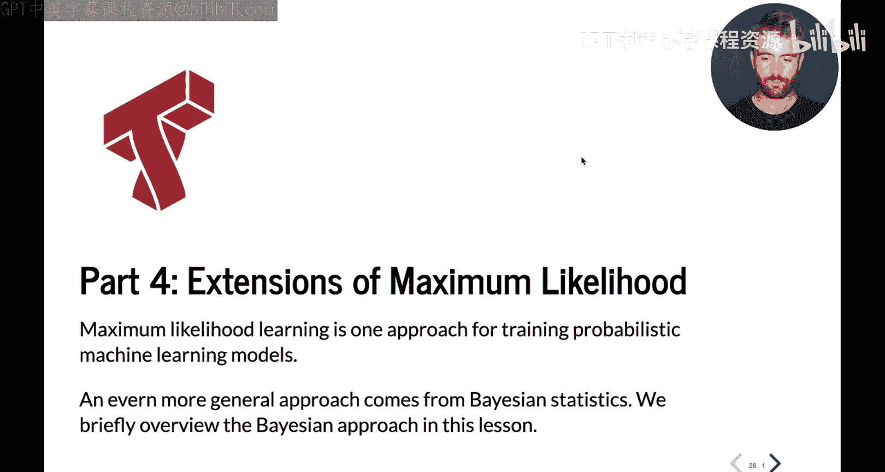

在本节课中，我们将继续探讨最大似然估计，并了解这一原理的一些重要扩展。我们将重点介绍统计学和机器学习中的一个核心思想——贝叶斯方法，并探讨其与频率主义方法的区别。最后，我们将学习一种实用的近似方法：最大后验估计。

---

## 频率主义方法回顾 🔄

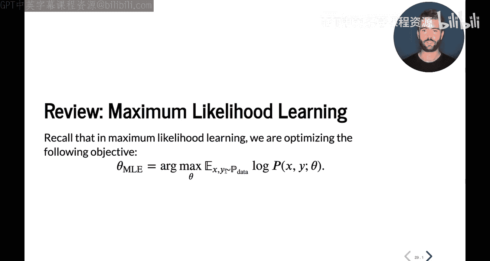

上一节我们介绍了最大似然估计。在最大似然学习中，我们优化以下目标：

我们有一个带参数 `θ` 的概率模型 `P`。最大似然为我们提供了一个目标函数，该函数可以通过最小化KL散度从第一性原理推导出来。目标函数如下：

**公式：**
`L(θ) = E_{(x,y) ~ D}[log P(x, y; θ)]`

在实践中，我们无法计算这个期望值，但可以使用蒙特卡洛估计来近似，即用从数据分布中抽取的样本的平均值来代替。因此，模型会为来自数据分布的样本分配高概率。

这种训练概率模型的方法是**频率主义方法**的一个实例。频率主义思想的核心是：我们试图估计的参数 `θ` 是一个固定但未知的量。我们的目标就是去发现这个真实但未知的参数。

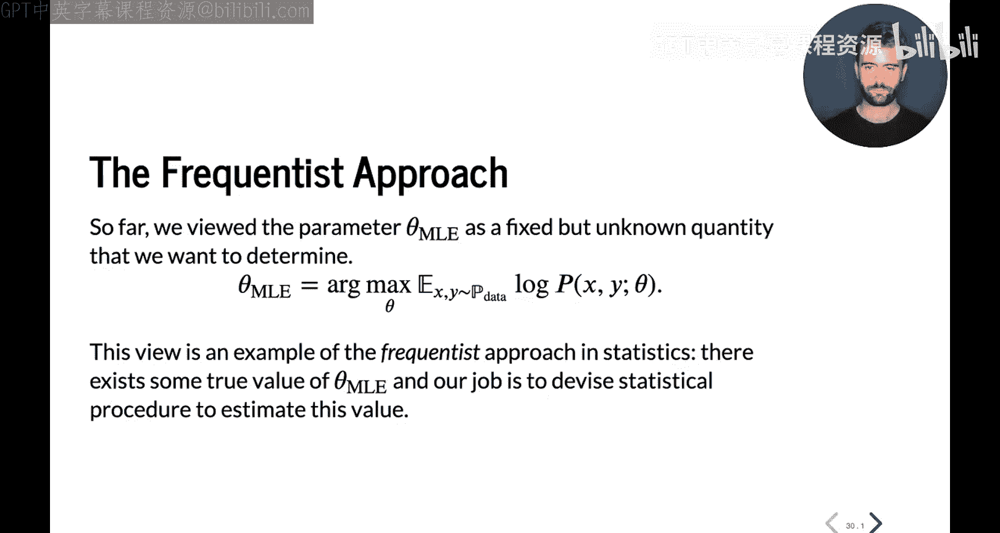

例如，考虑之前视频中抛硬币的场景。硬币有一个未知的偏差（偏向正面或反面的程度）。我们观察到大量抛掷结果，这些结果来自一个真实的数据分布。最大似然估计就是一种推断这个未知但固定参数的统计程序。

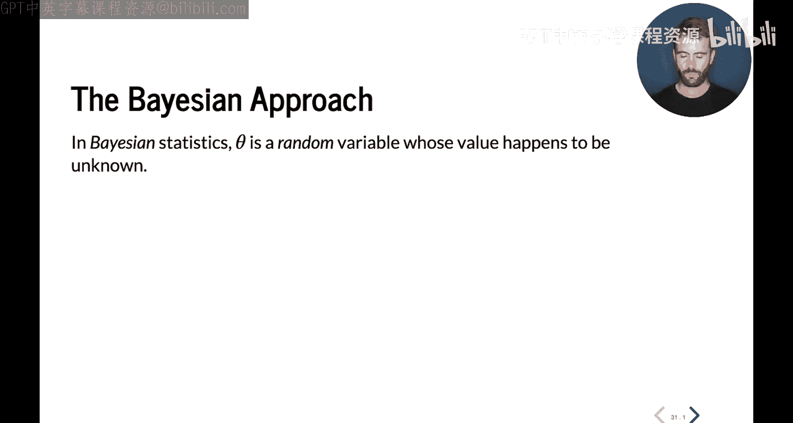

---

## 贝叶斯方法介绍 🎲

与频率主义方法形成对比的是**贝叶斯方法**。在贝叶斯方法中，我们将要推断的参数 `θ` 本身视为一个值未知的**随机变量**。

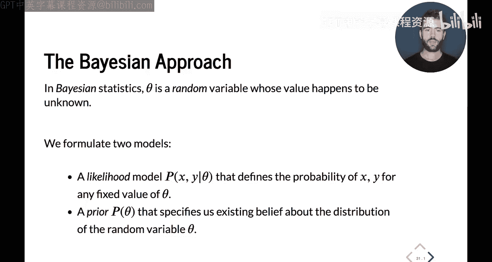

这是一个非常有趣的想法。为了进行贝叶斯统计，我们将定义 `X`、`Y` 和 `θ` 的联合分布。这需要定义两个组成部分：

1.  **似然**：这是在给定参数 `θ` 的某个赋值下，`X` 和 `Y` 的概率。即 `P(x, y | θ)`。这与我们之前使用的概率分布相同。
2.  **先验**：这是为 `θ` 的不同值分配概率的分布，即 `P(θ)`。直观上，先验指定了我们在看到任何数据之前对 `θ` 的信念。

通过这两个部分，我们可以定义 `X`、`Y` 和 `θ` 的联合分布：`P(x, y, θ) = P(x, y | θ) * P(θ)`。这里需要强调的是，`θ` 现在和 `X`、`Y` 一样是一个随机量。

理解这一点可能需要一些哲学思考。一种理解方式是，将 `θ` 的概率分布视为我们对其真实值的**信念**。不同的 `θ` 值根据我们的先验信念和观察到的数据，被赋予了不同的可信度。

---

## 贝叶斯推断与预测 🔮

在频率统计中，我们推断一个能很好解释数据的 `θ` 值。但在贝叶斯方法中，由于 `θ` 是随机变量，我们应考虑在给定数据集 `D` 下 `θ` 的概率分布，即**后验分布**。

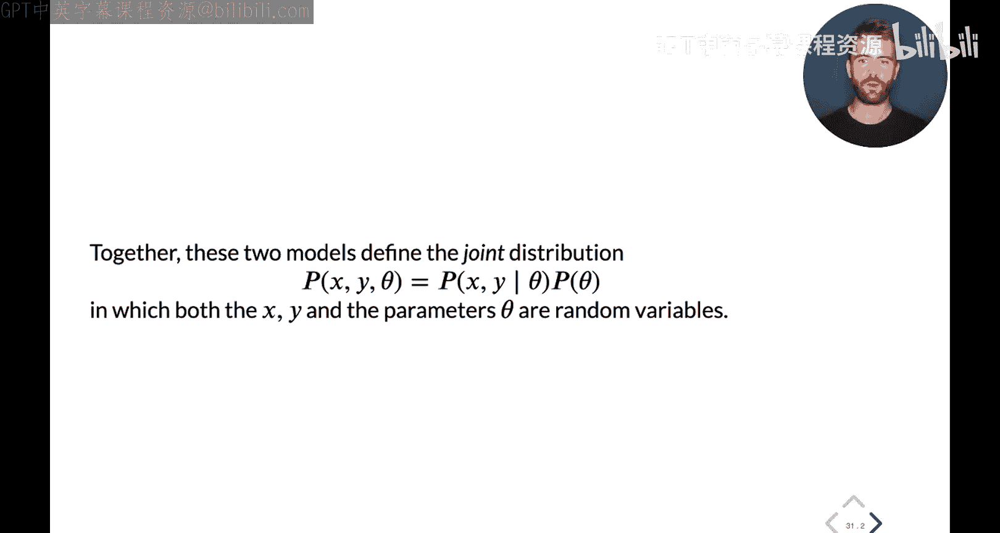

**公式：**
`P(θ | D) = P(D | θ) * P(θ) / P(D)`

其中，`P(D) = ∫ P(D | θ) * P(θ) dθ`（对所有可能的 `θ` 积分）。这个表达式原则上是可以计算的，因为 `P(D | θ)` 是我们的似然函数，`P(θ)` 是先验分布。

那么，在这个框架下，我们如何对新的 `X` 预测 `Y` 呢？与频率主义不同，我们没有一个单一的 `θ` 估计值，而是有一个完整的分布。

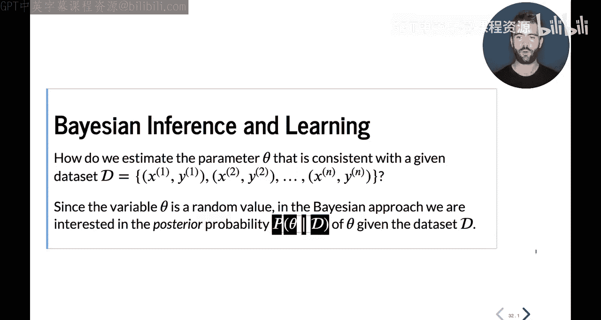

**公式：**
`P(y | x, D) = ∫ P(y | x, θ) * P(θ | D) dθ`

这个表达式利用了全概率定律。左边的 `P(y | x, D)` 被称为**后验预测分布**。其思想是，我们考虑所有可能的参数集（例如，所有可能拟合数据的直线或曲线），根据它们在给定数据下的概率对每条曲线进行加权，最终的预测输出是所有模型的加权平均“投票”。

---

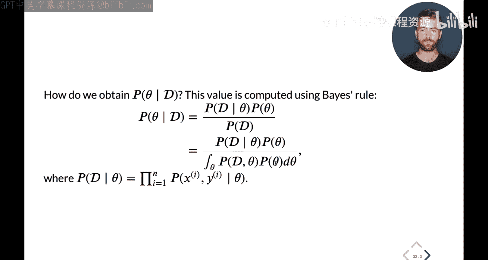

## 贝叶斯方法的优势与挑战 ⚖️

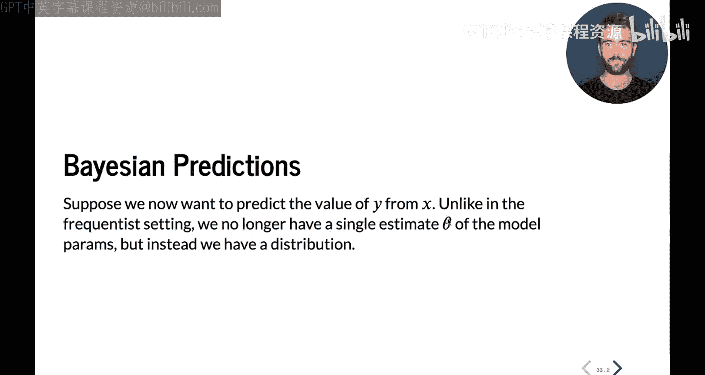

贝叶斯方法非常强大，原因如下：

*   **不确定性估计**：我们不仅能预测 `Y` 的单一值，还能预测一个分布。这个分布不仅考虑了预测本身的不确定性，还考虑了模型本身的不确定性，因此通常被认为是更高质量的不确定性估计。
*   **融入先验知识**：通过先验分布 `P(θ)`，我们可以将关于问题的已有知识以原则性的方式纳入统计过程。
*   **统一的建模框架**：它为创建、构建和推理概率模型提供了一个通用框架。

然而，贝叶斯方法的主要缺点是**计算复杂性**。计算对所有可能模型的平均积分通常非常困难，在几乎所有有趣的应用中都无法精确计算。

因此，贝叶斯统计和贝叶斯机器学习的一个重要部分就是为这些贝叶斯量寻找良好、准确且可处理的近似方法。

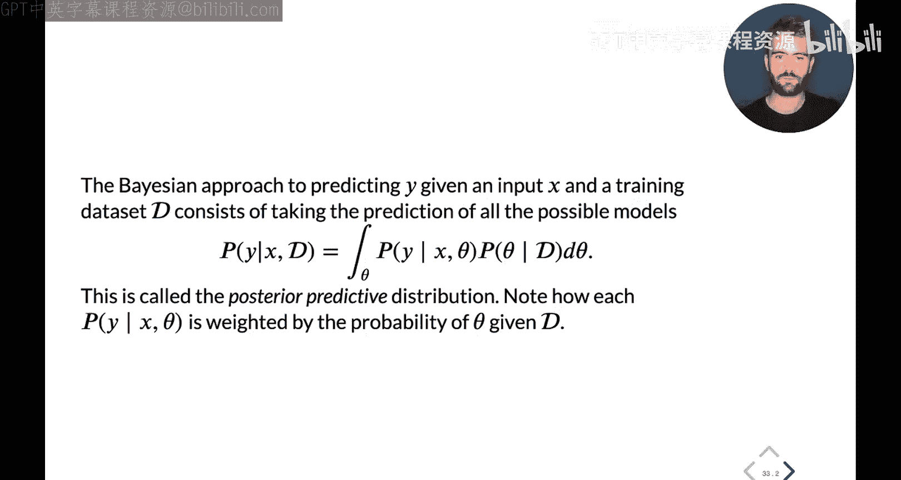

---

## 最大后验估计：一种实用的近似 🛠️

在本视频的剩余部分，我们将重点介绍一种贝叶斯学习的近似方法，称为**最大后验估计**。

由于计算完整的参数后验分布 `P(θ | D)` 非常困难，MAP学习的想法是，用后验分布中**最可能**的那个单一参数值来近似整个分布。

换句话说，我们计算一个估计值 `θ_MAP`：

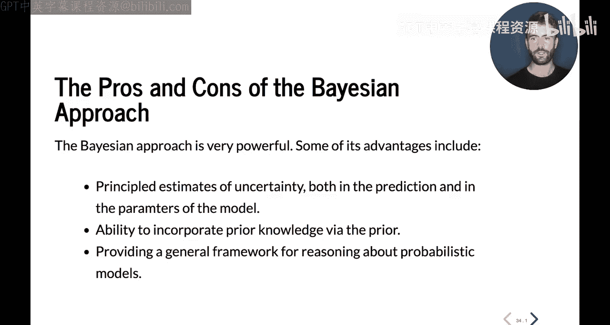

**公式：**
`θ_MAP = argmax_θ P(θ | D)`

然后，在进行预测时，我们不再对所有可能的参数取平均，而是仅使用这个单一的MAP估计值来近似。

如何计算这个参数呢？我们可以再次应用贝叶斯规则：

**公式：**
`P(θ | D) ∝ P(D | θ) * P(θ)`

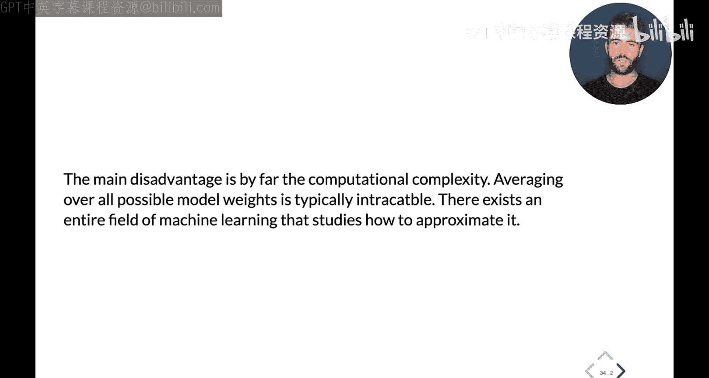

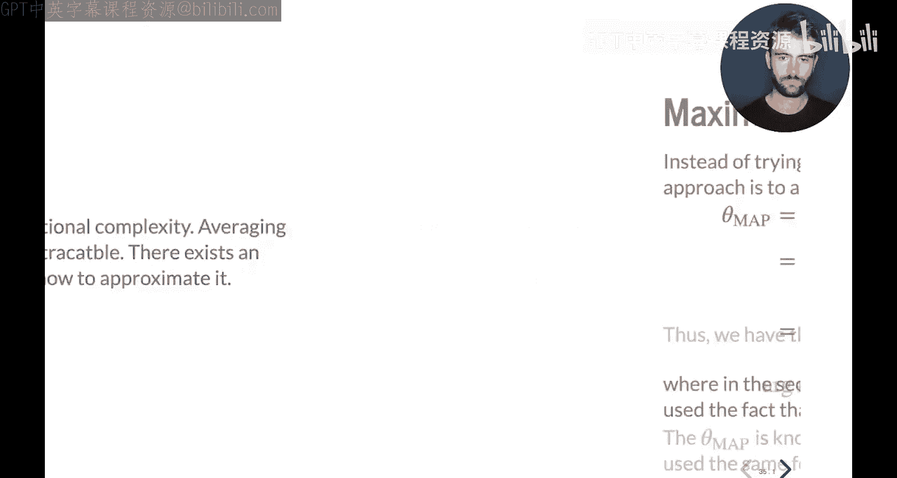

其中，`P(D)` 是与 `θ` 无关的常数，可以忽略。因此，MAP估计是以下目标函数的最大化者：

**公式：**
`θ_MAP = argmax_θ [ log P(D | θ) + log P(θ) ]`

观察这个公式，MAP目标函数对应于我们常规的对数似然 `log P(D | θ)`，加上一个来自先验 `log P(θ)` 的额外项。因此，MAP估计试图在**根据似然很好拟合数据**和**尊重我们先验信念**之间取得平衡。

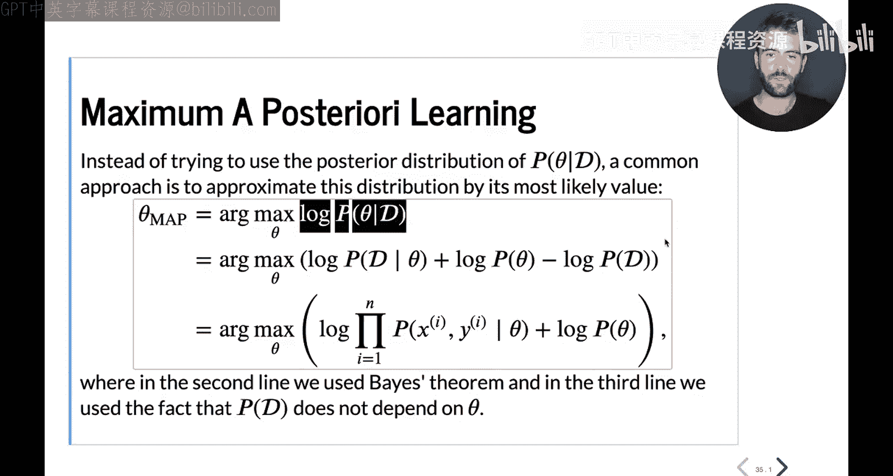

在实践中，MAP估计是一种非常常见、强大且实用的近似贝叶斯推断的方法。许多常见的机器学习算法都是MAP估计的特例。

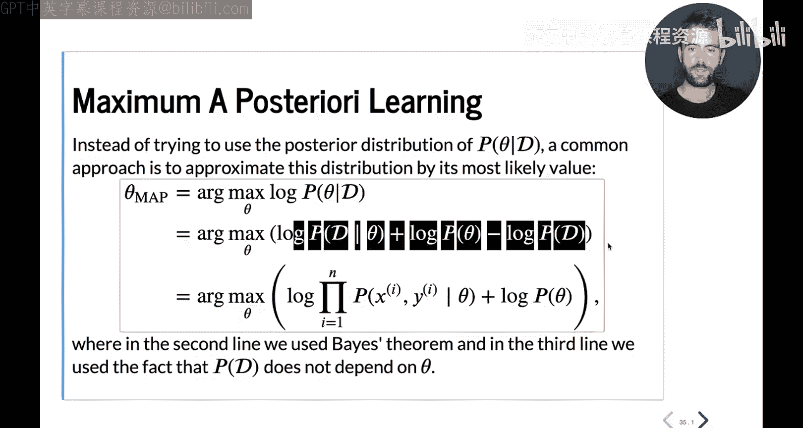

---

## 示例：抛硬币的MAP估计 🪙

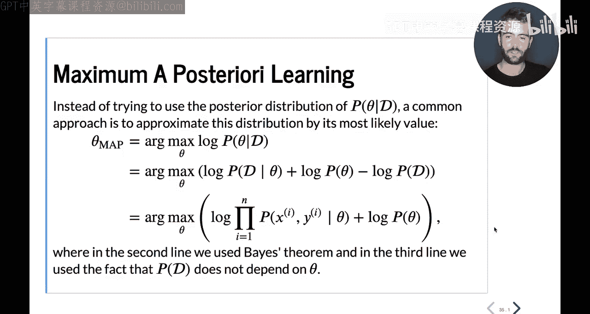

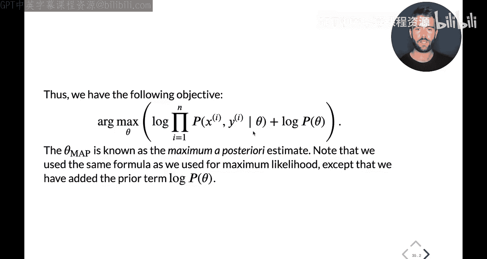

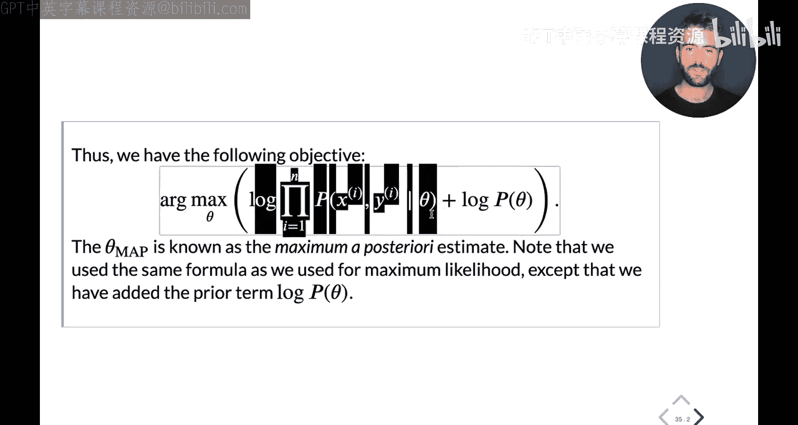

让我们看一个在抛硬币情境下MAP估计的简单例子。我们假设与之前相同的模型和数据集。

**数据**：三次正面，两次反面。
**模型**：`P(Heads) = θ`, `P(Tails) = 1 - θ`。

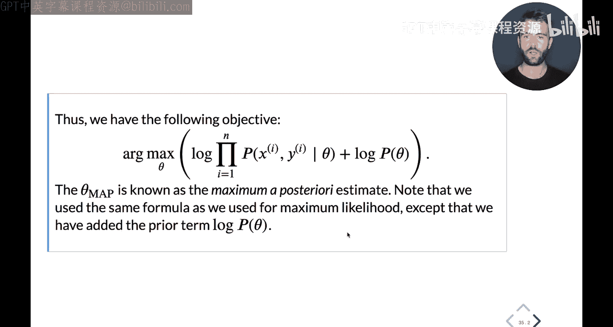

此外，我们为 `θ` 的先验假设一个特定的分布——**Beta分布**：`P(θ) ∝ θ^(α-1) * (1-θ)^(β-1)`。`α` 和 `β` 是Beta分布的参数（超参数），我们可以根据先验知识来选择它们。

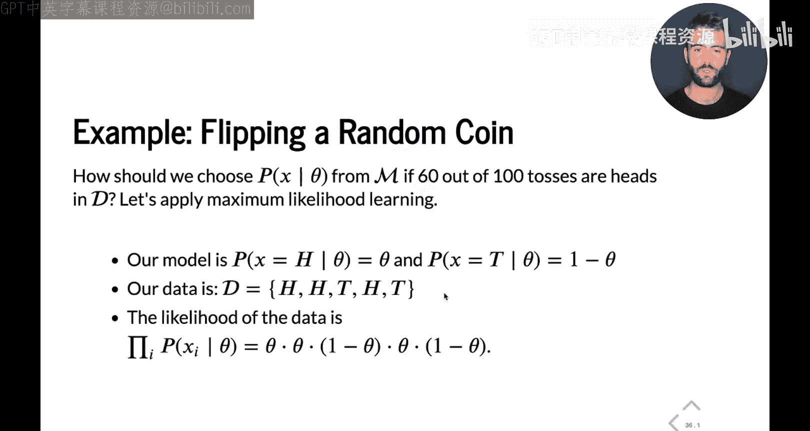

现在，我们可以计算MAP目标。似然部分为 `P(D | θ) = θ^3 * (1-θ)^2`。先验部分为 `P(θ) ∝ θ^(α-1) * (1-θ)^(β-1)`。因此，联合分布正比于：
`P(D | θ) * P(θ) ∝ θ^(3+α-1) * (1-θ)^(2+β-1) = θ^(α+2) * (1-θ)^(β+1)`

取对数后，对数后验为：
`log P(θ | D) ∝ (α+2) * log θ + (β+1) * log (1-θ)`

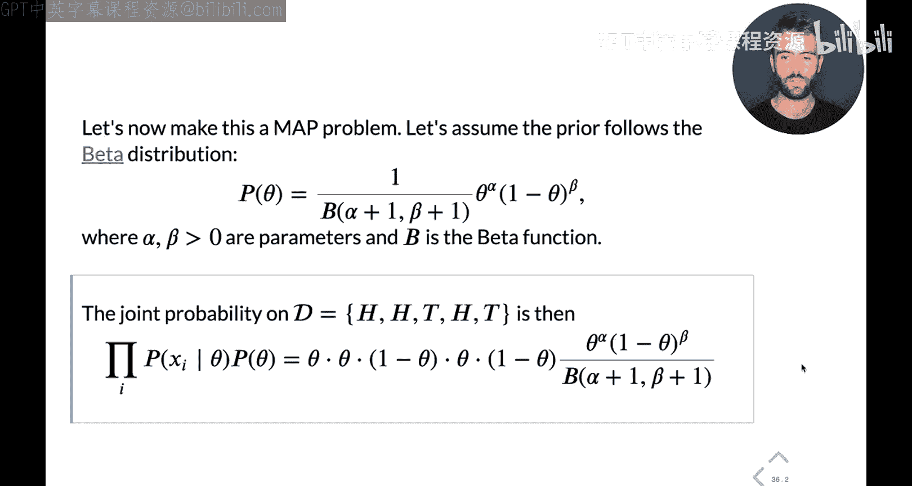

通过求导并设为零（与最大似然类似），我们得到MAP估计：

**公式：**
`θ_MAP = (α + 3) / (α + β + 5)`

让我们仔细看看这个结果。现在，我们对正面概率的估计不再是简单的“正面次数/总投掷次数”（即3/5=0.6）。我们额外加上了参数 `α` 和 `β`。

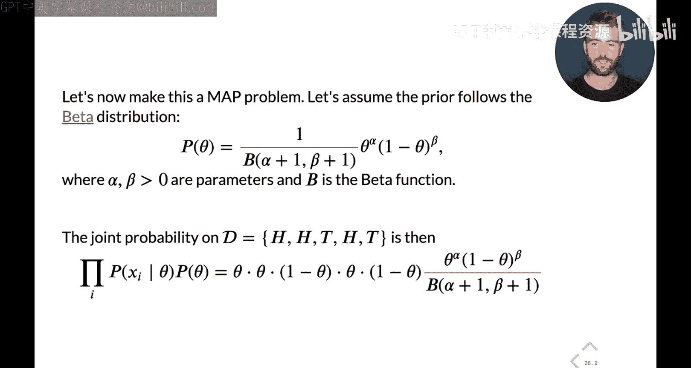

你可以将 `α` 和 `β` 理解为虚拟的正面和反面计数。例如，如果我们设 `α = 10`，`β = 20`，那就相当于我们在看到实际数据之前，已经看到了10个虚拟正面和20个虚拟反面。然后在这个基础上计算似然。

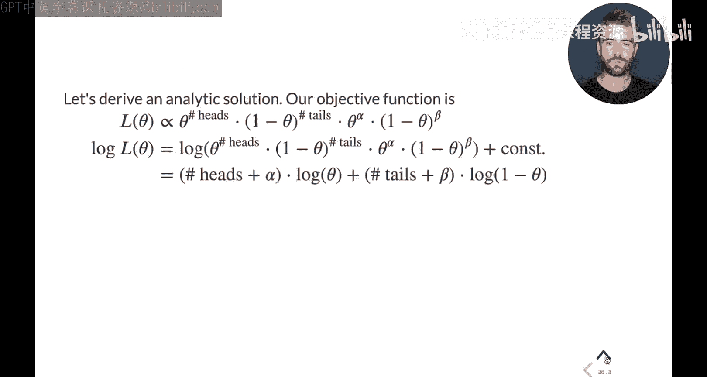

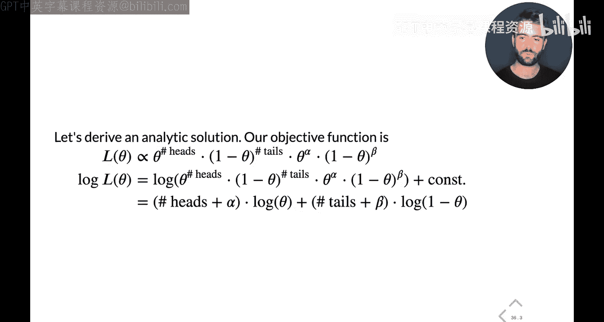

这是一个通过设置特定先验来修改估计过程，并将先验知识（这里解释为虚拟计数）注入模型的例子。

**具体演示**：
*   如果我们设 `α = 1`, `β = 1`（一个常见的无信息先验），则 `θ_MAP = (1+3)/(1+1+5) = 4/7 ≈ 0.57`。尽管数据中正面占60%，但MAP估计更接近0.5，因为先验倾向于认为硬币是公平的，并且我们数据量很小（仅5次投掷）。
*   如果我们设 `α = 10`, `β = 10`（强烈的先验信念认为硬币公平），则 `θ_MAP = (10+3)/(10+10+5) = 13/25 = 0.52`，更加接近0.5。
*   如果我们设 `α = 0`, `β = 0`（退化为最大似然），则 `θ_MAP = 3/5 = 0.6`。

这展示了如何通过贝叶斯或MAP方法，利用先验知识来影响估计结果。

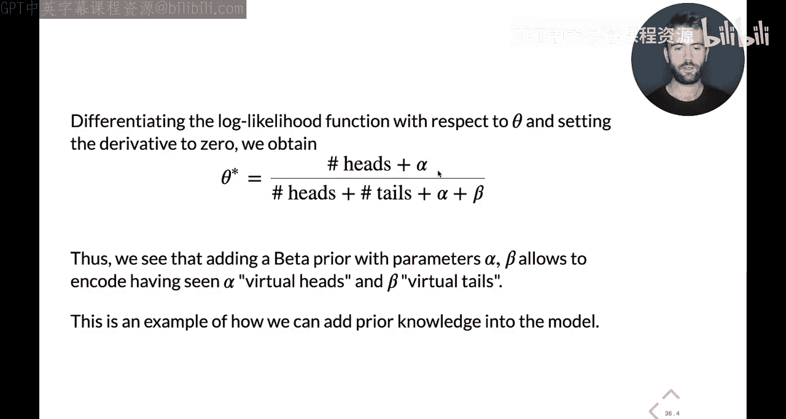

---

## 总结 📝

本节课中，我们一起学习了最大似然原理的重要扩展：

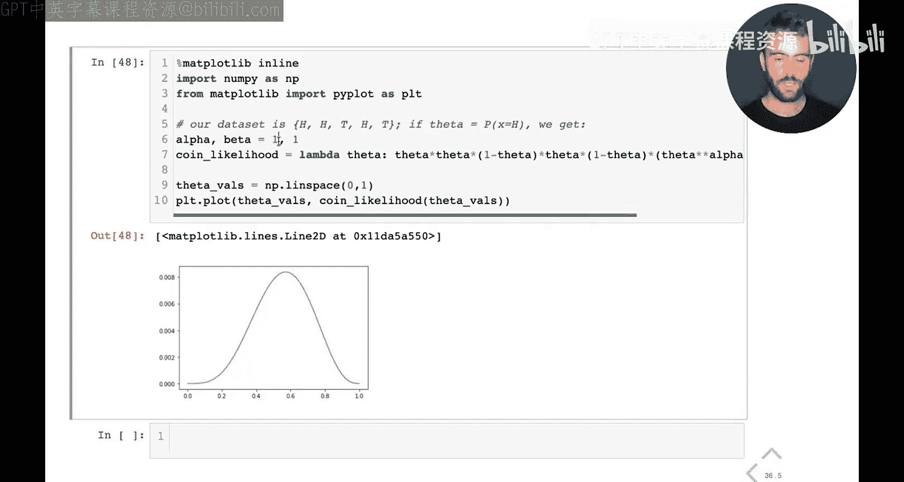

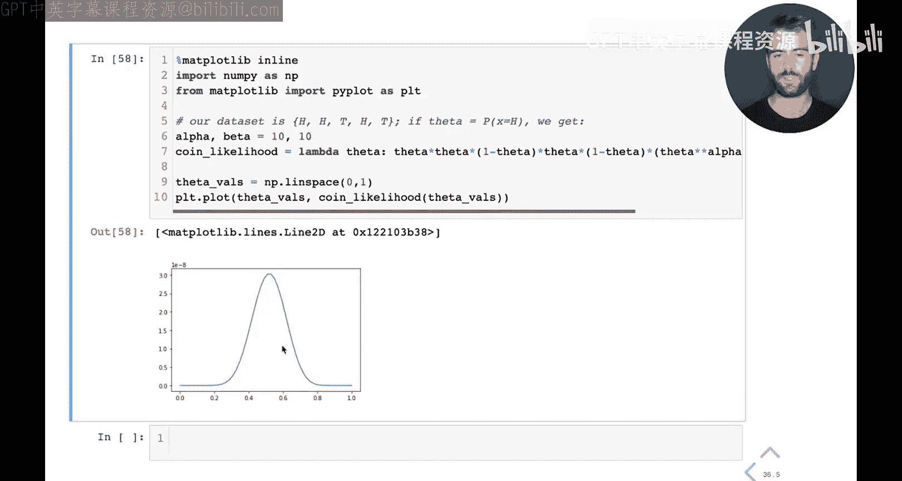

1.  我们回顾了**频率主义方法**，其将模型参数视为固定但未知的量，目标是通过数据估计其值。
2.  我们引入了**贝叶斯方法**，其核心创新是将模型参数本身视为随机变量，并通过先验分布和后验分布来描述我们对参数的不确定性。
3.  我们探讨了贝叶斯方法的优势（如不确定性估计、融入先验知识）和主要挑战（计算复杂）。
4.  为了应对计算挑战，我们学习了一种实用的近似方法——**最大后验估计**。MAP通过寻找后验分布中概率最大的参数值，在数据似然和先验信念之间进行权衡，是连接频率主义和贝叶斯思想的桥梁。
5.  最后，我们通过一个抛硬币的实例，具体演示了如何计算和应用MAP估计，并解释了先验参数（如Beta分布中的 `α`, `β`）的直观含义。

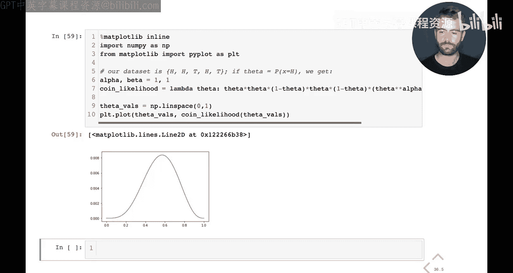

在下一讲中，我们将看到MAP原理在一些我们已经熟悉的算法中的应用。