# 康奈尔大学《应用机器学习 CS 5787_ Applied Machine Learning 2020》中英字幕（deepseek p21 -21-Lecture 5b. Part 1_ Probabilistic Linear Regression.zh_en -BV12udzYvEFM_p21-

。

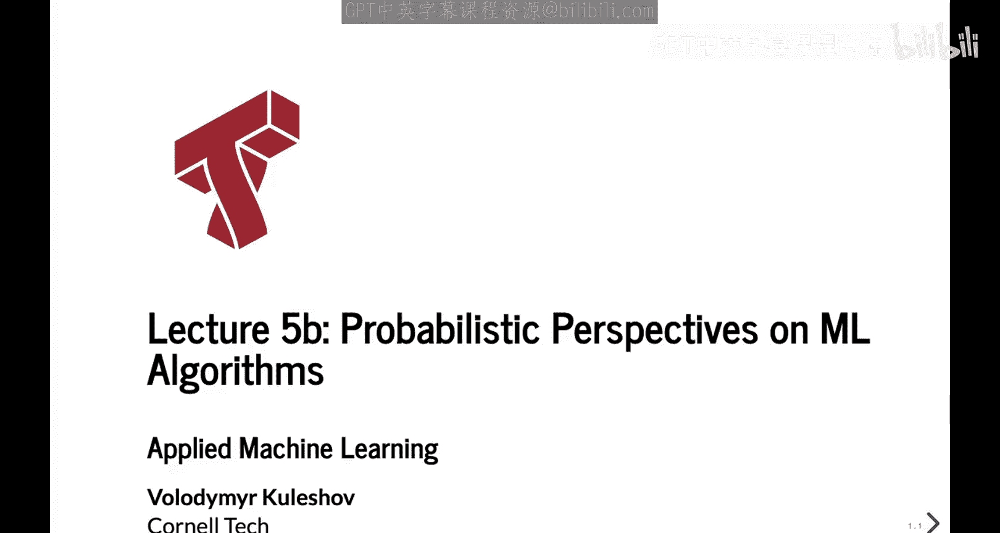

Welcome back to Applied Maine learninging。In this lecture。

 we're going to continue talking about machine learning algorithms from a probabilistic perspective。

Recall that in the previous lecture， we saw how we can formulate machine learning algorithms as fitting a probabilistic model to the data。

 and this is a model that mimics the data distribution from which our data set is generated。

In this lecture， we're going to continue the discussion that we started in lecture 5。

And we're going to see some specific examples of probabilistic machine learning algorithms。

And this lecture is going to be very similar to the previous one。

 which is why I'm calling it lecture 5B， and you can think of this as being additional extra material that's closely related to lecture 5 and。

It will both make the material in lecture 5 more concrete。

 and we're also going to see a lot of the algorithms that we saw earlier are actually special cases of the probabilistic approach to machine learning。

So you can think of lecture 5 and this lecture， lecture 5 B are being very close together and being continuations of the same theme。

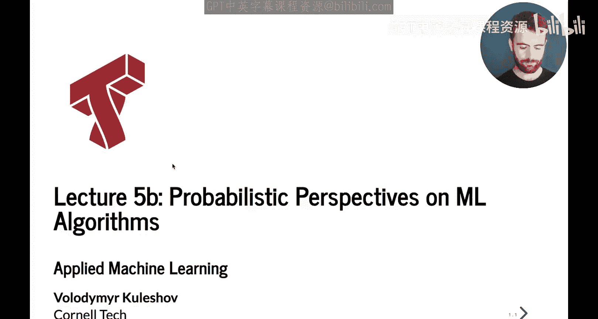

So in the first part of this lecture， I want to again go back to our discussion of linear regression and then combine this with what we saw of probabilistic models to define a new probabilistic perspective on the linear regression algorithms that we've been working with so far。

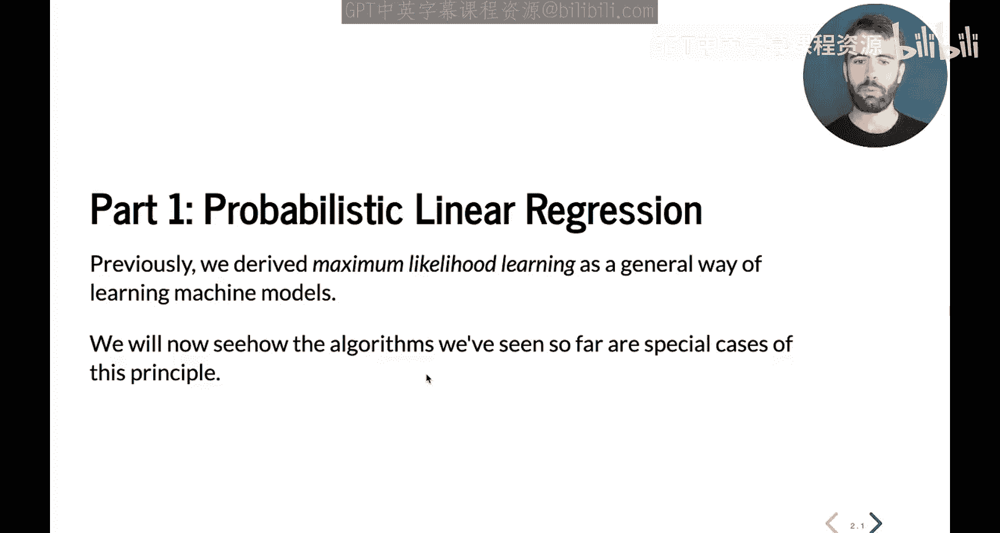

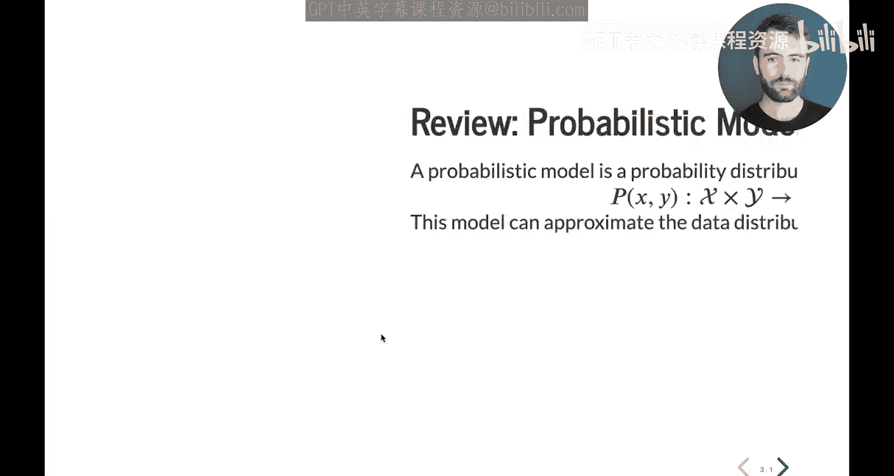

So recall that in the previous set of videos， we defined what was a probabilistic model。

And you can think of a probabilistic model as being a distribution over x and Y。

 and our goal is to approximate the true distribution over X Y， the data distribution with our model。

We can use a probabilistic model for supervised learning by transforming the joint into the conditional distribution using standard operations and probability。

And very often as in standard supervised learning， our probilistic models are going to be parameterized by a set of parameters theta。

 and in that case I will denote the probability here with a subscript theta。

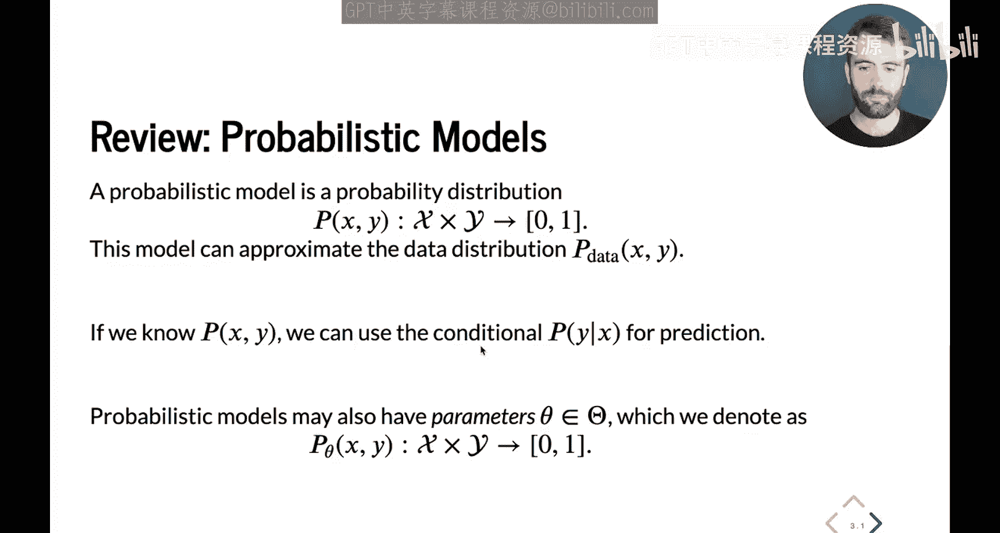

Now， we can train。Probabilistic models using the principle of conditional maximum likelihood so first we can define a joint model of this form or we can define also a conditional model of this form they are closely related to each other via probability transformations and so in many cases if we're only interested in supervised learning we can fit models of this form and we can use a training objective for models of this form directly and in that case the objective that we would normally want to use is the following which is the principle of conditional this is an objective from which we can derive the principle of conditional maximum likelihood。

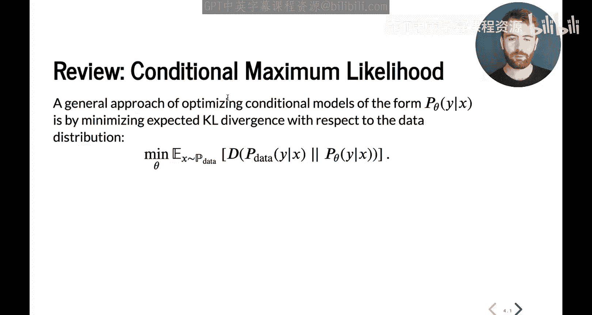

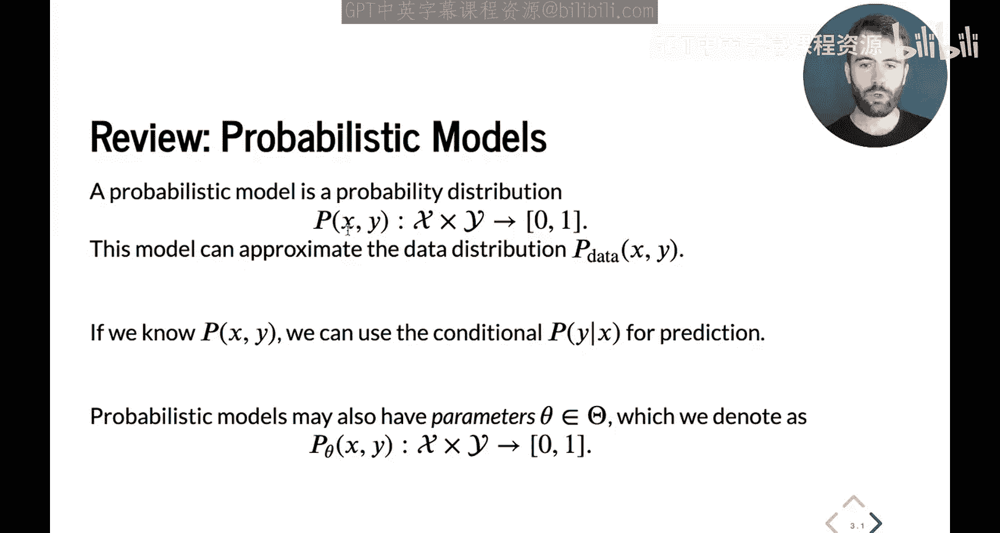

So here in this objective， we are looking at a divergence。

 specifically the KL divergence between the data distribution and the model distribution at a  point x and we're comparing its distribution over y given an x。

And our goal is to minimize the expected difference between these two functions where the expectation is taken over all the possible X that we can have。

So this is our。This is our definition of this is an extension of the KL divergence that we saw earlier and with a little bit of math in a way that's really similar to what we did in the previous set of videos。

 we can transform this objective into the following into this following simpler objective。

 which is the conditional maximum likelihood objective。And。

If you look at this a little bit more closely， we are training the model to maximize or training the model to put high probability on examples that come from the data distribution and。

And so our model will assign。High probabilities to samples that come from the data distribution。

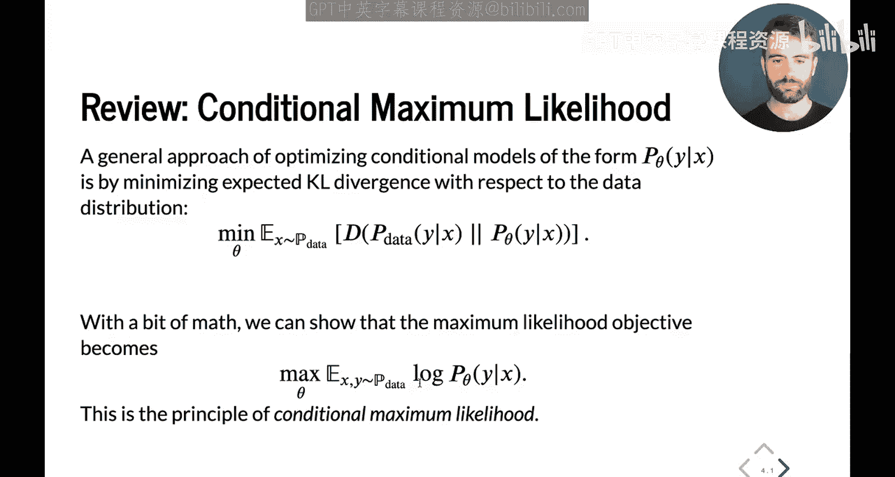

So this was our discussion of probabilistic modelsists。And in earlier lectures。

 we also saw several machine learning algorithms for linear regressiong。In particular。

 one of the first algorithms that we saw was called least squares。

And least squares is an algorithm that fits a linear model which has the following form here again。

 x is our input theta is our set of parameters， and our model is simply our model class is the set of linear models of this form where we are simply taking。

Awaited summation of all the。Attributes， input features or attributes X J。

And then we saw that we can optimize this model。Using the。The mean squared error objective。

Which has the following form。 So given a data set。Here actually this is the sum of squared errors and we are minimizing the sum of squared errors on this data set to minimize the difference between the prediction of the model。

 which is this term here and the actual prediction。

 the actual target that that's in our training set， which is this term here。

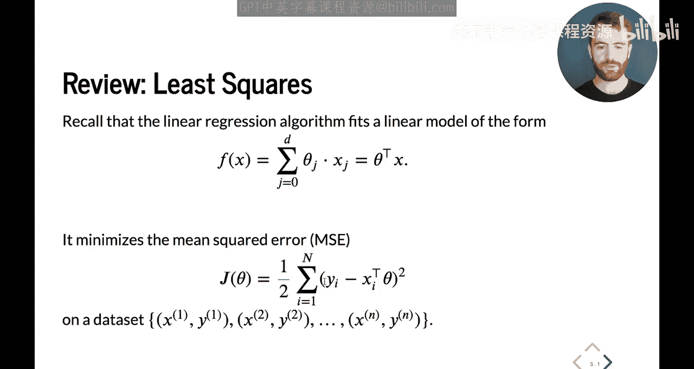

Now you may ask yourself the question whether there is a particular reason why we chose to optimize the mean squared error in least squares As you recall。

 we saw many different kinds of models we saw， for example， the L1 loss。

 which is an objective that we could also have used。

 we can also come up with many other objectives besides the ones that we saw earlier。

Really any sort of objective which encourages the targets and the predictions of the model to be similar can be used for supervised learning。

So why is it that we started with the mean squared error objective in the first place？Well。

 the answer to this question can be found by looking at this problem from a probabilistic perspective。

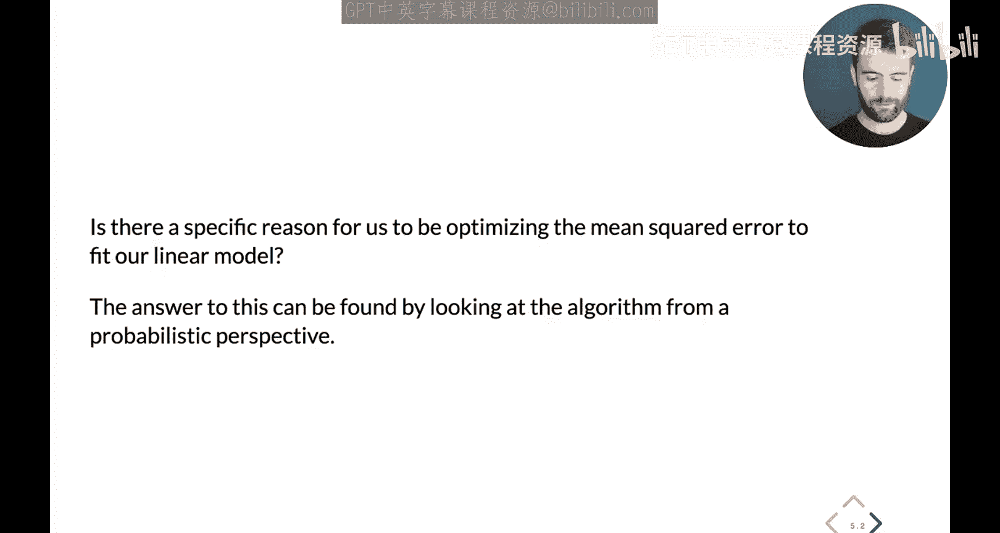

So let's now take a different angle to defining。To defining a supervised learning algorithm for an arbitrary supervised learning data set。

 let's try to derive an algorithm using our probabilistic approach that we saw earlier。

So recall that as in standard supervised learning in order to devise in order to define a machine。

 a supervised learning algorithm and also to define a probabilistic supervised learning algorithm。

 we have to define。A model class。An objective function。

 and we have to define a way of optimizing the subjective function。

 and together these three elements define a supervised learning algorithm。

 and also they define a supervised learning algorithm if we define these if our model is probabilistic。

So let me propose here a particular model class objective and optimizer and see and let's look at the algorithm that comes out of that。

So for the model class， consider the following family of probability distributions。

Which are also parameterized by a set of parameters theta here。

And this is the set of Gaussian distributions in one dimension to make things simpler。

 let's consider distributions that are in that are one dimensional。

 So here why is going to be simply。Y is going to be a scalar。

 So we're doing regression and Y is a scalar。 So here this is a one dimensional Gaussian that is the distribution over y。

And it is conditioned on x and theta。So the probability of y given x of theta is a Gaussian。

 and the definition of the Gaussian is simply this equation here。

And you may notice here that this Gaussian has a particular variance given by sigma that is one of the two parameters that define a Gaussian。

 and then we also have a mean， but this mean here happens to be a function of theta and x。

So essentially what this formula is saying is that we make the assumption that this distribution here。

 this conditional distribution is a Gaussian that has this form。

That has aine and a variance or standard deviation here。

And the mean itself is actually a function of x on which we have conditioned as distribution。

And this term this mean here in mu is going to be a linear function of our parameters and inputs x。

So now if we plug in， if we substitute the mean for its definition here。

 then we have the following expression， this is just the mean。So essentially。

 what this is saying is that given an x， the distribution of y is some sort of Gaussian bell curve around this mean。

This is what this distribution is implying， and this is the assumption that we're making here。

So this defines our model class。Let's now define an objective。

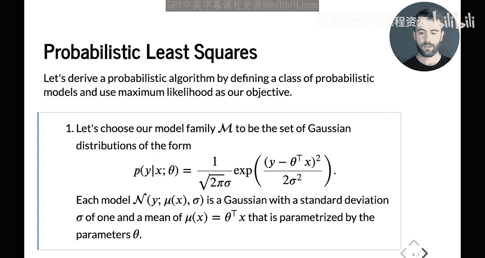

Well， if we follow the probabilistic approach to machine learning。

 we know that a natural objective for a probabilistic model is maximum log likelihood。

 or in our case， specifically conditional maximum log likelihood。

And so if we write the log likelihood function here， then we have the following。

 then this is it will take the following form， this is the objective that we want to minimize if again。

 we're minimizing the expected kL dirgs between the data distribution and our。

And our model and now substituting definition from the previous slide。

 we have the following expression。And now if I take the log and I perform some manipulations。

 we have an objective which looks like this。So here the constant， this includes the log term of this。

 and then the exponential and the log cancel and we only have this term that's left and everything else is a constant in a sense that it doesn't depend on theta。

And now you can see that what we have here， again， this is only for one data point Xy。

 but this is simply the squared loss that we had earlier that we were using for least squares。

And so the observation here is that the algorithm that we have just arrived。

 it it is simply a form of least squares， of course I haven't said how we can how we would minimize this loss。

 but since this is just the mean squared loss for，For a simple linear model。

 we can use any approach that we saw earlier such as gradient descent or the normal equations to optimize this loss。

 so now we have defined a probabilistic algorithm that happens to be equivalent to fitting a linear model using least squares。

Essentially， we have read derivedd least squares， but from a probabilistic perspective。

And so the answer to the earlier question that I posed。

 why do we use a mean squared error loss Well one reason why we're doing this is because it is what is natural。

 it's the algorithm that naturally comes out out of a few simple assumptions on our probabilistic model specifically we assuming that this is a Gaussian distribution or a normal distribution this means the same thing。

 this is a very natural assumption to make a normal distribution is one of the most basic and widely applicable and widely applicable。

Distributions and probability， and if we make this assumption。

 now we obtain our classical least squares algorithm。

So this is another justification for why at least squares make sense。

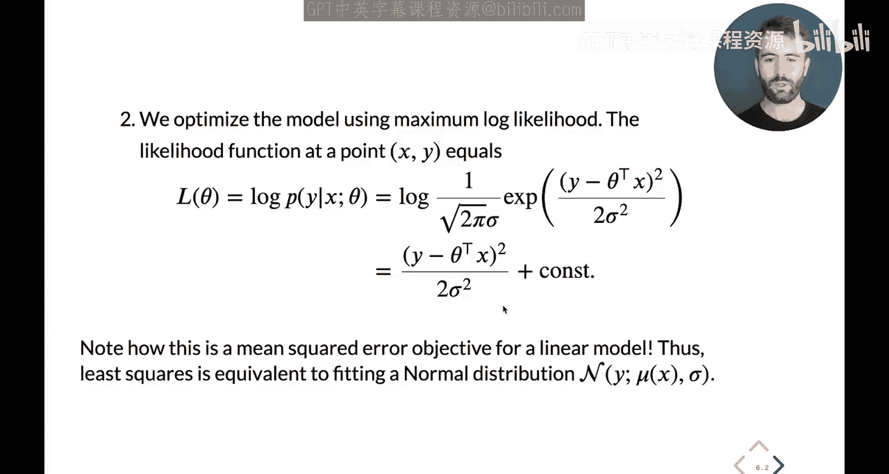

And so here I'm going to just redefine this algorithm and again this is the same here the first four lines are what we saw earlier。

 and now I have just added that this algorithm also happens to have a probabilistic interpretation。

 which is that of fitting a conditional Gaussian using maximum likelihood。

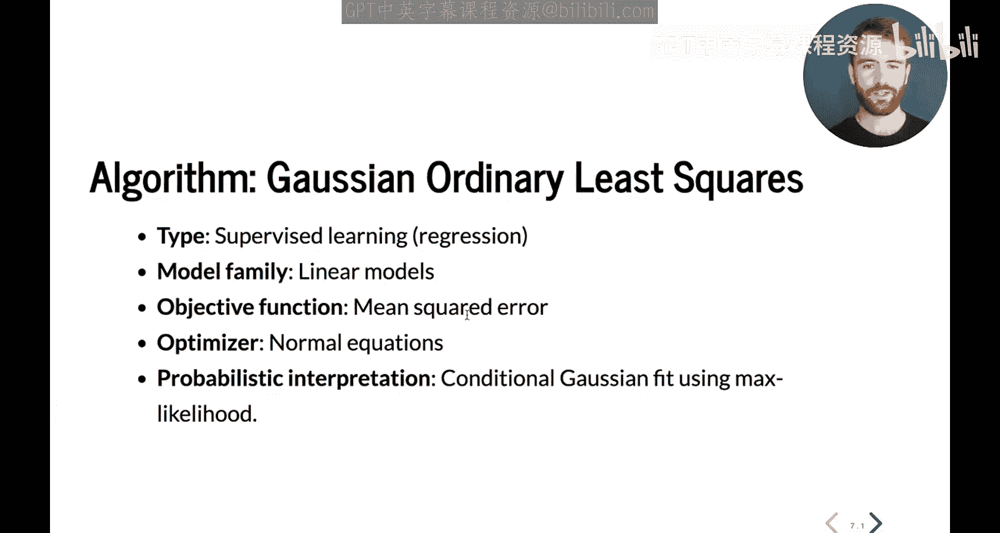

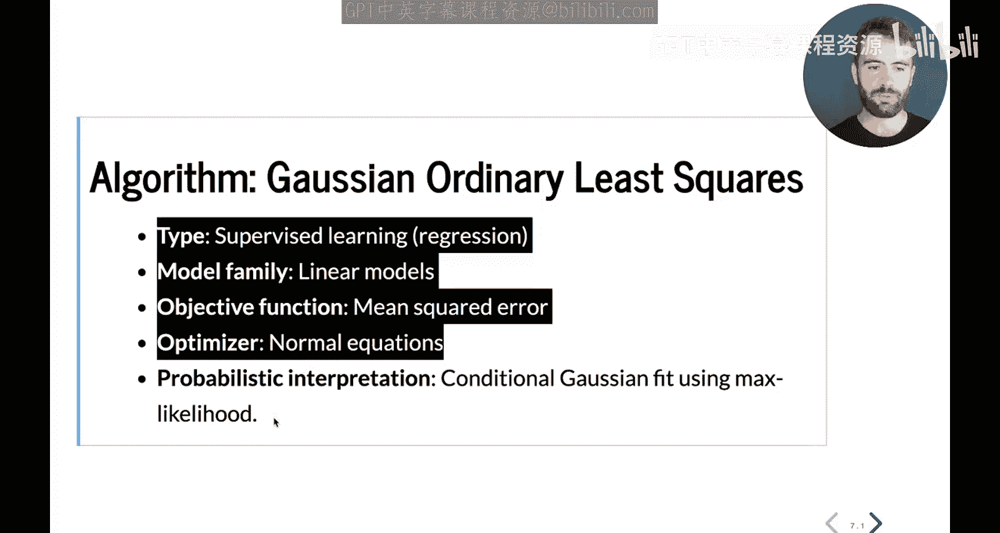

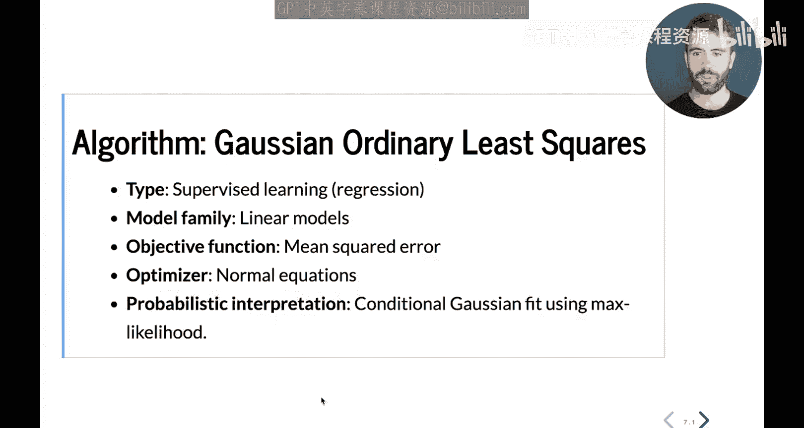

So。This is an example of how we can derive machine learning algorithms and nontri and we can derive very important machine learning algorithms using the probabilistic approach。

And also how least squares happens to be a special case of the probabilistic framework to deriv machine learning algorithms。

Now。Using the probabilistic approach， we can derive even more general algorithms than least squares。

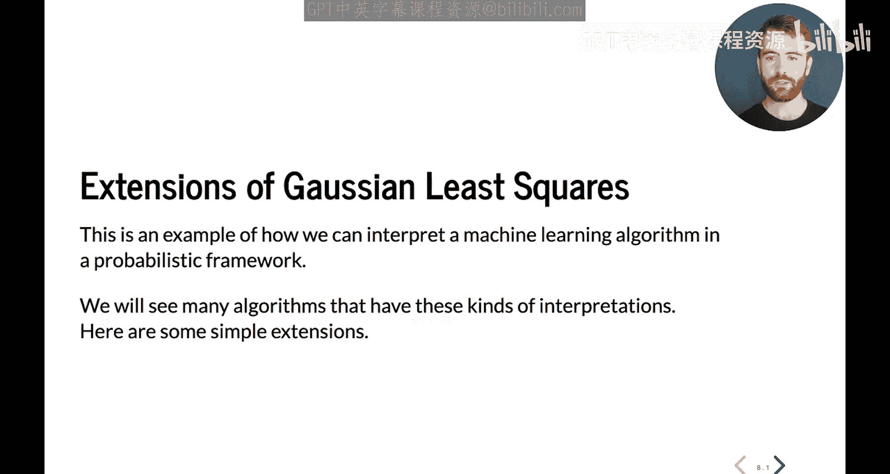

For example， one simple extension that we could do is we could also parameterize the standard deviation of our Gaussian distribution using a different set of parameters。

 and there are machine learning algorithms that do that。

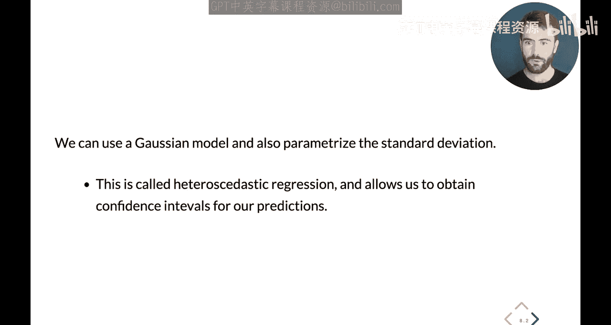

The resulting set of algorithms is something that's called heterochoastic regression that is a it's a very。

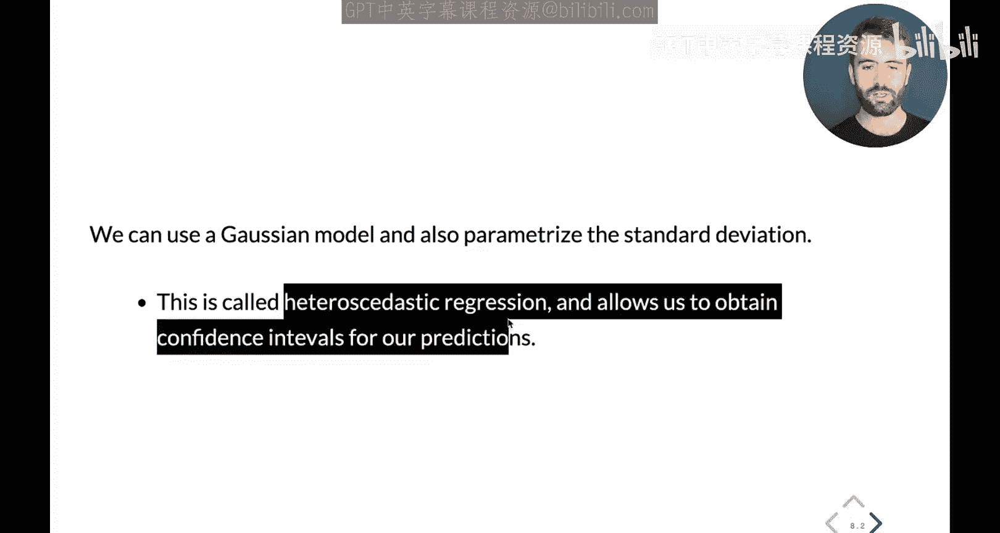

Llong and complicated word。 but essentially what this means is that。

Is that we are simply fitting a model to not just the mean。

 but also the variance of a Gaussian distribution。And this gives a probabilistic model that we can also interpret as giving us confidence intervals if we if we can choose the right theta for sorry if we can choose the right sigma。

 the standard deviation for a model， now we can predict a notion of confidence interval around the mean。

 this is a useful。This is a useful thing that we can do using a probabilistic machine learning model。

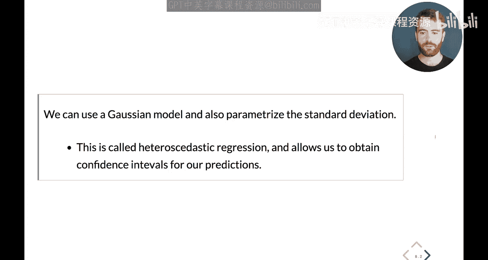

And also， we can parameterize many other distributions， not just the Gaussian。We can， for example。

 we can use distributions such as the exponential or the gamma and if our data happens to be better suited to these distributions。

 for example we got have a Poisson distribution as well。

 if if our data happens to be a set of counts， then we know that there are better distributions than the Gaussian for fittinging this distribution。

 for example the Poisson distribution might be a better approach here and we can parameterize the Poisson distribution with。

In the same way that we just parameterized the Gaussian distribution and now this can give us a specialized algorithm that's better suited to the kind of Poisson data that we might have and we can also do the same thing with discrete variables by parameterizing Bernoulli distribution in fact we're going to see shortly or we're going to see in the next several lectures examples of algorithms for discrete preclassification that are based on parameterizing the Berulli distribution and so this is。

Again， the high level message I want to convey here is that the probabilistic approach。

 it both motivates why the algorithms we've studied so far are interesting。

 and it can be used to derive new machine learning algorithms that are specialized to certain data sets that we might have。

In the next video， we're going to see a few more examples of this approach。

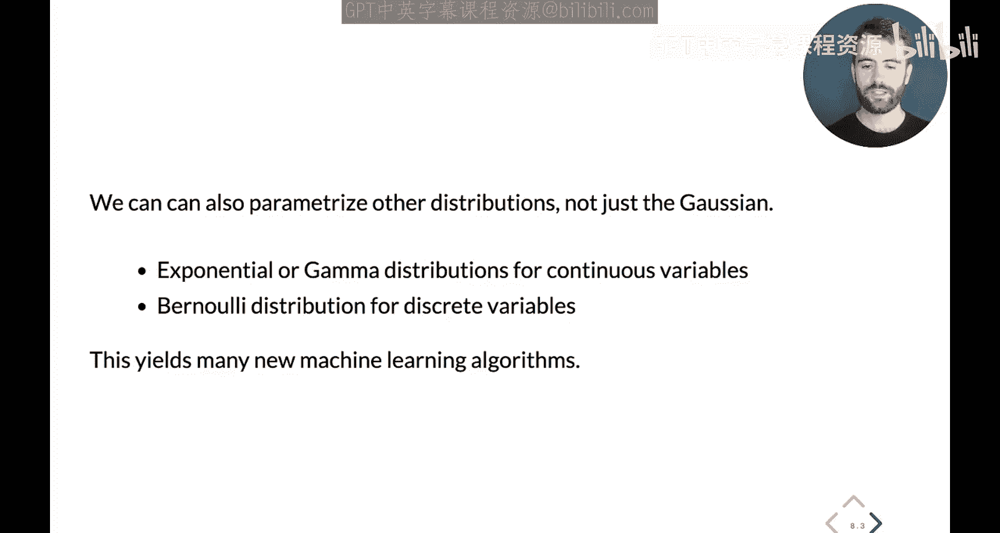