# 康奈尔大学《应用机器学习 CS 5787_ Applied Machine Learning 2020》中英字幕（deepseek p22 -22-Lecture 5b. Part 2_ Bayesian Algorithms.zh_en -BV12udzYvEFM_p22-

This is part two of Leture 5 B of Applied machine learning。In this lecture。

 I would like to continue our discussion of the probabilistic approach to machine learning。

And in this part of the lecture， I want to focus on the other kind of learning that we saw。

 which was the Bayesian approach to learning， and I would like to give you an example of a machine learning algorithm that we see before that can be derived from a Bayesian perspective。

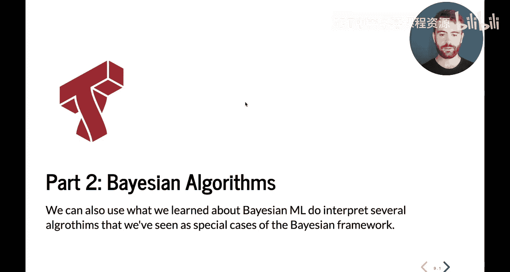

So recall that the Bayesian approach to machine learning consists in treating the set of parameters theta as a random variable whose value happens to be unknown。

This is in contrast to the frequentest approach where we have some true theta that we want to estimate。

 So， for example， if we're throwing coins， the the coin has the true probability of landing heads or tails and we want to estimate this。

 And in the Bayesian approach， there is a probability。

We define and we work with a probability that the bias of the coin takes a certain value that it's biased towards heads or tails by a certain amount。

And recall that in order to define a model that can be used within the Bayesian approach。

 we have to define two components， a likelihood model that has this form which defines a probability of our x and theta given over x and y given theta。

 this is the same kind of model that we worked with earlier。

 and then there's also a prior which specifies our existing belief。

 our pre-existing our initial belief about the distribution before we see any data。

And by multiplying these， we now form the so called joint distribution over all the variables and now we can。

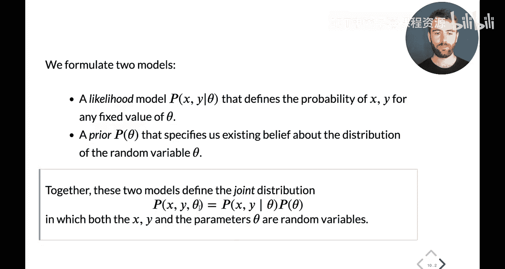

And then we have actually a probability over theta。

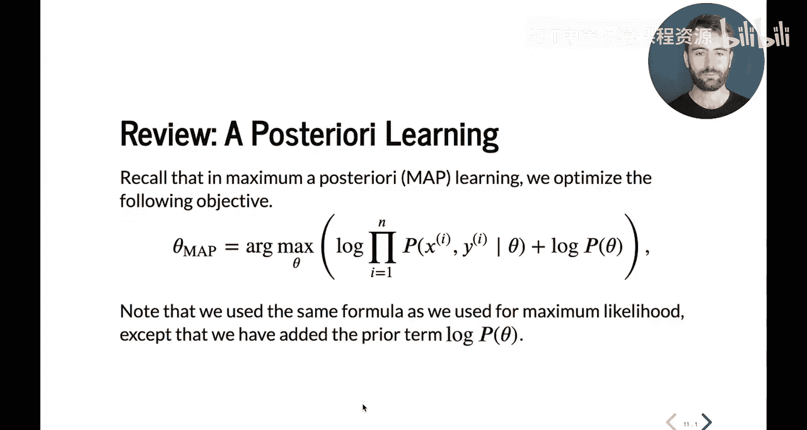

Now we also saw that the Bayesian approach is often in practice intractable。

 in order to apply the Bayesian approach， we have to take this joint probability and we have to transform it into another probability。

 which is called the posterior， which is the probability of theta given to data and doing these operations in practice is really expensive computationally and it's an intractable。

 it's a computationally intractable problem。

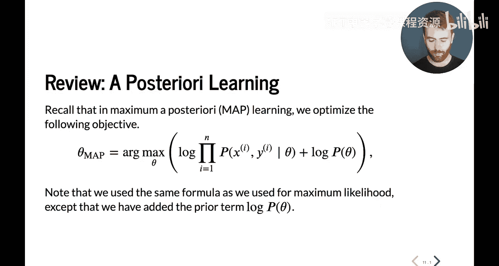

So in order to perform Bay learning， there are various approximation algorithms。

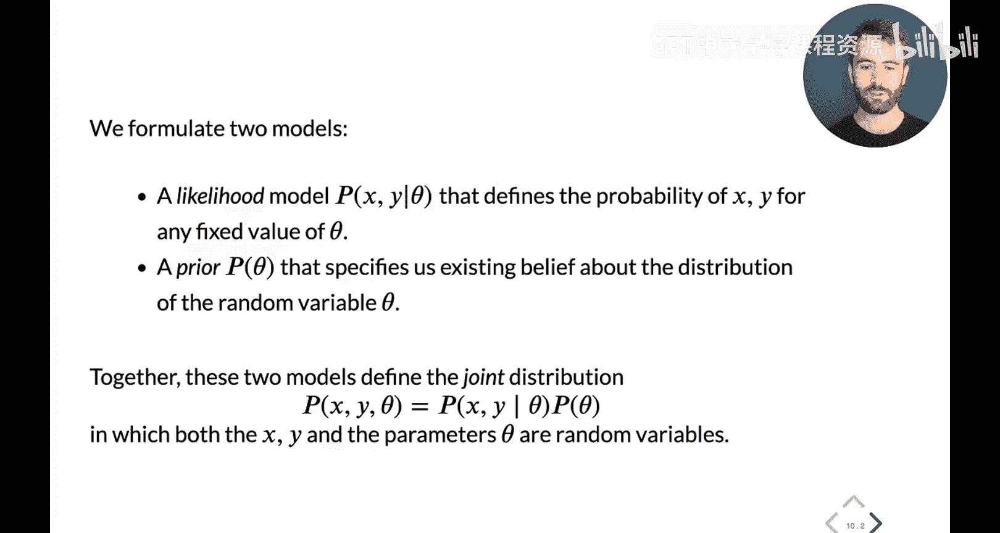

And we also saw in the previous lecture an approach which is called maximum Esteriary or MAP learning。

And this is an approximation to the fully Bayesian approach。In maximum a posterior learning。

 we are maximizing the following objective， which is our joint。

 but instead of looking at the full distribution of theta given the data。

 we're only trying to find the most likely value of theta under the joint model。Here。

 instead of looking at the full distribution。So I'm going to now focus on the MAP approach and I'm going to show how we can derive some of the existing of the earlier。

 some of the algorithms that we have seen earlier in this course as a special case of the MAP learning approach。

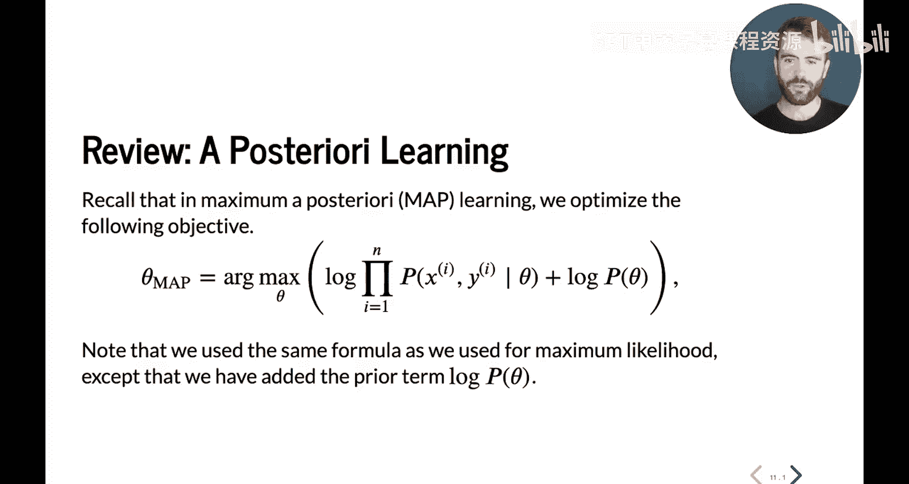

And the algorithm that I want to derive as a special case of the MAP approach is going to be Ri regression recall that in Ri regression we are fitting a linear model of this form。

Where we have inputs x and our estimate of the target theta is this linear model theta to product with x。

And the ridge model fits an L2 regularized mean squared error， which has this form。Here on this side。

 we have our mean squared error and on the on this side here， we have our regularizer。

 which is simply the L to norm of the parameter vector theta so by。By penalizing its L2 norm。

 were forcing this parameter theta to be small。Now let's look at how we can interpret wage regression as a special case of MAT estimation。

Again， the same way as we did in the previous video。

 we're going to define a probabilistic model from from the perspective of。

With the framework that we had earlier using the probabilistic approach。

 we will define a probabilistic model， we will define a model class。

 and we're going to apply the principle of maximum likelihood to obtain an objective。

And then we will see that this turns out to be a special case of re regressionion as well。Again。

 in terms of the model itself， we will use the same conditional Gausian。

 we will fit the conditional distribution of y given x and theta using the same Gaussian approach that we saw earlier。

Again， here， this is a Gaussian distribution of whose mean is parameterized by a linear function of x。

And then in order to apply the MAP approach， we also need to define a prior over theta。

 and we're going to assume that this is a Gaussian prior。With mean zero and a different variance tau。

 so this had a variance of sigma or variance of sigma squared。

 now the variance here will be tau squared。And it has mean zero。

 and it's a distribution over the parameters theta。

So just applying the definition of a Gaussian distribution， we have the following。

Expression for our prior。And now we can apply the maximum likelihood approach Oh sorry。

 we can apply the。The maximum a postiri approach to maximize the following objective functions is the log probability of our joint distribution。

 this is the log of our joint probability distribution。And now writing our set of our definition。

 we have the following form where I have simply plugged in the definitions that I used earlier。

And now I just simplify these terms by taking out these constants or these multiplicative constants because I'm taking the log。

 I。Put them into this additive constant term， and now the exponential cancels out with the log。

 and I have the following expression。So this is the same form that I had earlier。

 except that now I have this following extra， have this additional extra term theta thats。

That going's going to be added this particular to our mecor error objective。

And now you can see that this just happens to be our previous mean squared error approach where I have added a Gaussian prior with where we have added a Gaussian prior。

 and this Gaussian prior just corresponds to squaring the value of the parameter theta。

 so here I here theta is squared but if we have more than one parameter。

 then this is just going to be the sum of the squared parameters if theta is multidimensional then we have just a product of different distributions over of Gausian distributions over theta now and it will just become the sum of the thetas here。

So what we see here is Rige regressionion is also a special case of performing map estimation with a Gaussian prior in the same way that least squares was a special case of maximum likelihood。

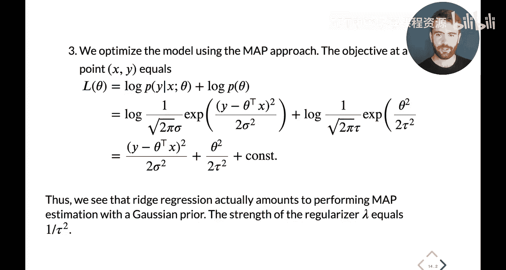

Under a similar model。Here let me again state this a little bit more precisely here I'm again them defining the Ri algorithm。

 which we saw earlier， and this is the same definition that we saw in our earlier video and now I have just added this probabilistic interpretation in that by fitting a rid least squares model is equivalent to fitting aal likelihood conditional a conditional Gaussian probability distribution using MA。

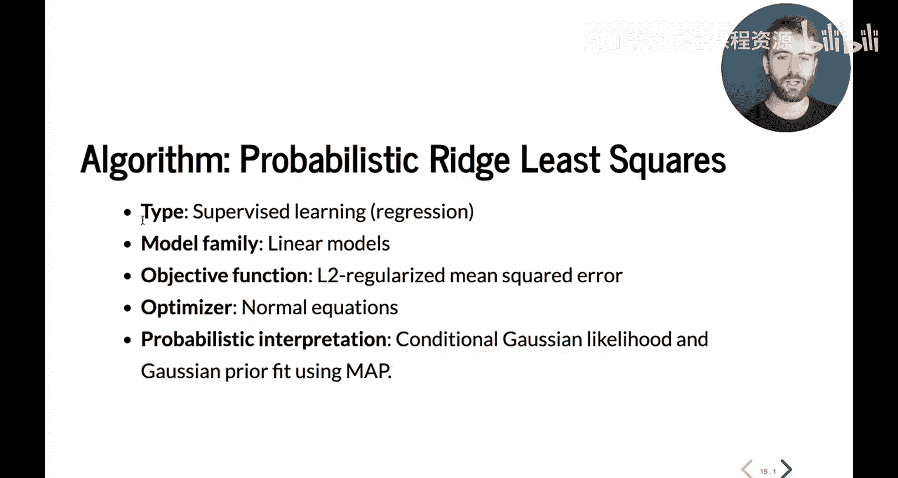

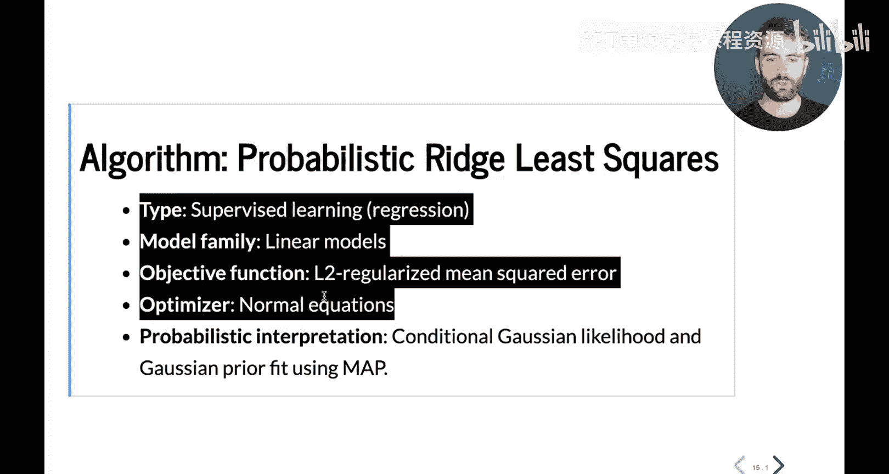

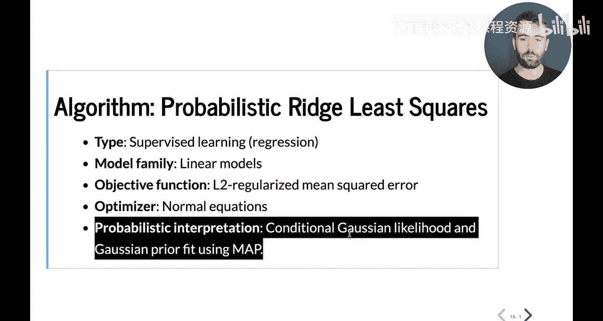

And in the same way that taking the probabilistic approach and using the principle of maximum likelihood gives us a wide range。

 it's a general way of de many machine learning algorithms and it's also a way of motivating and explaining why we're making certain choices for the algorithms that we saw earlier for standard machine learning algorithms。

 it helps explain motivate them in the same way that this was true for maximum likelihood learning。

 the same thing can be said for MAP learning or the Bayesian approach to machine learning of which I did not give an example but the same kind of examples hold as well。

And essentially， we can。We can both derive， we can both explain。

Classical machine learning algorithms using the Bayesian or MEP approach。

 and we can also derive new algorithms。So more generally。

 anytime we apply some sort of prior to the parameters of the model。

 it's very easy to interpret this as a form of regularization。

The intuition here is that we have prior knowledge。

 we have prior understanding that the weights of the model should be small。

 the weights of a good model are small， and so we encode this as a prior and we just happen to assume that this is a Gaussian prior centered at zero。

And by making this assumption that we have a prior。

 we naturally derive regularization from a probabilistic perspective。

 so you can think of this as another way of explaining and understanding regularization。For example。

 if we were to be using a1 regularization， then we could interpret this as using a la plus prior on the data。

 which is another probability distribution， so instead of assuming a Gaussian prior on the weights。

 we assume a la plus prior， we get back a1 regularization。

And many other algorithms will have similar interpretations。And so again。

 I would like to highlight in this lecture that the probabilistic invasion approaches are really powerful ways of thinking about machine learning models。

 explaining what machine learning models do， and also deriving new models and new algorithms。

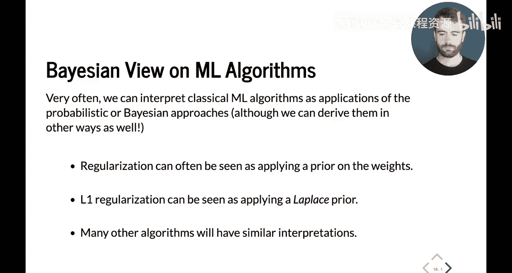