# 应用机器学习：第5讲B部分：贝叶斯算法（第二部分）🎯

在本节课中，我们将继续探讨机器学习的概率方法。本节将聚焦于贝叶斯学习方法，并通过一个具体示例，展示如何从贝叶斯视角推导出我们之前见过的机器学习算法。

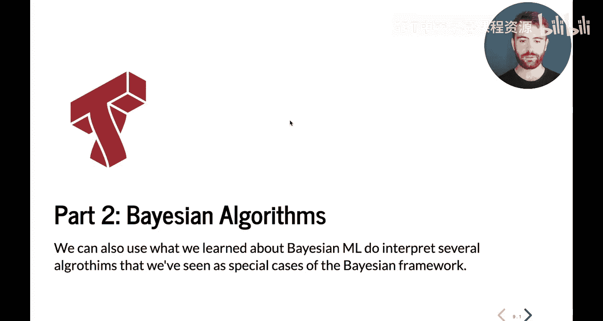

## 贝叶斯方法回顾

上一节我们介绍了频率主义方法，本节中我们来看看贝叶斯方法。贝叶斯方法将参数集θ视为一个随机变量，其值恰好未知。这与频率主义方法形成对比，后者假设存在一个真实的θ需要估计。

例如，在抛硬币场景中：
- 频率主义：硬币有真实的正面/反面概率，我们需要估计这个概率
- 贝叶斯方法：我们定义并处理硬币偏向某个值的概率

在贝叶斯方法中，我们需要定义两个组件：

1. **似然模型**：形式为P(x,y|θ)，这与我们之前使用的模型相同
2. **先验分布**：指定我们在看到任何数据之前对分布的初始信念

通过相乘这两个组件，我们形成所有变量的联合分布：

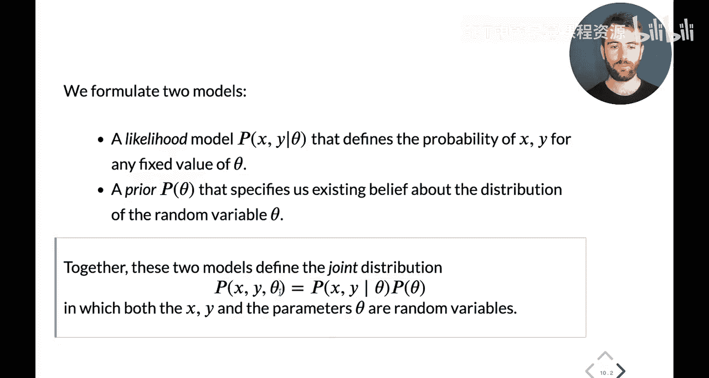

**P(θ,x,y) = P(θ) × P(x,y|θ)**

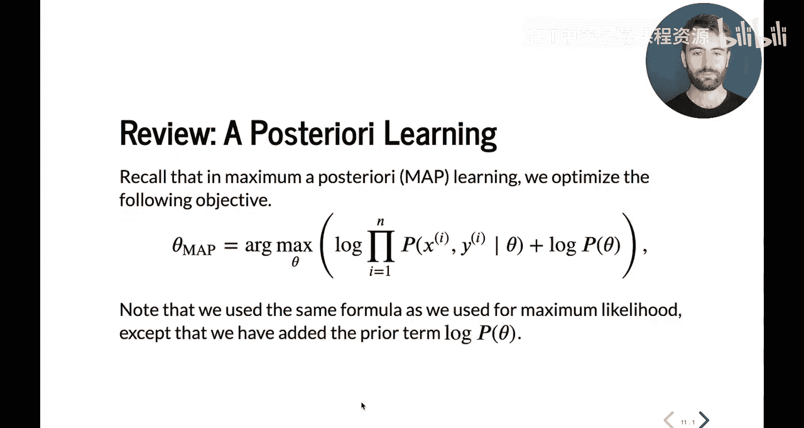

这样我们就得到了θ的概率分布。

## 贝叶斯学习的挑战

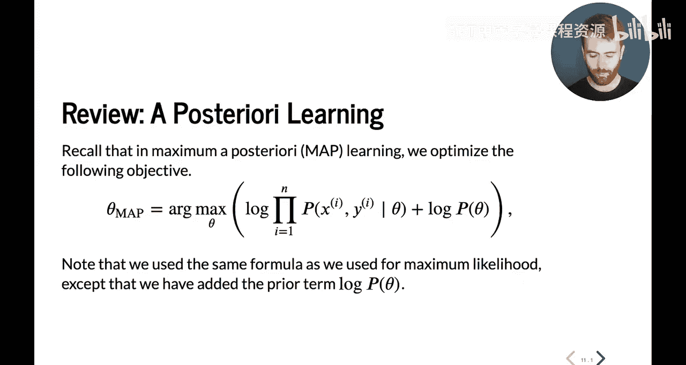

然而，贝叶斯方法在实践中通常难以处理。为了应用贝叶斯方法，我们需要将联合概率转换为后验概率P(θ|数据)。这些操作在计算上非常昂贵，是一个计算上难以处理的问题。

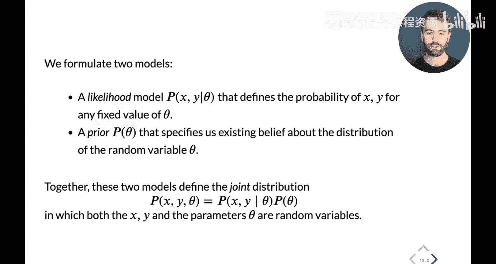

为了解决这个问题，有多种近似算法：

以下是主要的贝叶斯近似方法：

- **变分推断**：用更简单的分布近似后验
- **马尔可夫链蒙特卡洛**：通过采样近似后验
- **最大后验估计**：寻找最可能的参数值

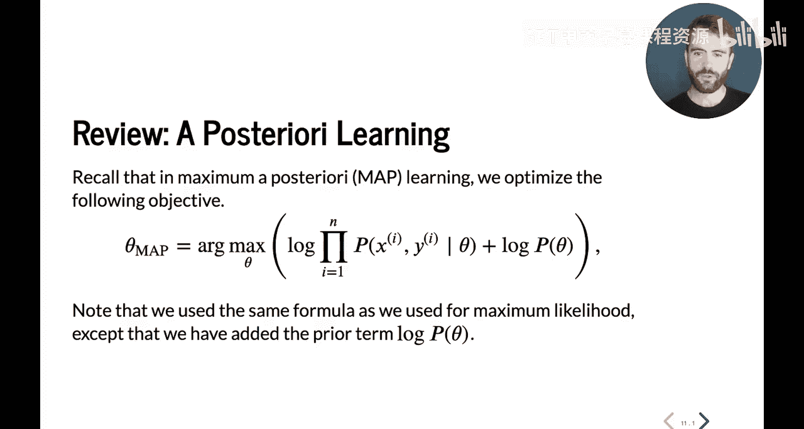

## 最大后验估计

在上一讲中，我们看到了最大后验估计方法。这是对完全贝叶斯方法的一种近似。在最大后验学习中，我们最大化以下目标：

**argmax_θ P(θ,x,y)**

我们不关注θ给定数据的完整分布，而是尝试在联合模型下找到最可能的θ值。

现在，我将重点介绍MAP方法，并展示如何将本课程早期的一些算法推导为MAP学习方法的特例。

## 岭回归的贝叶斯推导

我将要推导为MAP方法特例的算法是岭回归。在岭回归中，我们拟合以下形式的线性模型：

**ŷ = θᵀx**

岭模型拟合L2正则化的均方误差，形式如下：

**min_θ Σ(yᵢ - θᵀxᵢ)² + λ||θ||²**

左侧是我们的均方误差，右侧是我们的正则化器，即参数向量θ的L2范数。通过惩罚其L2范数，我们强制参数θ变小。

现在让我们看看如何将岭回归解释为MAP估计的特例。与之前的视频相同，我们将从概率视角定义概率模型。我们将定义模型类别，并应用最大似然原理获得目标函数。然后我们将看到，这同样是岭回归的一个特例。

在模型本身方面，我们将使用相同的条件高斯分布。我们将使用之前看到的相同高斯方法，拟合给定x和θ的y的条件分布：

**P(y|x,θ) = N(y; θᵀx, σ²)**

这是一个高斯分布，其均值由x的线性函数参数化。

为了应用MAP方法，我们还需要定义θ的先验分布。我们将假设这是一个高斯先验，均值为0，方差为τ²：

**P(θ) = N(θ; 0, τ²I)**

这只是θ上的分布。应用高斯分布的定义，我们得到先验的以下表达式。现在我们可以应用最大后验方法来最大化以下目标函数，即我们联合分布的对数概率：

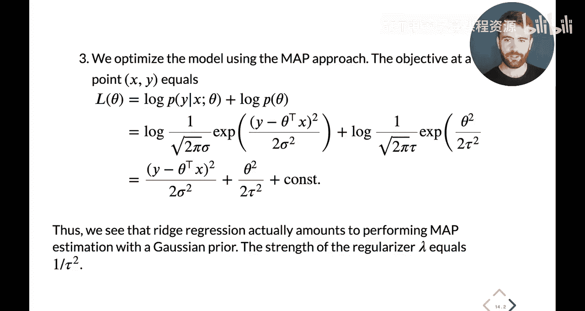

**log P(θ,x,y) = log P(θ) + log P(x,y|θ)**

代入我们之前使用的定义，我们得到以下形式。现在，我通过取出这些常数或乘法常数来简化这些项，因为我取了对数。我将它们放入这个加法常数项中，现在指数与对数相消，我得到以下表达式：

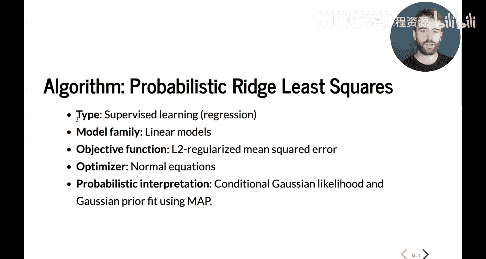

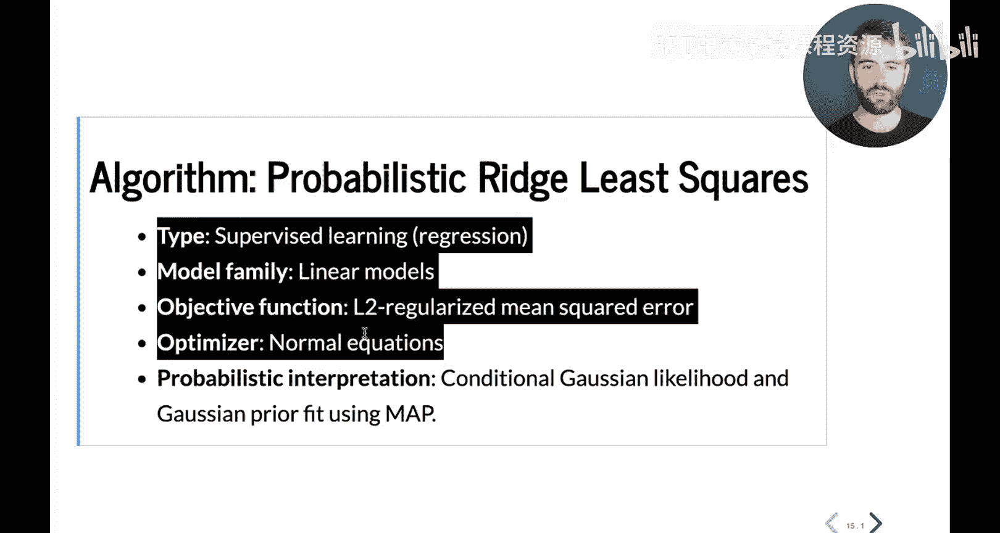

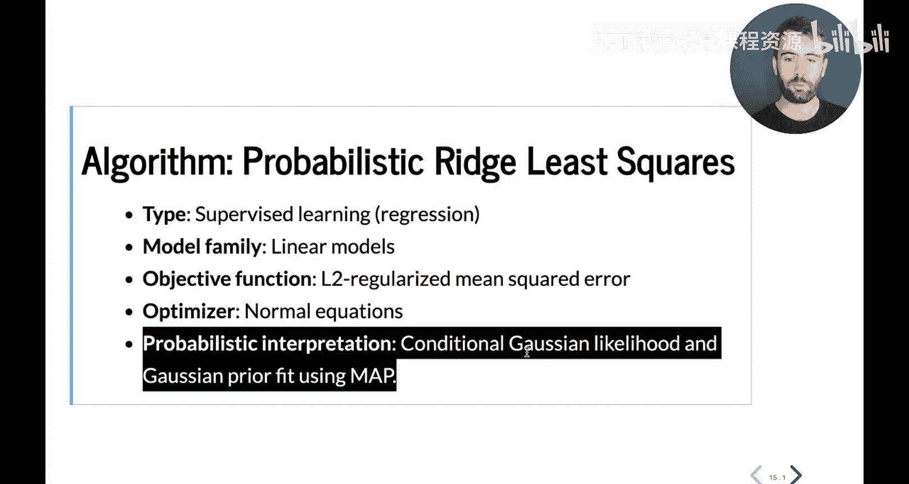

**-Σ(yᵢ - θᵀxᵢ)²/(2σ²) - ||θ||²/(2τ²) + 常数**

这与之前的形式相同，只是现在我有了这个额外的项θ²，它将被添加到我们的均方误差目标中。

现在你可以看到，这恰好是我们之前的均方误差方法，其中我们添加了一个高斯先验。这个高斯先验恰好对应于参数θ的平方值。如果θ是多维的，那么这将只是平方参数的和。

## 结论与总结

我们在这里看到的是，岭回归也是使用高斯先验执行MAP估计的特例，就像最小二乘法是最大似然的特例一样。

让我更精确地再次陈述这一点。我再次定义岭算法，这是我们早期视频中看到的相同定义。现在我只是添加了这个概率解释：通过拟合岭最小二乘模型，等价于使用MAP估计拟合条件高斯概率分布。

以同样的方式，采用概率方法并使用最大似然原理为我们提供了广泛的机器学习算法，这也是解释为什么我们对标准机器学习算法做出某些选择的方式。对于最大似然学习是这样，对于MAP学习或机器学习的贝叶斯方法也是如此。

本质上，我们既可以解释经典的机器学习算法使用贝叶斯或MAP方法，也可以推导新的算法。更一般地说，任何时候我们对模型参数应用某种先验，都很容易将其解释为正则化的一种形式。

这里的直觉是，我们有先验知识，我们事先理解模型的权重应该很小，好模型的权重很小。因此，我们将其编码为先验，并假设这是一个以零为中心的高斯先验。通过做出我们有先验的假设，我们从概率视角自然地推导出正则化。

例如，如果我们使用L1正则化，我们可以将其解释为在数据上使用拉普拉斯先验，这是另一个概率分布。因此，我们不是假设权重上的高斯先验，而是假设拉普拉斯先验，我们得到L1正则化。许多其他算法也会有类似的解释。

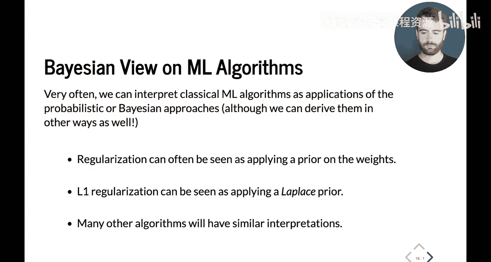

在本节课中，我想再次强调，概率方法是非常强大的思考机器学习模型的方式，既能解释机器学习模型的作用，也能推导新的模型和算法。