# 康奈尔大学《应用机器学习 CS 5787_ Applied Machine Learning 2020》中英字幕（deepseek p23 -23-Lecture 6. Part 1_ Classification.zh_en -BV12udzYvEFM_p23-

。

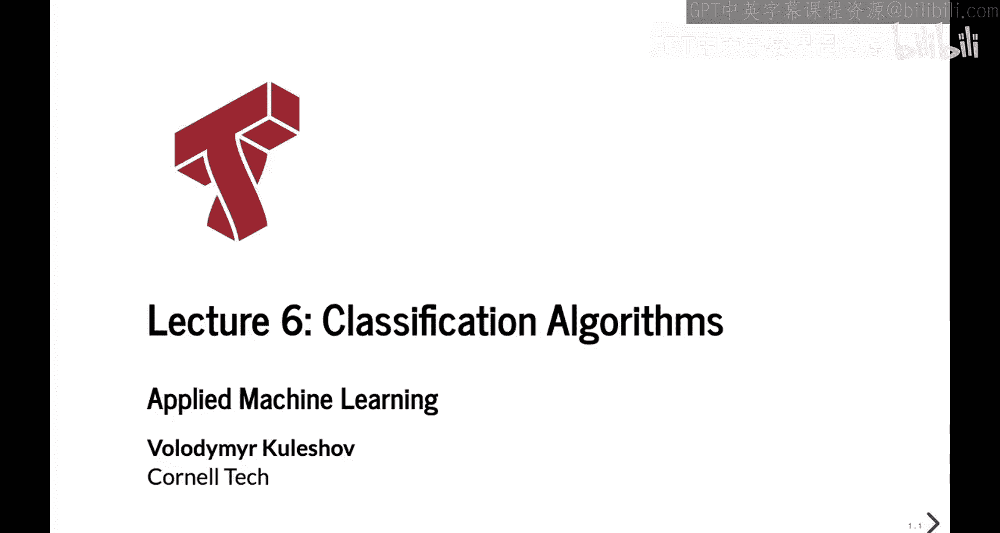

Welcome back to Applied machine learning。 We are now at lecture 6 of our course。

 and the topic of lecture 6 is going to be on classification。

We've seen quite a few machine learning algorithms so far。

 but all of these algorithms have been instances of a type of supervised learning problem called regression。

And in this lecture， I would like to start exploring the other important type of supervised learning problems。

 which are classification problems。

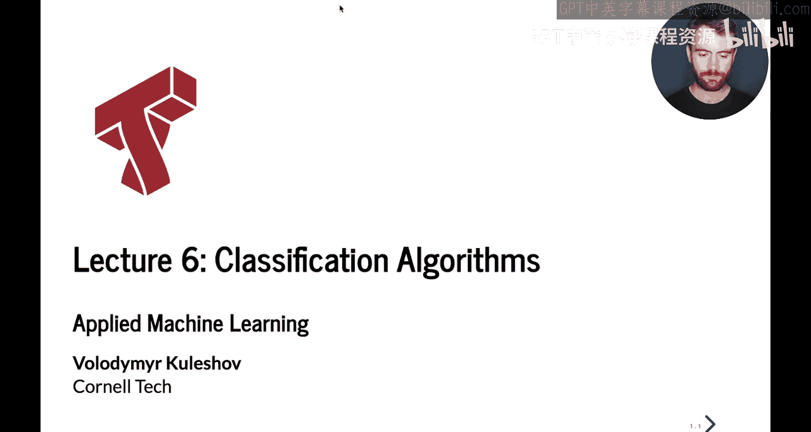

So in the first part of this course of this lecture in this video。

 I would like to again go back to the definition of a classification problem and establish some notation。

And give a few simple examples of what is a classification problem and then in the following videos。

 in the following parts of this lecture， we're going to start looking at a few specific kinds of classification algorithms。

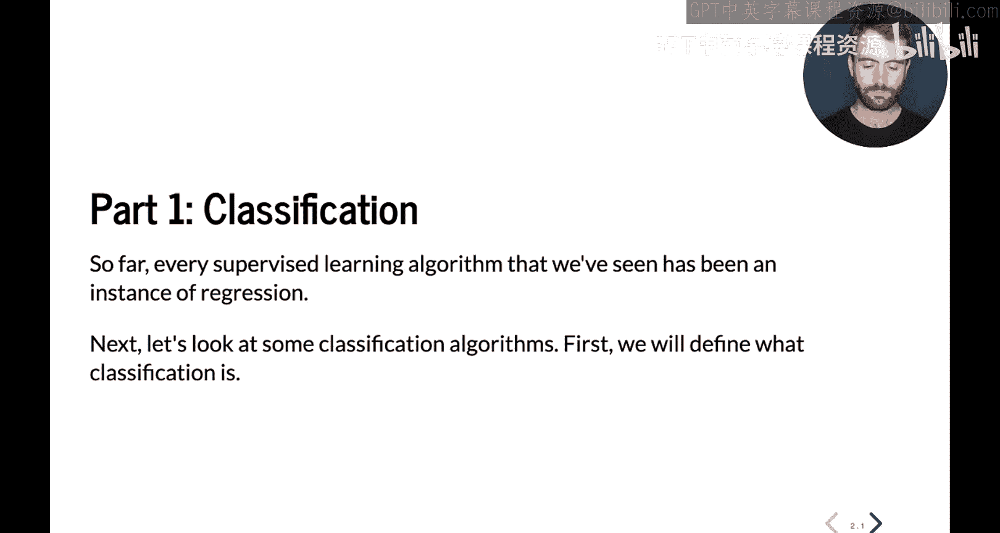

So let's start by again reminding ourselves the components of a supervised machine learning problem。

As I mentioned earlier， in order to apply supervised learning。

 we have to collect a training data set， which is a set of training instances which are pairs of targets and inputs and inputs are characterized by features or attributes。

And then we specify a learning algorithm that looks at this data set and produces a predictive model。

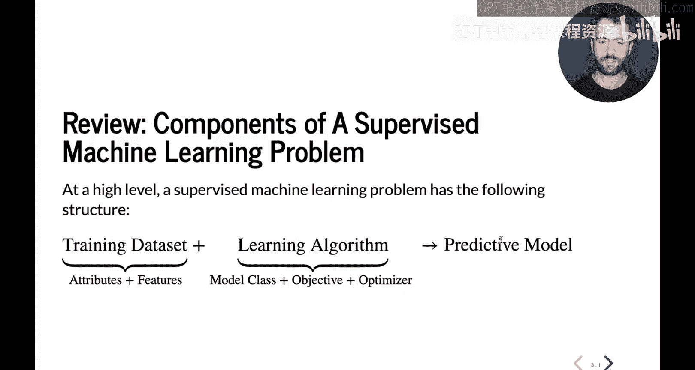

And as I mentioned in one of the earlier lectures， there are two types of supervised learning problems that we can define。

 which are based on the type which are based on the values that the targets in our training dataset take。

So so far in all of our examples， these training data set targets were continuous variables。

 so they took values in a set of real numbers。And when the targets are continuous。

 this is an instance of a regression problem。In this lecture。

 we are going to look at the case when these inputs are discrete。

We sorry when the targets are discrete。And this is going to be an instance of a classification problem。

When the variable y takes many values， going to denote this as follows。

 I'm going to denote the set of possible values that variable the targeted variable can take as script y and y1。

 y2 up to y capital K are going to be the set of K possible values。

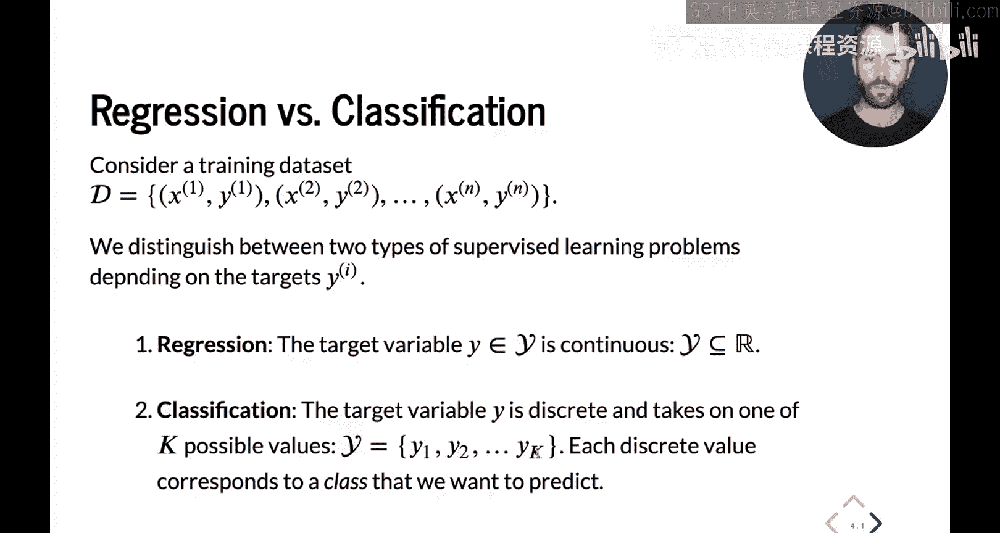

Now an important special case of classification is called binary classification。

 and I just want to highlight this term here because it's used a lot。

And binary classification is a special case when we have two classes， so when K equals to2。

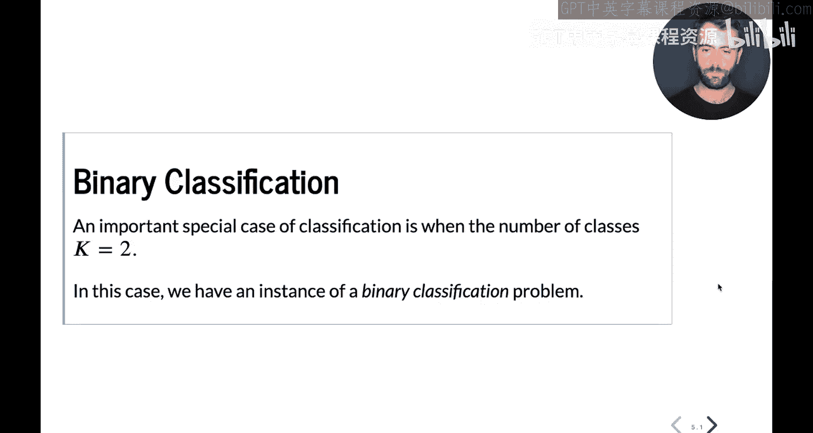

Now let's look at our first of first classification data。

This is going to be a data set that was originally created in 1936 by the famous statistician Fisher。

And nowadays it's widely used a way as a demonstration data set for various kinds of machine learning algorithms。

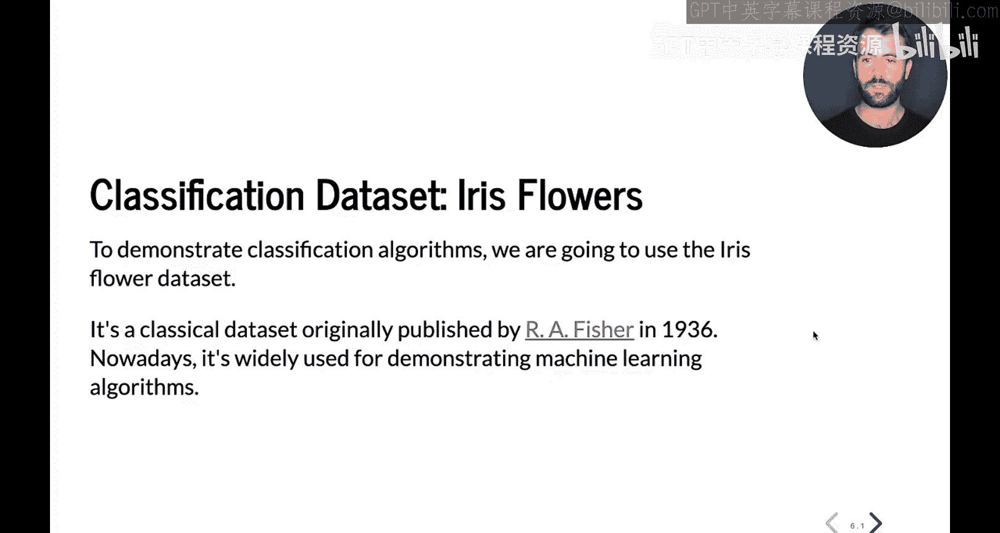

So I'm importing here this data set from PsychicL and you can read the description of the data here。

 but essentially this is a data set in which we collect various measurements for different species of iris flowers and in total we have the following three species of three subspecies of irIS flowers。

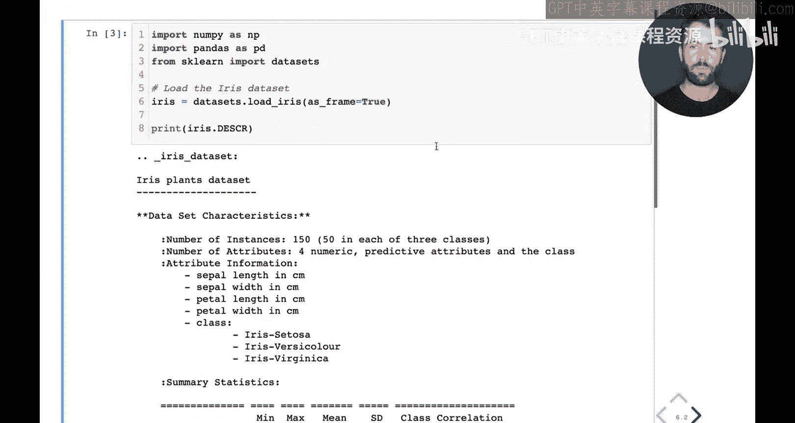

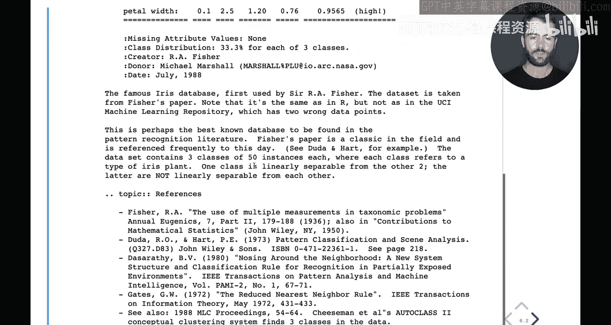

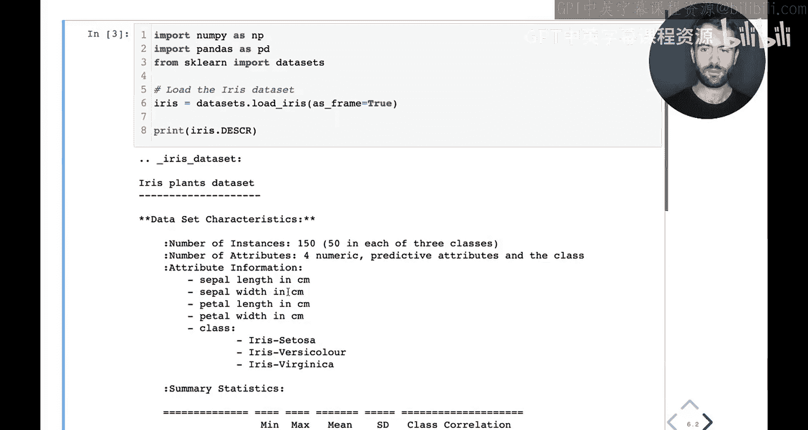

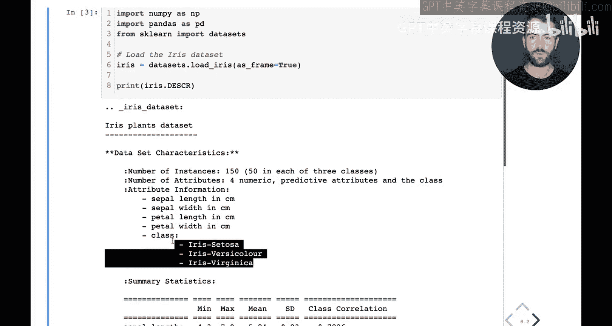

And we have collected measurements of the flowers which are given here。

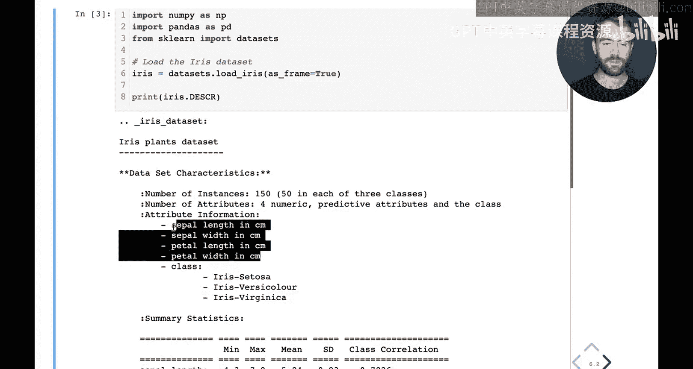

We can display this dataset set in tabular form and you see here that we have these four columns which corresponds to our four features here we have a target which will take a numerical value of0。

1 or two depending on which subspecies of flower。hich iris flower we are looking at and the rows in the stable are different measurements that we took for different flowers over time。

Now we can visualize this data and here I'm going to show you a visualization of this data set in three dimensions where I'm going to be taking the first three columns of this table and I will display each point in three dimensional space where again the three coordinates are the first three columns of this。

第一步。

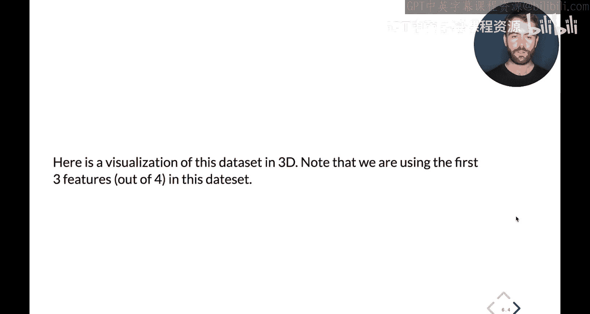

So when we do this， we have something like this here we have the three different characteristics of the flower that we've chosen。

 and each point here corresponds to a flower and I've colored the different flowers with different colors。

So the species Iis satossa is in red and the other two are in orange and gray here at the bottom and you see here that this is a data set that has that you can already see that it has interesting structure。

 for example， all the red iris satossa flowers are clustering together， they seem to have greater。

Pal length and then these two flowers seem to be more similar to each other。

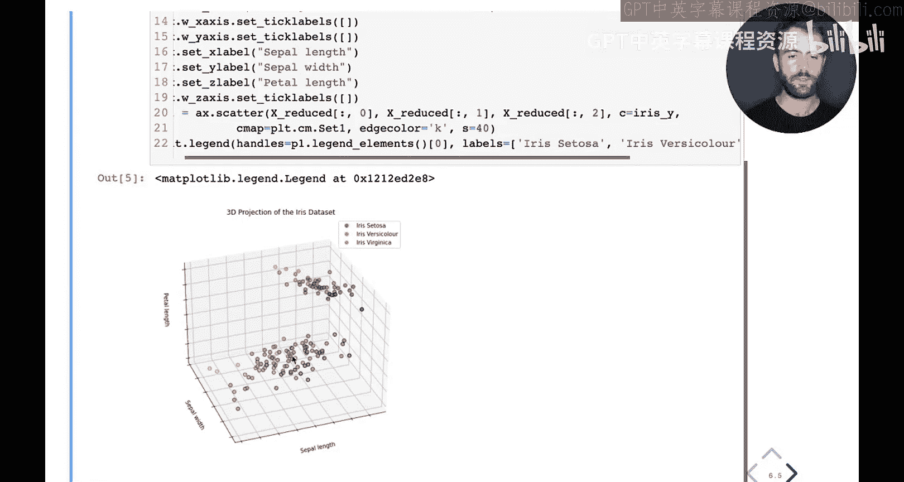

So let's look a little bit more about the differences between classification and regression。

You can think of a regression problem as trying to fit a curve or a line that goes through a given set of targets。

With these that goes through a set of targets y。As an example。

 you may recall our diabetes prediction task where we tried to fit a line through the data points that were pairs of BMI and diabetes risk scores and we fit a straight line to that data and we were looking for a line that passes through the data points that we had and we also then tried fitting more complex polynomials and these are all curves that tried to fit the true shape of the data in regression。

In classification the problem is a little bit different。

 we are still training models that try to match the targets on our training set。

 but now it's better to think about the problem that we're solving as finding a partition of the feature space where the different classes are partitioned into different regions and we're looking to identify the boundaries of these regions。

And I'm going to show you an example of this in a minute。

But the third factor about classification that I want to highlight is that。

If we think about classification models from a probabilistic perspective。

 if we think of them as probabilistic models， then the probability of a Y has a really simple interpretation。

 that is simply the probability that a given point belongs one class to one class versus a different class。

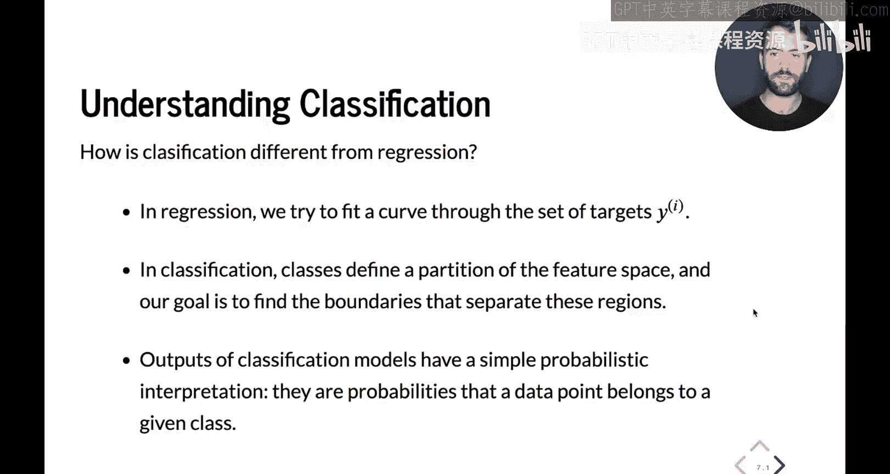

Now let's visualize our IIS data set again to see some of the observations that I just mentioned again。

 as I mentioned earlier， we're going to so right now I'm going to visualize the data in 2D now。

 so instead of choosing the first three columns I'm going to be choosing the first two columns or the first two features of this data。

And by projecting this data set into two dimensions， following we have the following plot。

 so here now I'm using a slightly different set of colors but again the irris satossa flowers clearly form their own cluster here。

 they're different from the other flowers and then the two other species of flowers are relatively similar。

 they here in yellow and brown on this side of the graph。And you can see that the feature space。

 which are the two measurements here on the x and Y axes。

The the space in this two dimensional space can be partitioned depending on whether we are in this space。

 and in this part of the space which matches the Irisittosa flowers or this part of the space which matches the two other kinds of flowers。

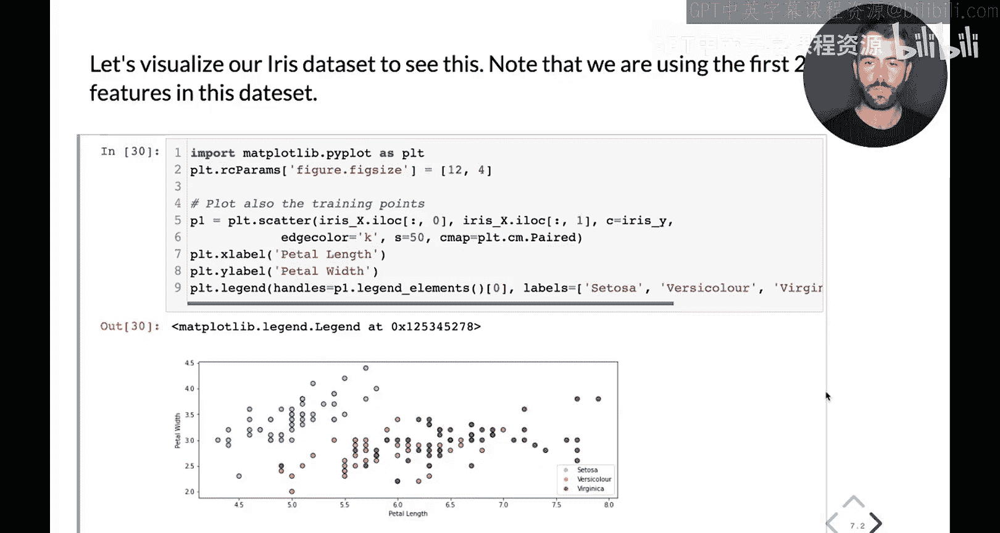

And now we can fit a classification algorithm to this data。

 I'm going to use an algorithm from psychic learn called a regression。

 which we're going to see in detail a little bit later in this lecture。But here I import。

 instantiate and train this algorithm on the data set。

 trying to separate the irrisitossa flowers from the rest。

 and we see that the algorithm finds the following partition of the space into two regions and the line that separates them that is essentially the decision boundary between the two classes。

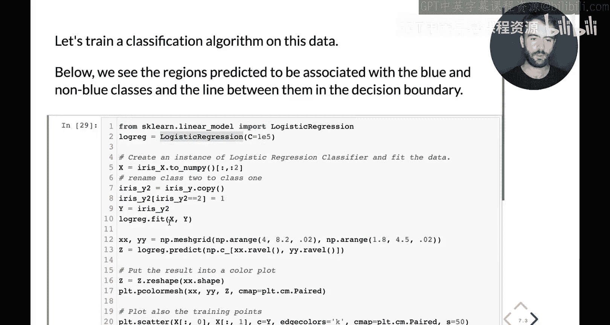

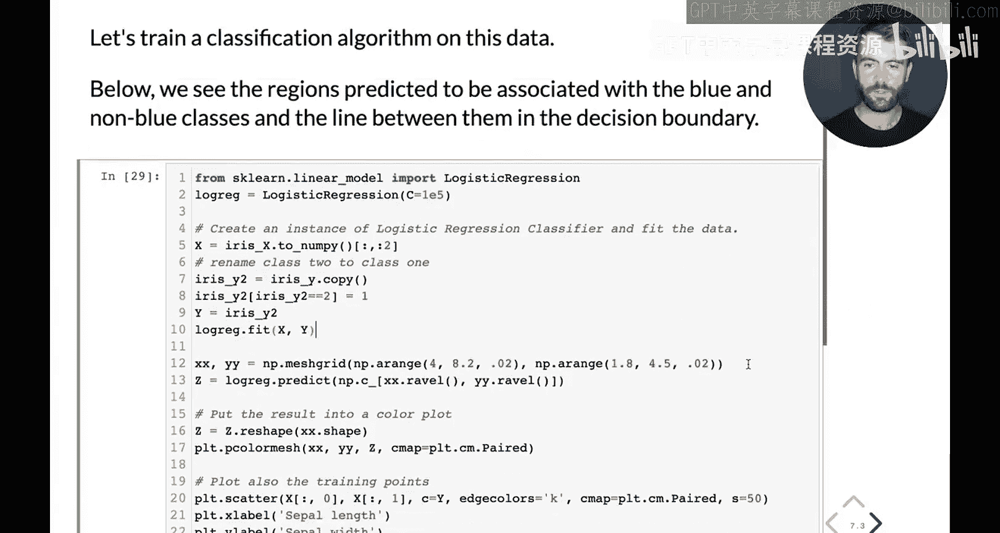

So this is an example of。How a classification problem looks like and the kind of decision that we need to make。

In the next video， we're going to look at our first example of an algorithm that can be used for classification。

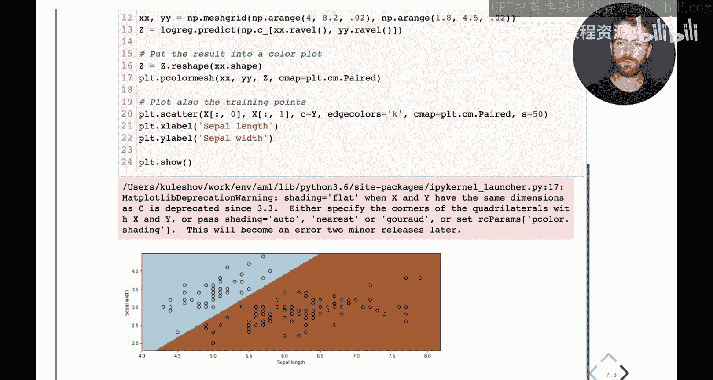