# 康奈尔大学《应用机器学习 CS 5787_ Applied Machine Learning 2020》中英字幕（deepseek p24 -24-Lecture 6. Part 2_ Nearest Neighbors.zh_en -BV12udzYvEFM_p24-

This is part two of lecture  six of applieded machine learning where we talk about classification。

In this part of the lecture， we're now going to see our first classification algorithm。

 which is called nearestar Neighs。

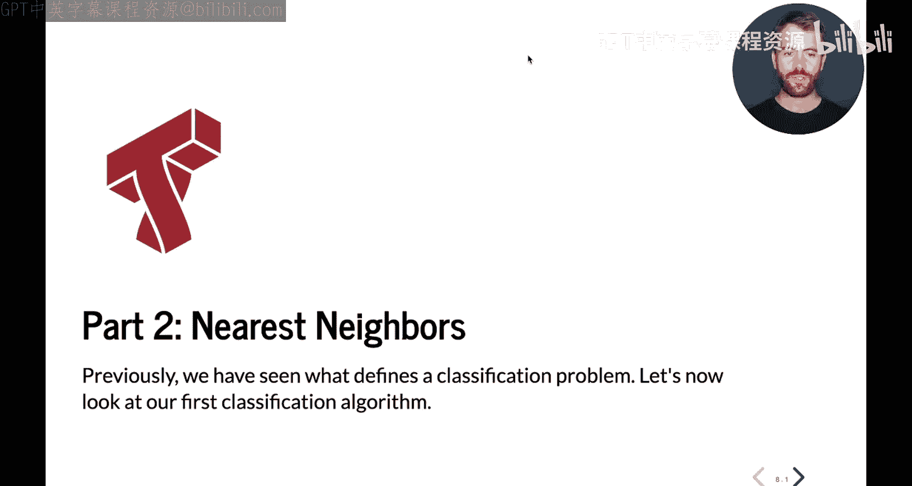

And before we start， let's again remember the setting of classification that we defined in the earlier video。

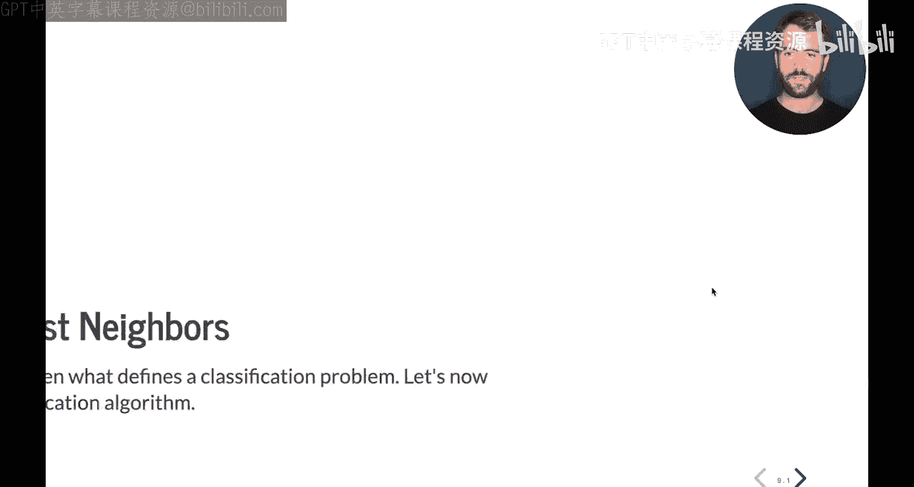

Wwhich is goes as follows let's say that we have a supervised training data set of this form that contains some targets y if these y take on discrete values in a set of K possible values which is given here then we say that we have an instance of a classification problem and this is different from the settings。

 this is different from all the problems that we saw earlier where the variable y was continuous and this was an instance of regression。

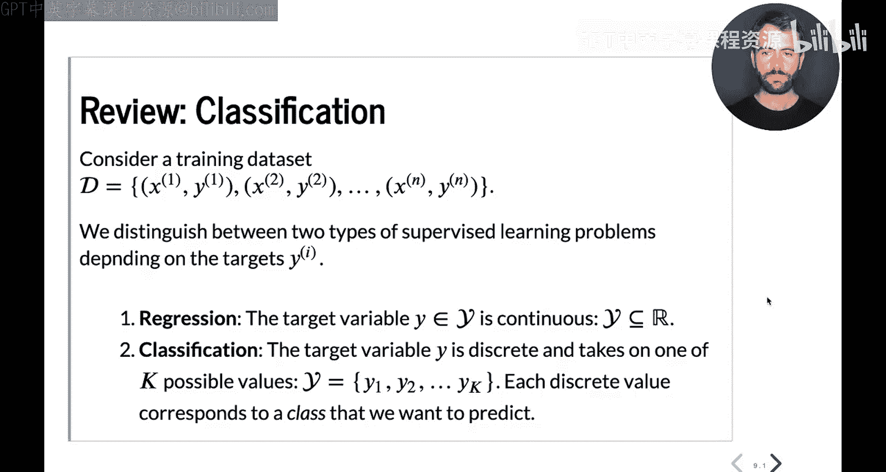

So let's now see our first algorithm that's applicable to classification。

And this algorithm is going to be called nearest neighbors。

At first this may look like a toy algorithm and it's deceptively simple。

 but it's actually an important algorithm in machine learning。And I。

 we're going to use it both to understand some theoretical properties of。Of supervised learning。

 and it's also an algorithm that's important by itself in certain practical applications。

 and also we will use this algorithm to contrast two different approaches the nearest neighbors approach and the approach that we're going to see in this lecture in the following videos。

So let's define what nearest neighbors。What nearest neighbors is。

Suppose that we have a training data set of this form。

 and now we are doing prediction or as it's also known in machine learning， we're doing inference。

And now we have received a new query point X primeme that's sampled from our data distribution。

 but that's different from our set of training points。

And our goal is to predict the label y prime of this0 x prime。How do we do this？

Nearest Nes takes the following really simple and perhaps deceptively simple approach。

 and you may not even think of this as a machine learning algorithm initially。What nearest neighbor。

 what nearest neighbors does is that。When given a query point X prime。

 we find the training example in our data set D that is closest to x prime in the sense that the inputs x are as close as possible within this data set to the query point x prime。

And then once we have found our nearest neighbor X。

 we simply return the label or the target of the nearest neighbor。This is it。

 This is the definition of nearest neighbors， and now let's look at a particular example。

 and then we will discuss this algorithm in more detail。

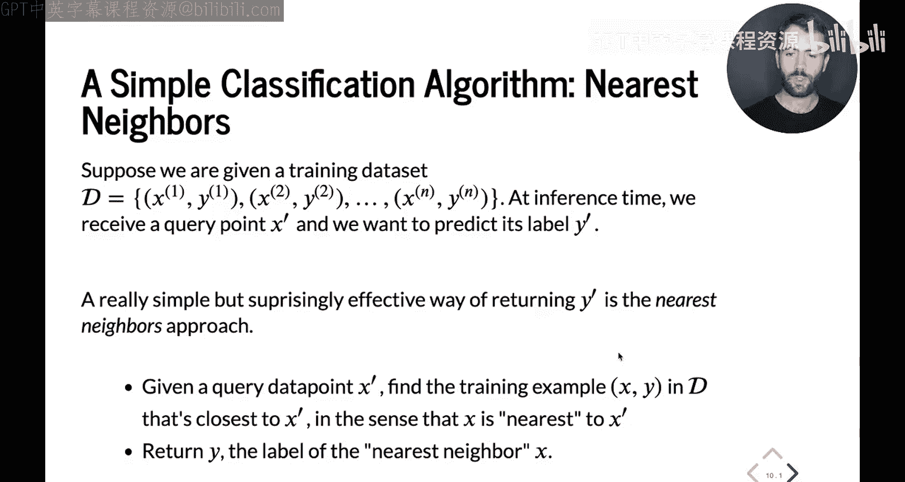

For our example， we're going to again use our。

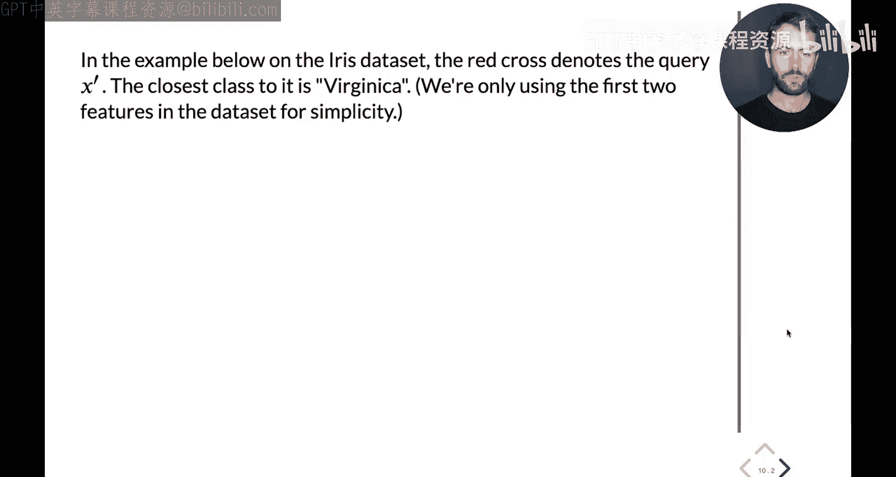

Data set of iris flowers， which we introduced in the previous videos。

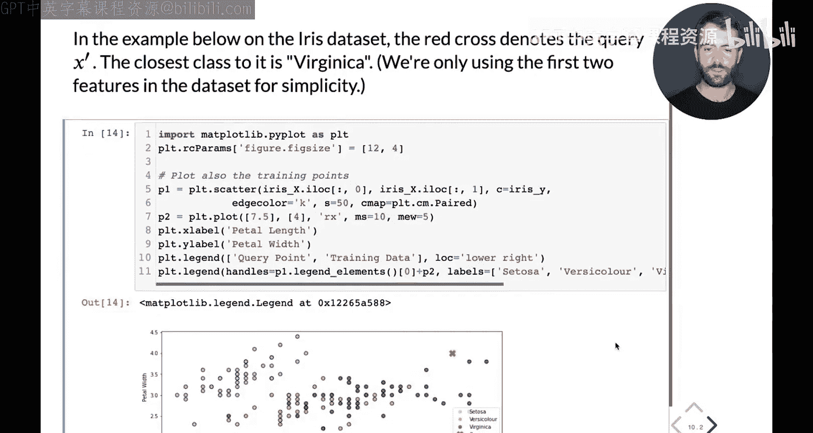

And you may recall that here each point is a flower and for this flower we've collected a set of measurements here I'm only using two measurements。

 the pedal length and the pedal width， and this point here this flower。

 its measurements are given by its coordinates along the x and y axis。

 so its location in this dimensional space is given by its pedal length and pedal width。

 which are the two axes。And now。Oh， and I should also add that we have multiple classes。

 we have three classes here， which I'm denoting here in the shade of blue and then yellow and brown。

And these corresponds to different species of flowers。And now imagine that we have a query point。

 which I'm denoting here with this red cross。 and this is a new flower。Whose measurements we collect。

 but we do not know its true species， and we would like to predict this species from data。Well。

 if we were to apply nearest neighbors， we would look at the closest data point to this flower。

 which happens to be this data point， and then we would simply return the class of this data point。

 which happens to be Virginiaica。And this makes sense because this。

Red Cross here is in an area where we have mostly Virginiaa flowers。

 so the output of nearest neighbors with this query point is perfectly reasonable where the output that we have is something that we would expect given the data。

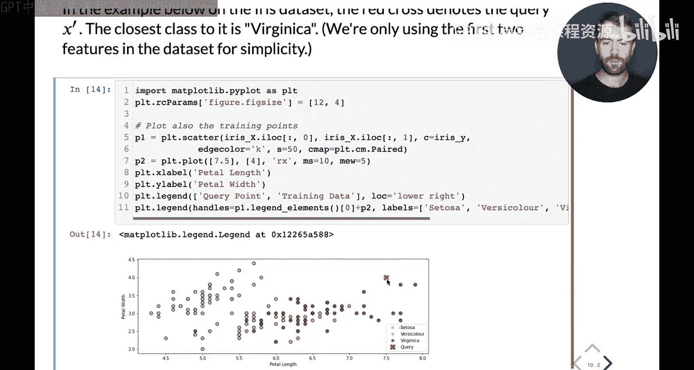

So this is the general structure of the nearest neighbors algorithm。

 but we have left a few details of this algorithm undefined。

The most important thing that we have not yet defined is how do we determine which point x is closest to our query point x prime。

 in other words， how do we define a notion of distance or similarity between the different data points？

One way in which to do this， which is the most natural and probably one of the most widely used is the Euclidean distance。

 which is defined as follows， and you can also think of the Euclidean distance as the L2 norm of the difference between x and x prime。

Remember that we've seen the L2 norm earlier when we talked about regularization， here。

 this is the notation for the L2 norm， and this is simply the definition of the L2 norm on the right。

And the Lorm is very straightforward， in this case the Lorm would be simply the length of the line between these two points that would be their Euclidean distance。

 it's simply the length of the line in this dimensional plot that connects them。

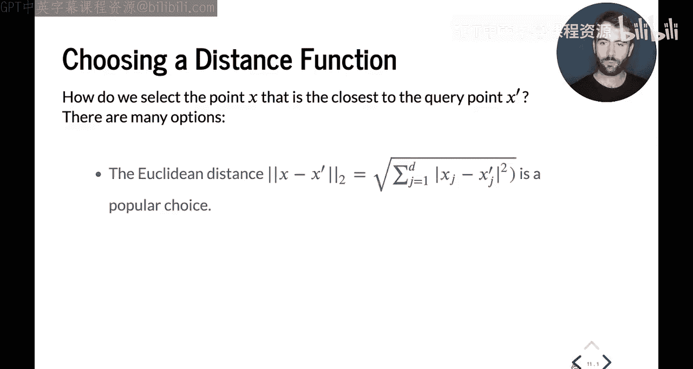

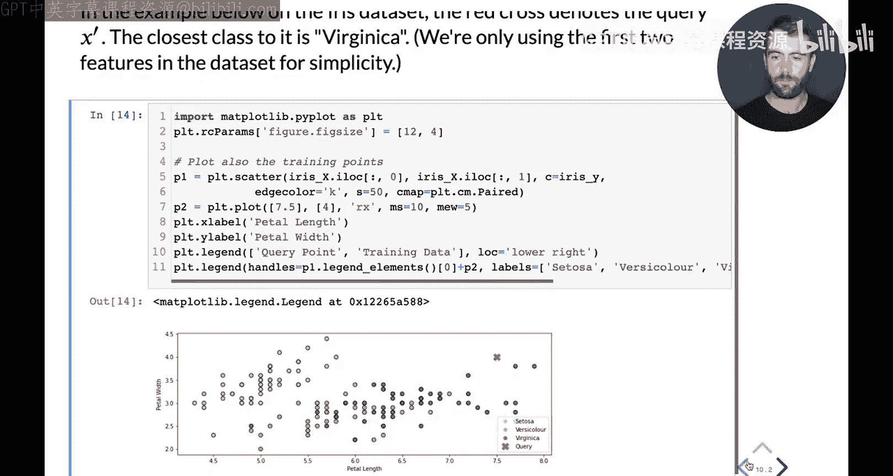

So the Euclidean distance is one popular metric， another type of distance that extends the Euclidean distance is called the Minkovsky distance。

 and the Minkovsky distance looks at the P norm instead of the Lto norm of the difference between x and x prime。

 and the p norm is defined as follows。Here p can take any value between between it's usually taken between1 and infinity and for each value of p we have a valid norm and a valid notion of distance。

 you should also note that when p equals 2 we have our Euclidean distance when p equals 1。

 this becomes the L1 norm of x minus x prime but for different values of p we have valid distances。

And finally， sometimes x and X prime can have discrete values。 If all of x and x prime。

 if all the components of x and X prime take discrete values。

 then we may want to use a specialized distance， such as the heming distance。

 which simply counts the。The number of components of x at which x is different from x prime。

So here we have defined three distances and there are several mores that several more distances that are used。

 but these can give you an idea for how we would compute distances between points and now let's look at again at our earlier example with the flowers using the Euclidean distance。

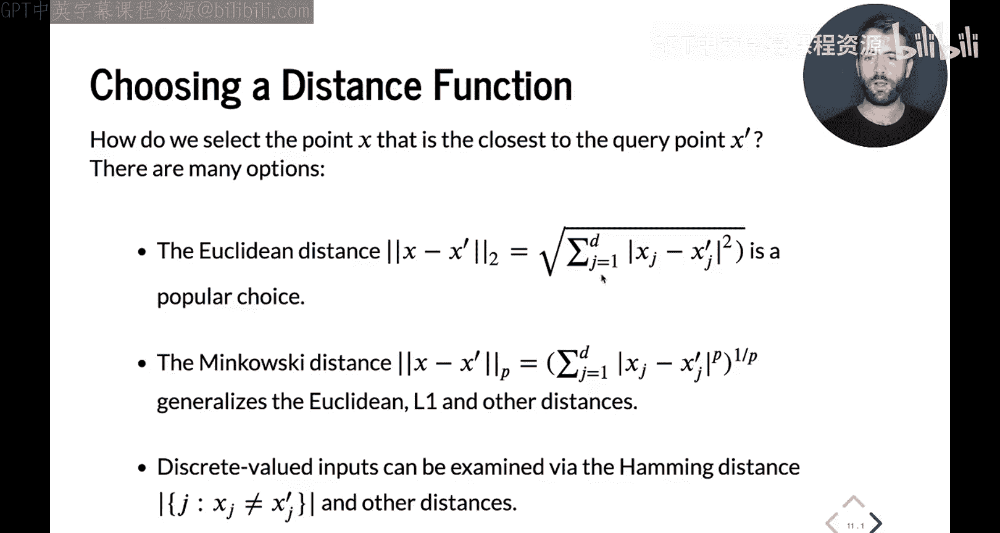

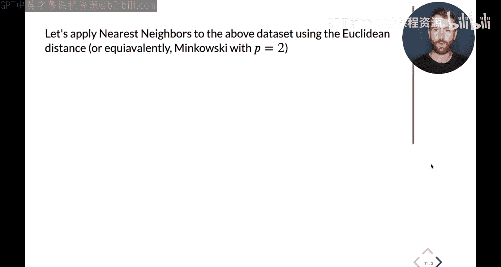

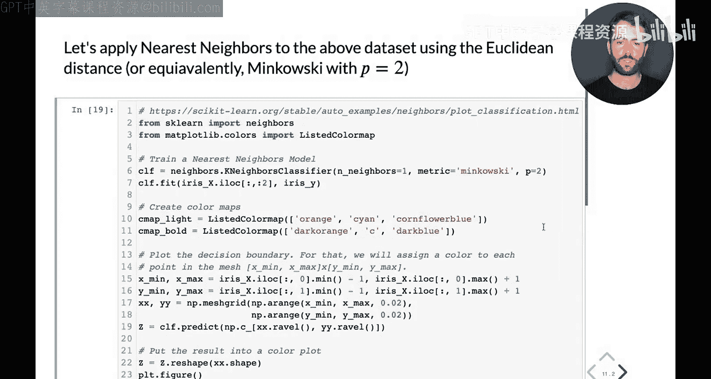

In this example， I have not only computed the most likely class at one query point。

 but I have computed it at every point in the two dimensional space。So here the orange region。

 that is the partition of the feature space in which nearest neighbors will return the orange glass。

 which happens to be the Satosa flower and the light blue and the dark blue regions these are the partitions of the feature space in which the。

In which nearest neighbors will return either the light blue or the dark blue class。

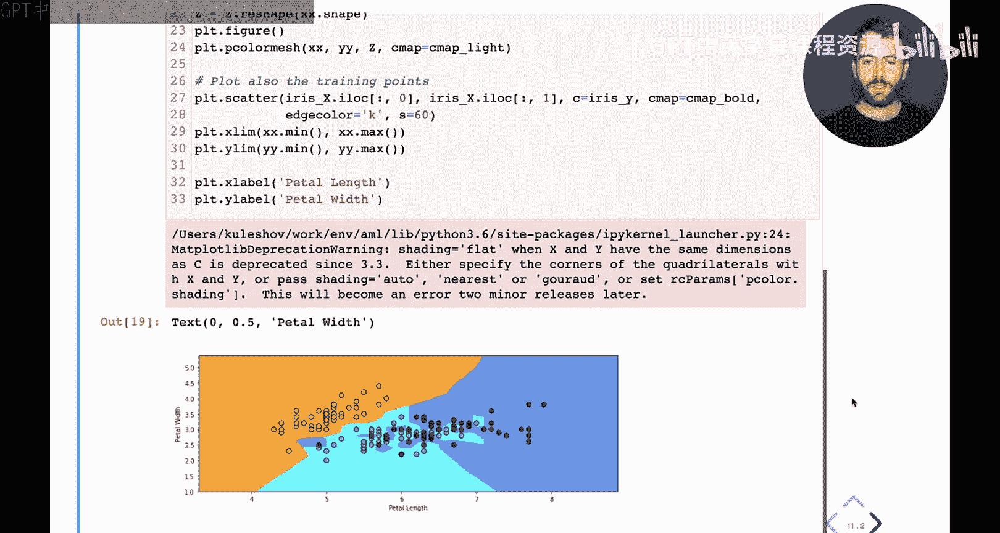

So。One problem that you may have noticed with this partition is that it's highly irregular。

Those regions that are colored in different colors。

 they are highly irregular and the boundaries between them are also very noisy。

And we have things like in in this example， you may see that there's there's an enclave of light blue in the dark blue region。

 And that is because we have this one light blue flower that's。

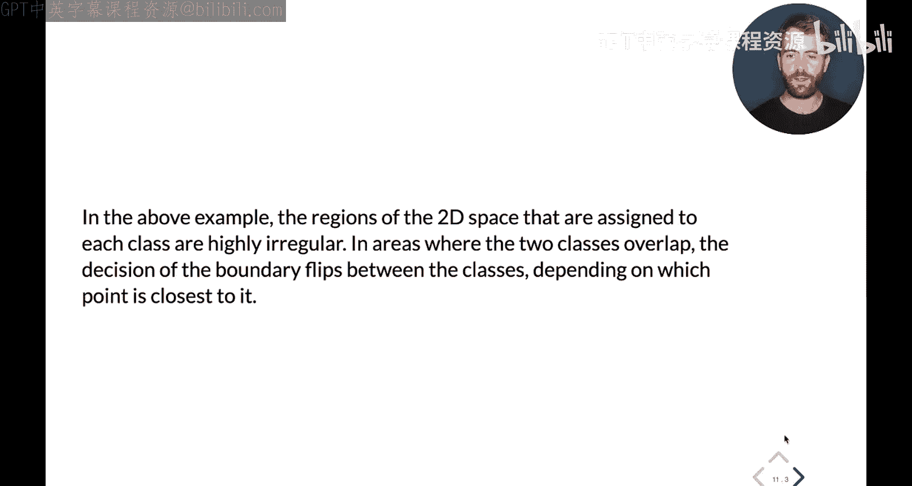

By itself， among this large set of dark blue flowers。And the algorithm。

 when we're really close to this light blue flower， it predicts light blue。

 but this is clearly unnatural because it just happens to be a one off spurious outlier that just falls in this region and most of the flowers are actually dark blue。

And it is clearly more intuitive to output dark blue as being the most likely class here。

So this irregularity and non smoothness intuitively seems like a bad property。

 and we would like to fix this issue with our decision boundaries。

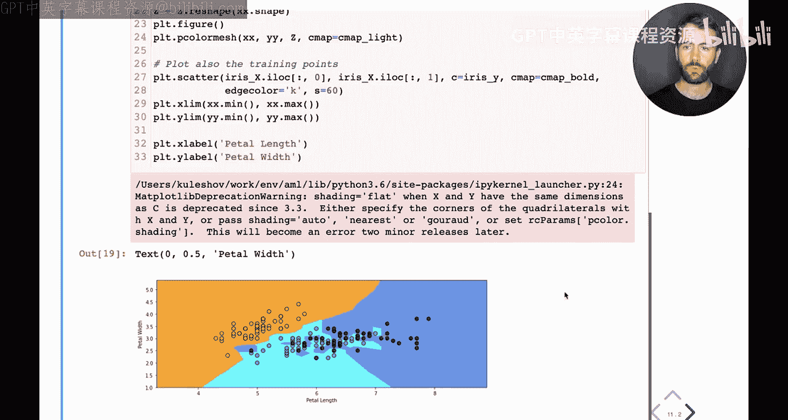

And the way that we're going to fix them is by extending our algorithm to something called k nearest neighbors k nearest neighbors is the version of nearest neighbors that is actually important and has a lot of practical uses。

It's only a slight modificationification of nearest neighbors。In that instead of outputting。

 instead of looking for the nearest neighbor， we're looking for the K closest neighbors to our query point X prime。

 and these form this set， which I'm going to call the neighborhood to the query point x prime。

 and then once we have retrieved this neighborhood from our training set。

 we output a label that is some sort of consensus of the labels or targets of these data points。

It's not really important how this consensus is computed for now。

 you can think of it as just the average or the most common class here。

 but there are many strategies including voting， weighted averages， regular averages。et cea。

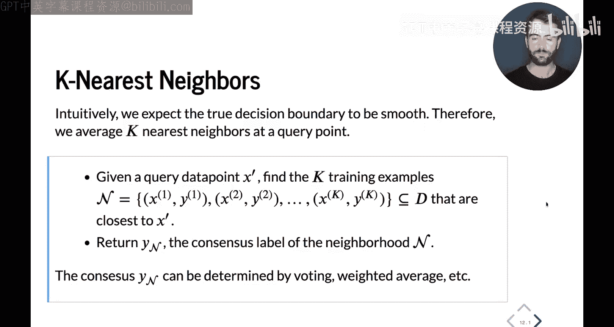

And now if I were to apply keenest neighbors on the flower data。

 we have something which looks like this， and now the decision boundaries are much more smooth。

 especially in this area where we have a few outlier light blue flowers。

 we still output a dark blue class because。

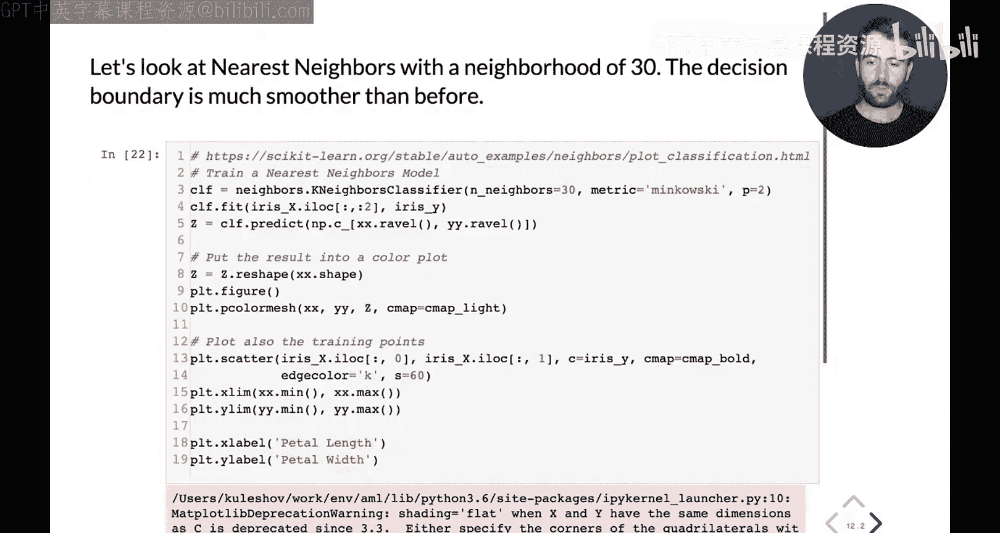

The vast majority of points in this region happen to be dark blue。

 and we correctly output dark blue evenre really even if we're really close to the light blue class。

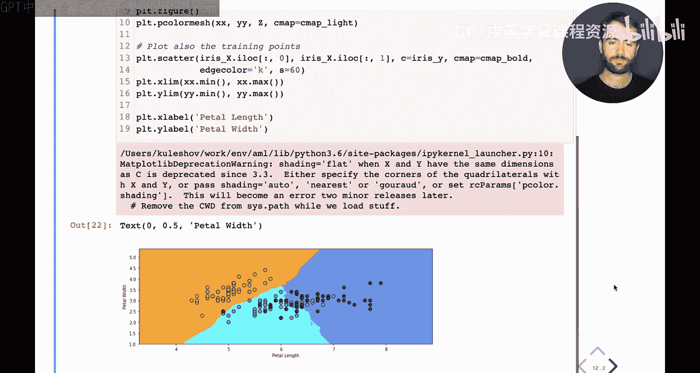

So this was the definition of key nearest neighbors and in the next few slides I would like to investigate some specific properties of this algorithm。

In order to do that I would like to first go back to something we've seen in the earlier lectures。

 which was the concept of a data distribution， recall that a data distribution is a probability distribution over x and Y and our training data set is a set of samples。

 it's a set of IAD samples from the probability distribution P。

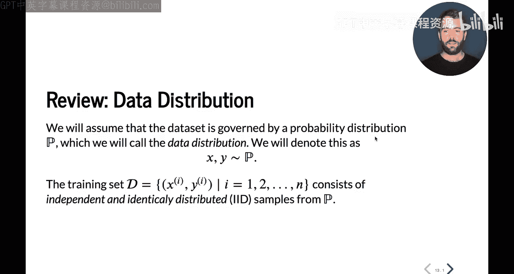

Now we can interpret K nearest neighbors as actually estimating this true data distribution。

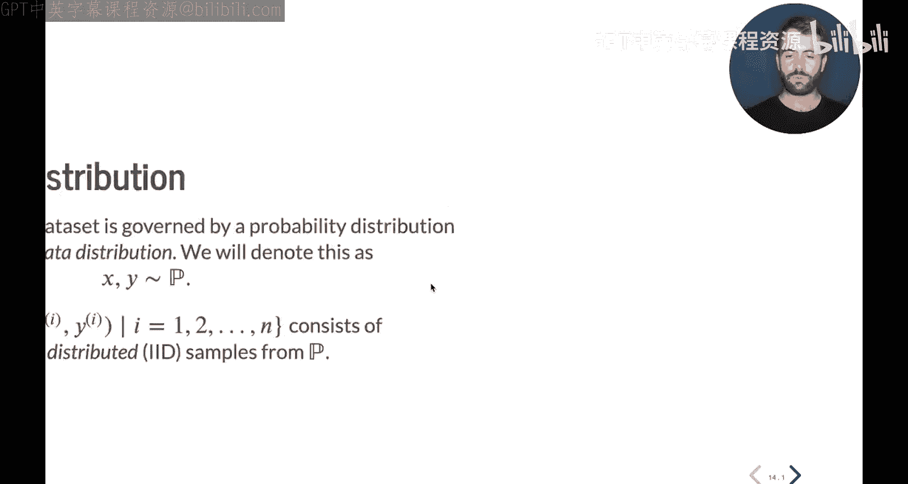

Recall what K nearest neighbor does given a query point x prime。

 we compute its neighborhood and then consider a consensus that is simply the average of these data points。

 so it's given here our output y prime consists of the average of the targets for the average of the targets of the data points that are in the neighborhood。

And I claim that this is actually an estimate of the conditional probability of y given x prime。

Where again， the P here is our data distribution。And you can convince yourself why this is true by the following high level argument。

Essentially， this approximate equality holds because y prime is a form of Monte Carlo estimate of this expected value。

So you can think of this expected value here as being， well， first of all。

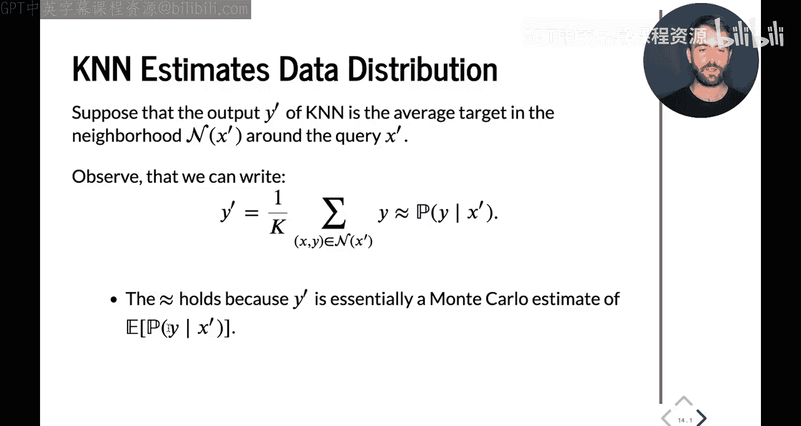

We， we saw that all the samples X， Y， they come from this distribution。

And given that x is close to x prime， all of our samples in this neighborhood。

 you can think of them also as approximately being around x prime and so this label this target y for our distribution。

Because all the x's are really close to x prime， you can almost think of them as being I samples of y given x prime。

 and because we have something that looks almost like an I set of samples， of course。

 X and X prime are not exactly the same。 but as we get more data and as the points become closer to x prime。

 we then this average here becomes becomes an estimate of the average y given the。

Given the training distribution here， So this is a connection of this is a connection between k nearest neighbors and our data distribution。

 and again， it shows why k nearest neighbors valid is a valid。

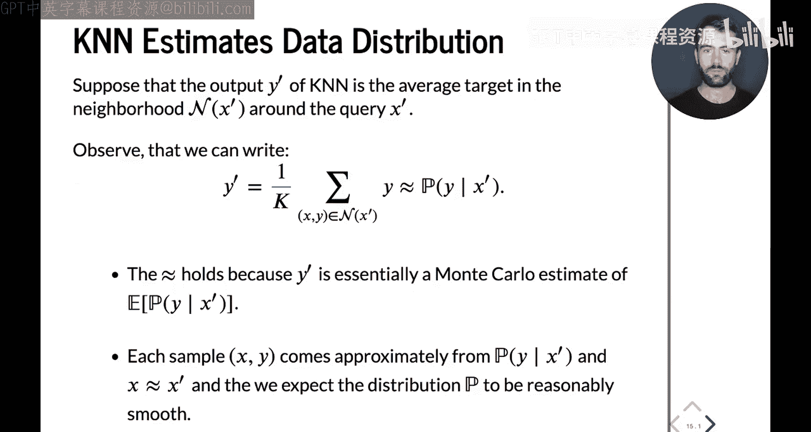

Machine learning algorithm。Now， here I'm summarizing the properties of this algorithm。

 It's an instance of supervised learning。 And even though I defined it for classification。

 I haven't really mentioned this， but you may have noticed that there is nothing in this algorithm thats。

That's really tight to classification。 It can be used equally well for regression。

 So even though it's our first example of a classification algorithm。

 it can be equally well used for regression too。And so the model family。

 I will come back to this in the next video， but you can think of this as being a consensus over different training instances。

 we are still solving an optimization problem by finding the closest points to our query point according of different objective functions to a number of different distance functions here。

And even though we don't perform any optimization at training。

 we perform nearest neighbor search at En time， and finally this algorithm also has a probabilistic interpretation in that it approximates this density。

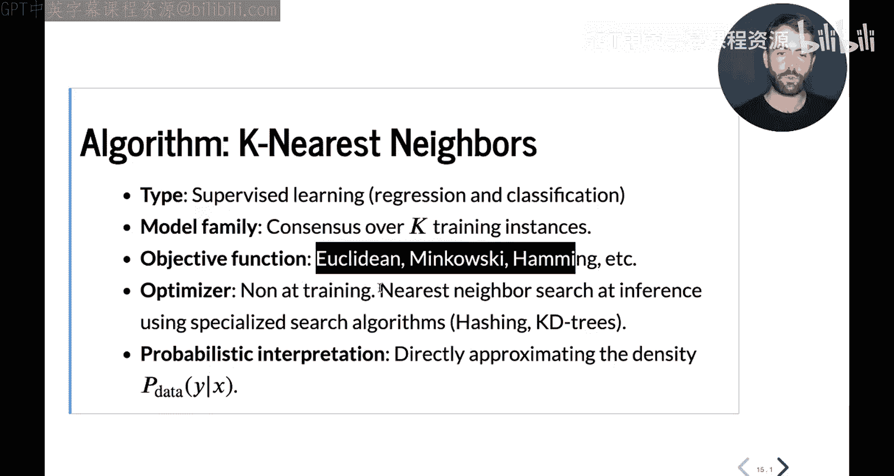

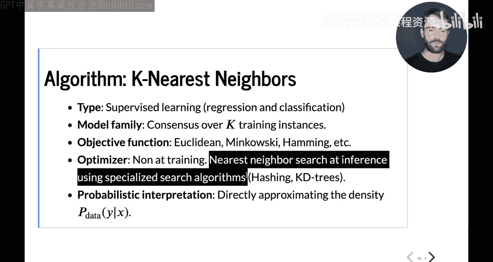

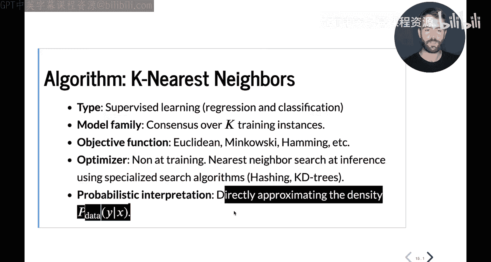

Now finally， I just want to briefly mention some pros and cons of k nearest neighbors its most interesting advantage is that it doesn't assume any restrictive form to the model。

 it always uses the entirety of the data set and so if we have a lot of data then we don't need to restrict ourselves to any kind of form for a model like a straight line or a polynomial of a certain degree。

 we can use all the data and so。Once we have a huge data set。

 it can potentially leverage all of this data set without compressing it or limiting it。

 and so in theory it can output more accurate predictions because it can use all the data and it can fit it can fit the true data distribution arbitrarily well in theory。

However， it has computational challenges as we need to store the entire dataset somewhere and we also need a way of querying this dataset set effectively and both of these things can be computationally challenging and finally。

 even though we can fit the data arbitrarily well， even though we can fit the data distribution arbitrarily well。

 if we have enough samples from it， in practice this is challenging in high dimensions because of something which I'm going to come back in to which I'm going to come back later in this course that's called the curse of dimensionality。

 but for now you can just remember that the data requirements of this algorithm in high dimensions are actually。

Quite high。And in the next video， we're going to look at these pros and cons in a little bit more detail。

 and we're going to learn about one important property and distinction of key nearest neighbors。

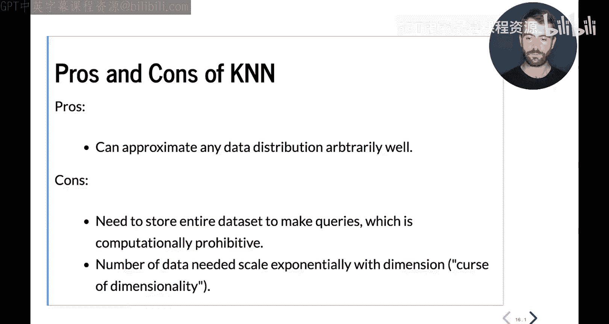