# 康奈尔大学《应用机器学习 CS 5787_ Applied Machine Learning 2020》中英字幕（deepseek p25 -25-Lecture 6. Part 3_ Non-Parametric Models.zh_en -BV12udzYvEFM_p25-

This is part 3 of lecture 6 of applied machine learning。

The focus of this video is going to be on non parametric models。In the previous video。

 we defined key nearest neighbors， which was our first algorithm that can be used directly for classification。

And it turns out that Key nearest neighbors is also an instance of what is called a non parametric model。

And parametric versus non parametric models is an important distinction between machine learning algorithms that I would like to explore in this video。

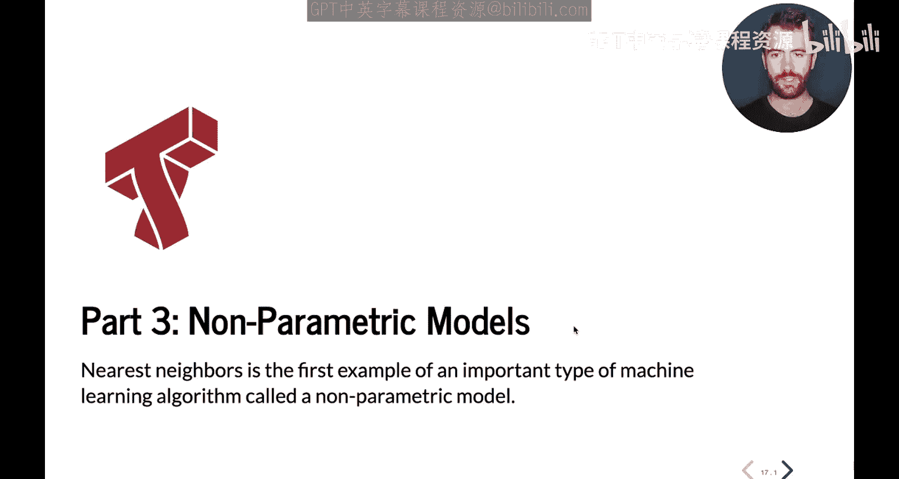

So recall that in our lecture on supervised learning， we define what a supervised learning model was。

 and we said that this is a function F mapping inputs x to targets y。

And then we saw that models often have parameters theta。

And we then use the following notation to say that F is parameterized by these theta。

 which means that each instantiation of the parameters defines a model。

 it defines a particular mapping from inputs x to targets y。And so far。

 all of the examples of supervised learning algorithms that we have seen have been instances of this type of parametric model。

And nearest neighbors turns out to be our first model which we cannot express in this form using a set of parameters nearest neighbors actually is this more general type of model and it is not associated with a set of parameters which makes it nonparmetric and I'm going to define more precisely what nonparmetric is in a few moments。

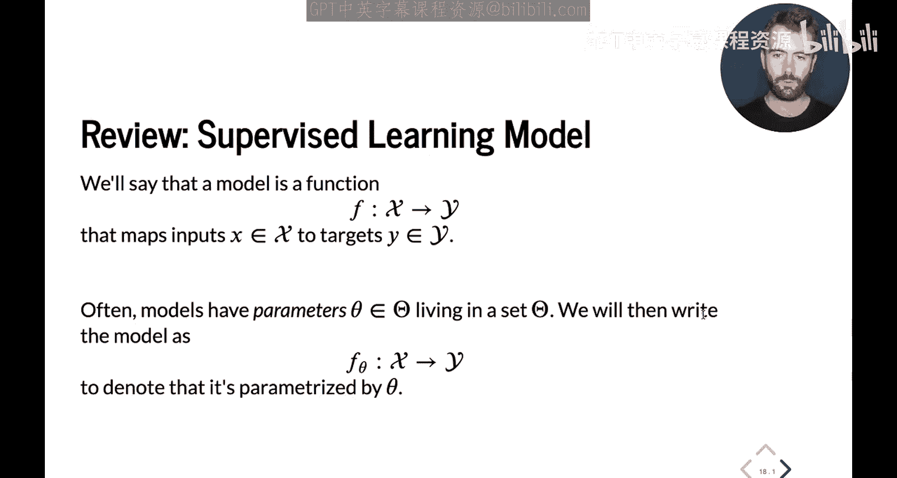

So recall that nearest neighbors is an algorithm that uses a training data set D of where we have N training examples and。

At prediction time， we receive a query point X prime。

 and then nearest neighbors finds the K closest training examples to x prime。

 and we call the set of examples of the neighborhood then order by n script n。

 and then nearest neighbors returns either the average of these training points。

The average of the targets in this neighborhood or the most frequent target in this neighborhood。

 or more generally it's some sort of consensus label or consensus target in this neighborhood。

So this is our definition of K nearest neighbors。

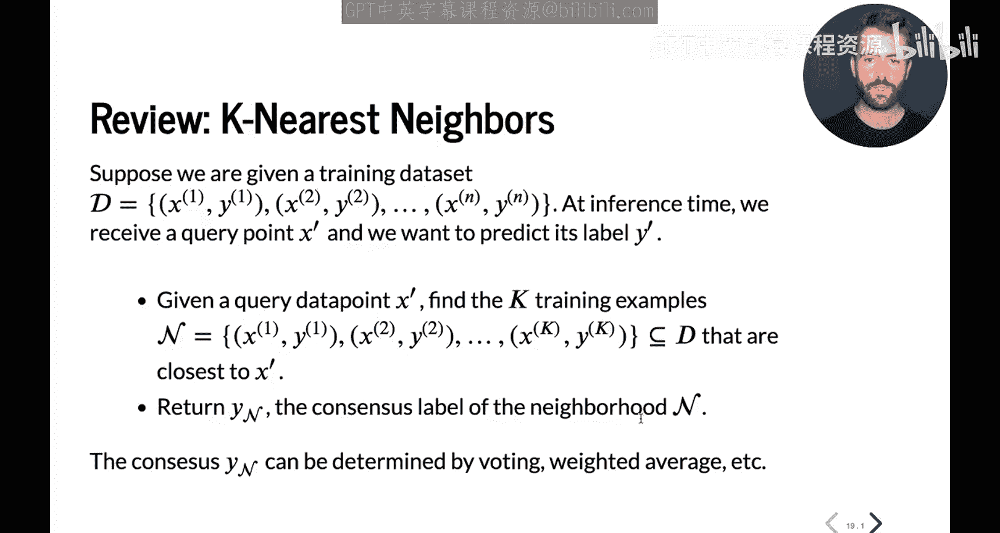

And as I mentioned earlier， key nearest neighbors is our first example of a non parametric model。

Let's see what a nonparmetric model is， but before I give a definition again。

 I just want to highlight that parametric versus nonparmetric is an important access along which we can place the different machine learning models that we have seen that we have seen and we will see in the course。

 most of them will be parametric， but it's important to know that this is not the only approach。

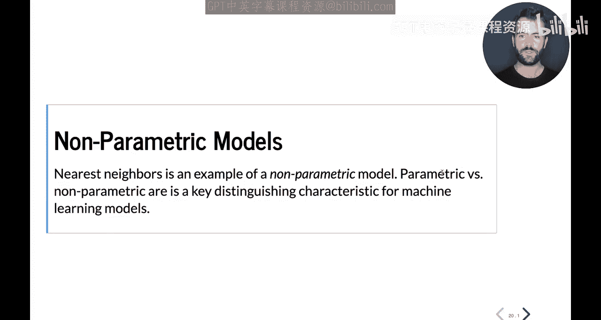

So a parametric model。Can be seen as a function。ButFrom x and the parameters set theta to the target y。

 and so here for each instantiation of theta， we have a mapping from x to y。

And this is the type of model that we've seen before， for example。

 the kinds of linear models that we looked at in previous lectures they take this form and this is a parametric model with this particular signature。

Now， these are parametric because we have this set of parameters， but more generally。

 they're parametric because they have。You can think of this model as having a fixed number of degrees of freedom。

 or more generally， you can think of the class of these linear models as having。

A number of degrees of freedom， so if theta has dimension D。

 then we have essentially d degrees of freedom along which we can explore the set of possible models right so if theta is a d dimensionsal vector then we have d distinct numbers which are in this case these degrees of freedom that we can play with and for each instantiation of these D numbers。

 we have a member of our model family class。Now the crucial observation is that this number of degrees of freedom D does not change with the data set size。

 so if we have 10 data points or 100 data points or 1000 or a million。

 we are still going to have D degrees of freedom in our model class。

And the fact that this number of degrees of freedom does not increase with data set size。

Is actually the more precise and rigorous definition of what makes this model barmetric。

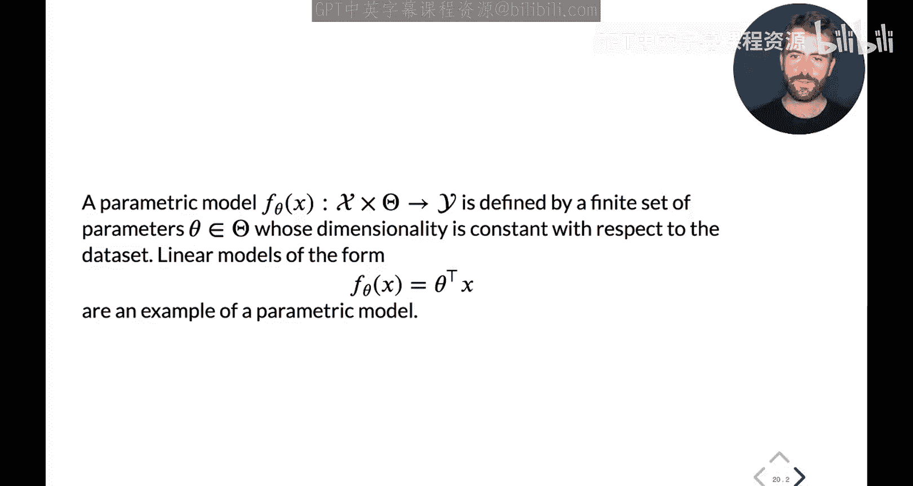

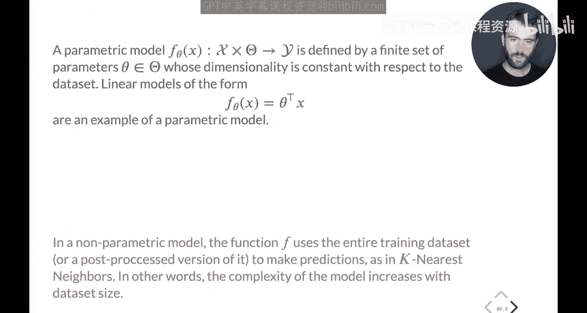

Now， in contrast， a non parametric model is one in which the complexity of the class is measured by some sort of degrees of freedom。

Continues to increase with data set size。And an example of this is， again。

 ouraneous neighborighs algorithm。In Key nearest neighbors。

 we do we never compress the data set in some sort of intermediary form， like a set of parameters。

So before in linear regression， we would take a data from that we would compute a set of de dimensional parameters。

 and then we would always use this de dimensional set of parameters and we would discard the data and all the knowledge would live in these parameters。

And then even if we were to give it more data， we would still compress our knowledge within these D numbers。

In nearest neighbors， there is no such compression， we use the raw data。

There is no intermediary form in terms of a parameter set， but crucially。

 as we give the model more data， it still uses。It uses all of this data directly without any intermediary form。

 and so if we were to think about the number of degrees of freedom that define a key nearest neighbor model。

 this number of degrees of freedom increases with dataset set size。

So if we have a training set of 100 points， then each instantiation of these 100 points defines our partition of the feature space for each instantiation of these 10 training points。

 we now have defined a mapping from x to Y。And。And so by changing these 100 points。

 we have 100 degrees of freedom that define the set of possible mappings from x to y with nearest neighbors Now if we have if we increase our data。

 if we increase our data set to 1000 data points，Well， now we have 1。

000 degrees of freedom that define the set of possible mappings from x to Y。

And as we increase the data set size。the complexity of our model class。

 the number of models in our model class increases as we increase our data set size。

 so if we go to a million data points， now we are going to have even more possible models now the dimensionality of our model class is going to be on the order of a million。

And so since the complexity and the dimensionality of our model class keeps increasing as we give it more as we collect more data。

This is the reason why we call certain algorithms likeaneius neighbors as nonparmetric。

 and this is the more formal definition in machine learning of what is a non parametric algorithm。

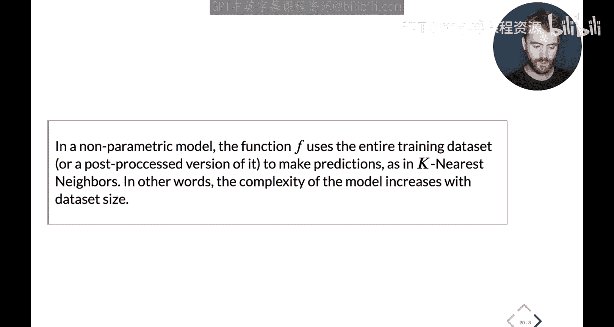

So nonparmetric algorithms in general have the advantage of not losing any information at training time since we never compress our training data set into a smaller and fixed set of parameters。

Which is fixed relative to the possible dataset set size that we could have。

We areWe never lose any information， and as we collect more data。

 the complexity of our model class just keeps increasing and we're providing more accurate queries。

So we always use the raw data set， we never discard any information which makes our predictions potentially more accurate。

Now the disadvantage， of course， is computational complexity。On one side。

 it is just computationally hard to to use this。To use this data set because we have to store it。

 we have to compute over it directly， so now at prediction time instead of just doing a simple dot product with the parameters。

 now we have to perform some more complicated search over our training set。

 so both the storage and computational requirements are greater in the case of a non-parametric algorithm like nearest neighbors。

And also we may easily overfit the training set， so you saw the example in the previous video where we introduced nearest neighbors where if we only take the closest data point。

 our boundary would become really noisy and it would be easy to overfit the data。

You can imagine here in a similar fashion if we use the raw data set and we have a maximally flexible algorithm。

 it will be easier for us to overfi the training set。

 and we will have to make sure that we choose certain hyperparameters of the model like the neighborhood size K to be appropriate given the data size that we have。

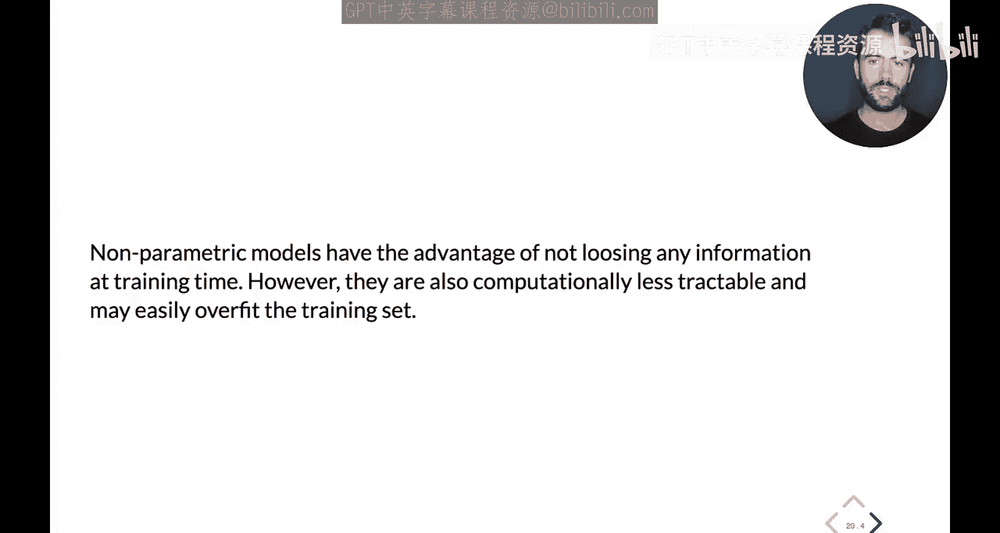

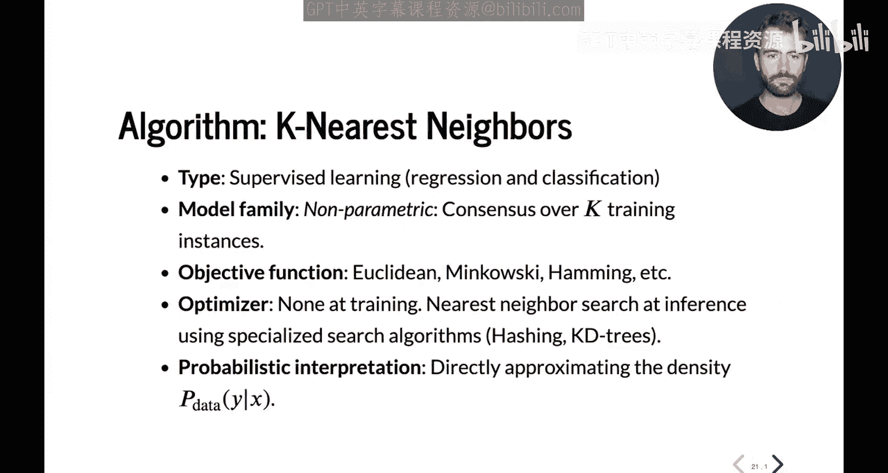

So again， I want to summarize the algorithm we have seen earlier， keen nearest neighbors。

As the following slide in here， I have added that the model family is actually non parametric and it happens to be the consensus over the K closest training instances。

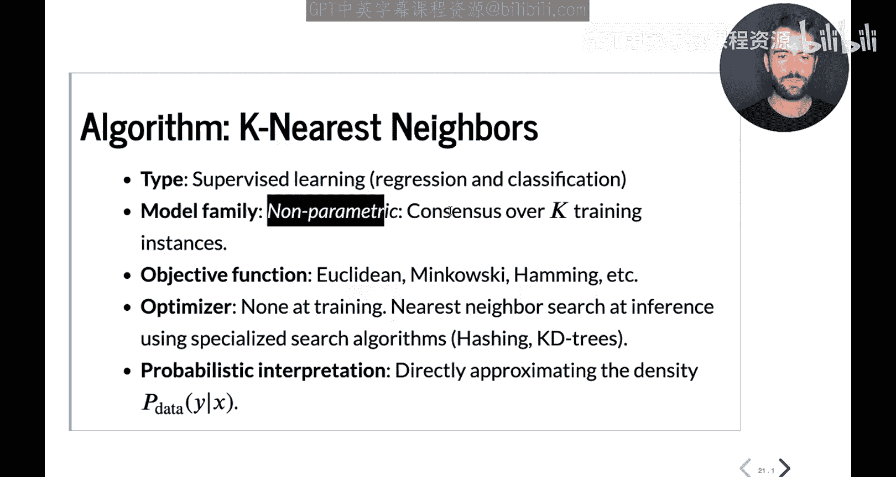

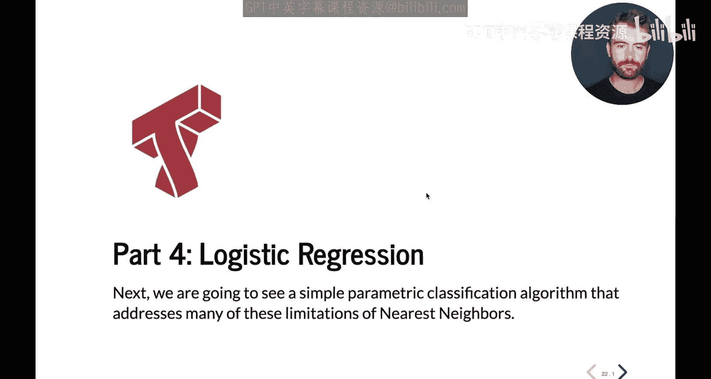