# 康奈尔大学《应用机器学习 CS 5787_ Applied Machine Learning 2020》中英字幕（deepseek p26 -26-Lecture 6. Part 4_ Logistic Regression.zh_en -BV12udzYvEFM_p26-

This is part 4 of lecture 6 of applied machine learning。In the previous videos。

 we saw our first supervised learning classification algorithm， which was called nearest Neighs。Here。

In this video， we are going to see a new supervised learning classification algorithm called logistic regression。

 and logistic regression will address many of the limitations that nearest neighbors has。

 and it's also going to be an example of a parametric approach to classification。And more generally。

 logistic regression is a very important algorithm。

 it's one of the most important algorithms in supervised learning。

 and it's something that should be part of every person's toolbox。

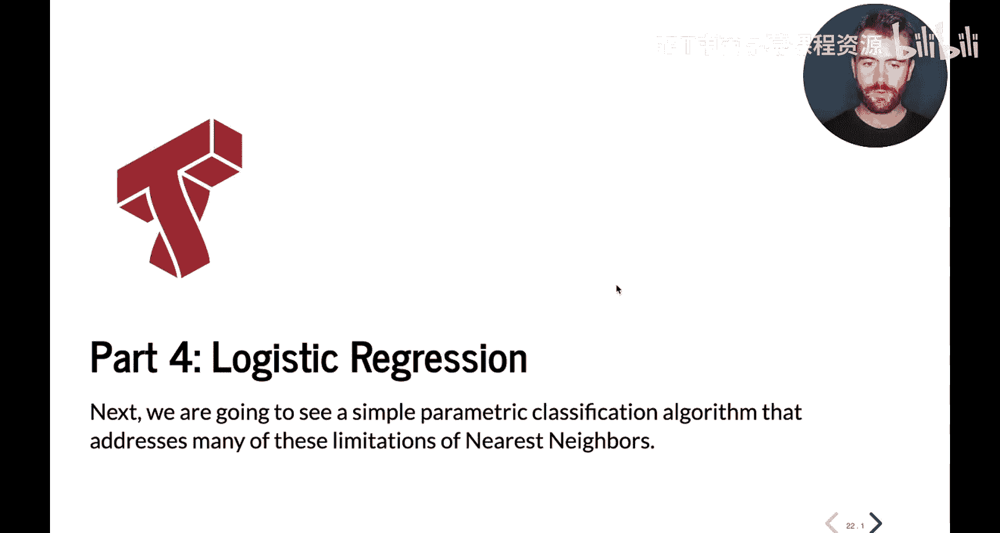

So let's start by reminding ourselves about the definition of classification in classification we have。

 or more generally in supervised learning， we have a data set， a training data set of this form。

 and if the targets Y are discrete if they take one of a finite number of possible classes。

 then we call this a classification problem。

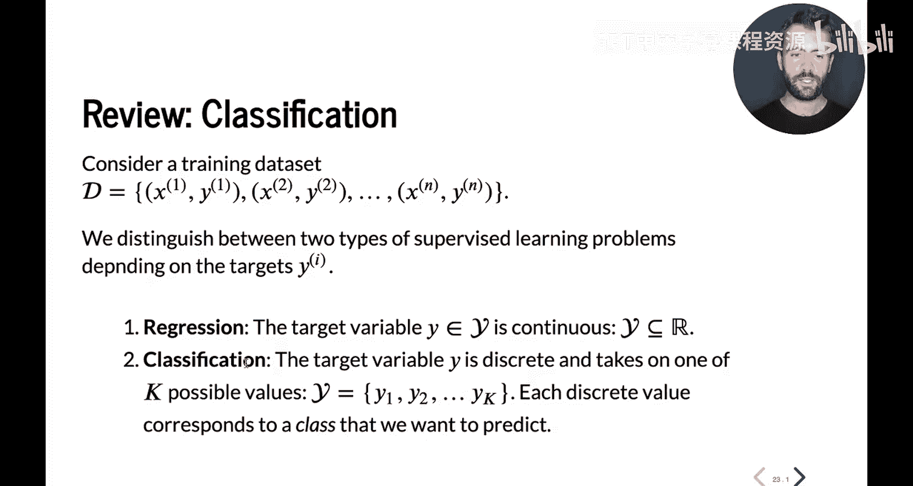

And specifically， if the number of classes equals to two， we call this binary classification。

 and in this video we are going to focus only on binary classification and we will see that regression is an algorithm that is aimed specifically at binary classification and then in the next video we will see how we can extend logistic regression to a general number of classes。

And as a running example， we will again use our iris flower dataset set。

 I'm going to load this data here， but we have seen it in earlier videos essentially this is a dataset set where each point here visualize into the as a flower and for this flower we have collected a number of measurements such as the pal length or the pal width and here I have。

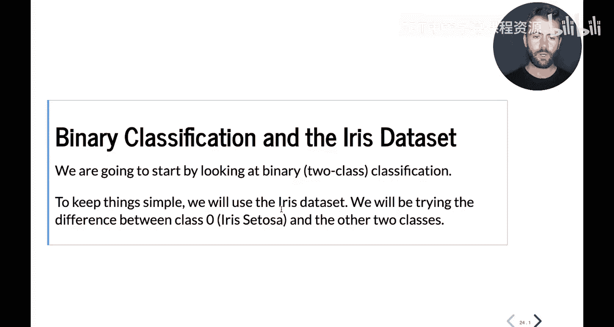

I have projected dimension this data these two dimensions which are along these two measurements which are collected for every flower and in this data we have three types of flowers but for the purposes of this video I am going to merge the two nonseosa types of flowers so we're going to be classifying iris satossa versus non-irris satossa and you can see the two classes here in different colors blue and brown these are blue as sattoa brown is non satosa and our goal is going to be to learn to distinguish between these two types of flowers。

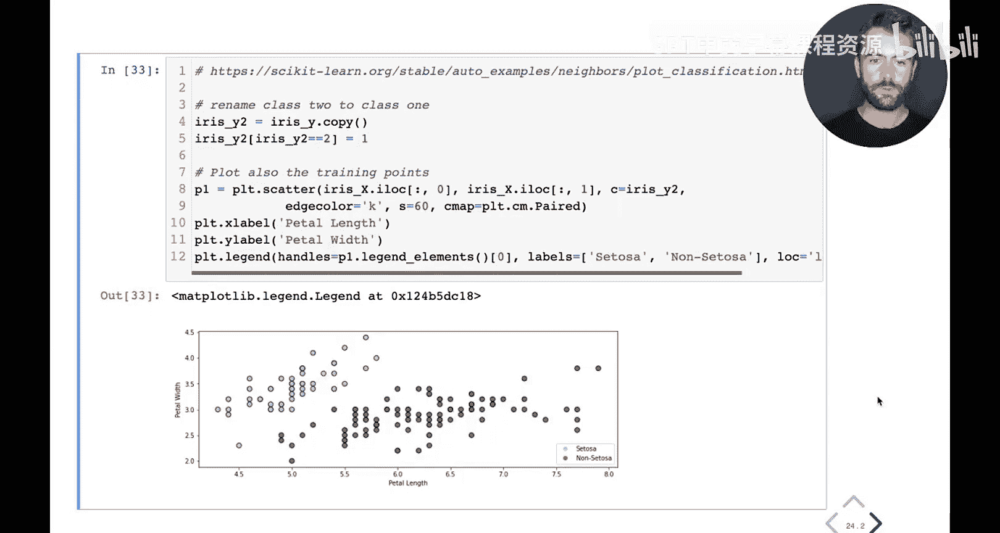

Now， one way in which we could solve this problem potentially and also using a parametric approach would be using least squares。

Recall that our least squares model assumes a supervised learning model of the following form where F is a linear function of inputs x and parameters theta。

And we fit this model using the mean squared error。

 which involves solving the following optimization problem where we're minimizing the distance between the prediction given by our model。

 which is here and the true target， which is on this side。

So if this data is a supervised learning is a supervised learning classification data set。

 then each y here is a binary target， if this is binary classification and this is a valid this is a valid approach because we're simply training our model to output a training data point to output a prediction for this training data point which matches the zero or one label。

 so in theory we could view this as a pure leader regression problem In fact we can try to solve this problem by importing our linear regression model from Psyche to learn and training it on this data set of Earth flowers。

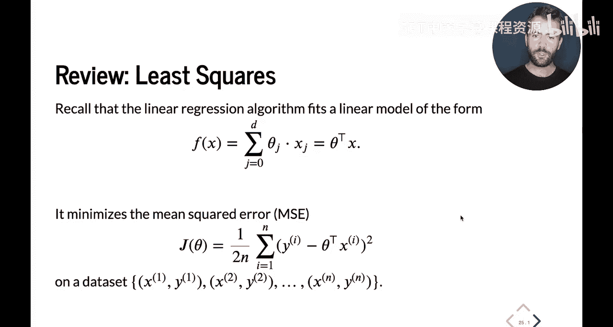

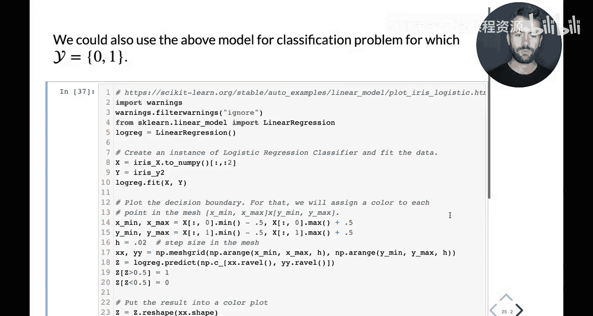

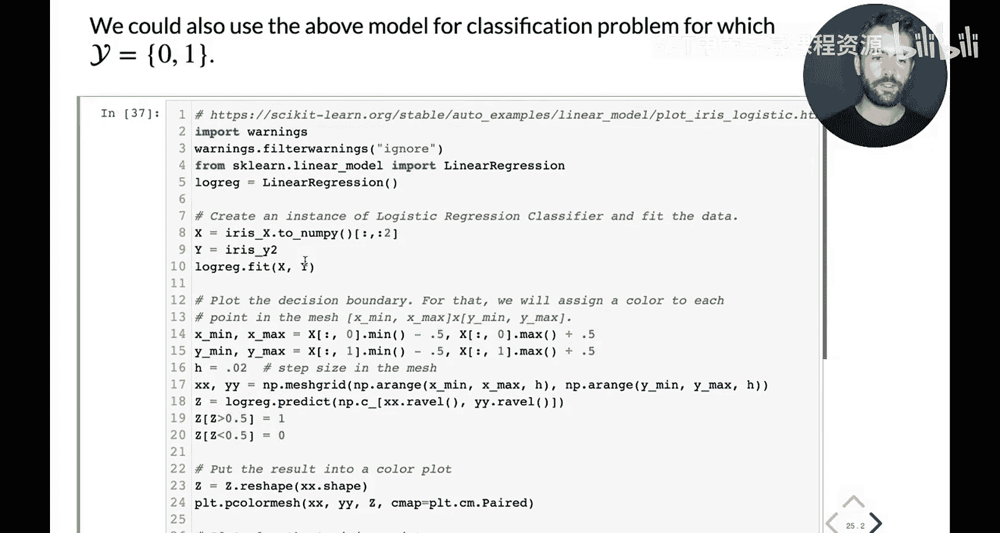

And we can visualize the results of this algorithm， and indeed， by running。

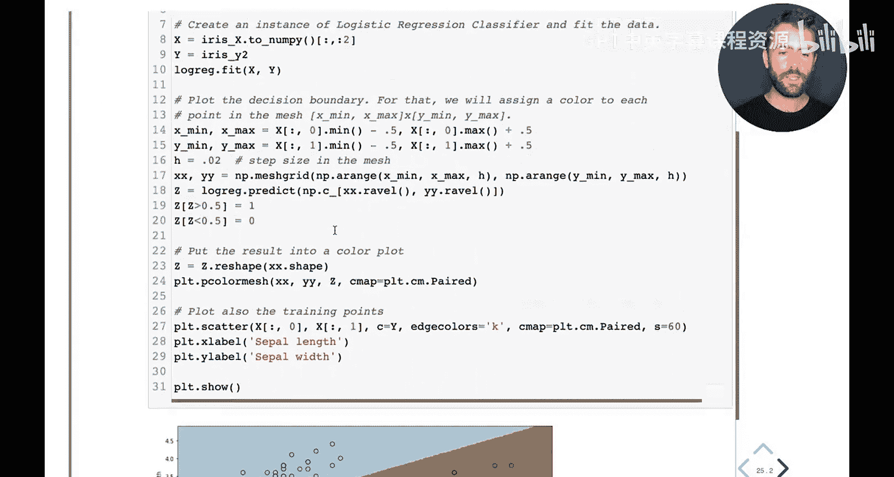

By running linear regressionggress， we obtained some separation between the two classes which looks reasonable。

 so here this is a line that we have learned by fitting a linear regressiong model of the kind that we saw earlier in the previous lectures。

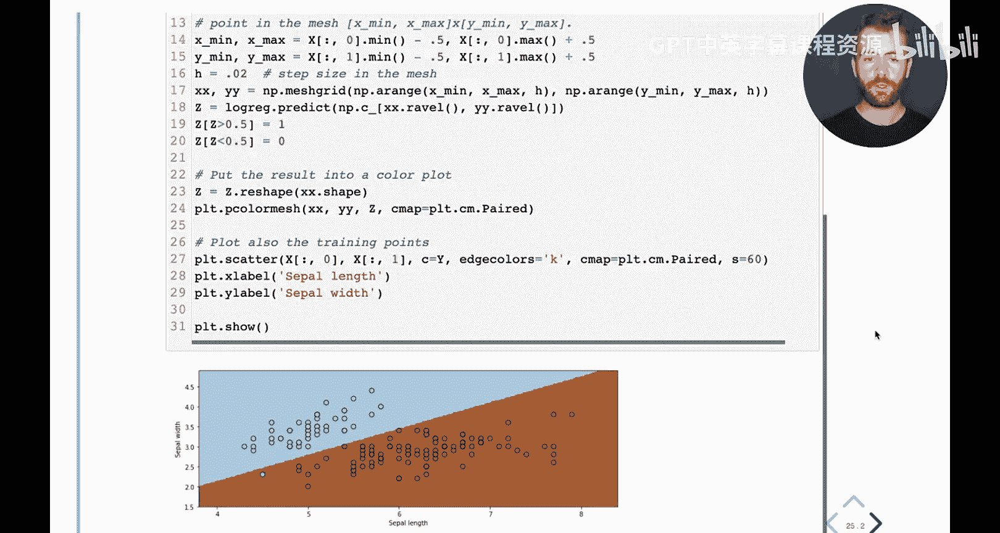

So this approach returns a boundary which looks reasonable。

 but it's also problematic for a few reasons。First of all。

 there is nothing to prevent the outputs of our of our model， which is F。

 which is simply theta dot product with x。 there is nothing to force these outputs to output labels that are either that are close to 0 or1。

 our model can output something that's greater than one that's less than 0 and this is just conceptually wrong because we know that the only two classes。

 the only two labels that we have are 0 and 1。 So conceptually， it's not a very elegant approach。

 And in practice this problem， this approach doesn't give us the best possible performance。

 If you just look at the at this。

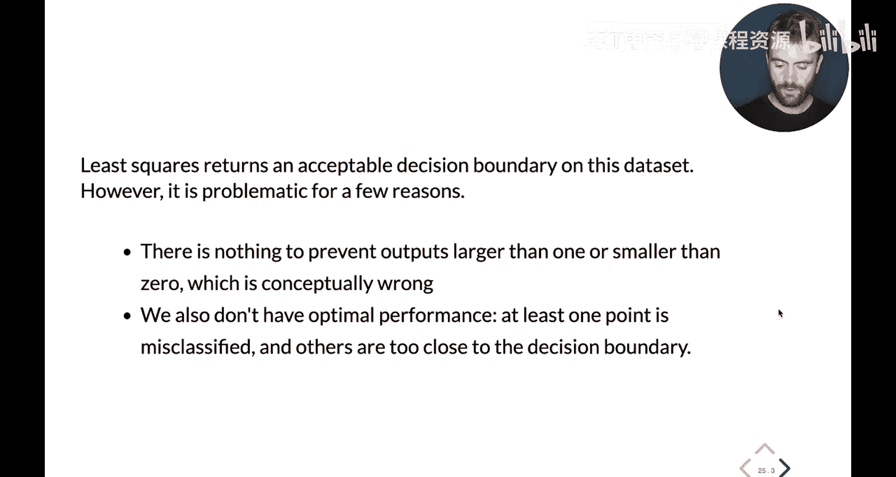

And this example here， we have a hyperplane which separates the two classes。

 But this point here is misclassified。 And these two points are very close to the boundary。

 So this is not the optimal solution。 And in practice， the fact that we're trying to。

The fact that we're trying to use this regression algorithm which assumes a general type of y and we're trying to apply this to a problem where y is either zero or 1。

 this is conceptually wrong and it also introduces errors in the data that we find the errors in the boundary that we find and it just doesn't return as the best possible solution so in practice this is not the best thing that we can do。

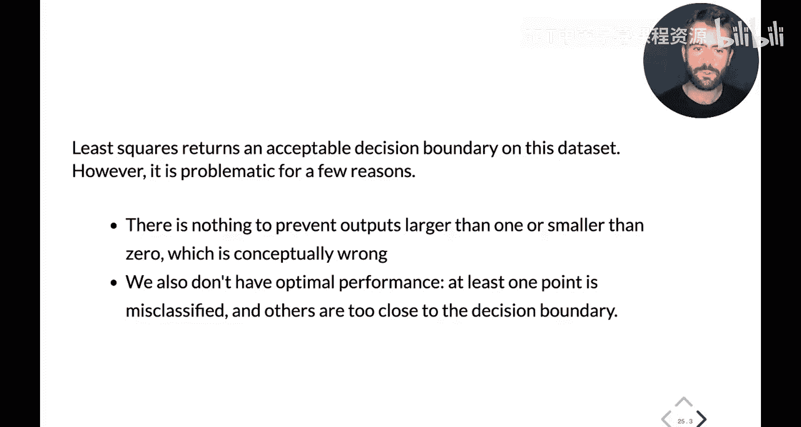

In this video， we are going to look at a different kind of model F that connects inputs and targets。

And this model will have the following form。Here our model F is going to be a function sigma of theta transpose x。

So what you see here， theta theta transpose X is our linear model。 And now we are going to feed this。

Feed the output of this linear model into this function called the sigmoid or logistic function。

 which has this form。I am going to explain in a second what this function does。

 but if we combine this function with the definition of our model。

 we have a model that takes the following form here。

 this is going to be the model family that we're going to consider。Okay。

 so we're going to assume that we're working with models that have this particular type。

Now we can better understand why we chose this particular form by visualizing the logistic function。

So the logistic function， it maps the real numbers into the interval between0 and 1。

 so it squeezes points from the real line into the unit interval between 0 and 1。

And we can define this function in Python and we can visualize it here between minus 5 and 5。

 and it takes the following form， it looks a little bit like the letter S。

 which is why called the sigmoid function， or it's also known as the logistic function。

And you can see here that when the input to the sigoid function is 0， it outputs 0。

5 and then as we approach the value infinity we。We approach so the value of the sigmma it increases。

 and then it asymptically approaches one as the input Z goes to infinity and conversely。

 it approaches。Z as z goes to minus infinity。 So here we're squeezing all the possible values on the number on the real line into a number between 0 and 1。

And this is intuitively what we want because we have two classes denoted by0 and1 and we want to output something that's between0 and 1 and if the output is not0 or 1 exactly we can interpret it as a probability or as a confidence measure how close we are to 0 and 1。

 So for example， if our model would output 0。5， then we would say that we're equally confident between the two classes if we were to output 0。

9， then we think that it's most likely the class 1 so squeezing the number between 0 and 1 is something that's really reasonable for a binary classification problem。

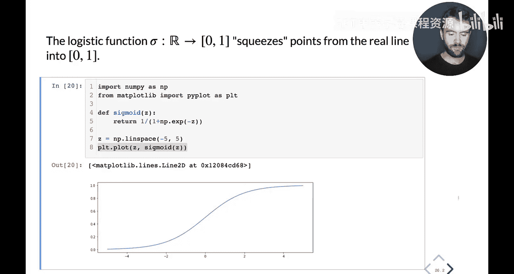

can I'm going to describe here a few additional properties of the logistic function。

 I mentioned this earlier， but again it tends to one as its input goes to infinity and0 as it goes to minus infinity。

 which makes the values between0 and 1 and it's also easy to derive a derivative for this function and you can check you can check yourself by using calculus。

 that the derivative of this function has the following convenient form so the derivative of sigma is sigma times 1 minus sigma。

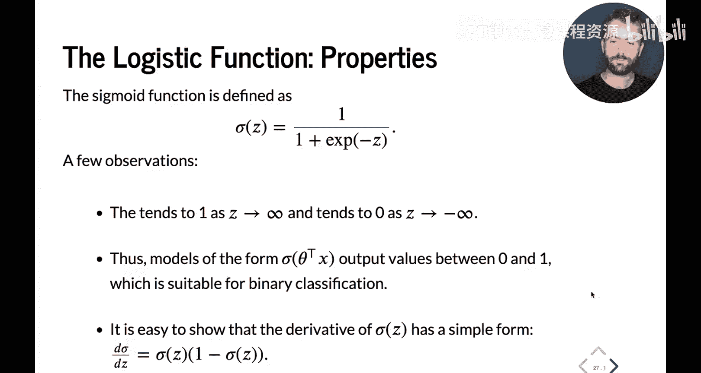

Allright and now we can use the sigmoid function to implement a model F。

 so this is a model that takes an input x and a parameter set theta。

 and now the output of the model is simply sigmoid times theta dot product with x。

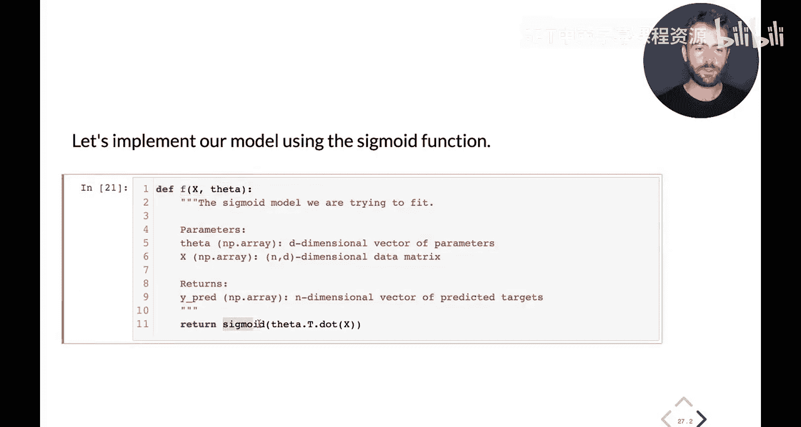

So we have defined so far our supervised learning model。

Now our goal here is to define a supervised learning algorithm。

 therefore we still need to define an objective function over the set of all the possible models that we in the class that we have just defined。

 and then we have to define a way of optimizing this objective in order to find the best fit the best model within the class according to our objective。

So what objective would be appropriate for this model class that we have just defined？

In order to define an objective， we're going to follow the probabilistic approach to classification。

 which we have discussed in the previous lecture。So we're going to start by。

Giving a probabilistic interpretation to our algorithm。

And then we're going to apply the principle of maximum likelihood to derive an objective。

So we can interpret， and I just alluded to this earlier， we can interpret the output of our model F。

 so we can interpret sigma of theta transpose x as a probability。Because it's between 0 and 1。

 we can interpret this number as the probability that the class is1， according to our model。

 and then conversely the probability of it being0 is simply going to be1 minus theta1 minus the sigmoid function。

 so 1 minus the output of the model。So here I have assigned a probabilistic interpretation to our model。

 or in other words， I have now defined a probabilistic model which has this form here on the right that is specified by the function I just defined earlier。

And we can also think of this as parameterizing what is called a Bernoulli distribution。

 So a Bernoulli distribution is simply a probability over a variable that takes two outcomes and this probability distribution has the following form and has a single parameter P。

 and now we are simply parameterizing P as。As this particular via this particular expression。

And if you watched the videos from lecture 5B， you saw that we took a similar approach to define a probabilistic interpretation of the Gaussian to define a ballbilistic interpretation for least squares by parameterizing the mean of a Gaussian distribution here in the same way we're parameterizing the one parameter of a Bernoia distribution。

Alright。 so now we have defined the following probabilistic model。

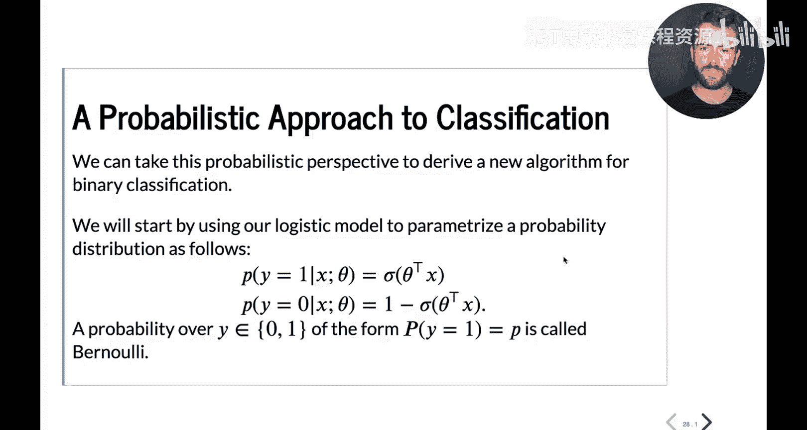

And we can also write this model a little bit more compactly in this form since y is either 0 or 1。

 we can write it in this form and if y equals 0， well here we have something to the power of0 that's1 and here this is to the power of1 so we have。

We essentially recover our definition。 This is just a bit of a convenient notation。

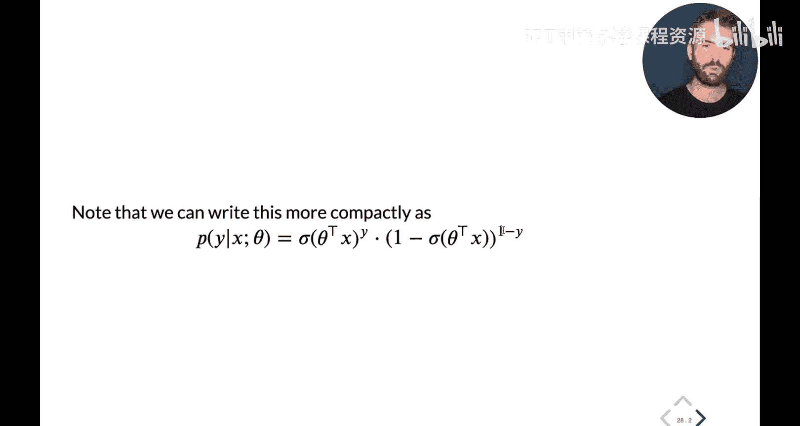

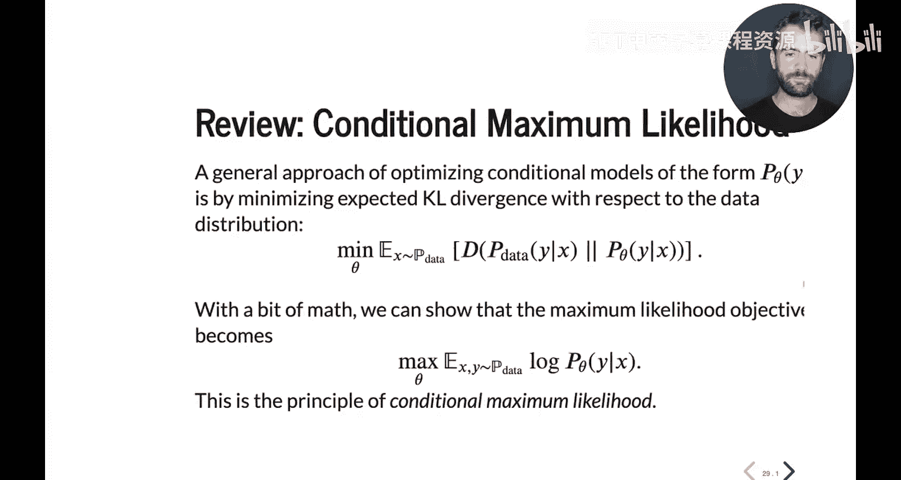

And now that we have a definition of our a probabilistic model。

 we can apply the principle of conditional maximum likelihood to obtain an objective for this model。

So recall that the definition of conditional maximum likelihood is the following objective where we are choosing a set of parameters theta such that samples Xy from the data distribution have high probability。

And optimizing this objective， maximizing this objective is equivalent to minimizing the expected KL divergence between the prediction between the distribution over y that's given by our model。

Relative to the distribution over Y that's the that's specified by the unknown data distribution。

So this is a very general objective that is interesting for many reasons。

 in addition to optimizing the scale divergence， and so we are going to use this objective as our objective for training our model that we have just defined。

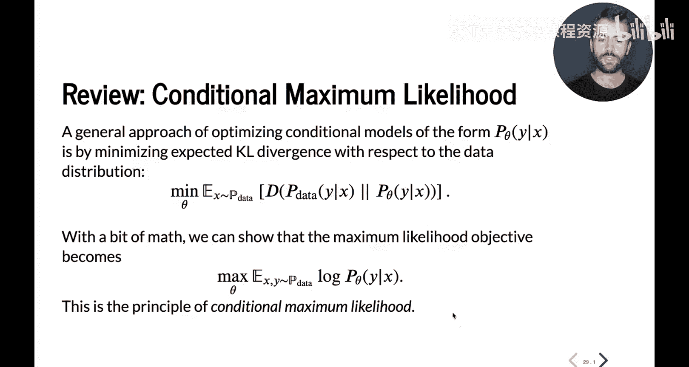

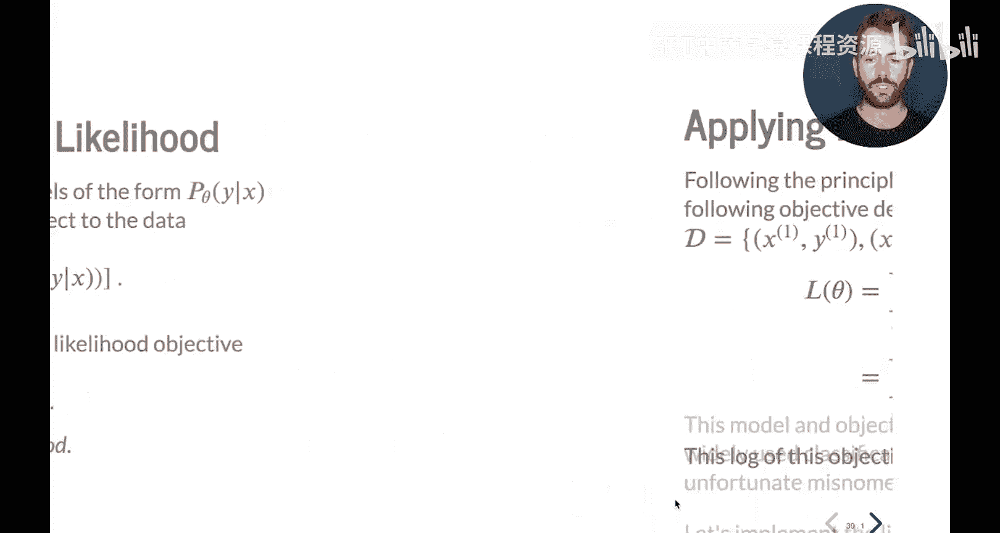

So if we apply the principle of maximum likelihood， we obtain the following objective。

 we obtain the following likelihood， which is so given a data D。

 this is simply the probability of each Y given x under our model and now here I'm just plugging in the definition of the model that we have given earlier and we obtain the following objective。

We're going to be working with the log of this objective， and in that case。

 it is also known as either the log loss or the crossenttropy objective。

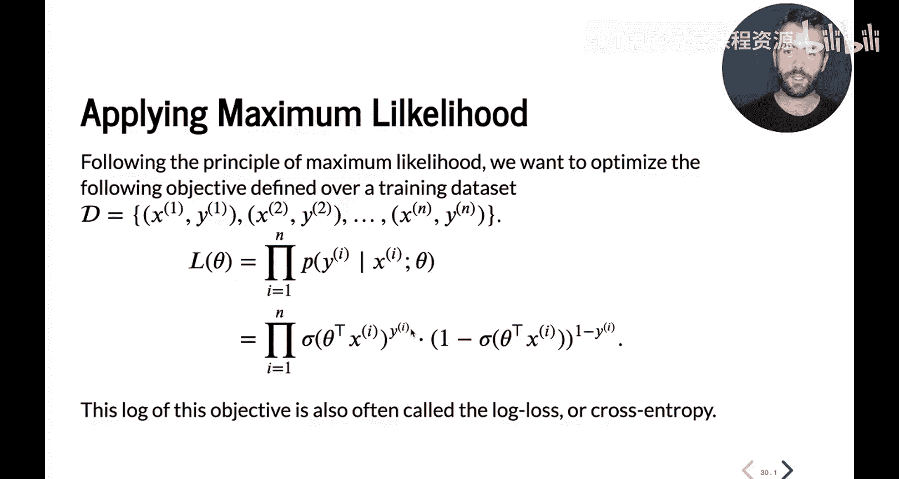

So together this model and objective and I will define the optimizer in a second。

 but it's going to be gradient a descent in this model and objective function。

 they define an algorithm called logistic regression which is one of the most widely used classification algorithms now this is important to note that even though the algorithm is called logistic regression。

 this is a misnomer， it is not a regression algorithm and it's actually a classification algorithm and it's an unfortunate historical fact that this algorithm ended up being called logistic regression。

 it is an instance of regression if you invert the sigma and you're fitting the。

The if you apply the interests of Sigma on both sides of this classification problem。

 then you might have something which looks more like a regression problem。

 this is not really important， we should just remember that logistic regression is a classification algorithm。

So we can implement this objective very easily in Python here。 this is the log likelihood。

 and it has the following。Form here， which is simply applying the definition that we saw earlier and implementing it in Python。

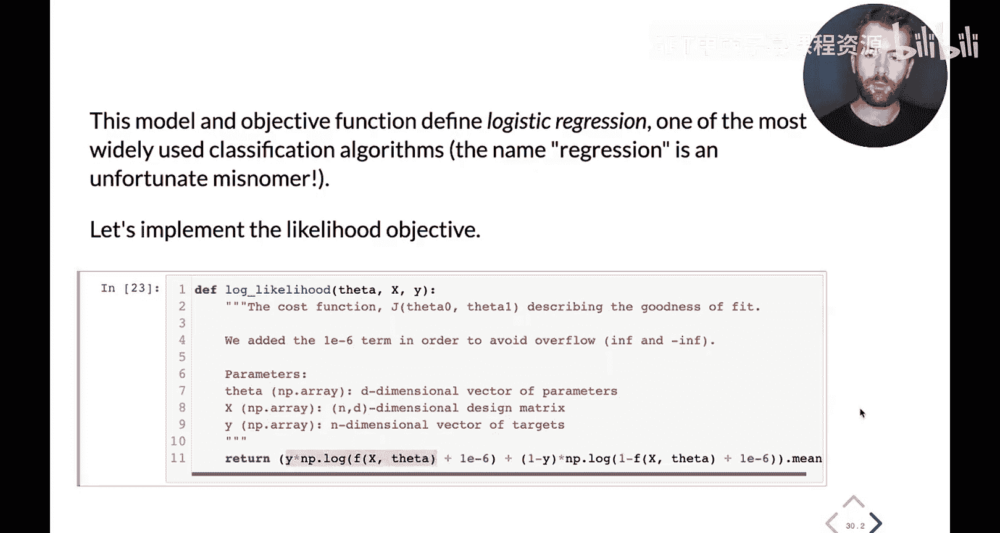

Now， as I mentioned earlier， in order to optimize this objective。

 we're going to use gradient descent， which is a general purpose of optimization algorithm that we saw earlier。

And you may recall that the definition of gradient descent consists in repeatedly applying the following rule。

 so here if we're minimizing J， we are going to be applying the following function where we repeatedly take steps in the direction of steepest descent as specified by the gradient J。

And if we implement this in pseudocode， then we have something which looks like this。

 this looks very much like Python。嗯。So we repeatedly move in the direction of steep as descent as specified by the gradient。

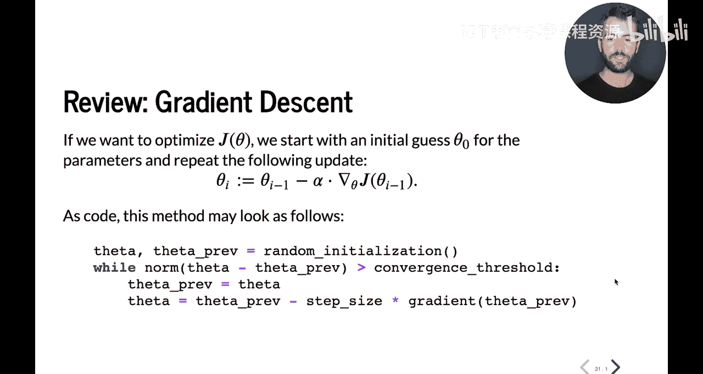

And in order to apply the principle of in order to optimize the log likelihood。

 we need to compute the gradient of this objective。And in order to compute the gradient。

 we need to compute the partial derivatives， so recall that the gradient is the vector of partial derivatives。

 and now we need to compute a form for each partial derivative of the log likelihood。

So you can convince yourself that the log likelihood as the following form here in the first line。

 I have simply used the definition now here I have。

I have used the definition of the log to make this a sum of two terms and now taking the derivative of these two terms。

 we have the following expression， which is maximized by what was inside the term。

 which is this this thing here， now in this line， I am applying the definition of the gradient of logistic regression。

 which I showed you on the earlier slide。And we still have to multiply by here this is theta x here on this side and now taking the final derivative。

 we have this form， so this is nowops this line here now looks like the definition of our gradient。

 except that we can also make a little bit simpler by again using the fact that y is either1 or0 and the fact that the upper of our model is this expression。

 you can convince yourself that when y equals1。Well。

 this term is0 and now we have1 minus the output of the model。

 so we have this form and similarly when y equals0。

 then we only have this term and this again looks like the following expression。

 so if you work through this math， you will see that the gradient or sorry the partial derivative has the following form。

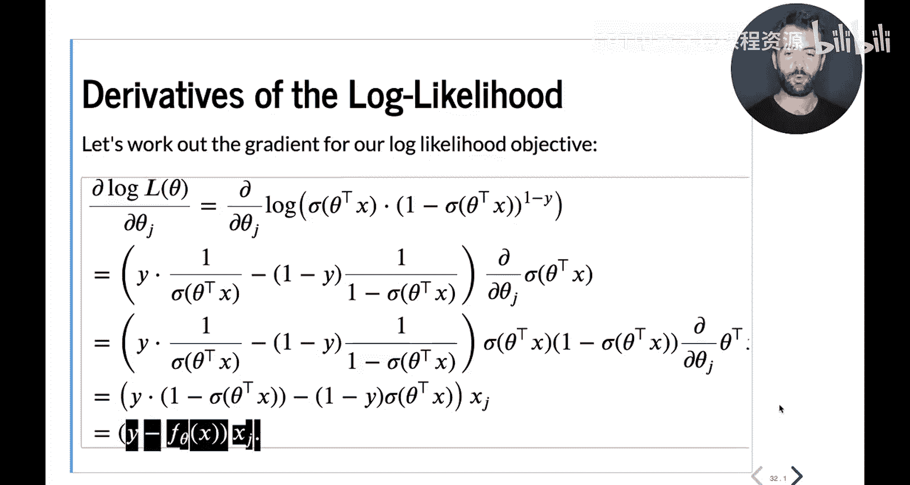

And now we can combine all of these partial derivatives to obtain the gradient。

 which will have the following form。That you see here。

And it's interesting that this expression has a really similar form to the gradient of the mean squared error that we saw。

 There again， we had the difference between Y and F times the vector times the input X。

 this was our gradient2。 But even though it has a similar form， this is actually a different。

This this is going to be a different， it will take a different value because the function F here that we're using is different if we're optimizing for logistic regression。

 F is going to be a logistic regression instead of a linear model but it's interesting that it has a similar form and there is in fact a theory which we will not be covering here but there's a theory of what are called a generalized linear models which can explain why the form remains the same but for now this is just an interesting observation and again there's also an intuitive interpretation for why we would have this term here because we are interested in minimizing the difference between why the output so it's normal that we're scaling by this difference。

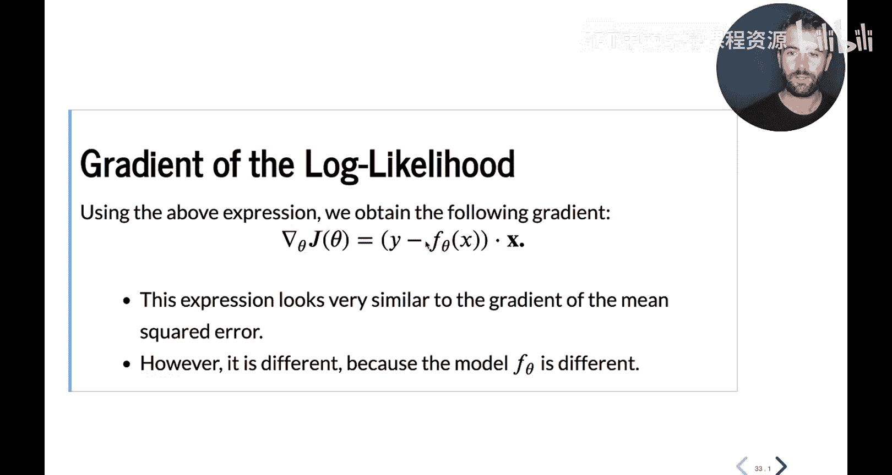

Again， we can easily implement this gradient in Python。 This is again very short。

 we're using Nmpy to implement this in one line of code。

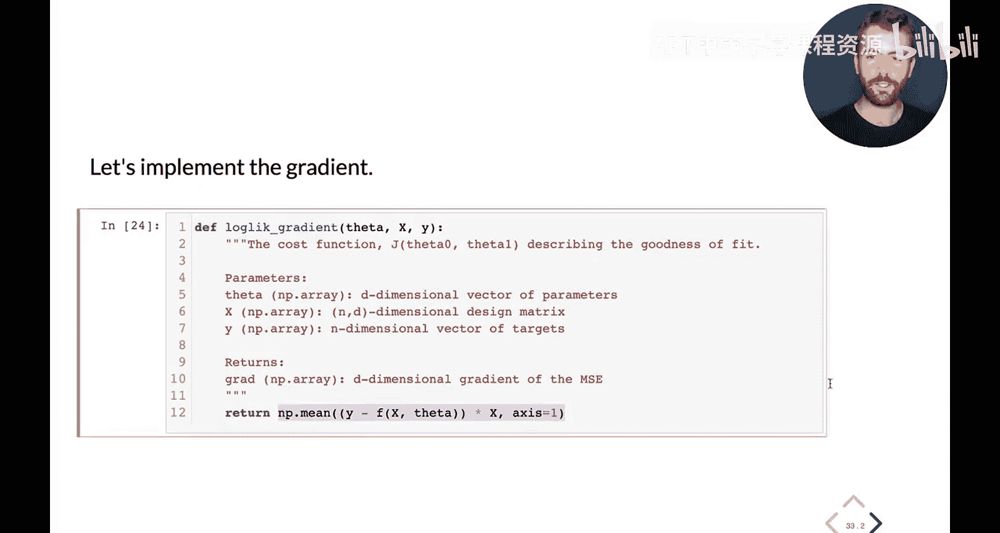

And now plugging in this into our definition of gradient descent， we have the following expression。

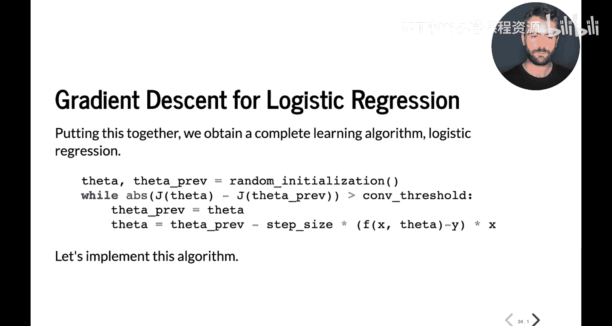

And now we can also implement this algorithm very easily in Python。

So here I have essentially just reimplemented the episodesoda code from the previous slide and I have also added a few extra lines of code to store the gradients and the optimization points and to print out progress and now if I were to run this I am going to be optimizing the log likelihood over a number of iterations and as we train the log likelihood increases because we're maximizing it and in the end after a number of iterations the output of we have attained the maximum set of weights。

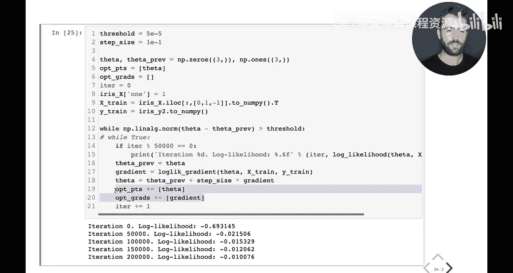

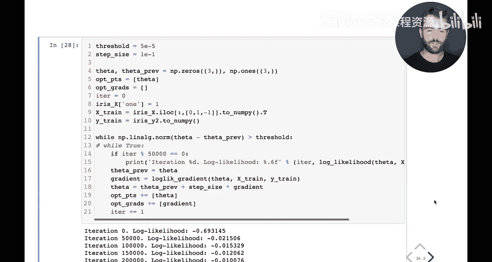

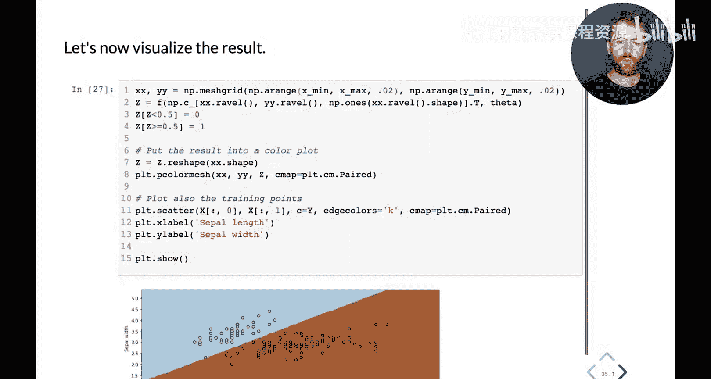

And now in this figure， I am visualizing the output that was found by logistic regression and。

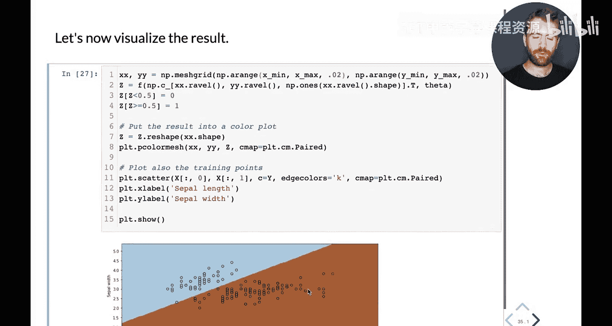

It it is simply the line that you see here between the blue and the brown regions。

 so logistic regression has found this linear decision boundary between the two classes and we are assigning the points in this area as being go class I think this this is one class in blue is the other class and now we have perfectly separated these two classes this point here is correctly classified and and so now we have you can also see that the dissolution is better than what we have found using linear regression we are able to perfectly separate the two classes。

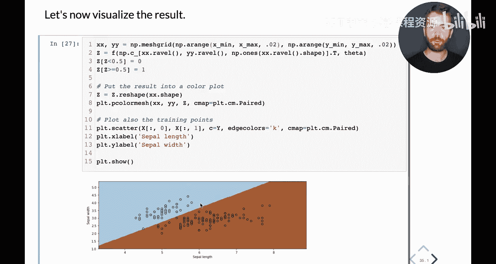

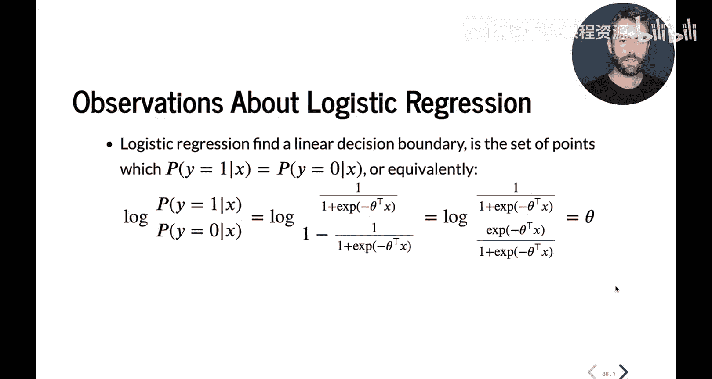

I will make a few observations about logistic regression。

 One observation that I would like to make is that the fact that the fact that our。嗯。

The fact that the decision boundary was linear is not a coincidence。

 Log regression is still an algorithm that finds a linear decision boundary between the two regions。

 and we can convince ourselves。That this is the case by visualizing this via the following expression。

 so here I have the ratio of the two classes and at the boundary this ratio is equal and then if we work out the math well。

This。This is， unfortunately， my slides are a bit are a little bit cut off here。

 but this is going to be theta transpose X。 and this is simply the。

This is going to be a linear function， so this ratio is going to be of the two probabilityba is going to be a linear function。

 which means that our boundary is linear。Now， the other important distinction is unlike least squares which we saw earlier。

 we do not have a closed form solution for the weights theta。So with a least squares model。

 we were able to optimize our mean squared error objective directly in closed form。

 and we had a close form expression for the optimum that we obtained via the normal equations。

 we no longer have this closed form solution for logistic regression。

 which is why we have to optimize it numerically using gradient descent。

 and this is the example that you saw earlier。

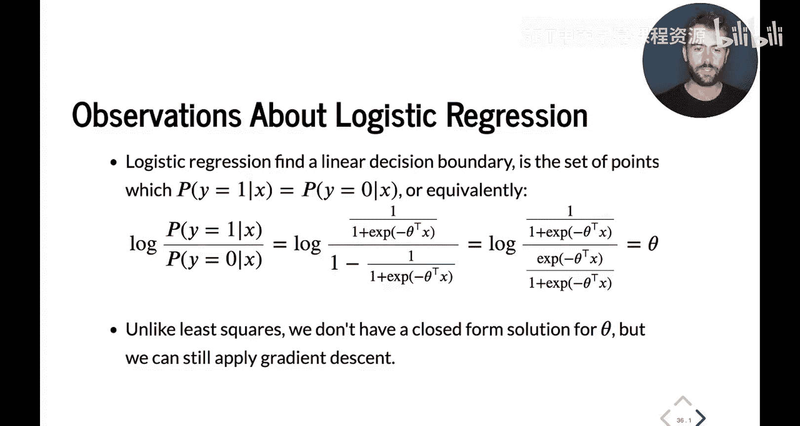

So summarizing what we saw in this video， we saw logistic regression。

 which is a type of supervised learning and that is applicable for binary classification again this regression is an unfortunate misnomer。

 this is actually a classification algorithm。And we're looking at the model families which consists of linear decision boundaries between the two regions。

 and we're training this using maximum likelihood， which in this case is also called the crossenttropy。

 we're optimizing this using gradient asscent and we can view this from a probabilistic perspective as fitting an approximation to a parameterized Brnouli distribution。

In the next video， we are going to see how we can extend logistic regression to multiple classes。

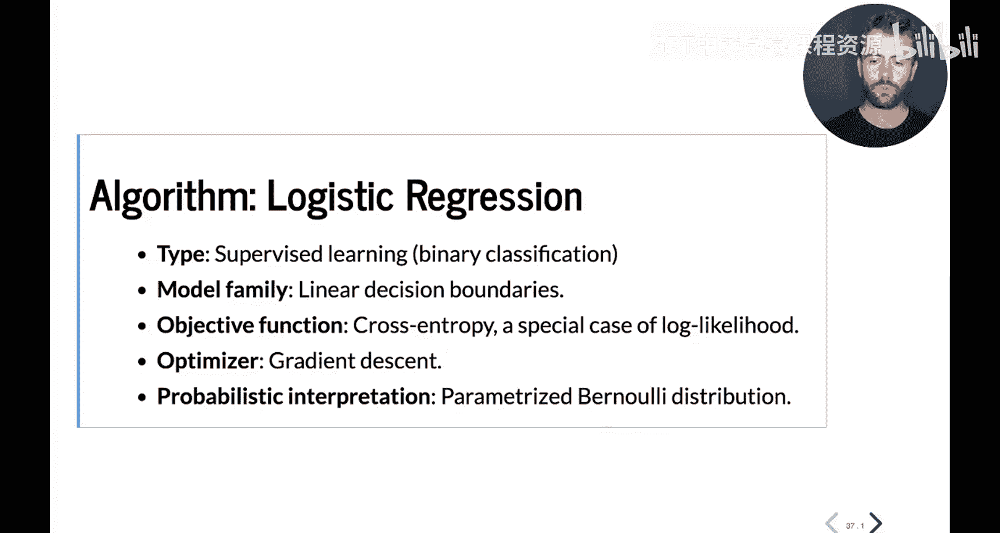