# 康奈尔大学《应用机器学习 CS 5787_ Applied Machine Learning 2020》中英字幕（deepseek p27 -27-Lecture 6. Part 5_ Softmax Regression.zh_en -BV12udzYvEFM_p27-

This is the fifth and last part of lecture 6 of appliedli machine learning。In this video。

 we're going to look at multiclass classification。Previously。

 we saw an algorithm called logistic regression， which is an important and widely used algorithm for binary classification and in this video we're going to see how to extend logistic regression to an arbitrary number of classes k。

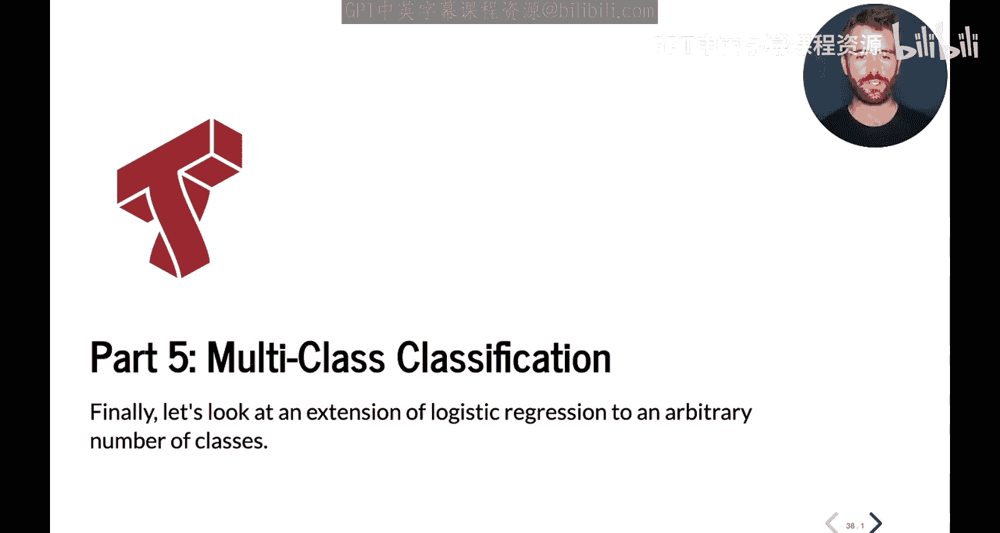

Now recall the model that we have defined earlier， logistic regression。In logistic regression。

 we assume that the function F that maps inputs x to targets y takes the following form。

 which is a transformation of a linear function of theta and X and this transformation is the sigmoid function essentially the sigmoid function takes a real number that's given by theduct product of theta and x and it squeezes in。

 it squeezes it such that it is between 0 and 1， this is what this function does and when we put it within within this function F。

 we have the following form。

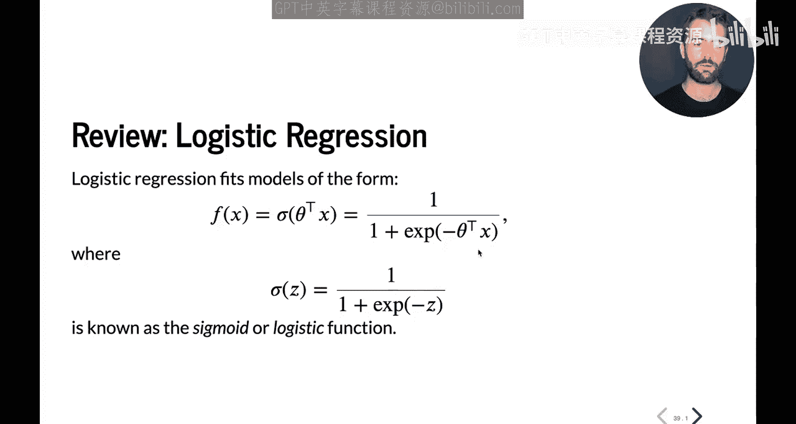

So how， how can we extend this function to。To multi class classification problem where we have an arbitrary number of classes k。

Well， one simple approach that we could use， and this is an approach that is reasonably often used in practice and that can be applied to any machine learning algorithm。

This approach consists in training one classifier against all the other classes。

And we train one classifier per class to distinguish that class from all the other classes。

 it's called the one versus all approach。We in fact。

 in a way did this in the previous video when we trained a binary classification model to predict Satosa from nonsetosa flowers and similarly we could have trained a model to so let's say Satosa was class zero and the other two classes were1 and2 well we could have also trained a model to distinguish one from0 and 2 and we could have trained a third model to distinguish class 2 from class0 and 1 and this would have given us a way of。

Of distinguishing the three glasses。This approach works and is reasonably often used， but。

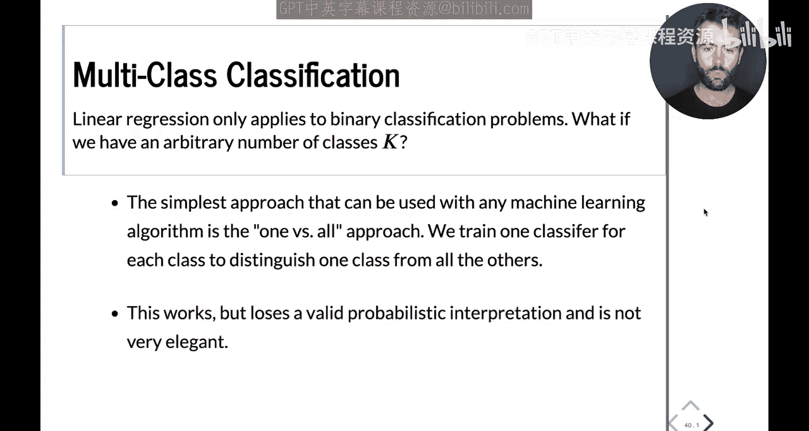

From a conceptual point of view， it is not。It is not fully satisfying and it's not entirely elegant。

 and in particular it loses the valid probabilistic interpretation that we had earlier for the logistic regression algorithm。

For some algorithms in machine learning， this one versus all approach is the best we can do。

But it turns out that in the case of logistic regression。

 we may fit a different model that is also going to be a probabilistic model that is a generalization of logistic regression and that directly outputs multiclass probabilities。

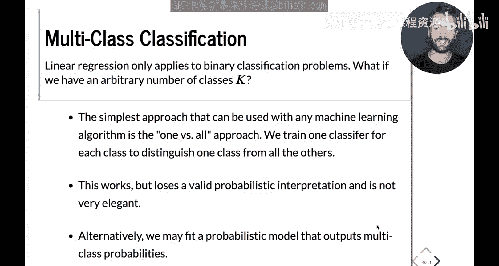

As an example to illustrate this algorithm， we're going to again use our IIS flower data set and here we're going to use the full version in which we have the three classes again here each point is a flower for which we have different measurements and we have。

We're showing these flowers in blue， light brown and dark brown。

These colors represent our three classes。

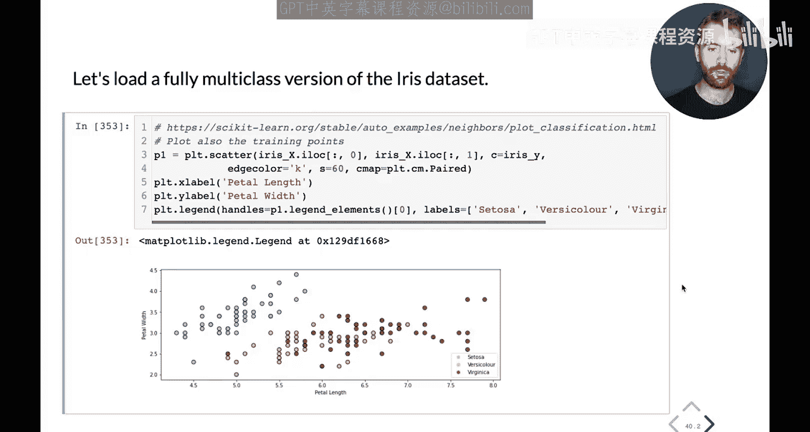

In order to generalize our logistic regression algorithm to multiple classes。

 we're going to take a similar approach to the one that we took in the previous video。

And our first approach is going to be to extend the logistic function。

 so you may recall that the logistic function it was a mapping from the real numbers to the unit interval 0 and1。

 and it can be seen as mapping each input Z to a probability。

We now want to generalize this to multiple classes。

 therefore we're going to define a multiclass extension。

 which I'm going to denote here with this extra arrow on top now this is the multiclass version and now it maps a K dimensional input into a K dimensional vector probabilities so if we have K classes we provide it with K inputs and we have as an output K probabilities for this function。

So how are we going to define this new multiclass extension？

We're going to use the following expression， and this is something that is going to be called the softmax function。

Essentially， the softmax function is so as I mentioned， it's a vector valued function。

 it outputs a vector of k probabilities， and each component denoted here by a lower case k has the following form。

So here the case component is。Well， let let's first define what this function does in two steps。

 First of all， this function looks at all the components of Z and it applies to them the exponential function。

So we look at each component of the vector Z， the input vector Z， and we exponentiate it。

 which gives us this expression for the case component。

And this is useful because it makes Z non- negativeg and if we're going to be using probabilities we need non negative numbers。

 so now all the components are z are non negative and the remaining step we need to do to make it a probability is just to make sure that all the non negative components sum to one and we do that by simply normalizing by the sum of the components。

So again here， in order to obtain this expression， we have exponentiated all the components of Z and then we have normalized all their components by their sum。

 such that the sum across all the components of this new vector sigma of Z such that the sum of these components equals to1 this is called the softmax function and there are also other ways of deriving this function。

 but this is an intuitive explanation for why it's reasonable。

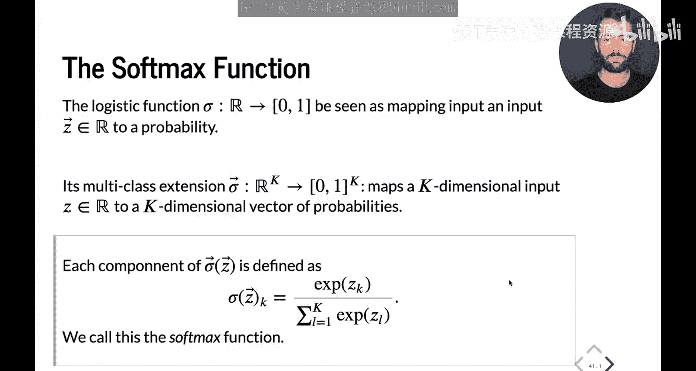

Let's now look at a special case of dysfunction when k equals 2。 when we have two classes。

In this case， we have the following expression where the first component of。

So the probability of the first class has the following form。And now， observe that。This expression。

 it takes the same value if we multiply each Z by。By some number。

 So if we were to multiply both the bottom and the top by an arbitrary scalar A。

 then we would still have the same distribution。 we would simply rescale it。

And since we're simply rescaling this distribution， so in a sense it's over parameteraized。

 we have an extra parameter right if we were to multiply z by Z 1 and Z 2 by2 we would still have the same set of probabilities so in a sense we have an extra parameter and in order to avoid this this over parameterization。

 we can arbitrarily set one of these probabilities to1。So， we can assume that。呃。

The exponential of Z1 equals  one。Or in other words， we can just divide。

On both sides by exponential of Z1 and this will cancel off。 this will cancel off。

 And we're going to have a different number。 So here I should denote this Z2 prime because this is a slightly different Z2 from before。

 But essentially we can assume the following form and as we go across all the values of Z2。

 we're going to be able to express the same set of probabilities。

 So here I have just simplified this expression by setting Z1 to be by setting。

By setting Z1 to0 essentially， arbitrarily because Z1 is an extra degree of freedom that we don't need。

 we just need Z2 and this will be enough to define all the possible probabilities for the two classes。

And now you can see that this form is really similar to what we had before for the logistic function。

 except that we don't have the minus here， but even if we have the minus。

 it doesn't change because this is an arbitrary input so it doesn't really change the set of it's essentially just flipping the function。

 it doesn't really change change much and we could use this function also as our。

As our probability this we can use this instead of the logistic function equally well。

 and this shows that the softmax is essentially a generalization of the sigmoid function。

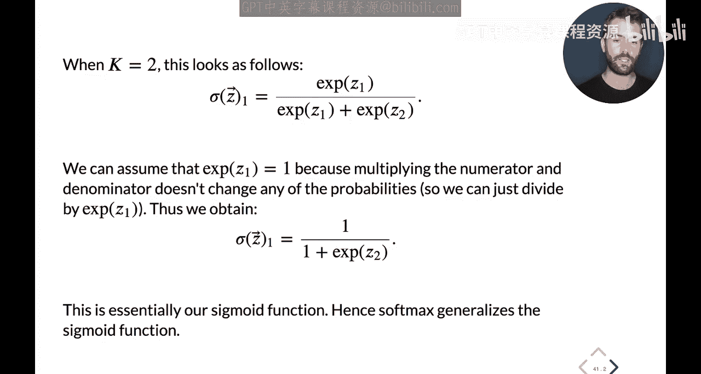

So now let's use the sigmoid function to define a model that we can use in K class classification。

Recall that in the binary classification setting， we assumed the following form where we had weights and features and we would map their dot product into a probability by applying the sigmoid function。

 so we would look at theta transpose X and we would apply the sigmoid to obtain the following expression。

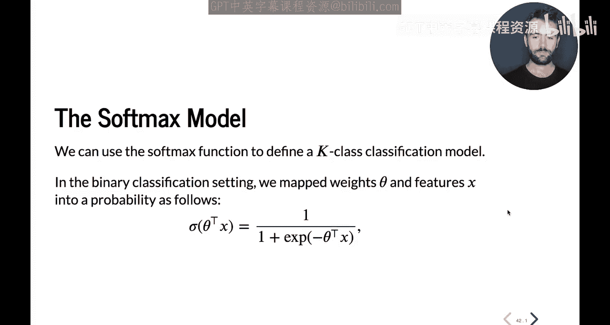

In binary classification， we are going to do the same， except now we're going to。

 so we will define a model。Well， in the multiclass setting， our model， instead of outputting。

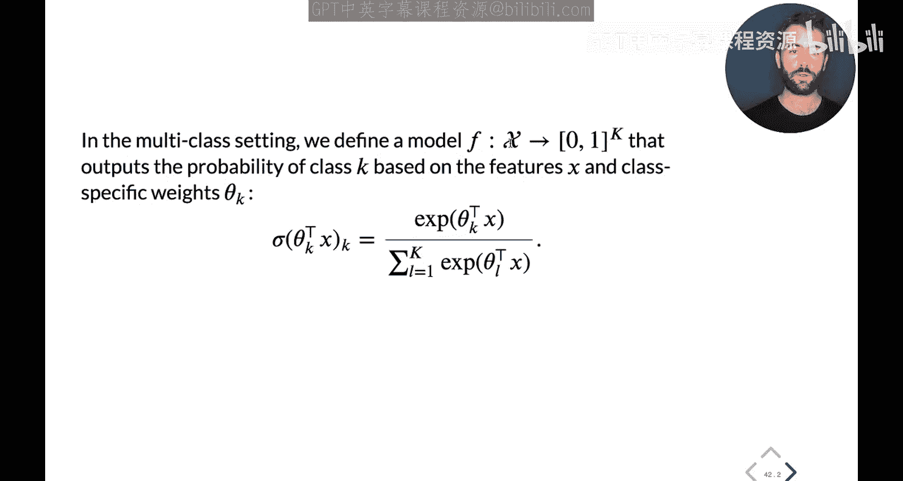

So here F outputs a single probability now in the multi class setting。

 we're going to output K probabilities。

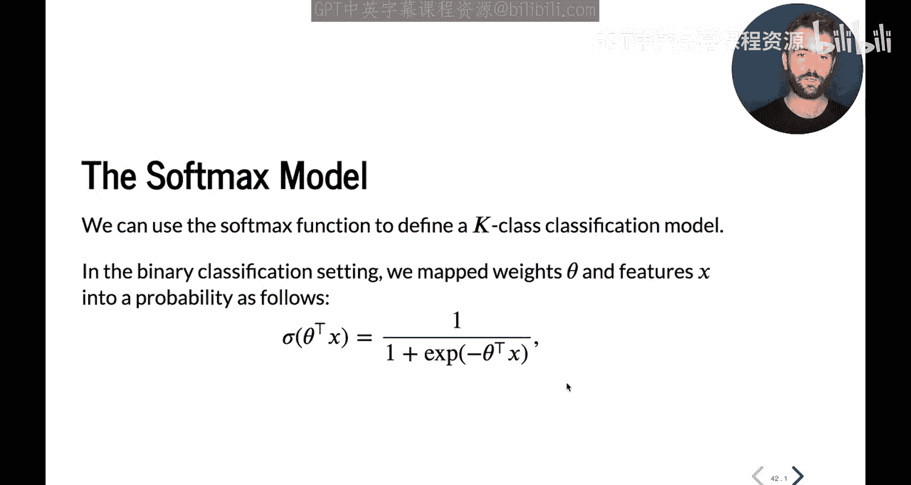

And the probability of each class K is， again， going to be the soft max。Of。X。

When we take the dark product of x with some set of weights， theta sub K。

 where we have one set of weights for each for each possible class。 So in other words。

 given an input， our model， its set of parameters is k times is is。Instead set of parameters are k。

K instances of theta。 so in logistic regression， theta was simply the set of d dimensionsional wheel numbers and now the set of parameters for our multiclass model is going to be k times this set of parameters。

 so we're going to have one vector of parameters per class。Then given an input X。

 we're going to compute a score for each class by multiplying it with its parameter theta。

So each class will have a score that's theta k times x。

And then we will simply normalize the scores and convert them into a probability by applying the softmax function that we saw earlier。

 and this gives us the following expression， and this is going to be the definition of our softmax model。

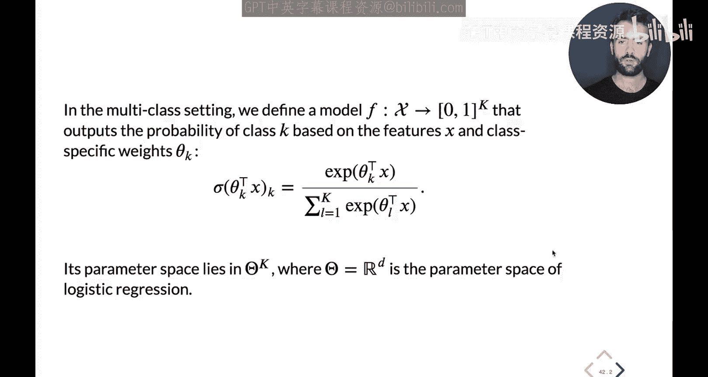

And again， I want to highlight that this expression is slightly over parameterameterized。

 we can multiply the top and the bottom of the previous expression by the same number to obtain an equivalent set of probabilities。

 and so in practice in softmax with the softmax model。

 it is common to assume that one set of weights is fixed to zero。And now these two。

 well now we have ther model， and in order to define an algorithm。

 we need to define an objective and an optimizer。And for the objective。

 we're going to again derive this objective from a probabilistic perspective。

Just like we did for a logistic regression， we are going to use our softmax model to parameterize a probability distribution as follows。

So here we're going to again interpret each component of the softmax function as a probability because it's between0 and1 well it's between 0 and1 and all these components sum to1。

 therefore our softmax function gives us a valid vector probabilities and。

We can define a probabilistic model that is a probability function where y takes each of these k classes and we assign the probability of the case class to be this model。

 This can also be seen as parameterizing what is called a categorical distribution。

 a categorical distribution is an extension of the Bernoulli， the Bernoulli。

the Bi distribution in the Bnoi distribution， the variable in question that follows the Bnoi distribution can take one of two possible values and in a categorical distribution it can take。

A number of K possible values， and we're parameterizing each of these by。

The following expression by this expression here， so now this defines a probabilistic model over the K possible values Y can take。

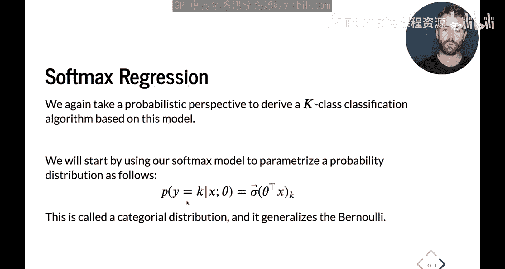

And again， we can apply the principle of maximum likelihood to obtain a training objective which looks as follows。

 Again， this is simply the probability of the training set。Under our model。

 and now by optimizing for this set of parameters theta。

 we have an algorithm called softftmax regression。And again。

 we can perform this optimization using gradient and descent， this is how it's typically done。

And as in logistic regression， the term regression here is a misnomer that is actually a classification algorithm。

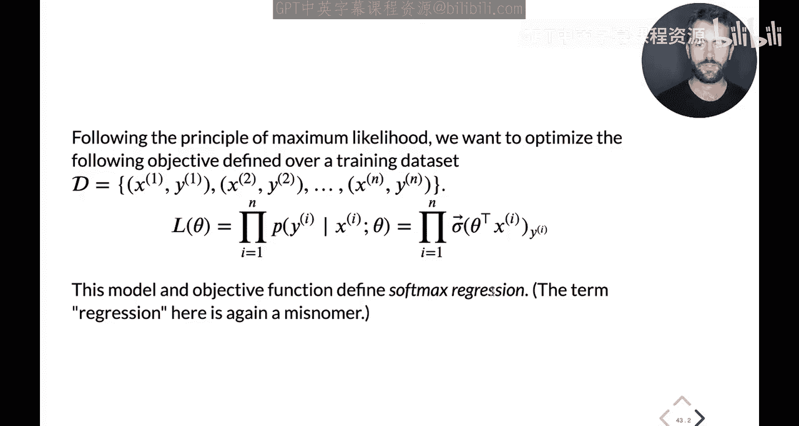

I'm not going to implement selfm regression from scratch， but you can see here the the definition of。

Softm regressiong you can see here how we can apply softmax regression by calling the implementation psyitLar so in psyit learnar actually Somax regression is part of the logistic regression class except that we have to specify that it's multiclass and now we can fit the model on our ir data set this is now the full data with the three types of flowers we can generate predictions from this model。

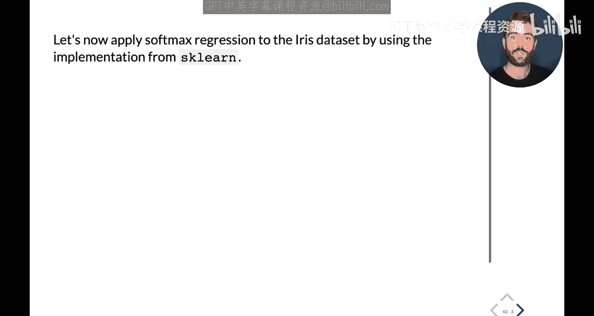

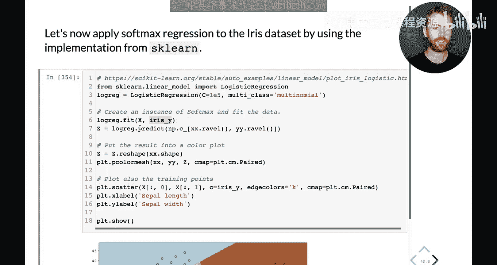

And now I can visualize the decision boundaries and the partition of the space。

 and they take the following form。So here we have， again， a hyperplane。

That separates the Setosa flowers from the rest， and now we're also separating the two other classes through this line。

 which is quite reasonable given the data that we have。And again。

 you should notice that these are straight lines and softm regression is also a linear model in the sense that it finds a linear decision boundary。

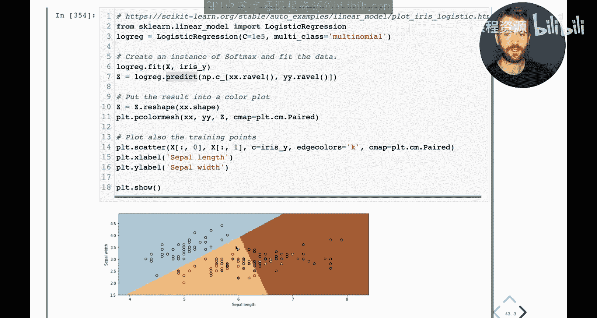

Summarizing what we saw， Somax regression is an algorithm for supervised learning and specifically for classification that fits a model that is parameterized by softmax function and which looks for linear decision boundaries between the data。

 its objective function， we can call it the softmax loss。

 but this is a special case of the local likelihood and is typically optimized using gradient descent。

 and we can interpret it from a probabilistic perspective as parameterizing a categorical distribution。

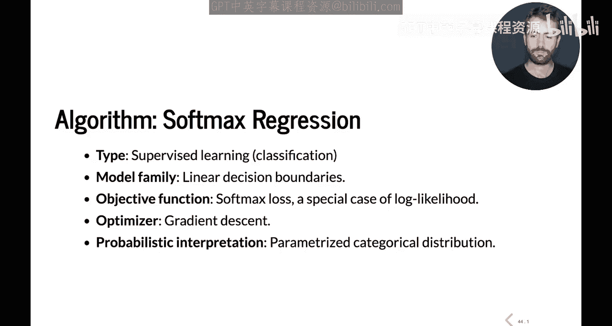