# 康奈尔大学《应用机器学习 CS 5787_ Applied Machine Learning 2020》中英字幕（deepseek p28 -28-Lecture 7. Part 1_ Generative Models.zh_en -BV12udzYvEFM_p28-

。

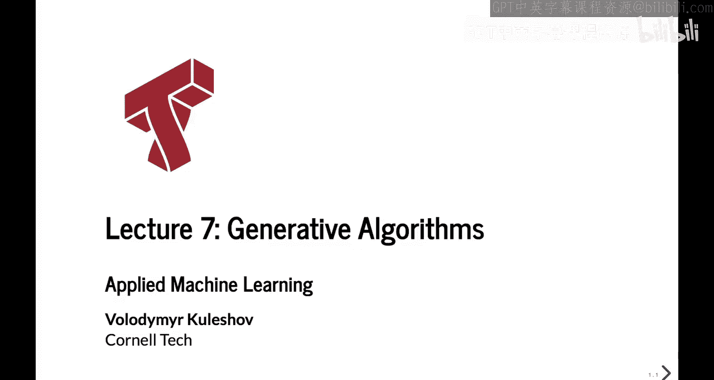

Welcome back to Le 7 of Applied machine learning。In this lecture。

 we're going to look at a new topic called generative algorithmgoris。In the previous few lectures。

 we looked at different kinds of supervised algorithms and in particular in the last lecture we started to look at classification algorithms。

In this lecture， we will introduce the general approach to defining machine learning algorithms that is called the generative approach。

 and a special case of this approach is going to be a set of new supervised learning algorithms for the kinds of classification problems that we have seen earlier。

And in the first part of this video of this lecture in our first video。

 I would like to start by defining what it means for a model to be generative。

 so we're going to start with a concept of a generative model。

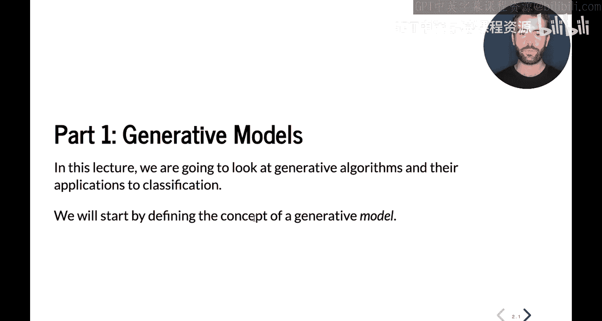

Recall from our earlier definition of supervised machine learning。

 recall that applying supervised learning to a problem involves specifying a training data set which contains labeled examples and then also specifying a learning algorithm when the learning algorithm is combined with the training set。

 we obtain a predictive supervised learning model。And this learning algorithm。

We can think of it as having three distinct components， a model class。

 an objective which ranks the different models within the class of all the possible models by how well they fit the data and an optimizationr or an optimization algorithm that chooses the best model as defined by our objective。

So in order to define a new set of learning algorithms， which are called Genative algorithms。

 we are going to start by defining a particular model class that contains the set of gene of models。

 and then we're going to discuss objectives and optimizers later。

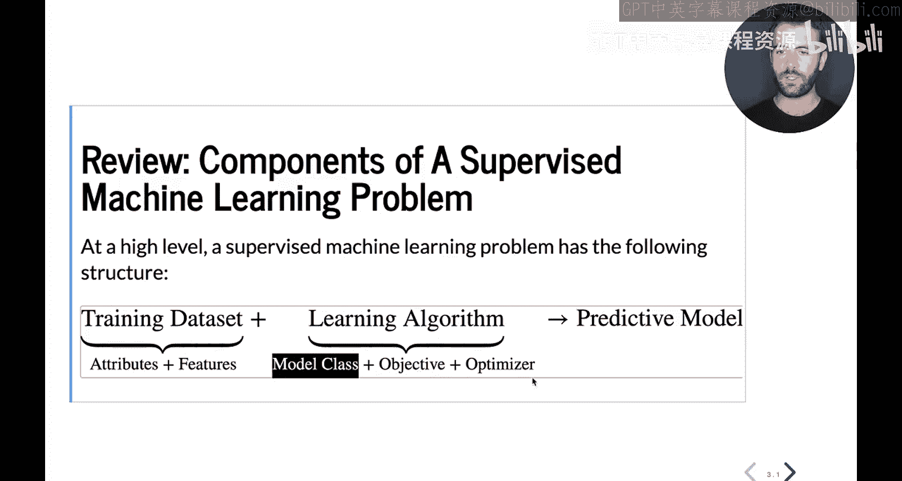

Now， recall also that the in the previous few lectures， we talked about how we can define。

How we can define machine learning models from a probabilistic perspective。 and we define this。

particular kind of model or this family of models or essentially we start with the most general possible definition for a machine learning。

 from for a probabilistic machine learning model， and this is how we defined it so we said that probabilistic model is a function that maps each set of X and y each tuple of X and y to some kind of probability here。

And here I'm assuming that this is a parametric probabilistic model and the parameters of this model are specified by theta。

And the idea of these models is that if our data comes from some kind of data distribution。

 then it makes sense also for our model to be a distribution。

 and then we can try to approximate these two models。

And we saw that the principle of maximum likelihood is one way in which we can fit these kinds of probabilistic models。

And also even though here we're fitting a model over both x and y。

 we can still compute predictions out of this model by looking at the conditional distribution over y given x。

 and we have we this we can obtain this distribution from our full model by applying the following formula。

To this， this is just a simple identity from probability。

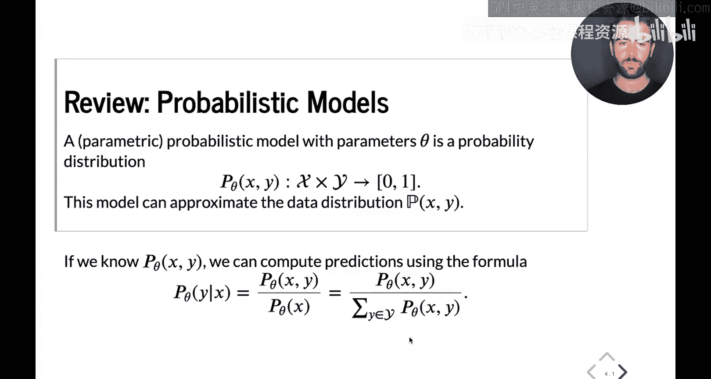

So we define probabilistic models。

And as I mentioned earlier， these models can be trained using maximum likelihood。

 it's a general approach that can be used to define a training objective for any probabilistic model here we essentially choosing a set of parameters such that the model assigns high probability to data coming from the true distribution。

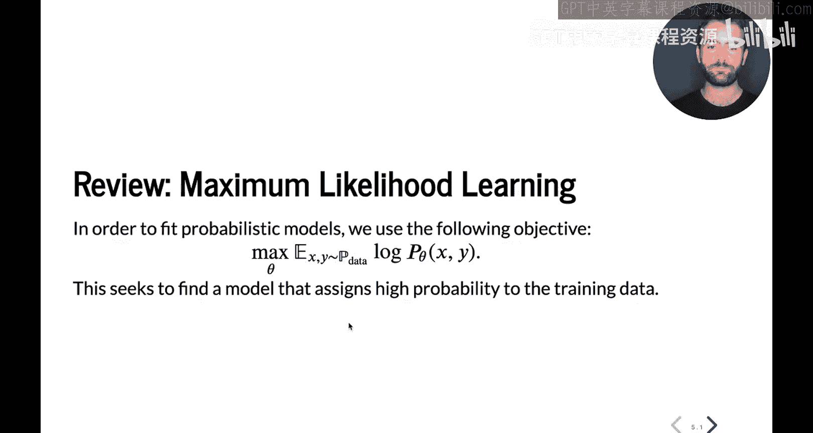

And then we saw also a special case of probabilistic models which were called conditional probabilistic models and in these are models that have this form。

 they are again mapping x and x and O Y to a probability。

 but now this is no longer the probability of seeing X and y。

 now this is going to be the probability of seeing y given x。

And these kinds of models can also be fit using maximum likelihood except that the derivation is slightly different。

 but still the objective looks really similar here。

 we are again choosing we're trying to find a model that assigns high probability。

 high conditional probability to the targets given each x where the targets and the x's are coming from our data distribution。

And you should recall from the previous lecture that we saw one example of this approach which was logistic regression Lo regression was one way of parameterizing a conditional model of this form。

 and the output of logistic regression was directly a probability between0 and 1 and this was the probability of seeing a particular target y given x。

So。These conditional probabilistic models are they。

We find them very often within different machine learning algorithms， and they're really important。

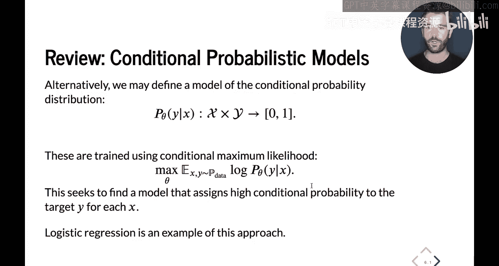

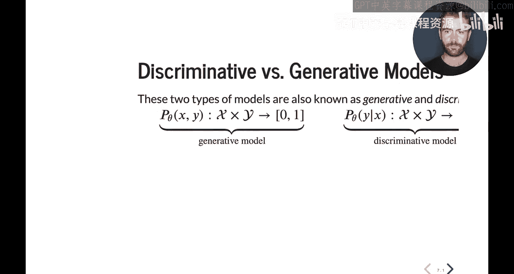

So the distinction between these two kinds of models is actually really important。

 and it forms the basis of an important class of well， two important sets of algorithms。

 which are called generative and discriminative。And the distinction between generative and discriminative is it's a very important one in machine learning we've seen a few of these different classes or maybe different related classes along which or different dimensions along which machine learning algorithms can be compared。

 we saw for example， in the previous video， non-parametric versus barmetric models we've seen classification and regression algorithms and now discriminative and generative is another important dimension along which we want to think about machine learning algorithms。

So what is discriminative and what is generative？Essentially， this distinction。

Is what I discussed earlier when I defined and when we reviewed the two kinds of probabilistic models that we have seen before。

So the first distinction between discriminative and generative algorithms is the particular type of model that they fit。

And we refer to these models also as either being generative or discriminative。And。

A generative model is a model that has this form in which we fit a joint distribution over both the inputs X and the targets Y。

 So this is our most general form of probability distribution that we have seen before。

And it turns out this has a special name and we're going to see why it's important to distinguish these two kinds of models later。

 but this full model is what is called a generative model。And the other kind of model we have seen。

 the one that fits a conditional distribution。That one， we often call it a discriminative model。

And again here， an example of this was logistical regression and we have actually not yet seen any real non toy examples of generative models。

 we saw a little toy example that could fit in a table with six rows but we haven't yet seen real examples of gener models and we're going to see one in this lecture。

So this distinction is one that I want to emphasize again。

 and I want to assign it this very specific name， these two very specific terms。

 generative and discriminative。So what is the difference between these two models？

 Why is it important。So the first and maybe really obvious distinction is that， well。

 these are two functions with the same signature over here。

 but they parameterize two really different kinds of probabilities。So on this side。

 we have a function that output puts the number between0 and 1。

 and then when we sum this over x and y。The sum of all the probabilities has to equal  one。

Here we here the kind of function that we parameterize here has really different properties。

Now we only need for this probability to sum to one for every y so here I'm just saying that the kinds of functions that we would use to specify these models would be different because these probabilities have really different properties and that is the first point that I wanted to make here。

Now， because these are different probabilities， they also involve different training objectives and you have seen the example of conditional and in general maximum likelihood and these when we apply them and we derive the objective we typically get a a different objective which results in different predictions so even though this model。

 even though the generalative model and a discriminative model can predict y from X。

 these predictions will tend to be different because we are applying a different objective to a model that's parameterized in a different way and has a different functional form。

And as a result， because these two approaches are different。

 their uses are going to be different and of these will be some types of models will be more suitable to a certain use and the other class will be more suitable to a different set of uses。

For example， if we are interested only in prediction， we would use one class。

 if we're interested in generation or in other properties related to modeling X。

 then we would use the generative type of model and I'm going to be talking more about the distinction between these two types of models and why specifically they are different and when we would want to use them in the following few lectures。

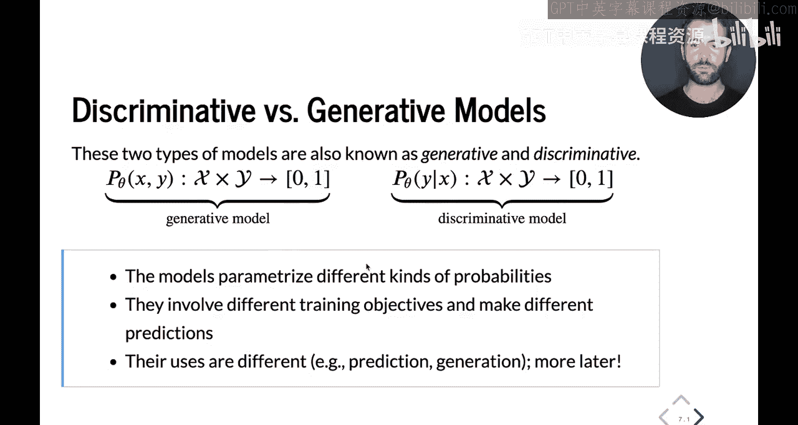

So as an example。That can make this distinction a little bit more concrete。

 let's look again at our data set of irIS flowers that we have used in the previous lectures to demonstrate classification algorithms。

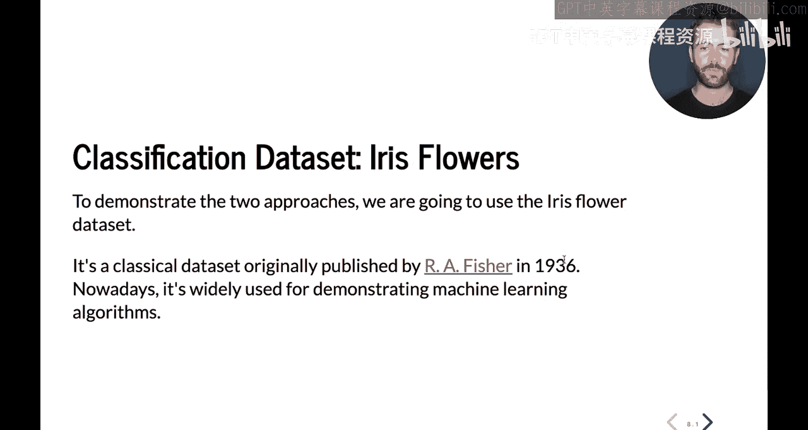

So recall that in the Iis flower data set， we have a collection of a few hundred data points where each data point corresponds to a flower。

 and for this flower we have taken a number of measurements such as the paal length， the Cal length。

And we have three types of flowers in this。Data set。In this data set。

 which are denoted by the different labels here，0，1，2。

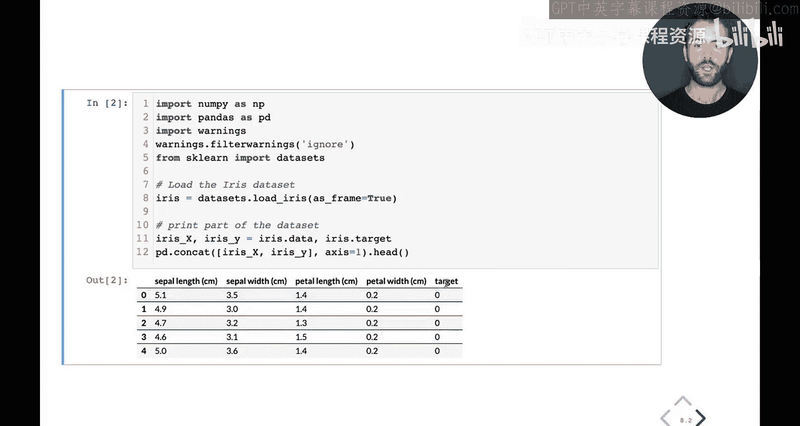

And if we only consider the first two feature columns from the previous table。

 we can visualize this data set in two dimensions， which gives us the following scatter plot here the three colors。

 blue， light brown and dark brown， these correspond to three different types of flowers。

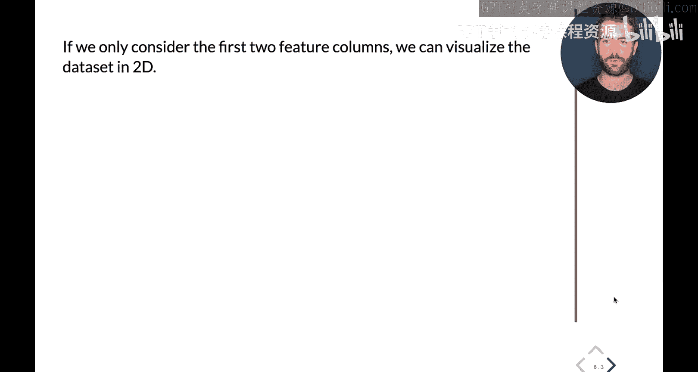

And we see here that one type of flower clusters in this area。

 so these flowers are more similar to to they're more similar within their flower type than these two。

So again， this is a two dimensional visualization of our data set。

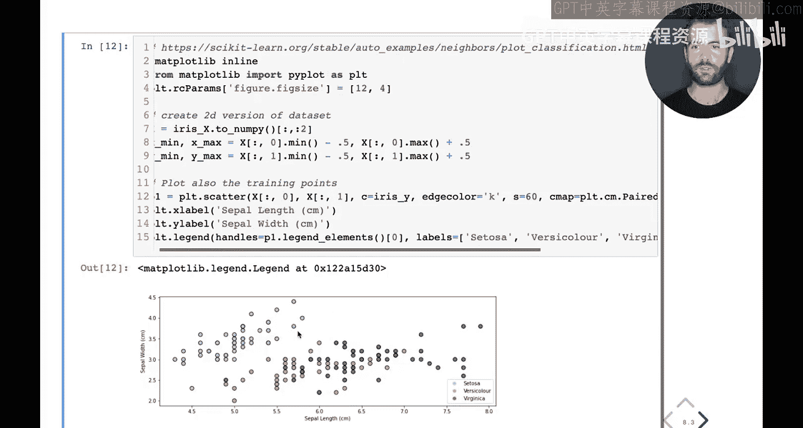

So an example of a discriminative model on this dataset set would be logistic or softmax regression that we have seen before。

And another way of looking at what a distriminive model does is that it directly tries to partition the feature space into regions that are associated with each class so here。

 for example， this these blue flowers they live in their own part of their feature space where they form a cluster。

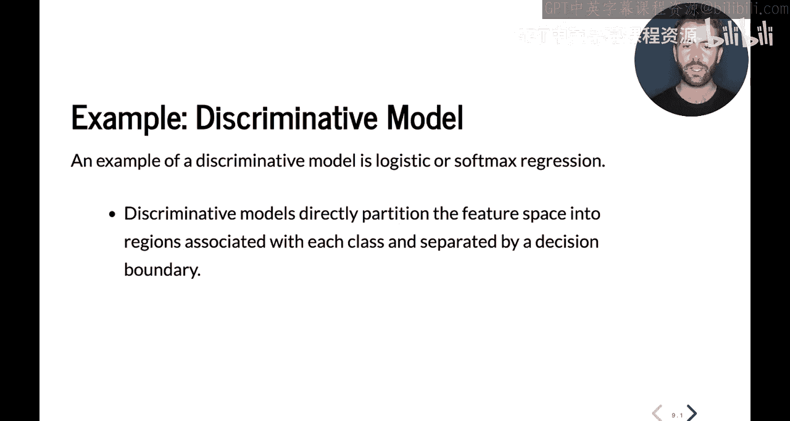

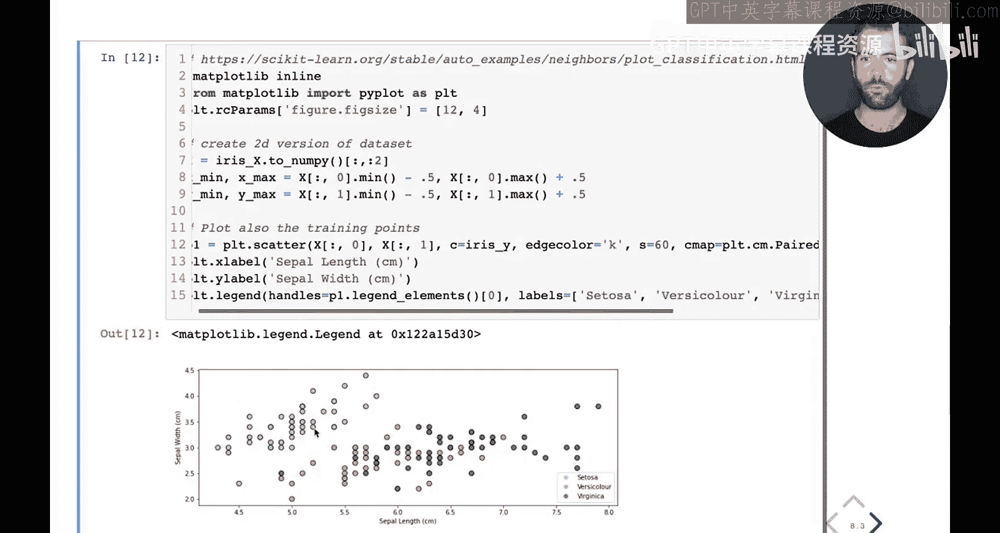

And the idea of partitioning the feature space is to identify that cluster is to identify the region of the feature space where these blue flowers are located and similarly find the region of the space where the other two kinds of flowers are。

And these flowers will be separated by a decision boundary。So。To put it in yet another way。

 given features x， a discriminative model will directly map to the predicted class。

 and this can be a function such as this one where this is a form of the sigmoid function with the that takes in the score for that particular class this is the form that's like the logistic regression is uses。

 but the highlevel point here is that we want to partition the feature space into different regions and we have a function that at each point in the feature space it directly outputs the class or the partition to which this subset of the region belongs to。

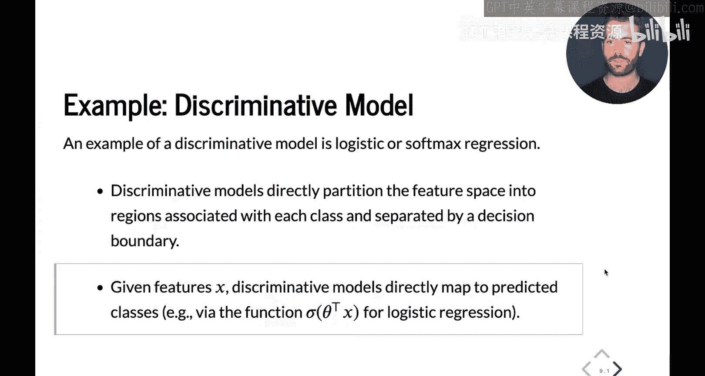

This is this is an example of running softmax regression on our data and you can see here that we have partitioned the space into the following three regions denot by the different colors and if we invoke the softmax function。

 say at this point here or even at this point here， we're going to get，The output blue。

 So at each point in this two dimensional grid， we are directly specifying which class is the output。

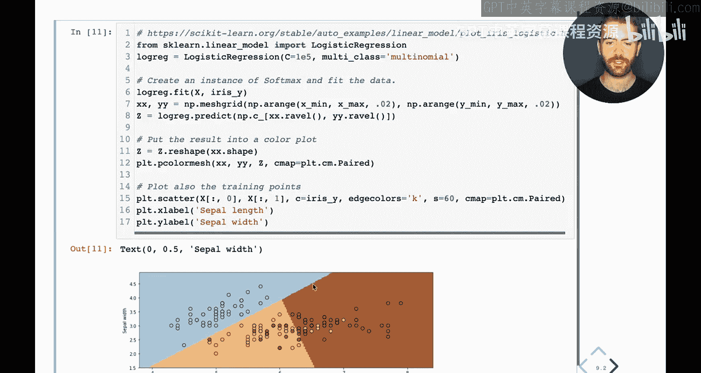

And now let's compare this to what a general model would do。In a generative approach。

 we would instead do something that's a little bit different。So in the IIS example。

 what a generative model would do is that it would first build a model of how each type of flower looks like。

So in other words， if x is the vector of features that describes our flower。

 then we would try to estimate the following probability。 So the probability of x， which is。

Some vector features， some vector of measurements。Given a particular class， so for each class。

 we would learn a model of how this flower X looks like。

Another way of thinking about this is that this is a model for how each flower is generated given a class。

 or it's a model over X， which allows us to generate new flowers。

And this is what gives this approach its name。So again。

 this is a different way of thinking about classification。

It's a different way of thinking about glification。That also leads to to new algorithms。

 but they have a different philosophy。So again， step one is to specify this model of how each class looks like。

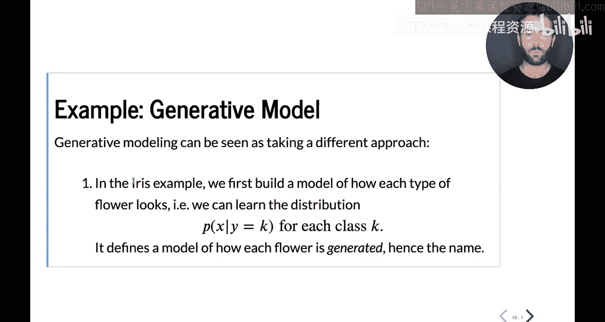

And now given a new flower， instead of trying to directly map to the class of this flower。

 we are instead going to match it against each of our three flower models and then we're going to determine the model that fits or the model that looks this X prime will look most similar to one of the three models that we have found。

 and to choose we're going to say that the label of X prime is the label of the flower model that matches it best。

So if X prime looks like our model looks like what is predicted as our model of iris sattosa flowers。

 then we're going to say that the label is Iis Setosa。And mathematically。

 what this means is that we do the following operation。 We are interested in。

Knowing the most likely class under our model and now we invert this expression using base rule。

 again， in a supervised in a disriminative approach， we would have this would be a model directly。

 but now we don't have a closed form we don't have a function that that measures this particular value。

Instead we have a model for for each type of class。

 so therefore we apply base rule and we obtain the following example here on the following formula here on the following expression that you see on the right。

And now the maximum of the class， the most likely class is。

It is given to us by the model that explains this x the best。

 so we will output the class such that the probability of x given y is the highest。Under this class。

 in other words， we're going to compute the probability of this data point under each of our flower classes。

 and we're going to output the class that gives us the highest probability of seeing this point。

So this is the general approach to。Generative modeling in the context of classification。

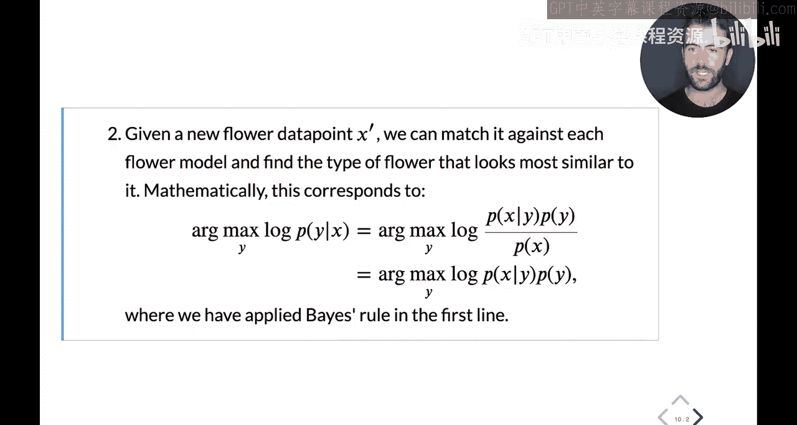

And it's just a general philosophy for how to approach these problems。So。

Given that we have these two approaches generative and discriminative， which one is better。

 Which one do we want to use。We're going to be talking about this。嗯。

At at several points during this lecture and also during the next lecture。But in brief。

 if we are only interested about prediction， well， we don't really need a model of。Of， of x。

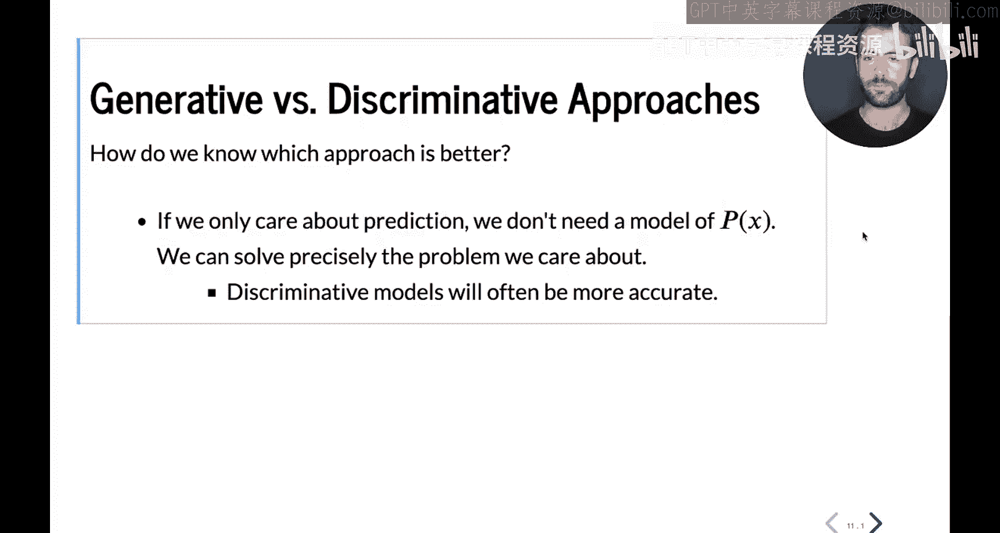

So in other words， a discriminative model only models this distribution。

 whereas the generative model also is modeling x given y， but we don't really need x given y。

 so if we are only interested in prediction and therefore if we don't model it。

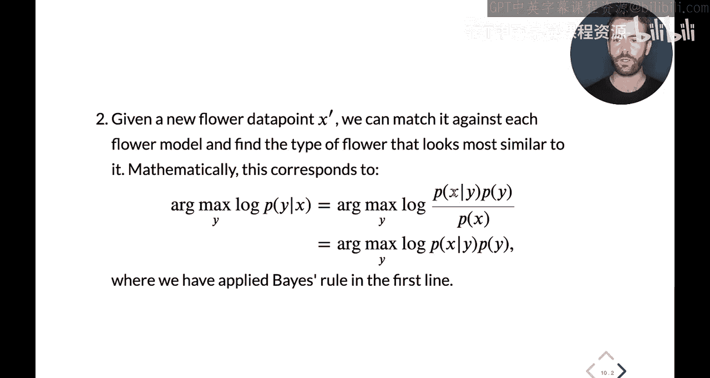

Then。We would be solving the problem that we care about more precisely using fewer modeling assumptions。

 and in general it will mean that the prediction in practice are more likely to be accurate。However。

 if we care about other tasks， such as generation or dealing missing values。

 or maybe we know the true model， we know that it's generative。

 maybe we can specify the process by which the data was generated and we can build a more accurate model if it's generative。

Then in these cases， we will want to use a generative approach。So again。

 these are two simple distinctions between the two models and I'm going to talk about this in more detail later on and for now I will pause here and then in the next video we are going to see our first example of a nontoy generative algorithm。

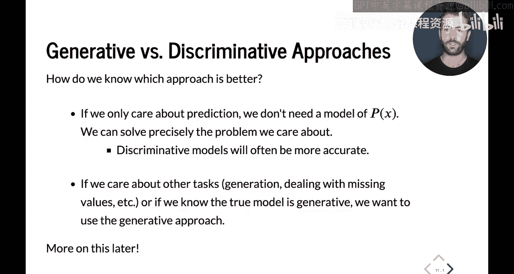