# 应用机器学习：第7讲：生成模型（第一部分）🎯

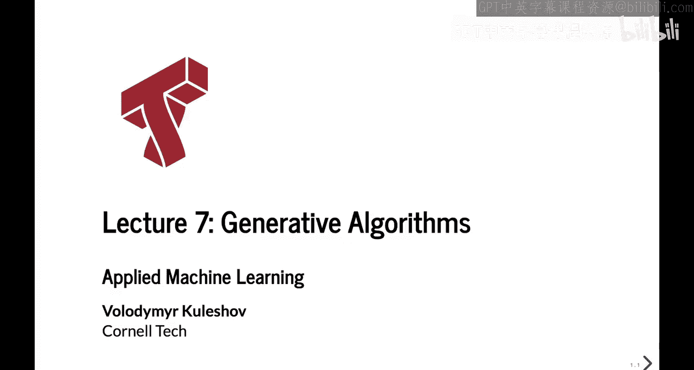

在本节课中，我们将学习一种新的机器学习方法——生成模型。我们将探讨生成模型与之前学过的判别模型之间的核心区别，并通过一个具体的例子来理解生成模型的工作原理。

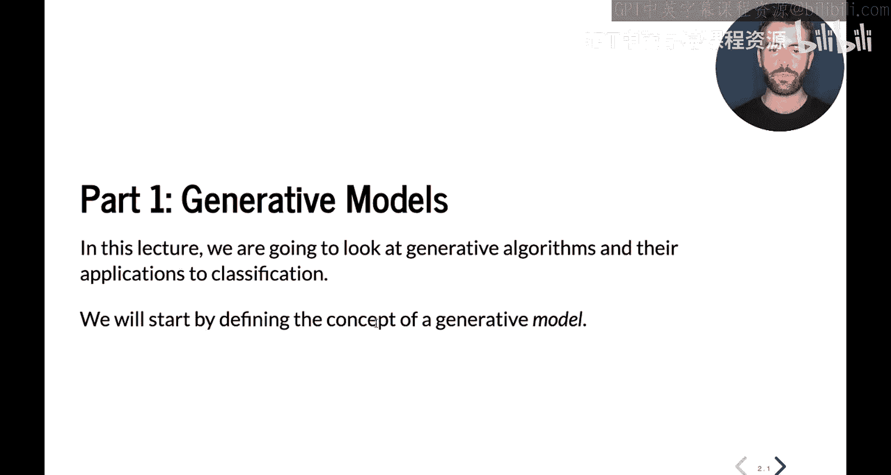

## 概述 📋

在之前的课程中，我们学习了多种监督学习算法，特别是分类算法。本节课，我们将引入一种定义机器学习算法的通用方法，称为生成方法。这种方法的一个特例，将为我们之前见过的分类问题提供一套新的监督学习算法。

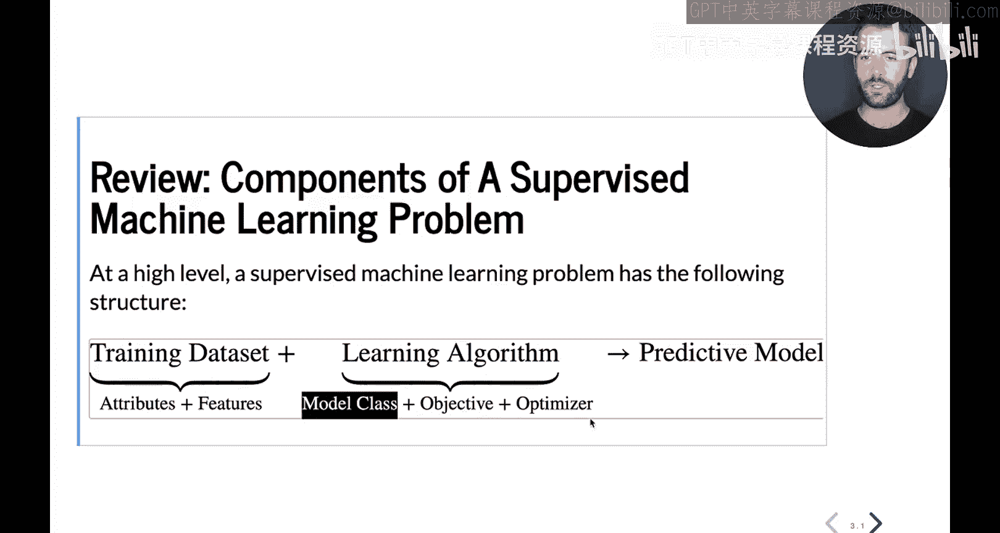

## 生成模型的概念 🤔

首先，我们来定义什么是生成模型。

回想一下我们之前对监督学习的定义：应用监督学习涉及指定一个包含标记示例的训练数据集，以及一个学习算法。当学习算法与训练集结合时，我们得到一个预测性的监督学习模型。这个学习算法可以看作由三个不同的部分组成：
*   **模型类**：所有可能模型的集合。
*   **目标函数**：根据模型对数据的拟合程度，对模型类中的所有模型进行排序。
*   **优化器**：根据我们的目标函数选择最佳模型的算法。

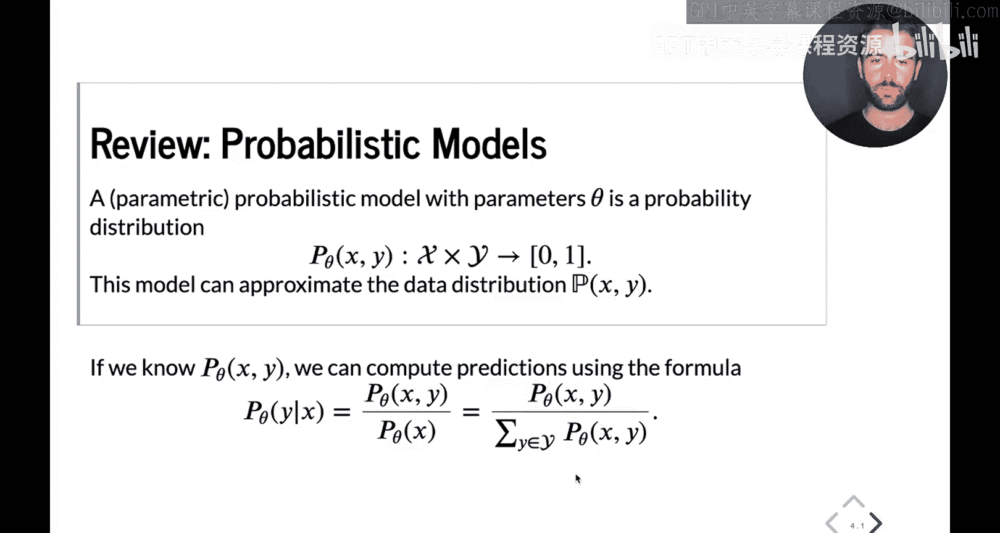

为了定义一套新的、被称为生成算法的学习算法，我们将从定义一个包含生成模型的特定模型类开始，稍后再讨论目标函数和优化器。

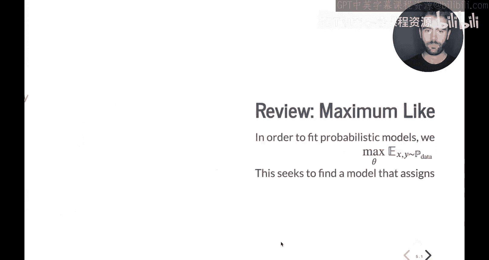

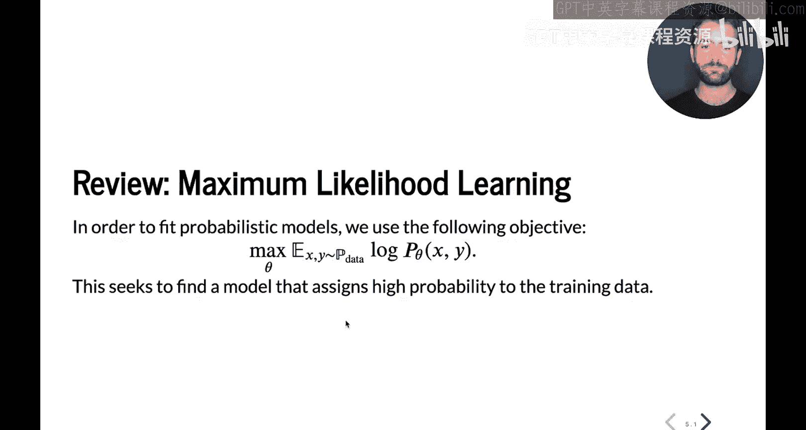

## 概率模型的回顾 📊

在之前的课程中，我们讨论了如何从概率的角度定义机器学习模型。我们从一个最通用的概率机器学习模型定义开始：

一个参数化的概率模型是一个函数，它将每一组输入 `X` 和输出 `y` 映射到一个概率值 `P(X, y; θ)`，其中 `θ` 是模型的参数。

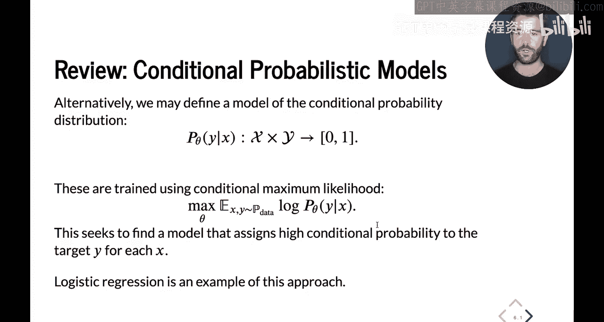

这些模型的思想是，如果我们的数据来自某个数据分布，那么我们的模型也应该是一个分布，然后我们可以尝试去近似这两个分布。

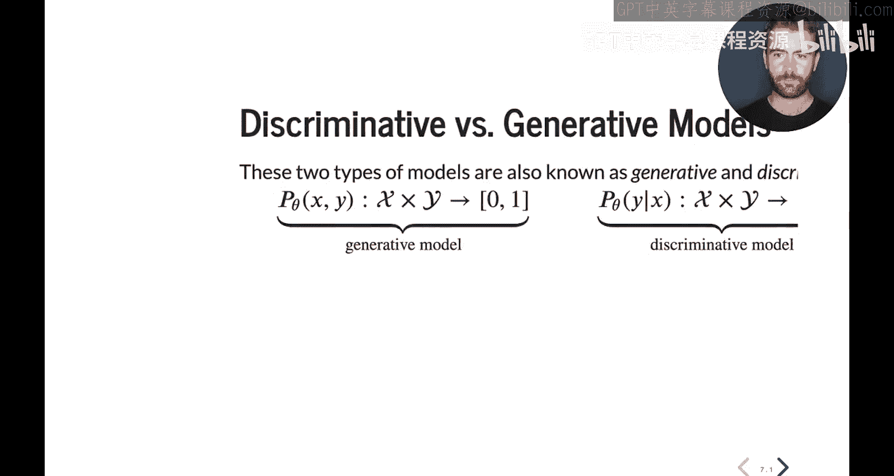

我们看到，**最大似然估计** 是拟合这类概率模型的一种方法。尽管我们在这里拟合的是关于 `X` 和 `y` 的联合模型，我们仍然可以通过查看给定 `X` 时 `y` 的条件分布来计算预测。我们可以通过以下公式从完整模型中获取这个条件分布：

`P(y | X; θ) = P(X, y; θ) / P(X; θ)`

这只是概率论中的一个简单恒等式。

## 判别模型 vs. 生成模型 ⚖️

概率模型与条件概率模型之间的区别非常重要，它构成了两类重要算法的基础：**生成式** 和 **判别式**。

*   **生成模型**：拟合输入 `X` 和目标 `y` 的联合分布 `P(X, y)` 的模型。
*   **判别模型**：拟合条件分布 `P(y | X)` 的模型。逻辑回归就是这类模型的一个例子。

这两种模型有什么区别？为什么区分它们很重要？

1.  **模型形式不同**：它们是参数化两种完全不同概率的函数。生成模型需要所有 `(X, y)` 对的概率之和为1，而判别模型只需要对于每个 `X`，所有 `y` 的条件概率之和为1。
2.  **训练目标不同**：应用最大似然估计时，通常会得到不同的目标函数，从而导致不同的预测结果。
3.  **用途不同**：如果我们只关心预测，可能会使用一类模型；如果我们关心生成数据或建模 `X` 的其他属性，则会使用生成模型。

## 一个具体例子：鸢尾花数据集 🌸

为了让这个区别更具体，让我们再次看看之前用于演示分类算法的鸢尾花数据集。

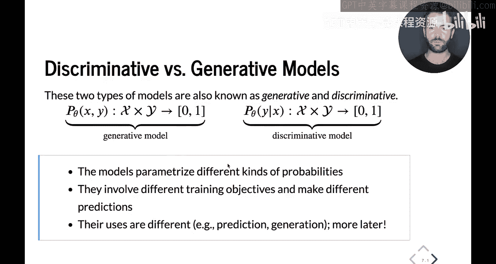

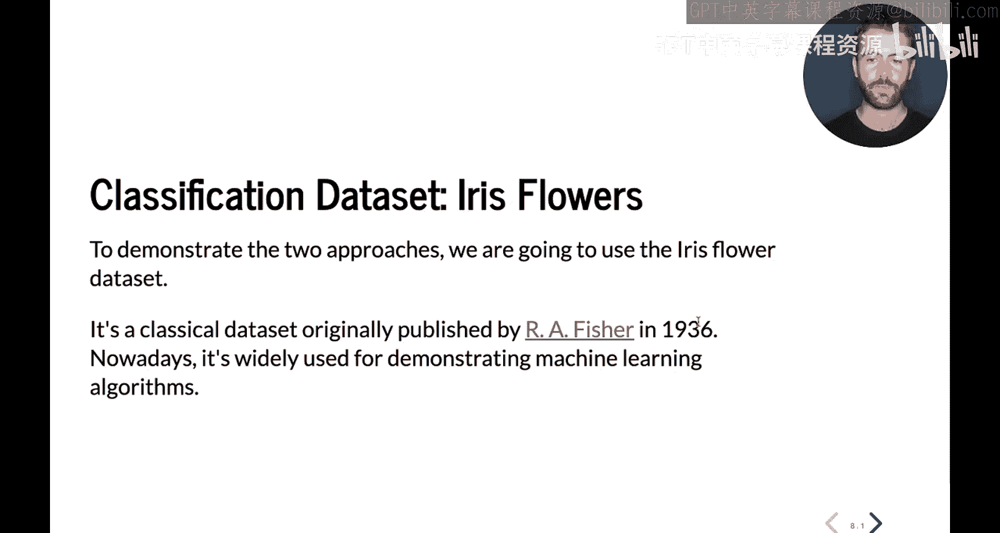

该数据集包含数百个数据点，每个点对应一朵花，具有萼片长度、宽度等测量特征，以及一个表示花类型的标签（0, 1, 2）。

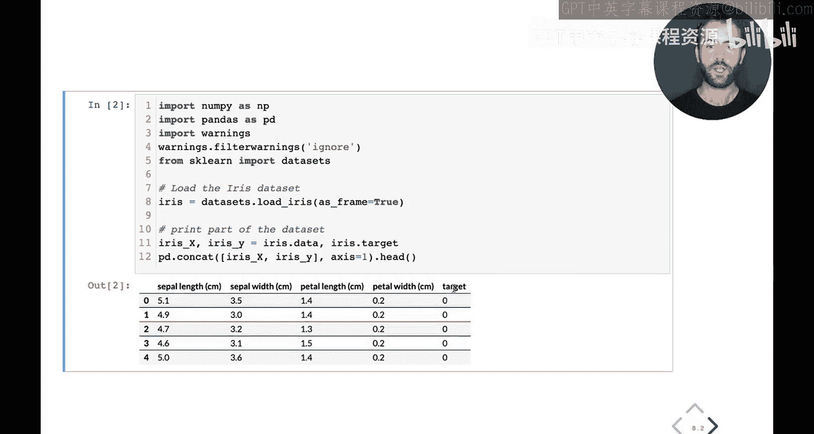

### 判别式方法

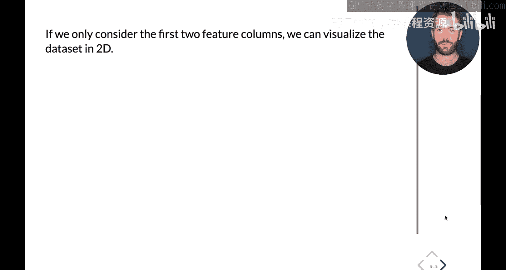

在该数据集上，判别模型（如逻辑回归或Softmax回归）会尝试直接将特征空间划分为与每个类别相关联的区域。给定特征 `X`，判别模型会直接映射到预测的类别 `y`。这就像一个函数，在特征空间的每个点上直接输出类别。

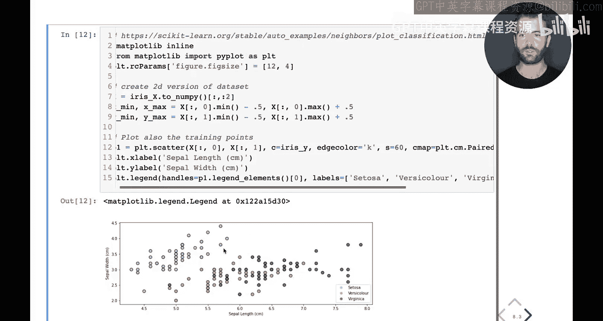

这相当于用决策边界将特征空间分割成不同的区域。

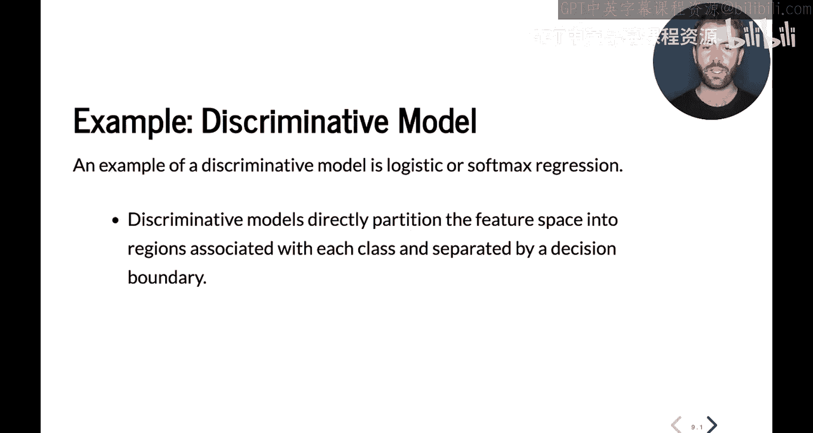

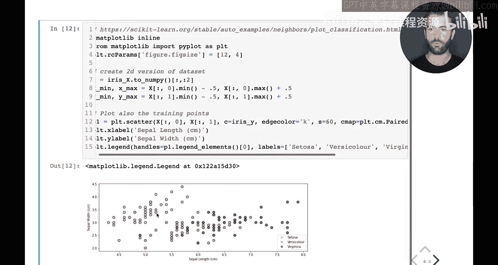

### 生成式方法

生成式方法会做一些略有不同的事情。在鸢尾花的例子中，生成模型会首先为每种类型的花建立一个模型，描述该类花看起来是什么样子。

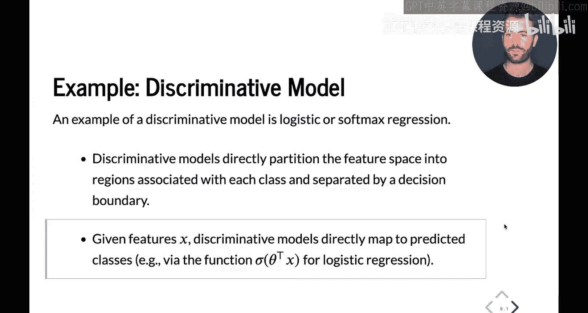

换句话说，对于每个类别 `y`，我们会尝试估计概率 `P(X | y)`。这可以看作是在给定类别下，花朵特征 `X` 是如何“生成”的模型。

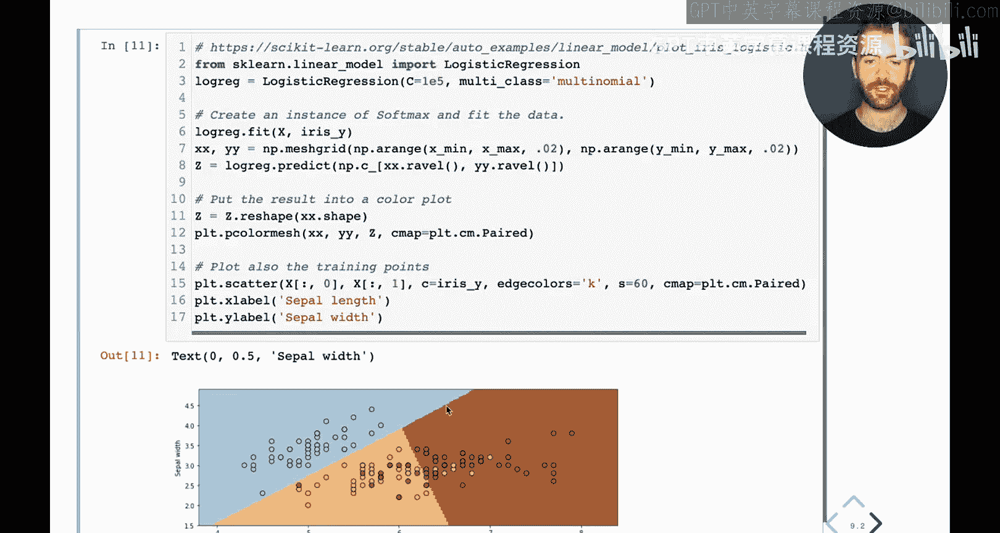

现在，给定一朵新花 `X'`，我们不是直接将其映射到一个类别，而是将其与我们已有的三个花卉模型进行匹配。然后，我们确定 `X'` 与哪个模型最相似。我们将 `X'` 的标签指定为与其最匹配的花卉模型的标签。

数学上，这意味着我们进行以下操作：我们关心在模型下最可能的类别 `y`。我们使用贝叶斯规则来转换这个表达式：

`argmax_y P(y | X) = argmax_y P(X | y) * P(y) / P(X)`

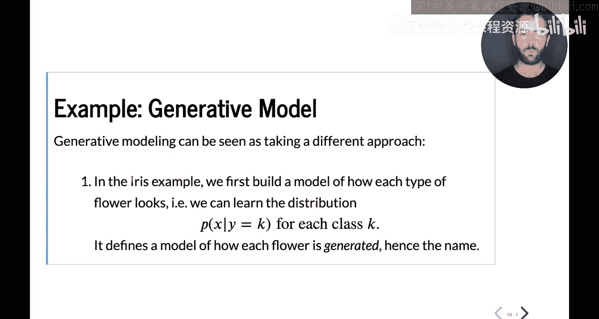

由于 `P(X)` 对于所有 `y` 是相同的，因此最可能的类别由下式给出：

`argmax_y P(X | y) * P(y)`

在实践中，我们通常假设先验概率 `P(y)` 是均匀的，或者从数据中估计。因此，我们基本上会输出使得 `P(X | y)` 最高的类别 `y`。换句话说，我们计算数据点在每个花卉类别下的概率，并输出给出该点最高出现概率的类别。

## 总结与比较 📝

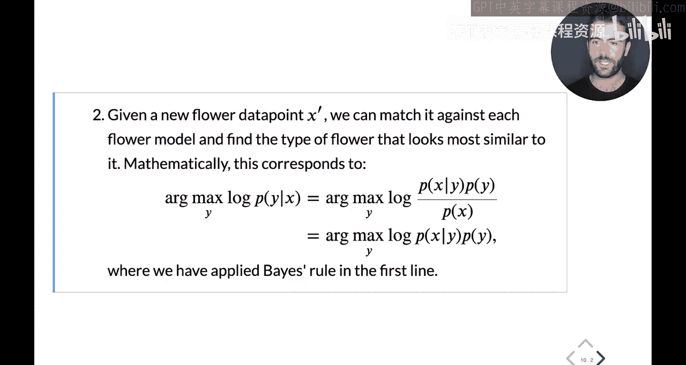

那么，生成式和判别式这两种方法，哪个更好？我们该用哪个？

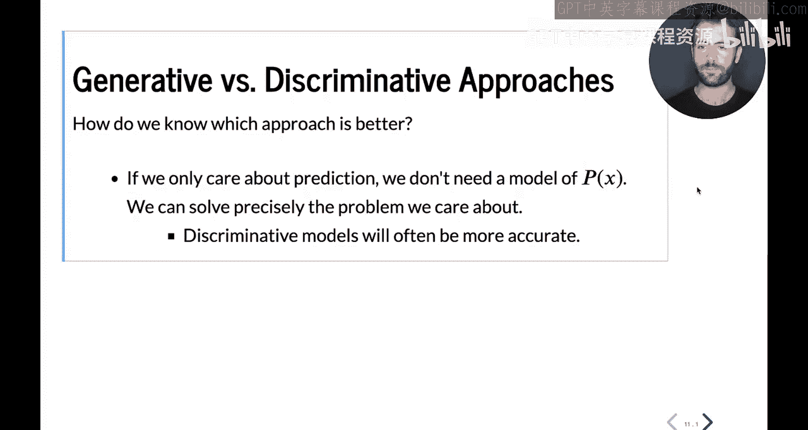

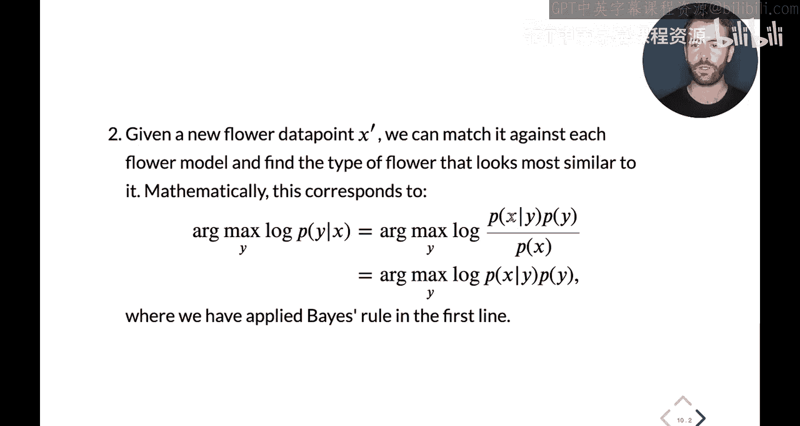

*   **如果只关心预测**：我们并不真的需要一个关于 `X` 的模型。判别模型只建模 `P(y | X)`，而生成模型还建模 `P(X | y)`。如果我们不建模不需要的部分，就能用更少的建模假设来更精确地解决我们关心的问题。在实践中，这通常意味着预测更可能准确。
*   **如果关心其他任务**：例如生成新数据样本、处理缺失值，或者我们知道真实的数据生成过程并且可以构建更准确的生成模型，那么在这些情况下，我们会希望使用生成式方法。

本节课，我们一起探讨了生成模型的基本概念及其与判别模型的核心区别。我们了解到，生成模型通过建模数据的联合分布 `P(X, y)` 来工作，并利用贝叶斯规则进行分类预测。选择哪种方法取决于我们的具体任务：纯预测任务可能更适合判别模型，而涉及数据生成或理解数据本身的任务则可能受益于生成模型。

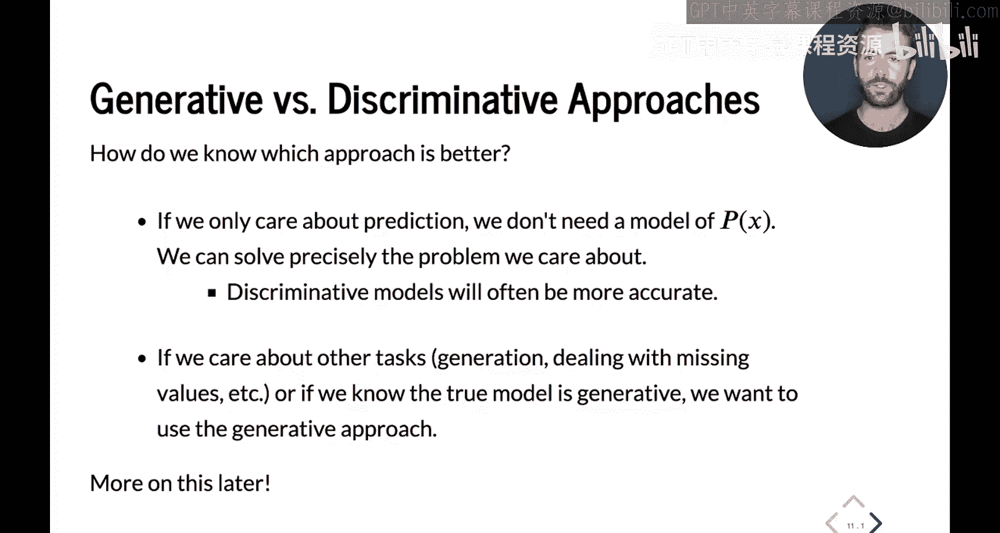

在下一个视频中，我们将看到第一个非玩具示例的生成算法。