# 康奈尔大学《应用机器学习 CS 5787_ Applied Machine Learning 2020》中英字幕（deepseek p29 -29-Lecture 7. Part 2_ Gaussian Discriminant Analysis.zh_en -BV12udzYvEFM_p29-

We are now at part two of Lec 7 of Applied Mach learning。In this lecture。

 we are going to now see our first non toy example of a generative model。

 of a generative supervised learning algorithm， and the name of this algorithm is going to be Gausian discriinate analysis。

WeI'm going to start in this video by defining the particular model that Ga instrumentnstru analysis uses and then in the next video。

 we're going to see how we can fit this model to data and what kind of objective and optimization algorithms we can use。

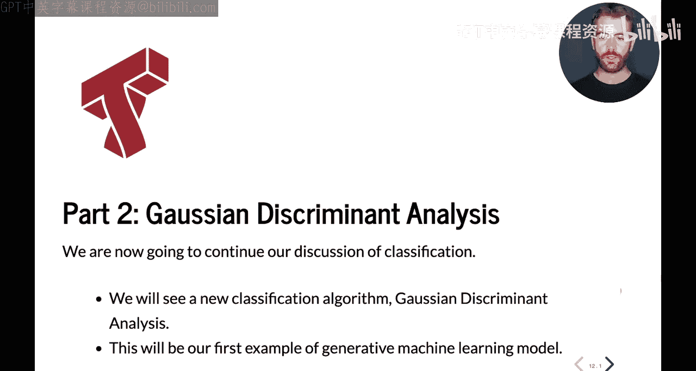

So I。Before we start， let's again remember the setting of classification。

 which is the setting that we're going to be using in this lecture。So in classification。

 or I guess more generally in supervised machine learning， we have a data set。

 a training data set that has this form that contains a set of training examples。

 and these training examples have inputs and targets。The targets y， if the targets y are continuous。

 then we have a regression problem， which is what we have seen in the first few lectures。

 and then in the last lecture， we saw that if the targets y are discrete。

 meaning that they take one of K possible values y1， y2 to y k。In this case。

 we say that we have a classification problem。And our goal is to predict the true class of each new input x。

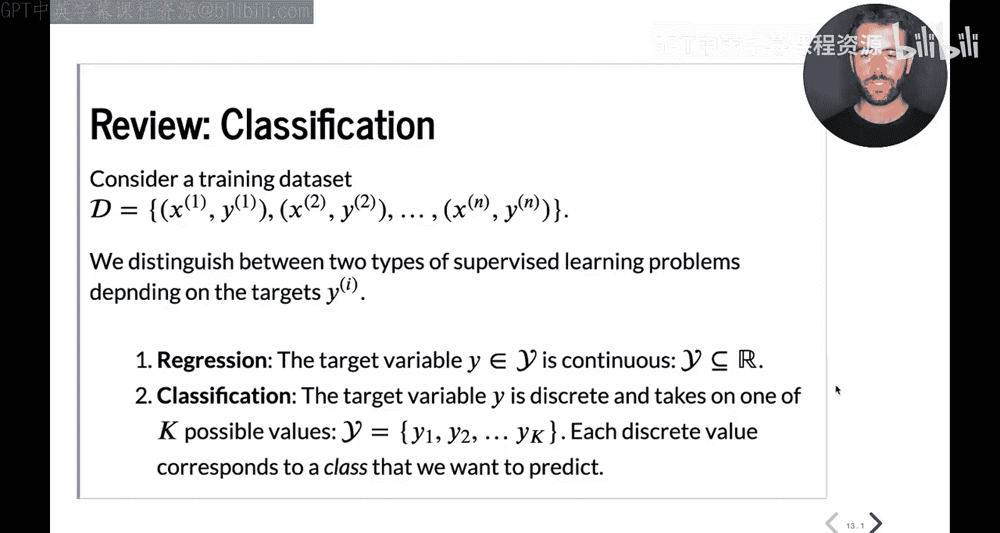

And then in the last video， I showed you an example of two kinds of models。

 two kinds of approaches that that we could use to solve a classification problem。

And these approaches， their main difference depends on the kind of model that we would fit to our data。

 so if you recall supervised learning algorithms involve choosing a model and in particular this can be a probabilistic model and there are two kinds of probabilistic models that we can use we can use a model that has this form that assigns a distribution to both x and y。

 so it's modeling and distribution of both x and y and this is called a generative model or we could fit a model of this form that only parameterizes the conditional distribution over y given x。

 so we're only modeling a probability over y but we're not modeling a probability over x anymore。

And this is called a disriminative model。This types of these two approaches they represent a really important distinction between algorithms in machine learning and in this video I'm going to now define a first nontoy example of。

Of a generative model。

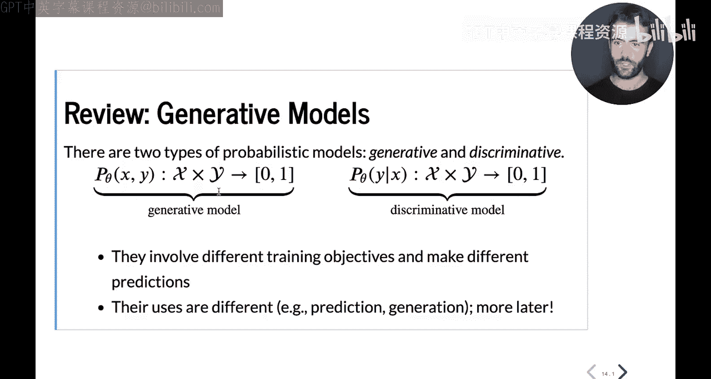

Before I do that， I would like to define something called a mixture of Gausians。

So a mixture of Gaussians is a probability distribution。So probability distribution over x。

That has the following form。Here this expression， which defines a probability over x。

It consists of a sum of k terms where each term here denoted by script n。

 this is the probability density of a Gaussian distribution。With mean mu and covariance matrix Sigma。

And the phi that multiply these， these are weights that are assigned to each distribution。

And the reason that this is called a mixture of Gausians is because these this is simply a weighted average of K Gaussian distributions。

And each phi here is it's a weight， this would be normally between 0 and 1 and all the phis they would sum to1。

And these phis， these weights， they define the mixture proportions of each Gaussian。

 so we could have 20% of Gaussian 1， 30% of Gaussian 2， and maybe 50% of Gaussian 3。

 that would be one way of defining a mixture of Gausians。

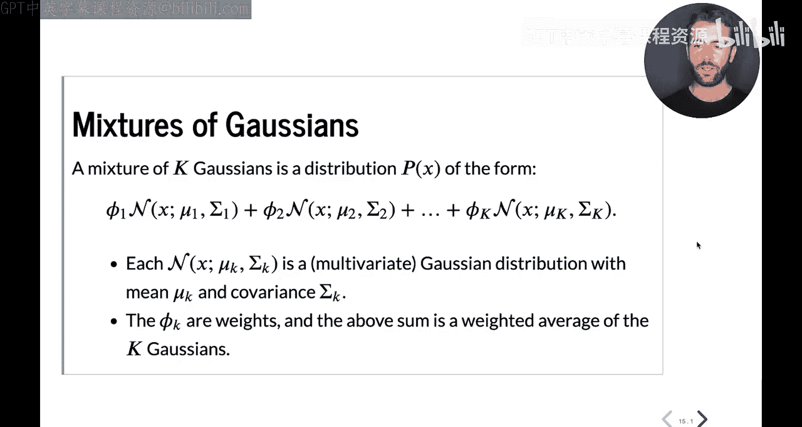

Let's visualize this to make it more clear。

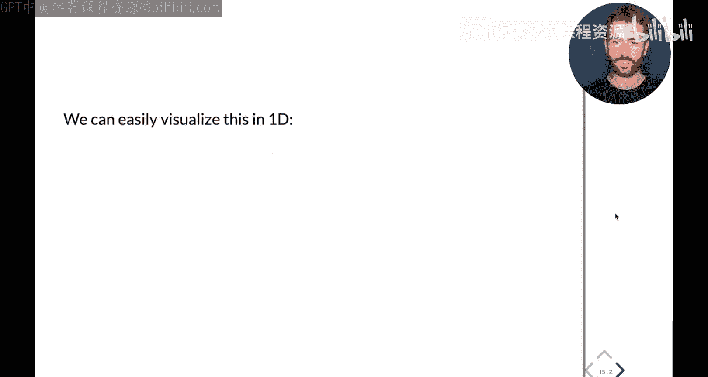

In one D， it's really easy to visualize。So here I'm going to first define the。The PDF。

 so the probability density function of a normal distribution。

And now I can define a mixture of two Gaussians， one of them is going to have mean。

 they will be centered at1， the other one will be centered at minus1 and is going to have standard deviation of 0。

5， this one too and the proportions of the mixtures mixture are going to be 60% for the first one and 40% for the second one。

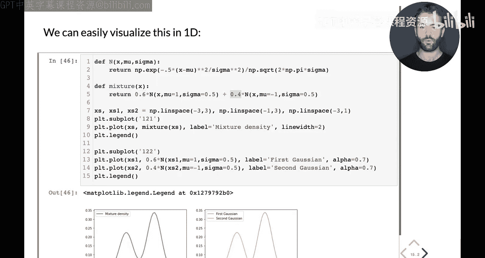

And now I can use the matplotlib to visualize these and I have something which looks like this。

 so on the right here I have my two scaled Gaussians， I've scaled this one by 40%， this one by 60%。

And these are just the kinds of bell curves that you would want for the define a Gaussian and here on the left hand side。

 I have the resulting mixture， so now this is a probability distribution that's given to us by our earlier formula of which I have an implementation here and now this assigns a probability mass at a probability density at each point along the real line here。

And you can see that it has two peaks， this one and this one that corresponds the two components to the two Gaussians that we have mixed。

So in other words， I have now defined this。This distribution with this particular shape and this is simply the weighted average of these two Gausians and this is there。

 yeah， this also represents a valid probability distribution and this is a mass that will integrate to one。

 so this is going to be a valid probability distribution。

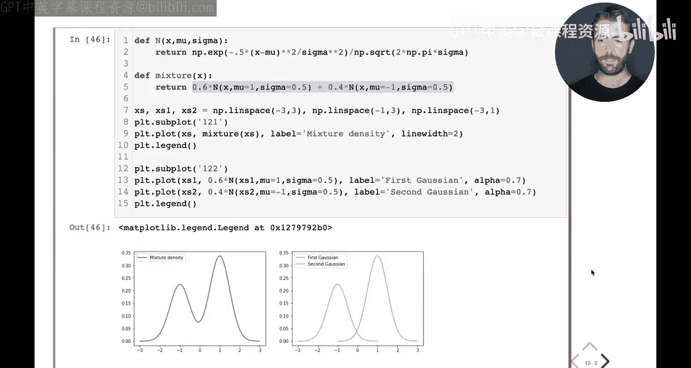

I'm going to use this concept of。Mixture of Gaussian to define a model。

 to define a generative model that will be the basis of the new algorithm that I'm going to define。

So we're going to use this approach a model P to define a model p theta that is going to be a joint distribution over x and y。

And is's going to be the basis of the algorithm that I'm going to be introducing in this lecture called Gaussian instrumentnstrument Ana。

ThisIn order to define this joint distribution P of theta， we're going to define two components。

First， I'm going to define a distribution over the classes y。

 and I'm going to assume that this is going to be what's called a categorical distribution。

It will be denoted as follows， and this is simply going to be a generalization of a Bernoulli which says that the probability of y taking on class k is going to be phi k。

So， this defines the。The distribution over y， and now in order to define a distribution over x and y。

 I need to define a conditional probability of x given y。

I need to define this probability for each class， recall that this is a core idea within gene modeling is that we want to define a model for each possible class。

 and then later we're going to see which of the K possible models defines the data explains a new data point best in order to determine its class。

So this conditional probability。It will be。 It will be。A multivariate Gaussian。Of this form。

 and it will have mean and covariance， which I'm going to denote by sigma K by muK and sigma K。

And now if we write out this definition in full。this。

This particular approach defines a distribution over x and Y。 that is a mixture of Gaussians。

 like what I have seen earlier， like what I like what we have。

Like like what we have seen earlier in the previous slide。In other words。

 the joint distribution over x and y， it's a sum over all the possible classes where each class is weighted by this probability of equaling k。

 and that is simply5 k and the conditional distribution of x。

 given that the class is Y is simply a Gaussian distribution。So in other words。

 I have assumed that the joint distribution is a mixture of Gausians。

 and you can see that this expression here is the same that we had in our earlier slide。

So this is the main modeling assumption that we're going to be making in。

In the Gaussian disccrminant analysis algorithm。And again， I want to highlight this。Moodeling。

 I want to highlight the form of this model again here。 should you should。

You should make note of this particular form。

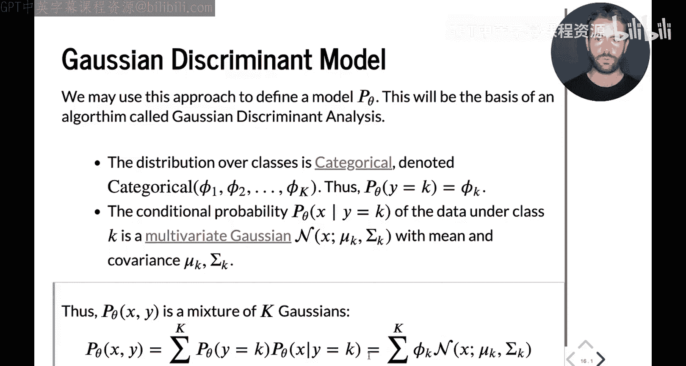

One way of looking at this particular model is in terms of a story for how the data was generated。

In other words， if we want to generate our data， we can define the following story first we will sample a class y from the categorical distribution。

 so we have K possible classes with proportions given by the PhiK and now we can sample a class。

And then we can sample a data point from the Gaussian distribution that's specific for that class。

And so this is a story that explains how our data was generated if we go back to this mixture of Gaussian's example。

 we can also see it。

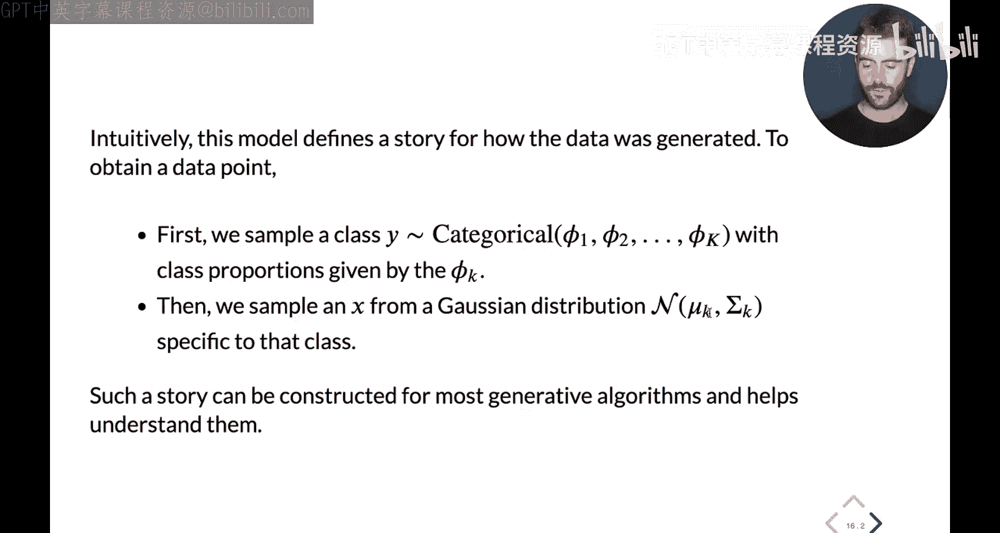

Here， imagine that we repeatedly flip a coin to determine whether we choose from the orange or the blue Gaussian。

 and then we simply draw a point。And if we repeat this many times。

 the distribution of all of these points is going to equal this is going to have this shape。

 so if we were to draw the histogram， if we were to put a bin along the X axis。

 if we were to put a set of bins along the X axis and record how many data points from this process fall within each bin。

 we would have the following shape。So most points would come either near the peak of this distribution or near the peak of this distribution。

 so most of them would fall either here or here， and fewer of them would fall on the sides and some of them would fall in the middle if they come either from the left of the first Gaussian or the right of the second Gausian。

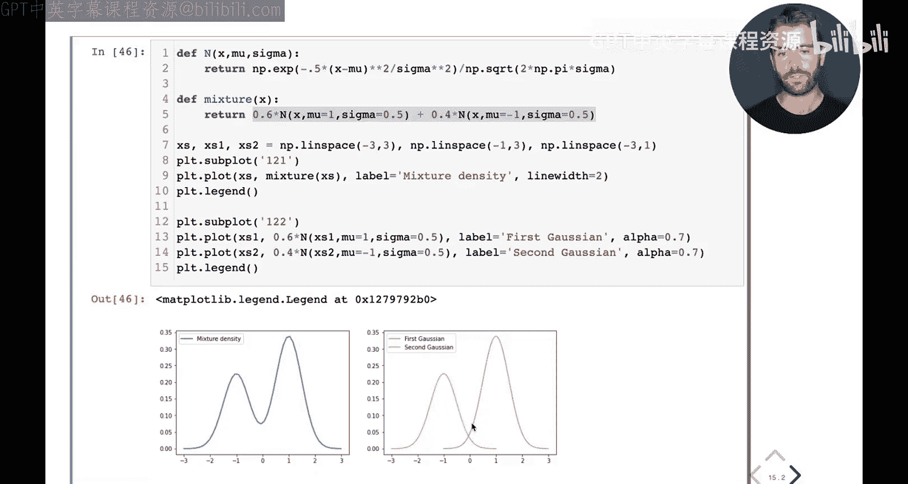

So this is this way of representing。A Gaussian， a geneative model as a story is a really interesting approach。

 and many geneative modeling algorithms can be。Thought many generative models can be thought as as this car as they can be defined by this kind of story for how the data is generated and if we have a more complicated model like for example。

 maybe we have a model of patients in a hospital and then these patients they might go through a set of procedures and each procedure has a certain has a certain influence on the patient we could also write this story in terms of probabilities and that would also define generative model so this approach in terms that uses stories is an interesting one and it's worth noting。

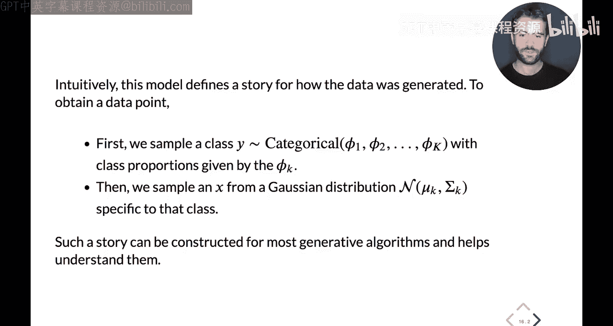

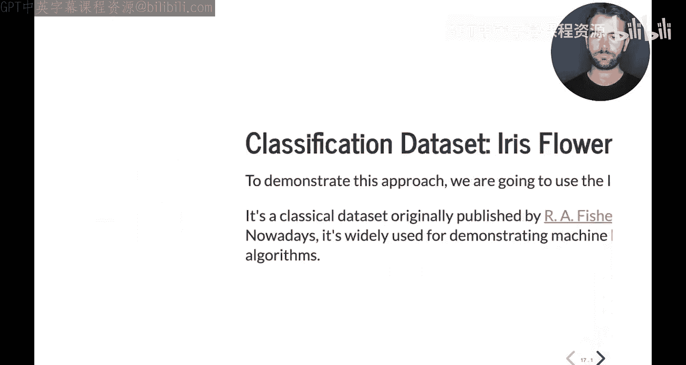

Now， let's look at an example of what it would mean to fitus。

 a mixture of Gausians on a slightly more interesting data， which is our I Flowers data。

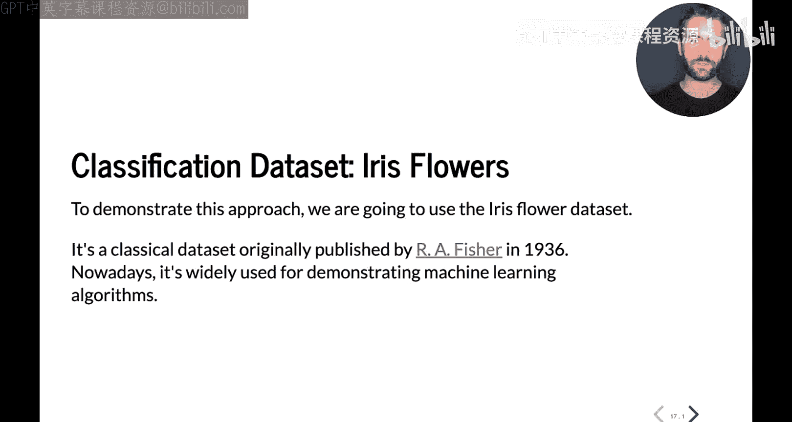

Recall that we've been using this data set quite for a few lectures now。

It's a collection of flowers for which we have these four measurements taken by these four columns and if we take only the first two columns。

 we can visualize this data set in two dimensions and it has this particular form where we have three classes denoted by blue。

 light brown and dark brown and they take the following shapes here I've projected them here I'm just visualizing them along the first two dimensions。

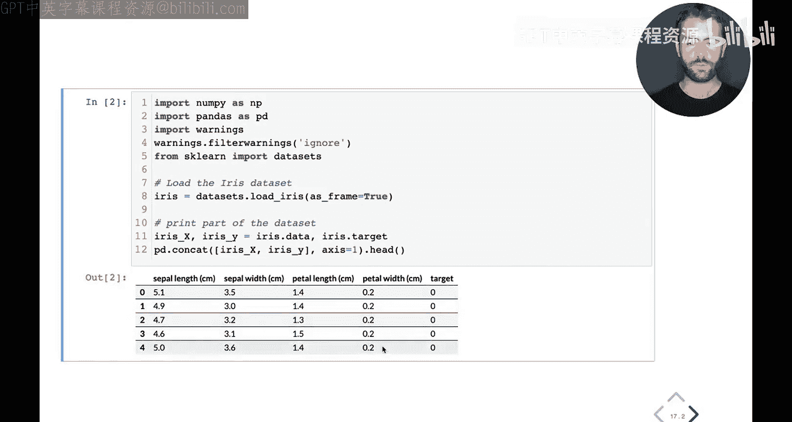

So what would it mean to fit a generative model to this dataset in particular。

 let's try to fit the model we have just defined in our earlier example。

 or perhaps we're not going to fit the model exactly。

 but we're going to define a model using an intuitive guess for what the parameters might look like。

 and then we're going to visualize this model on this data。

 so in other words I'm going to just define some parameters for this mixture of Gausians and then I'm going to show you that this is a reasonable model by sampling data from the model then by' looking at the real data and trying to compare the two to see if they are a good match。

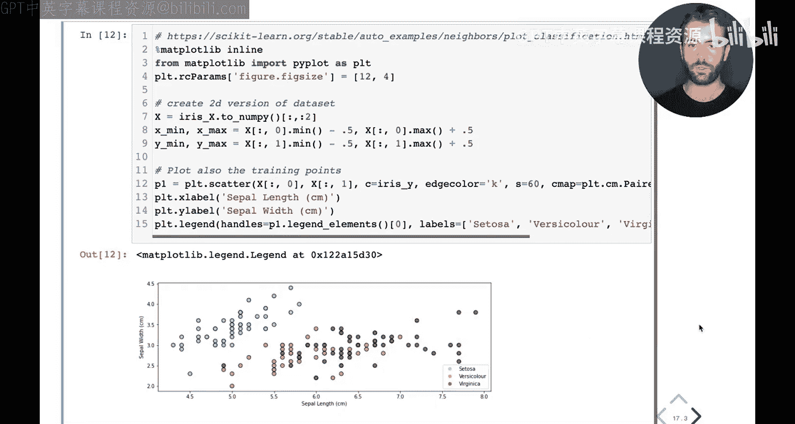

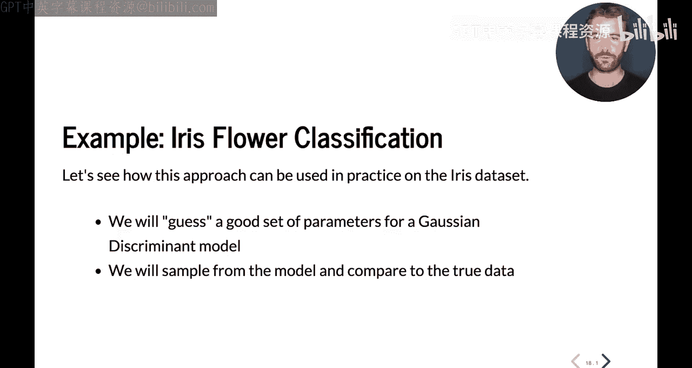

So here I am sampling data from a mixture of Gaussians。

 and I start by defining a guess for what the parameters of this distribution could look like。

So first， I am assuming that the。That the proportions of the classes are uniform， so here each class。

 well we have three classes and therefore each component of phi is just one third。

And now I'm going to assume that the means have the following， have the following value。

 So the mean for the first class is going to be approximately 5 and 3。5。

 The second one is going to be 6 and 2。5 and 6。5 and 3 for the third one。 I just chose these by。

Visual inspection of the 2D plot that we had earlier and for the covariances。

 I'm going to assume a diagonal covariance matrix for each distribution。

 except that we will rescale this by a factor of 0。05 to make it smaller。

And now that I've defined these phis mus and sigmas。

 I can really easily in nuy generate data from this model， so first I'm sampling a set of random y's。

 then I'm sampling x's from each of these distributions。

And you can see here these are the first 10 points that I have sampled。

 so I'm sampling 100 points in total， and these are the first 10 points and each of them dimension is a two dimensional vector which I'm going to visualize。

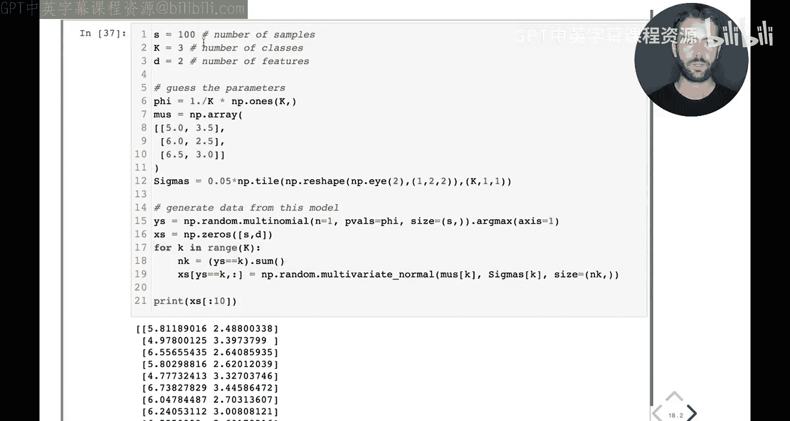

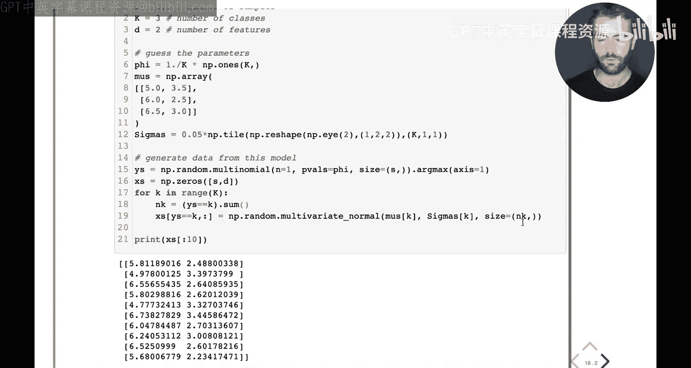

On the next slide。So now let's visualize these， these data points here on the right。

 This is our data set again。 Here we have this data set of blue flowers。

 this data set of brown flowers at the bottom and and on the on the left， I am visualizing the。

The classes that we have that from which I have generated these points just now。

 so I have the blue points that are default default here。

The brown points that fall here and the light browns are here。

 and you can see just by looking at this and by the way here I'm also in in the in the background I'm overlaying the actual data to So you can see that these points they approximate that I have generated from from my data set and that came from the。

Blue class， they fall approximately in this area， and then the light brown falls。 in this area。

 the dark brown falls in this area。 In other words。

 the data that I have generated just using my simple guess of what the parameters are。

 it has a shape that's。Approximately reminiscent of this。Of the shape of the true data。

 So just by choosing these three simple parameters。

using my own intuition and by visually inspecting this data。

 we have data that looks not unlike the real data， and this tells us that the model seems to be capturing something that's relevant it seems to be capturing the actual structure of the data。

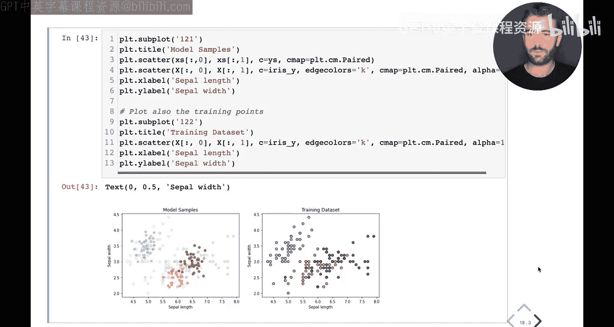

So this is a demonstration of what model what kind of model of what kind of generative model we can use on this data set。

And here I give you a simple example to convince you that it's producing reasonable outputs let's now see how we can learn these parameters from data in order to obtain a full learning algorithm on this data。

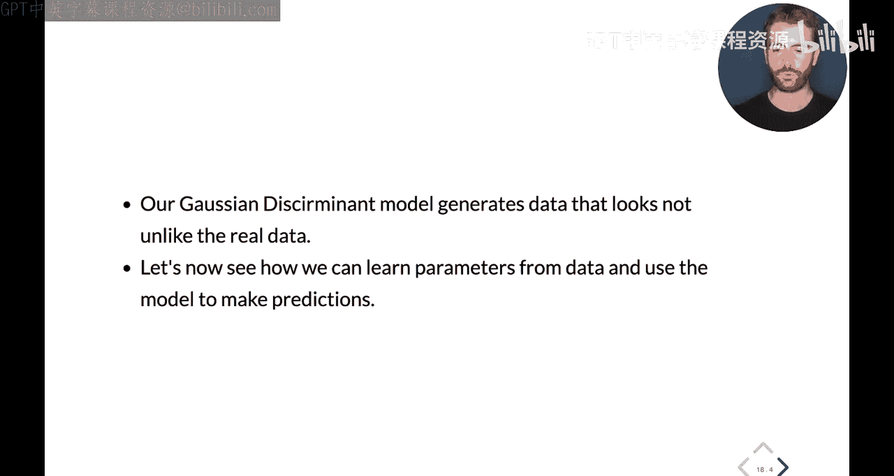