# 康奈尔大学《应用机器学习 CS 5787_ Applied Machine Learning 2020》中英字幕（deepseek p30 -30-Lecture 7. Part 3_ Gaussian Discriminant Analysis (Learning) -BV12udzYvEFM_p30-

This is now part three of lecture 7 of appliedli machine learning。

 where we're going to look again at the second part of the Gaussian disccrment analysis algorithm。

In the previous video， I defined what kind of model the Gauss instrumentcrment analysis algorithm would use。

 and now I'm going to look at the objective and the optimizer or the optimization procedure that we can use in order to fit this model to data。

 and this will define our Gaussian instrumentcr analysis algorithm in its entirety。

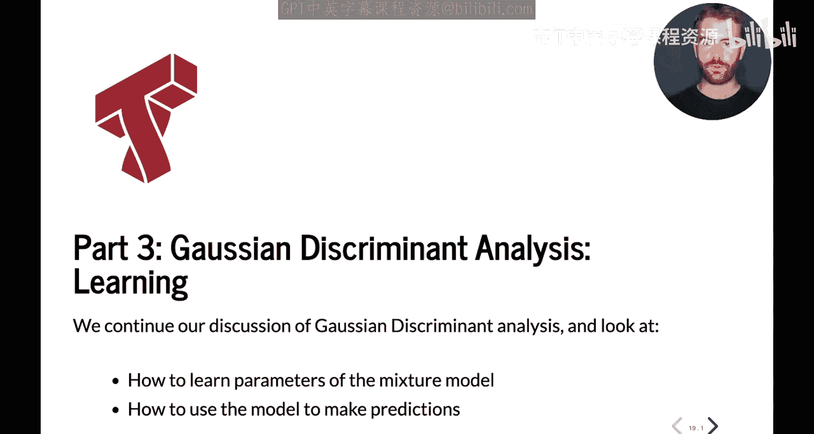

So recall that were still in a setting of classification where we have a labeled training data set with inputs X and targetsrg y。

 and these targets Y， they take on a set of K possible discrete values。

 they can be one of K possible classes， and this means that we have a classification problem。

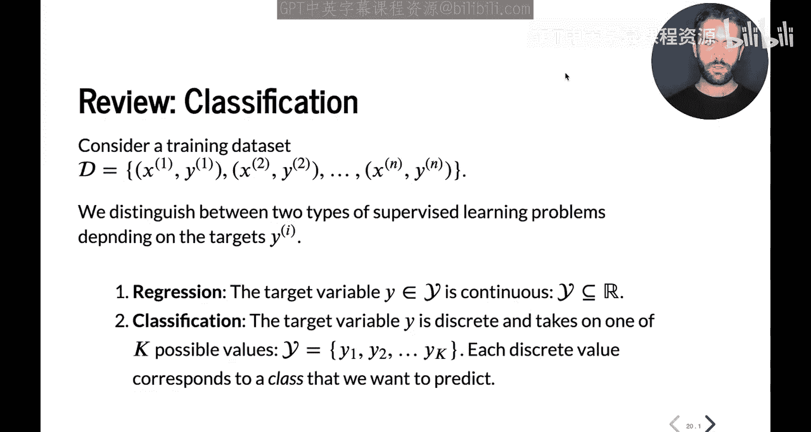

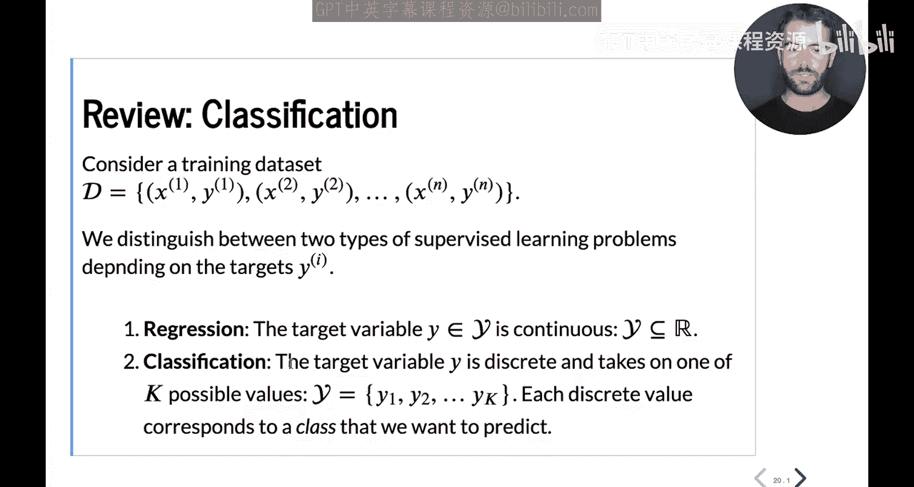

And in the previous video， I defined this。 I defined。 I showed how we can define。

The joint distribution as a mixture of K Gausians。Where。

This distribution can be defined by two components， a distribution over y that is given here。

 and that is simply going to be a categorical distribution。

 meaning the probability that y takes on class k is going to be specified by phi k。

And then the second part of the distribution that we want to define is the distribution of x given y and。

This can be a Gaussian and now plugging in these two definitions here we have a mixture of Gaussians。

 and so this is the model that I have defined earlier。

 and this is the model that will be the basis of the Gaussian discriminant analysis algorithm。

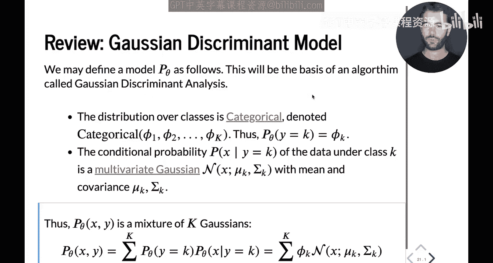

Let's now see how we can learn this model from data。

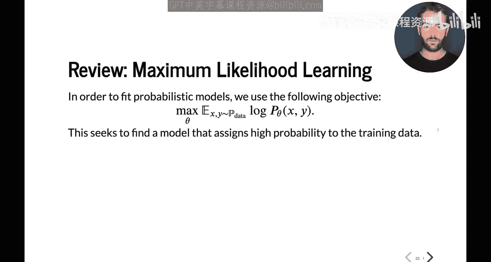

Since we have a probabilistic model and also we have a generalative probabilistic model。

 the principal approach for deriving an objective is maximum likelihood learning。

 so we are going to use maximum likelihood learning in order to learn the parameters of this model。

And just to be very clear and explicit here， the parameters of this model are the mean。

 the covariance matrix and the proportion of class K。So we have， if we have k classes。

 then we have three times k parameters， and these are denoted by， well。

 these are denoted by the following symbols and then the entirety of these parameters the。

this entire vector well this entire set of parameters， the mu1， sigma 1， et cetera。

 and everything up up to here， this is our set of model parameters， theta。

 So theta refers to all of the muse， sigmas and phis for all of the classes。

So let's see how we can learn theta from data。

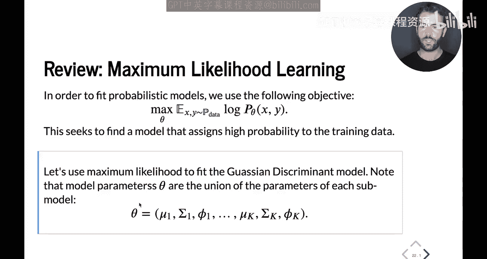

As I said earlier， the principled approach to deriving this objective is to maximize well the principald approach defining an objective as maximum likelihood and in maximum likelihood we want to optimize the following objective。

 which is our log likelihood， so we want to find theta such that the model assigns high probability to data coming from the model to data coming from the data distribution。

Which is this year。And we can rewrite this data particular in a slightly different form。Since。

Since we defined this joint as having two components， y and x given y。

 we can simply break it down into two sets of terms。

 the terms over the y and the terms over x given y。And here。

And here I can further decompose this term as follows each。

W is going to take is going to be one of K possible classes。 So we were we're going to be we can。

We can rewrite this theem in a slightly different way。

 which is this form in which I am first summing over all the possible classes and then for each class I perform a summ over all the X's and y's for which y equals k。

So if I， if I sum。All the classes and for each class are sum the points in that class。

 I will end up summing over all the n training points。

 so this is just another this is a different way of enumerating all the points in our training data。

 but now what this allows us to do is that for each class K。

 I can write this probability a little bit more explicitly and I can say that this is going to be the probability from the。

From the case conditional Gaussian model that has parameters， mu and sigma。And then this join here。

 even though so it's actually not a function of all the parameters theta。

 it's a function of only the parameters phi。And similarly， these terms。

 they're only a function of parameters mu and mu K and sigma K。

 and they're not a function of any other parameter in theta。

And now the crucial observation that I want you to make is that。

All the terms that involve muke and sigma K， they are precisely here。 So this， they all fall within。

One， they basically can be all I have grouped them all together and also all the terms that invoke the phi。

 I have grouped them together here。And。Again， saying this in another way。

we can decompose the log likelihood into a sum of terms， so into a linear function。

 where we're summing over a number of terms， and each term contains a different subset of the parameters。

So there is a sort of independence between the parameters and the practical implication of this is that if I want to optimize。

 for example， over the set of phis， then I can completely ignore I can completely ignore this term here。

 I can completely ignore it and if I want to max if I want to find the phi that maximizes the log likelihood。

 I only need to look at this term and I can ignore all the other terms。 and similarly。

 if I want to optimize for the best mu k and sigma k， I just need to look at。

I just need to look at this expression for the value of k that I'm interested in and I can ignore both this term and also I can ignore all the other terms in this summation that do not involve the value of k that I'm interested in。

 So there's this decomposition into the our log likelihood objective decomposes into a sum of terms and each term contains a different。

Subset of the parameters， and each set of parameters is found in only one of the terms。

 So if I want to optimize over the parameters， I can do this separately by just considering each term for its relevant set of parameters。

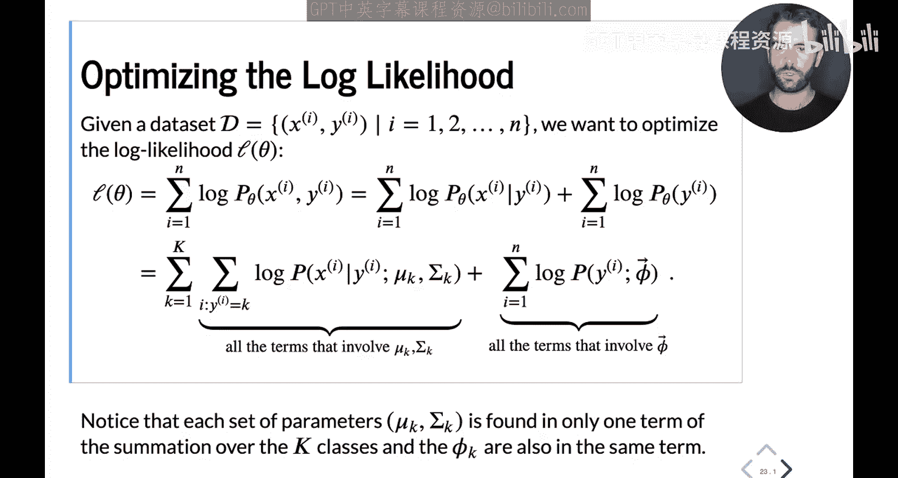

Let me write this down a little bit more formally and a little bit more mathematically so you can。

So you can。So you can again see what Im what I'm referring to。

Let's see that we want to optimize our log likelihood over the parameters of U k and Sigma K for some value for some specific value of this k here。

So this is our full log likelihood。And instead of optimizing over everything， I can right away。

 sorry， I can right away， ignore。

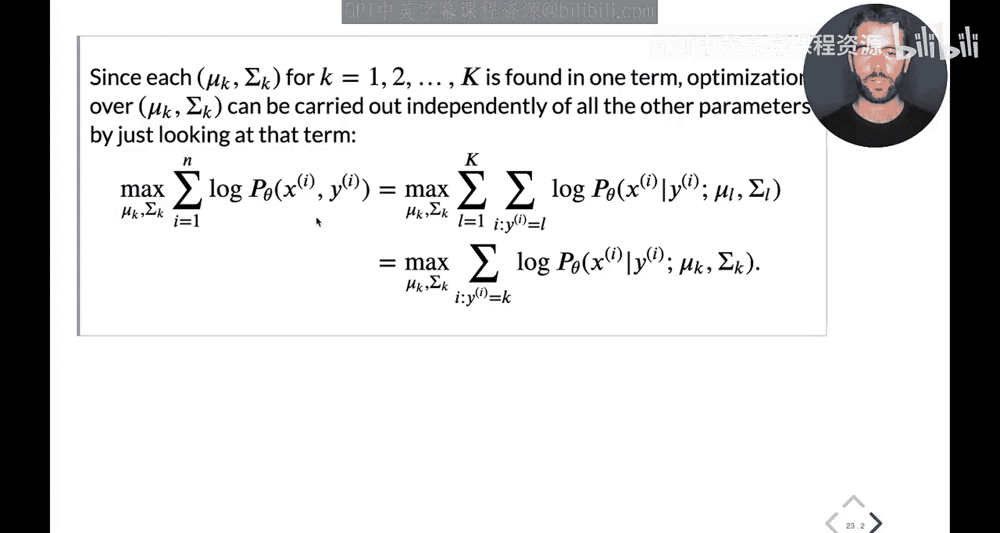

This term here， because it does not involve mu and Sigma a， I only have this set of terms。

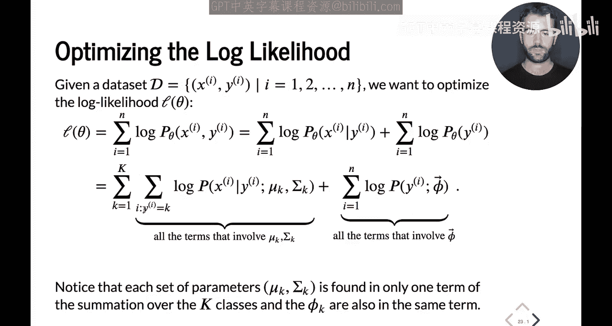

Which is what we have here。And then out of all of this sum。

 only here I am summing from l equals 1 to k。Only when does only when L equals our lower lower case K here is when we start seeing our mu k and sigma a so I can ignore everything except this。

Set of terms。 And so the maximum of the log likelihood is going to be the maximum of this subset of all the possible terms。

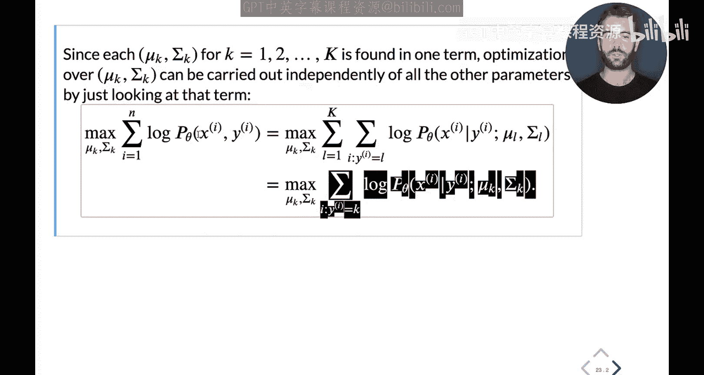

And similarly， if I want to optimize over Phi， I just need to optimize over this particular term。

 which is。Which is the only part of the expression。 that's a function of Phi。

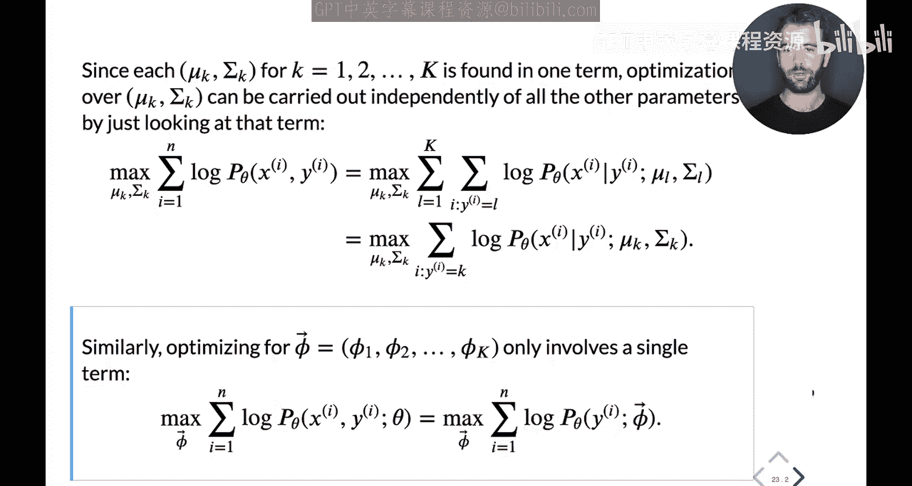

And again， this is now very useful because the optimization problem becomes parallellyizable。

 but also much simpler。For example， let's now try to find what is the optimal set of filess under this new objective。

As I showed you earlier， optimize， in order to find the best fight。

 we only need to optimize this expression。And now I can further， I I can use the definition。

 I can use the fact that P is a categorical distribution to say that this is going to be the particular form the probability of that this so the probability of seeing this class is the。

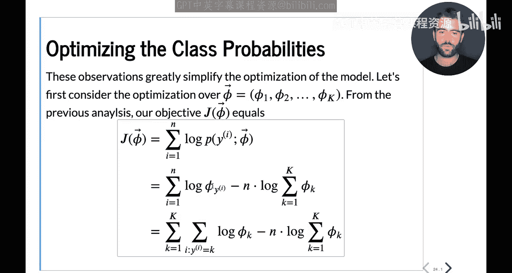

Or the lock probability has this form has this form here that's in the second line。

 this is just by the definition of the categorical distribution and the lock probability。

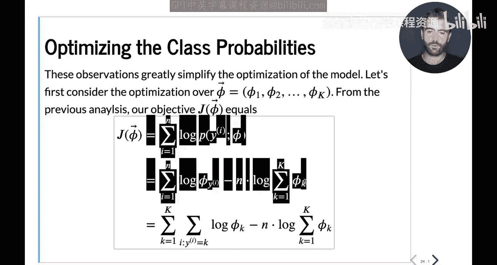

And here I have just rewritten this expression in a slightly different way where I'm taking a summation over all the possible values of k and。

Yeah， and then here I'm just summing over all the values of here this is a sum over all the indices class when the class equals k for this training point high。

So this is just here in the second line， I have just used the definition of a categorical distribution and in the third line。

 this is just rearranging the summation to make it a little bit more convenient to read。

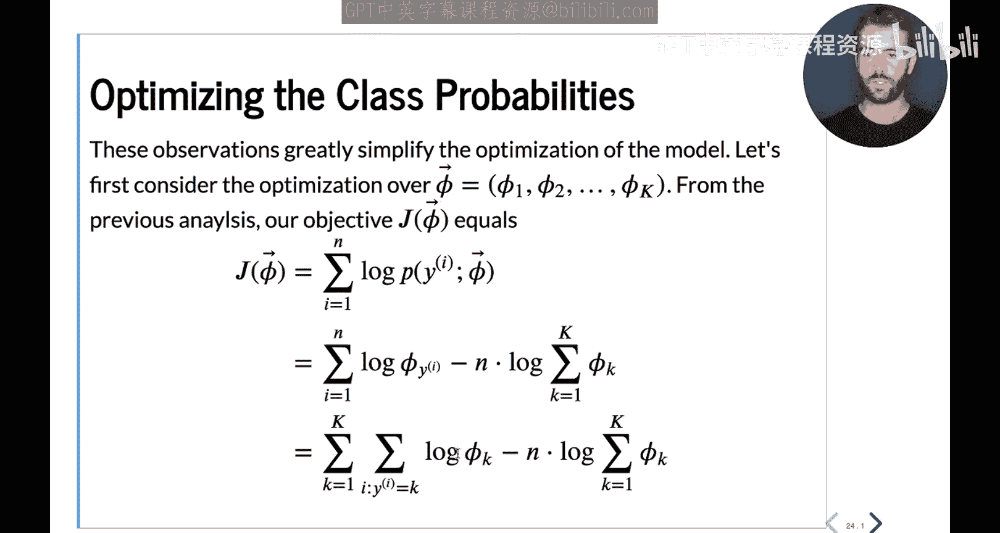

And now it's really easy to check that by。

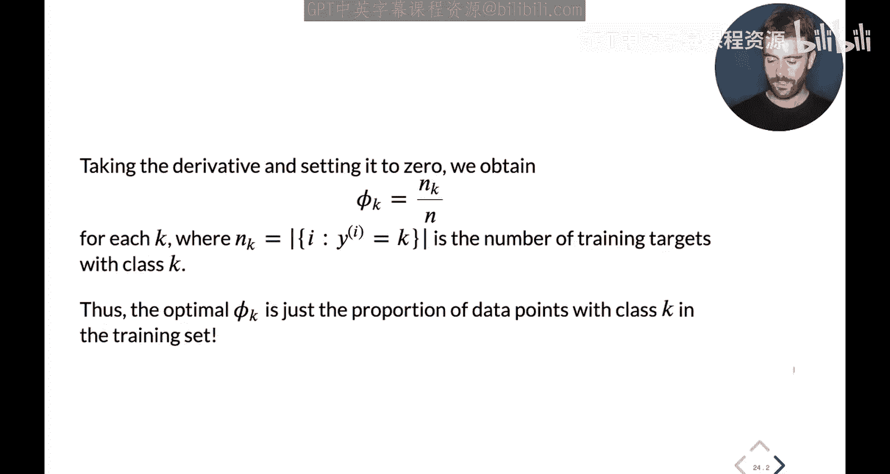

By taking the derivative with respect to any of these terms either relative to Phi1 or relative to52 phi2。

By taking the derivative and setting it to0 and solving it。

 we can derive a closed form expression for the parameter5hi k for every k and this closed form expression that maximizes this value is going to be really simple is going to be simply the fraction of the points in our training set that have。

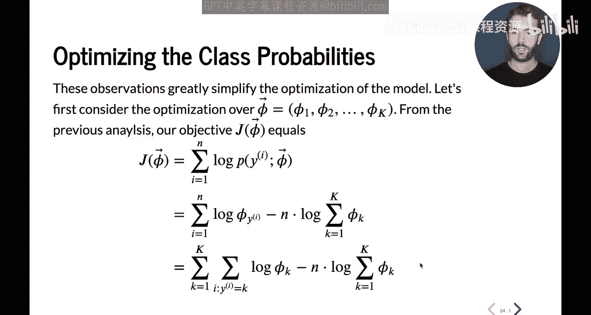

Class K。So the optimal parameter of Phi K in our data distribution is simply the proportion of training points with class K。

This is really intuitive。 And if you remember our。Our example with coin flipping and maximum likelihood。

 so we had five throws from a biased coin and we wanted to estimate the probability of heads the same way as the probability of heads was the empirical frequency in the data。

 well here the prior probability of class K is simply how many times have we seen class K in our data set。

So maximum likelihood。Especially in simple models， it has very simple and intuitive closed form solutions。

 and this is the case here again。aga we can have a close form solution for the maximum likelihood estimate of the parameters p。

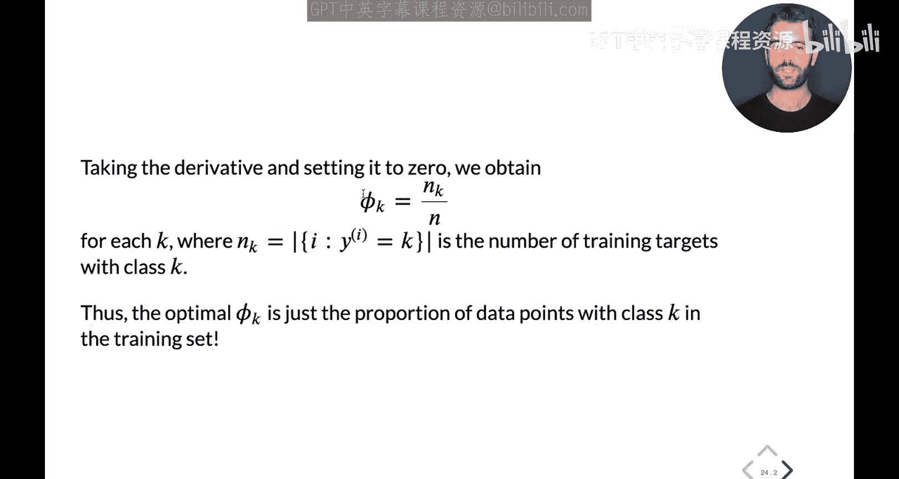

And similarly， we can also have a very intuitive expression for the。For the parameters of the。Of the。

 of the Gaussian distributions。Here， this is the。This is so yeah， if we want to optimize。

 if we want to find the best new K sigma K for some specific value of k here。

 then from our earlier derivation， we only need to optimize this term which here I'm just explicitly writing it out as a Gaussian distribution。

 so we want to maximize the probability of seeing the data that has class k here。

 so here this is the log likelihood of the data for class k under a Gaussian distribution。

So in other words， we only restrict ourselves to the subset of the training data that has class K。

 and we want to fit a Gaus into this data。Well， obviously。

 the Gaussian that that will fit this data best is going to have。As mean。

 the average value of Xi and the covariance is simply going to be the covariance of this data。

In other words， the conditional distribution of class K is a Gaussian whose mean is。

The mean of the x's。In the data set that we have and their covariance and the covariance of the model is going to be the covariance of the data that we have。

Again， we have this really simple， intuitive close form solution。

And now we have a close form solution for both mu， Sigma and Phi。And again。

 as in our very first example with the normal equations here also we no longer need to perform any optimization compute we can compute this expression in closed form。

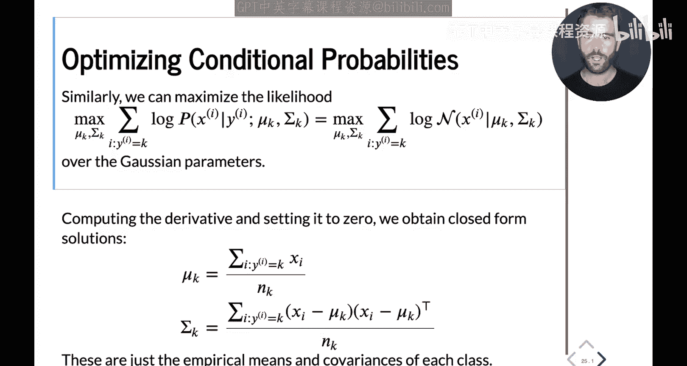

So now that we have parameters for our model， how would we obtain predictions from this model。

 let's say that we have an input X and now we want to compute the class y Well as I mentioned earlier。

 we can apply base rule to invert this probability and now it looks like probability of x given y times probability of y。

And again， the interpretation of this equation is that we have a point x and we're looking at the probability of this x under all the different classes under all the different models that we have for each class。

 and we will simply say that this label corresponds to the model under which this x has the highest probability。

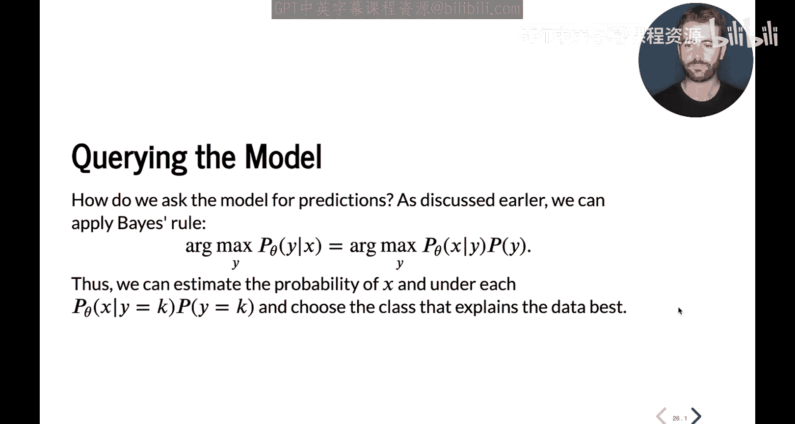

Let's now see how all of this works in practice again we're going to use our data set of iris flowers。

 which has this form， we have a number of measurements for the different flowers and if we visualize this in two dimensions then it looks like this where we have these different clusters and there are three types of flowers in this data。

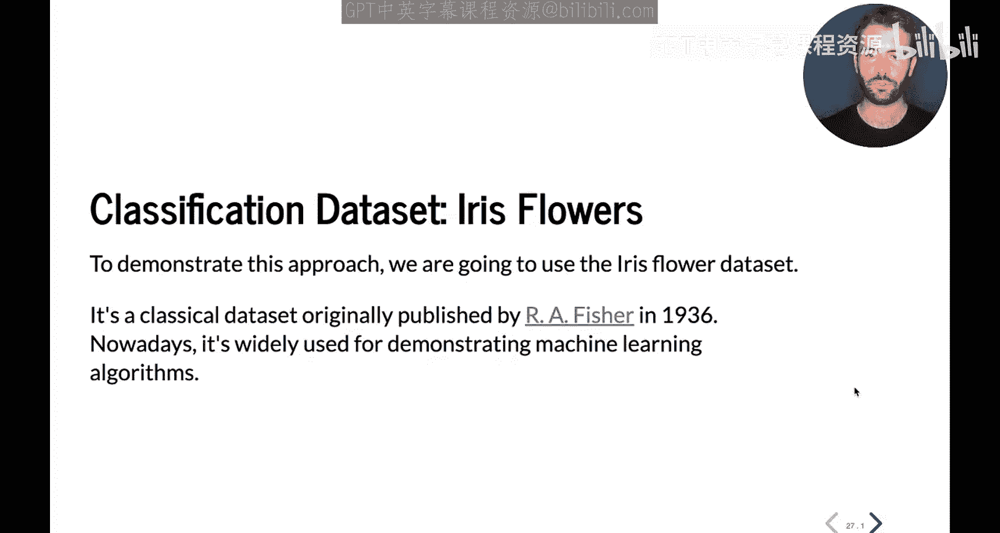

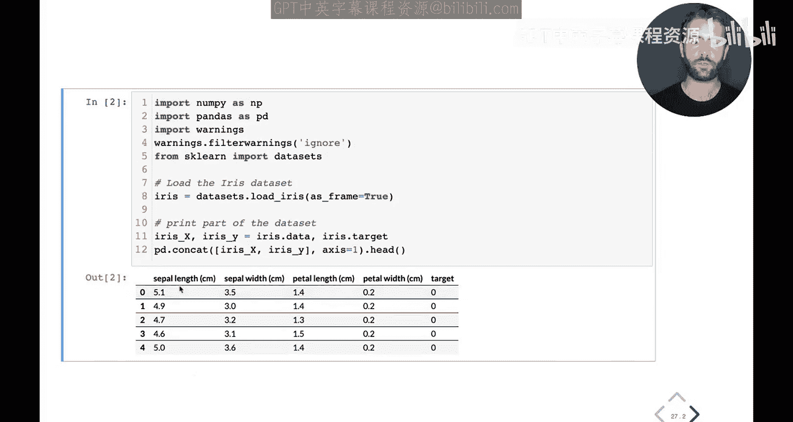

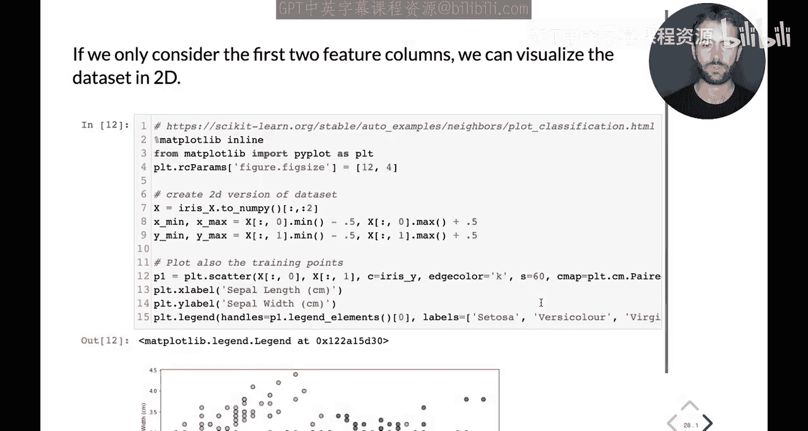

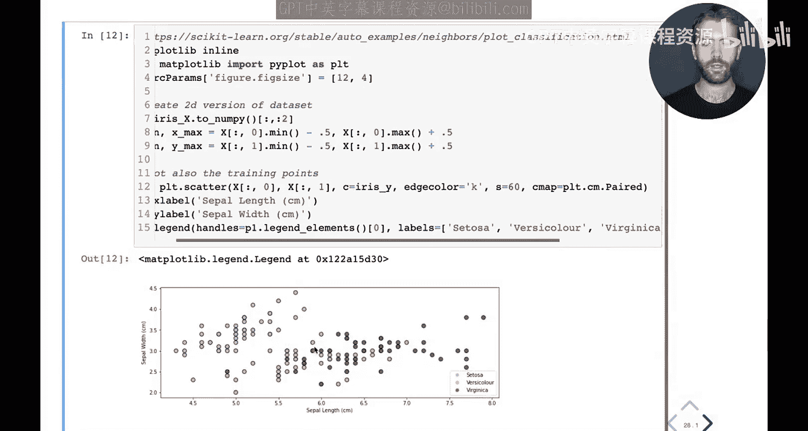

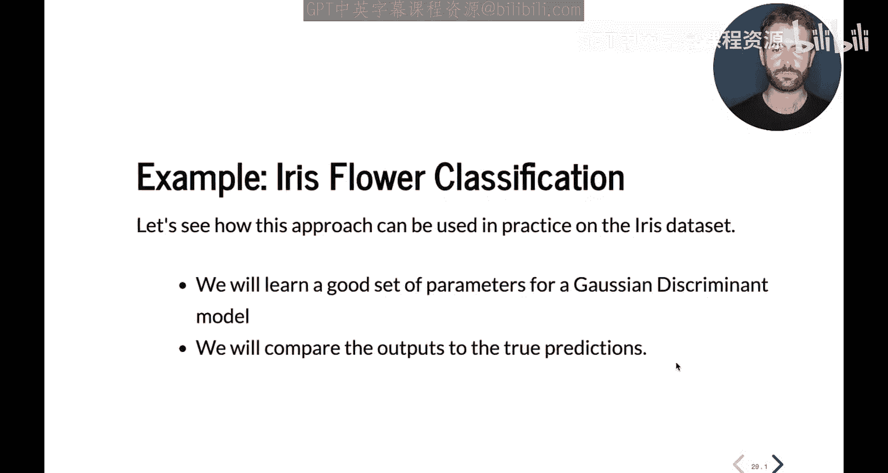

So let's now learn the parameters of the Gausian Increment analysis model on this data。

 and let's use it to make predictions。

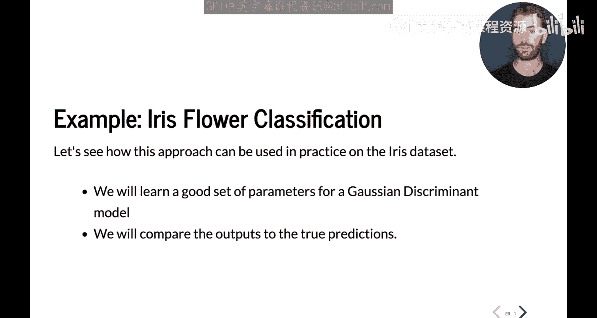

First， let's compute the two parameters。The beauty of the Gaussian disriminant model is that this is all the code that we need in order to compute our parameters。

So for each glass， I am simply。Looking at the subset of the data that has this class。

And the mu parameter of the Gaussian for this class is simply the mean of the data。

And the sigma parameter is simply the covariance of this data。

And the phi parameter is the proportion that class K takes in our data set。And let's say。

 three lines of code or a little bit more five lines of code to fit this model。

And here these are the value of mu that it finds， and these are not too different actually from what I guessed by just looking at the data visually。

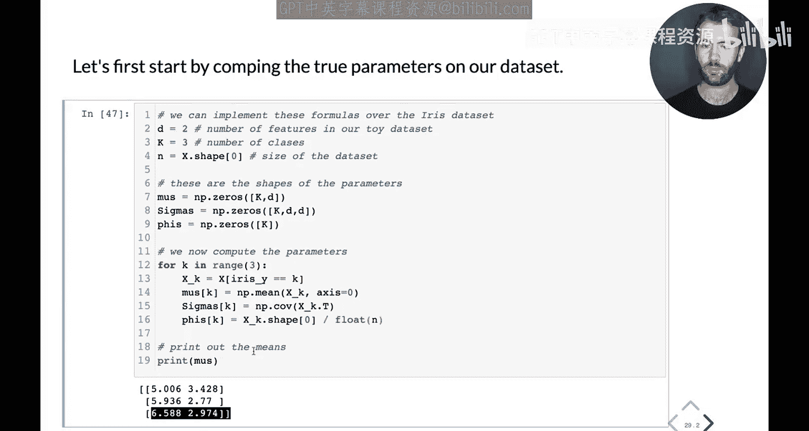

Now， in order to compute predictions， we can apply base rule。

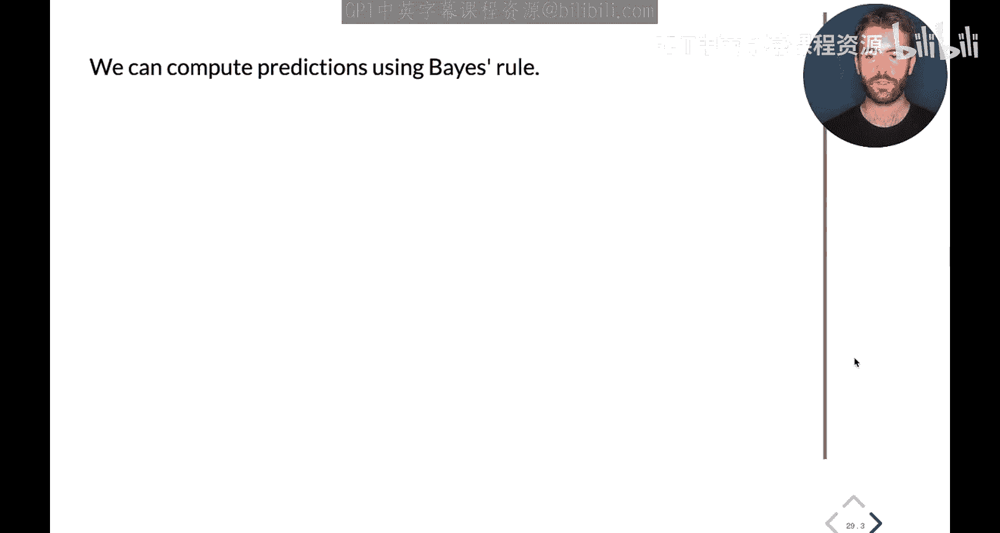

And again， the the main logic is in these。4 lines。I am looking at the probability of， well。

 first of all， I'm computing the prior probabilities of y。Then so the input data set， the input is x。

 and so I compute the probability of x given y for each possible value of y。

And now the probability of y given x is proportional to probability of Xy times probability of y。

 and in this line， I simply return the most likely class。

And the extra nonpy functions that you see here and these definitions。

 this is just in order to make this operation efficient and vectorized when x can contain multiple inputs。

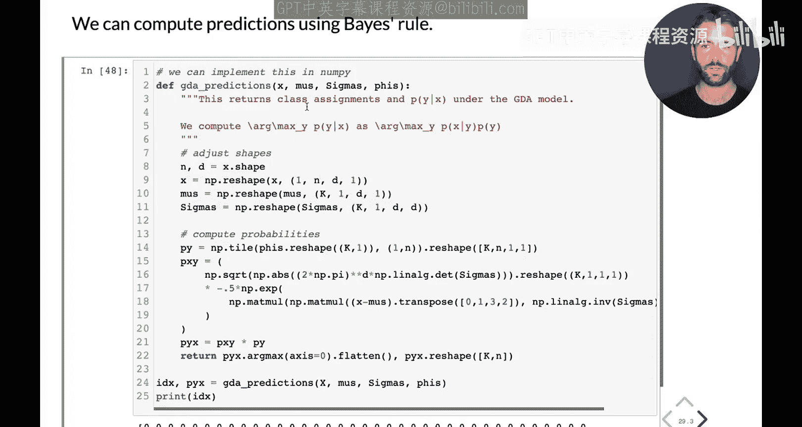

So now in order to perform inference， I simply invoke this function and here I can print out the labels that it's predicting for this class。

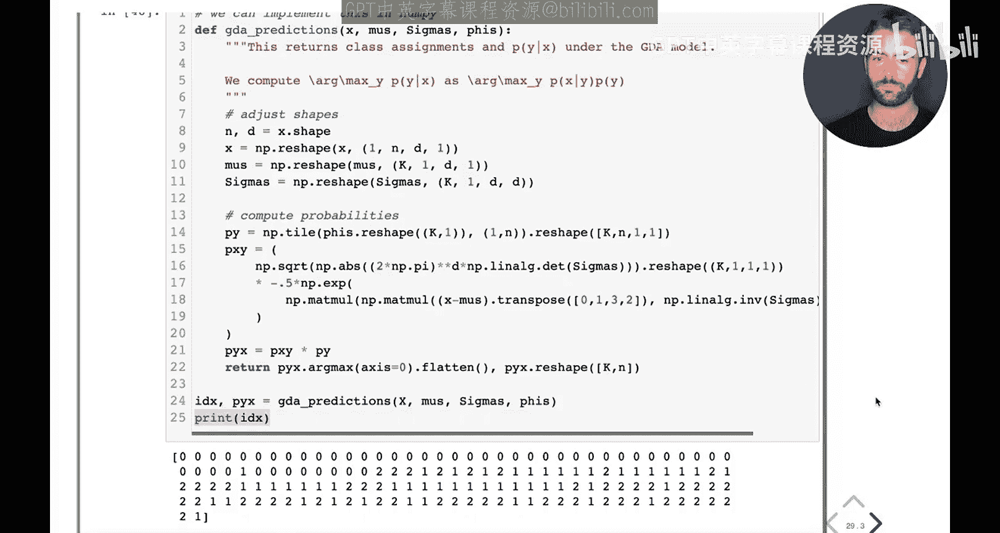

For this data set。And again， just to make it a little bit more explicit。

 I now have a function which can compute。

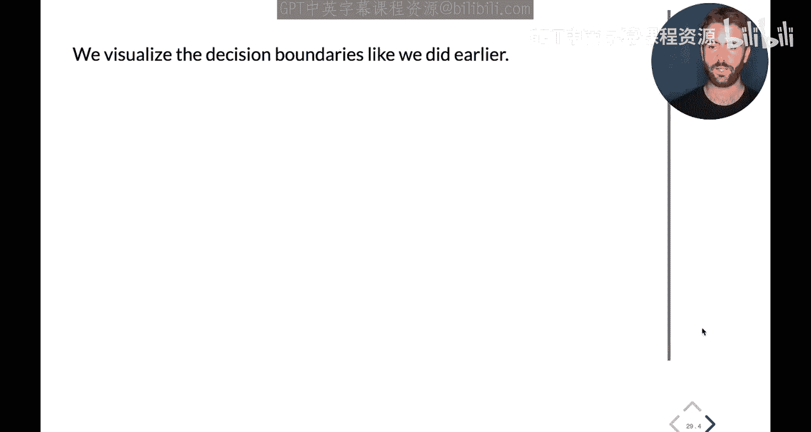

A class given each input X， although it does it not directly。

 it does it by inverting our probabilistic model， but it still have。

I have defined here a function that can assign。

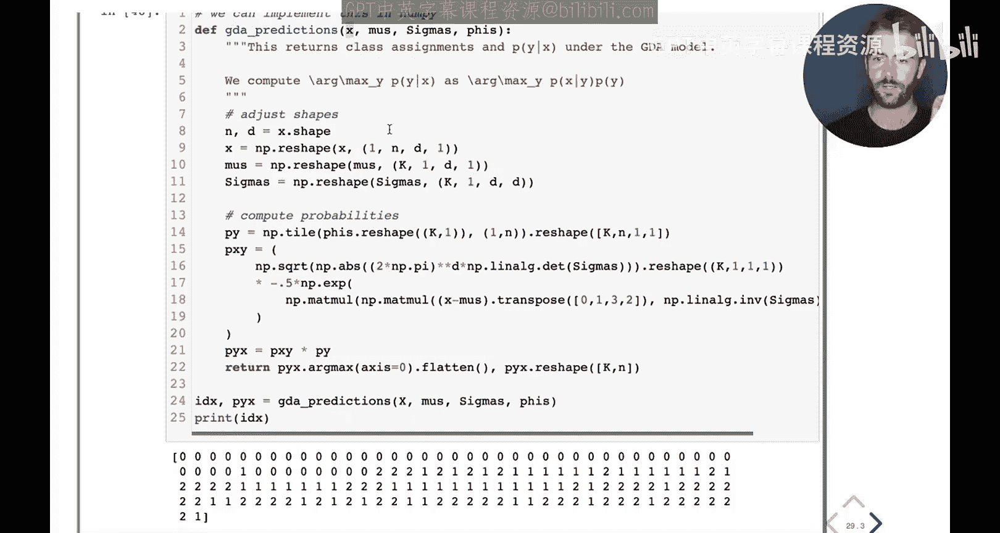

A target to each point in our two dimensional space。

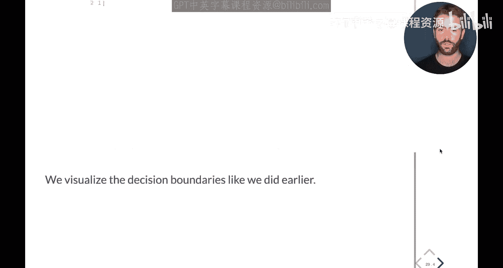

And now I can simply visualize these boundaries， as I have done earlier。

 and what I have looks like this。So here on this side。

 I still have all the blue points and these are all labeled in blue。

And now the dark blue and light blue the dark brown and light brown regions are they are where they should be and they're separated now by what is now a nonlinear decision boundary。

 which is。Which is interesting is actually。It's not a linear， but it's a quadratic boundary。

 so there's actually a quadratic function that describes this shape， but I'm not going to。Prove it。

 but actually it's not that hard to show that there's a quadratic function that describes this shape and these ellipses these correspond approximately to the shape of the covariance matrix。

Or in other words， you can also think of this as being one level curve that I just happen to choose to choose arbitrarily of the density of each component of the mixture of Gaussians so this is the this。

This is one level curve of the shape of the Gaussian distribution that describes this blue data set。

 and so you see that they're all centered around the mean of the data and they have a shape that's reasonable and that follows the shape of the data。

And this is a better fit than what I came up with by hand because I just chose all of these to be circles of some arbitrary。

 well， circles of some size that I tune based on the data。

 but actually this data has a slightly more elongated elliptical shape and we're able to capture by looking at it in this form。

So this is an application of。

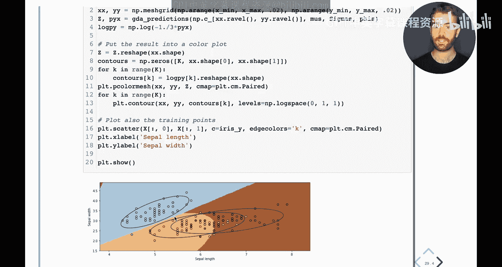

Qudratic disment analysis to this data set。And so finally I just want to summarize this in the following slide。

 so we have defined a new algorithm called Gaussian discriminant analysis。

 which is a form of supervised learning supervised learning algorithm and actually it's an algorithm for multiclass classification this is again another of these misnomers for historical reasons this is called discriminant analysis。

 but in modern machine learning， this is actually a generative algorithm and yeah this is another misnomer。

 the type of model that it fits is a mixture of Gaussians and it optimizes it using log likelihood and in this particular example with this particular algorithm。

 we don't need to perform any form of green descent or any other kind of numerical optimization there is a closedform solution for the parameters。

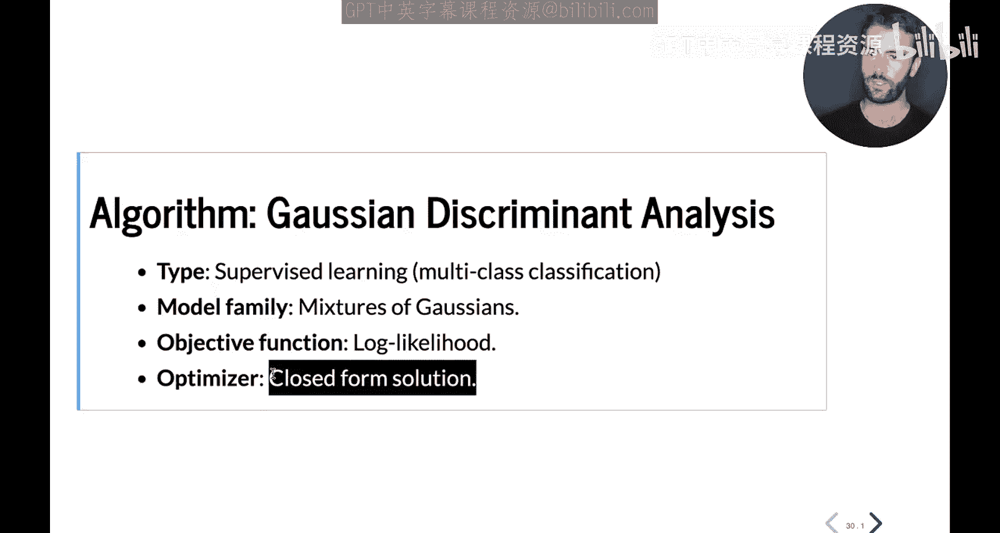

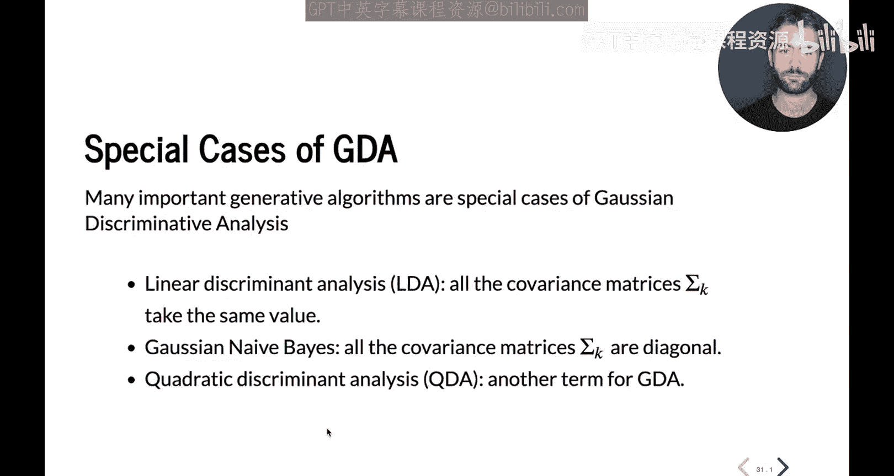

Finally I just want to briefly mention a few special cases of the GDA algorithm。

 these are algorithms that you may hear about in the future if you read on this topic or they they're just very well knownn machine learning algorithms。

 but they happen to be special cases GDA of，Of G。Linear discriment analysis or LDA is a form of GDA in which all the covariance matrices take the same value。

 so Sigma 1 equals Sigma 2 equals Sigma 3， if I add this extra constraint。

 then we have something called linearar discriment analysis。

And I will later tell you why it's linear， but。Well， really into words。

 it fits a linear decision boundary。Another version is called Gausian Nave Bayase。

And there the covariance matrices are diagonal。

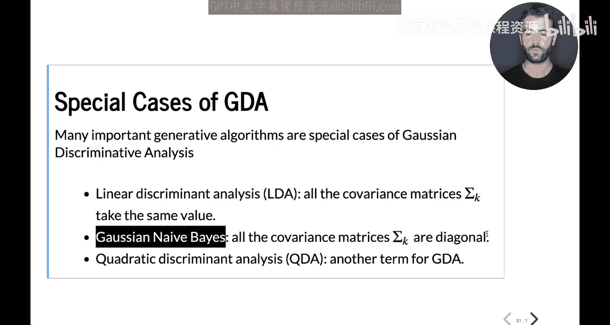

And finally， there's also the term quadratic discriminant analysis， which is another term for GDA。

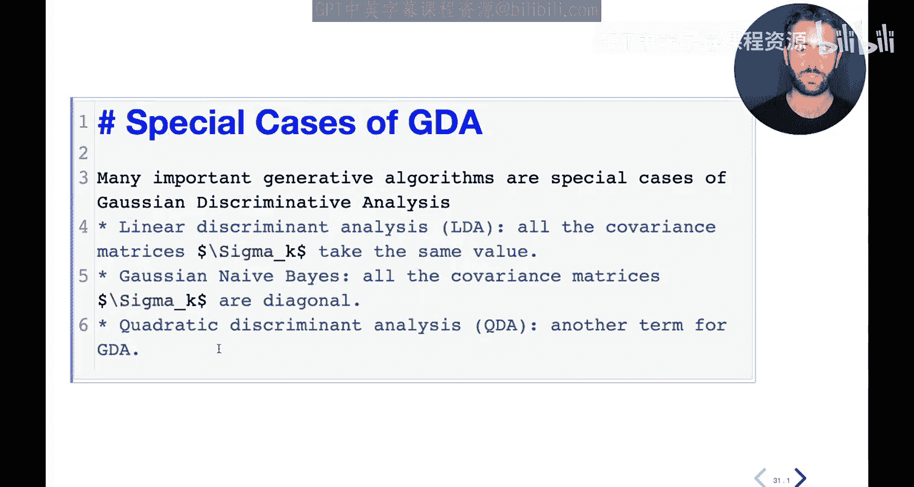

And the reason why it's also called quadratic disccrment analysis is， again， as I mentioned earlier。

 the shape of the decision boundary between the classes can be quadratic。

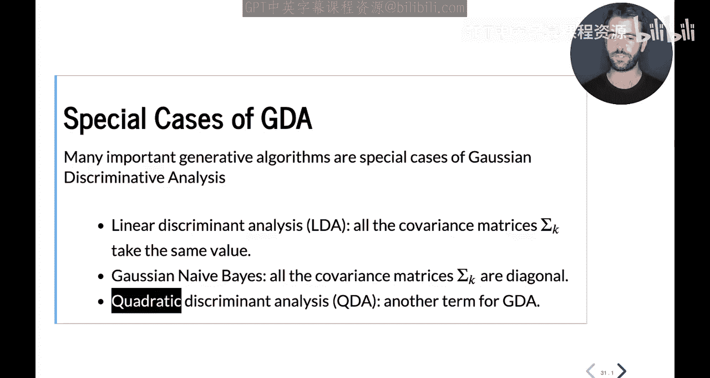

So finally， I want to come back to the question of when would we want to use the discriminative versus a generative approach。

In the in the next lecture， we're going to continue to look at other kinds of general algorithms。

 and I will give more information。 I will I will。I will explain in more detail what are the pros and cons。

 but for now let's just， let me just highlight a few of them。The。

 I would say that the main advantage of the primitive models is that。

They tend to make fewer assumptions about the data。 they make they model less of the data。

 for example， they don't model x at all， they only model y given x and there is no model of x at all that is done and because they don't model X they don't need to make any assumption what what X look like looks like and therefore they make fewer modeling assumptions and therefore they。

There's less chance to make an error。 There's less chance to model X incorrectly if you don't need it。

 and therefore， the model will tend to be more accurate because there's less chance that we have。

Misspecified or model。So in practice， especially given larger data sets。

 discriminative models are in practice， they often give us better predictive performance。

And I would say that the kinds of algorithms that are used in most machine learning applications are actually discriminative。

 so if you think especially modern applications that involve neural networks or deep learning。

 these are mostly discriminative algorithms and in applications like image classification or machine translation or summarization。

 these are all well， these are mostly forms of discriminative models。

 these are variants of discriminative models。However。

 the gene modeling approach is also really important。

It's important if we want to do something more than just prediction， for example。

 we may want to actually be interested in generating new data points X。

 maybe we want to generate new molecules or new drugs or want to generate sounds。

Then we would want to use a generative approach。 And even if we're interested in prediction。

 we might still want to use a generative model if， for example， we're missing certain features。

 So if， for example， if our data comes in and sometimes some of the features are not measured。 Well。

 if we have a model over x， then we can generate these missing values。

 and then we can perform prediction so。Generative models have this functionality that disriminative models don't。

And also。Because we're modeling X， we have more flexibility。

 we have more flexibility to specify a model。 we have a richer kind of model and we can specify more prior knowledge and if we actually have good knowledge about how X is generated given Y then we can specify it and if we actually know this process if we can specify it correctly。

 then generative models will tend to outperform streamminative models。 In other words。

 if we don't know the process of how x is related to y very well then it may not be worth modeling it and we will tend to be more accurate by not modeling it。

 but if we do have accurate prior knowledge and we want to put this in the model and we will output more accurate predictions。

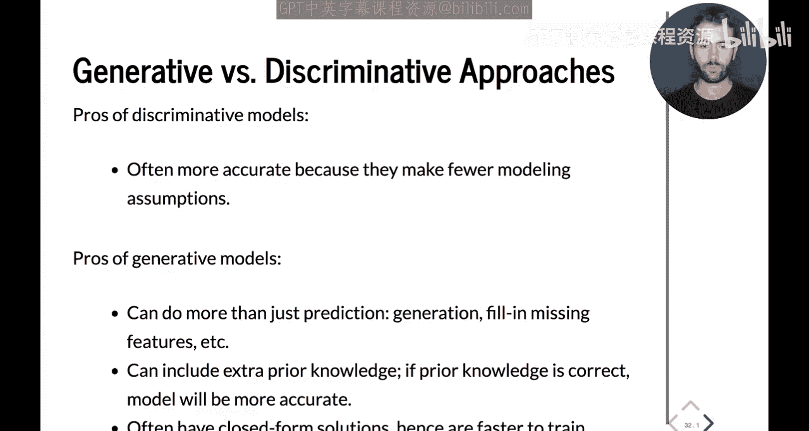

And finally， as I mentioned， as I showed in this video。Often， for。

Interesting classes of generative models， there will be closed form solutions to maximum likelihood。

 and therefore we can just compute the optimum of these we can optimize these generative models in closed form。

Which makes them easier to train and faster。So this concludes the definition of the Gasian discriminative analysis algorithm in the next lecture。

 we're going to talk more about generative algorithms and we're going to introduce a new and really important。

Generative modeling， generative algorithm called naive base。

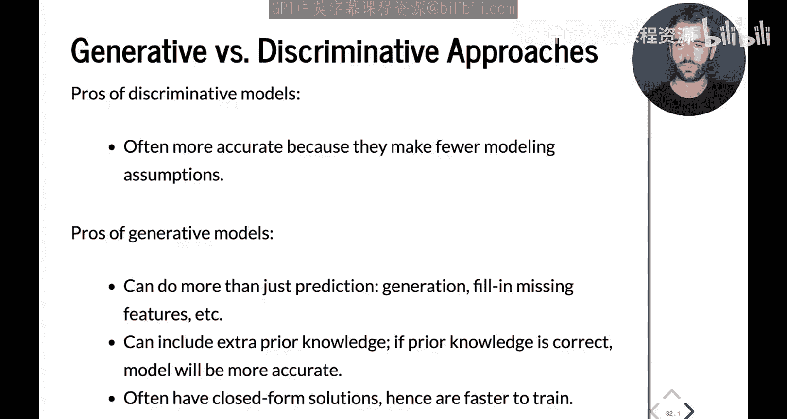