# 康奈尔大学《应用机器学习 CS 5787_ Applied Machine Learning 2020》中英字幕（deepseek p31 -31-Lecture 8. Part 1_ Text Classification.zh_en -BV12udzYvEFM_p31-

。

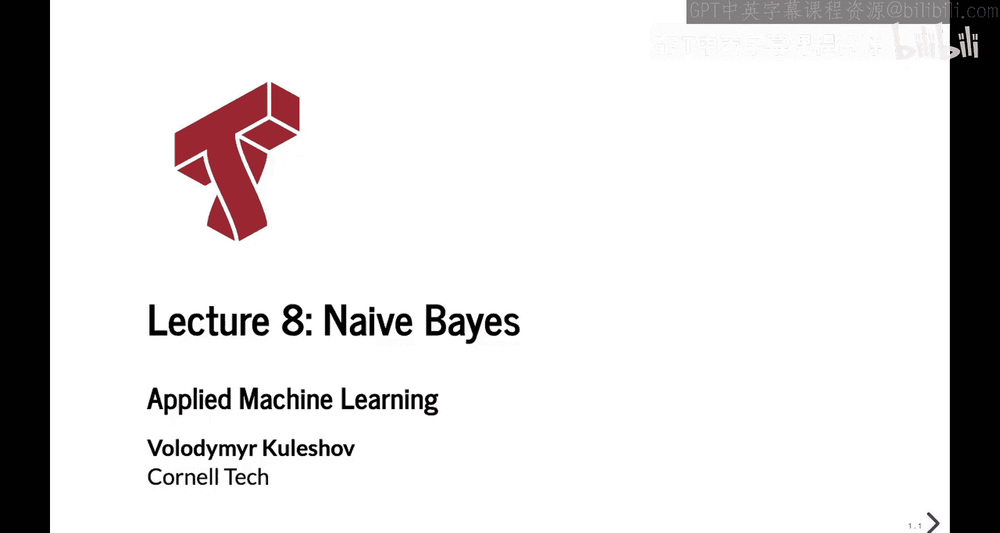

Welcome to lecture 8 of applied machine learning。The topic of this lecture is going to be a new kind of classification algorithm called naive Bayase。

In the previous lecture， we started to talk about a new approach to supervised learning algorithms called generative modeling。

 generative algorithms。 And we gave our first example of what is a generative algorithm In this lecture。

 we're going to continue this topic。 and we will see a different algorithm that is also very important。

 and the name of this algorithm is naive Bay。

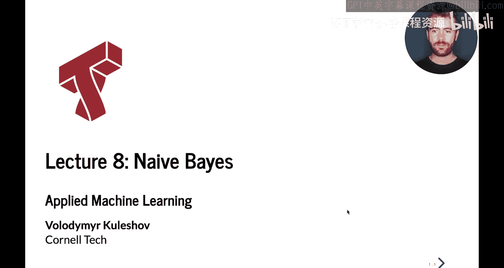

Before I define this algorithm， I want to start with a motivating application。

And this motivating application is going to be the problem of text classification。

Text classification is a really important practical problem and also is going to be a really good way to introduce this nave based algorithm。

 which I'm going to do in the next video and for this video I will start by defining what is text classification。

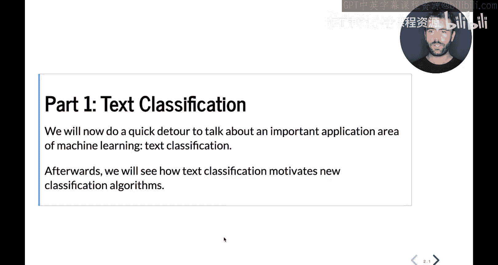

So recall that in the past few lectures， we've been looking at the classification problem。

In classification， we have a training data set of inputs and targets。

 and our targets are discrete and they take a number of K possible values and these are called the K classes that the target can take and the setting that we're in is called classification。

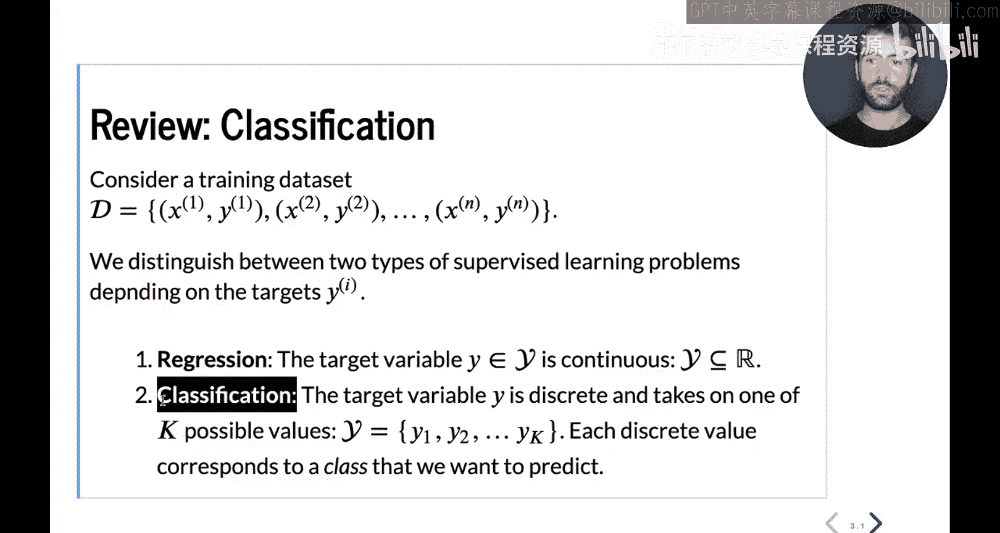

In this video， I'm going to look at a particular example of a classification problem。

 which is classifying text。This is an interesting problem to look at because a lot of useful。

 a lot of applied problems are instances of text classification， for example。

 spam filtering is a text classification problem， fraud detection based on fraudulent financial claims。

 so classifying financial claims into valid or fraudulent。

 analyzing medical records and classifying them into， for example。

 whether the patient is healthy or not healthy， these are all interesting examples of text classification。

 and this is a problem that is very often found in practice in practical applications of machine learning。

This problem is also different from what we have seen earlier。

 one way in which it's different is that now we're classifying sequences of words。

And these sequences of words can be of different lengths。

 so we could be classifying different sentences and each sentence is different。

 or we could be even classifying really long documents。

Another way in which this problem is different is that the dimensionality of the problem can be really large。

 so recall that x is a vector of a certain dimension and now if x is a sequence。

where each element of the sequence can take a large number of possible values。

 a large number of possible words， then in a way the dimensionality of this problem is really large。

 which means that it's going to be we're going to have to think about how we can apply our existing algorithms to this data set。

 it will require a little bit of extra work。

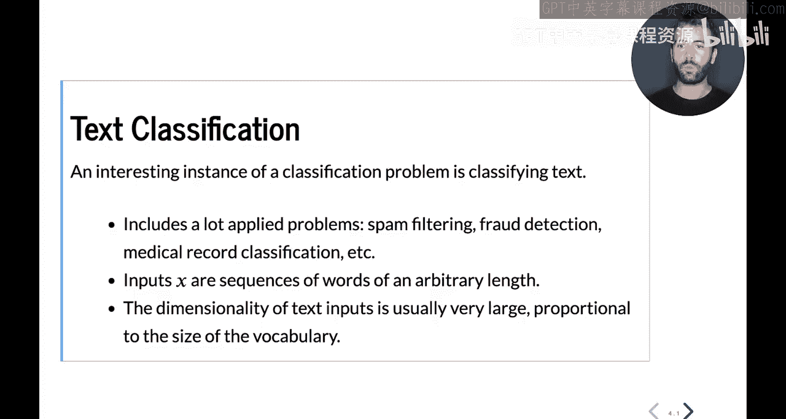

Now， in order to give you an example of what a text classification problem look like looks like。

 I'm going to use this。

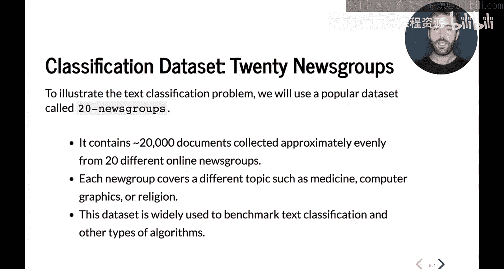

Famous data set in machine learning called the 20 news groups dataset。

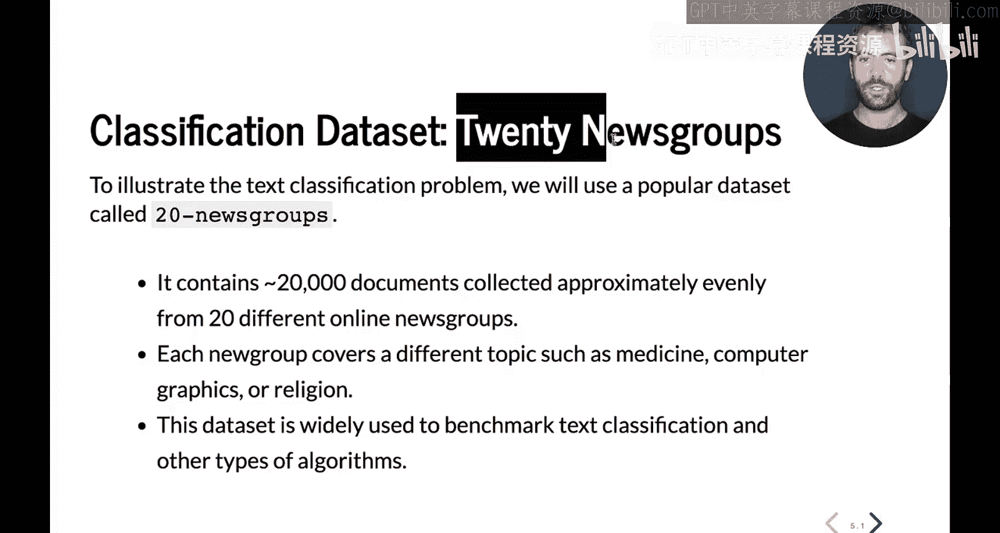

So this is an instance of a text classification problem in which we have 20。

000 documents that are collected approximately evenly from 20 different online muse groups。

And each news group covers a different topic。 So you can think of these as as。

Post to online forums where each forum has a different topic。

 these can These topics include medicine， computer graphics， religion。

 So they cover a really diverse set of topics。 And the classification problem in this example is to determine。

What is the， what is the topic， What is the。The goal is to predict from which news group a particular message came from。

 which essentially amounts to classifying the topic that is being discussed in that particular message。

And this is a data set that's widely used in machine learning for benchmarking， various algorithms。

 and it's also used for demonstration purposes。

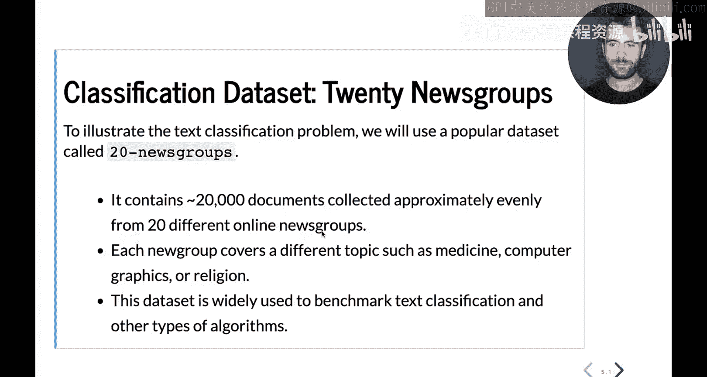

And I will be using it in this lecture， as well。So we can load this data set from the Psychit Learnn library again in p PsyitLearn we have a dataset set modules contains different kinds of which allows us to easily load different data sets and I'm going to use this function to load the twin0 news groups dataset。

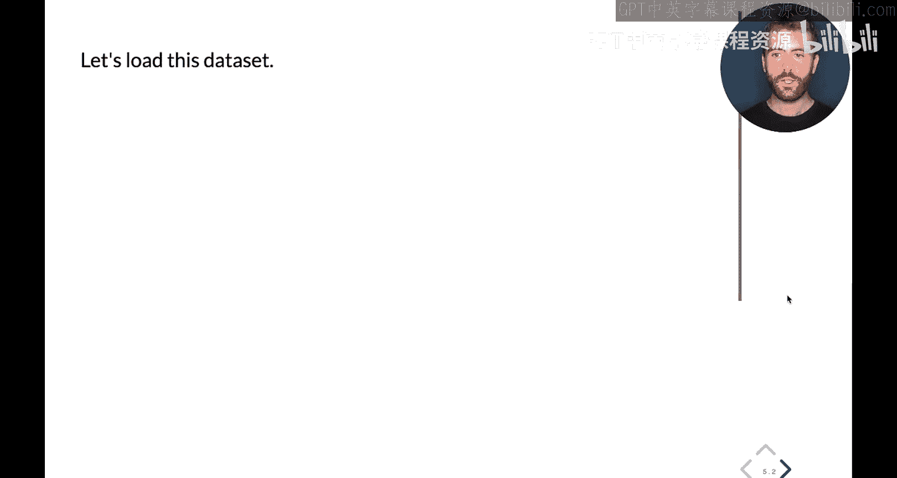

So instead of looking at all the 20 possible topics， I'm going to look at only these four。

 So these are atheism。Religion， Christianity in particular graphics and medicine these are the four topics that I'm going to load and now I'm going to load this data particular through this function and you can read the description of this data in this file if you're interested and for now I will just show you an example of a message from this data。

 so first of all again just to confirm our set of possible targets now consists of these four classes。

 atheism and graphics medicine， Christianity。

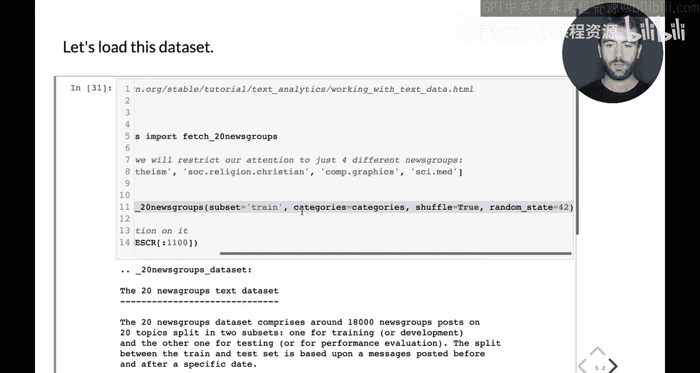

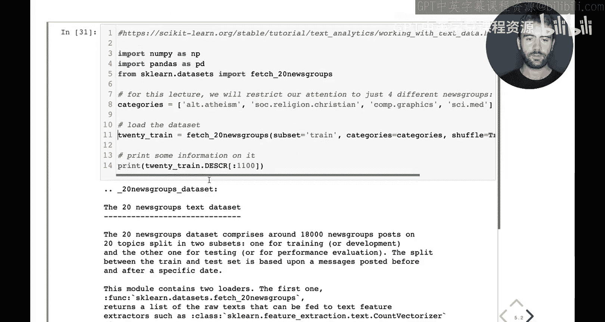

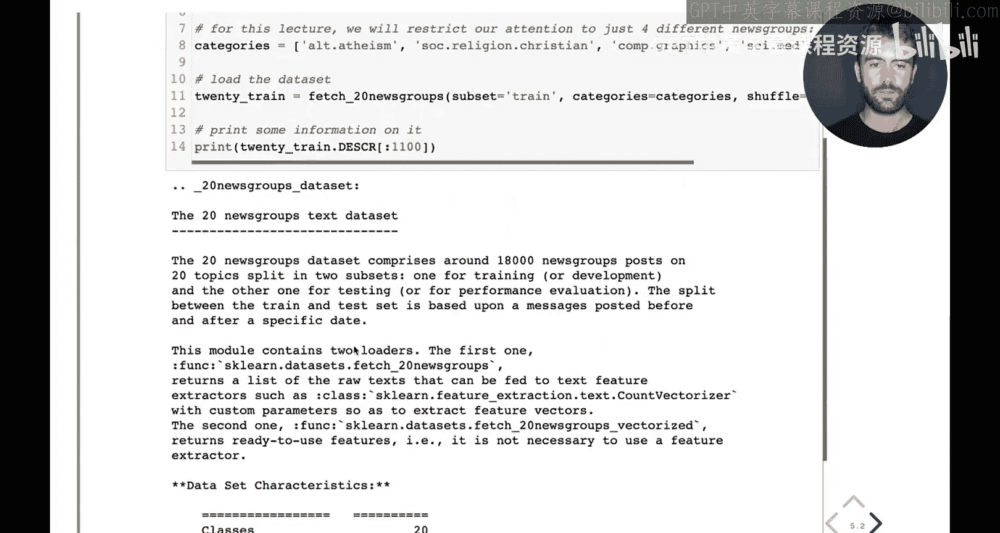

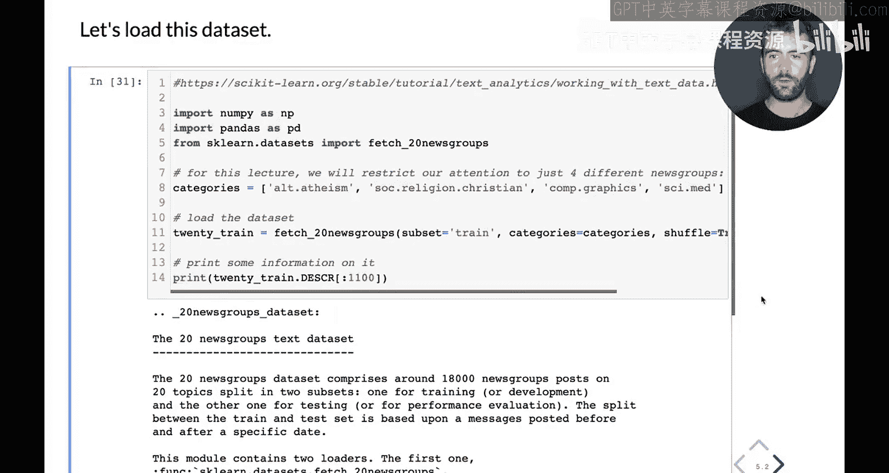

And。This is an example of a message from this data set。 So this is input， this is input。At index 3。

 And you can see that this is a message that was posted to， to the。Christianity data set。

 so this is a person that's writing a paper on the role of the Catholic Church in Poland and this person is asking for information about her research topic。

So here we have an example of how an input to our classification problem can look like。 So here。

 this sequence of words or even the sequence of characters。Cresponds to an input to our model。

 So this this is what X looks like。 X is now this， this， this message。And again。

 we have loaded because we only loaded four topics， we have about 2。

000 data points in our current data set。

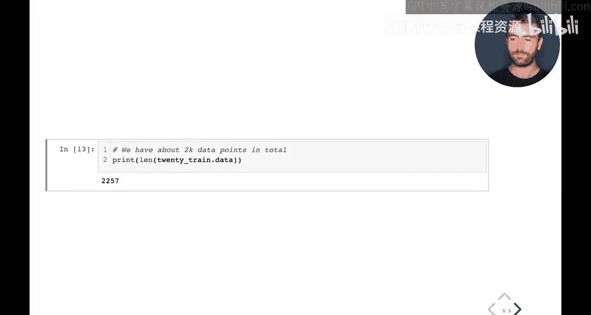

Let's now look at what happens if we try to apply classification algorithms to this data set。Again。

 as I mentioned earlier， the first issue that we run into is that this data and each input in this data is now a sequence of characters of an arbitrary length。

And our machine learning algorithms， all the supervised learning algorithms we have seen so far。

 they assume that we have some kind of D dimensionional vector of features phi of x。

So in order to apply our。Our existing supervised learning algorithms。

 we need to come up with some sort of feturization of this text。So what might we use as features？

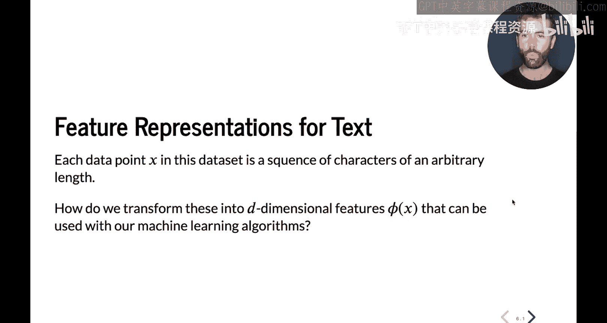

One approach that we could take would be to define handcrafted features based on this text。

 So for example， if we know that we're going to be classifying messages that have that have something to do with religion or with or with graphics or with with medicine。

 then we might use this prior knowledge to handcraft our own features。 So for example。

 maybe one useful features whether the message contains the word church。

Or maybe whether the email originates from inside or outside the United States。

 or is the organization that's in the email， a university。

 or has the person signed their name or is the person signing their name。

 is this a male name or a female name， maybe these are all useful features and by looking at the data by thinking about it。

 we could come up with our own handcrafted set of features。

This would probably give us really the good features。

 but it would require a lot of work to create these features。

 so is there a better and easier and more automated approach？

So one general way of defining features would be to look at every possible word and count how many times it occurs or to have an indicator for whether it occurs or not。

 so something like we did earlier here with the word church but we can do it with every possible word in the dictionary。

 so we would have one feature would be does the message contain artvarc。

 does the message contain apple。And then does the message contain zebra in the end。

 So all the possible words。This is actually a really powerful idea that I'm going to talk about。

In more detail shortly。But finally， I just want to highlight that there also exist specialized algorithms that could work with a sequence of characters directly。

 so here in bullet point1 bullet point2， I have proposed ways of defining features a fixed number of a fixed number D of features that we could then feed into our supervised learning algorithms。

 but I also want to highlight that there exist。嗯。Algorithms that are somewhat more modern and that are based on neural networks and that are within the field of deep learning。

 which could even take in the raw unfeturized sequence of characters directly。However。

 in this lecture， we're not going to look at these at these。At this third class of。

Algorithms just yet。 We're going to focus on how we can create our own how we can create how we can create a fixed number of features D。

And the particular。

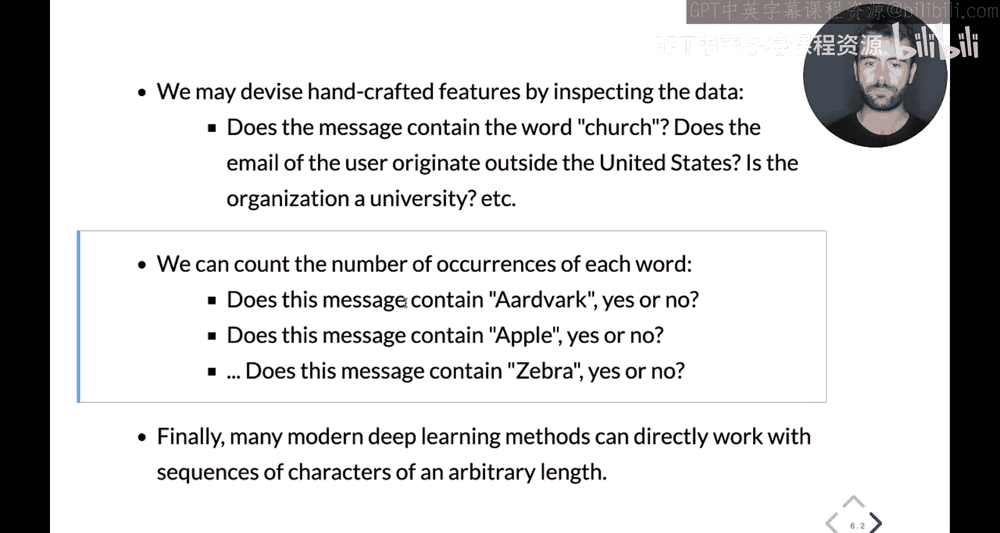

Approach that I'm going to take is going to be inspired by this second bullet point。

So I'm going to propose a way of defining features that is really important and that is used throughout machine learning and is's probably one of the most standard ways of classifying text and the name of this approach is called bag of words。

So let's look at what bag of words means。The first step to creating bag of words。

 features or bag of words representations is to define what is called a vocabulary。

So a vocabulary is all the。Is the set of all the possible words that are interesting to us。

So this could be the entire set of words in the dictionary or if we're in some kind of more specialized medical domain。

 then perhaps it's a medical vocabulary。But essentially this is all the set of possible words that exist in our universe that exist for the purposes of this machine learning problem that we're solving。

 so here's an example， here's a set of words that are in my vocabulary B。

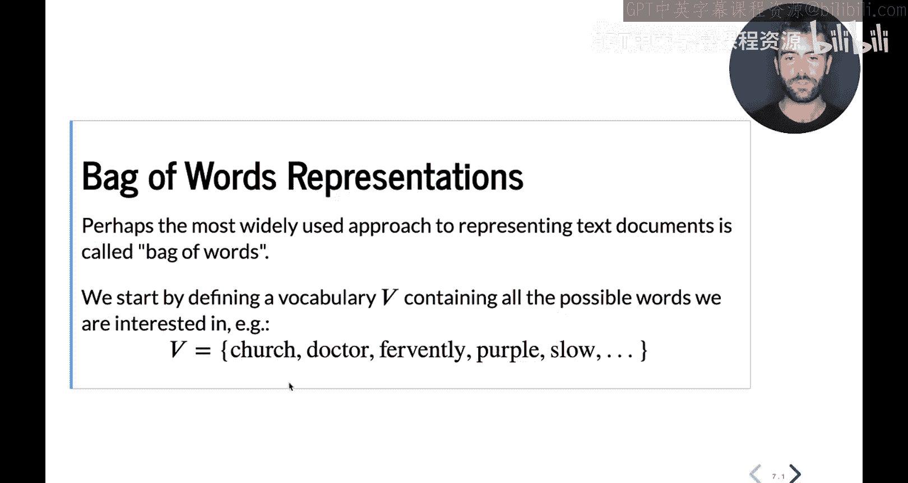

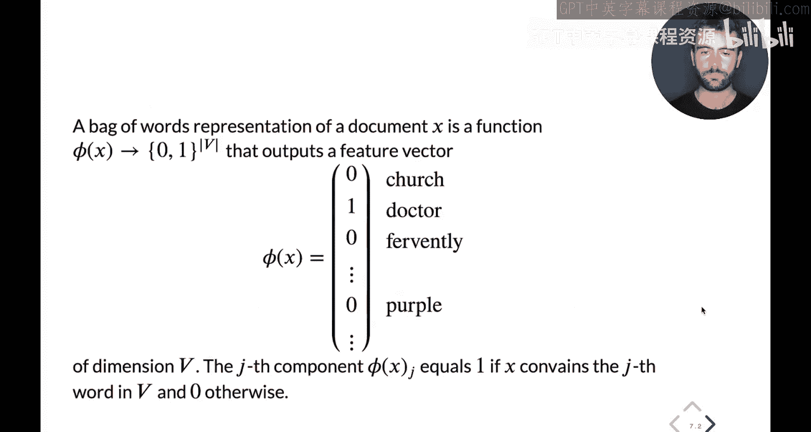

And then the idea of a bag of words representation is to define the following set of features。

 and this is what I alluded to earlier。So in a back of words representation。

 we define a set of features phi。Whose number equals the size of our vocabulary。

 So the dimensionality of this vector phi equals the dimensionality of our vocabulary V。

And so phi of x is a you can think of it as a very long column。

 so the vocabulary will typically be large， so this is going to be a very long column vector and at each position I have either a0 or a1。

And it I have here a0。 if this word， if this message contains the first word in our vocabulary。

 So here it happens to be church and the second。Entry contains one， if we have the word doctor and0。

 if we don't have the word doctor and similarly for fervently。 And so in our。In our vocabulary。

 we're assuming some kind of ordering over the words， we're going to have for each word。

 we're going to find one index in this vector and add this index。

We will have a binary indicator of whether the word was present in the message X or whether it was not present。

So this is an example of a futurization。 and it looks like for most words， So church。

 fervently purple， these are these words are not present， but we have the word doctor that's present。

 So now this might。Tell us something that it might start。

 it might be an indication that this document X here has something to do with medicine。

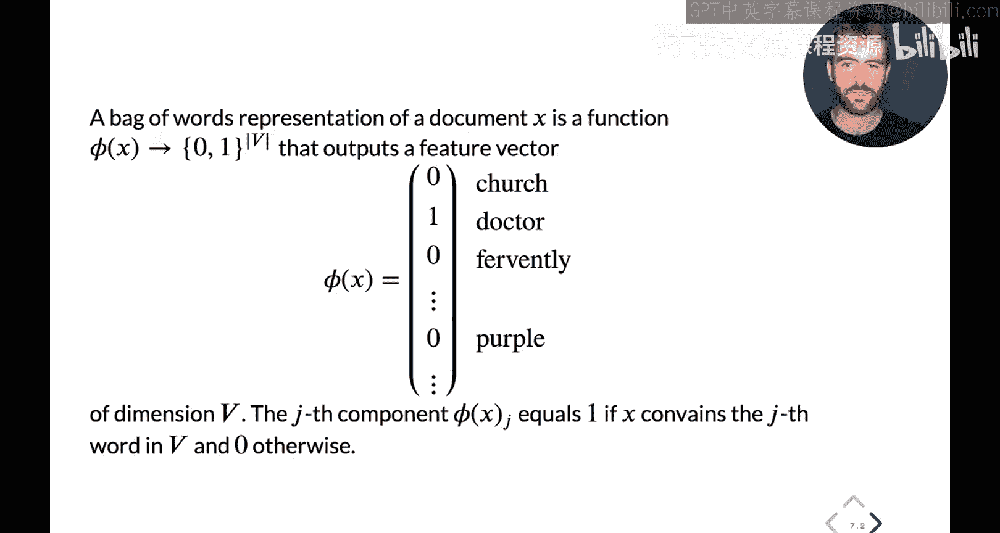

So let's see an example of what a bag of words representation looks like on the 20 news group data set。

We can use second learn to easily compute these bag of words features for us。

So we're going to use an object called count vectorizer and count count vectorizer essentially will compute this set of features for us。

So here I am transforming our data into a futurized matrix xtrain。

 and now Xtrain has the following shape， 2000 by 35，000。

2000 is the number of examples that we have in our training set， is the number。

 this is the size of our training set， and this is the dimensionality。

 so count vectorizer has identified a vocabulary of size 35。

000 and each element of each of our data set is represented as a 35。

000 dimensional vector in this case。

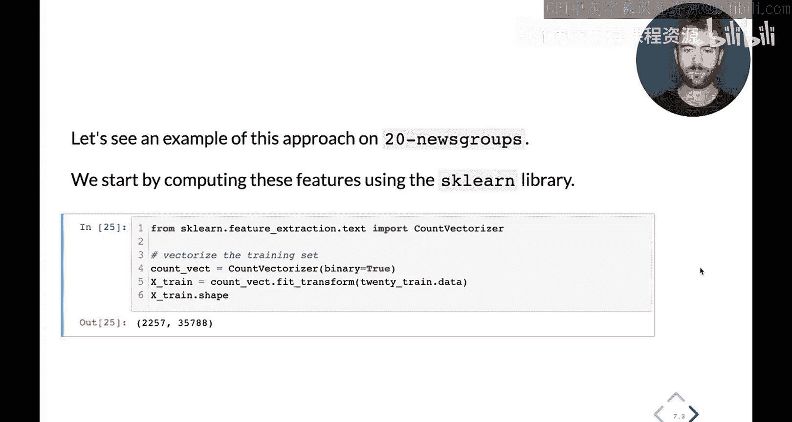

So just to make this even more concrete。I can use this count vectorizer object to retrieve the index in the vector that's associated with each word。

 so let's say I look at the word church， well the index for the word church is number 8，609。

I can get this via the psychic learn class。And the index for the word computer is number 9，338。

And just to convince you that these indices are real。

 I can go back and I can load this message that we had earlier。 So this was the this was。

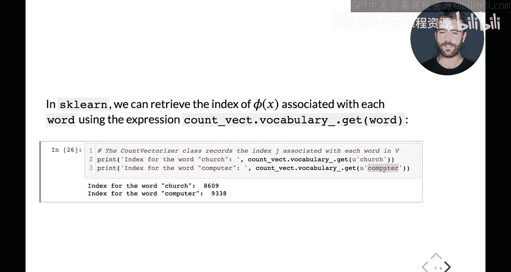

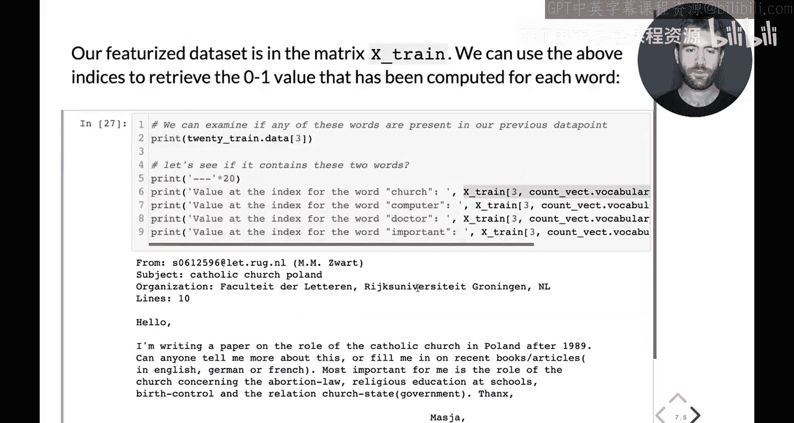

Input data point at index3 and this is this message about this person who is looking for information about the Catholic Church in Poland and now I can look at whether this message contains certain words or not。

 so Xtrain recall that this is a matrix of dimension approximately 2000 by approximately 35，000。

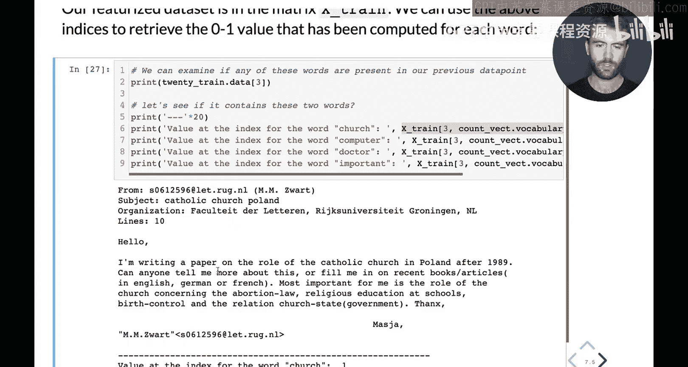

And now I can， I know what is the index for the word church， and I can just print out what is。

The value of this matrix。For index3， which is the index of our。Message here。

 and then the index of the word church。 And similarly。

 I can look at what is at the index for the word computer， for the word doctor， for the word。

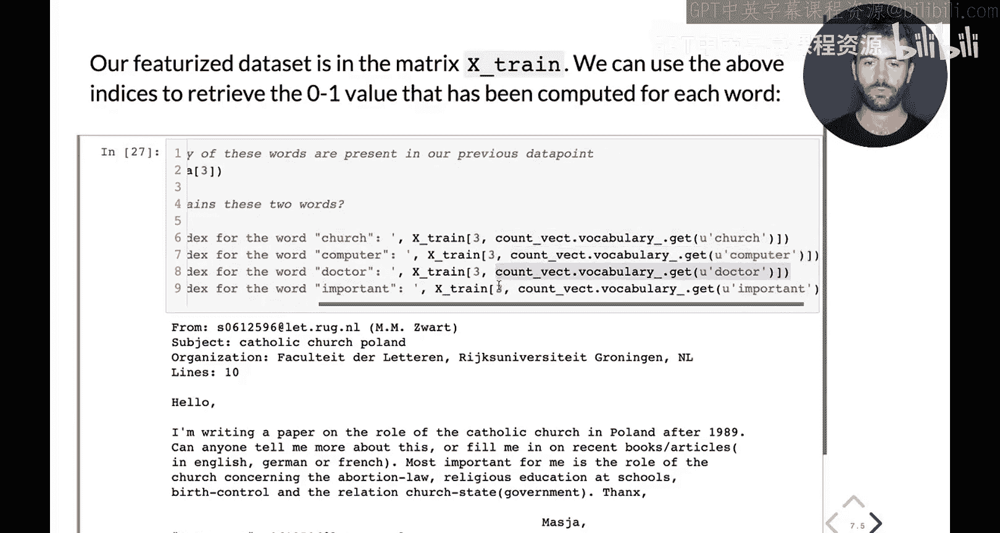

Important， and I am just printing these out here， so at the index for the word church。

For the vectorized representation of this message， I have a one and indeed is one because the word church is actually present computer zero are so the word computer is not found here。

 the word doctor is not found here， the word important is found here and I am sure that if we look at it。

 if we look at this message we should be out there you go this is important is found here。

So you can see that this vector representation indeed works and gives us what we want。

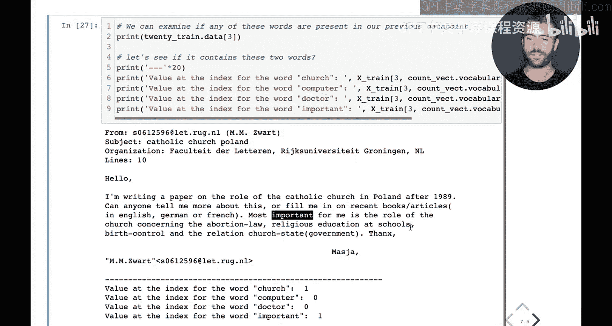

So back of words is a really important idea in machine learning。

 and whenever we do text classification。In most when we want to do text classification。

 bag of words is a really standard and common way of representing our text documents。In practice。

 there are slight modificationifications to this technique， I give you the high level idea。

 but there are some practical considerations that you should be aware of when applying this technique。

So often the J component of the futurized representation of x contains not just the binary indicator of whether the word is present。

 but the count of how many times this word was in a document。

 this is a slight variation on the version of back of words that I showed earlier。

 and both of these are used in practice and you would have to try one versus the other to see which one works better for your data。

Also， the raw text that is futurized is typically not just the text itself。

 but it's a processed version of this text。 for example one common processing technique that that would be applied is called stemming which means that we would consider only the stem of the word rather the word itself so for example if we have the word slowly and slowness in our data both would be stemmed and we would only keep slow so we would use only slow in our vocabulary and both slowly and slowness would map too slow This is just to make sure that we don't have any we don't have too many redundant words in our dataset。

And finally， it is also really common to filter stop words such as the A and also rare words are often excluded。

 or we would also apply some kind of post processing to handle them so these are important practical considerations and there are others。

 but I just want to give you a flavor of what this is。

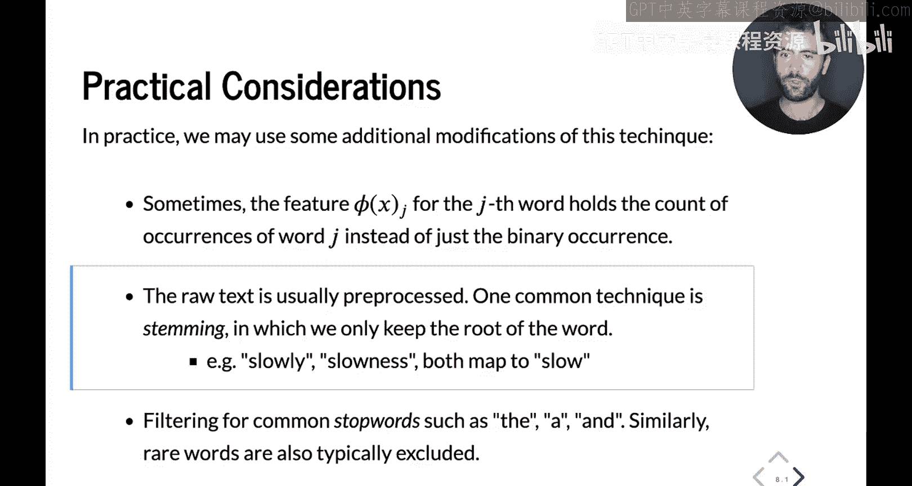

So now that we have these bag of words features， we can apply any of the shelf classification algorithm to perform text classification。

For example， we could use the logistic regression method that we saw earlier。

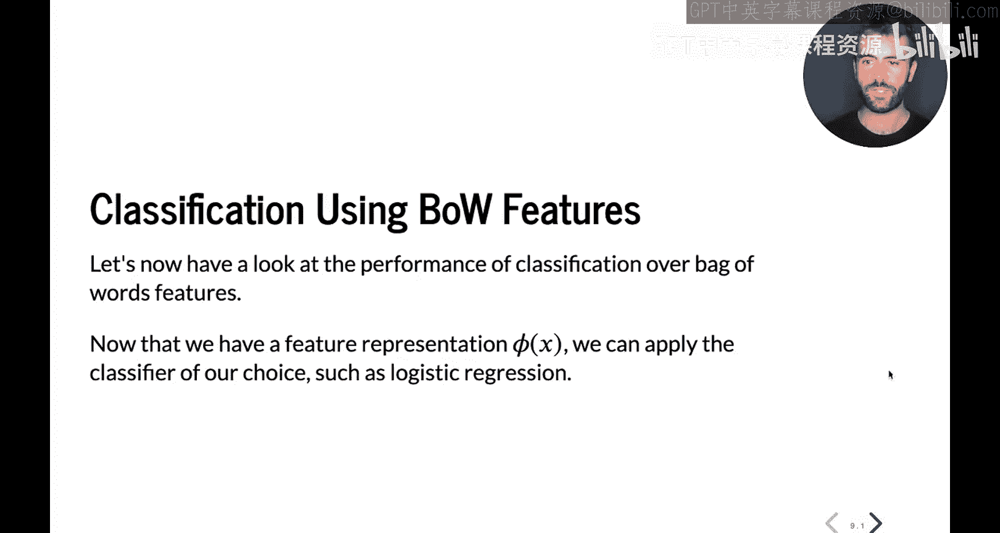

So here I am importing logistic regression from psyitLn， I am instantiating it in this line。

 and now I just fit this to the feurized data set and so this is the matrix with the bag of words representation so here logistic regression is trained。

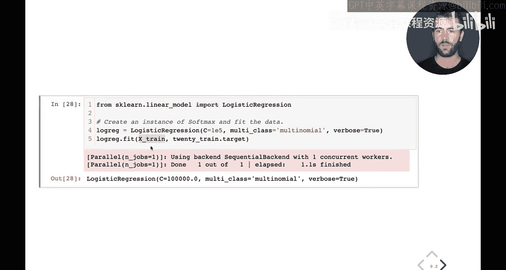

And now we can use this model to predict new outputs。

 So here I have created a new set of documents on different topics。

Here I apply a futurization of this of this data set。And then in the next line。

 I generate predictions。And now we see here that we have correct classes。

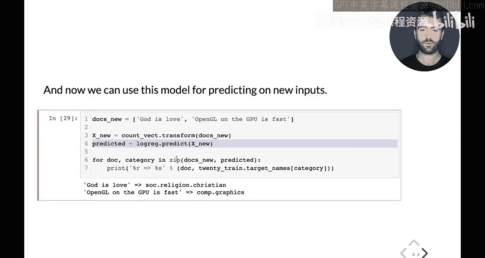