# 应用机器学习：第8讲：文本分类与朴素贝叶斯 🧠

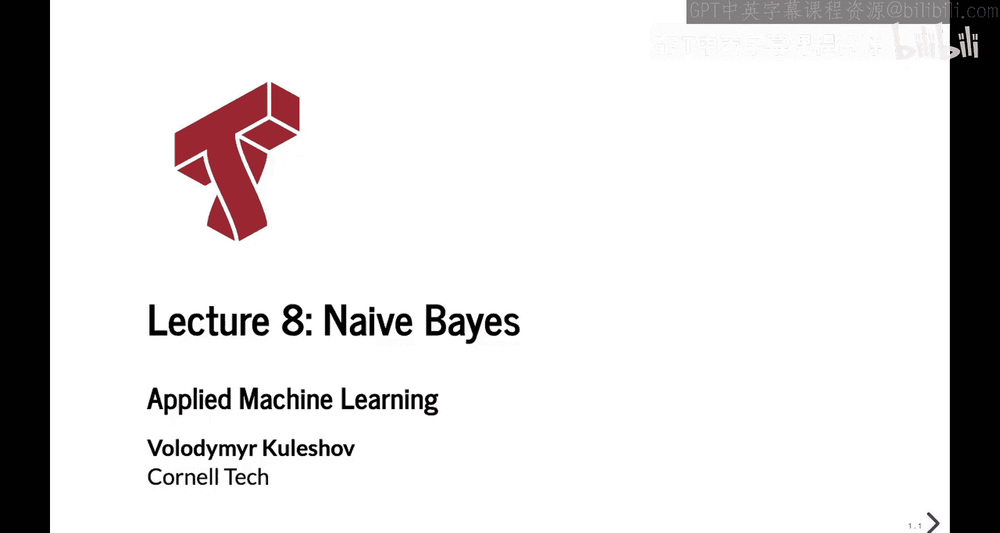

在本节课中，我们将学习一种新的分类算法——朴素贝叶斯。我们将从文本分类这一实际应用问题入手，介绍如何将文本数据转换为机器学习模型可以处理的特征，并最终应用朴素贝叶斯算法进行分类。

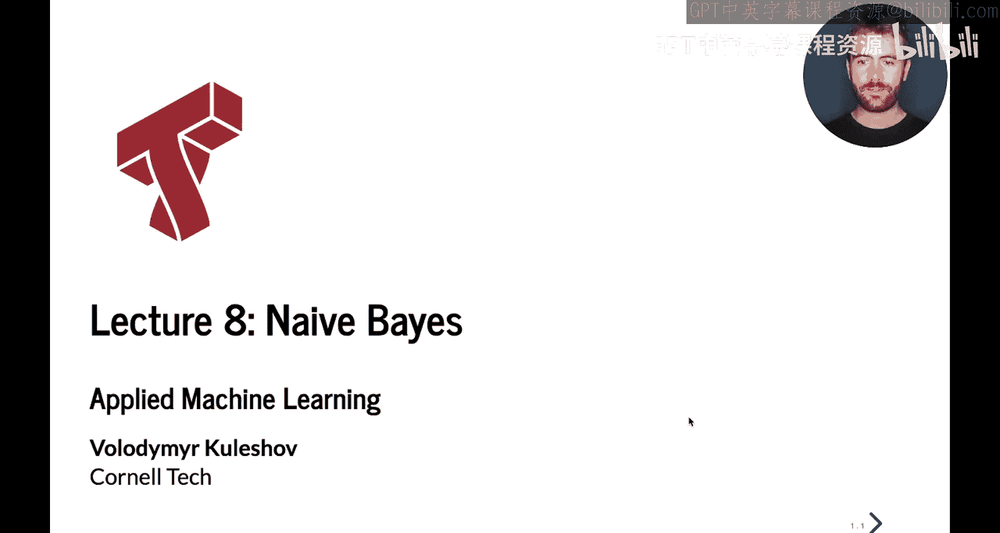

---

## 回顾生成式建模

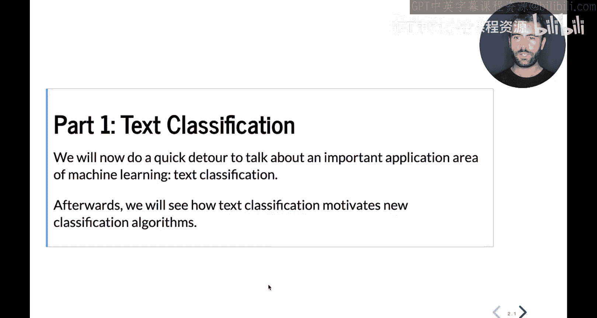

上一讲中，我们开始讨论一种新的监督学习方法——**生成式建模**。我们介绍了第一个生成式算法的例子。本节中，我们将继续这个话题，学习另一个非常重要的算法——**朴素贝叶斯**。

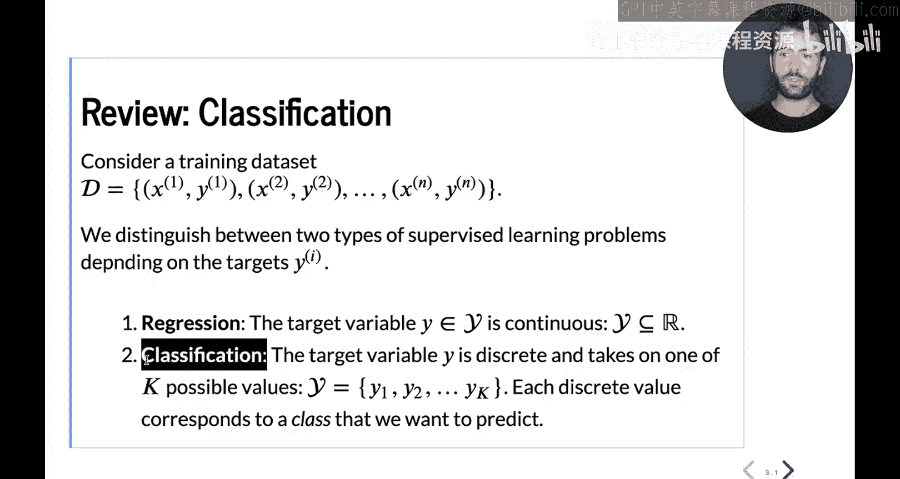

---

## 文本分类问题 📄

在介绍算法之前，我们先从一个实际应用问题开始——**文本分类**。文本分类是一个非常重要的实际问题，也是引入朴素贝叶斯算法的绝佳场景。

### 分类问题回顾

在过去的几讲中，我们一直在研究分类问题。在分类中，我们有一个包含输入和目标变量的训练数据集。目标是离散的，可以取K个可能的值，这些值被称为K个**类别**。我们当前所处的场景就是分类。

### 文本分类的特殊性

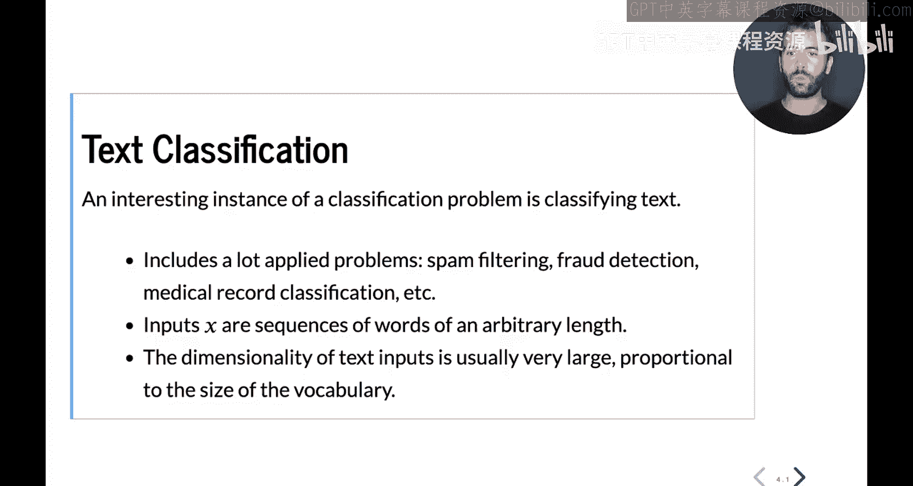

本节中，我们将关注一个特定的分类问题——**文本分类**。这是一个值得研究的问题，因为许多实际应用问题都属于文本分类的范畴。例如：

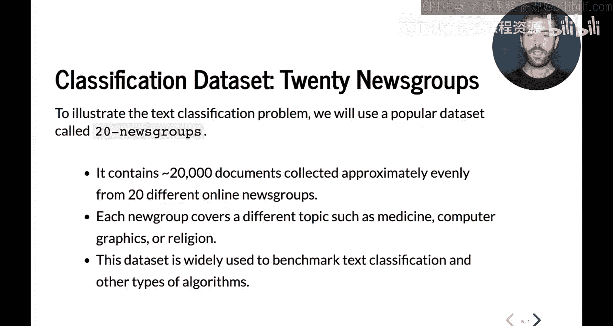

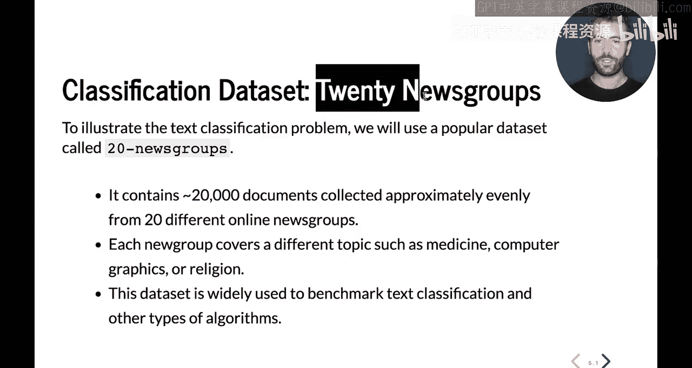

*   **垃圾邮件过滤**是一个文本分类问题。
*   基于欺诈性金融声明的**欺诈检测**，即将金融声明分类为有效或欺诈。
*   分析**医疗记录**并将其分类，例如判断患者是否健康。

这些都是文本分类的有趣例子，也是机器学习实际应用中经常遇到的问题。

这个问题与我们之前看到的问题有所不同。不同之处在于：

1.  我们现在分类的是**单词序列**。这些序列的长度可以不同，我们可以分类不同的句子（每个句子都不同），甚至可以分类非常长的文档。
2.  问题的**维度可能非常大**。回想一下，x是一个具有特定维度的向量。现在，如果x是一个序列，其中序列的每个元素（单词）都可以取大量可能的值，那么从某种意义上说，这个问题的维度非常大。这意味着我们必须思考如何将现有算法应用于这个数据集，这需要一些额外的工作。

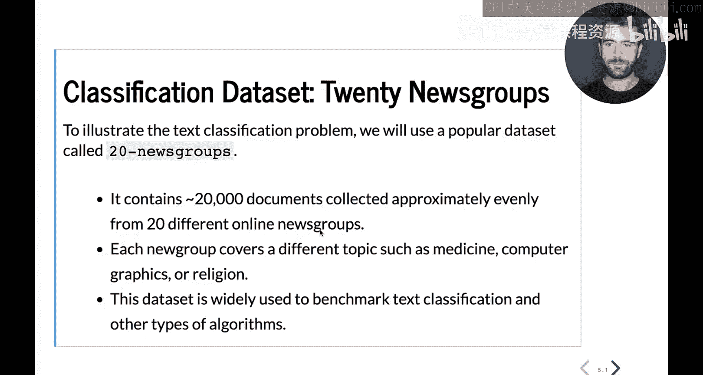

---

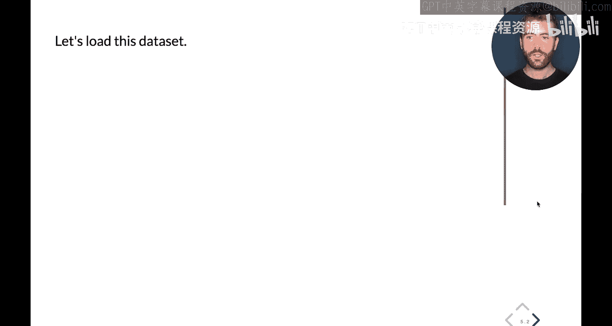

## 20新闻组数据集示例 📰

为了展示文本分类问题的样子，我将使用机器学习中一个著名的数据集——**20新闻组数据集**。

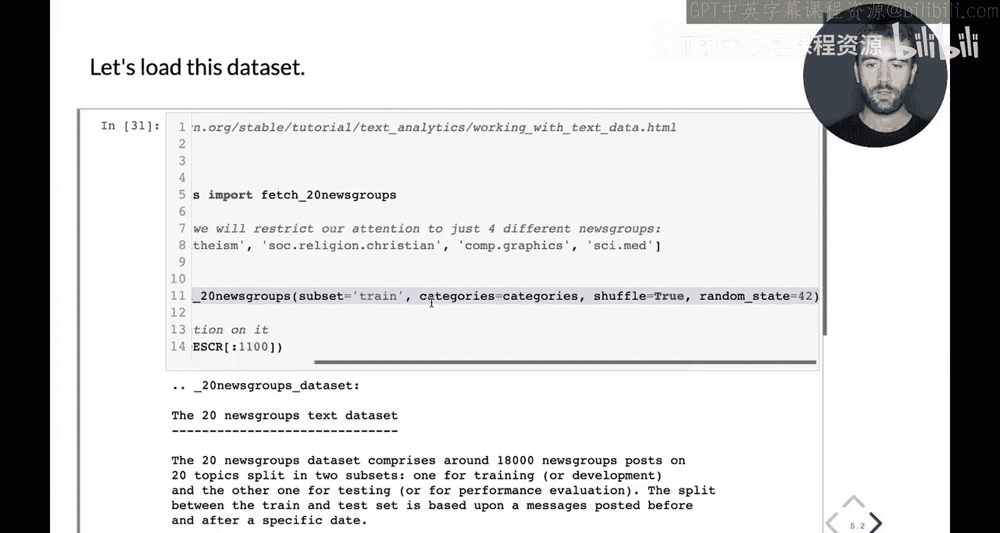

这是一个文本分类问题的实例，其中包含大约20,000个文档，这些文档大致均匀地收集自20个不同的在线新闻组。每个新闻组涵盖一个不同的主题。你可以把它们想象成在线论坛的帖子，每个论坛都有不同的主题。这些主题包括医学、计算机图形学、宗教等，涵盖的主题非常广泛。

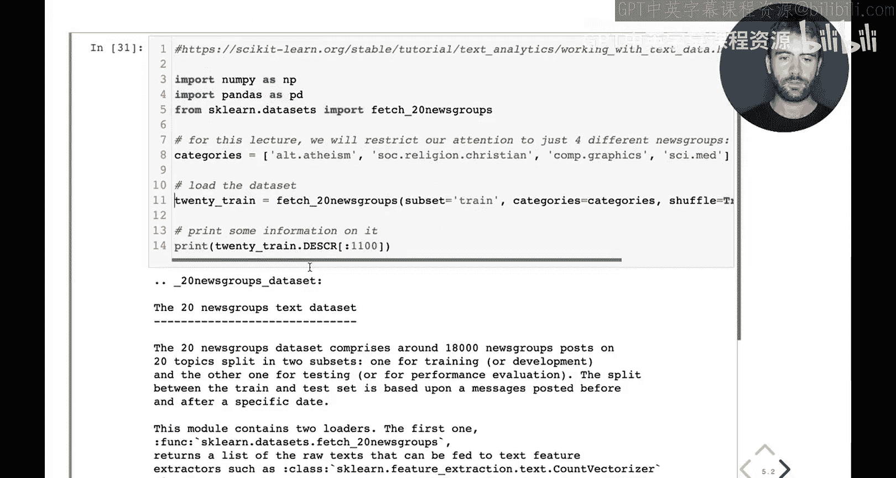

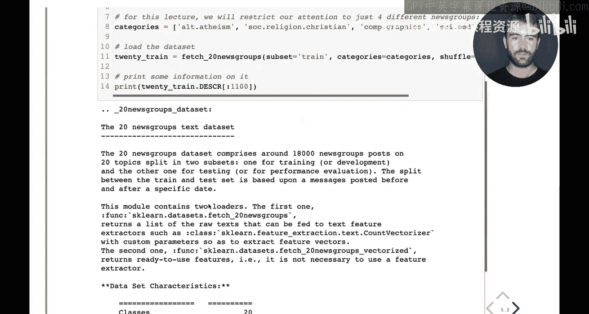

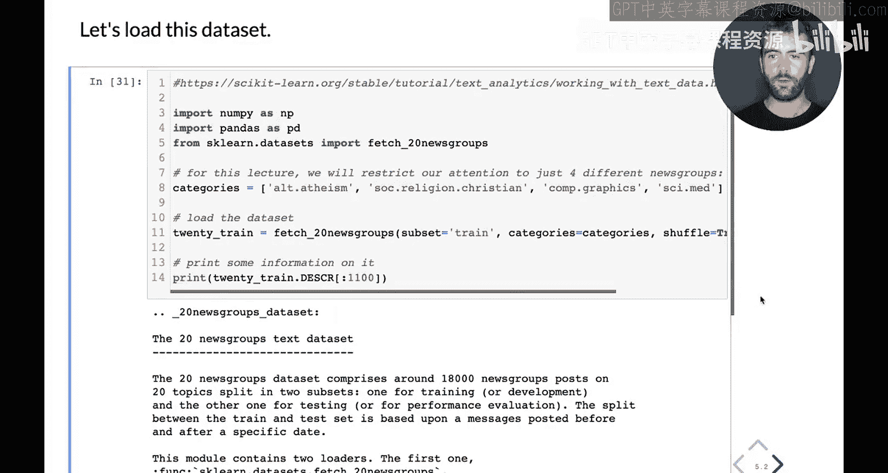

在这个例子中，分类问题是确定一条消息来自哪个新闻组，这本质上等同于对消息中讨论的**主题进行分类**。这个数据集在机器学习中被广泛用于对各种算法进行基准测试，也用于演示目的。

### 加载数据

我们同样可以从Scikit-learn库中加载这个数据集。在Scikit-learn的`datasets`模块中，有一个函数可以让我们轻松加载不同的数据集。我将使用这个函数来加载20新闻组数据集。

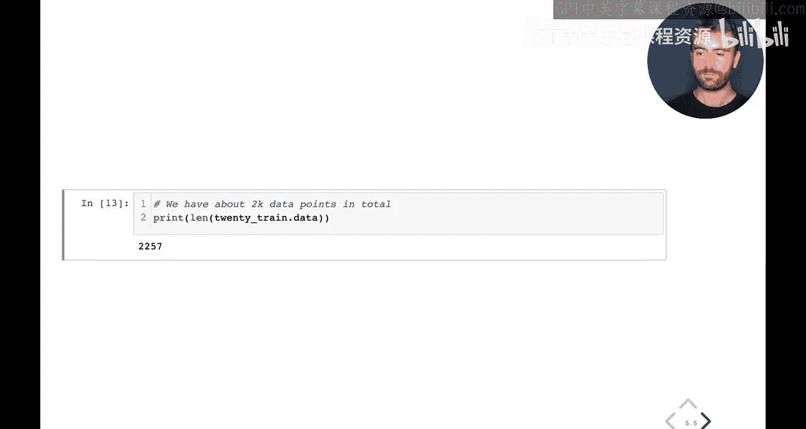

为了简化，我将只关注以下四个主题：无神论、基督教（特定宗教）、计算机图形学和医学。我将加载这四个主题的数据。

加载后，我们的目标变量集合现在由这四个类别组成：无神论、计算机图形学、医学、基督教。

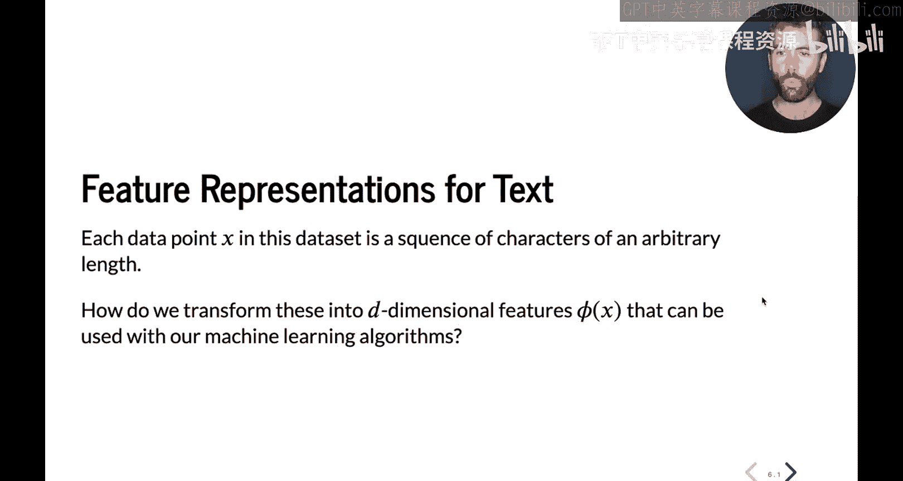

### 数据示例

这是一个来自数据集的邮件示例（索引为3的输入）。你可以看到这是一条发布到基督教数据集的消息。发帖人正在撰写一篇关于天主教会在波兰作用的论文，并正在寻求有关其研究主题的信息。

这里我们看到了分类问题输入的一个例子。这个单词序列（甚至是字符序列）对应着我们模型的输入X。这就是X的样子。因为我们只加载了四个主题，所以当前数据集中大约有2,000个数据点。

---

## 文本特征化 🔧

现在让我们看看如果尝试将分类算法应用于这个数据集会发生什么。如前所述，我们遇到的第一个问题是，这个数据中的每个输入现在都是一个任意长度的字符序列。

我们迄今为止看到的所有监督学习算法都假设我们有一个D维的特征向量`φ(x)`。因此，为了应用我们现有的监督学习算法，我们需要为这段文本提出某种**特征化**方法。那么，我们可以使用什么作为特征呢？

以下是几种可能的思路：

1.  **手工设计特征**：我们可以基于文本定义手工设计的特征。例如，如果我们知道要分类的消息与宗教、图形学或医学有关，那么我们可以利用这些先验知识来手工设计自己的特征。例如，一个有用的特征可能是“消息是否包含‘church’这个词”。或者，邮件是否来自美国境内或境外，邮件中的组织是否是大学，发件人是否签名，签名是男性名字还是女性名字。这些可能都是有用的特征。通过查看数据并思考，我们可以提出自己手工设计的一组特征。这可能会给我们带来非常好的特征，但创建这些特征需要大量工作。那么，有没有更好、更简单、更自动化的方法呢？

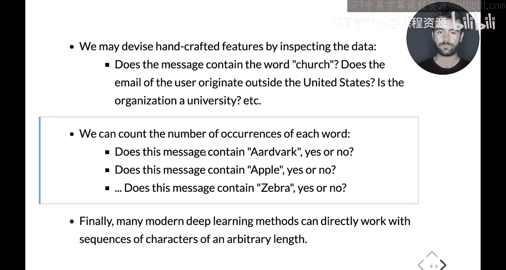

2.  **基于词汇表的通用特征**：一种通用的定义特征的方法是查看每个可能的单词，并计算它出现的次数，或者用一个指示器表示它是否出现。就像我们之前对“church”这个词所做的那样，但我们可以对字典中的每个可能的单词都这样做。我们会有一个特征：“消息是否包含‘aardvark’”，另一个特征：“消息是否包含‘apple’”，依此类推，直到“消息是否包含‘zebra’”。所有可能的单词。这实际上是一个非常强大的想法，我稍后会详细讨论。

3.  **专用算法**：最后，我想强调的是，也存在一些专门的算法，可以直接处理字符序列。在要点1和要点2中，我提出了定义固定数量D个特征的方法，然后我们可以将这些特征输入到我们的监督学习算法中。但我也想指出，存在一些更现代的、基于神经网络的算法，属于深度学习领域，它们甚至可以直接接收原始的、未经特征化的字符序列。然而，在本讲中，我们暂时不会研究这第三类算法。我们将专注于如何创建固定数量的特征D。

---

## 词袋模型 👜

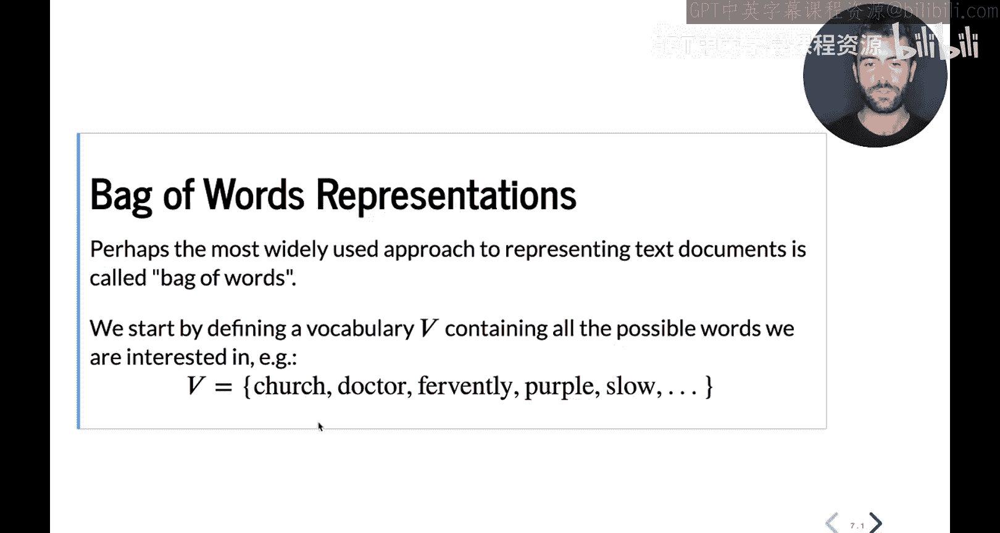

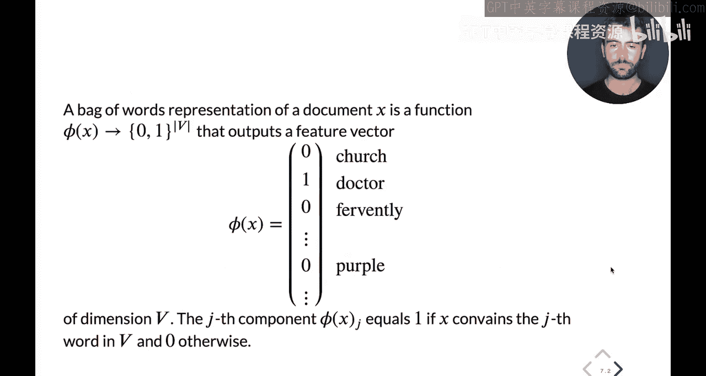

我将采用的方法将受到第二个要点（基于词汇表的通用特征）的启发。我将提出一种定义特征的方法，这种方法在机器学习中非常重要，并且是文本分类最标准的方法之一。这种方法的名字叫做**词袋模型**。

让我们看看词袋模型是什么意思。

### 第一步：定义词汇表

创建词袋特征或词袋表示的第一步是定义一个所谓的**词汇表**。词汇表是所有对我们来说可能感兴趣的单词的集合。这可以是字典中的全部单词集合，或者如果我们处于某个更专业的医学领域，那么它可能是一个医学词汇表。但本质上，这是我们宇宙中存在的、为我们正在解决的机器学习问题而存在的所有可能单词的集合。

### 第二步：构建特征向量

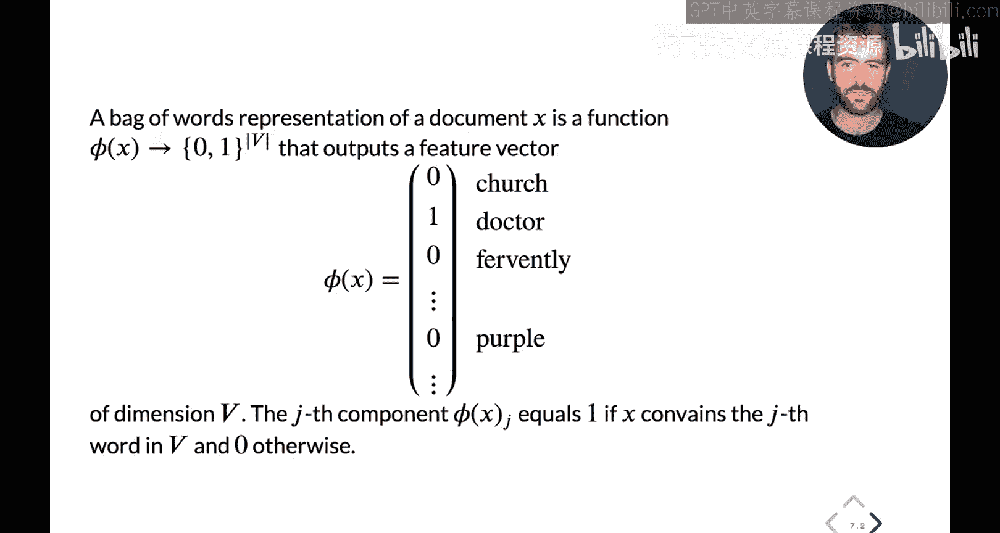

词袋表示的思想是定义以下一组特征，这也是我之前提到的。在词袋表示中，我们定义一组特征`φ`，其数量等于我们词汇表的大小。因此，这个向量`φ`的维度等于我们词汇表V的维度。

所以`φ(x)`是一个很长的列向量（因为词汇表通常很大）。在每个位置上，我都有一个0或1。如果消息X包含我们词汇表中的第一个单词（例如“church”），那么第一个条目就是1，否则为0。第二个条目包含1，如果我们有单词“doctor”，否则为0。对于“fervently”也是如此。在我们的词汇表中，我们假设单词有某种顺序。对于每个单词，我们将在该向量中找到一个索引，并在该索引处放置一个二进制指示器，表示单词是否出现在消息X中。

这是一个特征化的例子。对于大多数单词，比如“church”、“fervently”、“purple”，这些词没有出现，但我们有单词“doctor”出现了。现在，这可能告诉我们一些信息，它可能是一个迹象，表明这个文档X与医学有关。

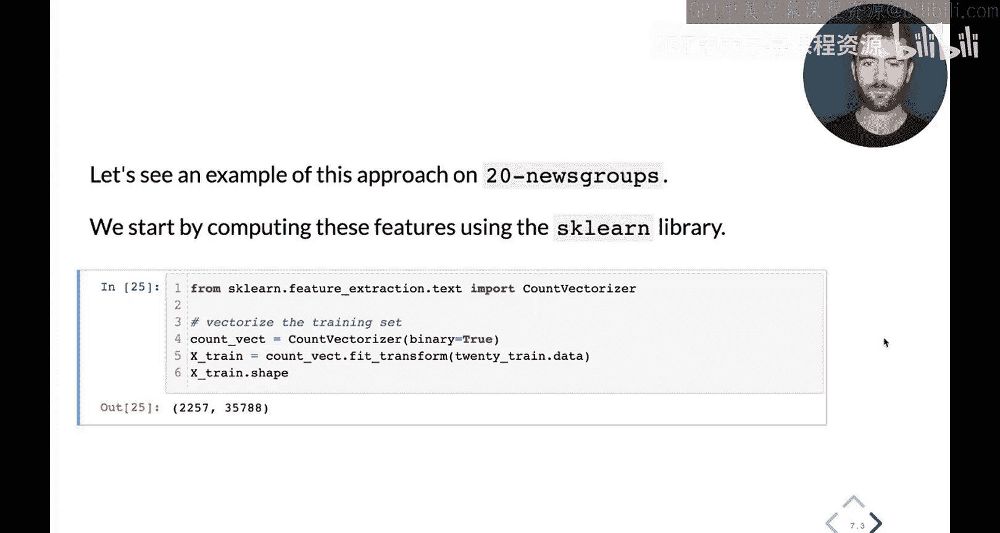

### 在20新闻组数据集上的示例

我们可以使用Scikit-learn轻松地为我们计算这些词袋特征。我们将使用一个名为`CountVectorizer`的对象，它本质上会为我们计算这组特征。

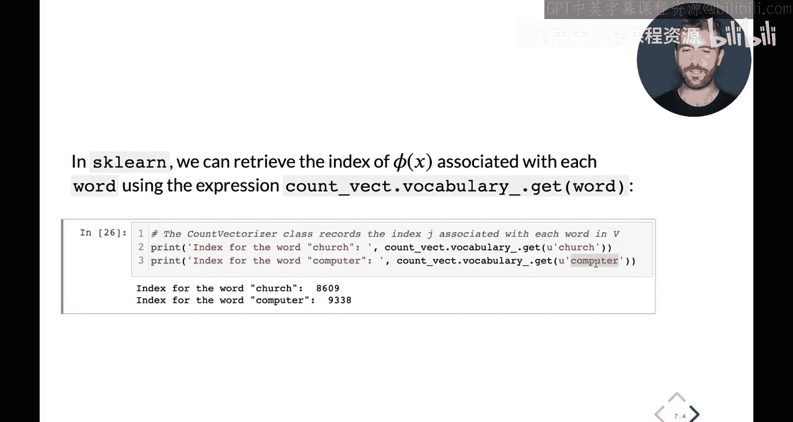

在这里，我将数据转换为特征化矩阵`X_train`。现在`X_train`具有以下形状：2000 x 35000。2000是我们训练集中的样本数量，35000是维度。所以`CountVectorizer`识别出了一个大小为35000的词汇表，我们数据集的每个元素在这种情况下都被表示为一个35000维的向量。

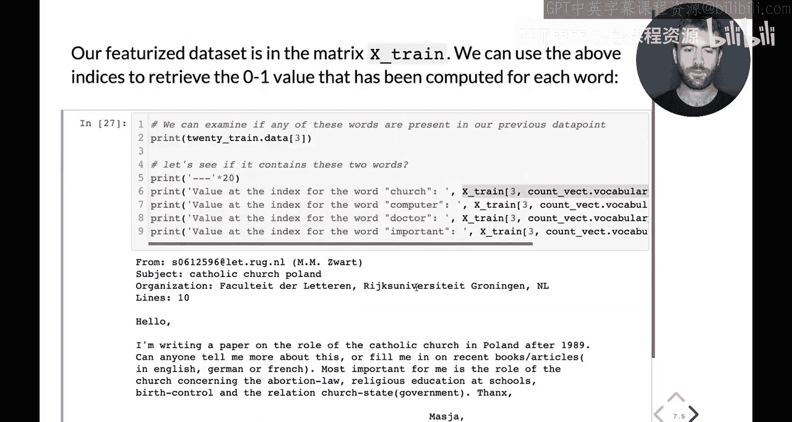

为了更具体，我可以使用这个`CountVectorizer`对象来检索与每个单词关联的向量中的索引。例如，单词“church”的索引是8609，单词“computer”的索引是9338。我可以回到之前加载的那条消息（索引3），查看这条消息是否包含某些单词。`X_train`是一个大约2000 x 35000的矩阵。我可以打印出这个矩阵在索引3（我们消息的索引）和单词“church”的索引处的值。同样，我可以查看单词“computer”、“doctor”、“important”的索引处的值。对于单词“church”，这条消息的向量化表示中有一个1（确实为1，因为“church”这个词确实存在）。“computer”为0（所以单词“computer”在这里没有找到），“doctor”没有找到，“important”找到了。如果你查看这条消息，你会发现“important”确实在这里。所以你可以看到，这种向量表示确实有效，并给出了我们想要的结果。

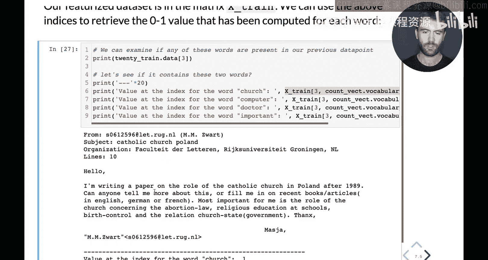

---

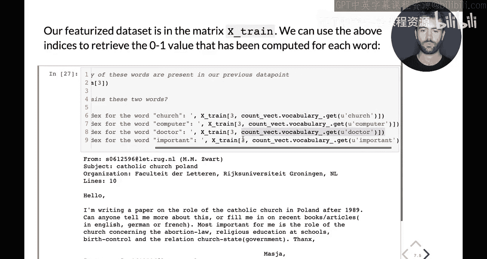

## 词袋模型的实践考虑 ⚙️

词袋模型是机器学习中一个非常重要的思想，每当我们进行文本分类时，在大多数情况下，词袋模型是表示文本文档的一种非常标准和常见的方法。在实践中，这项技术有一些细微的修改。我给了你高层次的概念，但在应用这项技术时，你应该注意一些实际的考虑因素。

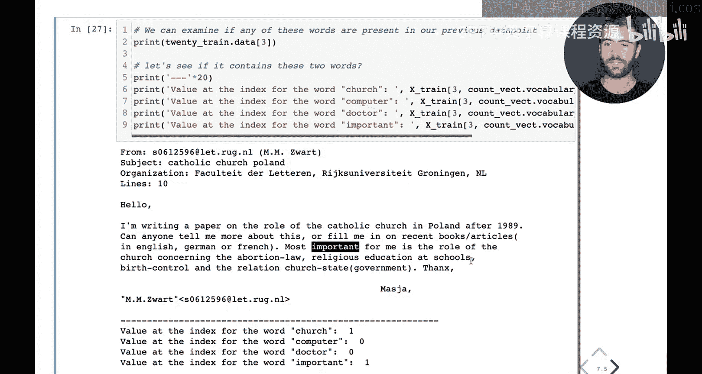

1.  **词频 vs. 词存在**：通常，特征化表示`φ(x)`的第j个分量不仅包含单词是否存在的二进制指示器，还包含该单词在文档中出现的**次数**。这是我之前展示的词袋模型版本的一个微小变化。这两种方法在实践中都有使用，你需要尝试哪一种对你的数据效果更好。

2.  **文本预处理**：被特征化的原始文本通常不仅仅是文本本身，而是经过处理的版本。例如，一种常见的处理技术称为**词干提取**，这意味着我们只考虑单词的词干，而不是单词本身。例如，如果我们的数据中有单词“slowly”和“slowness”，两者都会被提取词干，我们只保留“slow”。我们只会在词汇表中使用“slow”，而“slowly”和“slowness”都会映射到“slow”。这只是为了确保我们的数据集中没有太多冗余的单词。

3.  **过滤停用词和罕见词**：过滤停用词（如“the”、“a”、“and”）也非常常见。罕见词也经常被排除，或者我们会应用某种后处理来处理它们。这些都是重要的实际考虑因素，还有其他因素，但我只是想让你了解一下这是什么。

---

## 应用分类算法 🚀

现在我们有了这些词袋特征，我们可以应用任何现成的分类算法来进行文本分类。例如，我们可以使用之前看到的**逻辑回归**方法。

在这里，我从Scikit-learn导入逻辑回归，在这一行中实例化它，然后将其拟合到特征化的数据集（即具有词袋表示的矩阵）。这样，逻辑回归就被训练好了。

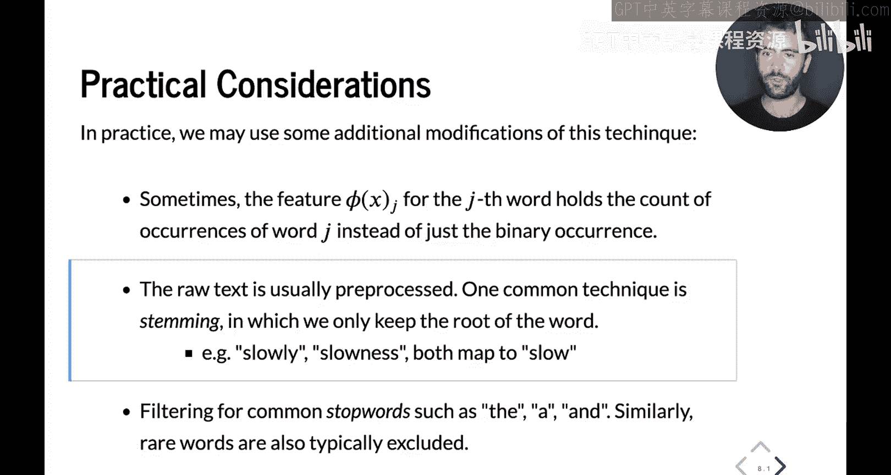

现在我们可以使用这个模型来预测新的输出。这里我创建了一组关于不同主题的新文档。我对这个数据集应用了特征化。然后在下一行，我生成预测。现在我们看到这里我们有正确的类别。

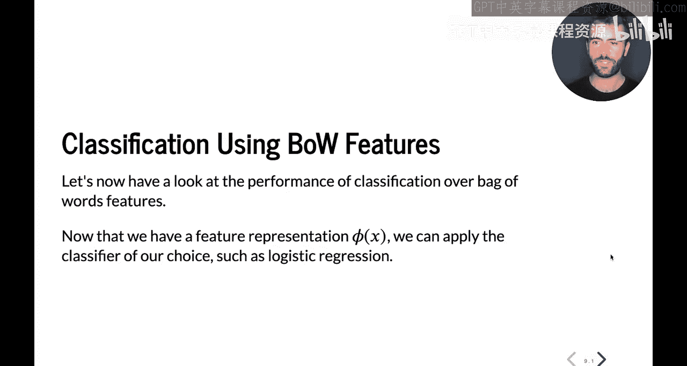

---

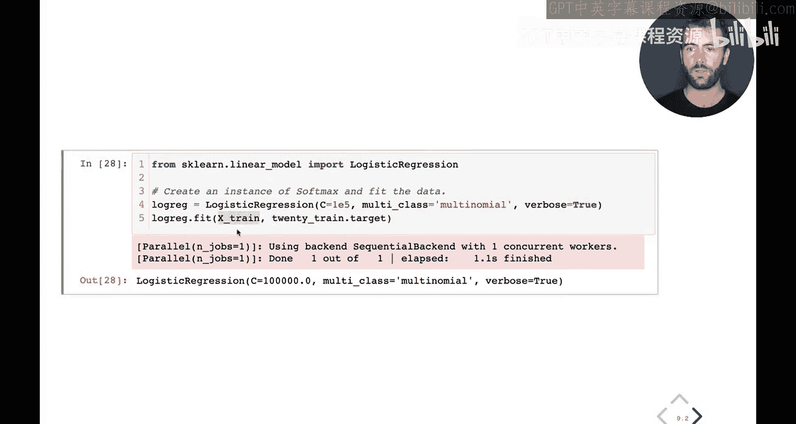

## 总结 📝

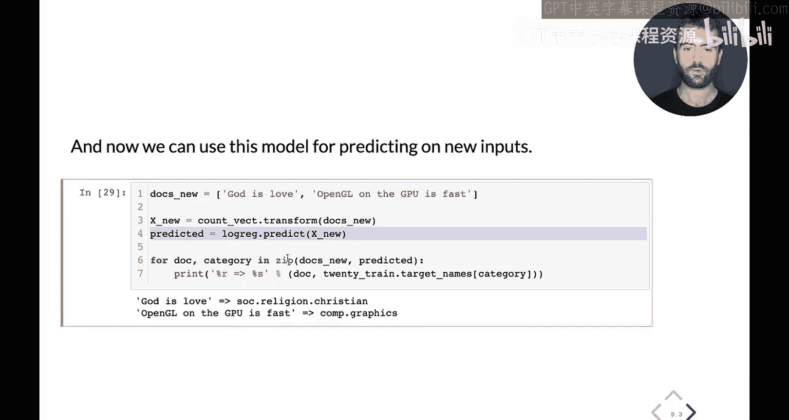

本节课中，我们一起学习了文本分类的基本概念，并介绍了**词袋模型**这一强大的文本特征化方法。我们了解到，为了将文本数据输入到标准的机器学习算法中，需要将其转换为固定维度的数值特征向量。词袋模型通过构建词汇表并为每个单词创建二进制或计数特征来实现这一点。最后，我们看到了如何将处理后的特征应用于逻辑回归等分类算法。这为下一节正式引入**朴素贝叶斯**算法——一个特别适合高维稀疏数据（如文本）的分类器——奠定了基础。