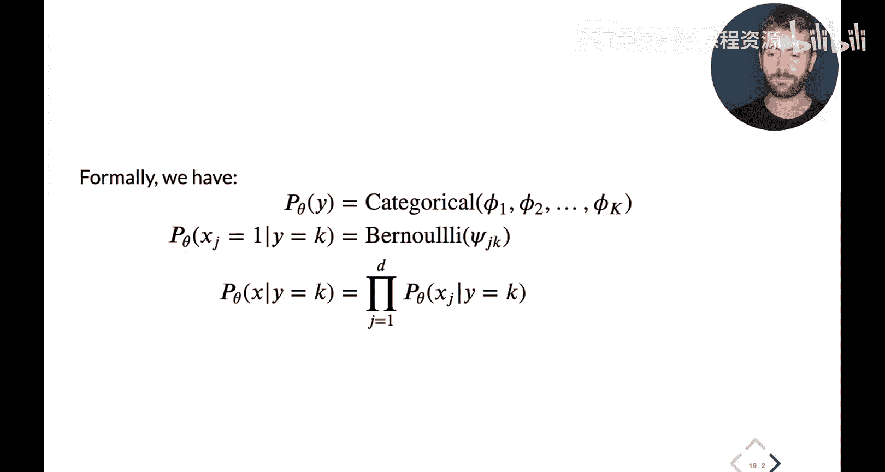

# 康奈尔大学《应用机器学习 CS 5787_ Applied Machine Learning 2020》中英字幕（deepseek p32 -32-Lecture 8. Part 2_ Naive Bayes.zh_en -BV12udzYvEFM_p32-

We are now at part two of lecturec 8 of Applied Machine learninging。

In this video， I am now going to focus on the main topic of this lecture。

 which is the naive based algorithm。In the previous video。

 I defined the problem of text classification， which is going to be a motivating problem for the naiveb algorithm and now in this video I'm going to start defining what this algorithm is I'm going to start by again defining the model that nabase is optimizing and then I will talk about how we can learn this model in the next slide in the next video。

So recall that our motivating problem is text classification。

 this is an instance of a classification problem in which we are trying to in which x is a sequence of words or a sequence of characters。

 which can be of arbitrary length and of high dimensionality and we want to classify this x and practical examples of this problem include spam filtering fraud detection。

 medical record classification and others。And we saw in the earlier video that one of the main challenges of applying machine learning algorithms to this data is how can we feurize this input X in a way that works with the algorithms that we have seen so far？

And the approach that we have proposed is something that is called bag of words feature representation。

 which just means that given an input X， we have some vocabulary v。

 which is a set of words that we're going to consider and then the feature representation of x is a long vector with one component per word and at that component we have either a0 or a1 depending on whether we find this word in X or not。

 so here0 here we have0 at the first index because the word church is not found in x have what we have one at the second index。

 the one for the word doctor because doctor is found in this input X。

So this is our definition of bag of words feature representation。Now。

 we would like to apply supervised learning algorithms to this problem。

 and we have seen two kinds of supervised learning algorithms。We have seen discriminative models。

 which is an example of a discriminative model will be logistic regression。

And and then we also saw generative models of which an example would be Gaussian disccrminment analysis。

 and these differ in whether they model the full distribution of x and y or whether they're only modeling the conditional distribution of y given x。

And the idea of generative models is instead of simply predicting the class。

 we learn a model of how the data points x， of how the inputs X look like。

 and then when we have to make a prediction， when we have a data point x prime。

 we have one model of x per class。And we report the the class under which our data point has the highest probability。

And mathematically， this can be defined by the following equation。An example of。

Of geneative model is Gaussian discriminant analysis。In Gaussian stream analysis。

 we assume that the conditional probability of x given y is a multivariate Gaussian。

 also known as a normal distribution with parameters， mu and sigma。

And the distribution over classes is a categorical distribution。

 which means that we have k possible classes， each one has a probability phi and the probability of seeing in class k equals phi。

 so this defines a joint model over x and y as follows here we have a formula for a probability of y equals k and we have a probability of x given y equals k。

 this is our Gaussians this is our categorical and the resulting joint probability over x and y has the following form。

 and we call this a mixture of Gaussians。So this is a Gaussian discrimininate model。

 and it is a really important algorithm in machine learning。

What would happen if we were to apply this algorithm to the text classification problem that we saw earlier？

Well， the first problem that we immediately see is that our data。

 which follows a bag of words representation is discrete street。

And theA model the GDA model uses it assumes that we have that the data is following a normal distribution。

And so clearly， this model is misspecified。We saw a similar instance of this problem when we talked about whether we can apply linear regression to a classificationification problem in principle we could fit a gaussian into this binary data。

 but it would just be wrong conceptually it it would not be an elegant approach and in the same way that logistic regression no in the same way that linear regression does not work well does not work as well as logistic regression on ecc classificationification problem。

In the same way。A specialized algorithm that takes into account the fact that these variables are all binary。

 this specialized algorithm will work better on this dataset set。So this is our first problem。

So we can try to resolve this problem by instead of assuming that the conditional distribution is Gaussian。

 we could assume that it's categorical。So recall that a categorical distribution is just a general of the Bernoulli to K classes In other words。

 we have some number of outcomes and let's say we have M different outcomes a categorical distribution we'll assign a probability to each of these M possible outcomes so for example if we're throwing if we're throwing a die and it has six possible outcomes。

 there' is going to be a probability assigned to each of these six possible outcomes。

If we apply the categorical distribution to this particular example。

 we are essentially going to have to define a probability for each possible x。

And X here is going to be our so I should have specified that x is a features it's a futurized version of the input text。

 so it has a bag of words representation which means that it has it's this binary vector and we have to specify a probability for each possible input and so if we have a categorical distribution。

 then we have to specify a probability for each possible assignment of 0 and ones to all the components of this vector so we have to assign a probability to 100。

0 to 01，0，0，0 and to basically every possible assignment of 0 and ones to these components we have to assign a probability to it so here in this example I'm assuming that the categorical distribution says that the probability of this particular sequence of words with their binary indicators has this value。

Now， this also has a problem in that if the dimensionality of our vector is really large。

 so imagine that we have a a vocabulary of 10000 words。

 then the number the number of possible values that x can take is2 to the power 10000 which is a really big。

 big number and so in order to model this x using a categorical distribution。

 we need some way of specifying。Essentially，2 to the2 to the 10000 possible probabilities。

Which is going to be really complicated。 It's going to be really hard to enumerate and to assign a value to all of these numbers。

 For example， so in other words， this categor， this categorical distribution would have2 to the power D -1 parameters。

 And we would have to specify all of these parameters。 And with a number that's this large。

 This will simply， this will not even fit in the memory of our computer。

 So we cannot really model this， this， this。This type of input as a categorical。

 we need to be a little bit more clever。So， the naive based algorithm。

It makes a particular assumption that simplifies this problem and resolves this high dimensionality problem that I just defined。

And the particular assumption that it makes is also called the naive based assumption。

 and it goes as follows。In order to deal with these high dimensional x's。

 we are going to assume that the distribution of x given y factorizes in this form。

So what this means is that the probability of having a particular x given a y is simply a product of probabilities。

 it's a product of d probabilities。And each of them。

Is simply the probability of one component given y。

 and this is independent of all the other components。

So what it means is that the probability of seeing word 1 given y and word 2 given y these are all this is just a probability of seeing word 1 given y。

 and it's independent of whatever value word 2 takes。Right so in our earlier example here。

 we had to assign a probability for when 0， when we have0 here and one here。

 and if we have 1 and 0 and 0，0 and 11， just over these two dimensions we have four possible values that we can take and if we're using the Eve base assumption。

 then the probability of having0 here is going to be the same regardless of whether we have a1 or a0 at the second position。

So this is called the Naive Bayase assumption， and it's a really important assumption that's used in many applications of machine learning and typically these kinds of algorithms that use this assumption are called variants of naive bays。

So here， let me give you again a more specific example。

 let's say that x has a binary bag of words representation。

 then the probability of the Jth component given y is simply the probability of seeing the J word。

And。Because x sub J is binary， we can model this probability as a Bernoulli。

 and the Bernoulli only has one parameter。 It has the probability of seeing the word and。

1 minus that is the probability of not seeing the word。

 So we only have one parameter now for each of these distributions。

 And so now if we look at the at the full distribution。

 that is the product of D Brnoulli distributions。 Well。

 now we only need D parameters instead of2 to the D -1 to specify this distribution of x given y。

So this is a really big simplification of the problem here we're using a number of parameters that is very small。

 very tractable， and we can scale this algorithm to really high dimensions such as a very large vocabulary size。

So this algorithm is going to be really scalable and is going to be applicable to our text classification problem Now of course we are making a lot of simplifications because words are typically not independent so for example if we have the word doctor well probably will also have the word patient or maybe disease or maybe medicine or hospital these words are clearly correlated so here we're making a big simplifying assumption however。

 we'll see that in practice this is not that bad and these kinds of algorithms they actually have really good empirical performance。

And now using this Bnoulli using this naive based assumption， I can define the naive base。

 I can start defining the nave based algorithm and I'm going to first specify the model that this algorithm will take so if you recall a supervised learning algorithm is comprised of a model an objective and an optimization procedure and here I am defining the model for the naive based algorithm。

And this is going to be a particular type of model called the Bernoulli Na based model。

And it goes as follows。First， at a high level， we're going to take the same strategy as we use to define the Gaussian instrumentment analysis algorithm。

 we're going to define a probability over the Y's， and then we're going to define a probability of x given y。

And our probability over the Ys is going to be the same as we had earlier。

 iss going to be a categorical distribution， so this first part is the same as in Gausian disccrment analysis。

And now for the conditional probability， instead of making it a Gaussian。

 as it was in the Gaussian instrument analysis algorithm。

Now this is going to be the following expression。Which is a product of Bernoulli distributions。

And we have used the naive base assumption here because the probability of each component of x is independent of all the other components。

So here again， each distribution， each conditional probability of x given y is a product of D Bnoulli distribution。

 D Bnoulli distributions where each distributions assigns a probability to the event of seeing a particular word at its location So here the probability of seeing a sequence of words where we have 0。

101 is the probability of，Of seeing zero given the class times the probability of seeing one given the class。

 etca。So this is the functional form of our model。And I can define it as follows。

 this is a slightly more this is just specifying the same thing。

 it's a mathematical form and the categorical distribution has these parameters phi and each pernoulli distribution has one parameter called Psi and so here now we have a number of parameters。

 that is approximately k times d which is something that's manageable。

So this is the definition of the Bernoulli model and in the next video。

 I'm going to show you how we can learn this model from data。

