# 康奈尔大学《应用机器学习 CS 5787_ Applied Machine Learning 2020》中英字幕（deepseek p33 -33-Lecture 8. Part 3_ Naive Bayes (Learning).zh_en -BV12udzYvEFM_p33-

Welcome back to part three of Le 8 of Applied Mach learning， where we are talking about Naive Bayase。

In the previous video， I started defining the naive Base algorithm。

 and I described the model that Naive Base uses。In this video， I'm going to continue on this topic。

 and now I'm going to show you how we can learn this nave based model from data。

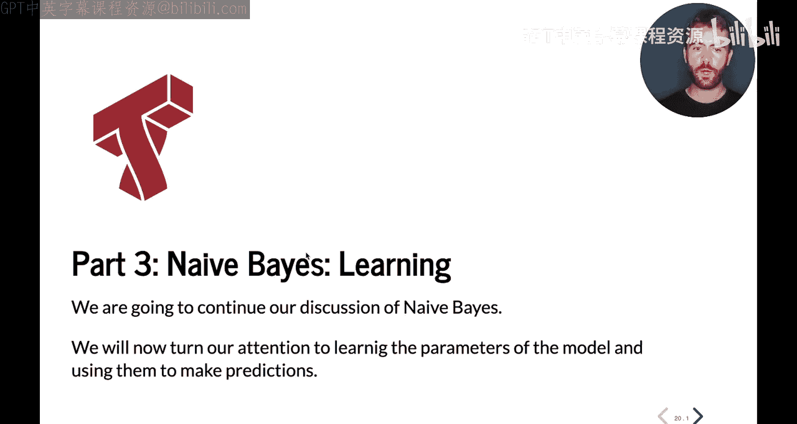

So recall that the motivating problem for the na based algorithm is text classification here。

 this is an instance of the classification problem in which we have in which the inputs are sequences of words or sequences of characters。

 and we are going to be。Classifying these， and this problem has many interesting applications such as spam filtering or fraud detection。

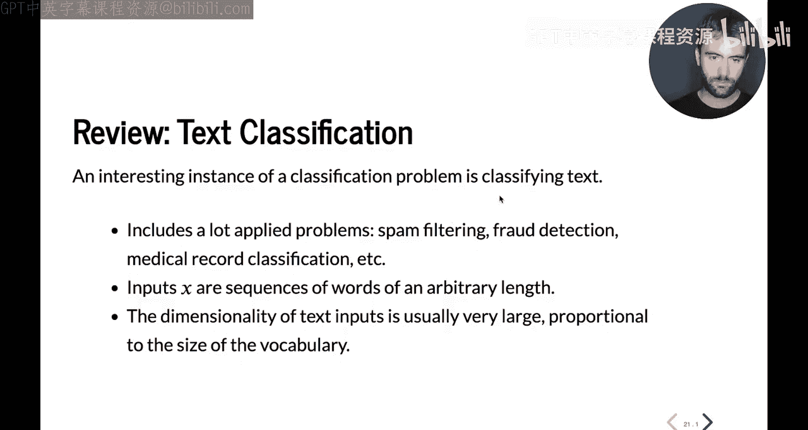

And the main challenge in order to apply machine learning algorithms to text classification is finding a good feature representation because each x is just a sequence of words or characters。

 it's unclear how we can transform it into a fixed set of features into a vector like we did in all of our earlier algorithms and one way of doing this is via the back of words representation which means that we have our feature vector is a long column and its length corresponds to the number of words in the vocabulary and we have one component。

 one index for each possible word and at this index we have either a0 or one depending on whether the word is present or not in the text X。

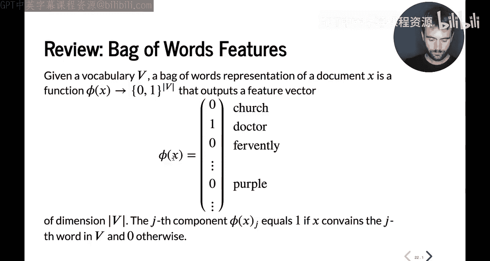

And then we proposed a particular model over this kind of data where x has xs of vector binary features and y is a class。

 we have proposed the following model， which has two components。

The first component is the probability over the Ys， which is here。

 and this is a categorical distribution， same as in Gaussian instrument analysis。

And then the conditional probability of the data under class K has the following form。

 so it's a product of D Bernoulli distributions where each Bernoulli distribution has a parameter called psi。

 and we have d times k such parameters。And because this distribution factorizes over its component。

 because the probability of seeing each word is independent of whether any other word is present because we have the simplifying assumption。

 this is we call this a naive base algorithm because it uses the naive base assumption。

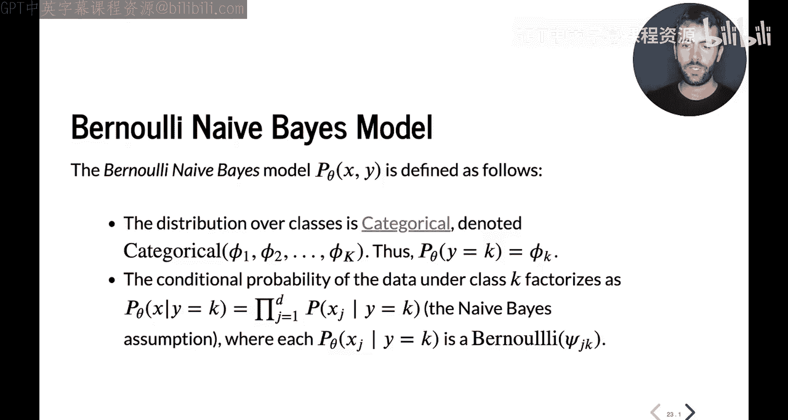

Now how would we learn this model again because we have a probabilistic model。

 we have a principled way of drivingriving an objective for these models。

 and this is the principle of maximum likelihood， so this is our objective and we're looking for model parameters theta under which the data coming from our data distribution has high probability。

And here we're going to apply this principle to fit our Berulli naive base model and it just to make things a little bit more concrete。

 our set of parameters， theta is going to be the set of all the phis and all the size that we have。

 so all the parameters of all the distributions that we have seen earlier。

 all of these together correspond to the model parameters， theta。

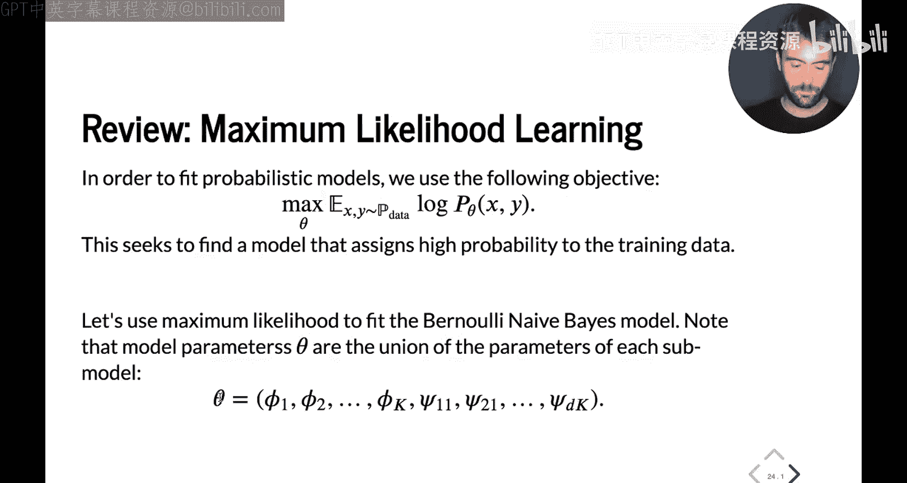

So how would we learn this model， what happens if we apply the principle of maximum likelihood to this problem？

Well， we have something which looks a lot like what we saw when we did this work for the Gause instrument analysis algorithm。

So here I have simply written down the log likelihood and because our probability consists of two components。

 P of y and P of x given y， I can simply separate them as follows。

 this is just because of how our proba is defined and now in the following line here I have kept this term the same but here I I'm using a different way of enumerating all the data points here instead of just enumerating them in the order in which they appear in our training data set instead of this approach I am now using a different way of enumerating them where I first enumerate over all over all the classes。

And then I enumerate over all the points。That have a particular class key。

And because we have the naive base assumption， each probability， so each x given y。

 it factorizes over the different components， and so the log of probability of x given y is actually going to be the sum of the log probabilities for each component j here and this is where this sum comes from here I have just broken down this probability into into its components because it factorizes via the nave base assumption。

So this is how I got to the second line。And now I'm going to make the same observation that we made when we were looking at the Gaussian discriminant analysis and the observation is that all the terms that involve a particular parameter。

 they all or if I were to take any parameter， this parameter is only found in a small subset of all the terms in estimation。

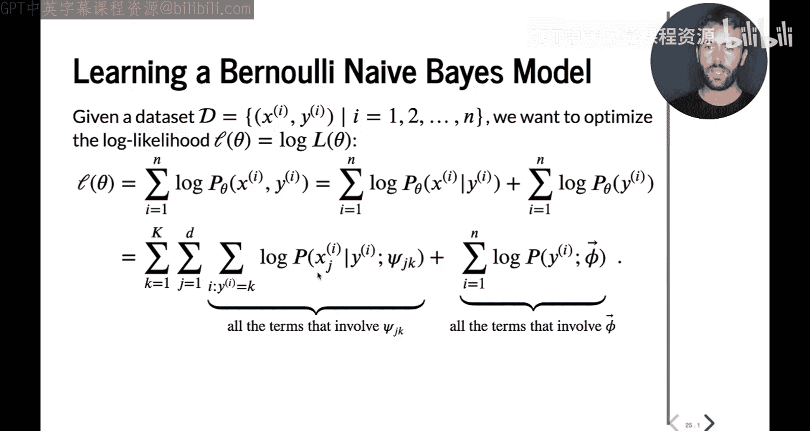

So for example， all the terms that involve phi， they are here。

This is the set of all the terms that involve Phi and everything that's on this side does not involve Phi。

 So if I want to optimize this model， I just need to optimize this term。And similarly。

 for each parameter， Psi JK。This here is the set of terms in the summation that contain that involve parameter ps JK。

And if I want to find the best Psi JK， the maximum likelihood Psi JK。

 I only need to look at this set of terms in the summation。

So this is a really powerful observation that again。

 will give us a nice closed form solution for the parameters of this model。

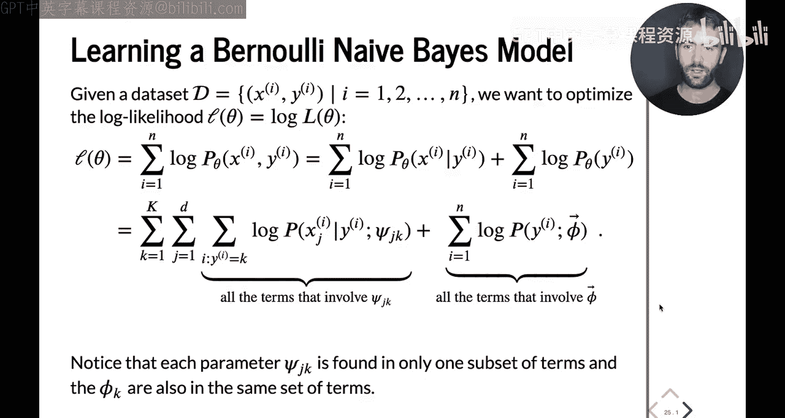

嗯。Again， just restating what I said earlier， if we want to find the maximum over one parameter beside Ps Jk。

 well I can ignore all the terms except this small set of terms。

 and I only need to maximize this particular set of terms in order to find the maximum likelihood parameter beside ps JK。

 and the same thing can be said for the parameters， phi。

 I only need to look at this part of the log likelihood， only this subset of terms。

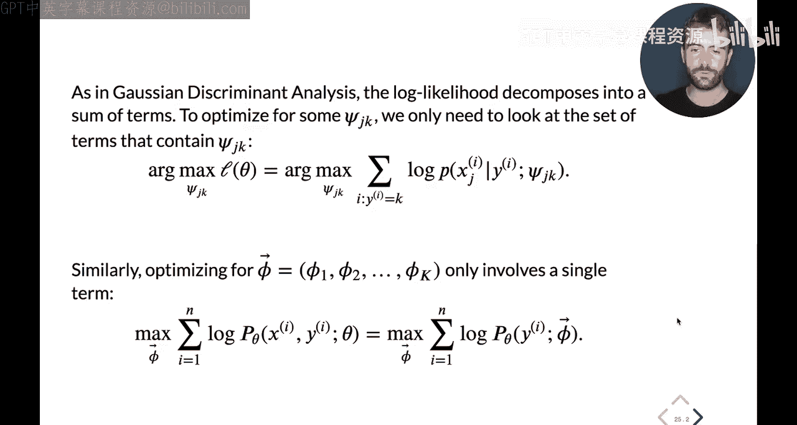

So what happens if we optimize this model？Well， because we have these simplified assumptions。

 we can again derive a really simple closed form for our parameters So first for the parameter for the parameter phi we have the same nice and convenient form that we had earlier so this has exactly the same form and the derivation is exactly the same that we followed in the previous lecture and it is indeed the same because the part of the model here that we're optimizing this is exactly this has exactly the same form as in the Gasian discriminment model we're optimizing exactly the same objective and therefore the result is going to be the same。

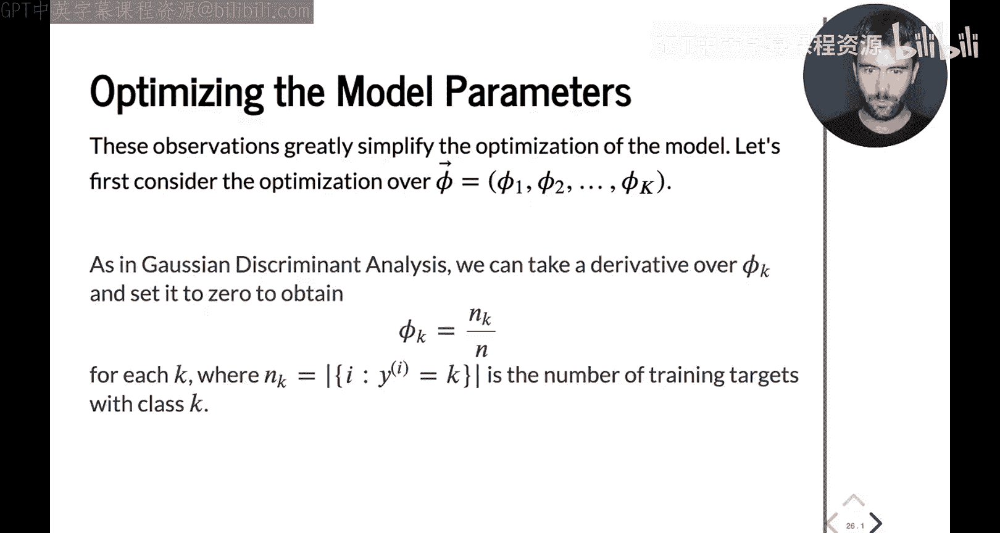

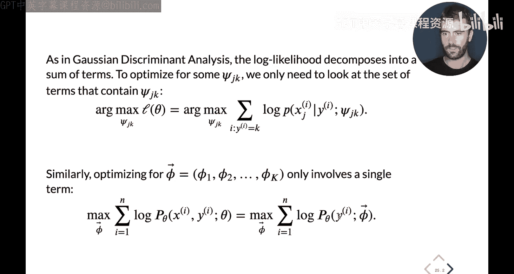

So and again， just to remind you what this is， this is simply the fraction of our training data。

 which has class K， so the of seeing the probability of y taking class K。

 we estimated to be simply the fraction of class K in our training set。This is what this term is。

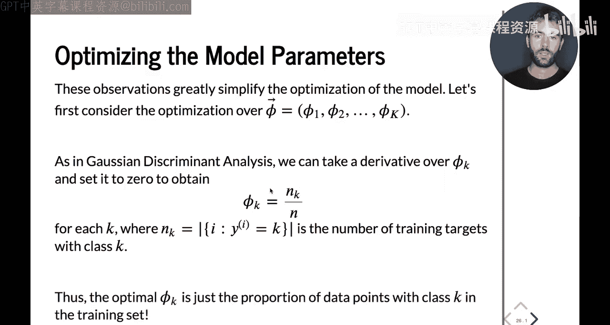

And similarly， we can do， we can follow the same approach to derive a value for the parameter sub p Psi。

 Again， if you want to do it yourself， you would just take the expression that I had on the earlier slide for where I was。

Defining the maximum Psi Jk， this is a lock probability， it's a Bernoulli lock probability。

 so you can plug in the definition of a Bernoulli， you can take the derivative。

 you can solve it you can set the derivative to0， you can solve for p Psi K and you will have the following expression where end sub K is the number of classes is the number of data points that have class K and the number at the top here is the number of data points that have class K and in which word J occurs。

Again， this is a really straightforward definition。

 So essentially ps Jk is a probability of seeing word J in class K。

 and we estimate it to be simply the fraction of words in class K that happen to have。

Word J in our training set。We're simply estimating these parameters to their empirical frequencies in our training set。

And now this gives us a close form expression for both P psi and phi。

 and now we have specified how to we have specified both our training objective。

 which was the log likelihood， and we have specified an optimization procedure。

 which allows us to obtain the maximum likelihood parameters for this model。

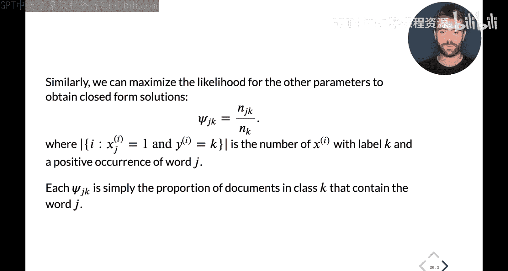

Again， I just want to remind you that if we want to query the model for a particular prediction。

 we can use the following equation， which is an application of basease rule。

 so I have used basease rule to invert this particular to invert this probability and now what's on the right both P and y and P of x given y。

 these are all。Probabilities that for which we have an expression they're both they both involve bernoulli distributions and again。

 the intuition here is that given a new word， given a new document X。

 I look at its probability under my model under each model that I have for each class。

 and I return the class of the model under which x has the highest probability。

So I choose the class that explains this new data point best。

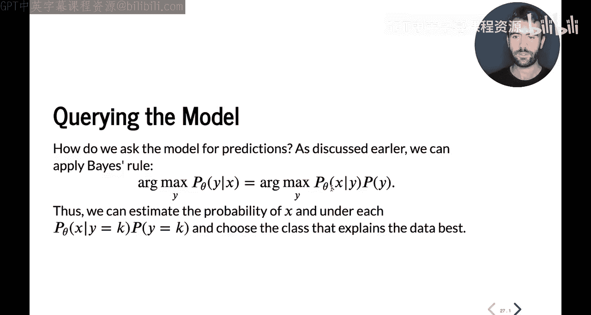

So this is how we perform predictions using this model。And now again， to illustrate this。

 I'm going to use our 20 news groups data set， which I introduced in the first video。

So recall that in 20 news groups， we have the following。

 we have a data set of messages that come from different online news groups。

 and each of them has a different topic。And these topics include medicine， computer graphics。

 religion。And each of them each X is a short messageger。

 you can think it as a short email to the news group。

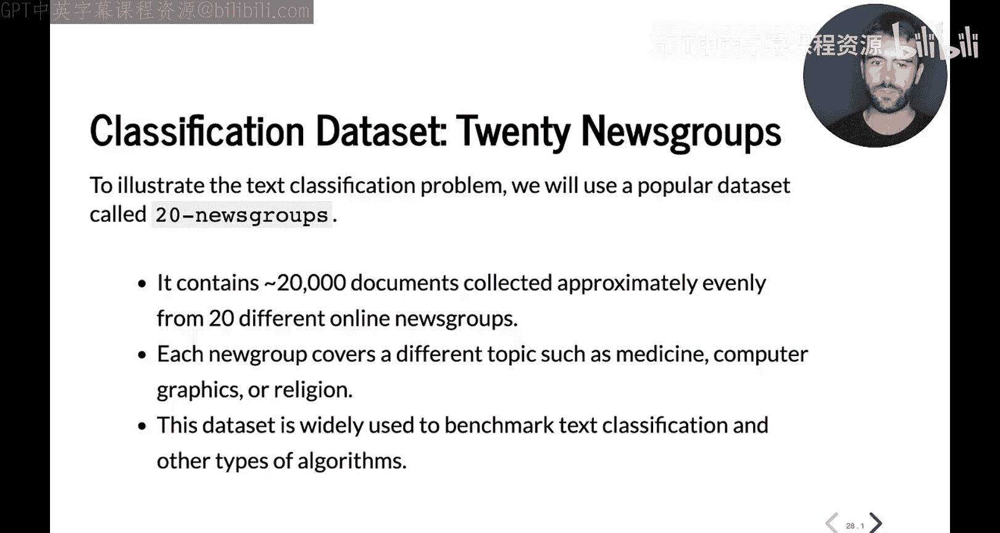

I can load this dataset set using P psychicL， using the built in psyit learn function for loading this data。

 and again I'm only going to look at the following four classes， atheism， Christianity， graphics。

 and medicine。

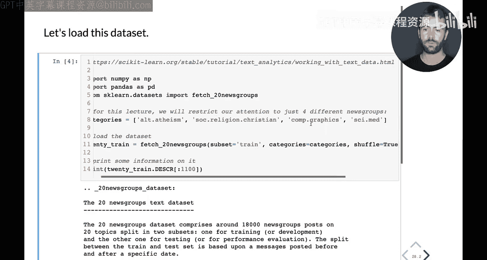

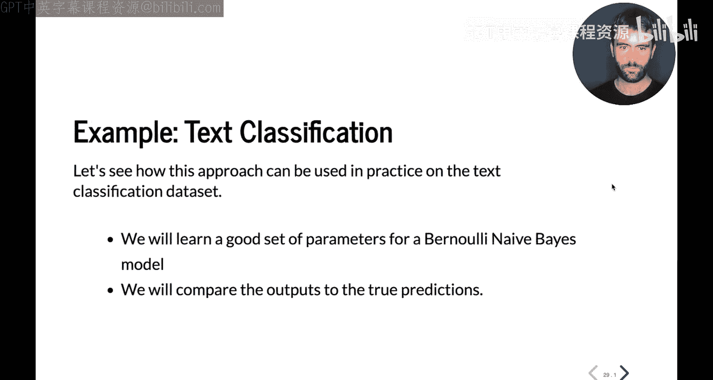

Let's apply the Bernoulli naive based model to this data set。

 I'm going to now implement this in Nmpi and I will show you how to learn these parameters and then how we can use them to compute predictions。

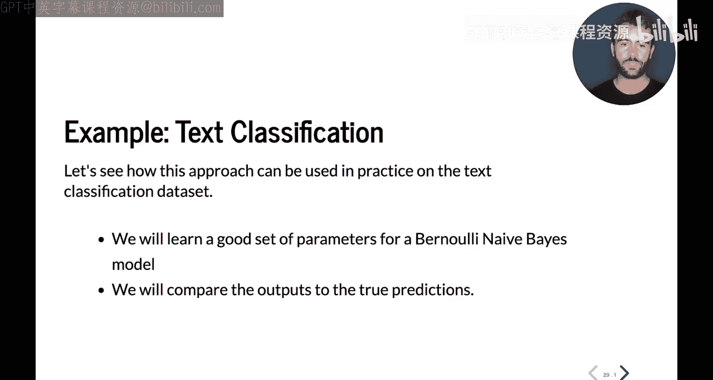

So here。We can start by computing our features， using the using this。

Feurizer that we have shown earlier in the first lecture on。

Tex classification and the output is a matrix x strain。

 which has dimension approximately 2000 by 1000 and 2000 is the number of inputs is the number of training examples。

 and 1000 is the number of features that I have just said here in order to make these needs matrices smaller。

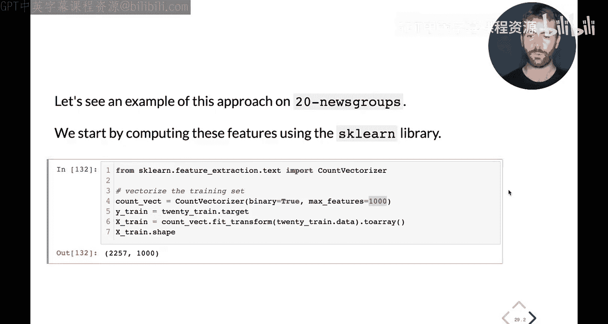

Let's now compute the maximum likelihood estimates for the parameters on this data set。

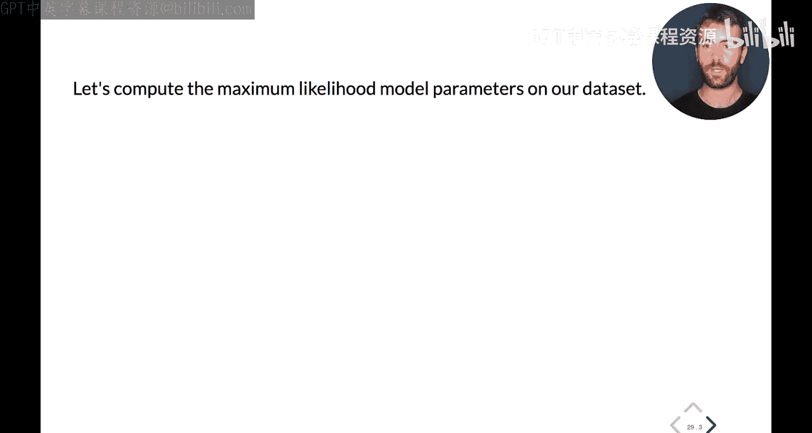

Again。As in Gaussian stream analysis， this code is really short， and this is， this is， again。

 one of the advantages of generative algorithms the。The， the， the expression for compute， the， the。

 the code for computing these closed form expressions is really small。

 So here I'm initializing a matrix of Phis and a matrix of size。

 I have K ps and I have K times deep size。 This is precisely the set of model parameters that I have。

 And now for each class。 I look at the。The subset of the data that has class K and my vector psi for class K is simply the number of times that I have seen each word within the subset of the data that has this class and because this matrix is binary I can just take the mean along the axis along the axis that goes over all the data points in order to just compute the average number of times that I see each word in my training data and similarly for the phis。

 it's simply how many examples of class K I have over the total number examples in my data。

 and these are the probabilities of the different classes I have I have about a quarter each。

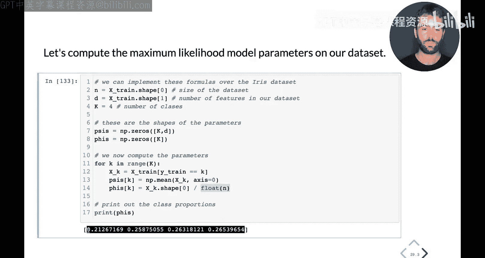

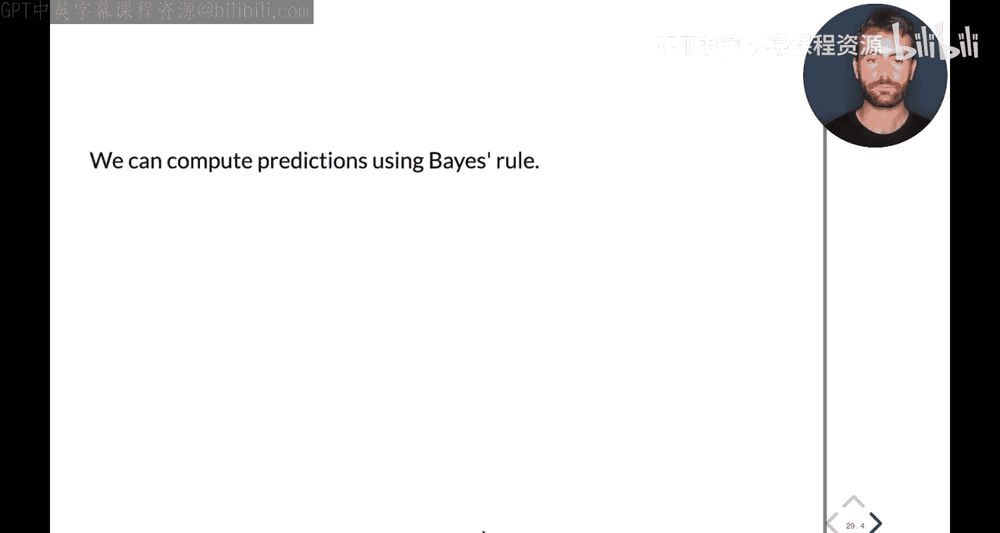

Now， in order to compute predictions， we implement a form of base rule。 Again。

 this is a really simple function in Python。 I'm doing a little bit of reshaping here in order to vectorize these operations。

And I compute the log probability of the class Y， I compute the log probability of x given y。

 and now I can simply compute the log probability of y given X by applying base rule。

 which combines these two terms here I'm operating in log space because these probabilities are often really small。

 And so in order to avoid summing everything to in order to avoid working with really small numbers that might be too small for a computer to represent effectively。

 I am converting everything to a log scale and this makes this algorithm numerically more stable。

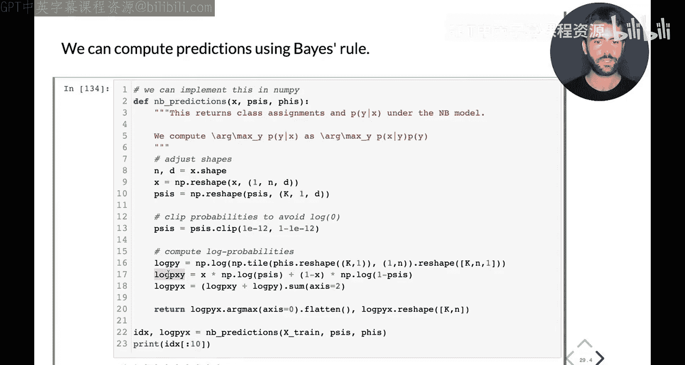

And now I can invoke this function on our chain dataset to get a set of predictions。

 and these are the classes that are predicted for this data set。

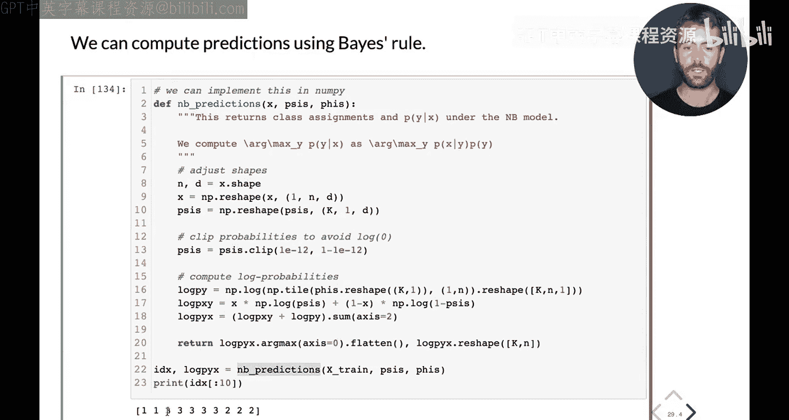

Let's now see how we can apply this algorithm。 Again， I have this input open GPL on the GPU is fast。

 I use my featureurizer from psy learn to compute feature representation and now I run my a base prediction function to compute its target and indeed it predicts that this is。

This is a text that corresponds to the graphics data set， the graphics topic。

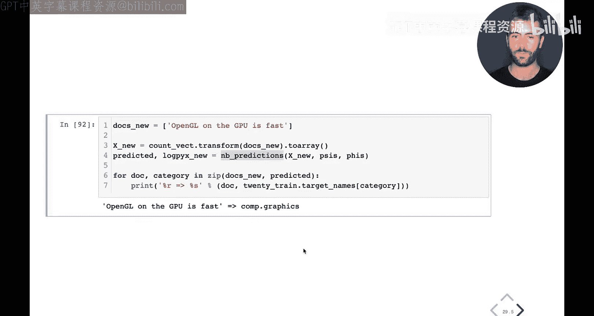

Alright， so just summarizing everything that we have seen so far。

 I have introduced an algorithm called Berulli nave Bayase。

 and an instance of this is a supervised learning algorithm which solves multiclass classification problem it models the data as a mixture of Bernoulli distributions it's well。

I guess you could say it's a mixture of categorical distribution where each categorical distribution factorizes fully over its dimension。

 according to the naive base assumption， and so therefore it looks like a mixture of Brnoulli distributions。

 this model is optimized using the log likelihood and as in Gaussian instrument analysis。

 there is a closed form solution for this dataset。So even though this Bernoulli naive base model is really。

Simple。It is still achieving close to state of the art performance most on a lot of data and up to relatively recently。

 it was it was matching state of the art， although there are over the last years methods based on neural networks have started to outperform naive base。

 but for a very long time， this was a very strong benchmark that was hard to beat。

 So even though this is a simple algorithm， it works really quite well。

 and it also scales to very large dataset sets very easily。

 you just saw here that training this algorithm is really simple。

 we just need to do some a few matrix operations。 And so if we have very a very large data with a very large vocabulary。

 We can use the fact that the solution is so simple to run it on very large data sets。

 and even an algorithm like logistic regression might not scale as well as naive base because logistic regression involves a numerical optimization procedure。

But here we have a very simple formula， so this is yet another reason why nab is a good algorithm to try if you're dealing with text classification problems。

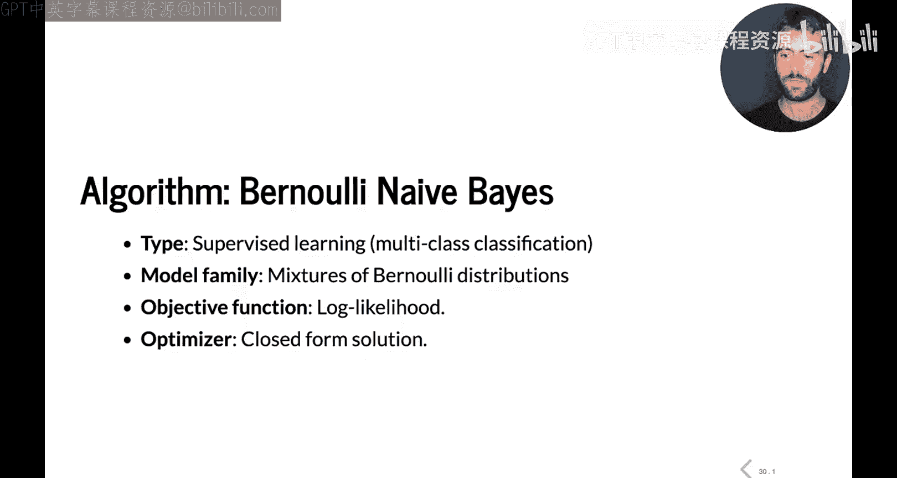