# 应用机器学习：第8讲：朴素贝叶斯（学习）📚

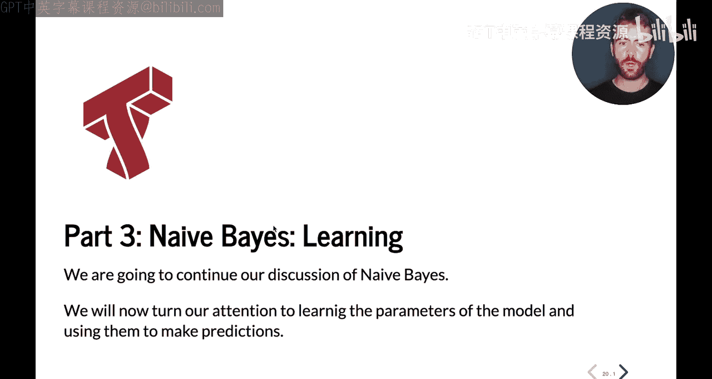

在本节课中，我们将要学习如何从数据中学习朴素贝叶斯模型。我们将回顾模型定义，推导其最大似然估计的闭式解，并通过一个文本分类的实例来演示其应用。

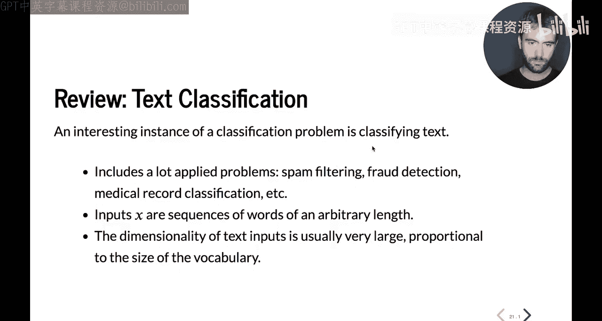

---

## 模型回顾与学习目标 🎯

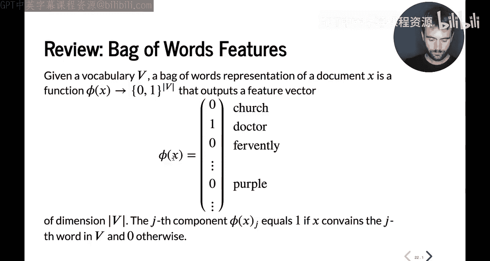

上一节我们介绍了朴素贝叶斯算法及其使用的模型。本节中，我们来看看如何从数据中学习这个模型的参数。

朴素贝叶斯算法的动机问题是文本分类。这是一个分类问题，其输入是单词或字符序列，我们需要对这些序列进行分类。该问题有许多有趣的应用，例如垃圾邮件过滤或欺诈检测。

将机器学习算法应用于文本分类的主要挑战在于找到良好的特征表示。因为每个输入 `x` 只是一个单词或字符序列，我们不清楚如何像之前所有算法那样将其转换为固定长度的特征向量。一种实现方式是使用词袋表示法。这意味着我们的特征向量是一个很长的列向量，其长度对应于词汇表中的单词数量。每个可能的单词都有一个对应的索引分量，该分量的值为 `0` 或 `1`，取决于该单词是否出现在文本 `x` 中。

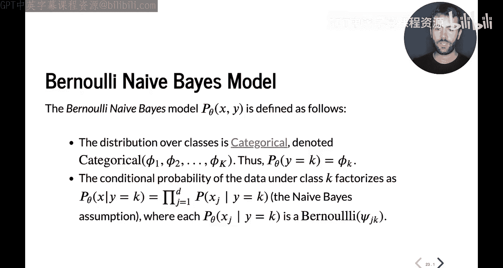

我们为这类数据提出了一个特定模型，其中 `x` 是二元特征向量，`y` 是类别。该模型包含两个部分：

1.  类别 `y` 的概率分布，这是一个分类分布，与高斯判别分析中的相同。
2.  给定类别 `k` 时数据 `x` 的条件概率，其形式如下：

    ```
    P(x | y=k) = ∏_{j=1}^{D} Bernoulli(x_j; ψ_{jk})
    ```

    这是 `D` 个伯努利分布的乘积，每个伯努利分布都有一个参数 `ψ_{jk}`，我们总共有 `D × K` 个这样的参数。由于这个分布在各个分量上可分解（即看到每个单词的概率与其他单词是否出现独立），我们称其为朴素贝叶斯假设，这也是算法名称的由来。

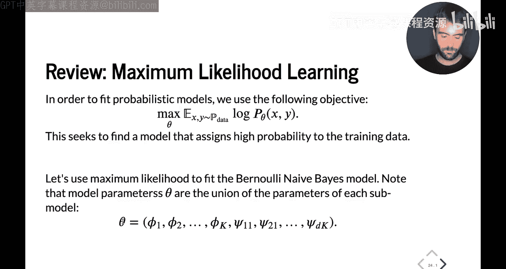

---

## 最大似然估计推导 🔍

现在，我们如何学习这个模型？因为我们有一个概率模型，所以有一个原则性的方法来推导这些模型的目标函数，即最大似然原理。这是我们的目标，我们寻找能使来自数据分布的观测数据具有高概率的模型参数 `θ`。

为了使内容更具体，我们的参数集 `θ` 将包含之前看到的所有 `φ` 和所有 `ψ`。所有这些参数共同构成了模型参数 `θ`。

那么，如果我们对这个问题应用最大似然原理会发生什么？这里的情况与我们为高斯判别分析算法所做的工作非常相似。

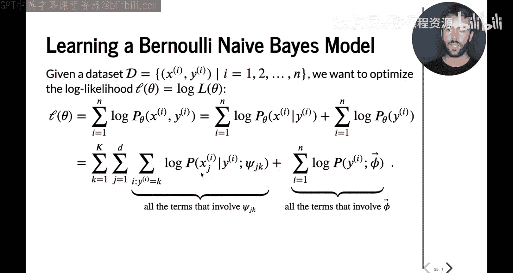

以下是其对数似然的展开。由于我们的概率由 `P(y)` 和 `P(x|y)` 两部分组成，我可以将它们分开。在下一行中，我使用了一种不同的方式来枚举所有数据点：首先枚举所有类别 `k`，然后枚举所有属于特定类别 `k` 的点。由于朴素贝叶斯假设，每个 `P(x|y)` 在不同的分量上可分解，因此 `P(x|y)` 的对数实际上是每个分量 `j` 的对数概率之和。这就是第二个求和项的来源。

现在，我要做一个与我们在研究高斯判别分析时相同的观察：涉及特定参数的所有项都只出现在求和式的一个小子集中。

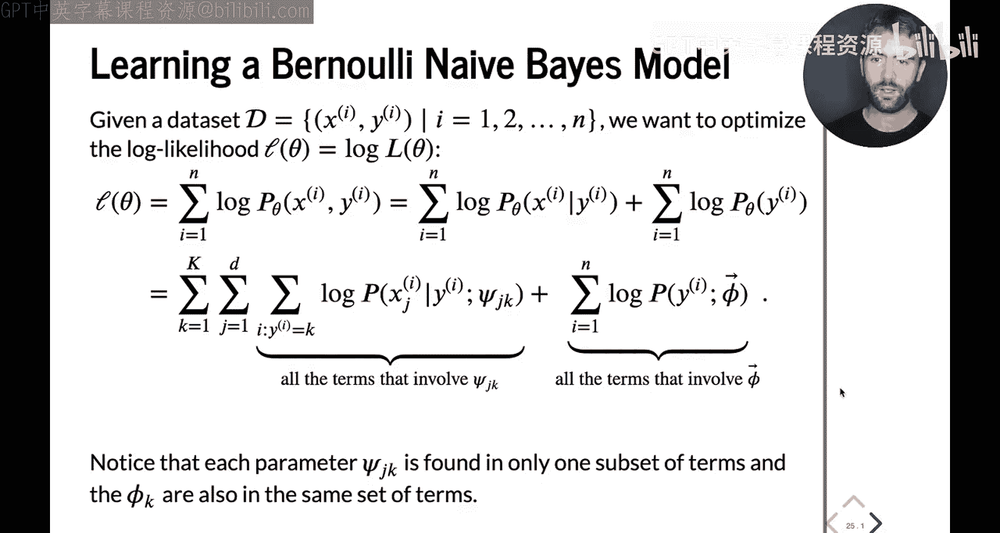

例如，所有涉及参数 `φ_k` 的项都在这里。这是涉及 `φ_k` 的所有项的集合，而另一边的所有项都不涉及 `φ_k`。因此，如果我想优化这个模型，我只需要优化这一项。类似地，对于每个参数 `ψ_{jk}`，涉及该参数的项也只在求和式的一个特定子集中。如果我想找到最大似然估计的 `ψ_{jk}`，我只需要关注求和中的这一小部分项。

这是一个非常有力的观察，它将再次为我们提供模型参数的闭式解。

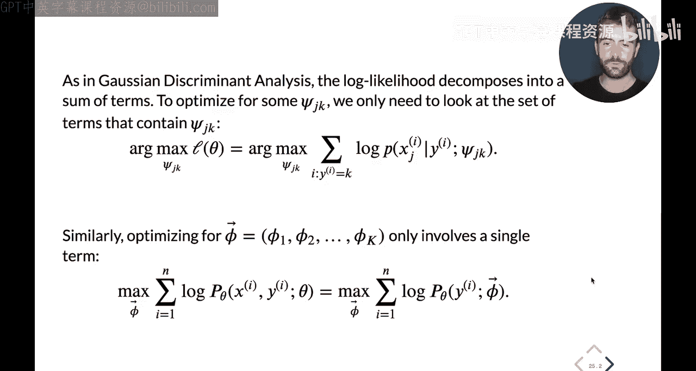

---

## 参数闭式解 📝

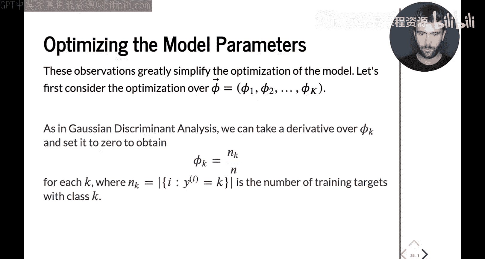

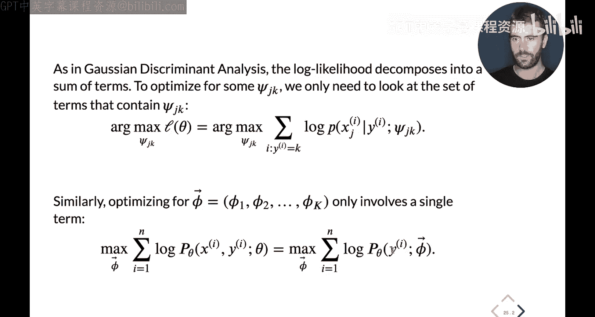

重申一下，如果我们想找到某个参数 `ψ_{jk}` 的最大值，我可以忽略除这一小部分项之外的所有项，只需要最大化这个特定的项集。对于参数 `φ` 也是如此，我只需要查看对数似然的这一部分，即这个子集。

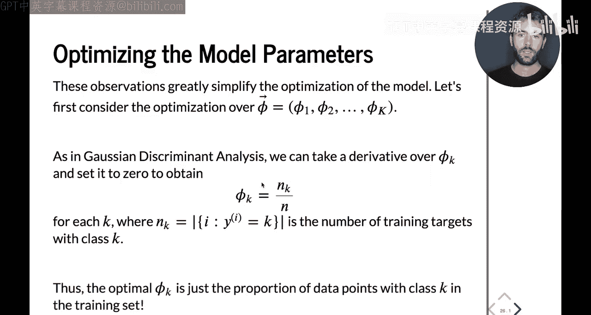

那么，当我们优化这个模型时会发生什么？由于我们有这些简化的假设，我们可以再次为参数推导出一个非常简单的闭式解。

首先，对于参数 `φ_k`，我们有一个与之前相同的形式，推导过程也完全相同。这是因为我们正在优化的这部分模型与高斯判别模型中的形式完全相同，因此结果也相同。

这个公式表示，`φ_k` 简单地估计为训练数据中属于类别 `k` 的样本比例。

类似地，我们可以遵循相同的方法推导出参数 `ψ_{jk}` 的值。如果你自己想推导，只需取我之前幻灯片上定义最大似然 `ψ_{jk}` 的表达式。这是一个伯努利分布的对数概率，你可以代入伯努利分布的定义，求导，令导数为零，然后解出 `ψ_{jk}`，就会得到以下表达式：

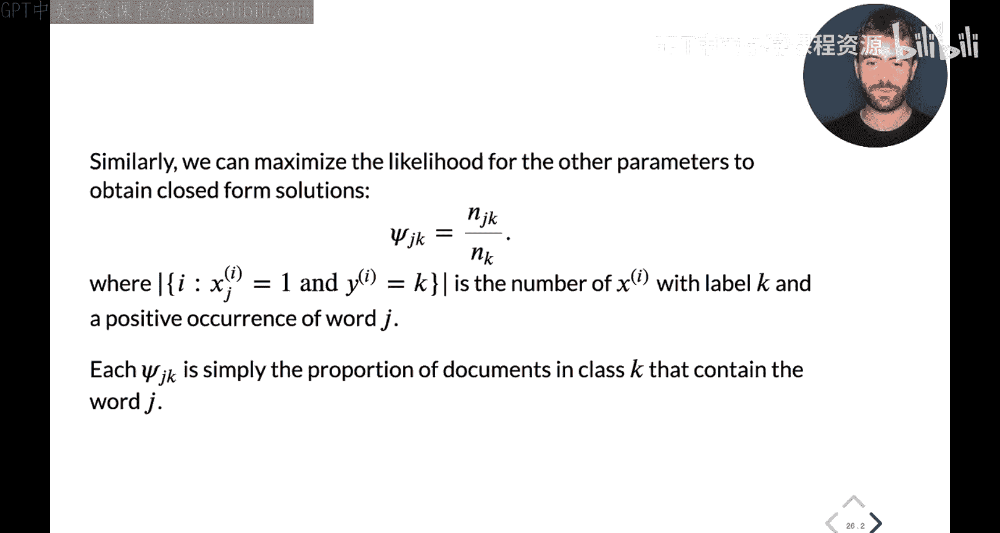

```
ψ_{jk} = (∑_{i: y_i=k} x_{ij}) / N_k
```

其中，`N_k` 是类别为 `k` 的数据点数量，分子是类别为 `k` 且单词 `j` 出现的数据点数量。这又是一个非常直接的定义。本质上，`ψ_{jk}` 是在类别 `k` 中看到单词 `j` 的概率，我们将其估计为训练集中类别 `k` 的文档中出现单词 `j` 的比例。

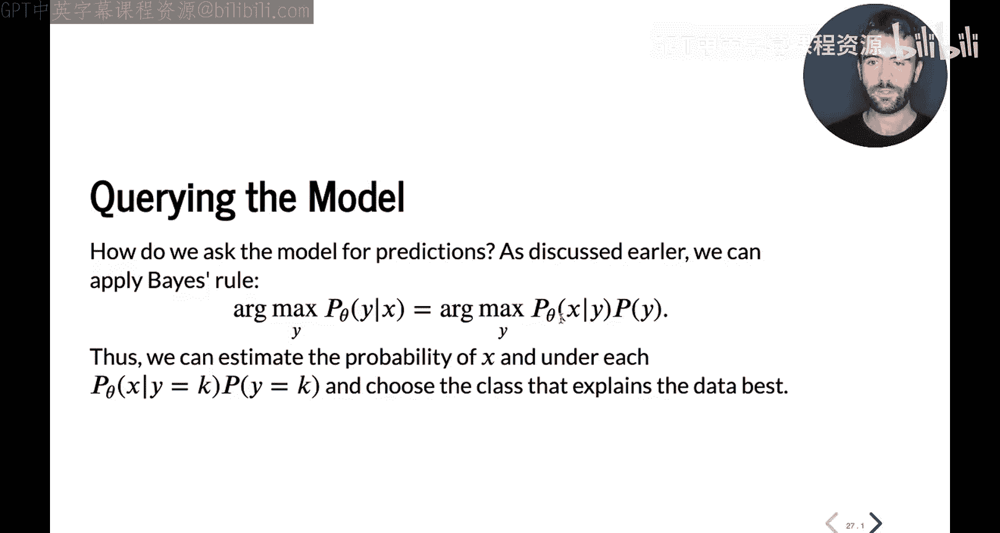

这为我们提供了 `ψ` 和 `φ` 的闭式表达式。现在，我们既指定了训练目标（对数似然），也指定了优化过程，使我们能够获得该模型的最大似然参数。

---

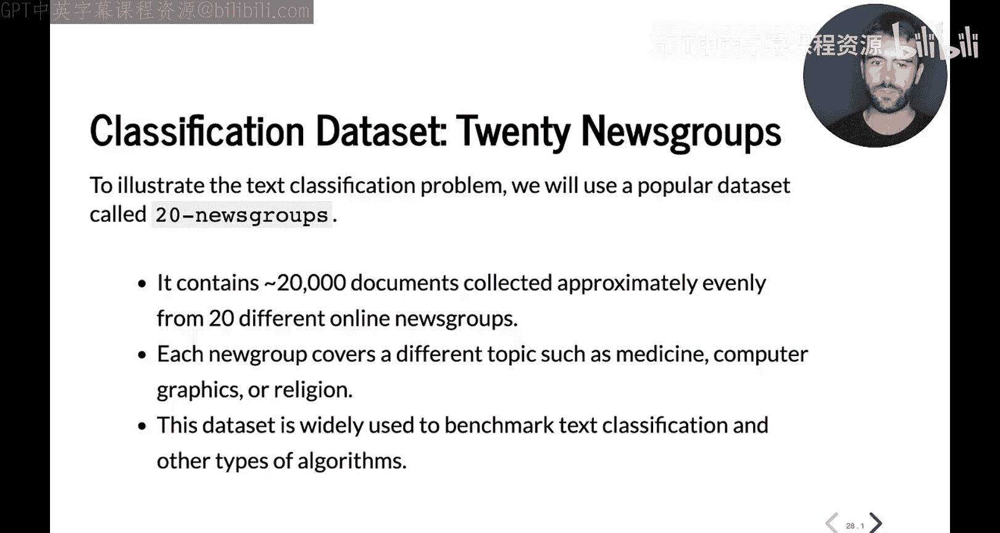

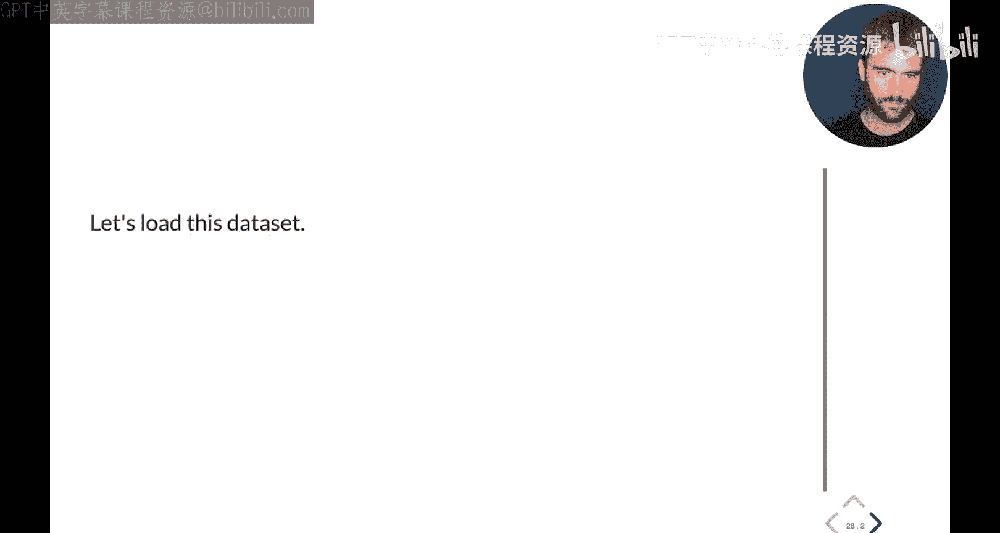

## 进行预测与实例演示 🚀

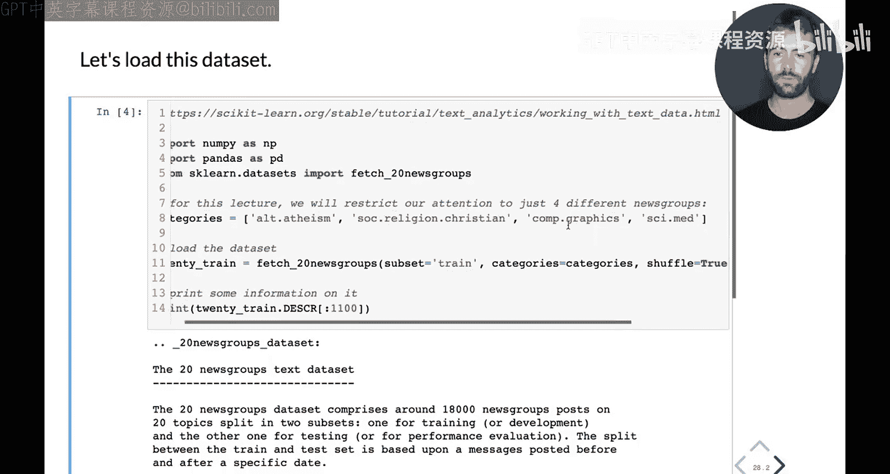

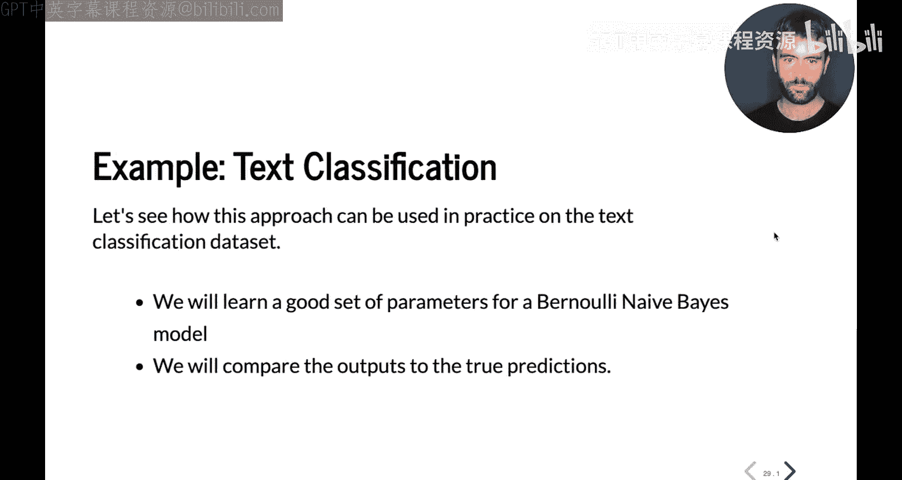

我想再次提醒，如果我们想查询模型以进行特定预测，可以使用以下应用了贝叶斯规则的方程：

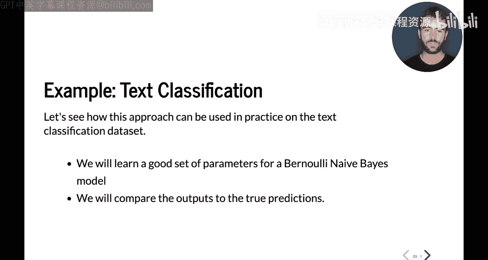

```
P(y=k | x) ∝ P(y=k) * P(x | y=k)
```

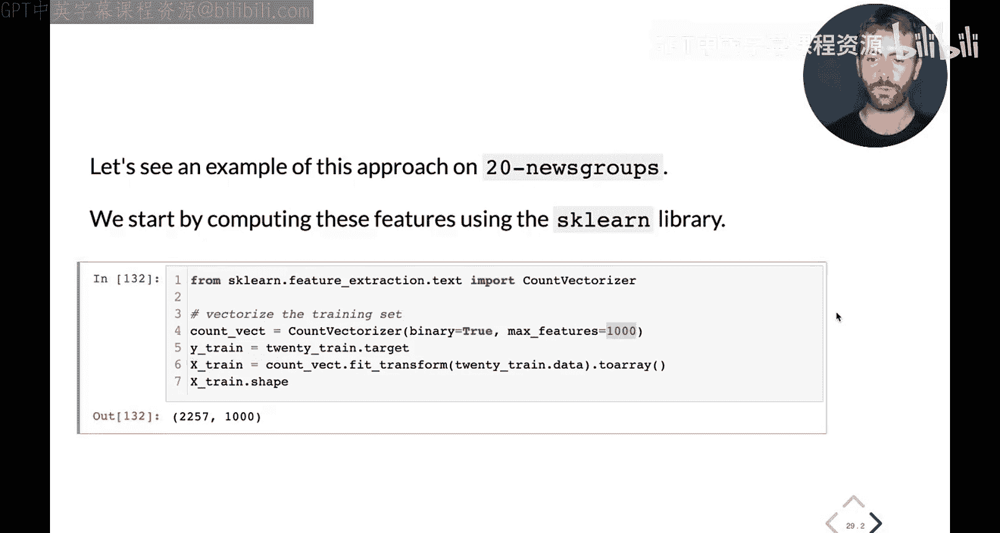

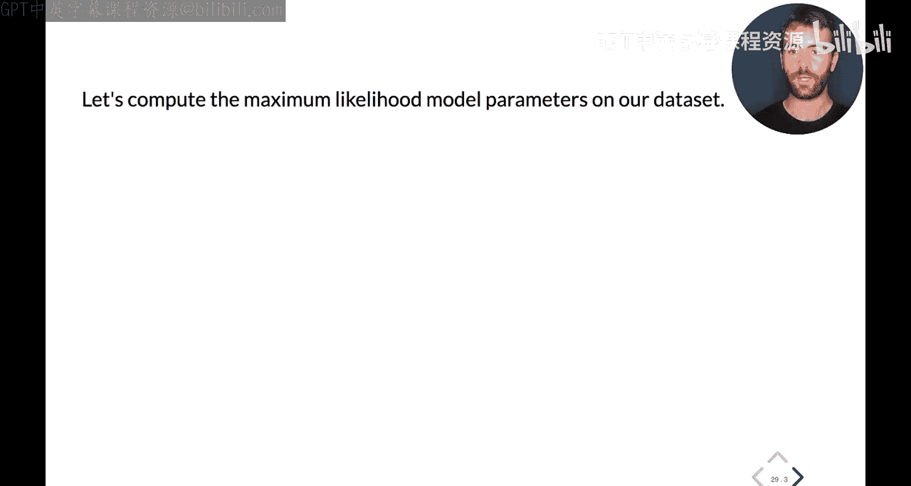

等式右边两项 `P(y)` 和 `P(x|y)` 我们都有表达式，它们都涉及伯努利分布。这里的直觉是，给定一个新文档 `x`，我查看它在我为每个类别建立的模型下的概率，然后返回使 `x` 具有最高概率的类别。也就是说，我选择最能解释这个新数据点的类别。

现在，为了说明这一点，我将使用在第一讲中介绍的20个新闻组数据集。

以下是使用该数据集的应用步骤。首先，我使用之前展示的特征提取器来计算特征，输出是一个维度约为2000×1000的矩阵 `X_train`，其中2000是训练样本数，1000是特征数。

现在，让我们计算该数据集上参数的最大似然估计。与高斯判别分析一样，这段代码非常简短，这也是生成式算法的优势之一。计算这些闭式表达式的代码量很小。

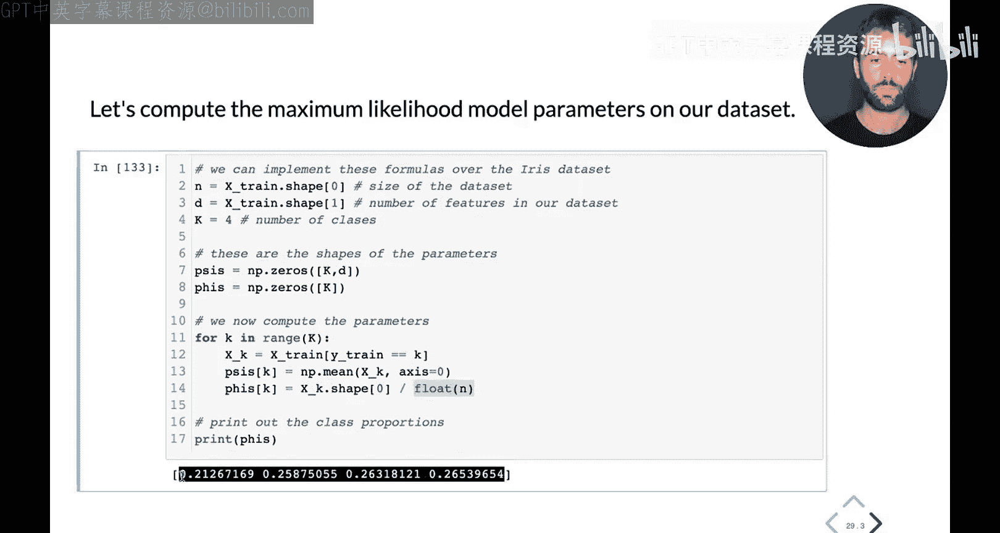

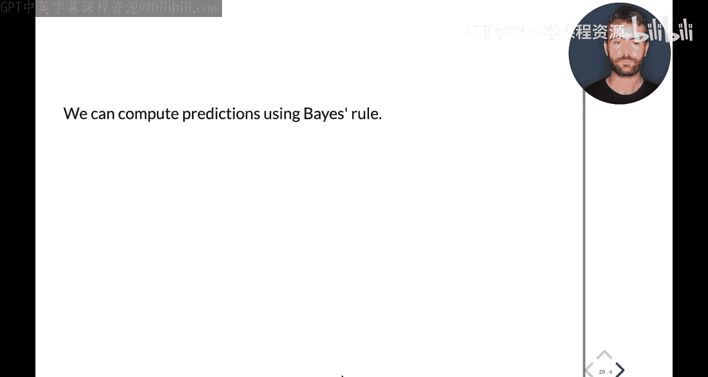

我初始化了 `φ` 矩阵和 `ψ` 矩阵。对于每个类别 `k`，我查看属于该类别的数据子集，该类别的向量 `ψ_k` 就是该子集中每个单词出现的次数。因为这个矩阵是二元的，我可以简单地沿数据点轴取平均值，来计算训练数据中每个单词出现的平均次数。类似地，对于 `φ_k`，它只是类别 `k` 的样本数除以数据中的总样本数。

为了计算预测，我们实现了贝叶斯规则的一个形式。这是一个非常简单的Python函数。我在这里做了一些重塑操作以向量化这些运算。我计算了类别 `y` 的对数概率和给定 `y` 时 `x` 的对数概率。现在，我可以通过应用贝叶斯规则（结合这两项）来计算给定 `x` 时 `y` 的对数概率。我在对数空间中操作，因为这些概率通常非常小，为了避免处理计算机可能无法有效表示的极小数字，我将所有内容转换为对数尺度，这使得算法在数值上更稳定。

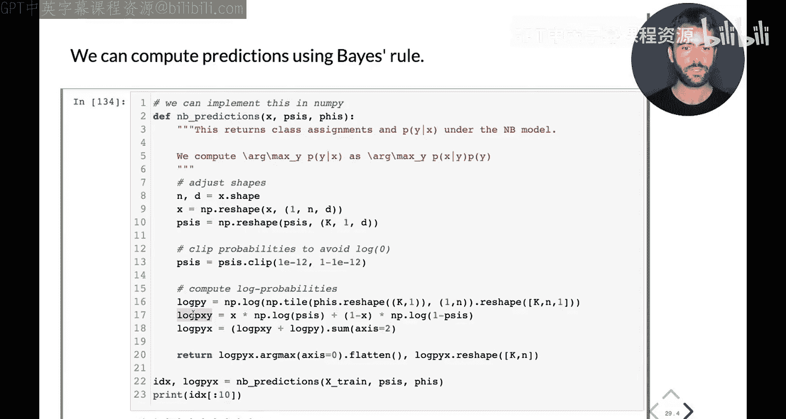

现在，我可以在我们的训练数据集上调用这个函数来获得一组预测，这些就是为该数据集预测的类别。

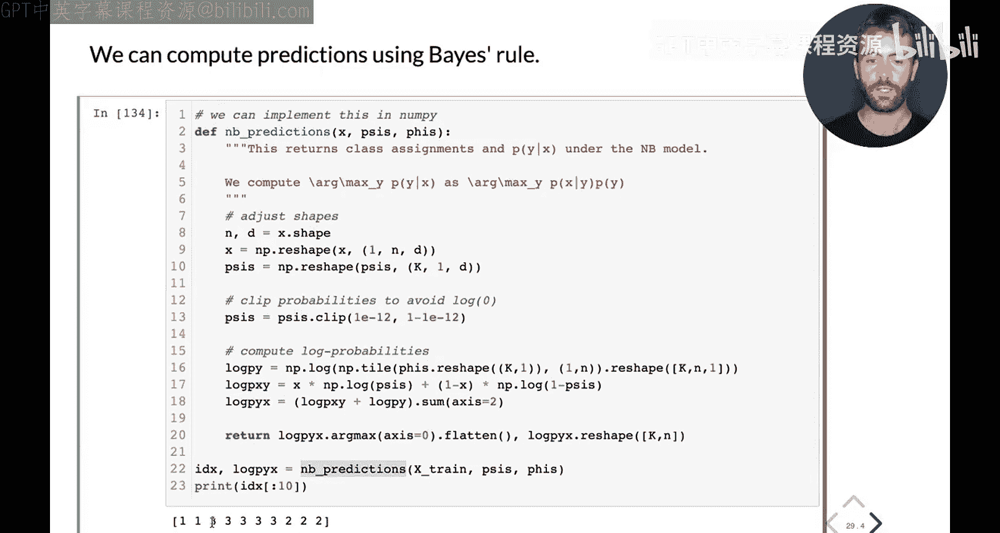

让我们看看如何应用这个算法。我有一段输入文本“OpenGL on the GPU is fast”，我使用scikit-learn的特征提取器来计算其特征表示，然后运行我的朴素贝叶斯预测函数来计算其目标。确实，它预测这段文本对应于“图形”主题的数据集。

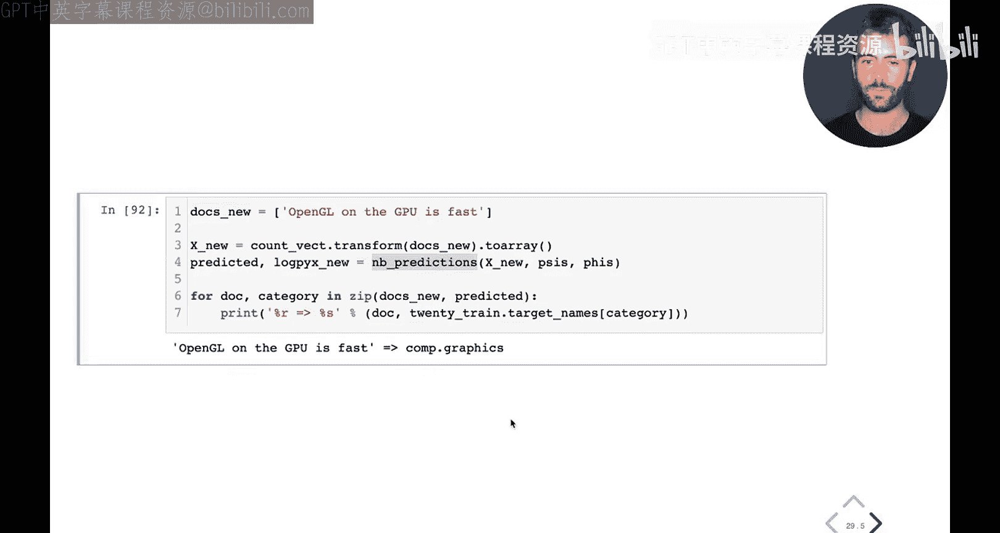

---

## 总结 📋

本节课中我们一起学习了朴素贝叶斯算法的学习过程。

我介绍了一种称为伯努利朴素贝叶斯的算法。它是监督学习算法的一个实例，解决了多类分类问题。该模型将数据建模为伯努利分布的混合（或者更准确地说，是在朴素贝叶斯假设下各维度完全分解的分类分布的混合）。该模型使用对数似然进行优化，并且与高斯判别分析一样，存在闭式解。

尽管这个伯努利朴素贝叶斯模型非常简单，但在许多数据集上，它的性能仍然接近最先进水平。直到最近几年，基于神经网络的方法才开始超越朴素贝叶斯，但在很长一段时间里，它都是一个难以超越的强大基准。因此，即使这是一个简单的算法，它的效果也非常好。

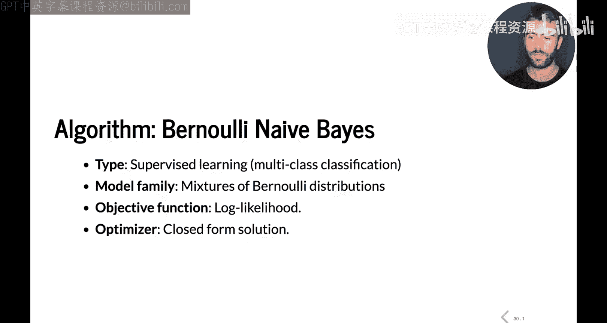

此外，它还能非常容易地扩展到非常大的数据集。你刚才看到训练这个算法非常简单，我们只需要进行一些矩阵运算。因此，如果我们有一个词汇量非常大的大型数据集，我们可以利用解非常简单的特点，在非常大的数据集上运行它。即使是逻辑回归这样的算法，由于涉及数值优化过程，其扩展性也可能不如朴素贝叶斯好。这是另一个原因，说明在处理文本分类问题时，朴素贝叶斯是一个值得尝试的好算法。