# 康奈尔大学《应用机器学习 CS 5787_ Applied Machine Learning 2020》中英字幕（deepseek p34 -34-Lecture 9. Part 1_ Classification Margins.zh_en -BV12udzYvEFM_p34-

Hi and welcome to Lecture 9 of Applied Machine Learn。In Le 9。

 we are going to look at a new family of machine learning algorithms called Support Ve Ma。

Support vector machines are a very important class of algorithms in machine learning that in general can be applied to many kinds of problems including regression。

 classification， and even certain types of unsupervised learning。

 and it's an algorithm that should be part of the toolbox of every machine learning practitioner。

And the focus of this lecture， the next lecture， and also some of the lecture after that will be on explaining what is a support vector machine and de many formulations of this important machine learning algorithm。

In this video I would like to start by motivating the high level idea behind support vector machines and the first concept that I'm going to explain is the idea of a classification margin I'm going to explain what a classificationification margin is and then I will use this as justification for deriving this new set of algorithms which we are going to call support vector machines。

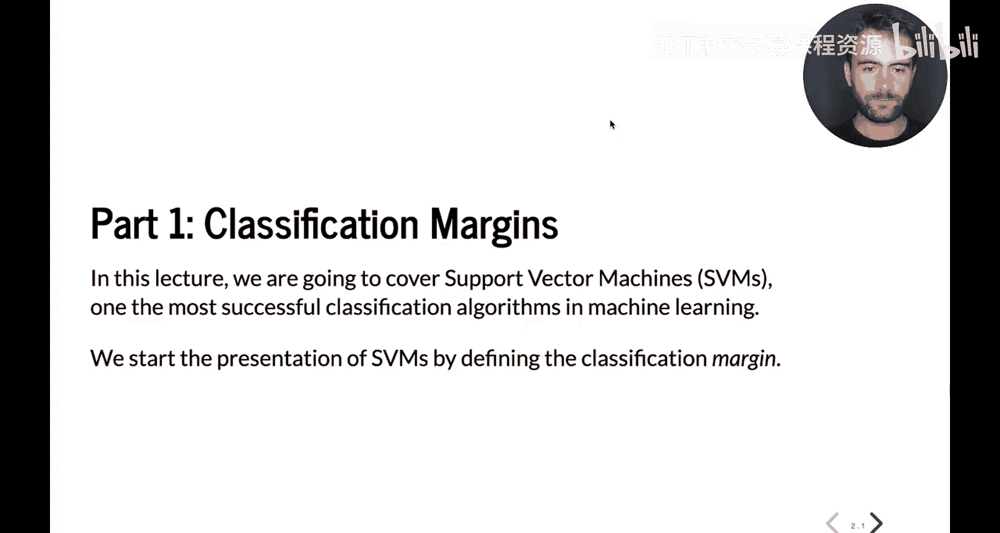

So to start I would like to define this notion called the classification margin and before I do that I want to set some context for this lecture。

 we are going to be focusing on the problem of binary classification。In general。

 the idea of support vector machines can be used for multiclass classification and as well as for other types of problems including regression。

 but for the purposes of this lecture and next lecture。

 we are going to focus on binary classification， and this will make the presentation of the algorithm simpler。

Recall that binary classification is a setting in which we have a supervised learning dataset set consisting of inputs X and targets Y。

 and our targets Y take one of two possible values so this makes it a binary classification problem and in this lecture we're going to introduce the additional notation of we're going to denote our labels in a particular way we're going to denote these two classes by plus one and minus-1 before we used to denote them by0 and 1 and in this lecture we're going to use minus1 and plus1 and that will make some of our mathematical derivations a little bit simpler。

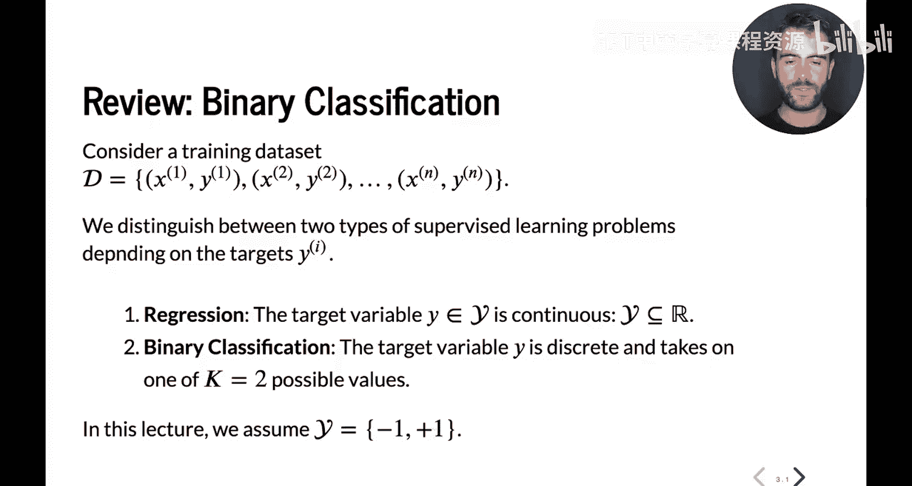

Now， the class of models that we will consider are going to be linear models。

We will later talk about how we can extend them and make these models nonlinear。

 but for the purposes of this lecture and the next lecture。

 we will consider model classes that have the following form。

 so they are linear in both the parameters， theta and the input attributes x。

And we can write models of this form in a vectorized form which looks like this。

 so here we have a vector of weights， theta， we do a our product between theta and x。

 and then we also add a bias term theta0， and that defines the model class that we are going to consider。

One distinction relative to previous lectures in which we looked at linear models is that we will consider the bias term as a separate term that will be not part of the vector theta and again we're making this small change in notation in order to simplify the derivations that we're going to be doing in this lecture。

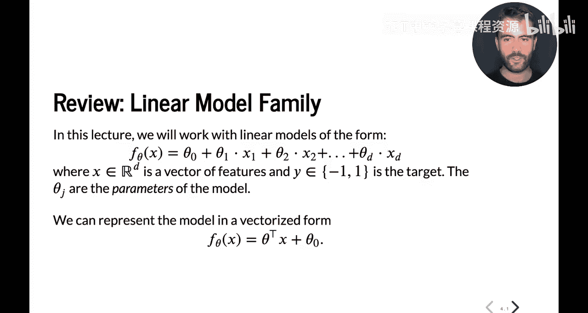

So as I mentioned， again， we are looking at binary classification problems and as an example of a binary classification data set and in order to define a running example that we're going to use throughout this lecture。

 we are going to use the IIS flower data that we have seen before。

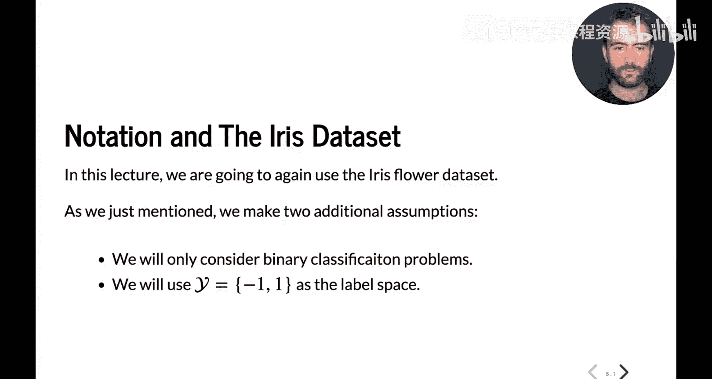

So recall that the Iis flower dataset set has the following form here I have loaded this data set fromsLn and this data contains a number of features for each flower。

 it has four features， these are measurements of various parts of the plant。

And here I have added here you see that the target column， I have labeled it as either 1 or1。

 depending on whether the flower is an iris Soossa flower that is going to be our class1。

 and then the other two types of flowers， I will denote them with class minus1。

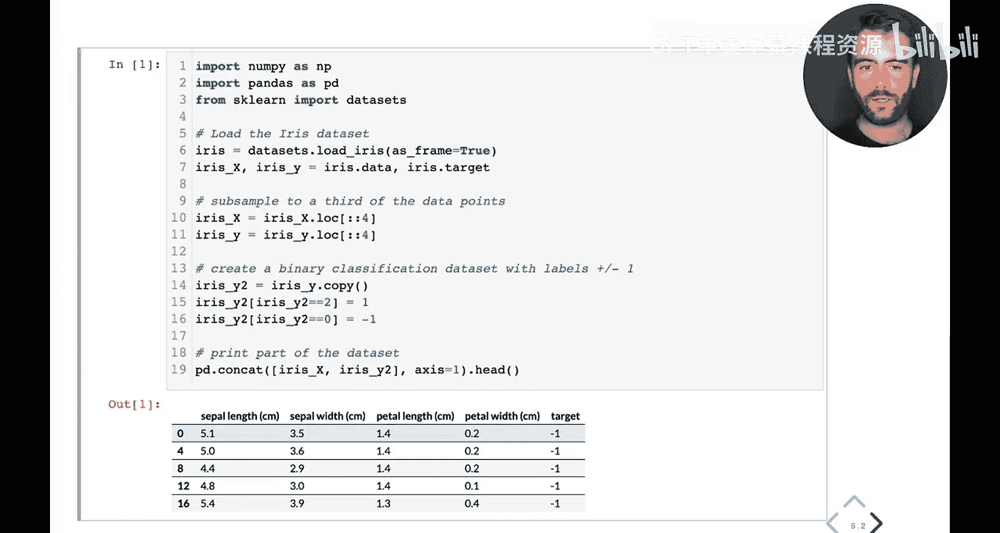

So we can visualize this data set here I have a small subset of this data set and the iris Satosa flowers here are in blue and the other two types of flowers which emerged into a second class。

 these are in brown and you can see them here。So this is going to be the data set that we will use as an example of the various algorithms that we're going to derive。

 and we have also used it for previous classification algorithms。

 including the logistic regression algorithm， Gaussian instrument analysis and others。

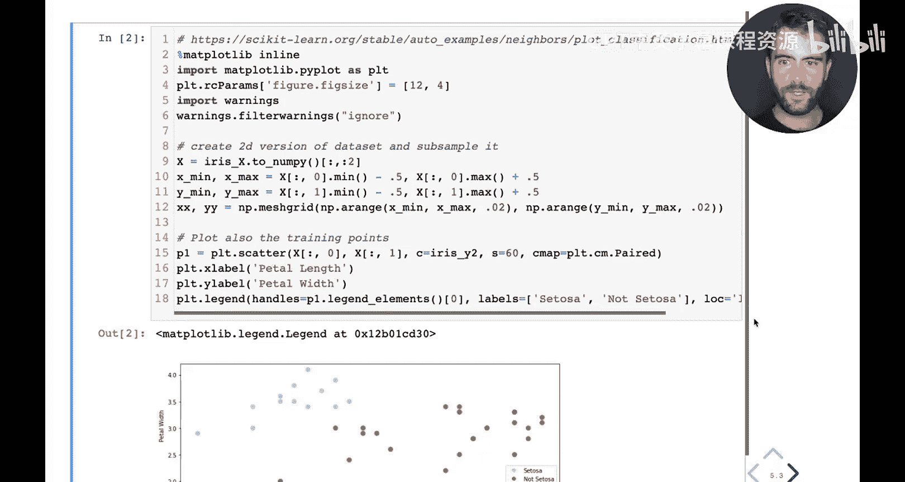

Now。Consider the Iris flower data set。 And we have seen previously。A number of algorithms。

 a number of machine learning methods that can be used for classification over this data set。

And each of these data sets， each of these algorithms will compute a certain decision boundary that will separate the two classes。

 and different algorithms will output different decision boundaries。

 logistic regression will output one line gasian instrument analysis will output a different hyperplane a different separating boundary between the two classes。

And many other algorithms， including ones that we haven't seen。

 will output other types of boundaries。The question that I would like to pose in order to motivate the derivation of the SVM algorithm is how do we determine which of these boundaries is the best one？

In particular in the example that I just showed you here these two classes are linearly separable。

 so in fact there's an infinite number of hyperplanes that separate this data perfectly are these two classes are said to be linearly separable and so the question of how do we choose among this infinite set of possible hyperplanes that perfectly separated data is particularly interesting in this example where again the two classes are perfectly linearly separable。

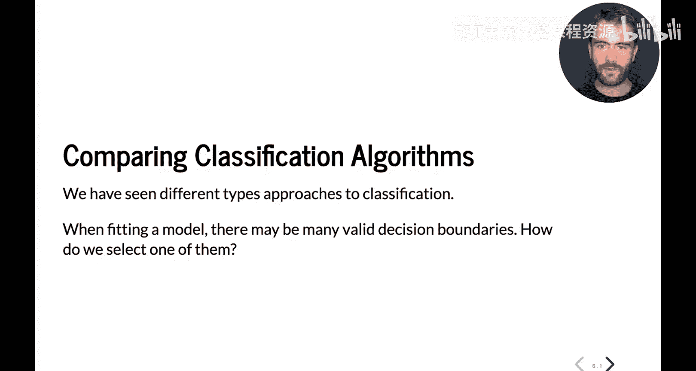

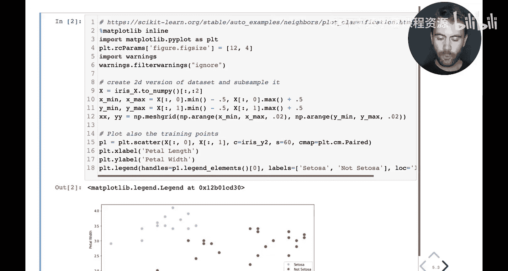

As an example of what I mean and why this question is interesting， consider the following example。

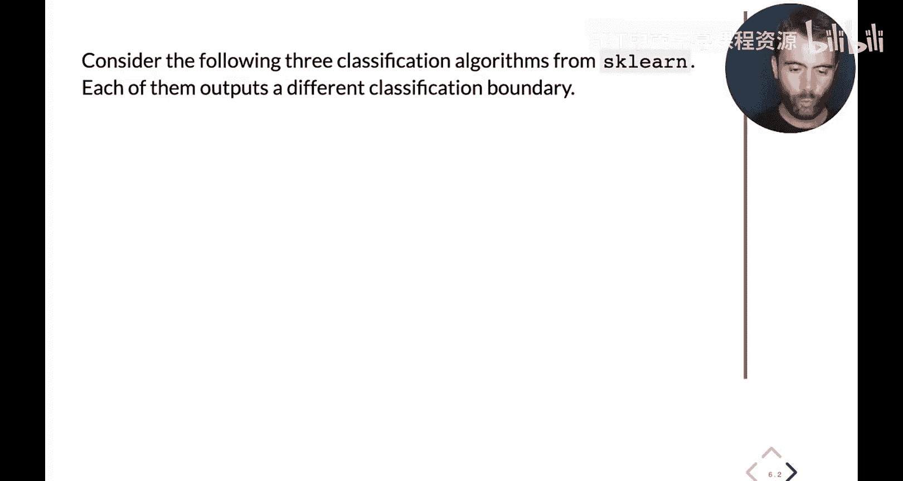

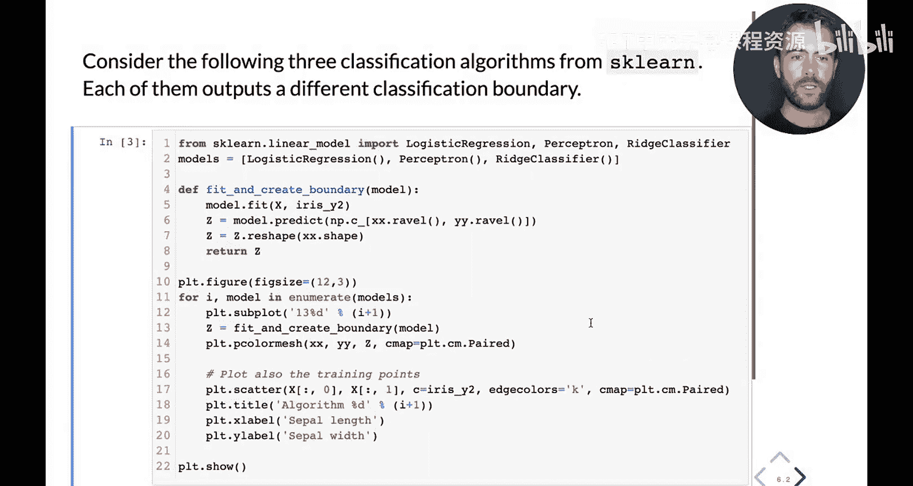

Here I am using psychic learn and I am importing three types of algorithms from psychic learn here I have a logistic regression algorithm that we have seen before and then the perceptron and rid classifier algorithms we will see the perceptron in a later lecture and then the rid classifier is。

It's a version， it's an L2 regularized classifier that you can read about in thesy learn documentation。

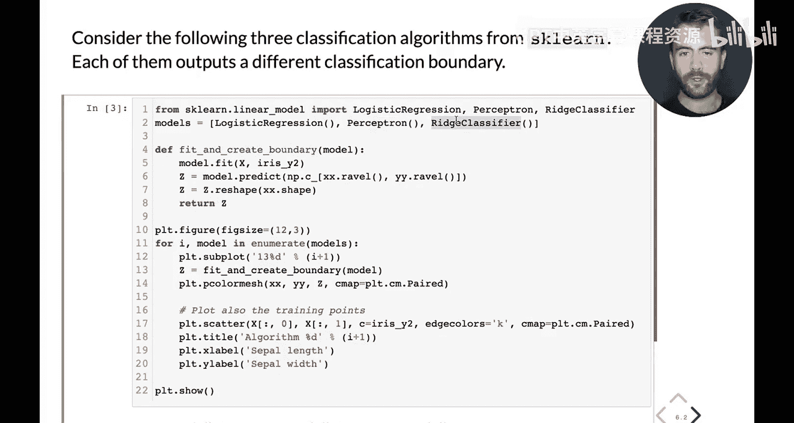

In this example， I fit these three algorithms to the same data set。

 and you can see that they give us boundaries that are significantly different from each other。

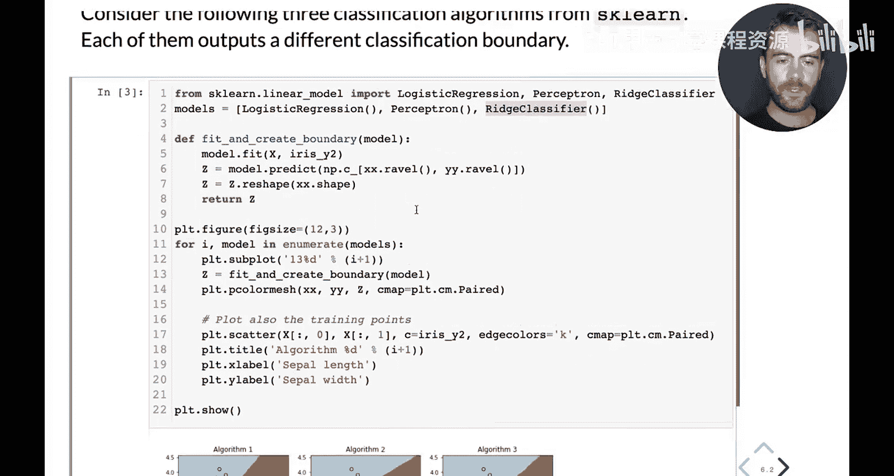

You can see that the slope of these lines is different。

 the location of these boundaries is also different。

 this one is passing very closely to this brown dot。

 this one is passing very closely to these two to these three sets of blue points。

 so the location of this hyperplane is different depending on the algorithm。

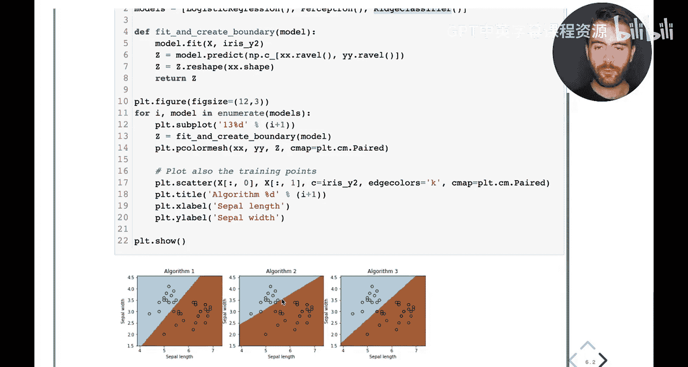

So how do we choose which hyperplane is best？The idea of the support vector machine algorithm is to choose boundaries which have a high margin。

 in particular， the basic premise on which the entire idea of support vector machines is built is that we should choose a decision boundary with the highest possible margin。

 which means that this boundary will be placed as far as possible from the data points。

So a high margin or a margin can be interpreted as the distance between a separating hyperplane and the closest data。

 the closest data points to the hyperplane， and we want to maximize the margin。

 we want to make the separating boundary， we want to place it as far as possible from our data points。

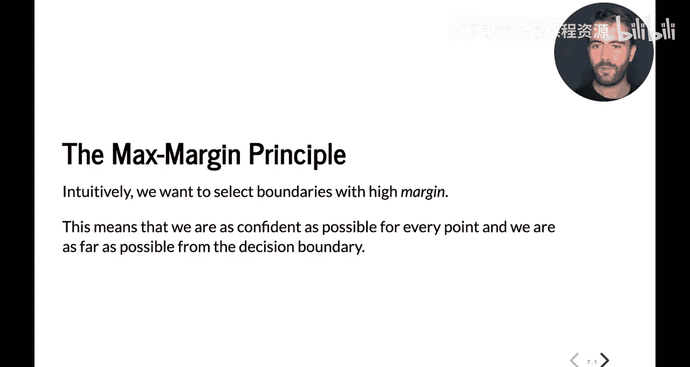

Let me show you exactly what this means by an example。

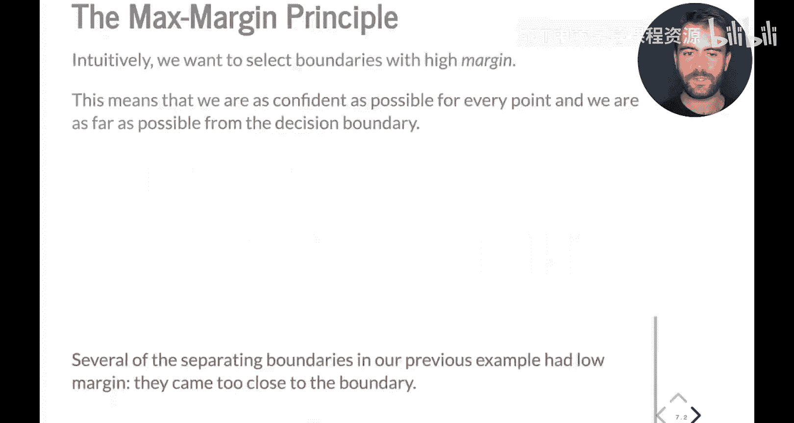

Here， let me again create a few separating hyperplanes that come from different algorithms。

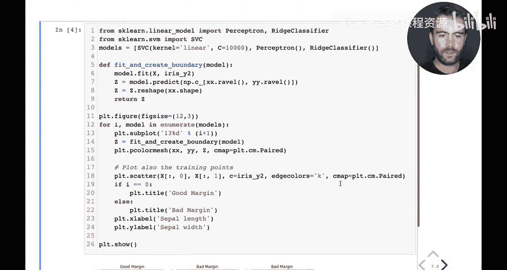

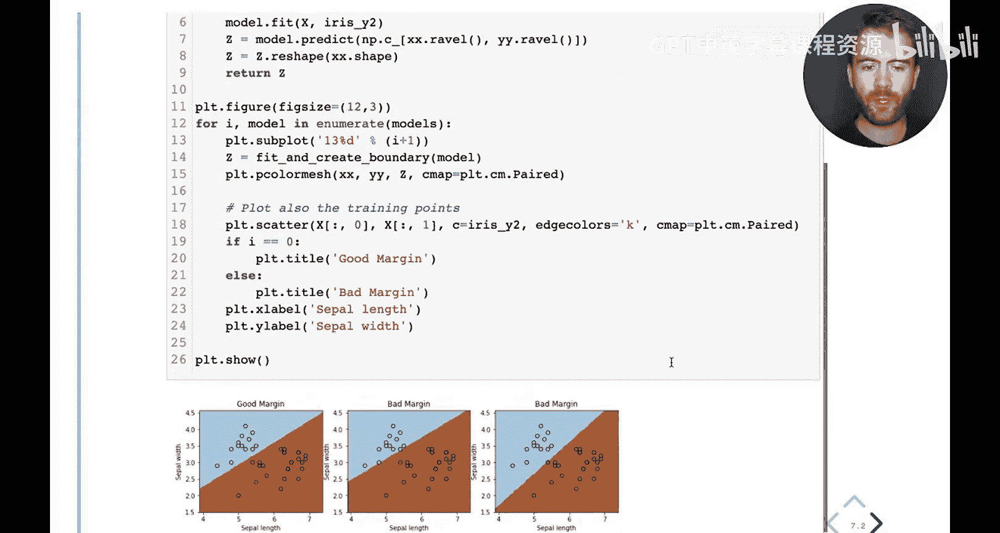

And let me use this example to show you what it means for a separating hyperplane to have a good margin and a bad margin。

Consider， for example， the following separating Hyplane。

This hyperplane is in a way problematic because it passes really closely to the brown data set。

 in fact， this brown point lies almost on the decision boundary。Now。

 imagine if we were to perturb this data set by a little bit。

 imagine we were to wiggle each point by a small amount。

 then this brown point will easily cross the other line and will become misclassified。

Or perhaps imagine that we have some slight errors in our measurements and this brown point。

 the measurement was taken incorrectly and it is actually a little bit farther towards the upper left corner。

 then again this point would be misclassified by this decision boundary。

Or imagine that we have some here we have a limited amount of data and we are not absolutely certain that this is the true boundary。

 we have only a limited amount of data points and the precise location of this boundary。

It is only a guess that we're making with a limited amount of data and so it is possible that this separating hyperplane is wrong and the true one is slightly off if we were to again perturb or slightly wiggle this data point。

 then we would immediately misclassify the brown point again。

These are all reasons why having a hyperplane that passes really closely to the data points is。

Is intuitively not the best idea because it results in a solution that is not very stable to various kinds of perturbations that might occur either because we have errors that our measurements or because we have a statistical error due to having a limited number of data。

And we have also the same problem in this example in the middle example where again the hyperplane lies really closely to these blue points。

 and again， if we perturb this data set or the hyperplane by a small amount。

 these points will become misclassified。Here on the left side。

 we have an example of a hyperplane that lies farther away from the data point and that has high margin。

If we were to perturb any of these points， if for example。

 we made a mistake in placing this hyperplane and the true one is a little bit farther off or we have。

 or imagine that we're sampling blue points and we happen to be sampling points near this boundary and we have a point that's slightly farther off from these blue points。

 then it will still be classified correctly because we still have a margin of error。

Around this hyperplane， so if we perturb this data a little bit。

 we still have good predictions and so in this sense this hyperplane seems intuitively like a better solution。

 it seems more stable and more robust to errors and perturbations。

So this is all intuition for why if we were to choose one hyperplane out of the infinite number of hyperplanes that this that perfectly separate this data。

 we will probably want to choose a hyperplane like this one that has high margin and that lies as far as possible from these data points。

This is an intuitive argument that justifies the development of algorithms that look for high margin hyperplanes and the support vector machine is going to be an algorithm which will look for such maximum margin hyperplanes。

 but I just want to make sure that this intuition is clear and again this is going to be an important intuition and an important principle that will motivate everything that we're going to look at in the rest of this lecture。

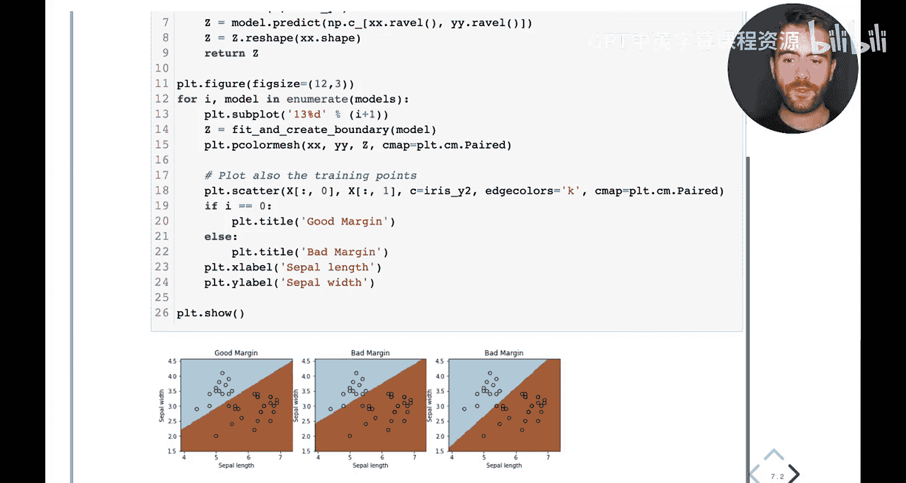

Here again， I have a hyperplane that is far away from our two data points and the points that are closest to it are highlighted in with black circles and there is a healthy margin between the separating boundary and the data points and the size of this margin is the distance between the black line and the dashed line or the solid line and the dashed line the size of this region in which there is no points that is the width of the margin and again we want to make this as large as possible。

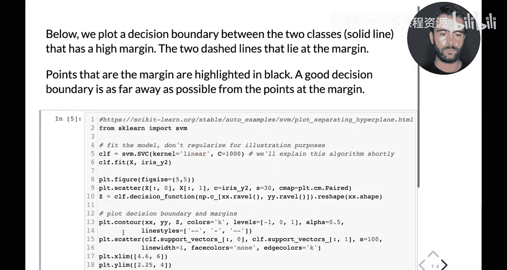

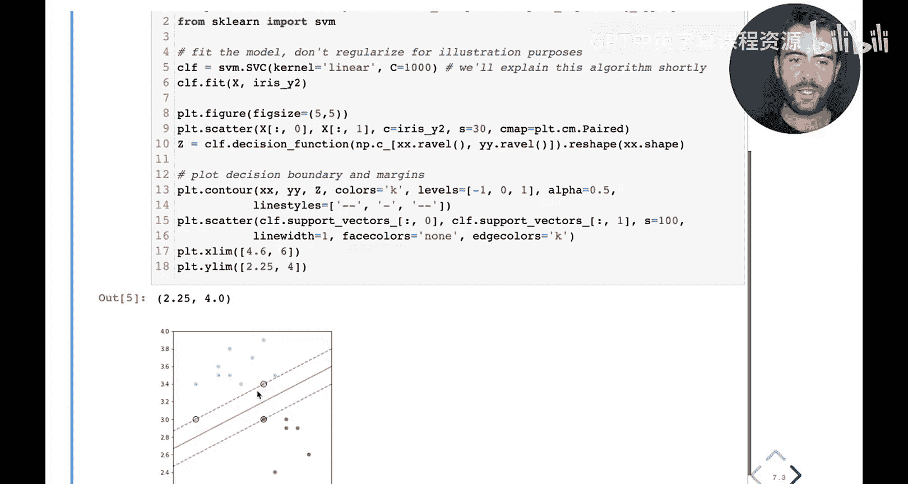

So I have given you intuition for how to find goods separating hyperplanes。

 how do we make this intuition more formal？The first step is to define a more formal definition of a margin。

嗯。Here is one attempt for doing this。Given that our targets y are either plus1 or minus-1。

 we can use the following definition in which our margin is simply the magnitude of the prediction that we're making so F is going to be a number。

 and if this number is very large then we are predicting the positive class if it's very negative。

 then we're predicting a negative class if the point has a very high score either towards plus infinity or or minus infinity。

 then this point then we can use that as a concept of a margin but in order to make sure that this value is positive。

 we multiplied by y。 so if a point has a negative score then negative will be multiplied by negative it will be positive so any point that is classified correctly。

 we'll have a positive margin and we will want this。To be high。 So again。

 our formula here is the target di is the score。And I claim that this is a good definition for a margin。

How can we convince ourselves that this is a good definition？

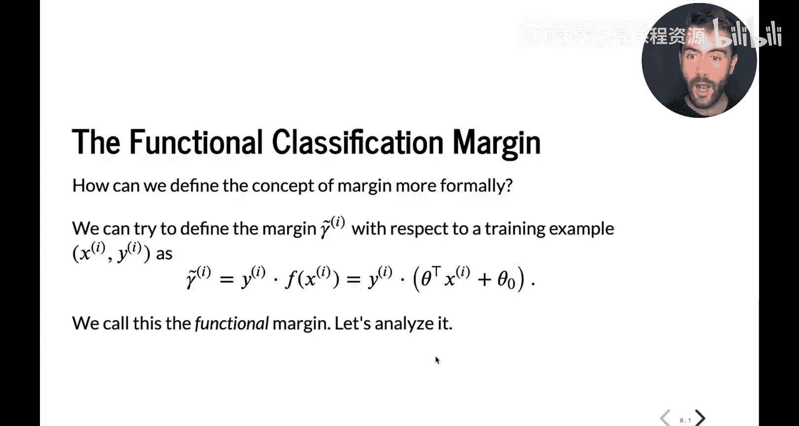

So consider again our definition and consider two possible cases。

Suppose that we have a point Xi for which the true label is positive。

Then if the score of the model is very positive and large， then this margin will be large as well。

 so points for which we have a high score which means that we are very confident that this is a positive point or in other words the point lies far away from the hyperplane so the separating hyperplane is when when the score is0 when it lies perfectly between plus1 and minus-1 a score of0 is at the boundary。

 so if our score is very large， if it's far away from0， if it goes towards plus infinity。

 then intuitively it's far away from the boundary， it has a high margin and so this is something good。

 it confirms our intuition。So it means that we're classifying this point with high confidence。

Conversely， if our target Yi is minus1， then again。

 this margin will be maximized when the score will tend towards minus infinity。

 and so we are going to be classifying this point as negative。

 which is the correct label with very high confidence and a very high score。

So this again matches our intuition。

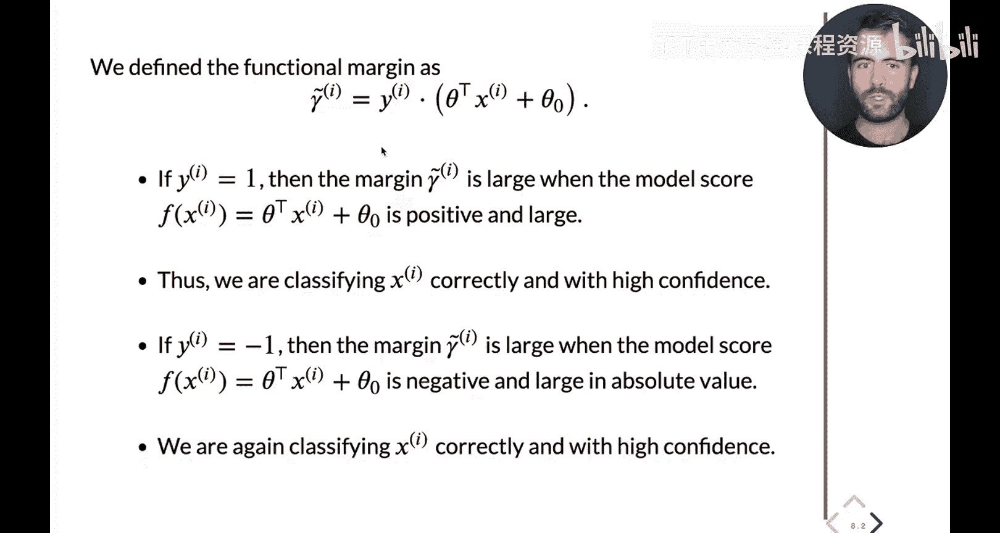

So higher margins means higher confidences and higher score at each input point。

 which means it's far away from the decision boundary， so this notion of gamma is useful for us。

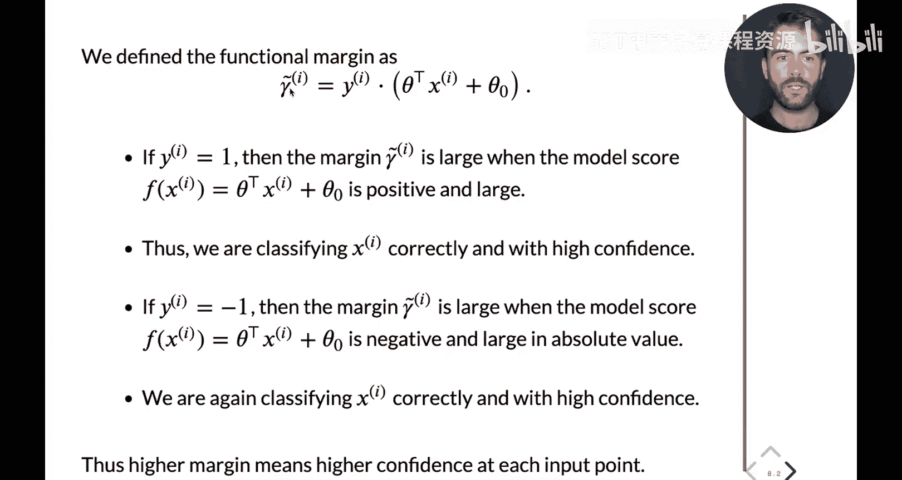

嗯。The only problem is that this definition has the following problem。

If we take the parameters theta and theta0 and we multiply them by scalar alpha。

 then we have these new parameters。But because alpha is positive。

 it doesn't change the signine of the score that is assigned to each point。

 and therefore it doesn't change the classification values。

 it doesn't change the label that is predicted at each point。However。

 our definition of the margin has been scaled by alpha。

 so we have made our margin larger just by rescaling the values of our parameters and without really changing anything about the location of the decision boundary or anything about the labels that are assigned to the score。

And so that is a bad property because it means that we can make the margin arbitrarily large by just rescaling the parameters。

 and this definition is missing something。

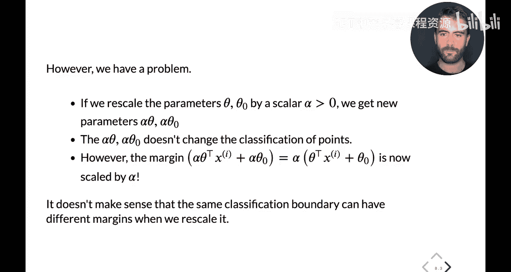

So in order to address this problem we are going to I'm going to slightly modify the definition that I had earlier and I'm going to define this other concept of margin in order by gamma here it's again gamma with an index of I meaning this is the margin point x of the point Xi and this is going to be what I call the geometric margin and it uses the same formula that I had before except that I have rescale the I have normalized the score by the norm of theta so recall that theta as a vector of parameters it has a norm I can just normalized it by this norm。

And now I claim that this will have the good behavior that we were seeking for gamma and also that the good behavior that Gamma Tilda had。

 but it will resolve this scaling issue that we had earlier。

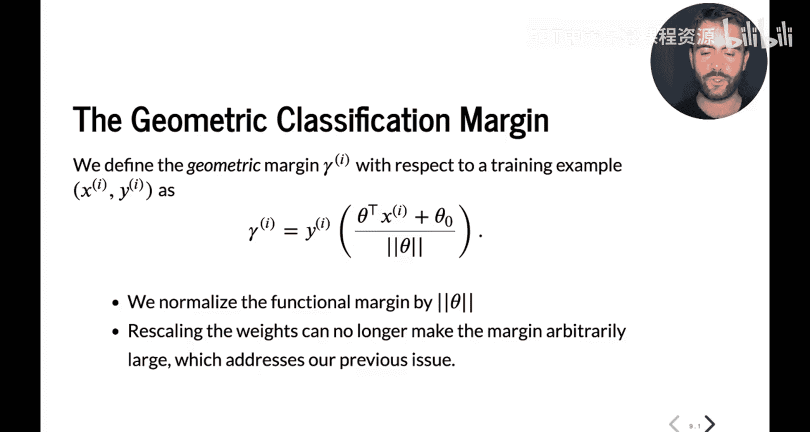

Again， let's verify that our intuition about the margin holds。If y is positive。

 then this value will be maximized by a model score that is positive and large。

And therefore we're classifying x correctly and with high confidence and if it has high confidence it means that it's far from the boundary。

 so this matches our intuition and it's easy to check then when gamma is equal to minus1。

 the same intuition holds and so our previous intuition holds for this formula as well。

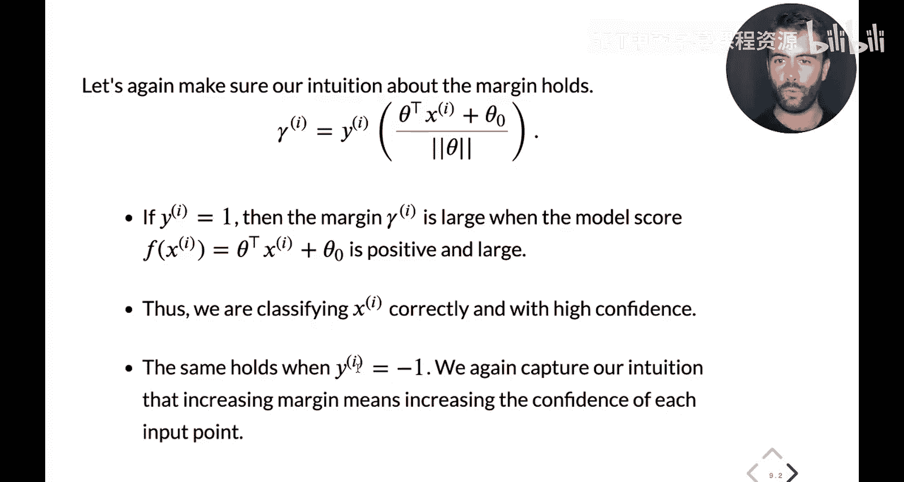

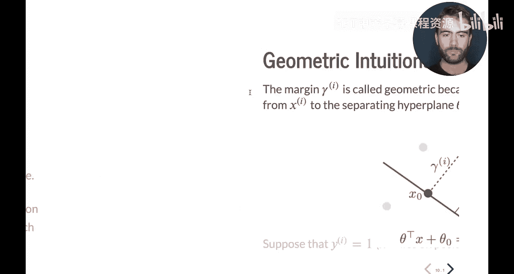

And also you can check that now if we were to rescale theta。

 then we cannot make the margin arbitrarily large anymore because we are normalizing by this value here and so now this rescaling trick no longer works so here we have a definition of a margin that captures their intuition and we have resolved our scaling problem。

This is going to be the definition of margin that we're going to use in this lecture。

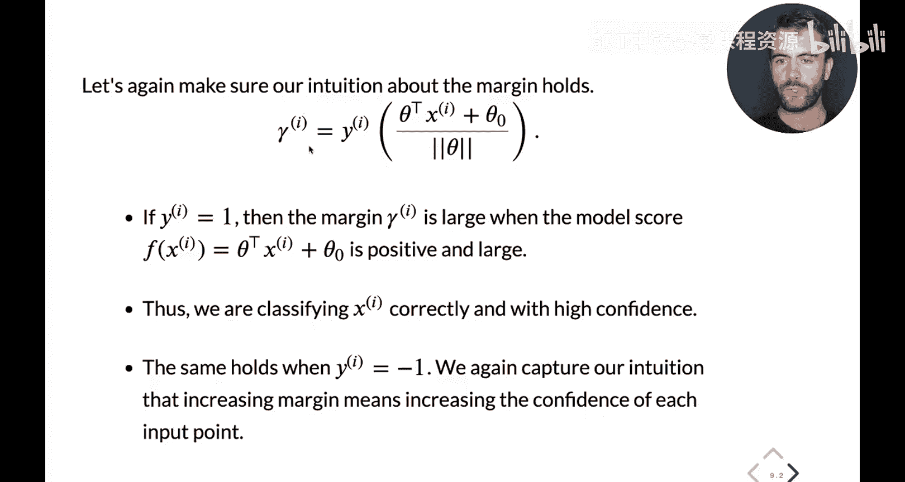

And in order to convince yourself that this is a good definition。

 I am also going to derive this formula from a different perspective， from a geometric perspective。

 and this is also going to explain why I have been calling this the geometric margin。

The formula that I gave you this gamma， this geometric margin。

 it in fact corresponds precisely to the distance between the point x and the separating hyperplane。

 which I have theed here using a dashed line。So if we take the closest path from this blue point x index I to the hyperplane。

 which is going to be the so following the line is's perpendicular to the hyperplane。

 this is the closest distance to the hyperplane here I'm noting this with a dashed line。

 I claim that the length of this dashed line， is precisely gamma I。

 which is our geometric margin that I just defined。

And that is another argument for why we want to be using precisely this formula for the margin because it just matches the geometrical distance。

Now， how do we convince ourselves this is true， The argument is not very complicated。

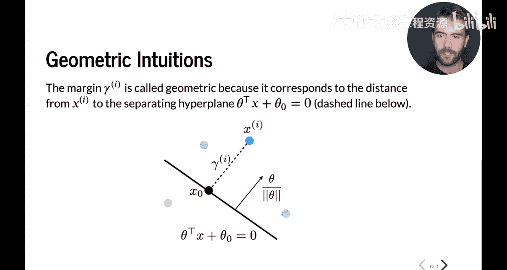

It first requires two simple observations。First， just to make the derivation simpler。

 I will assume that the true label y equals one， but if it's minus1， the same argument holds。

And then I will make the two following observations。First。

 the points x that lie on the decision boundary， in other words。

 the precise position of the decision boundary is given by the following formula。

I alluded to this earlier， but again the points that lie right at the decision boundary are the ones for which the score is neither positive or negative。

 it's right in the middle it's zero and this is simply the score that is assigned to a0 x by our model and so if our model outputs zero。

 then it's right in between plus1 and minus1， it is right at the boundary and so this is where the classification between positive of a negative switches。

 so the set of points that lie at the boundary。Have to satisfy this equation and also if you're familiar with calculus。

 you should recognize this as a formula that describes a hyperplane in a multidimensional vector space。

So this was observation1， and then observation 2 is that the vector theta is perpendicular to this separating hyperplane。

And it has unit norm， it has unit norm just by construction because we have defined it to have because here I'm dividing by the norm。

 therefore it has to have unit norm， and the fact that it is perpendicular to the hyperplane that is just effect from calculus that you can easily verify this is something that you can see by looking at material from a calculus recourse。

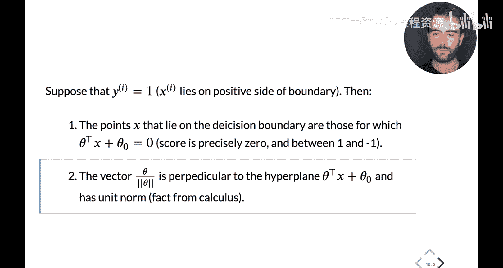

And it's easier to illustrate visually here I have my hyperplane in black。

 and that is the set of point at which this equation holds and then this vector here theta divided by the norm of theta is。

Pointing in a direction that is perpendicular to this line。And in particular。

 the line between this dashed line， because this is the closest line between x and the hyperplane。

 it has to be perpendicular to the hyperplane， and in particular it has to be along the direction of the spec。

So in other words， in order to get to the vector X， I start with x0。

 which is point that the point on the boundary that is closest to Xi。

And then from here I take a step of length gamma in the direction of this perpendicular vector theta。

 so this is what I'm doing here， I start x0， then I take a step in this direction with a step length of gamma。

 and now this gets me to X。This is just by construction and because of how I define all these values。

And then rearranging terms， I can find that x0 equalsxi minus gamma i times my perpendicular vector。

So again， this holds just。ourWe can easily verify this geometrically。

And now since x0 is on the hyperplane， the following equality holds。

 therefore plugging in my definition of x0， the following equation must hold and now solving for gamma。

 I have the following formula which is this geometric margin。

 this is precisely the formula for the geometric margin that I had earlier。

So hopefully I have convinced you that this particular definition。

 which I will be denoting by gamma throughout the rest of this lecture。

 is a good formula for the margin， and it's something that we want to。

 it's a sensible objective for us to maximize。

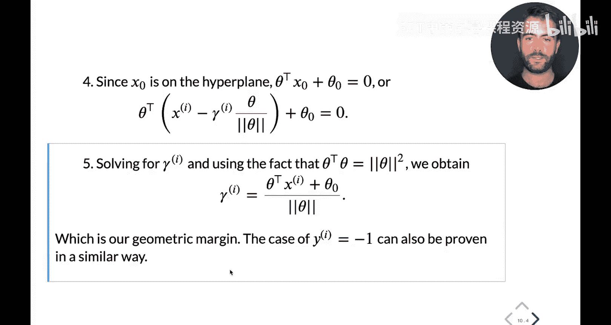

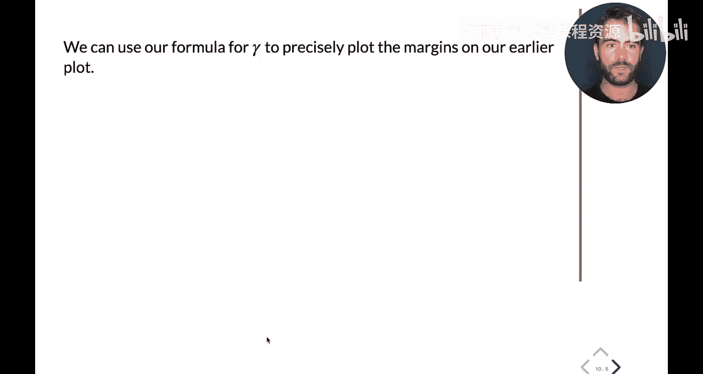

In particular， we can use this formula to plot the following blue segments here I have some Python code that will generate the vectors that have the same length as the margin and their length is precisely the distance between the closest points and the hyperplane。

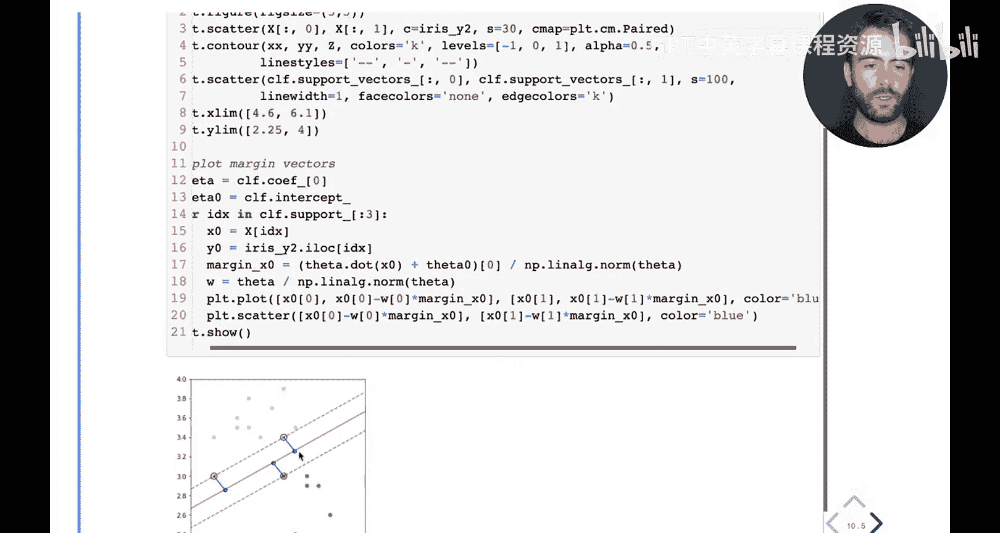

So to summarize， I have defined a concept of， well。

 I have argued that when we are finding hyperplanes that for classification。

 it makes sense to look at hyperplanes which have a high margin。

And now I have also given a formula for what the margin is， and now in the next set of videos。

 we're going to derive algorithms which compute hyperplanes that have a high margin。

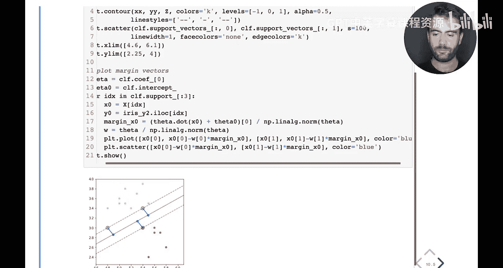