# 康奈尔大学《应用机器学习 CS 5787_ Applied Machine Learning 2020》中英字幕（deepseek p35 -35-Lecture 9. Part 2_ The Max-Margin Classifier.zh_en -BV12udzYvEFM_p35-

This is now part two of lecture9 of applieded machine learning。

 and in this part of the lecture I will continue talking about maximum margin classification。

In the previous video， I defined this intuition， which says that when choosing a hyperplane in binary classification for separating two classes。

 we should be looking for hyperplanes that have a high margin。

 which means that they lie as far as possible from the data points。

And then I gave a formula for how we can define a margin， and now in this video。

 I want to talk about an algorithm for optimizing this margin。

 for finding a hyperplane which has the highest possible margin by optimizing the formula that I derived in the previous video。

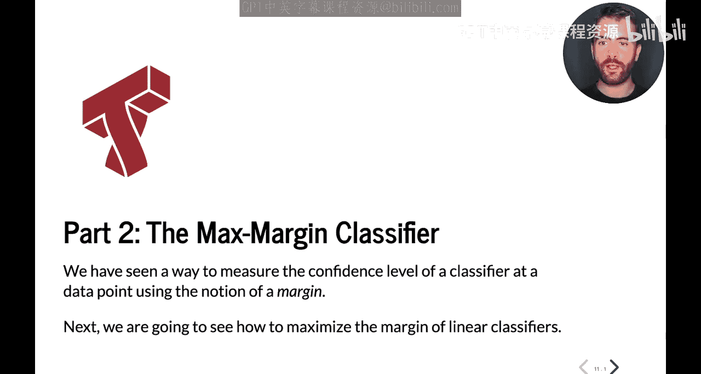

Now recall again that we are in the setting of binary classification and we are working with linear models of the following form here we have our target variable y。

 which is either minus1 or plus1， and our model is linear and it has a vector of parameters theta and a biaster theta not。

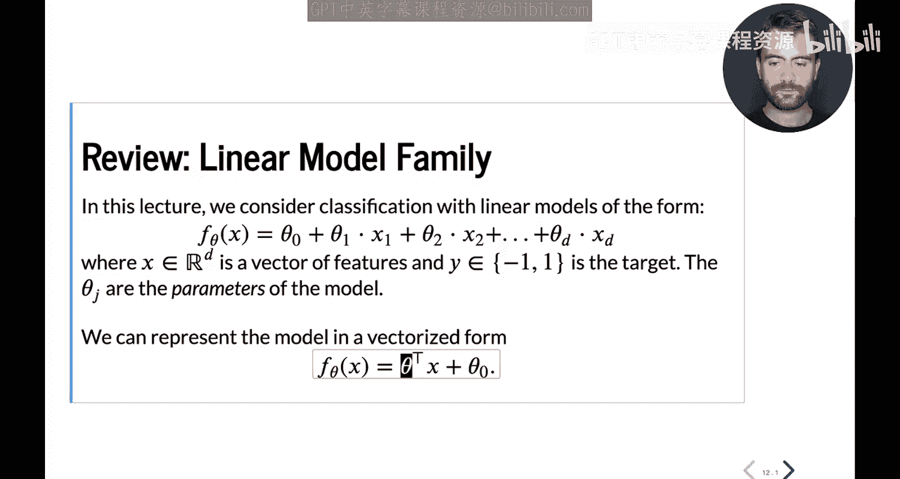

Now， recall that from the previous video， we defined the following formula for this concept of margin。

 which as I said earlier， is the distance from a given point x to the hyperplane。

And we want this quantity， we want this margin to be as high as possible for all the different points。

 which means that our separating boundary will lie as far as possible from the data points X。

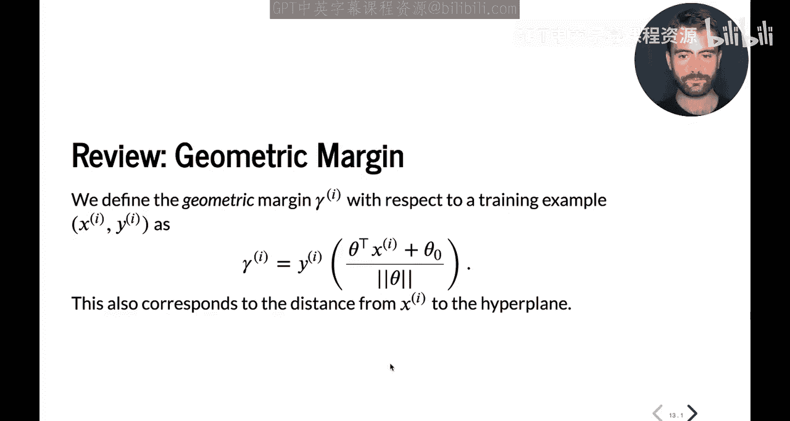

Now， how do we find a hyperplane that maximizes this margin？

One way to do it and this is going to be our first attempt is to define an optimization problem in which we are optimizing over the parameters of the hyperplane。

 which are theta and theta n。And we're also optimizing over this value of gamma。

 which is going to be the lower bound， is going to be the minimum value of all the margins that we have for all the data points。

So recall that we have defined a margin for a particular data point Xi as follows using this formula。

And now we are placing this constraint that all the margins must be at least gamma。

 or the smallest margin has to be at least gamma。And we are optimizing over both theta。

 theta n and gamma， such that gamma is maximized in other words。

 we are choosing the parameters of the hyperplane for which。

The smallest margin across all the data points is maximized。And so if this is。

 if we can find a solution， then gamma will be then every point will have a margin of at least gamma。

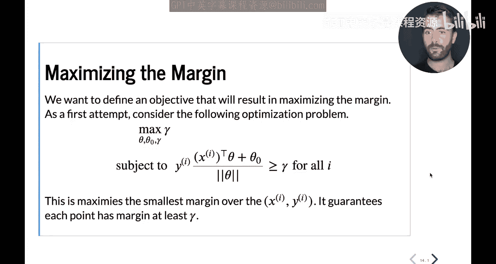

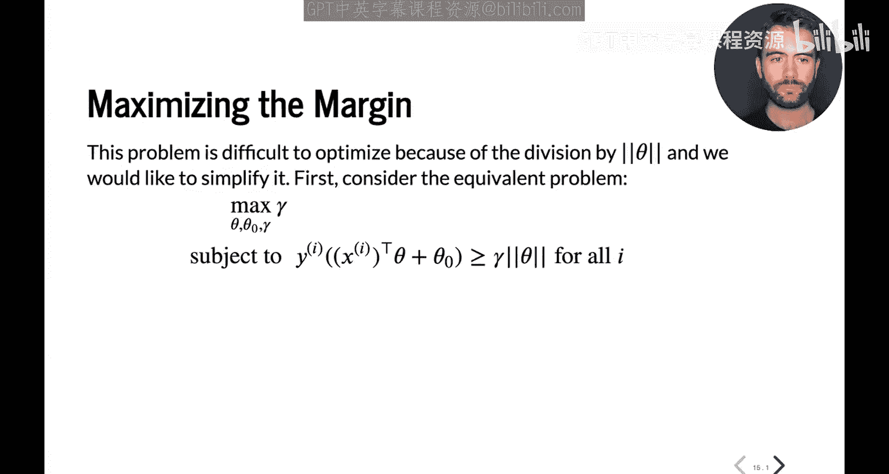

Now， the problem with this optimization problem is that it is difficult to optimize。

There are certain classes of problems for which there are easy and effective optimization algorithms。

 so for example optimizing a linear function is easy or optimizing necroratic function is easy optimizing linear constraints optimizing something under linear constraints is usually easy but here in our previous optimization problem we have a very complicated constraint。

 which is highly nonlinear， it involves dividing by the norm， and。

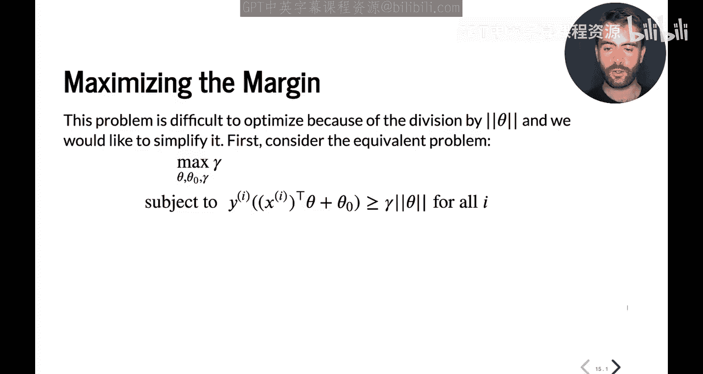

If we input this into a standard solver， this will not be a very efficient， the resulting algorithm。

 which would consist in solving this using off the shelf optimization procedure。

 this will not be very scalable and effective and we can do much better。

And we can derive a simpler form of this optimization problem。

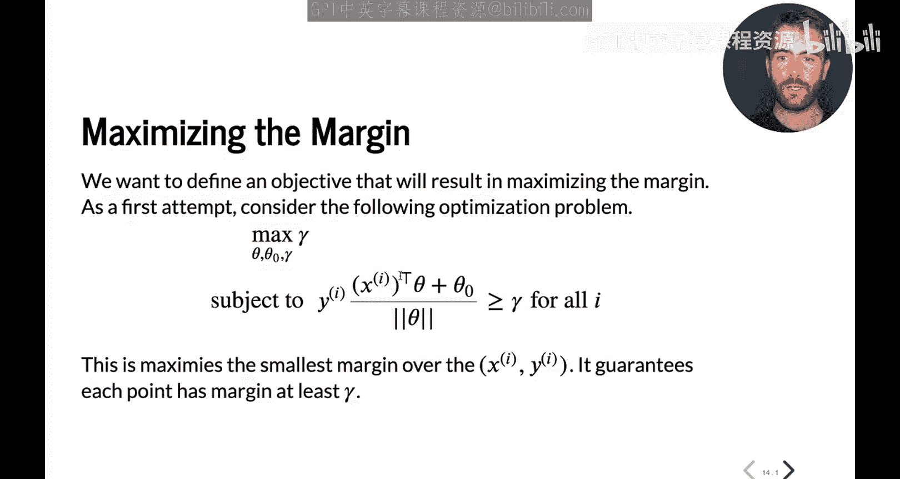

Now， consider first the following equivalent problem in which I have simply taken the norm of theta。

 which was dividing this side of the inequality and I have simply multiplied on both sides and now it appears here on the right and it multiplies gamma。

This is an equivalent problem clearly here again， I have just this constraint。

It is equivalent to the previous one。And I want to make the observation that this optimization problem is。

 in a sense inefficient because it has extra degrees of freedom。In particular。

 suppose that we multiply theta and theta  zero constant by some positive constant。

Then we will have another perfectly valid solution。So here。

Right this I will multiply by c on this side， I will multiply on c by this side。

 and my new value of theta and theta 0 will still satisfy this constraint with the same value of gamma。

 and so I have just found another valid solution to my optimization problem。

This means that I have extra degrees of freedom in my optimization problem。

And I would like to simplify this problem by getting rid of those extra degrees of freedom。

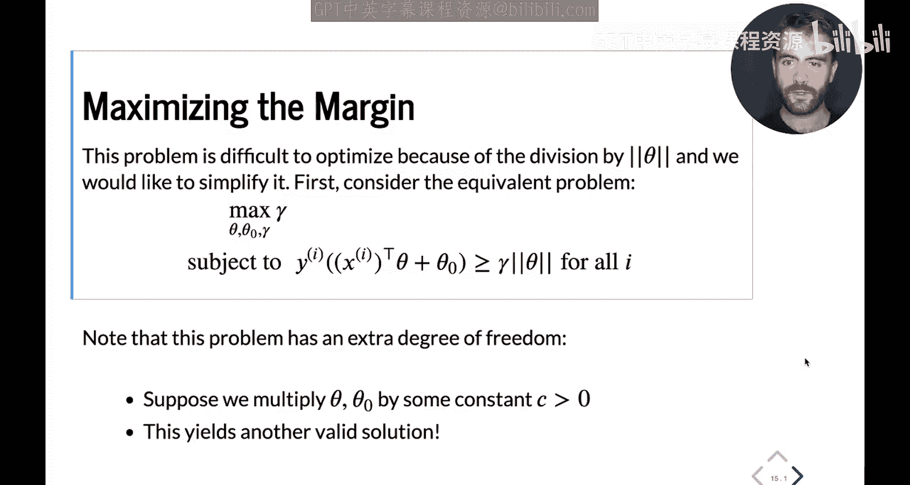

The first。The first constraint that I would like to the way would to make the way I would like to get rid of this extra degree of freedom is by adding a constraint into the problem。

 I would like to make the constraint that the norm of theta will always equal1 over gamma。

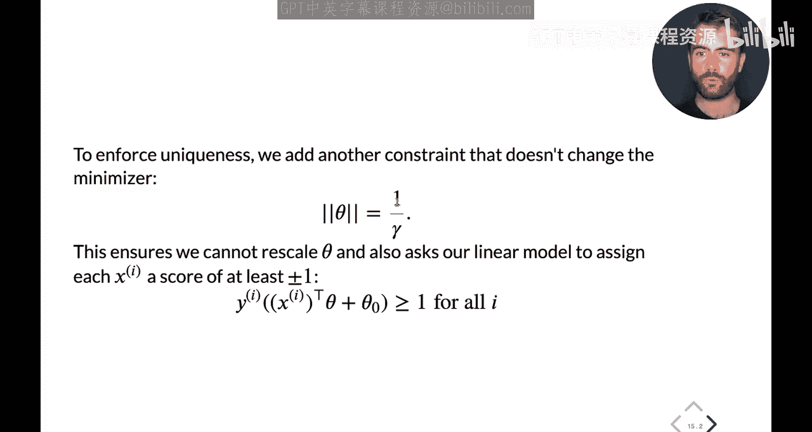

I can always do this because if it's not the case， then I can always rescale theta。

By a scalar C such that this constraint holds。

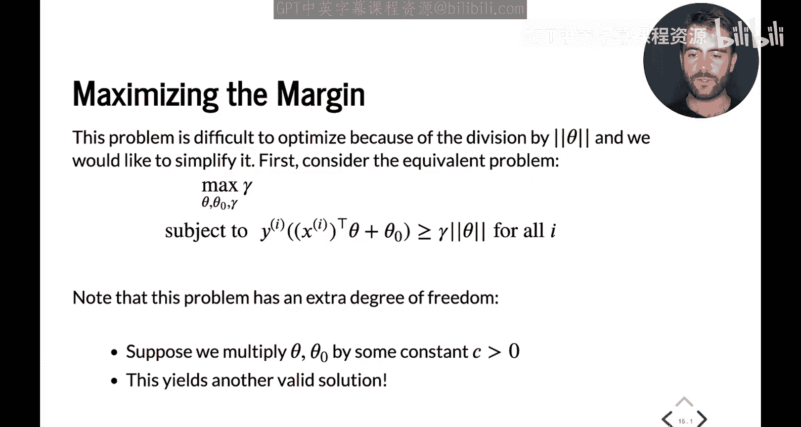

So suppose that I am at some solution where this constraint does not hold and the value of this norm is something else。

 let's say it has some value alpha， then if I just divide by。Gamma over alpha。Then I will have my。

Or if I divide by alpha over gamma。Then I will have no if I sorry if I divide by alpha by alpha times gamma。

 then I will have the following constraint that will hold。 So in other words。

 I have a value of C that I can choose， which is going to be。

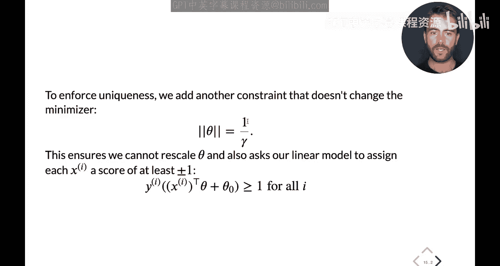

One over alpha times gamma， where alpha is the previous norm of theta。

 and for this particular choice of C， I can always make this constraint hold without breaking the validity of this optimization problem。

 of the solution to the optimization problem。

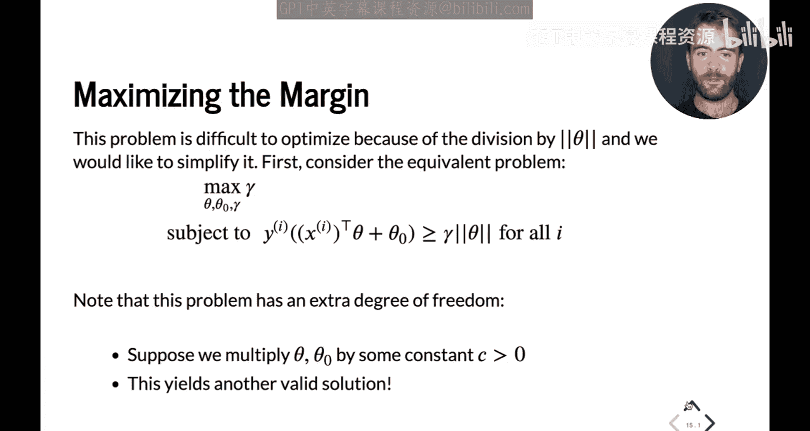

And so since I can always enforce this constraint by rescaling with an appropriate choice of C。

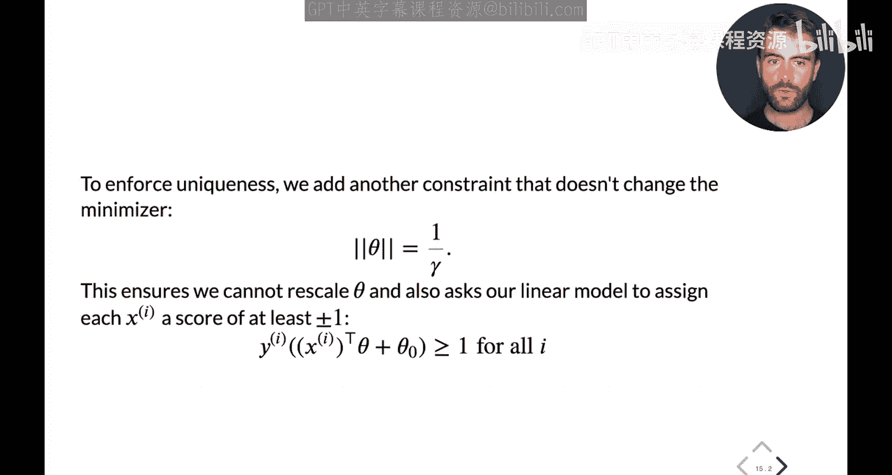

Then I can just add this extra constraint to my optimization problem without affecting its solution in any way。

And now if I add this constraint。Then my problem simplifies and theta and in fact I can just plug the definition of so here this specifies also that gamma equals1 over theta and I can just plug this definition of gamma into this optimization problem。

 which means that this site here simplifies to one and this gamma becomes one over theta。

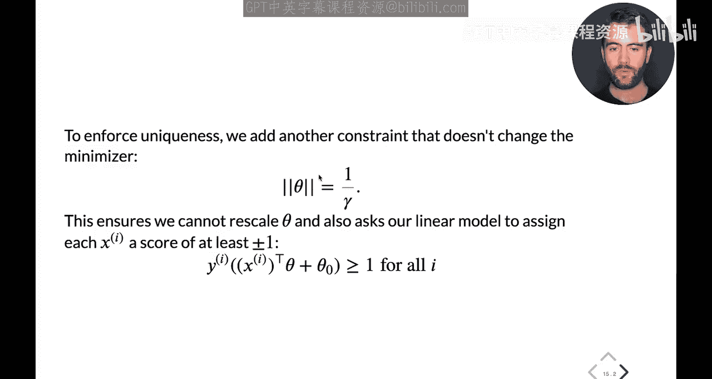

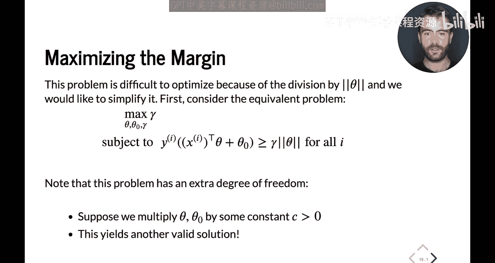

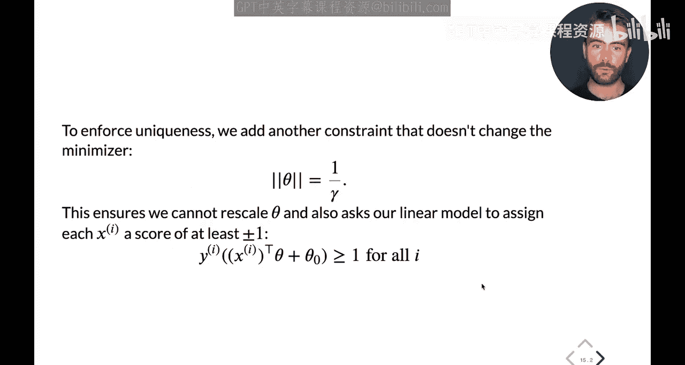

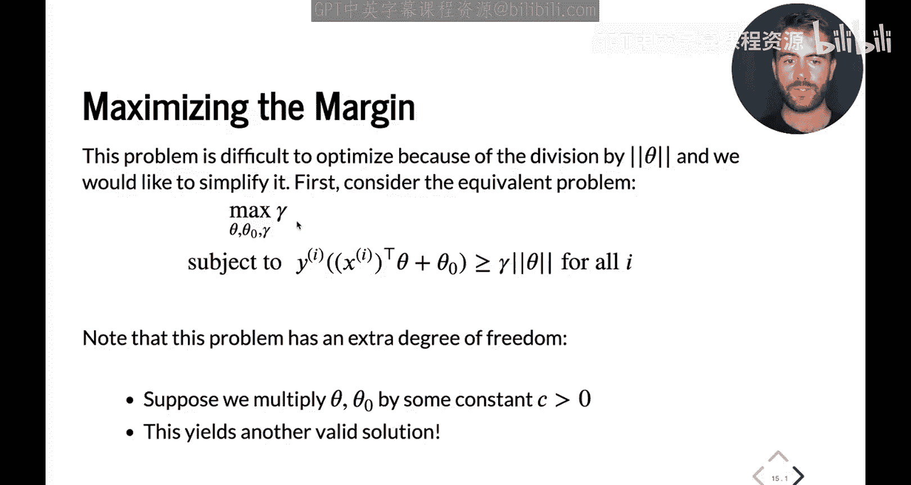

So essentially plugging in gamma equals1 over theta into my optimization problem。

 I get the following different optimization problem， which is equivalent to the first one。Again。

 all of these constraints can be hold can be made to hold without changing the minimum of my previous optimization problem。

 therefore I can just incorporate them， and then I can plug in this identity into my constraint here。

 or I can just replace gamma with one over theta everywhere and this will have the desired。

 this will give me a optimization problem which will be equivalent into the previous one。

So now we have a constraint here that is simpler than the one we had earlier， in fact。

 this is a linear inequality in theta and linear inequalities are easier to optimize。

 so we are going in the right direction。However， we still have a problem with the optimization objective。

 this is not a simple， easy objective to optimize。But we can make it simpler。

We can make it simpler by the observation that maximizing。

One over the norm of theta is the same thing as minimizing the norm of theta。

So maximizing the value is the same as minimizing its reciprocal。

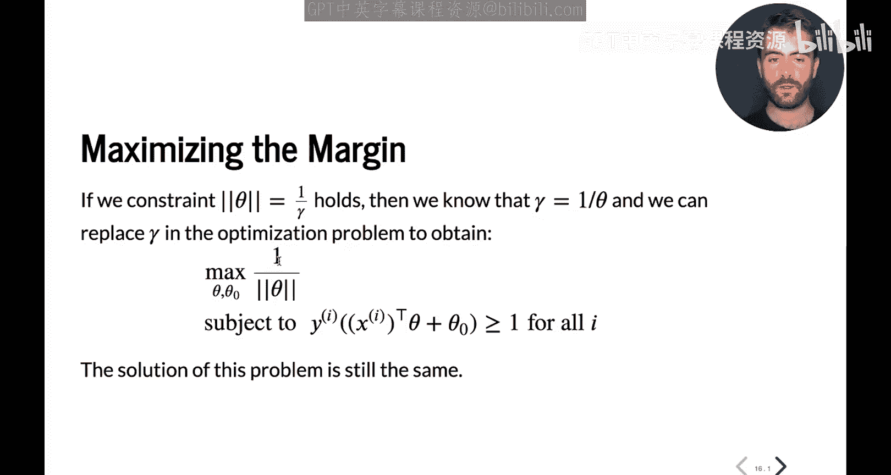

And。And so I can just flip it， I can just flip the one divided， and I can switch the max to in。

And I can also just make it squared and multiply by 1 over two without really again changing the value of the minimum objective because。

呃。Taking it to the power2， that's just the monotone transformation of the original function。

 it doesn't change its minimum。 and so again， this is a change that I can make that is equivalent to the one I had earlier。

And so now incorporating this change into my objective function。

 I have the following new optimization problem。And this is now an easier and a better optimization problem because my objective is a quadratic function。

So here， if we work out the math， if we multiply this out， I have a function that is。

Qudratic in its parameters， so it's a polynomial of degree at most too。

 and it's a quadratic function and optimizing a quadratic function under linear constraints is much easier。

In other words， through this series of transformations。

 we have started with an initial optimization problem which was not very tractable and we have transformed it into an equivalent one or into one which has the same optimum。

 but now this one is a quadratic optimization problem under linear constraints and it is easier to optimize。

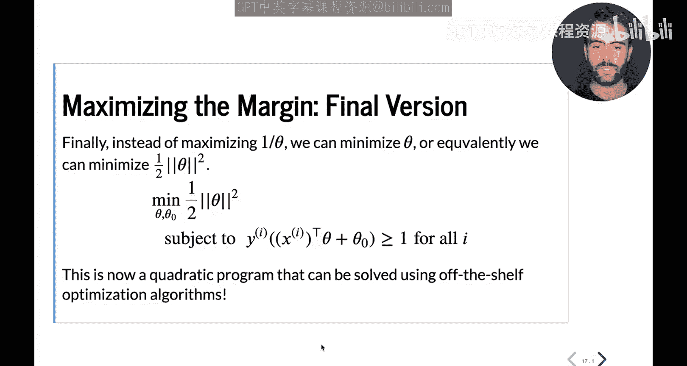

And now this concludes the derivation of the support vector machine algorithm。

 it is only one formulation of this algorithm and we're actually going to see other ways of framing this optimization problem but what we have now is the first workable solution for a max margin classifier。

 and it involves a particular class of model families which are linear models models within linear decision boundaries。

 it's also a supervised learning algorithm for binary classification。

 it optimizes this objective function for choosing the max margin。

 using adratic enough the shelf quadratic optimization algorithm。

So this is our first definition of the support vector machine classification algorithm。And later。

 we will see other versions of this algorithm as well， but for now。

 this is our first working definition。

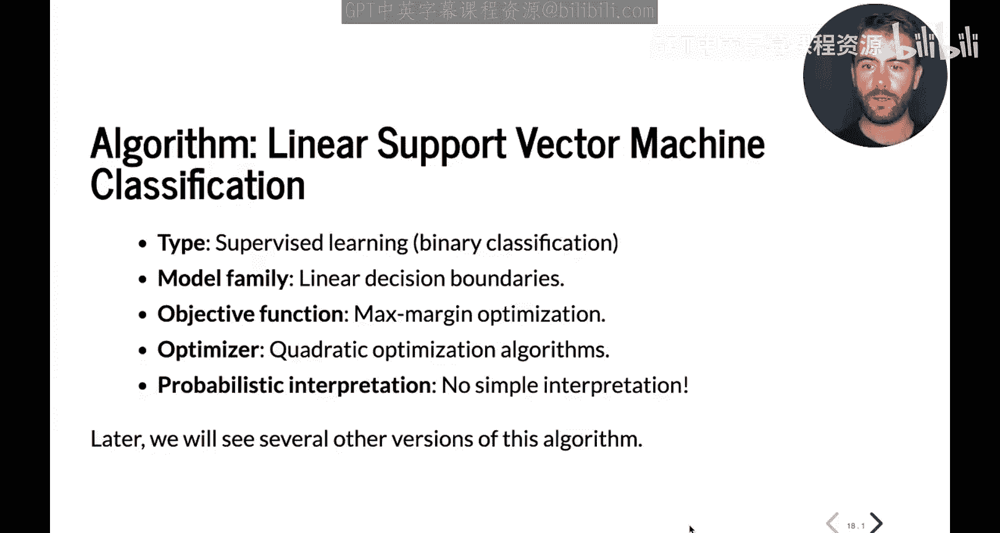