# 康奈尔大学《应用机器学习 CS 5787_ Applied Machine Learning 2020》中英字幕（deepseek p36 -36-Lecture 9. Part 3_ Soft Margins and the Hinge Loss.zh_en -BV12udzYvEFM_p36-

We are now at part three of lecture9 of applied machine learning。In this video。

 I would like to continue talking about support vector machines。And I would like to。

 in this video point out a few limitations， a few important limitations of the approach that we've taken earlier and ways in which we can address them。

And while doing that， I'm also going to define a new formulation of the vector machine or of the support vector machine optimizationization problem。

 I'm going to define a new way in which we can obtain max margin separating boundaries。

And I'm going to show how we can optimize this objective in the next video。So for now。

 let's first recall our optimization problem that we have discovered and that can be used to find the decision boundary between the two classes that optimizes the margin。

 so here we're looking for parameters theta and theta zero such that every。

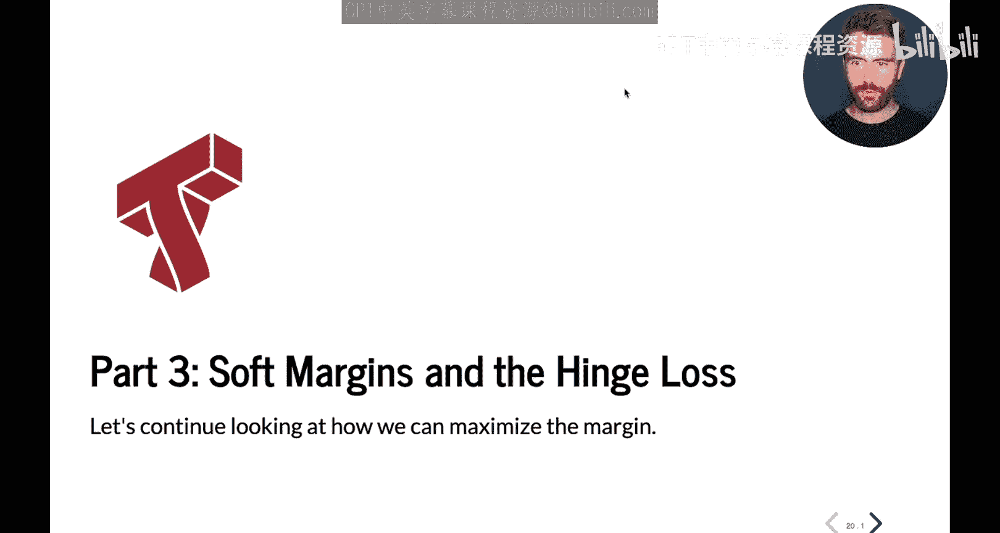

Point is Max is classified correctly and with a score of at least one。And the， and the。

And the norm here is minimized。There is， by the way another interpretation of this optimization problem that I haven't discussed。

 so here you can see that this term is what we called the functional margin in our earlier video。

 in our very first video。And we saw that the functional margin had a problem。

Because the because this objective was because we can rescale this objective by an arbitrary number。

 and it's still。And it still gives us the same hyperplane， the same decision boundary。

 but we can make the margin arbitrarily large and in order to avoid this。

You can think of this problem as enforcing the norm to be small such that we cannot arbitrarily rescale it if we did not have this objective then we could find a decision boundary with high margins just by making this norm high。

 but by forcing ourselves to look at to search for hyperplanes that classifies all the points with a functional margin of at least one and that and for which the hyperplane is as。

As low as norm as possible， we resolve this scaling error。This scaling issue。

 So this is just another interpretation of the subjective that I haven't mentioned in the previous video。

And as I mentioned earlier， this can be solved using off the shelf quadratic optimization algorithms。

 and this can be one way in which we can find these hyperplanes and this is the basis of one formulation of the SVM algorithm。

However， in practice， this approach is not often used。

 there are more efficient ways of solving this problem。

 and I'm going to start defining one way that is more efficient in this video。

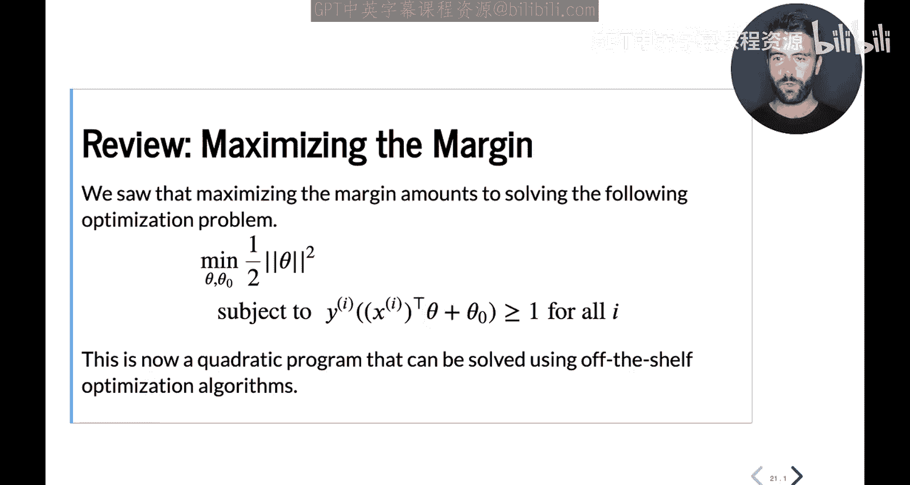

But before I start to do that， I want to point out an important limitation of what we did earlier。

So far， we have always assumed that there exists a linear hyperplane。

 a decision boundary that separates the classes that perfectly separates the classes。

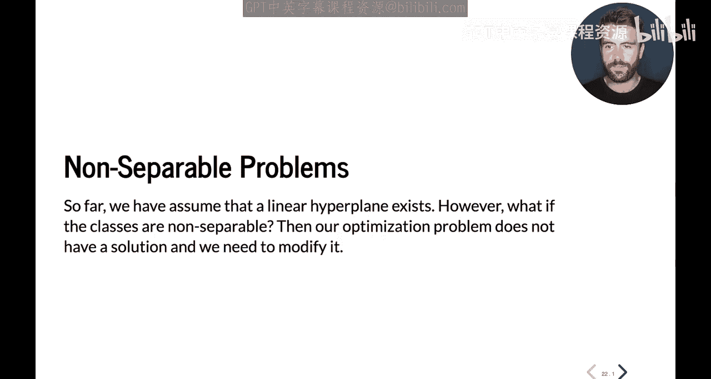

So in our constraint here， we assume that so this score is has to have the same sign as the target。

 in other words， each point must be classified correctly in order for this constraint to hold。

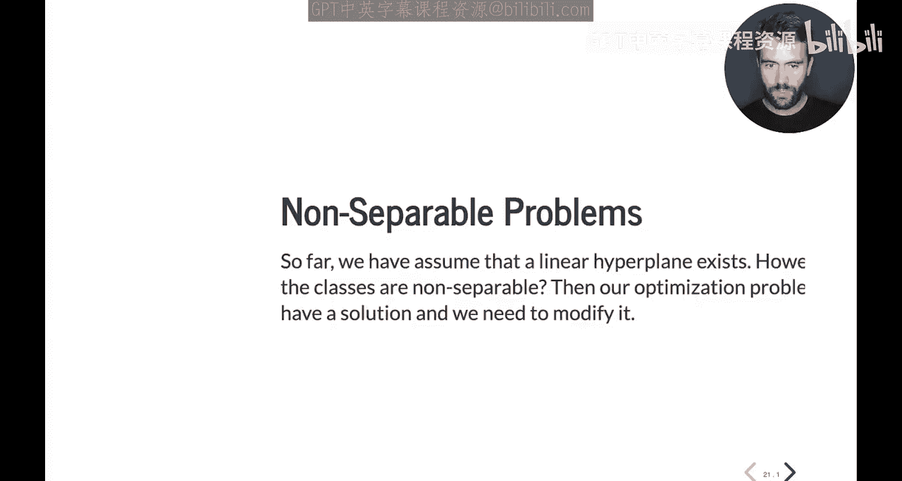

But in practice， most classification problems may not have most classifications problems do not have a clear separation between the two classes。

 therefore we need to modify our formulation。

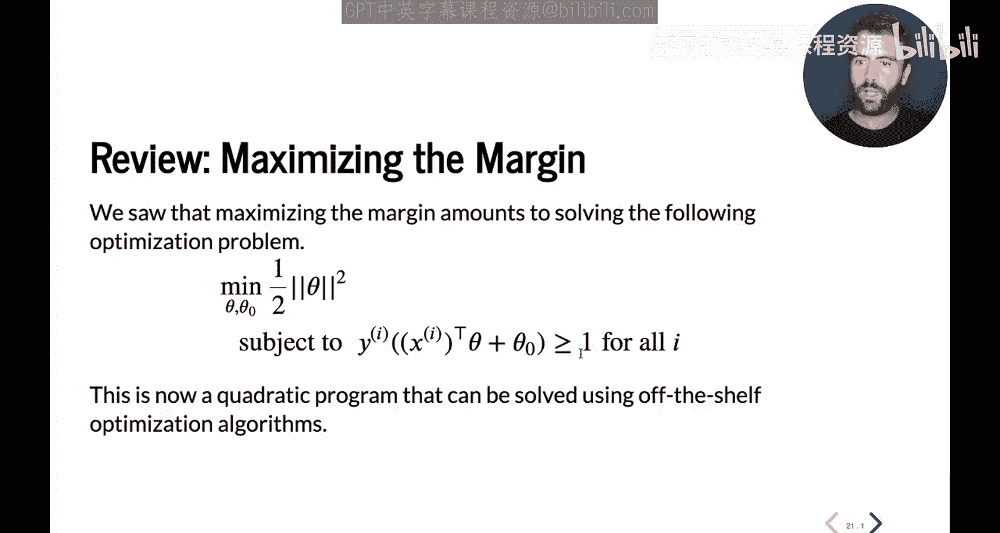

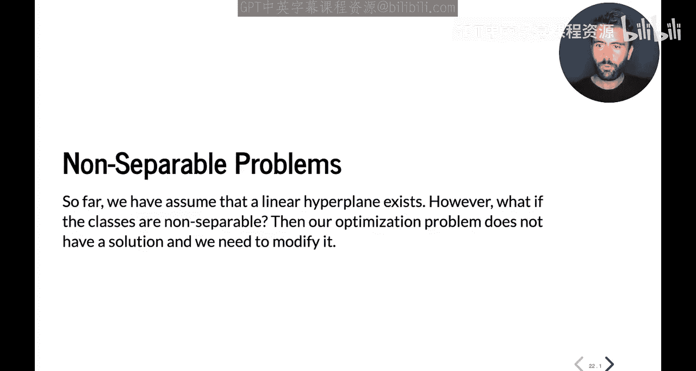

And the way that we're going to do this is going to be fairly simple。

We are simply going to allow this constraint to be violated with a small by some small number for a small number of data points。

And we're going to introduce a new variable calledsi here， which is going to be our。

Or the degree to which this constraint is violated。

So if this point is classified correctly with a perfect score of1 or minus1 or above one or below minus1。

 then we have a perfect classification and thesi variable here can equal 0。

But if we cannot assign a perfect score， then this ps can increase and for example。

 if this point is misclassified and this multiplication is something that's below  zero。

When it should be。Above 0 or at least above one。 Then Psi will take a value that can be one or larger。

But in order to avoid using very large errors， very large size， by the way。

 these are also known as the S variables。Because this constraint can hold with some slackla in order to avoid having these large slackck variables。

 we're going to define an optimization problem such that these size are chosen to be as small as possible。

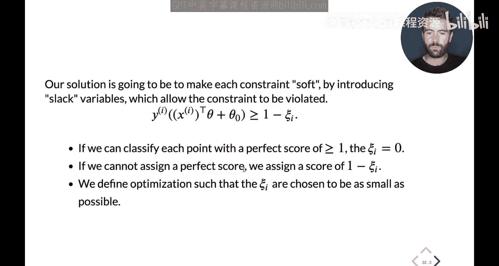

So specifically， we're going to define the following extension of our optimization problem。

Here I have the same constraint as earlier， except that I have introduced this Slack variable psi。

 which has to be which has to be positive， otherwise if it's negative。

 we can just make this yeah it has to be positive because it's the degree by which we are not satisfying this constraint and in order to encourage us to find small cosi。

 we're going to add a penalty term that forces them to be small and C is the strength of this penalty term。

It' C is a hyperparameter。嗯。So in other words， here we have here an optimization problem and。

And so the solution to this will now allow us to deal with data that is not perfectly separable。

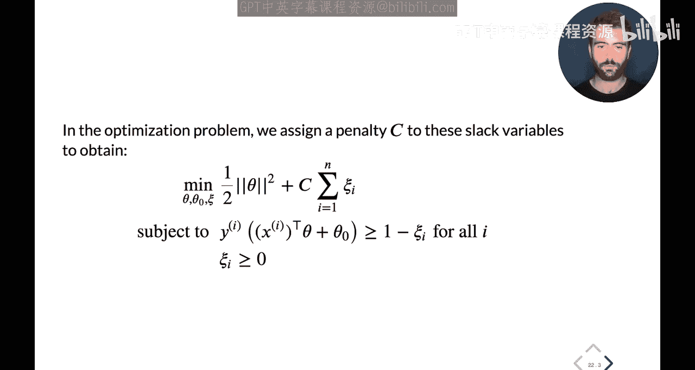

However， this is still not the final form that we're going to consider。So we can use， again。

 a quadratic optimization solver to find solution theta in this case。

But we can also take another approach which can be interesting and more powerful and actually this is the approach that would be used in practice in this is the approach that is implemented in most standard implementation of support vector machines。

And we're going to in order to define this new formulation。

 I will make a few observations about the values that these Slack variablessi can take。

The observation is going to be as follows。So this term here， which is the degree to which。

To which we are able to fit this particular point， by the way。

 here I have rearranged slightly the terms I have putsi on one side and everything on the other side。

If this if this is less than zero。Then it means that this score here is greater than1。

 which means that we are classifying x perfectly， and therefore the psi has to equal 0。However。

 if this constraint， if we have the other case where this term is greater than zero。

Then it means that this term here is actually positive。

And so now cosi can no longer take its minimum value of 0。 Now， the smallest value thatsi can take。

It has。 It is this value。And since we're minimizing sci。Each with we're minimizing eachsi I。

 this si I has to take its lowest possible value。 And if this term is greater than 0。

 thensi cannot equal 0。 becausesi has to equal this term。 And so in this case，si will equal。

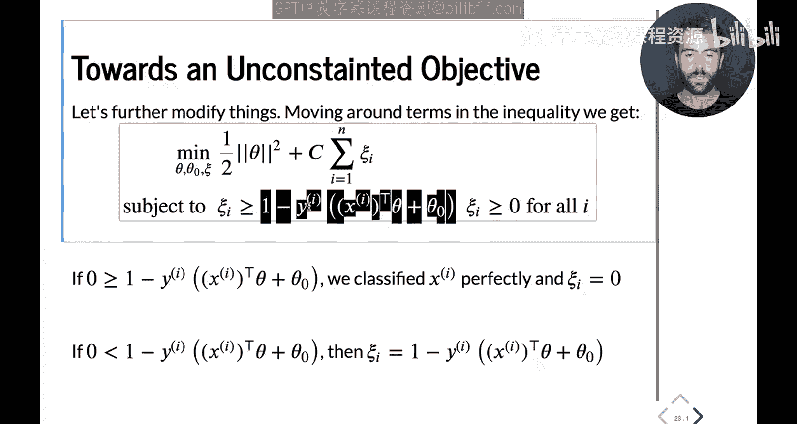

This expression。So when this term here is。Less than 0， as I showed here， then cosi 0。If this。

 if this term here is higher than0， then Xsi equals that term。

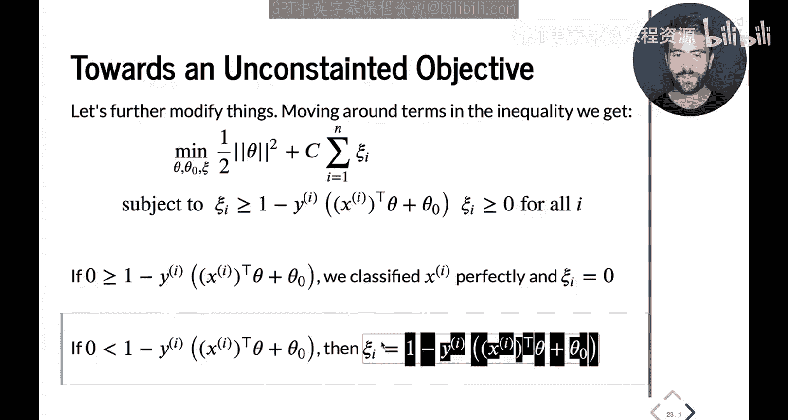

To put it differently，si will always equal the maximum of this term。N 0。

This is just saying the same thing that I said earlier。In other words。

 if cosi is if this term is is less than 0， then this argument shows that that I just gave shows that si will equals 0。

 And then as soon as it becomes greater than 0， this has to hold。 So this is。

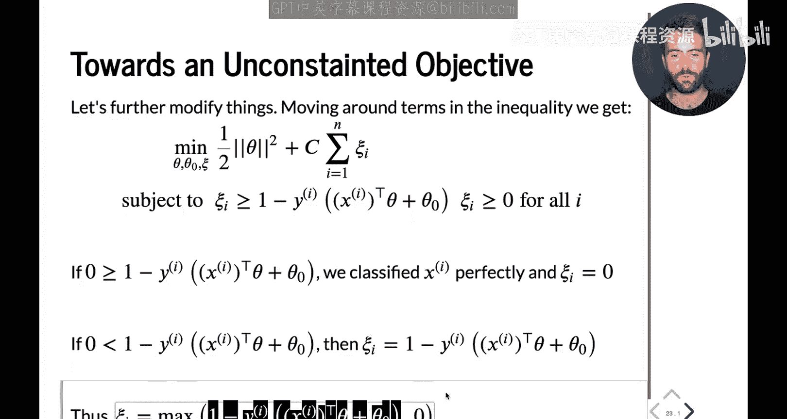

A formula for Xsi that will always hold for any value of， of。

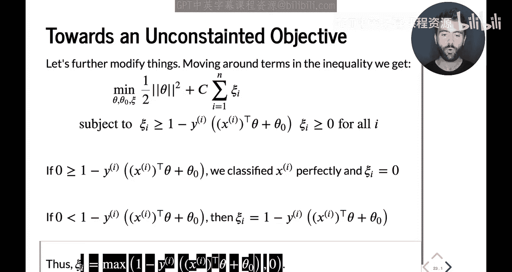

For any solution for any feasible point， given any theta that it choose。

 which can be an optimal theta or it can be not the optimal theta， the optimal psi。

 given this other choice of theta is going to be precisely this。

Just by construction and by simple analysis， we can show that。

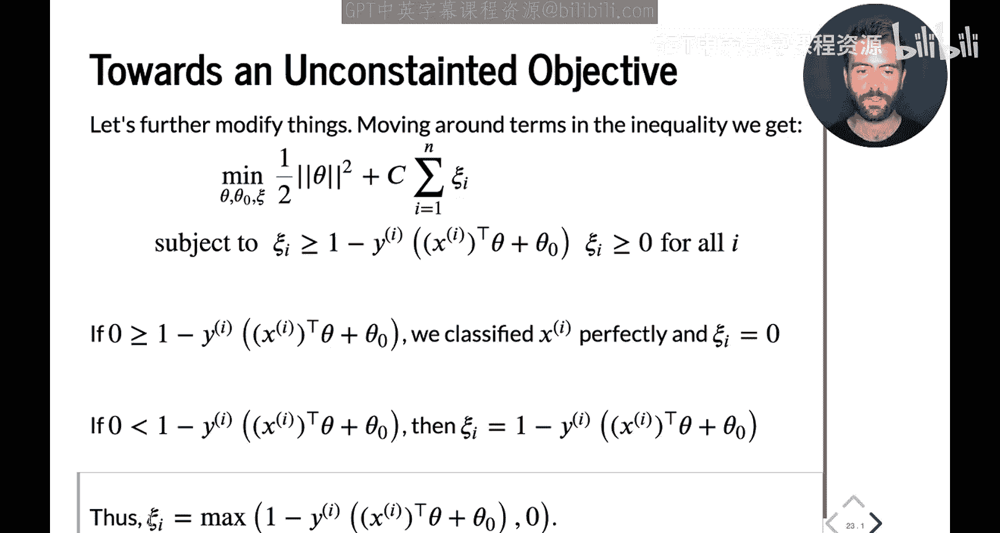

The optimalci must always have this form。

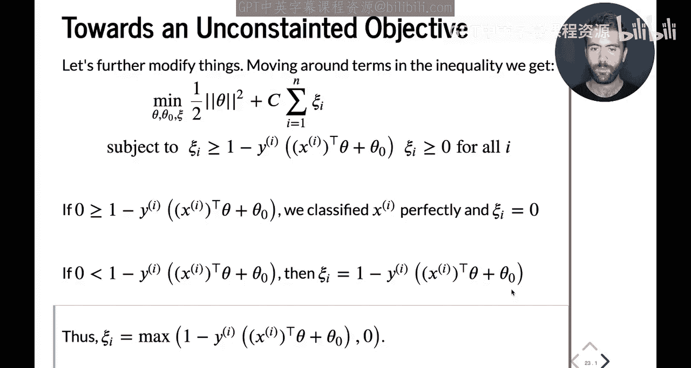

And so given now that we have this identity for Psi。

We can simply get rid of this constraint and use this expression for excite directly within this objective function。

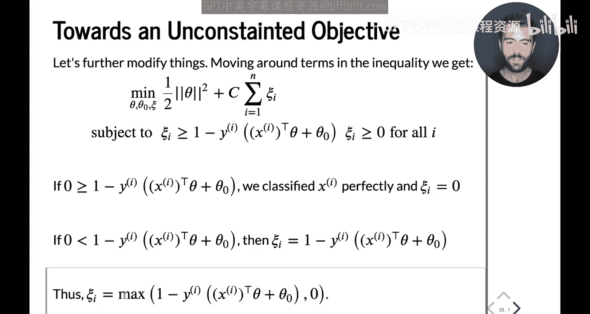

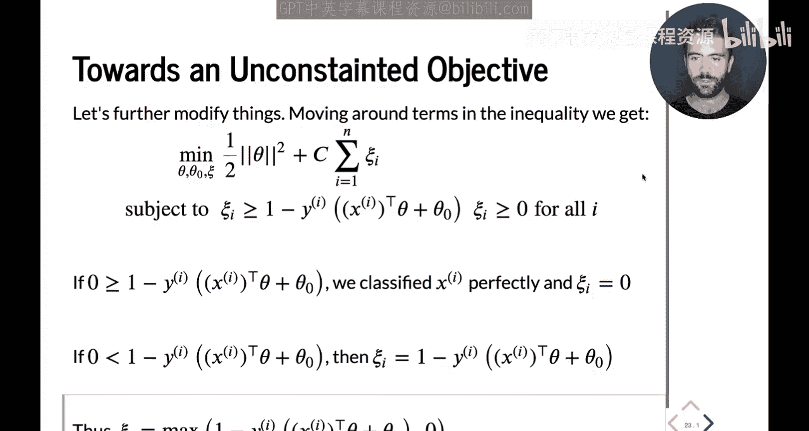

By the way， just to make things a little bit easier in terms of notation， I'm going to。

Add this extra notation term where I'm going to denote the max of x with0 as simply x plus。

So in other words， we have this identity wheresi equals the maximum of this term and 0。

 And therefore， I'm just going to write this as this term。With a plus。

So this is just a notational convenience。And， as I said earlier，si will always equal this。

 and so since it always equals this term， I can just go and plug it in into the equation。

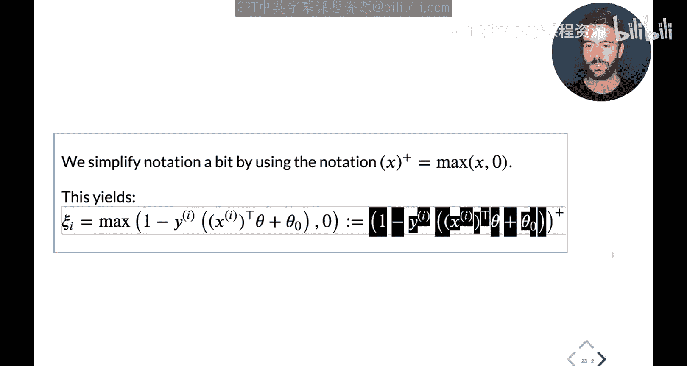

So I can take this term， I plug this into here into this objective。

 and now I have the following objective function， the following optimization problem with only an objective function and no constraints。

So by doing these additional manipulations， I have removed the constraint。

 and now I have a purely unconstrained optimization problem。

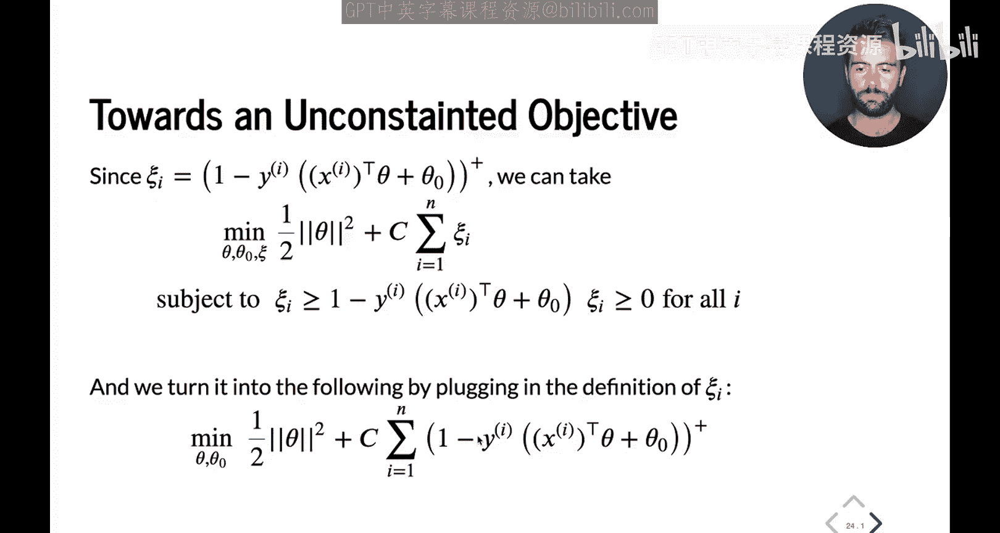

So this is really powerful。Now， we can also do one final step of mass this problem。

Since the term here is C is。

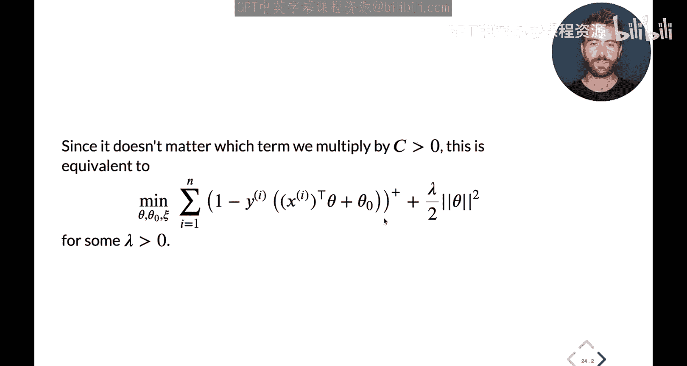

Positive， and it can be anything between 0 and infinity。Instead of multiplying this term by C。

 I can just multiply this term as well， or in other words， if I just divide by C on both cases。

 I'm going to have 1 minus C here， I will have one here and I can just name my one over C to another term like Lambda。

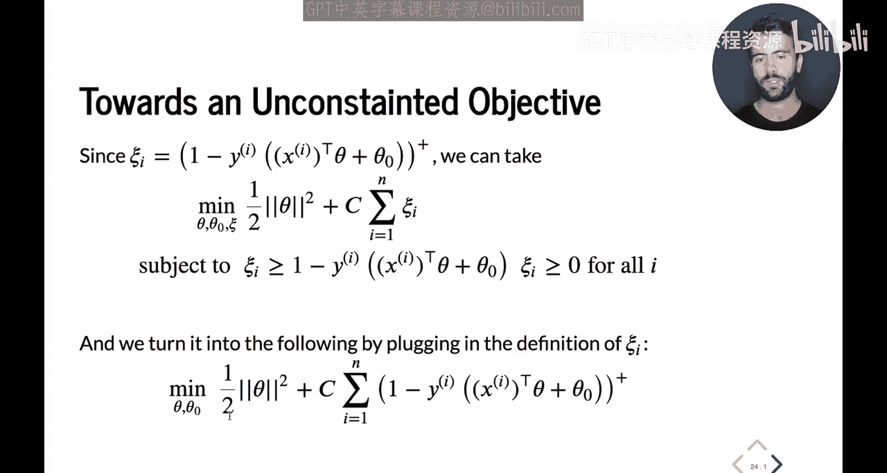

And so this is an equivalent formulation of the。Of this above of the above optimization problem。

 So instead of assigning more instead of having a variable weight on this term。

 I can also have a variable multiplicative positive weight Lambda on this term and the set of possible hyperparameters doesn't change。

 I can I can express always one for any given C， I can find a lambda such that the two problems are equivalent and so therefore I can write the problem in this form。

So this is the final change I'm going to make to the optimization problem。

 and now I'm going to make an observation here that we have transformed this objective into an unconstrained form that also has an interesting structure that should start to be familiar to us。

This term here， the L2 norm of the weights， this is something that we have seen before。

 this is a regularizer， this is the L2 regularizer that we have seen in our lecture on Ridge and this is a very familiar term to us。

And this term， even though it has。This unfamiliar form， given that this is a regularizer。

 this should start to look to us like a loss。And indeed。

 we can easily interpret this formula as a loss function。

Meaning that when the prediction from the model is given here is correct。

 then this loss will be zero and if it's incorrect， it will become larger。

So this is something that is called the Hnge loss。And so via these transformations。

 I have transformed our max margin optimization problem into one where we're simply optimizing a new kind of loss called the hinge loss with a regularizer term。

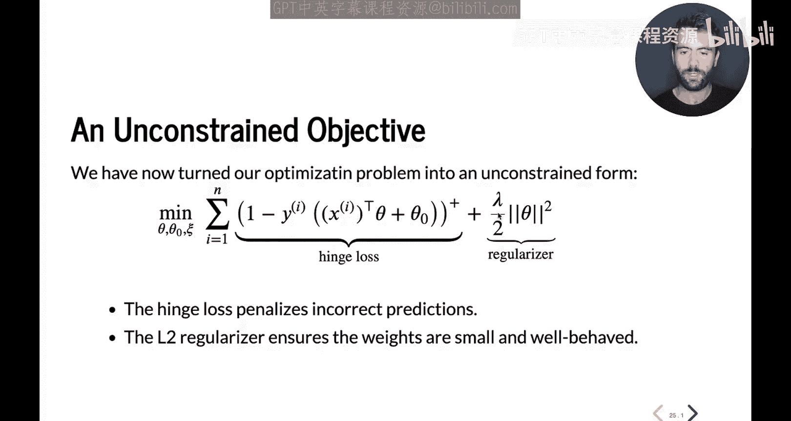

Let's now look at this hinge loss a little bit more closely。So this hinge loss。

Given a prediction from a model which I'm going to denote by F。

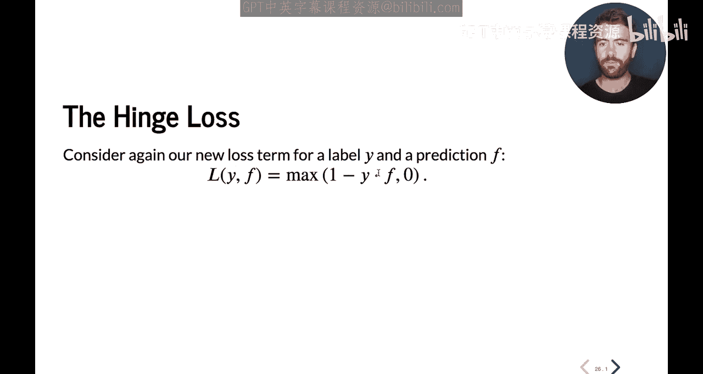

Here in this term， this is the value that the F takes， this is the value of F。

 this is simply the prediction from our model， so if I replace this with simply F which can be any prediction and doesn't have to have this particular functional form。

 it's just some estimate of y。

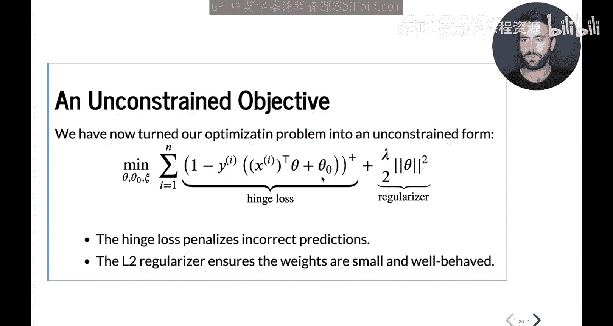

Then I have the following formula， it simplifies， and it simplifies into something really simple。

And now we can look a little bit more closely into what this does。

Imagine the prediction F has the same class as y。 So if y is positive and F is positive。

And the value of F is at least one or larger。So here， let's say that the true。

The true value of y is1。 So if F equals one or anything that's larger than one。

 which is in the right direction， then this value is going to be 0。

And if y is negative if y equals -1， then when f is -1 or smaller， this also equals 0。But now。

 let's say that the true target is one， but F is。Either below zero。

 meaning that it has the wrong class or that or this is below one， which is our optimal prediction。

Then this loss is going to be positive and is going to be a number。

 Its going to be a non zero positive number。Right so if the prediction here is of the wrong class or if f is less than1。

 then the loss is going to precisely equal y minus f。 If you want to convince yourself。

 then imagine that y equals 1， f equals1， then if f is itself less than 1。

 then this is going to be the same expression and if y is negative， f is let's say y is 1 f is。

-1 quarter。 Then this is going to be simply1-14。 It's going to be3/4。

 which is going to be the same thing as the absolute loss。 So in other words。

 this is minimized when the prediction is correct， and it is。

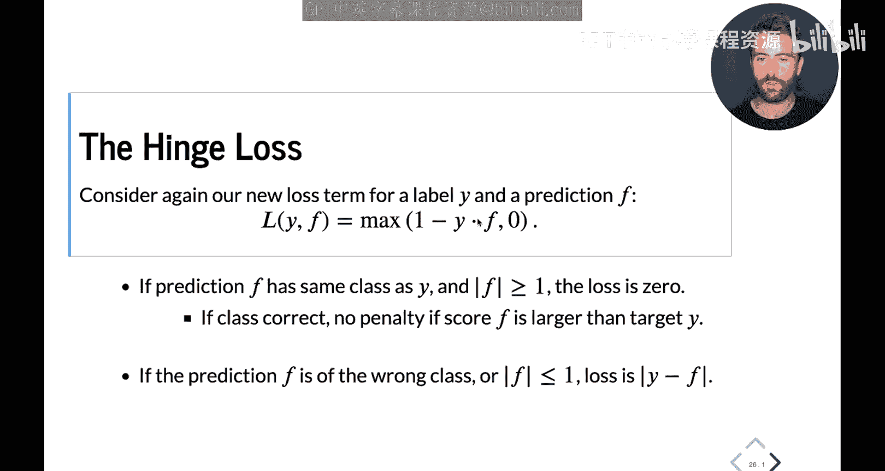

Large when the prediction is incorrect， which means that this is a valid loss function。Now。

 to better understand what it does， let's visualize this loss and a few other losses that we have seen before。

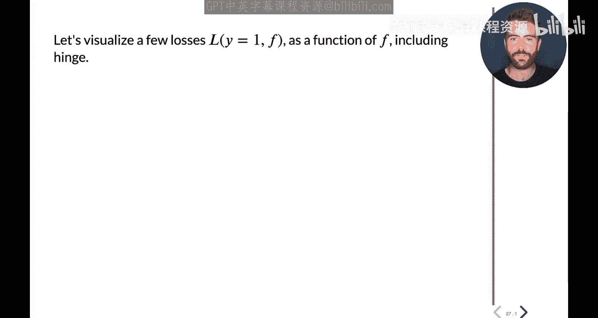

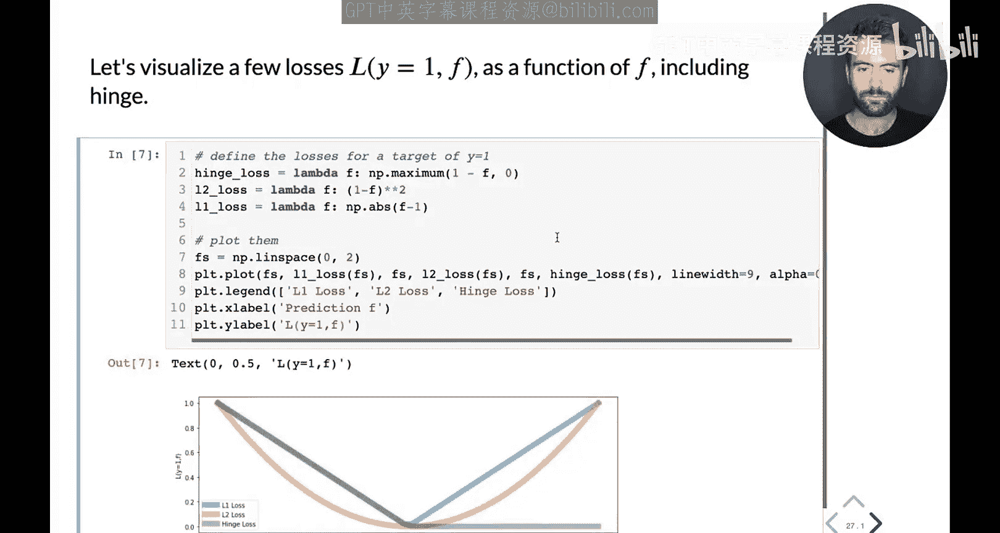

So here I am defining this hinge loss that you just saw， and by the way。

 this is all assuming that the correct label is one。So here， when y equals1。

 then this is the form for hingelo， and it's a function of the prediction f that we're making。

And then our L2 loss when y equals 1 is simply 1 minus f squared， and the L1 loss is f minus1。

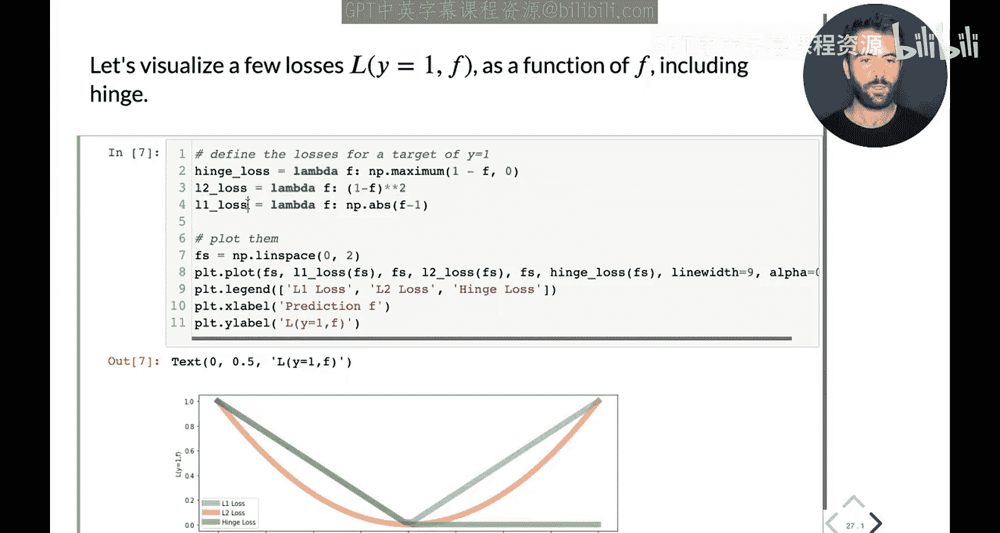

And now I can visualize these losses when the prediction F takes a value between0 and 2。

 I can visualize all of these losses。So this curve， this orange curve here。

 this is our familiar L2 loss。 and as you would expect， it is minimized when f equals 1 again。

 our true。Target here is one， so the minimum is at1。

 and then it has the squdratic shape as we move farther away from the optimal target one if we're either on this side or on this side。

 the loss increases。In blue here， I have the L1 loss， and the L1 loss has this V shape。And again。

 it is minimized when our prediction F equals the true target y， right。

 this is simply the absolute value between F and F and 1。

 So as I predict something that's higher than one， then my loss increases and if I predict something that's lower than one。

 my loss also increases。And now the hinge loss isn't green。

And you can see that the hinge loss is really similar to the L1 loss。

Except that its so it's the same on this side， but it's different on this side。So again。

 the minimum of the hinge loss。Is at one or one is one of the minimum of the hinge loss。

 The loss equals 0 when we predict  one， which is our correct target。

But the difference is that if we predict something that's larger than one。

 then we don't have any penalty。 So， for example， if we predict  two， then the hinge loss。

 then the L1 loss is。Its value becomes higher as we predict something that's above one。

But the hinge loss still is still  zero。And what and what this means is that if instead of predicting the true target。

 one， we predict something that's even more confident， like  two or three。

 we're still predicting the correct class。 and we're just increasing our confidence。 So if we're。

 if we're predicting something that's。On the that's airing on the overconfi side or on the good side。

 if our error is bringing us only farther away from the wrong class， which is minus-1。

 then it's fine we don't penalize that。But if we make an error that is towards the wrong class。

 so if we're making an error towards the negative side。

Then the hinge loss is going to be larger and it's going to equal and is's going to behave in the same way as the L1 loss。

So again， this is intuitively makes sense。 two correct classes are our two class labels are 1 and minus1。

And。If we're making an error。In the bad side towards -1， then that should be penalized。

 But if our correct target is1， and we are predicting away from the bad label -1。

 then we shouldn't be penalizing this。 And this is what the hinge loss does。

 And this is why it has this shape here。 And by the way。

 the name hinge comes from this shape because it kind of looks like like the hinge of a door if you look at your door from from above。

Here it has this shape。

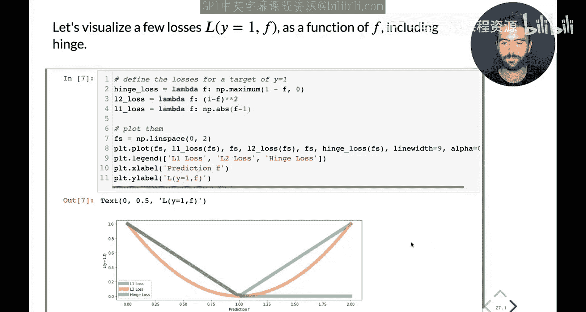

So this expression here is indeed a valid loss and again this here is showing this intuition that I just described earlier。

 so the hinge loss only penalizes errors that are on the wrong side， which is here。

 but it doesn't penalize any errors on the good side。

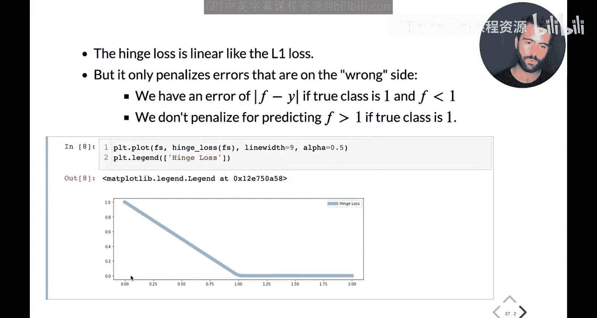

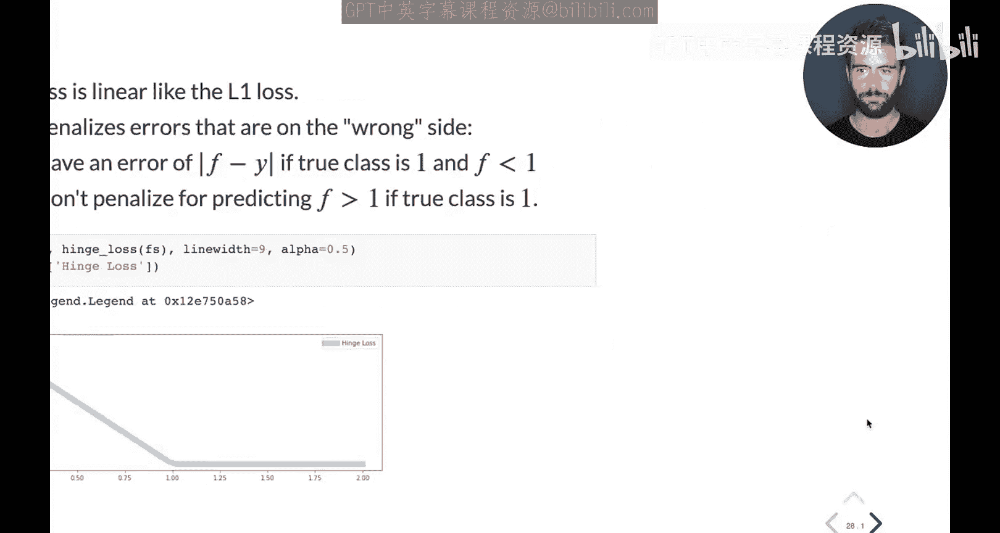

And the hinge loss is not just a curiosity， it's not a toy example。

 it's actually a very powerful and widely used loss in machine learning。

 In fact you can use the hinge loss for many different classification problems。

 you can even use it separately from the support vector machine algorithm so you could train a neural network with the hinge loss you could use it for many kinds use it for different kinds of losses with different kinds of models。

And its properties are the following。So because it penalizes errors that matter。

It is less sensitive to outliers。In other words， if we are not able to classify a certain point properly because it has a slightly different distribution。

 but our error is on the good side， then we don't penalize this and so for points that are outliers。

 this is not as much of a problem。And also if we minimize the regularized the hinge loss。

 as I showed earlier in this video， we are actually optimizing for a high margin， which is good。

 it's the property that we want， so by minimizing the hinge loss。

 we are finding losses with a high margin and that's not necessarily true for other kinds of losses。

And finally， one problem with this loss which could be which is， I guess。

 a downside is that it is not fully differentiable。 so here this is a kink。

 it's a function at which it's a point at which derivative is not exactly defined。

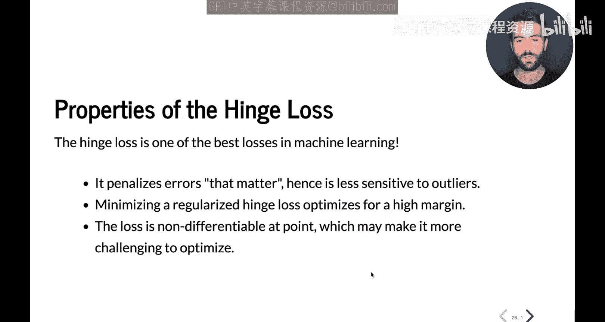

And because it's not defined， there could be some optimization issues with this loss。

 but in practice， it's not something that you should worry about too much。

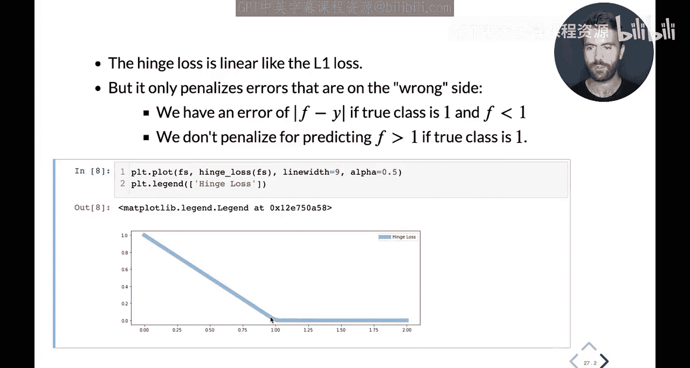

There are ways of handling this and in practice， the hinge loss actually works quite well。

 even though there is this discontinuity which might in theory make optimization more difficult。

So in other words， the hinge loss is a good loss and you should use it and finally one other potential issue is that the hinge loss does not have an obvious probabilistic interpretation like other losses might have so by minimizing the L2 loss we can think of as fitting the mean of the data if we minimize the L1 loss we fit the median but with a hinge loss we don't have this interpretation in terms of probabilities or statistics。

 but again it's not it's not a big deal and the hinge loss is a really good loss to use in practice。

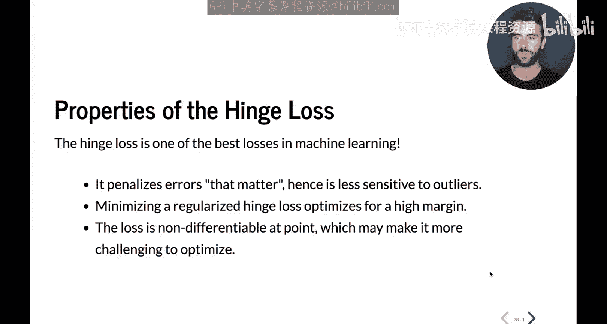