# 康奈尔大学《应用机器学习 CS 5787_ Applied Machine Learning 2020》中英字幕（deepseek p37 -37-Lecture 9. Part 4_ Optimization for SVMs.zh_en -BV12udzYvEFM_p37-

This is now the fourth and final part of lecture 9 of applied machine learning on SVNs。In this video。

 I would like to continue talking about the formulation of the SVM that we started in the previous video。

 which is the one that involves an unconstrained optimization problem in which we're minimizing the hinge loss。

So I defined this new formulation with this new hinge loss。

 and now let's see how we can optimize this new formulation。

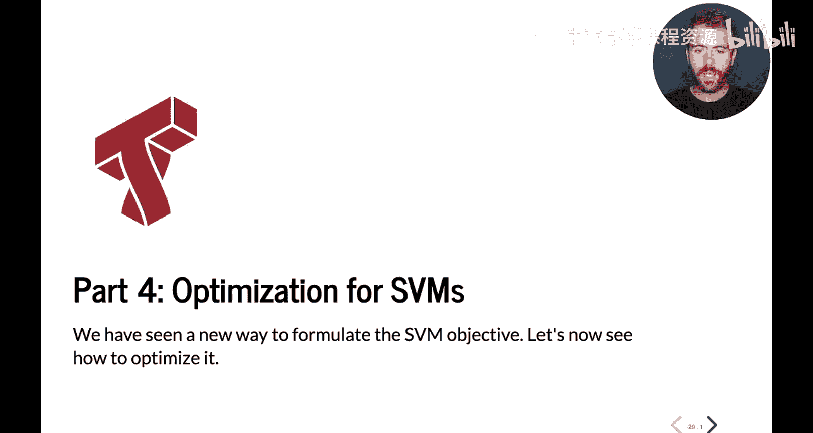

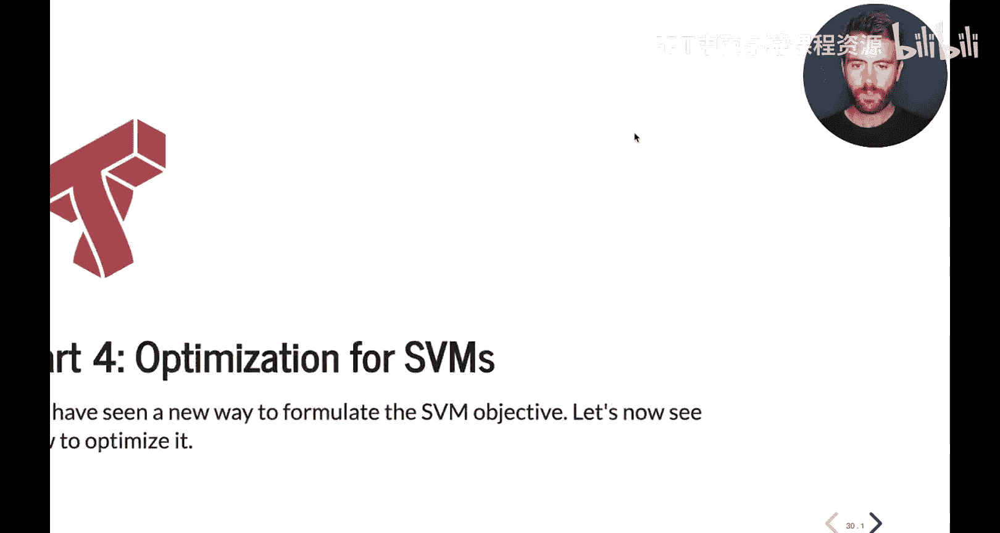

So recall again that we're working with models of this form which are linear。

 this is the way of writing them in vectorized form and our targets。

 y are either they binary and they're denoted by minus1 and1， these are the two possible targets。

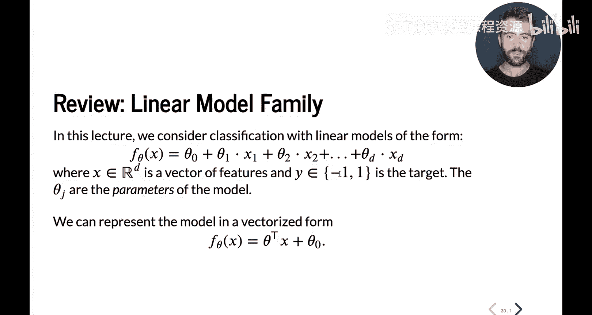

And in the previous video， I defined this new function called the hinge loss。

 and I showed that the SVM I showed that the problem of optimizing for the maximum margin。

 it is equivalent to optimizing for regular a regularized version of this hinge loss。

So this loss has interesting properties。Linear， like the L1 loss。

 but it only penalizes as when the L1 loss takes this V shape in the L1 loss。

 one of the directions of the V is removed and equals 0。

 So it's only penalizing errors that go towards the wrong class。

 So if we're at one and we're predicting something less less than one。

 then we're penalizing like the L1 loss。 But if we we assign the same penalty as the L1 loss would。

 But if we go towards the But if we are greater than one， if we're predicting away from the。

From the wrong class， then this is not penalized。

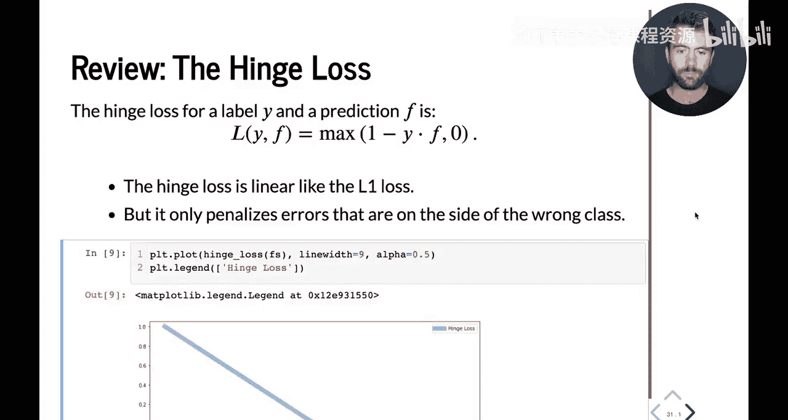

And this is the shape here。 So on this side， we are like the。We are like the L1 loss， but again。

 on this side of the minimum， we don't have any penalty。

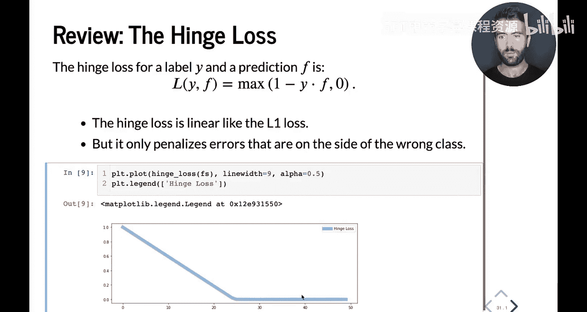

And then as I said earlier， our SVM objective can be seen as optimizing a regularized version of the hinge loss。

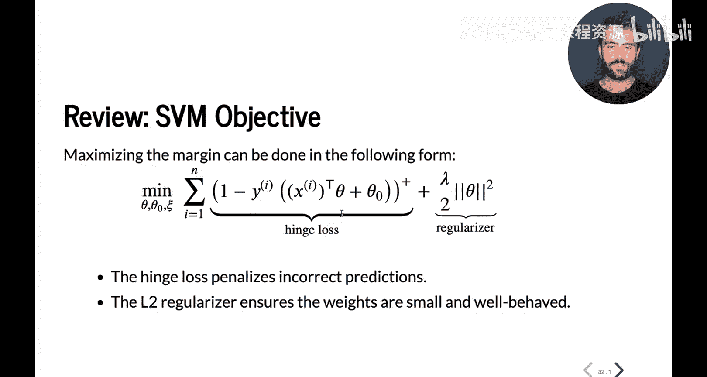

Now I'm going to implement a full algorithm， a full a full version of the SVM algorithm with the hingeos formulation in Python in this video and to start I will just define。

 as I did earlier， the model and here we have the following linear model where I have accent theta。

And then I'm going to define the hinge loss， well， I'm going to define the optimization objective that I had on the earlier slide and that is simply going to be my hinge loss。

 which is easy to implement in Python in this form， and then this is my regularizer。

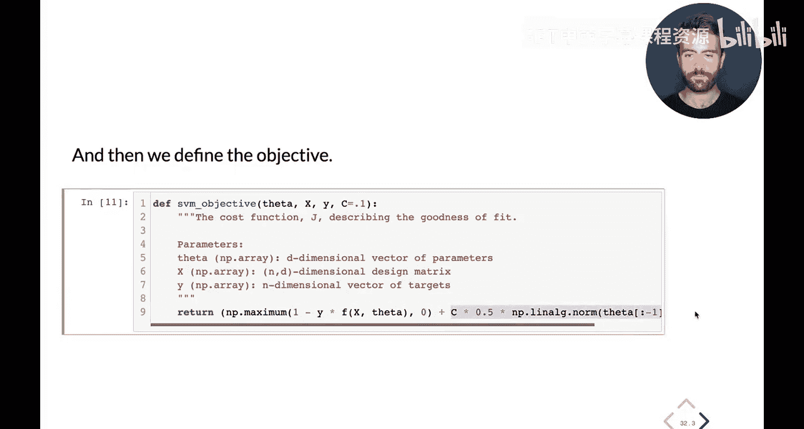

Now in previous lectures for other kinds of algorithms。

 we have used gradient descent to find the optimal objective。

 the optimal value for the parameters and recall that gradient descent is an algorithm in which we start with some guess for the parameters and then while the parameters are still converging we repeatedly apply the following step that is defined here in math and that simply means that we take our current best guess of theta and we take our current value of theta and we generate a new value at which the objective is going to be even smaller by taking a step in this direction of steepest descent that is derived by that is derived from the gradient so if we go along the direction of the negative gradient we know that we're going to。

We decreasing the function in that direction， so we take a small step and then we recompute the gradient。

 we take another step in the steepest descent direction and we keep doing this until we have converged so this is gradient descent。

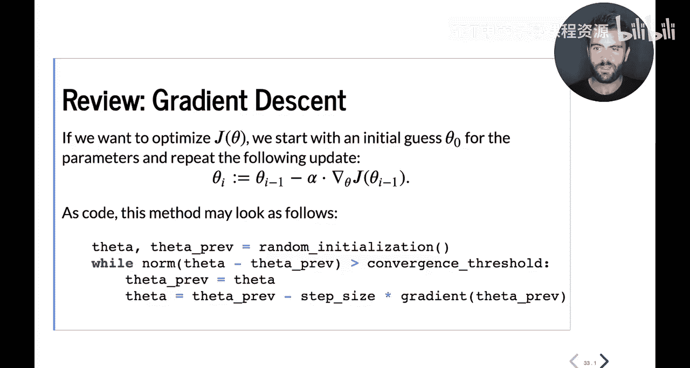

Now， how can we apply gradient descent to the hinge loss？Well。

 the hinge loss and is great and its direction of steepest descent。

 they are interesting and there are two regimes here which depend on which side of the optimal prediction we are so recall that this is our function for our objective。

And you can see here that there are two regimes。This one， the flat regime。

 which is in blue and this linear regime， which is in orange。So if we have a prediction F。

Such that y times F is less than1。Then we are in this orange linear regime。Here when y equals1。

 again this is the regime where f is less than 1， and so here is a 1。

 and this is when f is less than1， the function has this shape。

 it's this linear form and the particular formula for this slope is exactly1 minus y times f of x。

So this is what happens when this holds and we're in the linear regime。

And for any point that's here in orange that's in the linear regime。

 for any point x at which this holds， well， we can easily compute this gradient。

 this is just a linear function。

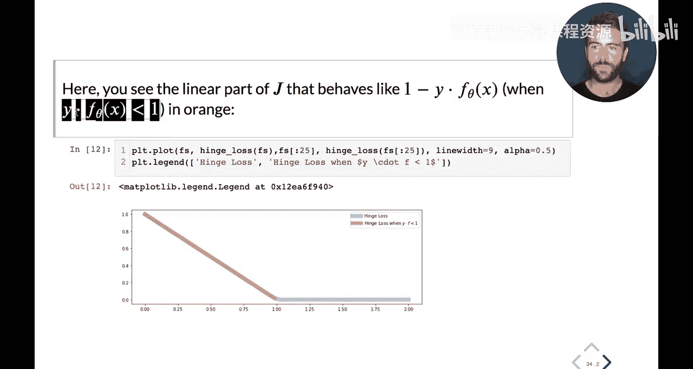

So when we're in this linear part that behaves like this， then we can compute。

 then we can get a gradient by simply taking the gradient of this expression。

 since this is how the function behaves near all the points when this is true。

So this is our objective and in the linear regime this objective takes is just this。

 and so now if we take the gradient of this expression that I highlighted。

 then we simply have something like this， it's y times the gradient of f of x。

 and since this is a linear model， this is simply going to be minus y times x where I used this property。

So here I have defined a gradient when the。

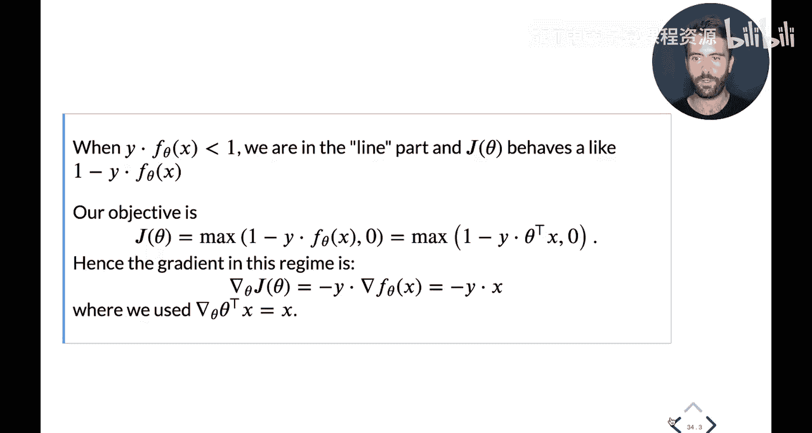

When the function was in the linear regime。Now we could also be in the flat regime。

 which happens when this condition holds， then we're in the blue flat regime from the previous curve and because the function is flat。

 well the gradient at all of these points，8 happens to be 0。

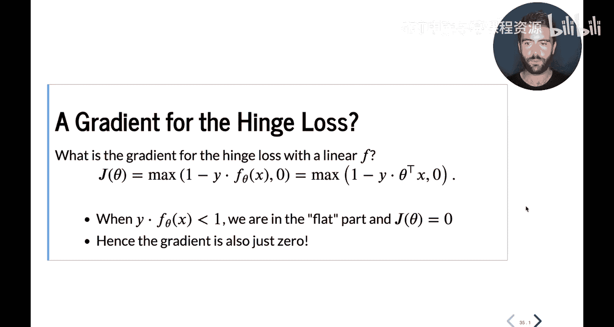

But now the interesting regime is when y equals F exactly。 In other words， there is。

 there is one point here， which is right in the middle here。 right， right when this function。

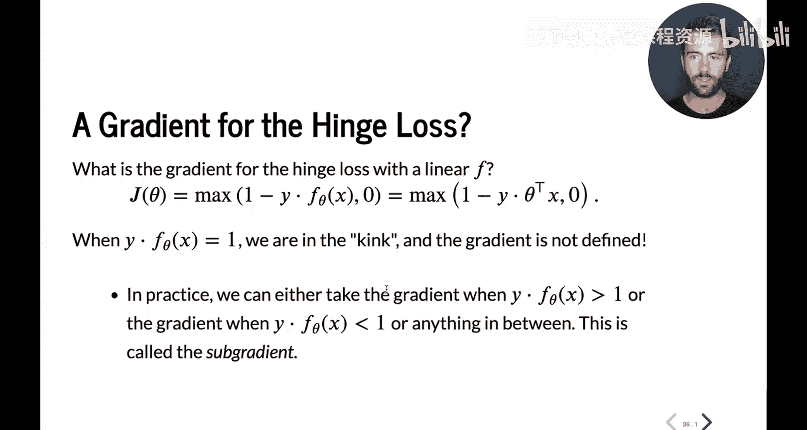

When there's an inflection from flat to linear。In this case。Technically， the gradient is not defined。

So if we come from this side， then this gradient is linear at every point and then it just still takes it still has a linear form as we approach here。

 but if we approach from the flat side， then the green is always zero and then at this point the green has a discontinuity。

And it's not well defined。So even though it's not well defined in practice， it is not a problem。

 in practice for optimizing this function， we either we can either take the flat one or we can take the linear one or we can take any combination between them。

 it will still work。And this idea of taking any of their combination or the either0 or this or any linear combination of 0 and this gradient。

This set of possible values that we could take， it is something that we call the subgradient。

 it is not important to remember this term for this course。

 but I just want to point out that there is a technical term in optimization for this and I'm going to refer to it a few times later in this video。

 but essentially what you need to remember is that once we're at this point。

We can choose either the orange or the blue， and it will still work。

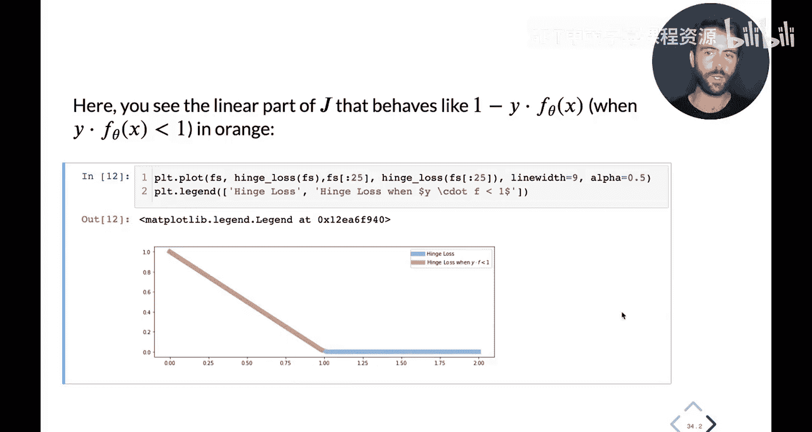

So again， in other words， when this condition holds。

 then we can take either of the two gradients and everything will work out。

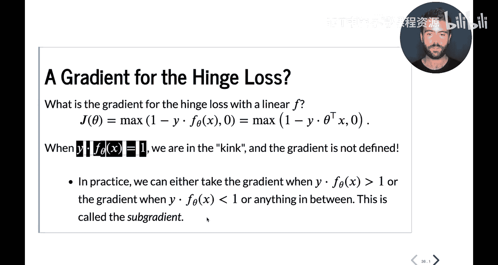

And so now using these observations， we can define。A gradient like function。 So here I've。

 I've demo that I this is， this is。This not real this is not standard notation。

 this is just something that I introduced in order to just be rigorous and point out that this is technically not exactly the gradient。

 but it's something which behaves sufficiently closely to the gradient that we're just going to use it as a gradient。

And so this object here， it just happens to be either zero or the green of the linear function that we saw earlier。

Depending on whether this condition is true or not。

And this could also be replaced with greater than or equal。

 and it will still be true here where I guess we're using zero as the gradient at the kink。

 but we could have been or at the inflection point， but we could have used this one instead。

 it doesn't matter。So here I'm simply combining the different cases that we have seen in the previous slides into one expression for this。

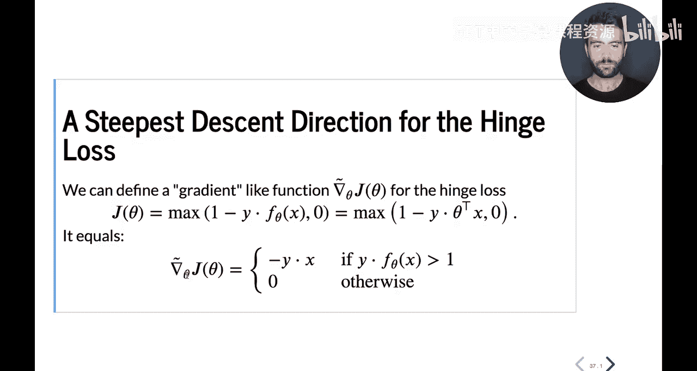

Term， which behaves like the gradient。And now I can use this term within our gradient descent algorithm except that so here this is what we had earlier。

 except that I'm using the I'm using the approximate gradient here， which is。

Which is not exactly the gradient。 And because this is not exactly the gradient。

 I am technically referring to this algorithm as sub gradient descent， but it still works。

 Let's try to implement this。

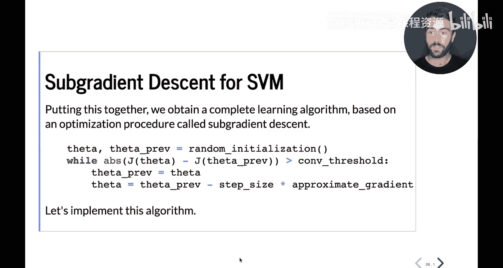

So first， it's easy to implement the approximate gradient in Nmpy here have I'm just implementing the formula y times x that we had earlier。

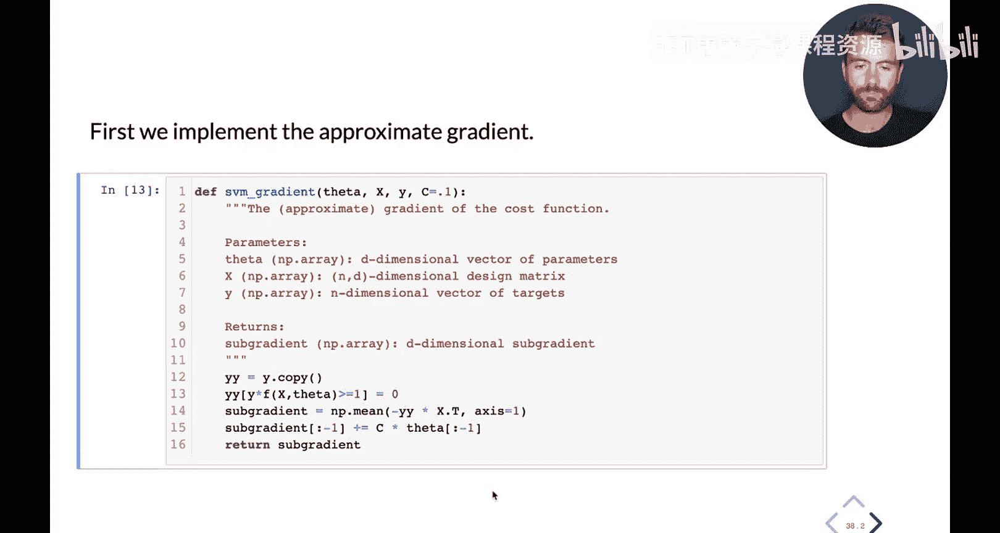

And now to implement this algorithm， it is， again， really easy here。

This almost has the same shape as the pseudo code。That I showed earlier。

 we take the gradient and we take a small step in the direction of the gradient until our value for theta is no longer changing。

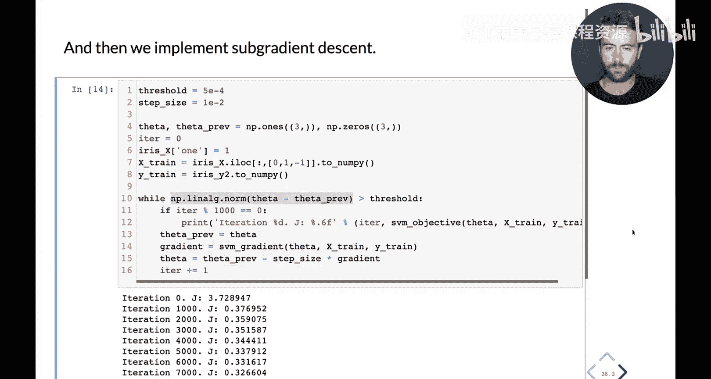

So here it is taking。R the 21，000 iterations took in the verge。

And this is the value of the loss at each at each or I guess the this is the value of the regularized objective。

 So this is the loss plus the regularizer。

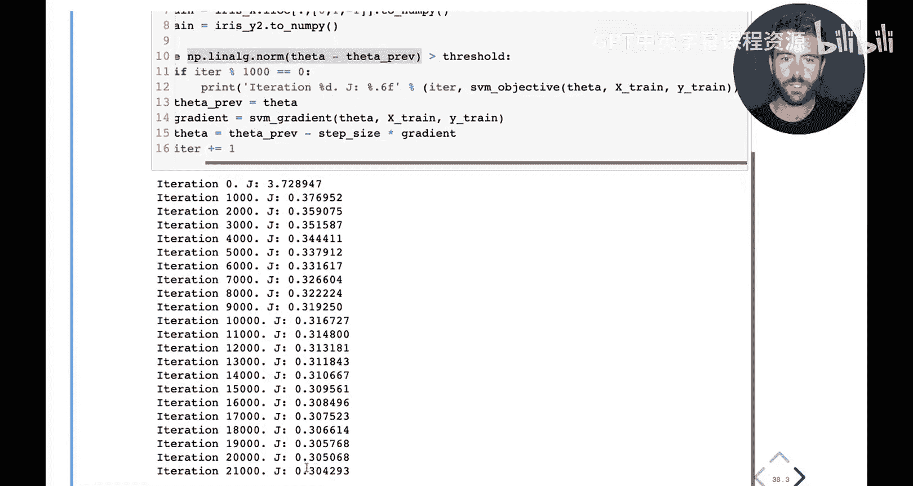

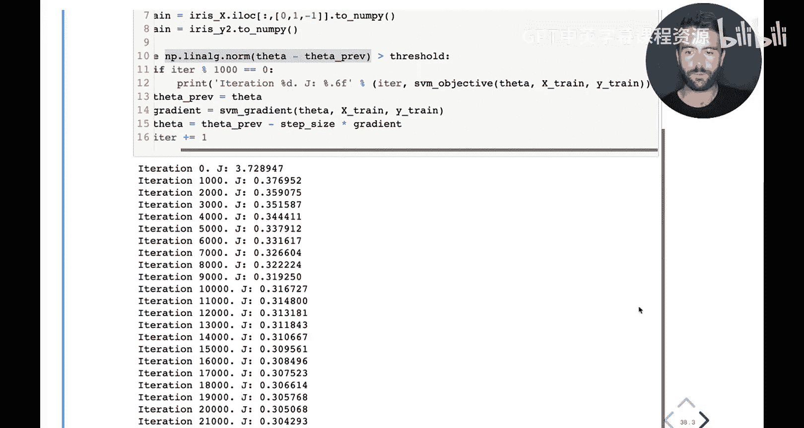

And then once this optimization process finishes， I have， I have。A value for theta here。

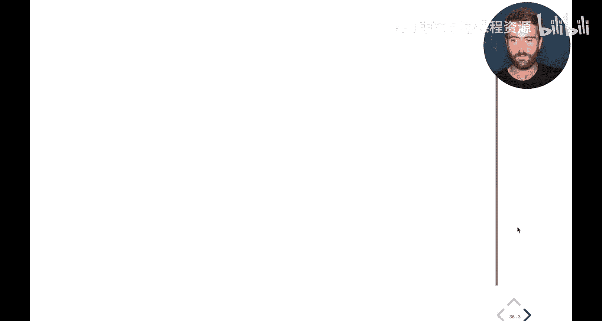

And I can easily visualize this as we did earlier， and now indeed this boundary。

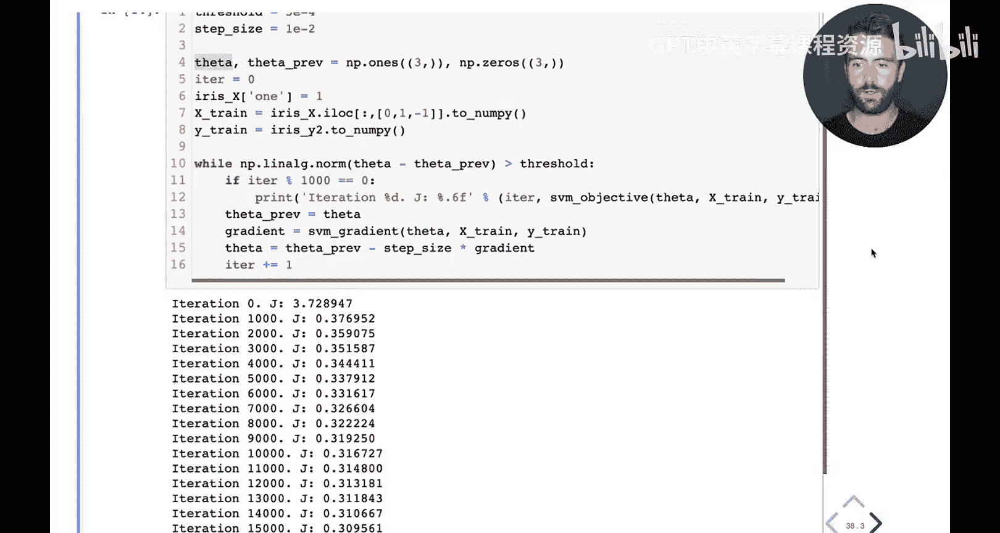

It separates both classes and it does this in a way that has high margin。

 so it stays far away from all these points。And it ensures that the margin over all of these points is high。

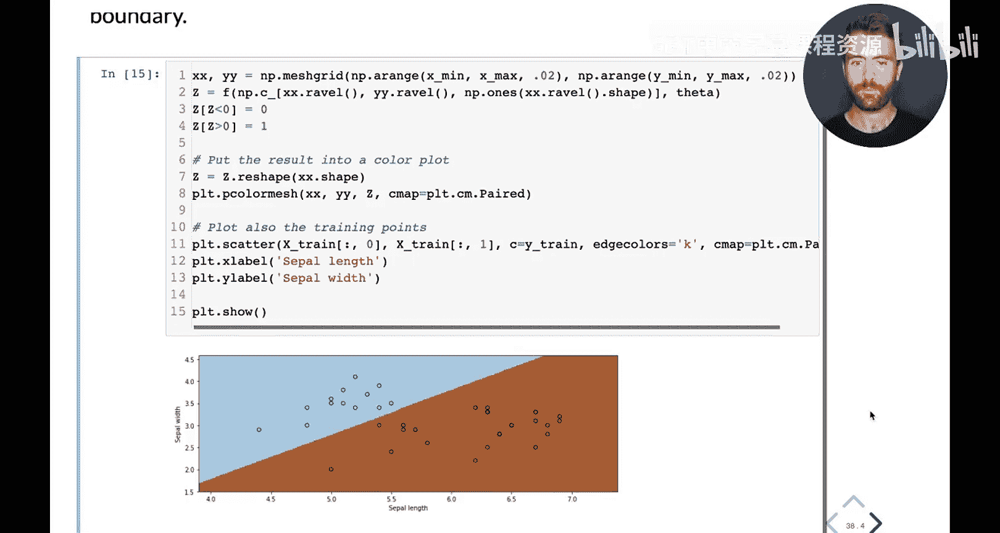

So this is a demonstration of another way of implementing our support vector machine algorithm。

And in fact， as I mentioned earlier， this is how a lot of practical implementations would deal with this problem。

 they would use a version of this linear loss。And again， just summarizing our algorithm here。

 this is a supervised algorithm for binary classification and our model family is linear and now our objective function is an L2 regularized hinge loss which no longer has involved in any additional constraint and we are optimizing this objective using subgraing descent as our optimizer。

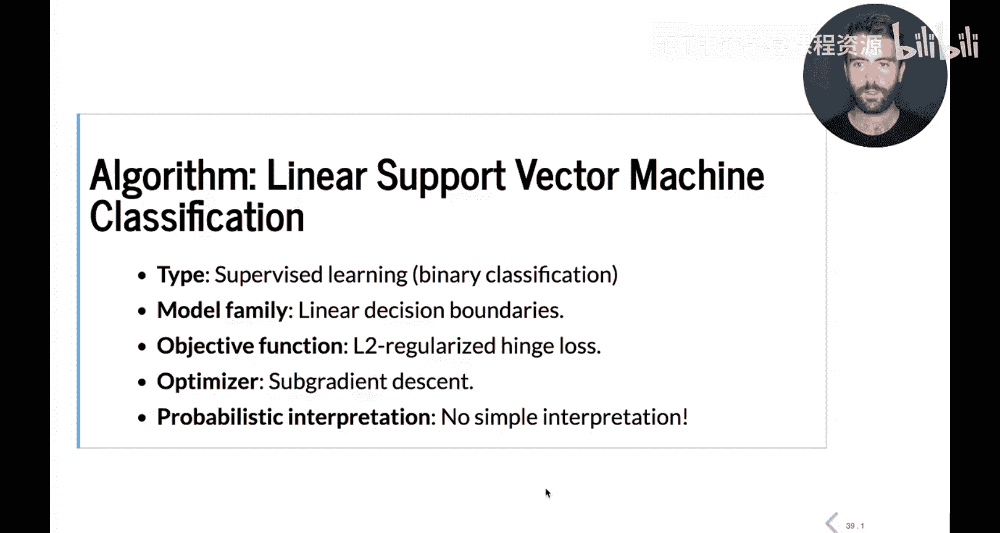