# 康奈尔大学《应用机器学习 CS 5787_ Applied Machine Learning 2020》中英字幕（deepseek p38 -38-Lecture 10. Part 1_ Lagrange Duality.zh_en -BV12udzYvEFM_p38-

Welcome back to Applied Ma learninging。We are now at lecture 10 of our course in the previous lecture。

 we saw a new and important machine learning algorithms called support vector machinesch and in this lecture we're going to continue looking at support vector machines as well。

And we're going to look at a new approach at a new way of formulating the maximum margin problem。

That is going to be very interesting and that will be used also in the next lecture in a different kind of context。

 but it is also going to be another important and widely used way of finding finding solutions that have a high margin and is going to be another way that is used a lot to solve the support vector machine problem and in many support vector machine problems。

 this approach is indeed used。And the name of this approach。

 so here I'm calling the lecture dual formulation of support vector machines and use a we're going to use a set of concepts and optimization which are called LaGrange duality in order to define a new version of the optimization problem that we had in the earlier lecture。

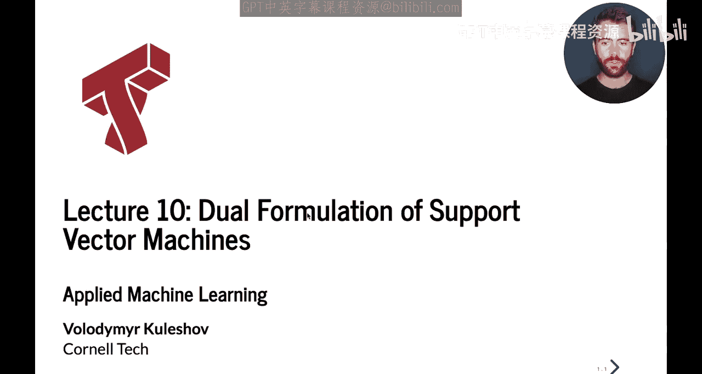

So in this video， I would like to start with the general mathematical concept of Lagrange Duity。

And then in the next videos， we are going to apply this concept to support vector machines and derive new algorithms and new formulations for support vector machines。

So Larangerange duality is actually a really， it's a fairly advanced mathematical concept and it's okay if you don't follow all the details in this video。

 and in the end will tell you or in the end and throughout this video I will tell you what are the most important parts。

And also I will keep it at a relatively high level。

 but still it's a really important concept in both optimization and also in its applications to machine learning。

 and you should be aware of what Ra dual is and it will also itll make it a little bit easier to understand the contents of following several videos。

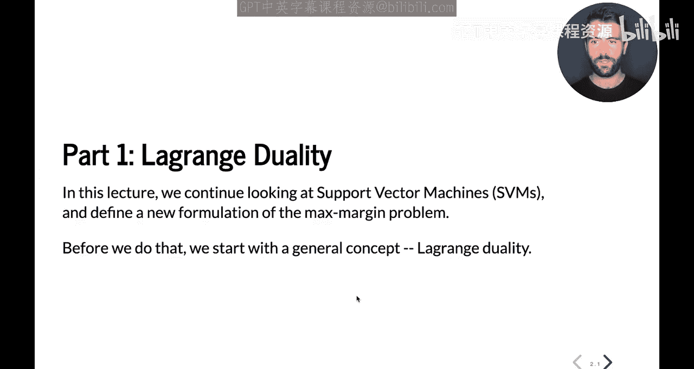

So recall that in the earlier lectures we were we looked at support vector machines and we defined the support vector machine as the solution to a number of optimization problems one of them was the following constrained optimization problem so here we are looking for for a separating hyperplane theta with a small L2 norm and such that all the examples are classified correctly。

And this will lead to this。 This hyperplane will be the one with the maximum margin。

But the reason I'm bringing this up again is that formula we have formulated the SVM as solving a constrained optimization problem。

And Larange duality is a set of interesting properties of constrained optimization problems that we're going to look at first in a general way in this video。

 and then we're going to apply them to support vector machines in the next video。

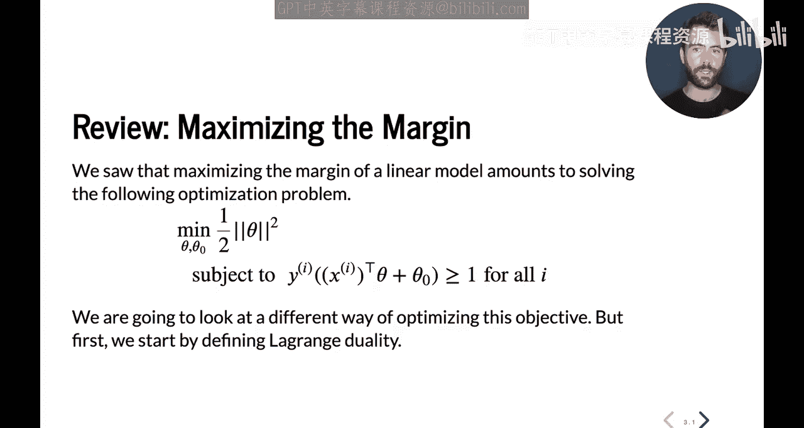

So first， let's look at a general constraint optimization problem in which we are optimizing over some objective J under a set of constraints。

 which I'm denoting here by CK so C is just some function from the space of theta that maps into the real numbers and our constraint is that this C is less than zero。

So this can be something simple， such as theta is you know the norm of theta is less than 0 or some linear combination of the features of the components of theta is less than  zero if we have a linear and sorry if we want to even though these are。

Even though these are inequalities， we can also formulate equalalities in this framework if we have a C thats less than if we have c of theta less than 0。

 we can also have another inequality that is minus c less than0 and then if c and minus c are less than 0。

 then we know that C has to equal 0， so we can also formulate constraints of this form equality constraints of this form。

 if C is less than some number。Even though this is zero here， it can be。

We can we can also have the equivalent of a nonze number here by adding a minus constant term into this function。

 so this is a very general form of representing essentially any optimization problem that would be interesting to us。

And if you think at a high level what this optimization problem is doing。

 it is searching for theta for which J is small because we're minimizing it and such that all the CKs are negative。

So that is the high level goal of this optimization problem that I have just defined。

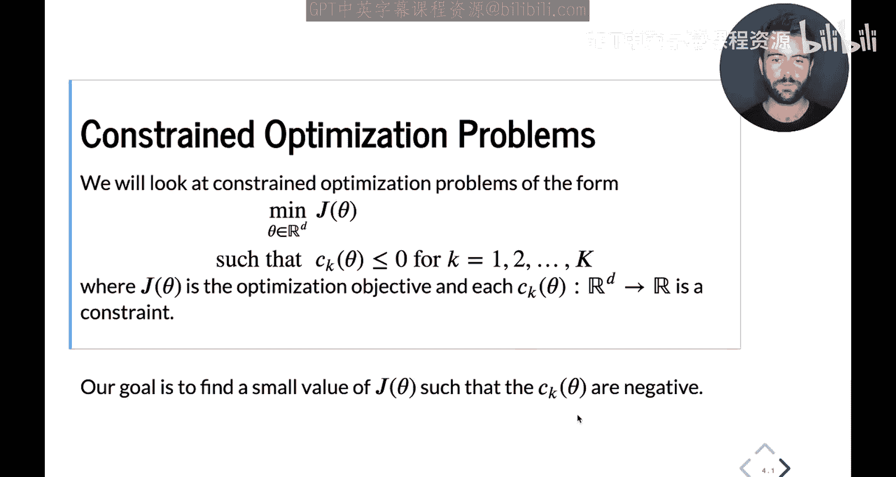

This particular formulation is not the only one that can help us reach this goal that I just described。

Another way of doing this would be to have an optimization problem that's minimizing a function of this form here I have simply added。

 so here I have my objective J。And then I have added my constraint functions into the objective function。

 and I have added a multiplier Lambda that is not negative。

And and that measures the importance of these extra terms。

 And the way to to interpret this step of adding these constraints is that we're going to be。

Penalizing large values of C， and therefore if we add them into the objective function that we're minimizing。

 we are going to be choosing theta that both minimize our objective and for which the value of the constrained function is small。

So if lambda is greater than0， since we're going to be minimizing this function。

 we're going to be penalizing large values of C， so we will be looking for thetas for which the C is small。

And for large enough。Penalty terms lambda。 if we put enough weight on this term。

 no C will be positive。 And so we're going to have a valid solution when in terms where valid means that these constraints are going to be less than 0。

 And since we're also minimizing the objective。 we're going to have reasonably small value for this objective。

 And so now we're going to have a solution that is。Generally similar to what we had earlier。

 so constraints are satisfied， J is small。But we're achieving it in a different way。

 We're achieving it via penalties。 So penalties are another way of。Enforcing constraints。

 at least to some degree。And this approach of formulating constraints as penalties is。

Its the the heart of the Laguangian approach It is is the it is kind of the it is the high level。

Approach that we take when we work with Lagrangians and Lagrangians duality， Lagrangian duality。

And in the rest of this video， I am going to refer to these terms by certain names。

So I'm going to refer to the lambdas， by the way， I have one lambda per constrained and each lambda is not negative。

 so lambda is a vector of positive numbers of k positive numbers。

And I'm going to refer to these lambmbdas as Larangrange multipliers， and then this function。

 which is our objective plus this penalty term that is called the Laangian function。

 So lambmbda here is the Laangian。These are terms which are which you should be aware of these are standard。

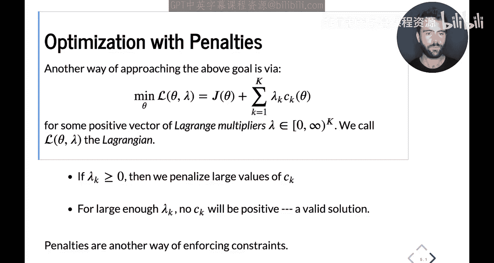

Conceptts and optimization。So penalties and constraints are very closely related。

 I give you an reason of an intuitive explanation of how they're related in the previous slide。

 but give let me give you an even more concrete and precise way in which they're related。

So recall that this is our optimization problem， it has constraints。

And we can define the primal lagrrange form of this optimization problem as follows。So here。

This function P of theta， where P stands for primal。

I'm going to define it as the maximum of the laggrangian。

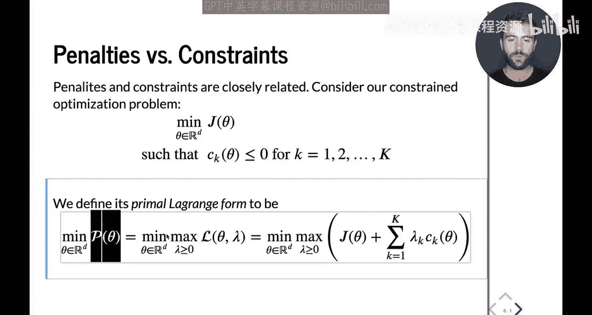

Over the weights， lambmbda。So in other words， it's the maximum of this Lagrangian function which I described earlier。

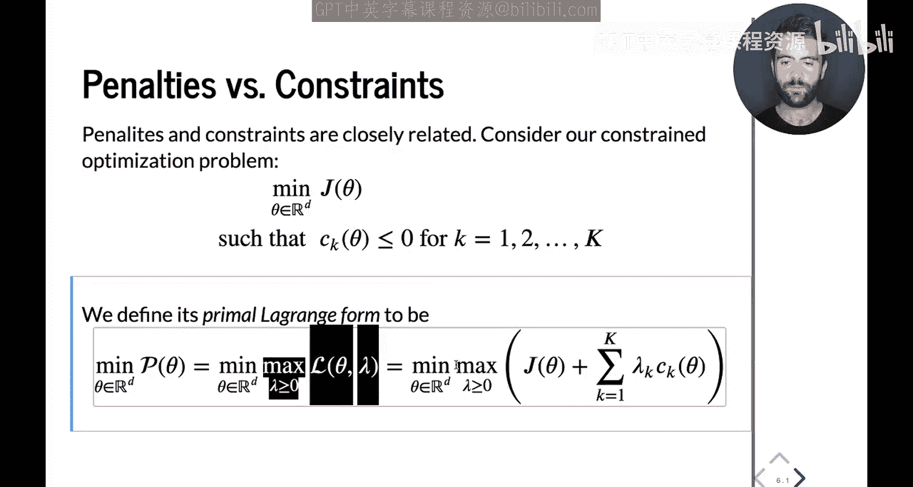

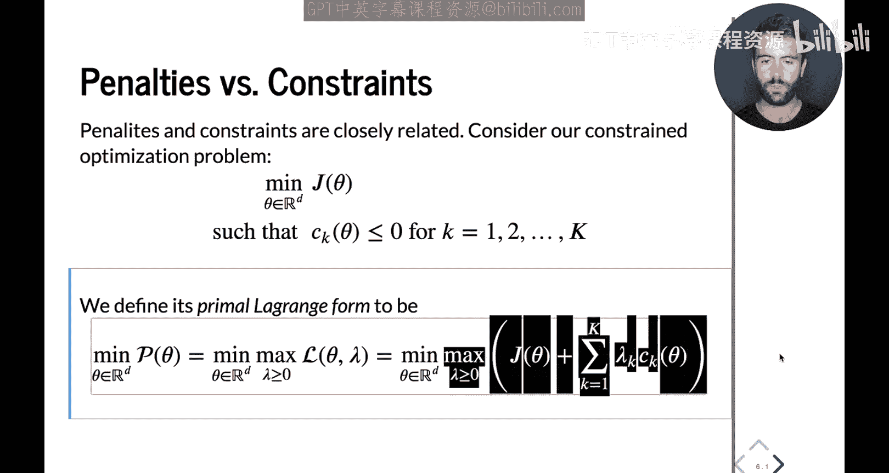

And similarly to how we're minimizing this constraint objective。

 we can also minimize this primal Larange form over the space of theta。

And then the really interesting claim and observation， and that's the first interesting results。

 interesting result in the Laangian approach to optimization， is that these forms。

 they actually have the same optimum。 So if I were to minimize this primal Larrange form。

Or if I were to optimize this constraint form， they would actually have the same optimal solution。

 which I'm thennoting here by theta star。And this is actually not too hard to see。

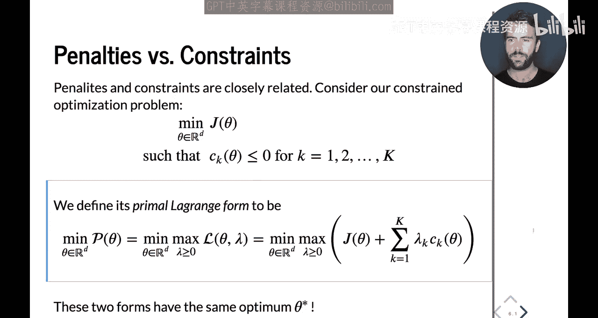

So consider again here our primal Larangerange form。

Imagine that we are we searching over the space of theta and we have arrived at some point theta at which some constraint is violated。

 so let's say that the CK is actually greater than 0。Well。

 then since we're optimizing over this form， which is so this by the way。

 this is still a function of theta， even though we're maximizing over Lada。

 the theta here is a free unbound variable and we can minimize over it so if some theta is violated。

 then since。

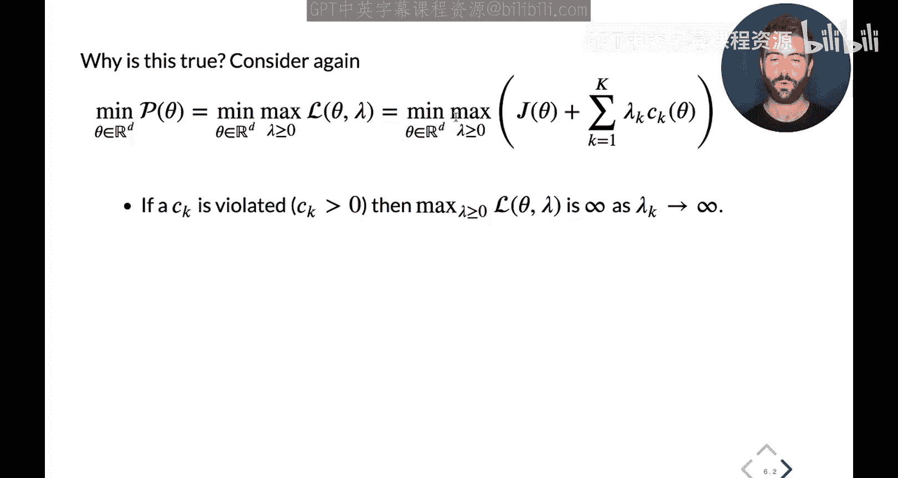

In this expression， we're taking the max of lambda。

Then the max of this expression over lambda is going to be infinity because we can take our lambda to be infinity。

 so if one of these CKs is positive，Then we can let Lambda go to infinity and since we're optimizing since we're multiplying a positive number。

As lambda goes to infinity， this entire objective goes to infinity。

 And so the value of this term will be infinite the value of。

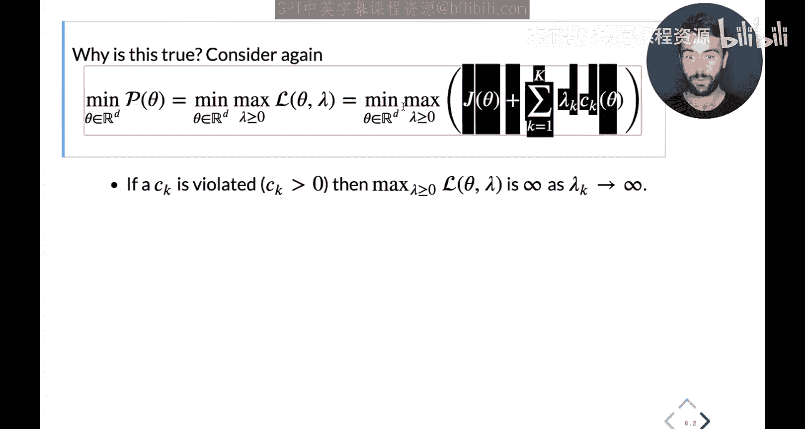

This objective is going to be infinity。🤧。And， therefore。

We would not choose any theta at which TK is violated because this will give us a really bad solution。

 It will give us infinity as the solution。So we would only want to， basically。

 this minimum has to be in the set of thetas for which no C K is violated if this theta。

🤧Were if if we， if this， if the solution to this optimization problem was a theta for which SK is violated。

 then its value would be infinity， and we would never choose that。 So this。

 the minimum of this objective。Lives in a space where no constraint is violated。

And now if no constraint is violated， well then the optimal lambda in this maximization problem has to be 0。

That's because this constraint here is now negative or at least not positive。

And since the lambmbda is trying to make this expression as small as possible。Well。

 as large as possible。 Well， if this is a negative number。

 then we want to multiply this negative number by 0 in order to make this entire expression larger。

 So when the C K are are are not violated， then this theta well， then， sorry， then then。

If noC is violated， then these lambda all equal 0， and in that case， this term becomes0 as well。

And so within the set of thetas。For which the function is feasible for which these constraints are not violated。

TheThe objective P of theta simply equals J of theta， which is our actual objective。

 And so at the minimum at the optimum P of theta， we're going to have the optimum of J of theta。

 So in other words， when all these decays are 0， the minimum of this objective function is simply the minimum of the original objective function and therefore the solution。

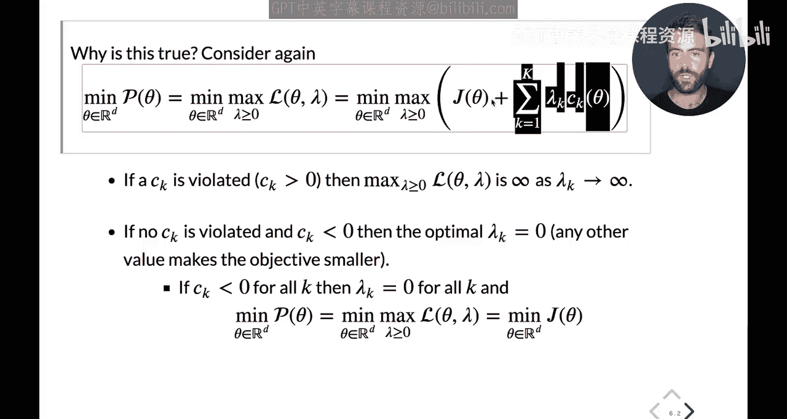

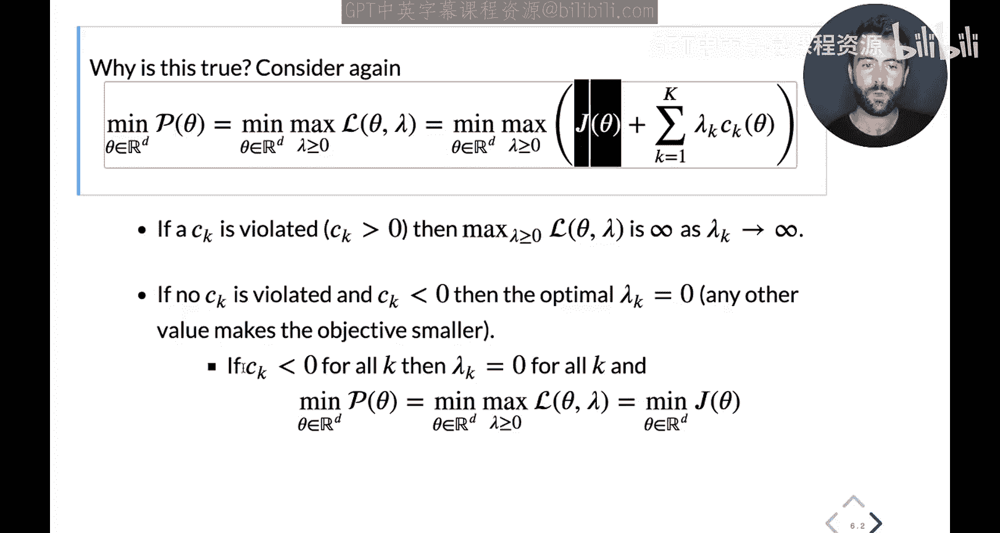

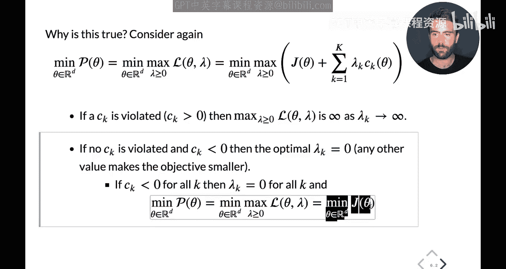

To the minimum of the prime allgrange form is the minimum of our initial optimization problem。

 This is a clever way of formulating our original constraint optimization problem。

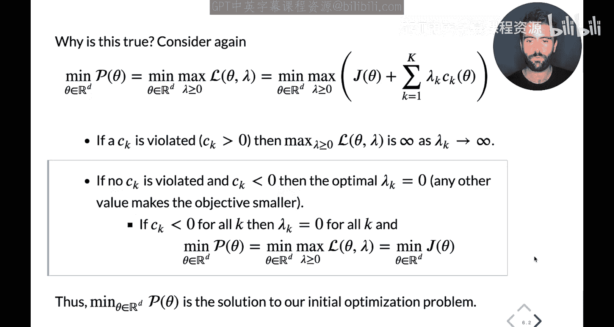

Now， given a primal optimization problem， which I've been denoting by P。

It is always possible to come up with a different objective function。

 a different optimization problem， which is called the LaGrange Dul and is noted by D。

So D here is a function of lambda。And we obtain this function by taking our laggrangian。

And changing the order of the max and the min。

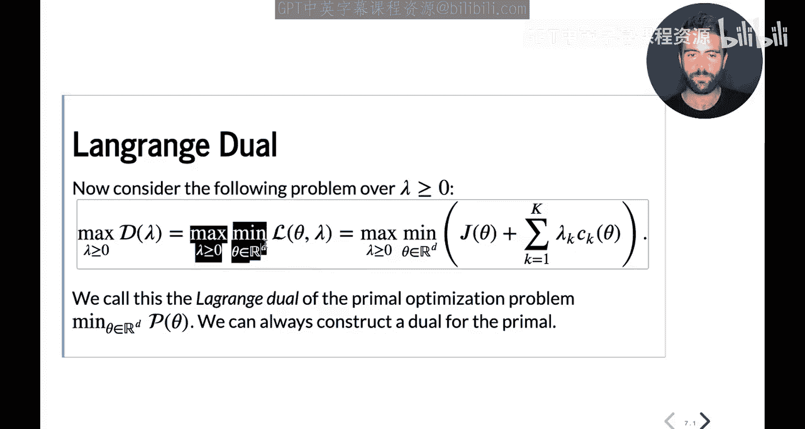

So before here， if you recall in the primal， so here we are minimizing the primal and the primal is the maximum over all the lamb does Now let's say that we flip the min and the max。

And we consider and we call this inner minimization problem over theta。

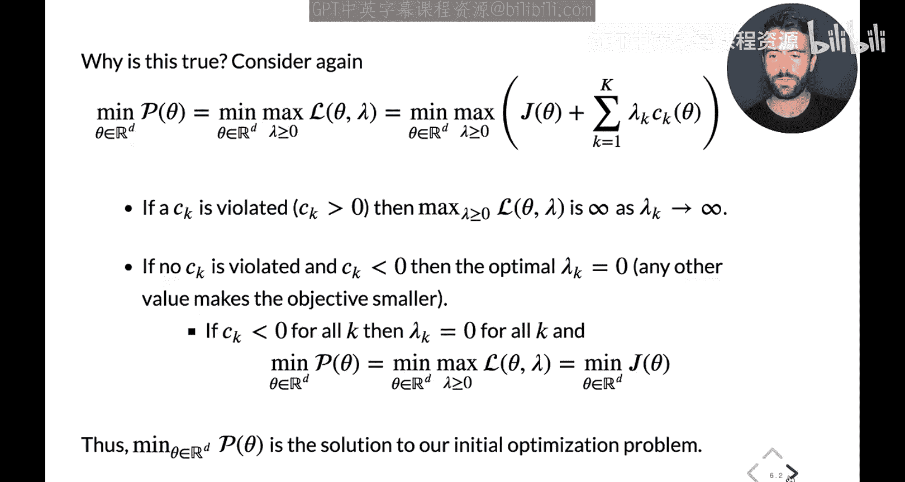

The result of this inner minimization problem is a function of Lambda。

 and we're going to denote this by D of Lada。And now we can then consider maximizing this function D of lambmbda and we call d of Lambda the dual。

 and here where the dual optimization problem is to maximize this dual function D。

So this is another optimization problem that we can always construct from the primal by flipping the max in the min。

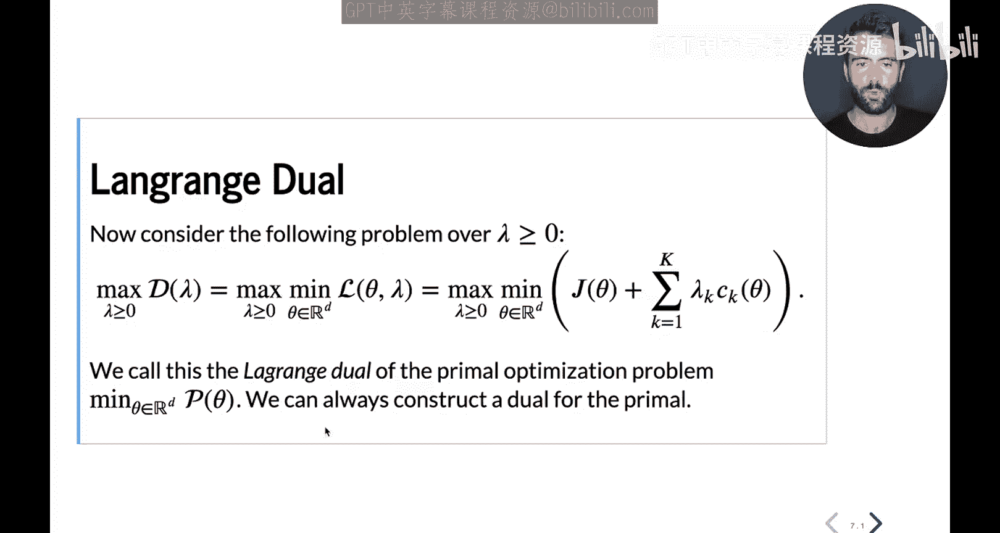

And now let's look at how this is related to our primal。

So it's easy to show that the following inequality holds。

 so the dual will be always less than or equal to the primal。

And then what's really interesting and I'm not going to prove this， but in many interesting problems。

 for example， in linear optimization and other kinds of optimization as well。

 these two problems are actually equivalent to each other。

 so in order to find the minimum we can either solve the primal or we can solve the dual and these problems are equivalent。

 so the primal and the dual are two equal formulations of the same optimization problem。

And now that should be really interesting and you're going to be。

 and you can now see that given that we have a primal and we can form the dual。

 this is a general approach that we can use to derive another perspective to the constrained optimization problem of the SVM that I showed you in the first set of slides。

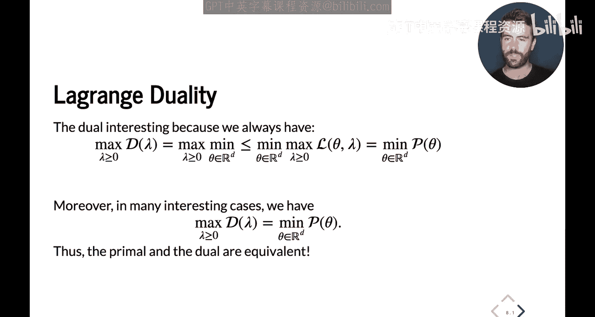

We're going to use this technique shortly， but before I go there。

 I just wanted to briefly mention that we saw。We briefly saw an application of this theory when we talked about regularization。

 so recall that weve been defining regularized optimization problems in this form where we have a penalty over a regularizer。

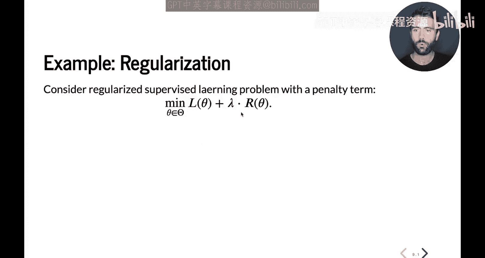

And I mentioned earlier that we can also show that this penalty based regularization term is equivalent to another form that involves a constraint。

 and in fact， there is a one to end mapping between the two。

 so it is possible to prove this claim rigorously by using the Laangian theory that we have discussed earlier。

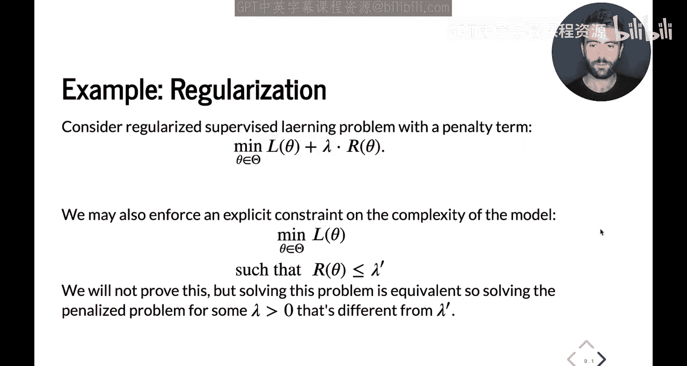

So again， we have this view on constraint optimizationization that's either based on constraints or penalties that are closely related。

 and in the next video I'm going to show how we can apply this theory in the context of SPBMs to derive new versions of the SVM algorithm。

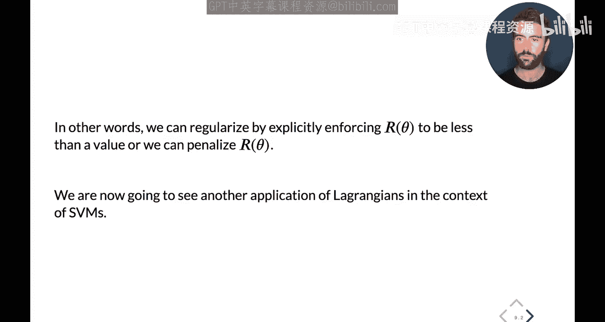