# 康奈尔大学《应用机器学习 CS 5787_ Applied Machine Learning 2020》中英字幕（deepseek p39 -39-Lecture 10. Part 2_ Dual Formulation of SVMs.zh_en -BV12udzYvEFM_p39-

Welcome back to Lec 10 of Applied Ma learninging， we are now at part two。In this part。

 I would like to now use the LaGrangerange theory that we saw in the previous video and apply it to support vector machines。

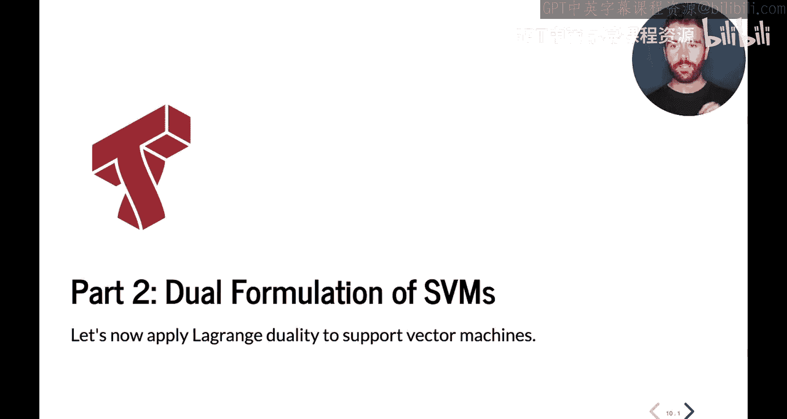

In order to do that， let me reintroduce a little bit some of the notation that we have defined in the previous lecture。

 and let's quickly remind ourselves what an SVM is。

So remember that we are in the setting of binary classification where we have a training data set of inputs and targets and these targets take one of two possible values plus1 or minus1。

 so this is the binary classification regime。

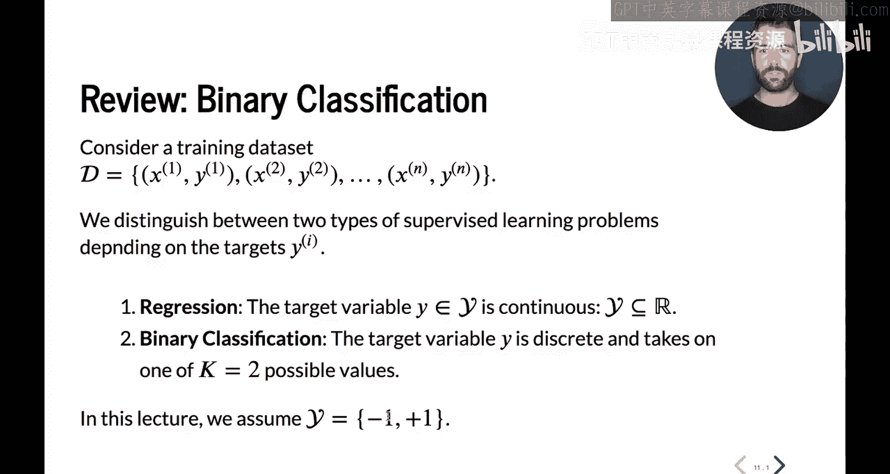

And we are working so far with linear model families families which are models of this form and here again y is minus y equals minus1 or1。

 this is our target and we can write this linear form in a succinct way using the vector dot product between theta and x and here we distinguish between the intercept theta and the targets and in the main vector of parameters。

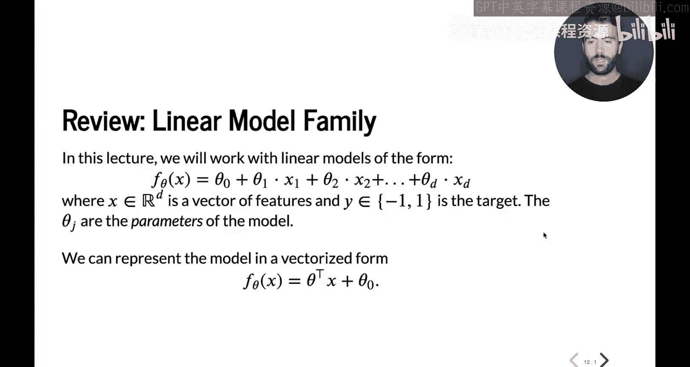

Theta， and we're going to see shortly why。嗯。

So our goal here is to find a good linear model， a good boundary between the classes that will distinguish between the two targets。

And at the very beginning of our lecture of SVMs， we define this concept of margin。

 which is the distance from any point to its its to the decision boundary or to the。

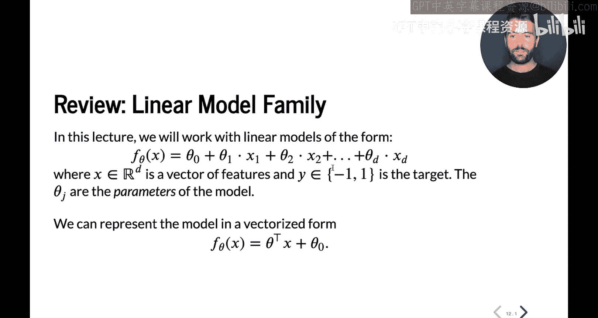

Separating hyperplane， as it's also called。And this， this， this distance。

 we can derive a very succinct form for it。 We can derive the following formula。 and this is。

This again， exactly corresponds to the distance between the point X from the point Xi to the separating hyperplane。

 and we denote this by gamma， and we call this the margin。

And the principle that we want to enforce is that we want to find hyperplanes with large margins。

 which means that fall in they separate the two boundaries， they separate the two classes。

 but they're also placed in a location that is as far as possible from any of the neighboring points。

So it separates the two points and it places them as far away as possible on each side of the boundary。

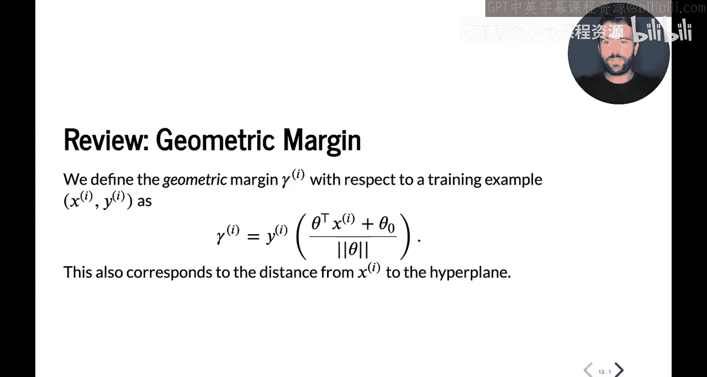

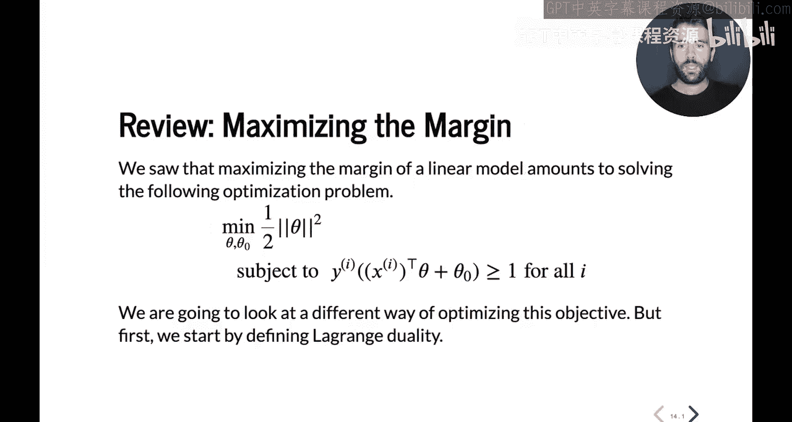

And the SVM is an algorithm that optimizes for the optimal margin。

And we can we have defined the following optimization problem。

Wwhich is a reformulation of a more intuitive way of defining this problem where we're simply optimizing over the margin gamma。

 we started with that problem， and then we went through a series of mathematical transformations to derive the following quadratic problem。

 whose solution is equivalent， whose solution was equivalent to that of the first problem with which we started。

But in this case， it's a quadtic form that's easier to solve。

And so this is typically the constrained version of the support vector machine problem。Here。

 this constraint ensures that every point is classified correctly and its target is its prediction。

 its score is at least1 or minus1， which are our two classes。

 or it could be even higher than one or lower than minus1 and under this set of constraints or looking for the vector theta which has the smallest norm。

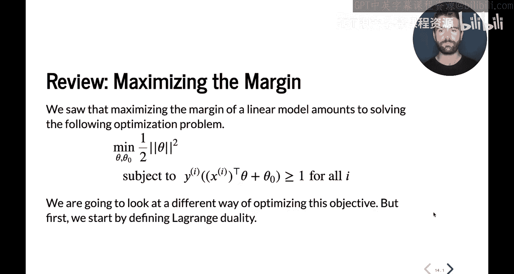

This is a constrain version this is a constraint optimization problem and in the previous video we saw that whenever we have a constrained optimization problem。

 we can also formulate this as an unconstrained version with penalties。

And then we can define the following primal laggrange form。

In which we in which we have added constraints as penalties and were optimizing over we're basically minimizing a function of theta。

 which is this thing this is a function of theta， we're minimizing it。

 but this function of theta is now itself an optimization problem over the lambda。

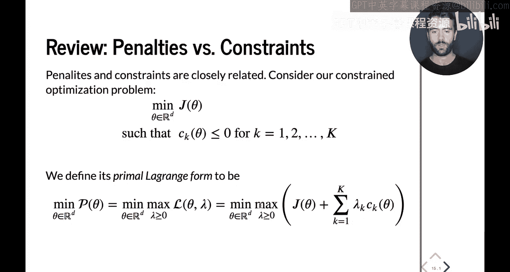

And we have seen that the solution to this problem here。

 the minimum of the primal Larrange form is the same as the minimum of this constrained objective function。

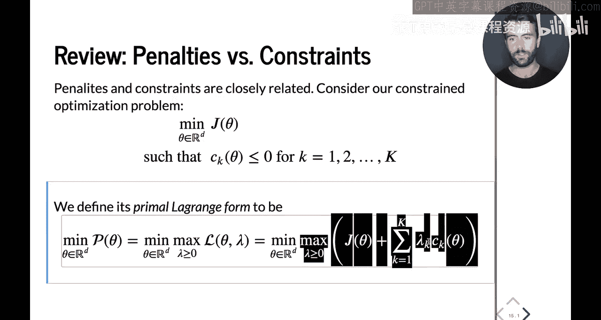

嗯。By the way， I just want to add here， I haven't mentioned this in the previous video， but this form。

 so in practice we would not use optimization solvers for this expression。

 this is more of a mathematical form， it's an interesting mathematical fact。

 that is used then to derive other optimization formulations that are actually solved but this is actually not something that this is not a that is used directly for solving an optimization problem。

 but it's an interesting mathematical fact that can be used to drive other optimization algorithms。

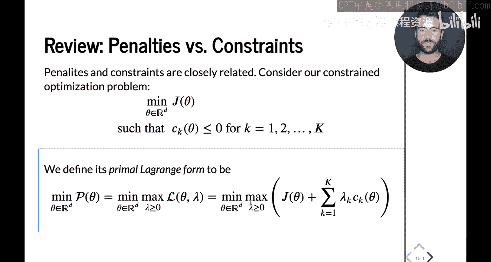

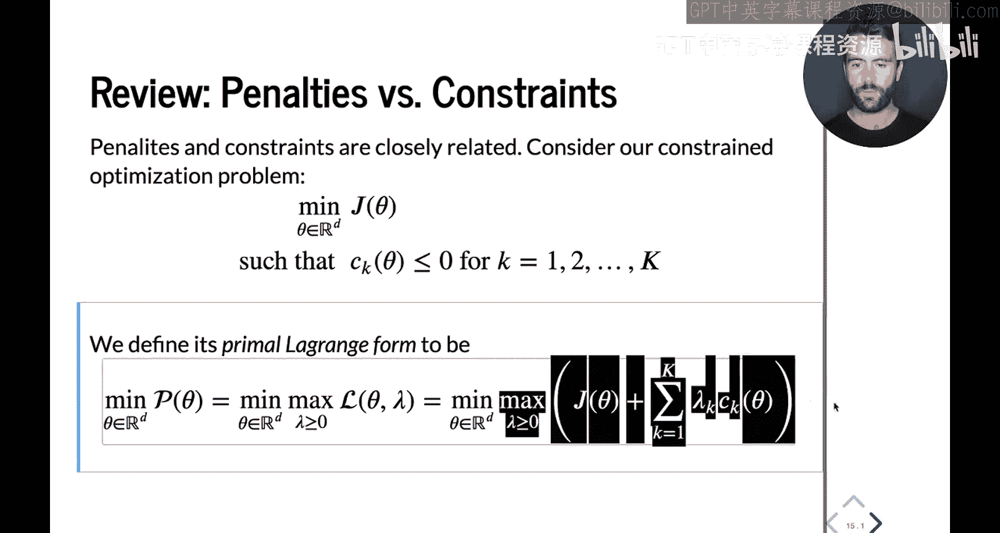

As I mentioned， these two forms have the same optimum。

And so now I would like to use this Larangerange theory and I would like to apply it to the SVM problem。

And the first step for that is to define eeangian。So consider the following objective and this is our Larange multi our Larange objective in which we have Lagrange multiplier Lambda。

 again， this is the objective and I have added these constraints with these Lagrange multipliers。

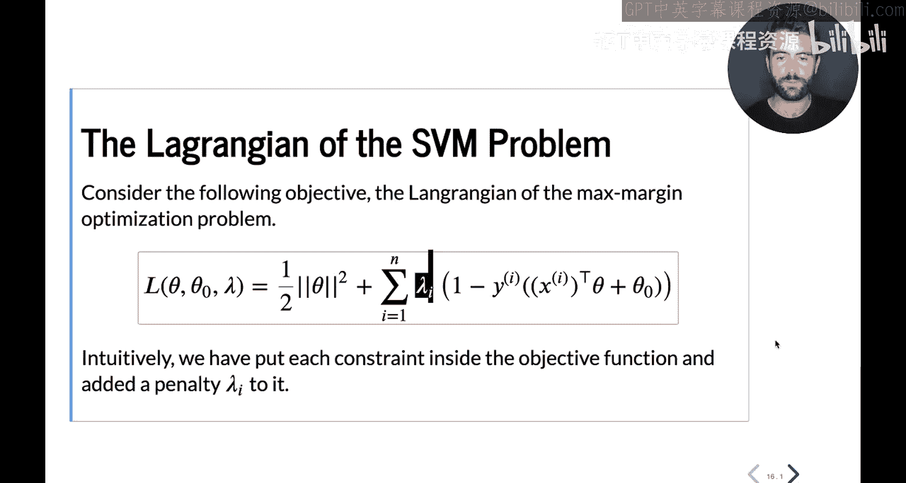

Now， in the previous video， I defined this concept of LaGrange duel。And given a laggrangian。

 we can optimize its primal form。or we can take the primal form and we can flip the max in the min。

To have them instead of being first the min then the max。

 we can flip them and have first the max and the min。

 and now this becomes an optimizationim function over lambmbda。And this optimization function。

It's called the duel。We can always construct this due。

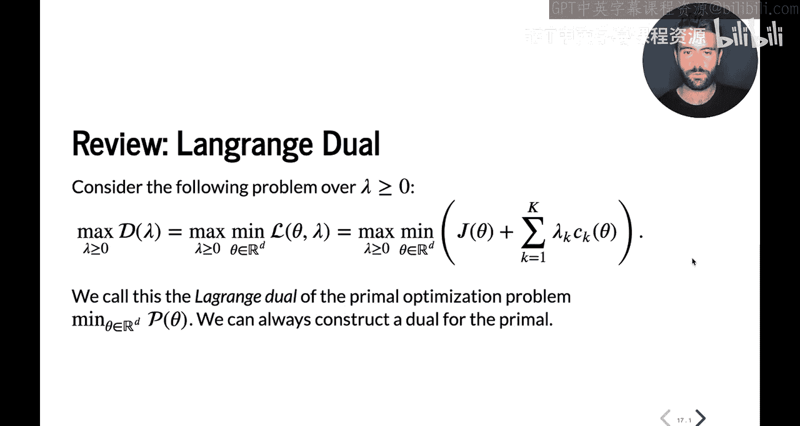

So let's now apply this and construct a dual for the optimization for the laggrangian of the SBM problem that we had earlier。

So recall that the laggrangian is as this form， and we want to be optimizing this laggrangian。

 We want to be minimizing we want to be。

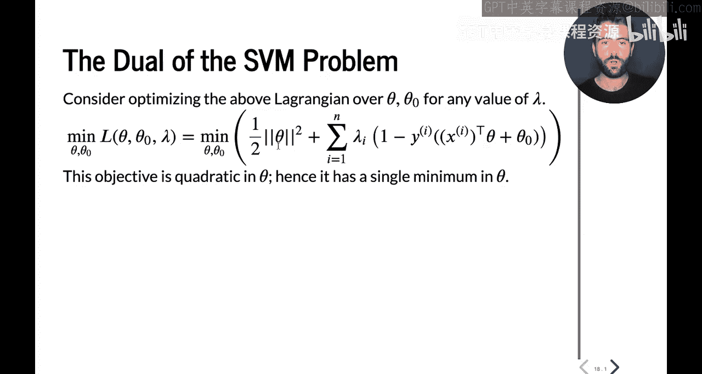

Maximizing the minimum over theta with this Laangian。

 So here on the next slide I'm going to define what d over lambda is and D over lambda is the thing that we're going to be maximizing over lambda。

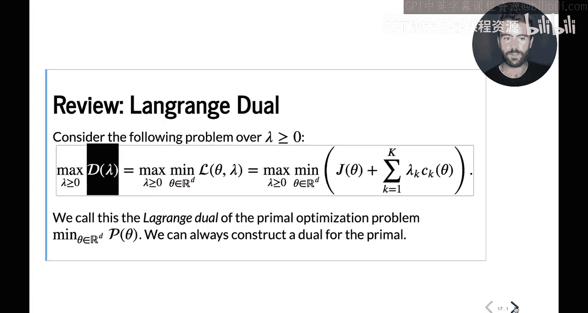

So this is the function， this is our D of lambda that we're going to be optimizing， and this is。

 as I mentioned earlier， this is the minimum of our laggrangian over the primal variables。

And therefore， it's the minimum of this objective。So how can we use this for optimization。Well。

 the first step is that we can actually compute this minimum in closed form for each function for each value of lambda。

 so this is a quadratic objective and it has a single minimum over theta and theta 0。

And we can derive this in closed form so we can derive an expression for theta in closed form。

So we can take the derivatives of this quadratic function。We can set them to0。

And then we can solve for theta and if we work out the math。

 I'm not going to work out the math in these lectures。

 but it's just straightforward algebra straightforward calculus and algebra to set this derivative to0。

 solve for theta， and then we will well， if we set the derivative to0 and then。

So well the derivative is going to be the gradient， the gradient will equal 0。

 the gradient is a vector and that will give us a set of equations。

 and from these equations we can derive the following。So these equations have to hold。

 and one of these equations happens to be an expression for theta。

So given that we have an expression for theta， which is our again， this is our minimizing theta。

 we can take this and we can plug it into the objective function that we see here。

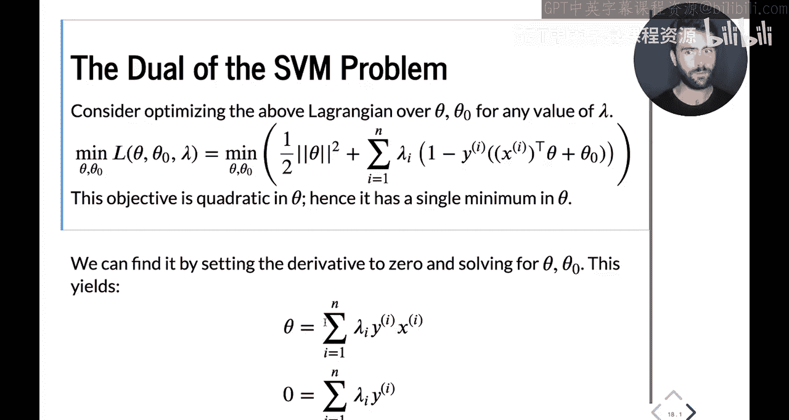

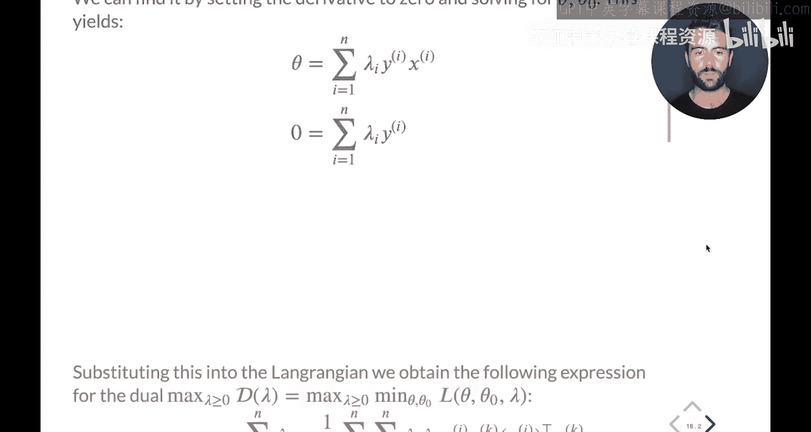

And if we plug it in into this objective functions， into this objective function。

 everything simplifies， and now our expression for this objective has the following form。

So this is the result of taking that expression for theta and plugging in and plug it。

 plugging it in。Back into the Laguangian。

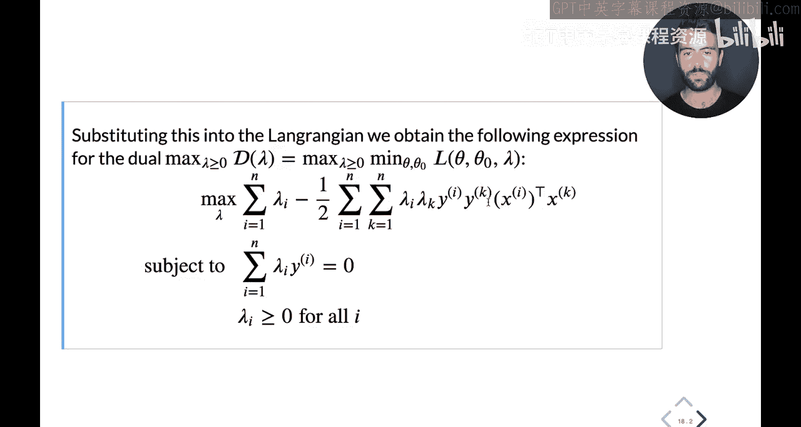

So now this expression， this is the solution to this optimization problem。

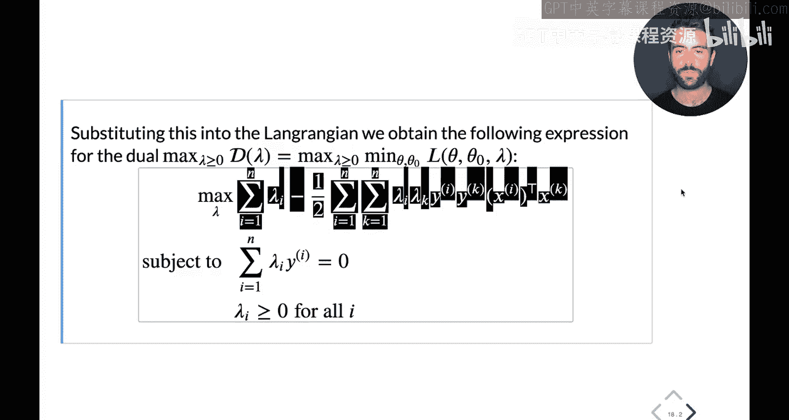

But I have solved for theta directly， and so for any lambda here。

 this is the expression for the Laangian with the optimal theta and with the optimal with the optimal set of parameters theta。

 this is going to be this form， so I have derived a closed form expression for d of lambda。

And now the only thing is， in addition to having this form。

 I also have to make sure that the Lambdas are always positive。

And that that the following constraint holds so this constraint we saw that it has to hold for in order for so we derive this by setting the optimal theta。

 So when this theta is the actual minimizer， this constraint must hold and therefore we also must enforce it as part of our dual optimization problem。

So now maximizing this over Lambda gives us the dual optimization problem。

 I have defined a dual version of the SVM problem， and this is how it looks like。

Now， recall that in the Larange duality for SVMs， we know that the maximum of the dual greater is less than or equal the minimum of the primal。

But it turns out that in the context of SVMs， we can show that these problems are indeed equivalent。

 so they reach the same minimum。Or sorryimum of each objective the optimum of each problem achieves the same objective value。

 And so here this is one of these cases where these two problems are actually equivalent。

Which means that now the duall of the SVM is something that we can use to formulate our problem。

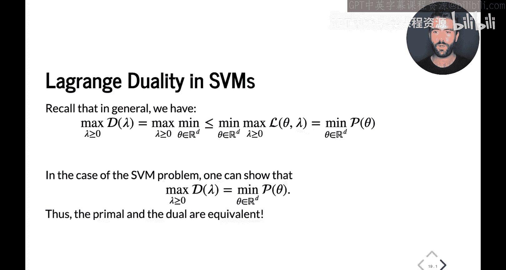

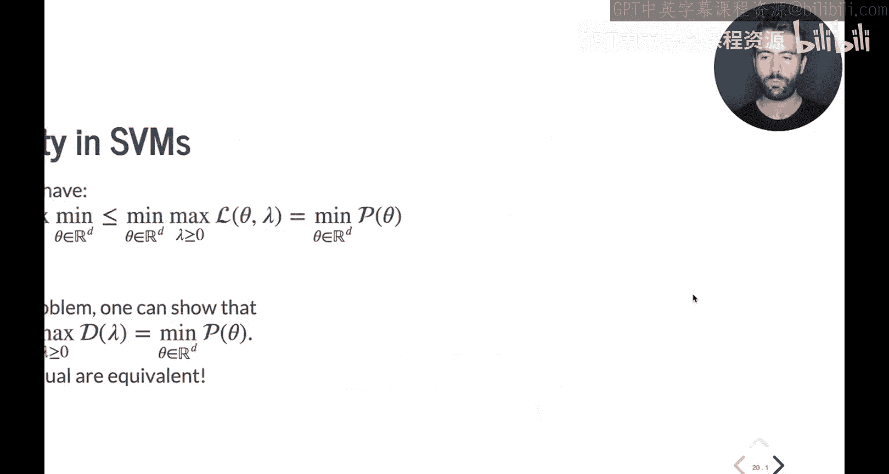

Now let's look at a few properties of the duel。We can make a few observations over this。

The first observation is that this is again a constrained quadratic optimization problem。

This is a reasonably good form， quadtic optimization problems are ones that we know how to solve。

It's also interesting that so now our optimization variables are the lambda and let's look at how many lambdas we have。

 we have exactly n of them， so we used to have n constraints in our previous problem and now we have n variables where again n is the size of our training data set。

嗯。And finally， one observation here is that this objective， it depends on our data X。

But it only depends on the dot products between the different x's。Which is quite interesting。

 And we're actually going to revisit this in the following lecture。

 And this is a property that I'm just going to briefly mention here。

 but we're going to come back to this in much more depth in the next lecture。

 and we're actually going to see that this is a very。

 very important property of the dual that is going to unlock It's going to unlock。

An entire new set of SVM type， SVM type algorithms that are going to be very powerful and that they're they're going to they're going to be a very important set of algorithms in machine learning。

 But for now， I will just leave it here。 and we're going to look at certain other aspects of the dual first。

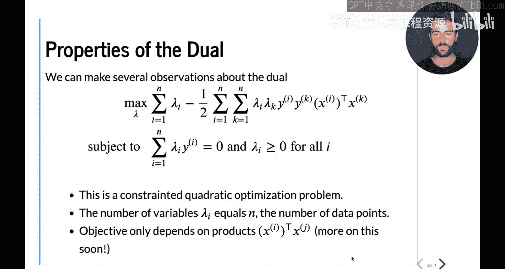

So we have defined a dual and a primal and how do we know when to solve the dual or the primal。

 There's going to be multiple reasons， but I'll start with two for now。

So first notice that the dimensionality of the primal。

 at least in terms of the size of the variables which we're optimizing， it is。

Linear in the number of features， the number of。Optimization variables equals to the number of features。

 there's D of them。 And so if we have a real large data set with many data points。

 then we should focus more on the primal。However， if we have a lot of features， but less data points。

 we want to use the dual。And so for example， if we want to do some kind of polynomial expansion。Then。

We can do this using the dual version。So if we have a very large number of polynomial features。

 if we have a polynomial of really high degree， our number of optimization variables does not depend on the degree of polynomial of the polynomial features that we use。

 And so potentially we could use a very large number of features in the dual but only but still are the complexity or optimization problem only we'll not increase as we add more features So this is an important property that we're going to be revisiting later。

 but for now I want to pause here with a definition of the dual and then in the next video we're going to look at how we can actually solve this duall and we're going to look at a few additional practical aspects of this dual approach。

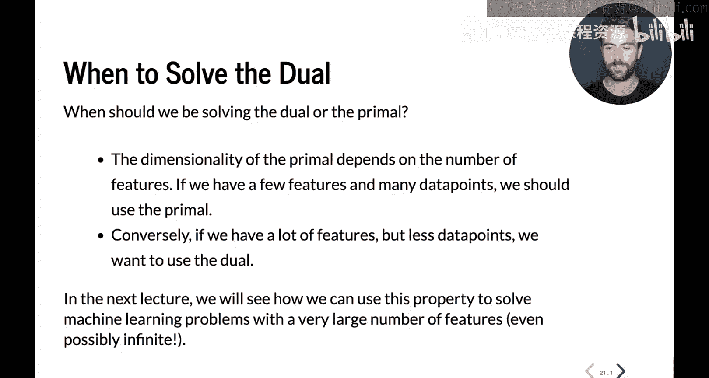