# 应用机器学习：10.2：支持向量机的对偶形式 🧠

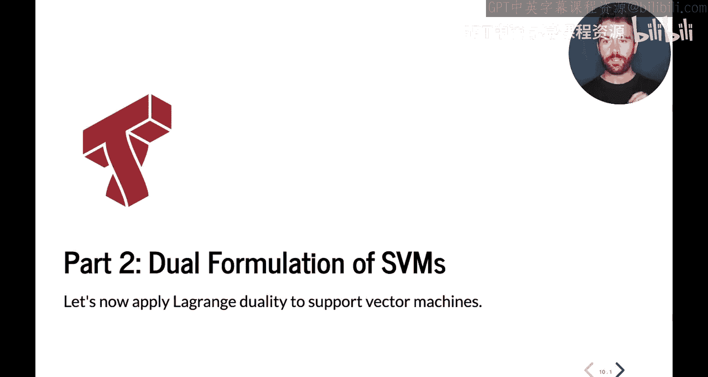

在本节课中，我们将学习如何将拉格朗日理论应用于支持向量机，并推导出其**对偶形式**。我们将从回顾SVM的基本概念开始，逐步构建其拉格朗日函数，并最终得到一个仅依赖于数据点内积的优化问题。

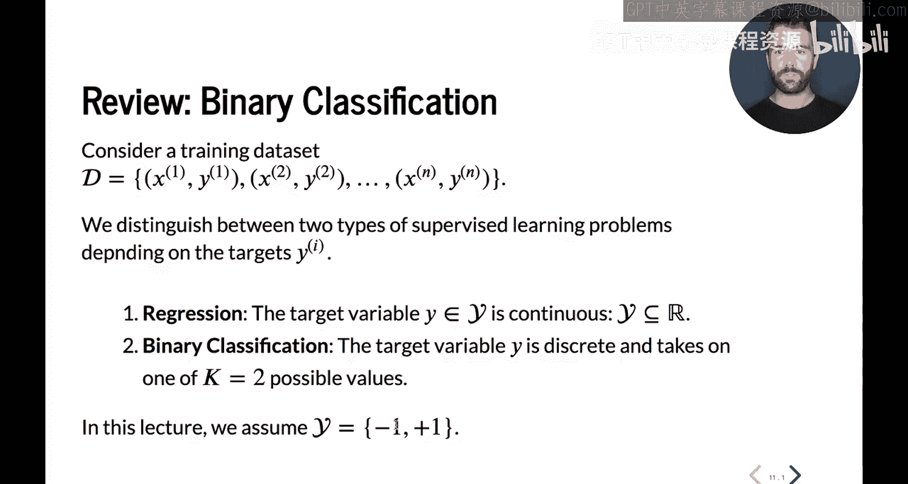

## 概述

上一节我们介绍了拉格朗日乘子法。本节中，我们将利用该理论，为支持向量机问题构建一个对偶优化形式。这种形式具有一些独特的优势，例如优化变量数量与数据点数量相关，并且其目标函数仅依赖于数据点之间的内积。

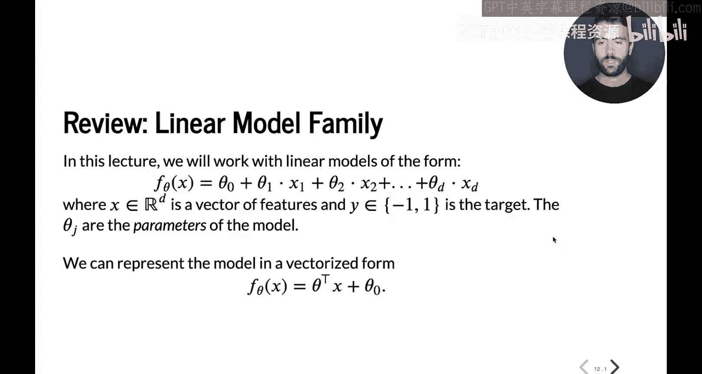

## 支持向量机回顾

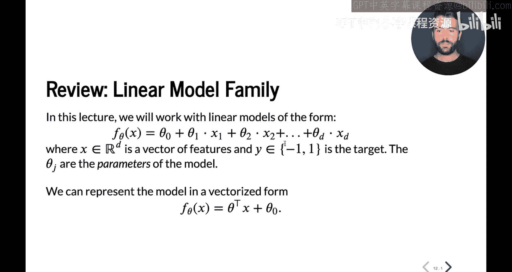

首先，让我们快速回顾一下支持向量机的基本设定。我们处于二分类场景中，有一个包含输入和目标值的训练数据集，目标值取两个可能值之一：+1 或 -1。

我们目前使用线性模型族，其形式如下：
`y = sign(θ^T x + θ_0)`
其中 y 是目标值（-1 或 1）。我们可以简洁地使用参数向量 θ 和输入 x 的点积来表示这个线性形式。这里我们将截距 θ_0 与主参数向量 θ 区分开来，稍后会看到原因。

我们的目标是找到一个好的线性模型，即一个能区分两个类别的决策边界。

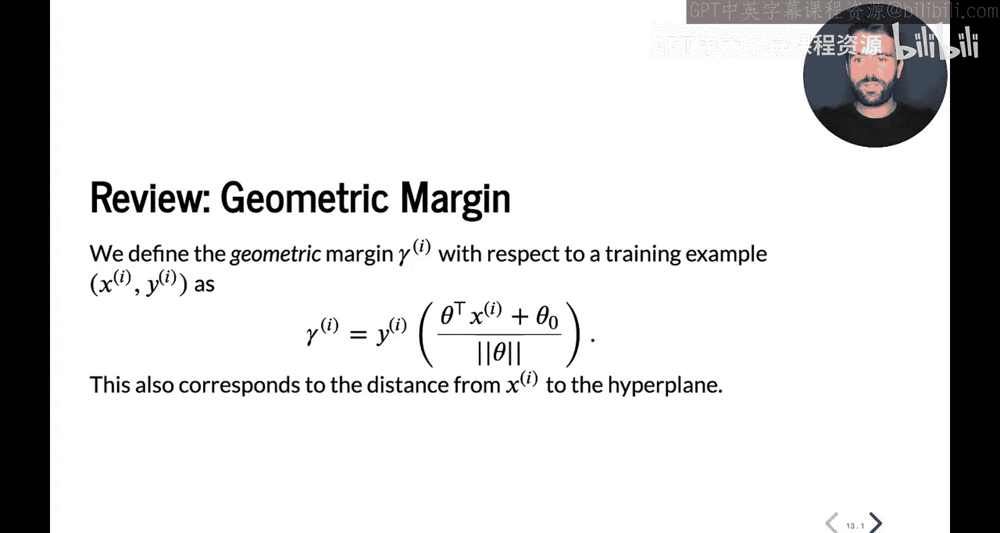

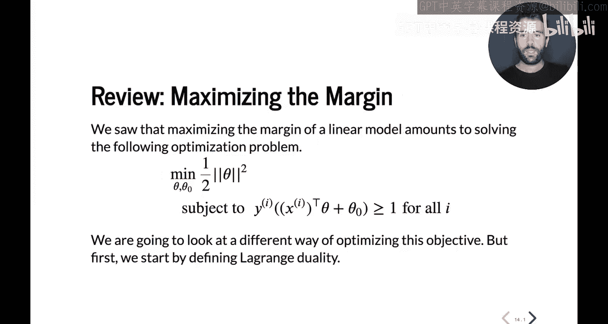

在SVM课程的开始，我们定义了**间隔**的概念，即任意点到决策边界（或称分离超平面）的距离。我们可以推导出该距离的简洁公式：
`γ_i = y_i (θ^T x_i + θ_0) / ||θ||`
这正好对应了点 x_i 到分离超平面的距离，我们称之为间隔 γ。

我们希望遵循的原则是找到具有**大间隔**的超平面。这意味着它不仅能分离两个类别，而且其位置尽可能远离任何邻近的数据点。

支持向量机是一种优化最优间隔的算法。我们定义了以下优化问题，它是更直观问题表述的重新形式化。我们从一个优化间隔 γ 的问题开始，经过一系列数学变换，推导出以下二次规划问题，其解与原始问题等价。

## SVM的约束优化问题

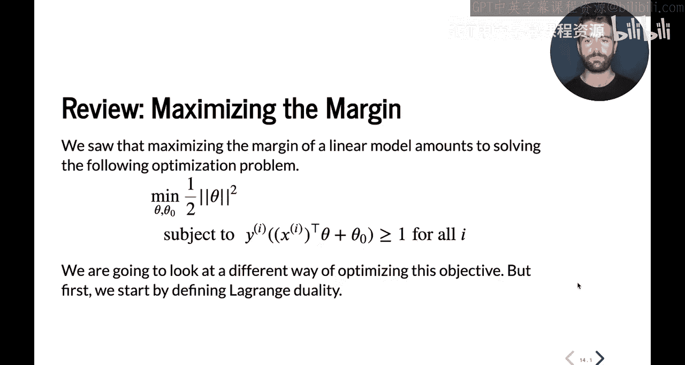

以下是支持向量机问题的典型约束版本：
`min_{θ, θ_0} 1/2 ||θ||^2`
`subject to y_i (θ^T x_i + θ_0) ≥ 1 for all i`

这个约束确保每个点都被正确分类，其预测得分至少为 1 或 -1（对应两个类别），或者可以更高/更低。在这组约束下，我们寻找具有最小范数的向量 θ。

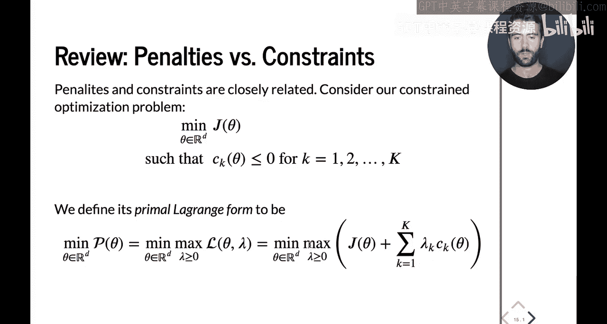

这是一个约束优化问题。在上一节视频中我们看到，对于任何约束优化问题，我们都可以将其表述为带有惩罚项的无约束版本。

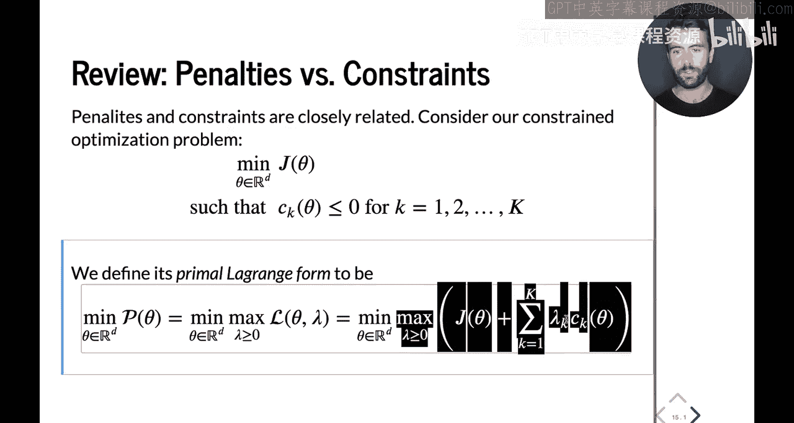

## 构建拉格朗日函数

我们可以定义以下**拉格朗日原始形式**，其中我们将约束作为惩罚项加入：
`L(θ, θ_0, λ) = 1/2 ||θ||^2 - Σ_{i=1}^n λ_i [y_i (θ^T x_i + θ_0) - 1]`
其中 λ_i ≥ 0 是拉格朗日乘子。

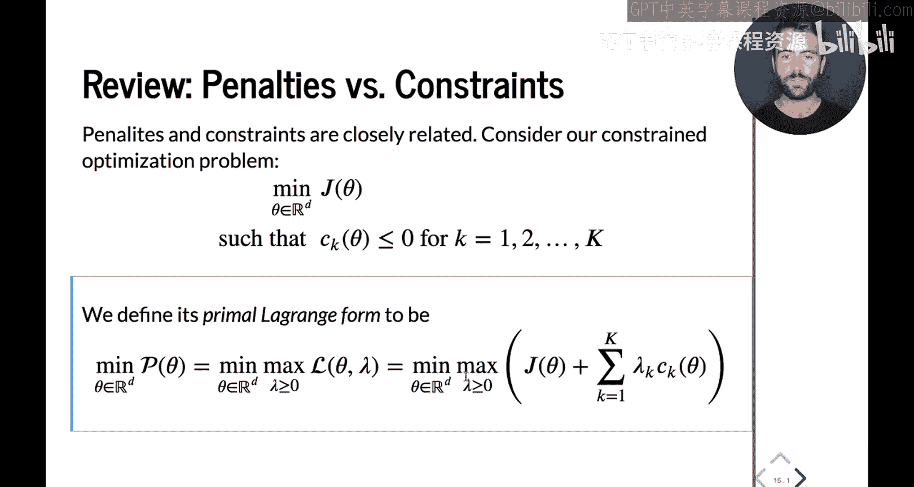

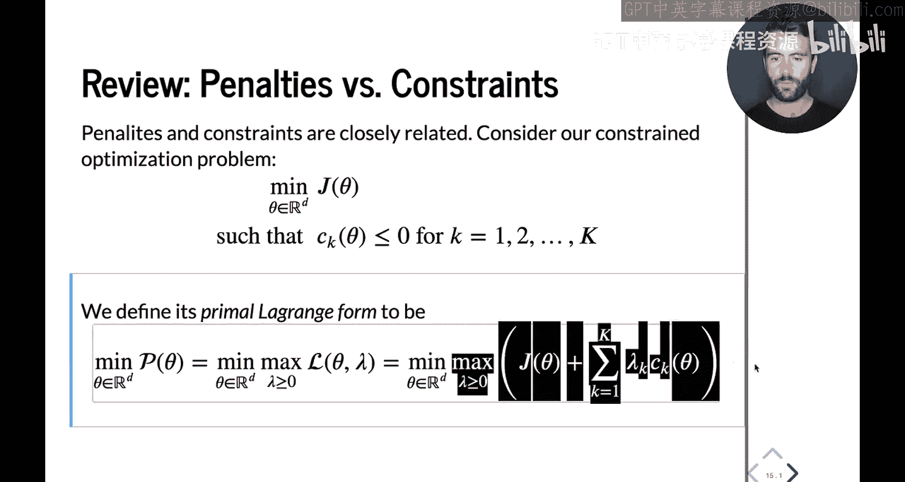

我们最小化一个关于 θ 的函数，但这个函数本身又是一个关于 λ 的优化问题。我们已经看到，这个拉格朗日原始形式的最小值与上述约束目标函数的最小值相同。

需要说明的是，在实践中，我们不会直接使用这个表达式来求解优化问题。它更像是一个数学形式，用于推导其他实际可解的优化公式。

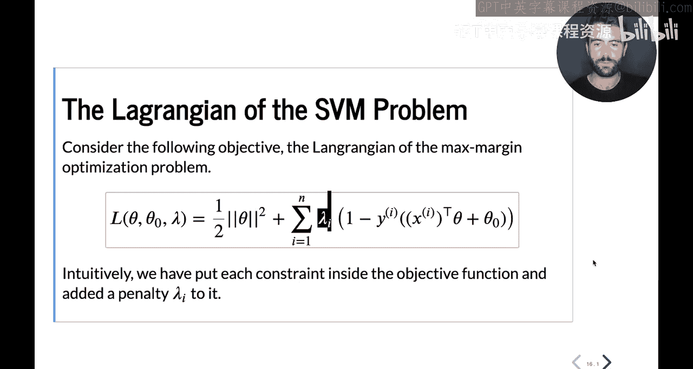

## 拉格朗日对偶

这两个形式具有相同的最优解。现在，我想应用拉格朗日理论到SVM问题。第一步是定义拉格朗日函数。

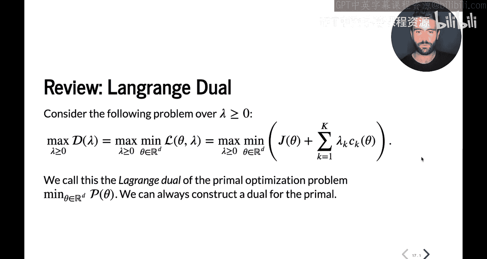

考虑以下目标函数，这是我们的拉格朗日目标，其中我们添加了带有拉格朗日乘子 λ 的约束。

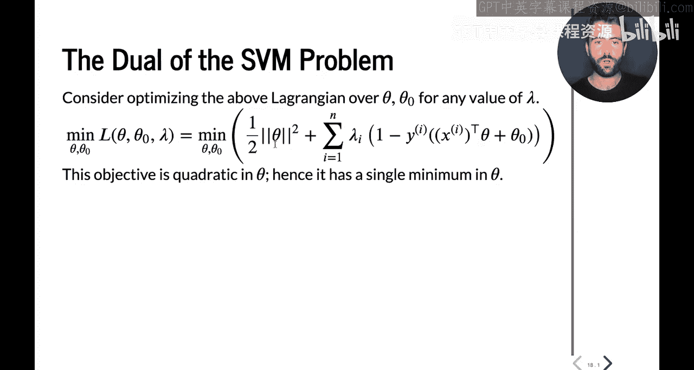

在上一节视频中，我定义了**拉格朗日对偶**的概念。给定一个拉格朗日函数，我们可以优化其原始形式，或者我们可以翻转 min 和 max 的顺序，得到首先关于 λ 求最大，然后关于 θ 求最小的问题。这个新的优化函数称为**对偶函数** `D(λ)`。

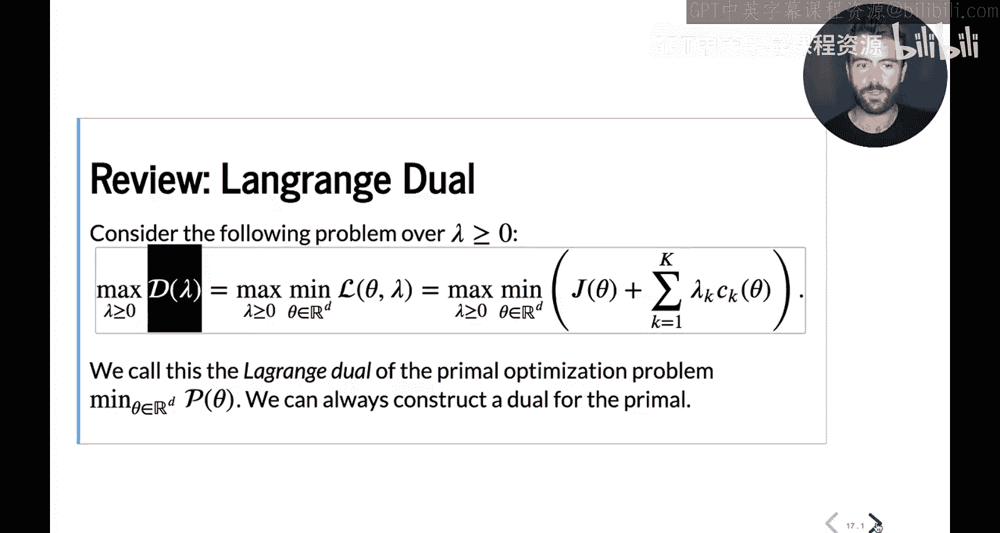

## 推导SVM的对偶形式

现在让我们应用这个理论，为之前SVM问题的拉格朗日函数构建对偶形式。

回想一下，拉格朗日函数具有上述形式。我们想要优化这个拉格朗日函数，即关于 λ 最大化关于 θ 的最小值。`D(λ)` 就是我们将要关于 λ 最大化的函数，它是拉格朗日函数关于原始变量（θ, θ_0）的最小值。

因此，它是这个目标函数的最小值。我们如何将其用于优化呢？第一步是，对于每个 λ 值，我们可以以闭式解的形式计算出这个最小值。这是一个关于 θ 的二次目标函数，存在唯一最小值。

我们可以对这个二次函数求导，令导数为零，然后求解 θ。通过数学运算（本讲座不展开推导），我们可以得到 θ 的闭式表达式。

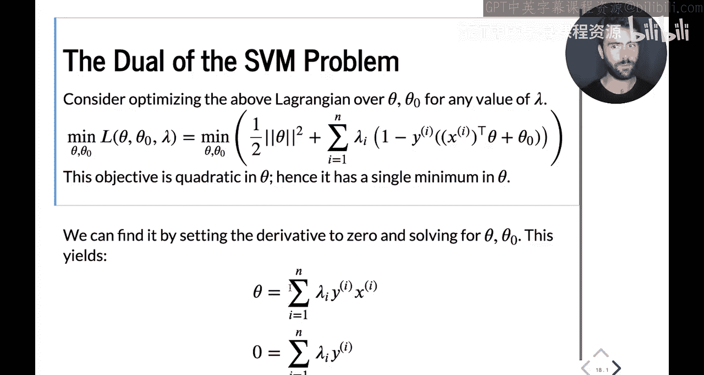

当我们设导数为零时，梯度（一个向量）将等于零，这给出一组方程。从这些方程中，我们可以推导出以下关系。这些方程必须成立，其中一个方程恰好给出了 θ 的表达式。

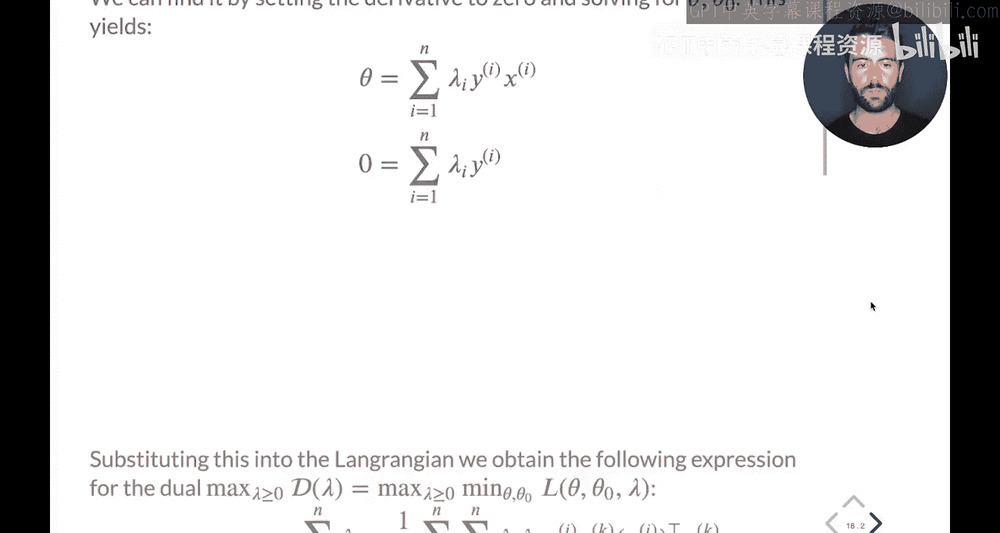

给定这个 θ 的表达式（即我们的最小化 θ），我们可以将其代入上面看到的拉格朗日目标函数中。

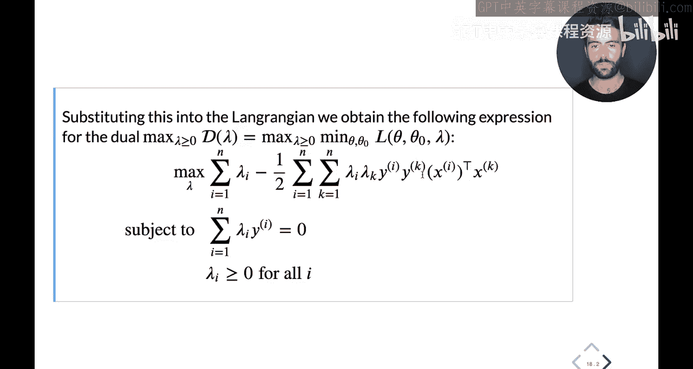

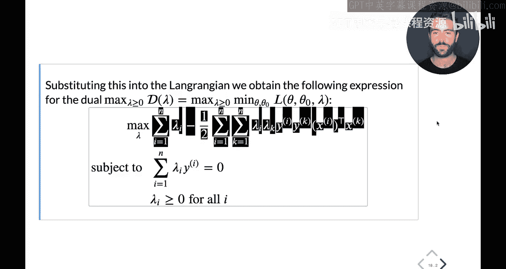

将其代回拉格朗日函数后，一切都被简化了。现在，我们的目标函数表达式具有以下形式。这是将 θ 的表达式代入拉格朗日函数后的结果。

## SVM对偶优化问题

现在这个表达式是优化问题的解。对于任何 λ，这都是具有最优参数 θ 的拉格朗日函数形式。因此，我得到了 `D(λ)` 的闭式表达式。

现在唯一的问题是，除了这个形式，我还必须确保 λ 始终为非负。此外，以下约束必须成立：`Σ_{i=1}^n λ_i y_i = 0`。我们通过设定最优 θ 推导出这个约束，因此也必须将其作为对偶优化问题的一部分来强制执行。

现在，关于 λ 最大化这个函数，就得到了**对偶优化问题**。我定义了SVM问题的对偶版本，其形式如下：
`max_λ Σ_{i=1}^n λ_i - 1/2 Σ_{i=1}^n Σ_{j=1}^n λ_i λ_j y_i y_j (x_i^T x_j)`
`subject to λ_i ≥ 0 for all i, and Σ_{i=1}^n λ_i y_i = 0`

在SVM的拉格朗日对偶中，我们知道对偶的最大值小于或等于原始的最小值。但事实证明，在SVM的背景下，我们可以证明这两个问题实际上是等价的，它们达到相同的最优目标值。这意味着现在SVM的对偶形式可以用来表述我们的问题。

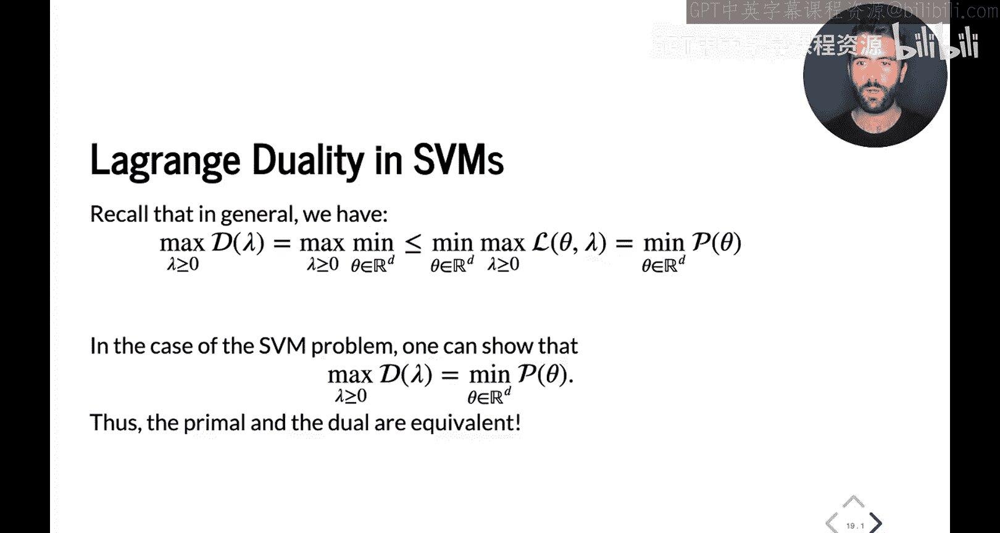

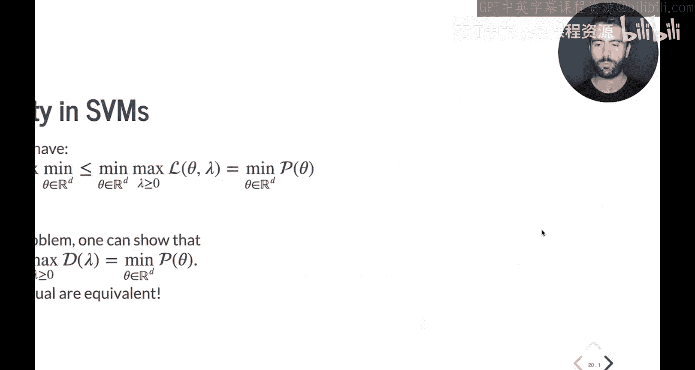

## 对偶形式的性质

现在让我们看看对偶形式的一些性质。我们可以做出以下几点观察。

首先，这又是一个**约束二次优化问题**。这是一个相当好的形式，我们知道如何求解二次优化问题。

其次，现在我们的优化变量是 λ。让我们看看有多少个 λ：我们恰好有 n 个，与训练数据集的大小相同。在之前的问题中我们有 n 个约束，现在我们有 n 个变量。

最后，一个重要的观察是：这个目标函数依赖于我们的数据 X，但**它只依赖于不同 x 之间的点积**。这非常有趣，我们将在下一讲中重新讨论这一点。这是一个非常重要的性质，它将开启一类全新的、非常强大的SVM类型算法。但现在，我们暂时把它放在这里，先看看对偶的其他方面。

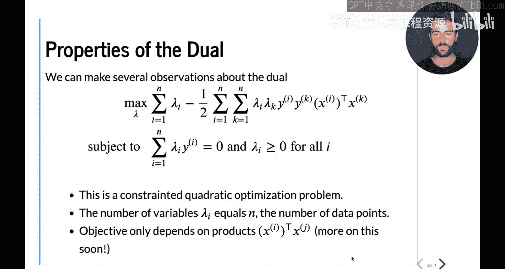

## 何时使用原始形式或对偶形式？

我们定义了原始形式和对偶形式。我们如何知道何时求解对偶或原始形式？原因有很多，我先从两点开始。

首先，注意**原始形式的优化变量维度与特征数量呈线性关系**。优化变量的数量等于特征的数量 D。因此，如果我们有一个具有许多数据点的大型数据集，我们应更关注原始形式。

然而，如果我们有很多特征，但数据点较少，我们则希望使用对偶形式。例如，如果我们想做某种多项式扩展，那么可以使用对偶版本。如果我们有非常多的多项式特征（例如非常高次的多项式），我们的优化变量数量并不依赖于所使用的多项式特征的次数。因此，我们可以在对偶中使用大量特征，但优化问题的复杂度不会随着添加更多特征而增加。这是一个重要的性质，我们将在后面重新讨论。

## 总结

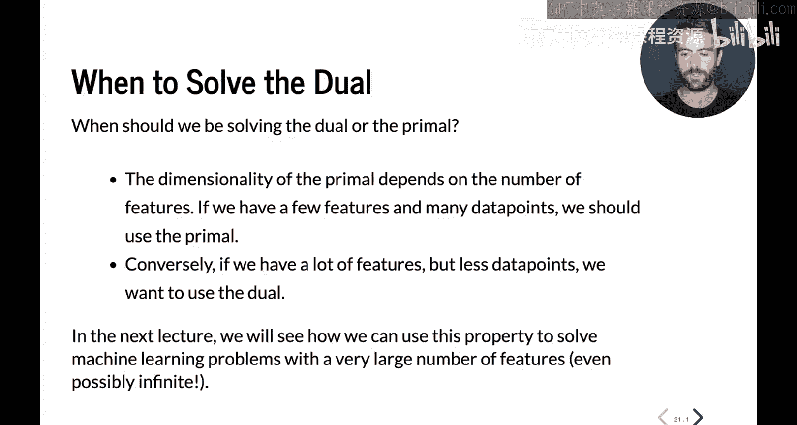

本节课中，我们一起学习了支持向量机的对偶形式推导。我们从回顾SVM和间隔的概念开始，然后构建了其拉格朗日函数。通过应用拉格朗日对偶理论，我们得到了一个仅依赖于数据点内积的优化问题。这个对偶形式将优化变量从特征数量（D）转换为数据点数量（n），并且在处理高维特征空间时具有潜在优势。在下一节中，我们将探讨如何实际求解这个对偶问题，并了解这种对偶方法的更多实际应用方面。