# 康奈尔大学《应用机器学习 CS 5787_ Applied Machine Learning 2020》中英字幕（deepseek p40 -40-Lecture 10. Part 3_ More on SVM Duals.zh_en -BV12udzYvEFM_p40-

This is now part 3 of lecture 10 of Apped machinech learning in which we talk about the dual formulation of the support vector machine。

In the previous few videos， we defined the dual formulation of the optimization problem that is solved by the support vector machine algorithm。

And we derive this using Lagrange theory。In this video。

 I want to continue talking about the dual formulation of the SVM。

 and I would like to mention a few important considerations that aware of if you should be aware of when deploying these dual algorithms in practice。

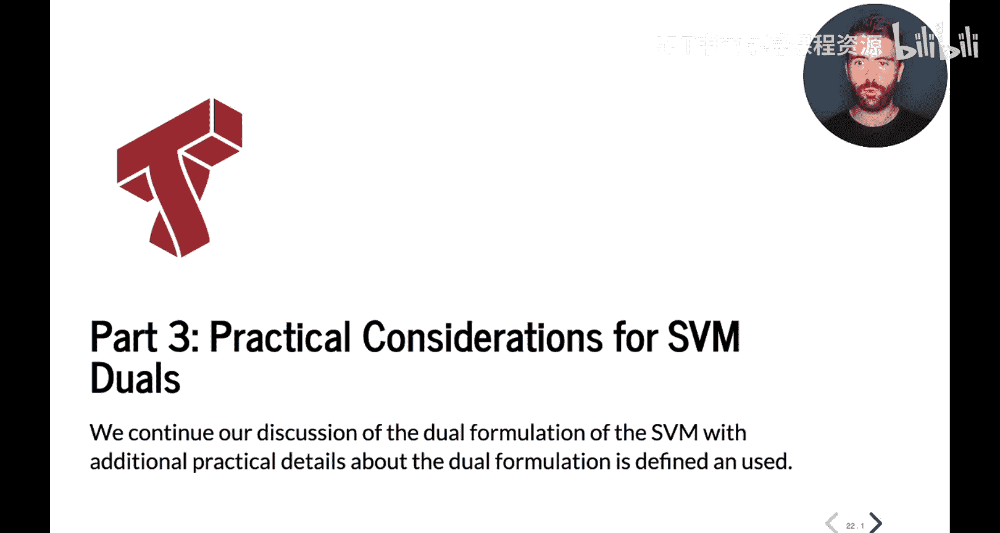

So recall that we are in a setting where we're doing binary e classificationification。

 we have a data set of training examples x and y， y is the target。

 and it takes one of two possible values， either minus1 or plus1。

 depending on which of the two classes x belongs to。

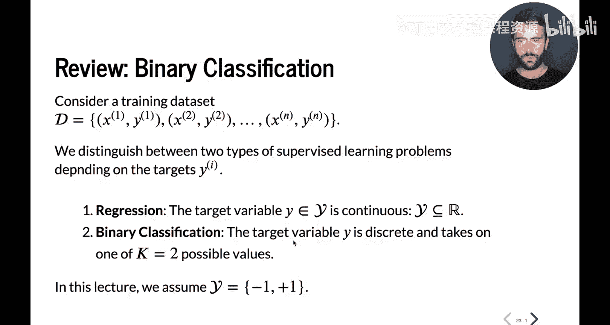

And we saw in the previous set of videos that one way in which we can choose this hyperplane that separates two classes。

 one way in which we can define a classifier is we can search for separating hyperplanes that have a high margin。

 which means that they are far away from the points of either class。

And when the hyperplane is far from the points from the two classes。

 it means that it's in a safe region and it's just an intuitive way of choosing the decision boundary。

And we saw that we can formulate the search for this maximum margin hyperplane via the following constrained quadratic optimization problem。

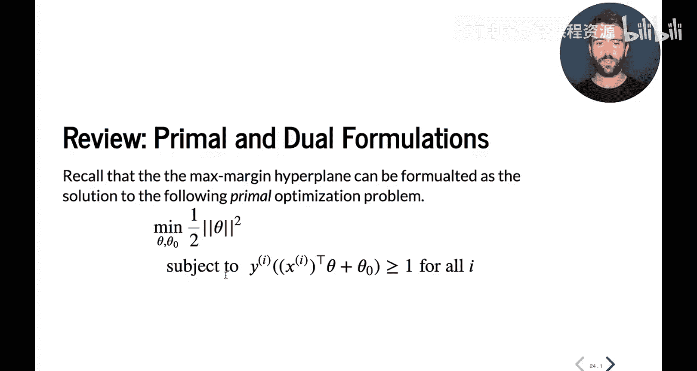

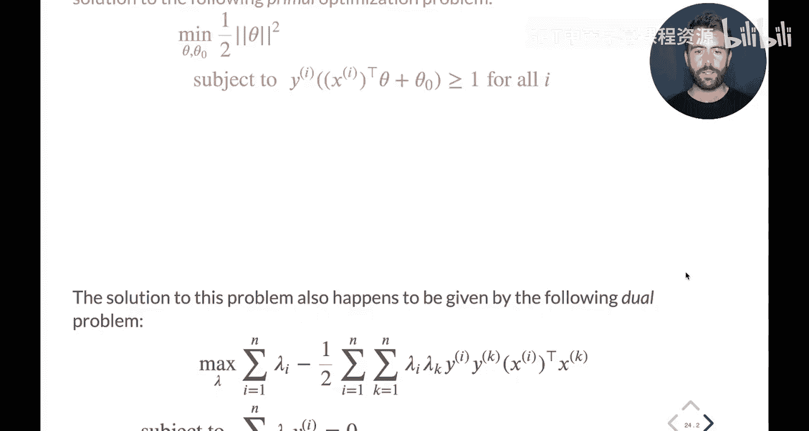

Then by using principles of Lagrange theory， we showed that we can derive the following dual problem and this dual problem achieves the same value of the objective as the previous one as the previous primal objective optimization problem。

So solving instead of solving the primal， we could be solving this dual as well。

 and this is another constrained quadratic optimization problem。

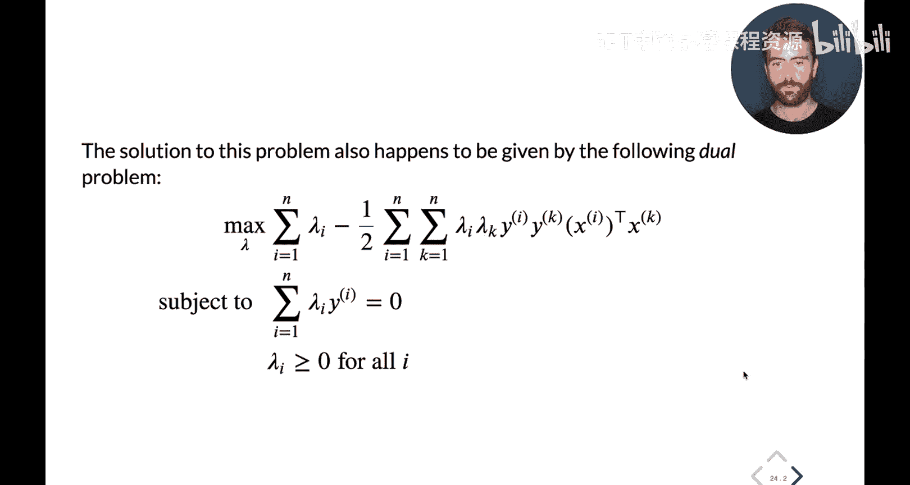

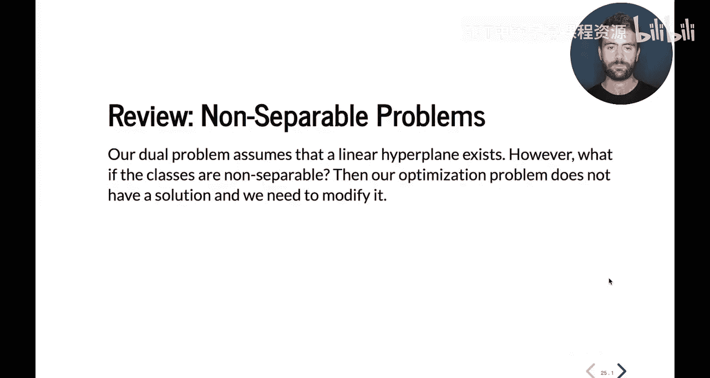

Now， there are a few issues with this approach that I have in a way shoved under the rug。

One issue is that so far all of this analysis applies only to separable problems。

 which means problems in which there exists a decision boundary which is able to perfectly classify our training examples In practice。

 we were not able to perfectly classify our training examples in practice。

 there' is usually some points which we cannot perfectly classify with a linear decision boundary。

And so we need to modify our optimization problem。We did this in the previous lecture and we did this by introducing these extra variables called Slack variablessci。

 and essentially Psi allows us to satisfy this constraint approximately。

 or it allows for a small violation of this constraint whose magnitude is given by the variable Xsi。

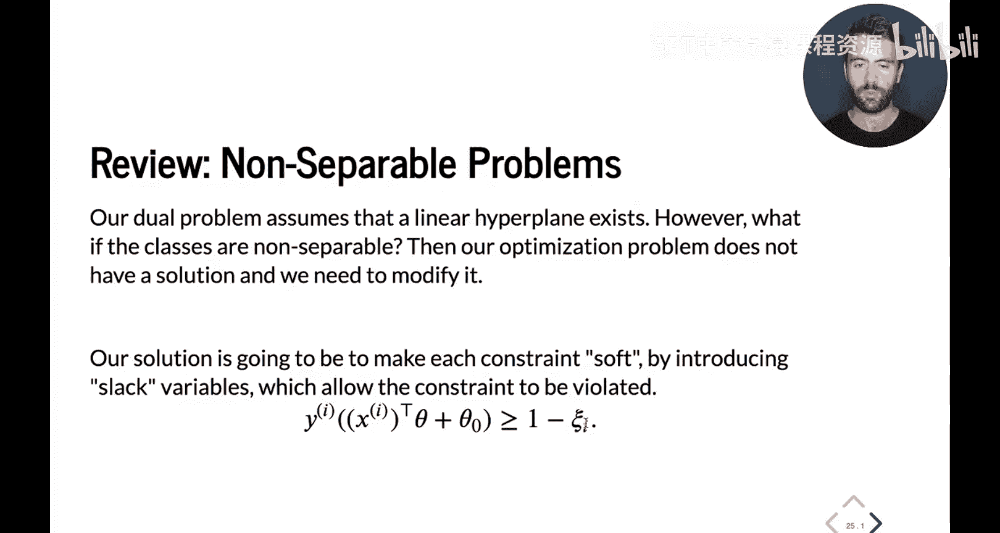

And then when we introduce these like variables， we have the following optimization problem here we have our typical set of constraints。

 but now this scsci allows the perfect constraint to be slightly violated。

 but we want this violation to be small， therefore we also minimize the magnitude of thesess with some penalty C。

So this is the primal version of the optimization problem for an SVM with Sck variables that can fit a nonseparable data set。

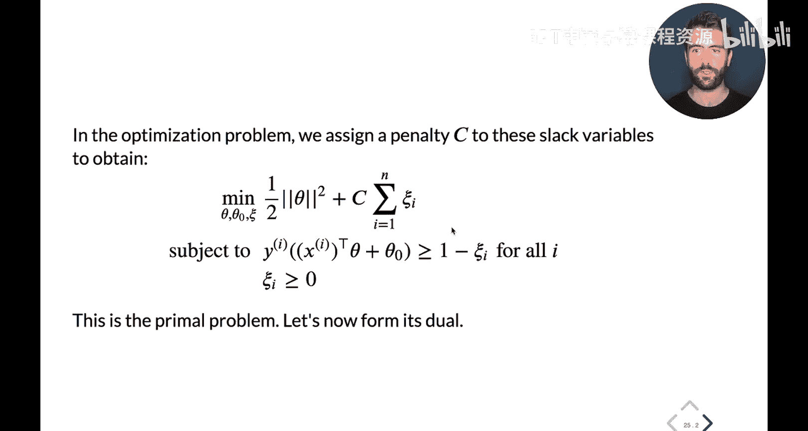

Let's now look at the duall of the optimization problem。In order to find the duall。

 we first start by defining the Laangian version， our Laangian now has two sets of dual variables。

 Lada and mu， The reason we have the mu is that we now have an additional set of constraints cosi I for each I because we have these additional constraints。

 we now have to introduce additional lagrangrange multipliers which are here and。

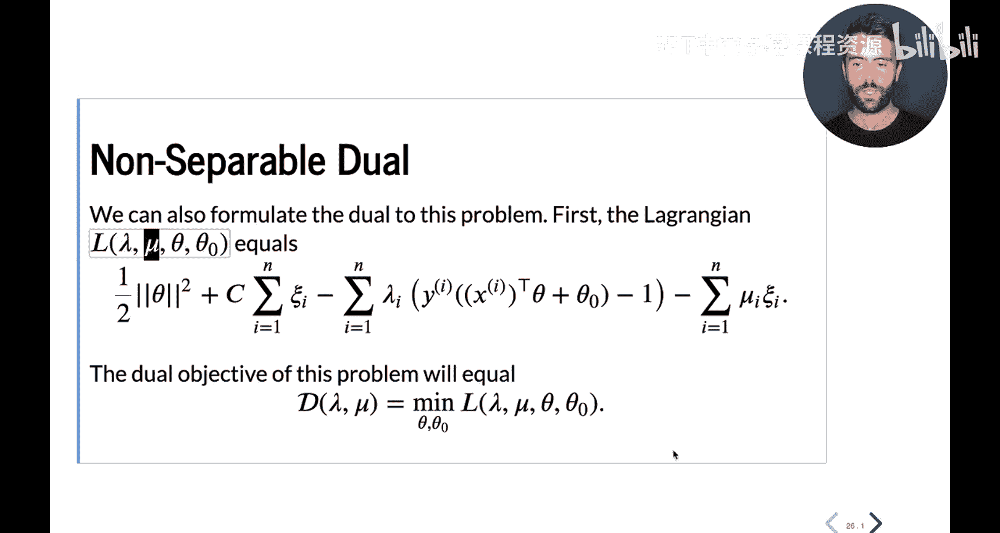

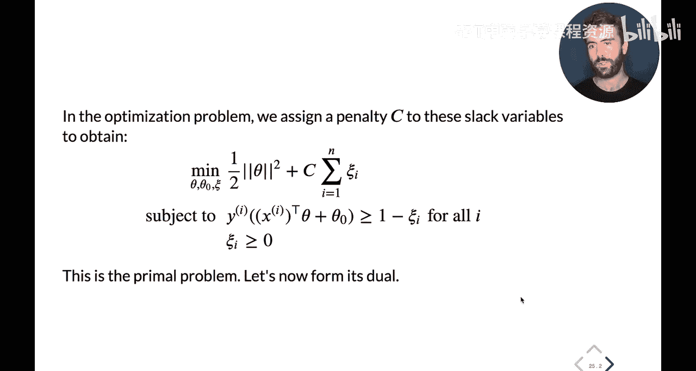

And this is simply multiplying our。Constrained the constraint， which is justscii。

And this is our usual set of constraints with the largerange multiplier for the main set of constraints。

And now we have our objective， which is here。So this defines our dual optimization problem。

And then we can this defines our dual objective if we now perform minimization of the lagangian over the primal variables theta。

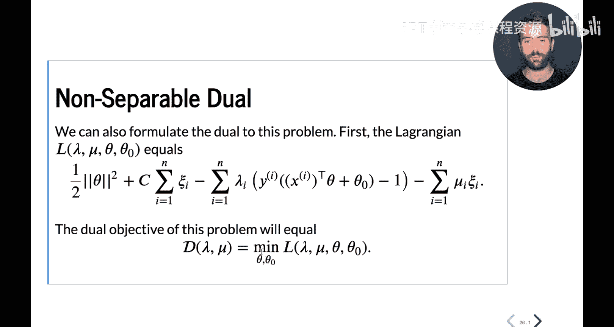

Similarly to how we did this in the previous video， we can again take the Laangian here。

 we can compute we can take its derivative with respect to theta because again this is simply a quaratic function of theta。

 we can solve for we can take the gradient with respect to theta， we can set the gradient to0。

 and that will give us a set of equations that must hold at the minimum value of theta。

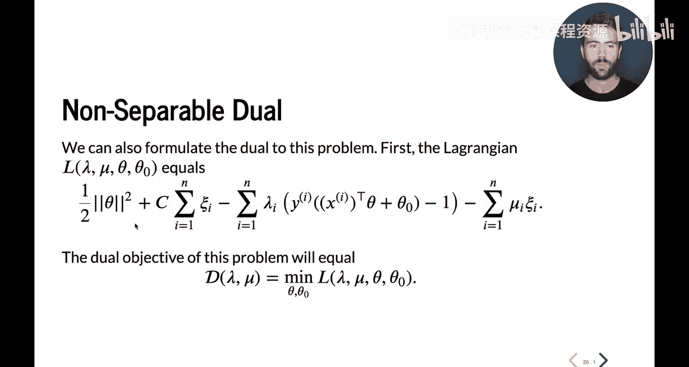

And then if we solve these equations， we can obtain a closed form for theta。

 we can plug it in into the objective， and we can find a closed form for for this。

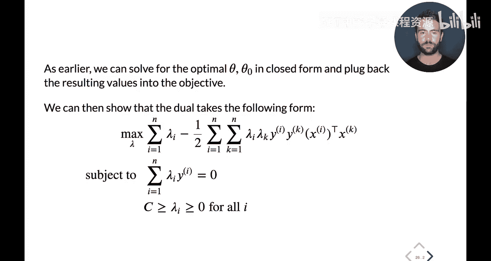

We can find a closed form for this function that no longer has instead of writing this as a minimum。

 we can get a close form expression for this theta。

 plug it in and we have a nicer expression that's just。

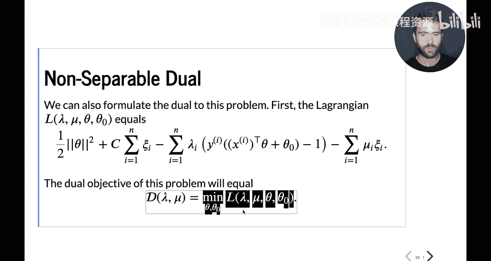

A formula， which instead of an optimization problem。

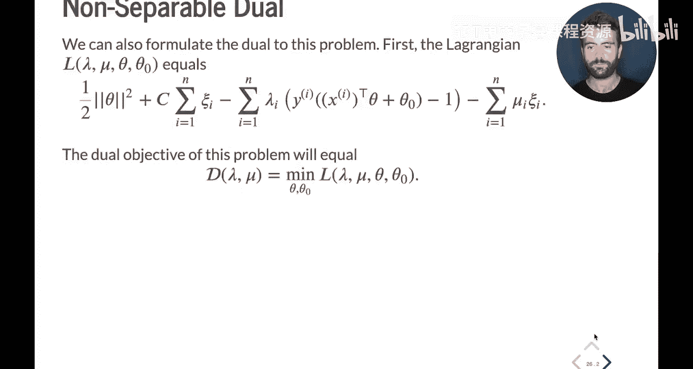

In addition to that， few other steps of we would do a few other transformations to this problem。

We can simplify things to get rid of the mu variables and as a result we will have an optimization problem that has this form。

 and this is really similar to the primal that we have seen to the dual that we have seen earlier except that now we have this additional constraint C on the magnitude of the Lambdas。

 but otherwise this is a really similar form to the previous dual that we had and we can find this for this version of the problem as well。

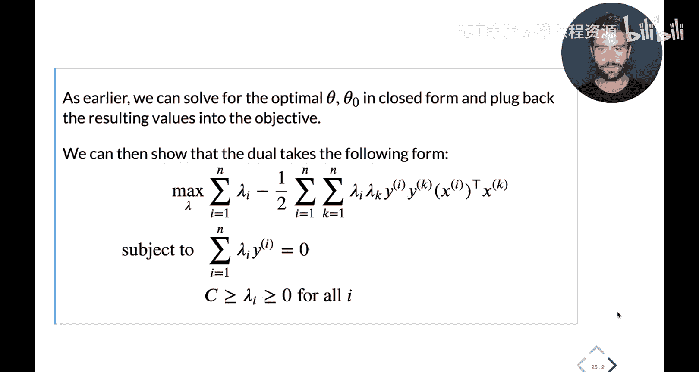

Now， given that we have a dual optimization problem。One interesting question is。

 how do we actually solve it。And I mentioned earlier that it's possible to use a quadratic optimization solver for this approach but in practice that is not the most efficient algorithm that we can use quadratic optimizers are general purpose that are designed to solve any quadratic optimization problem。

 but here we're dealing with a quadratic optimization problem that has a following form。

 and there are many specialized optimization algorithms that can solve this optimization problem more efficiently than a general quadratic optimizationr。

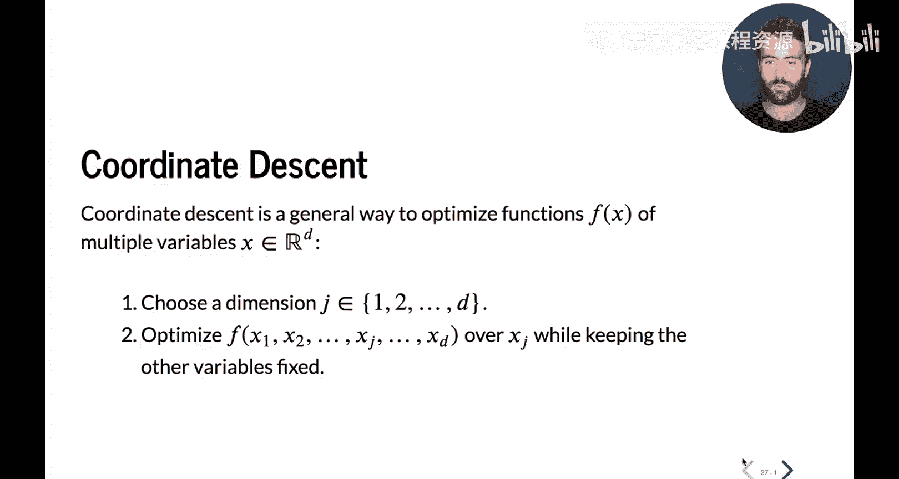

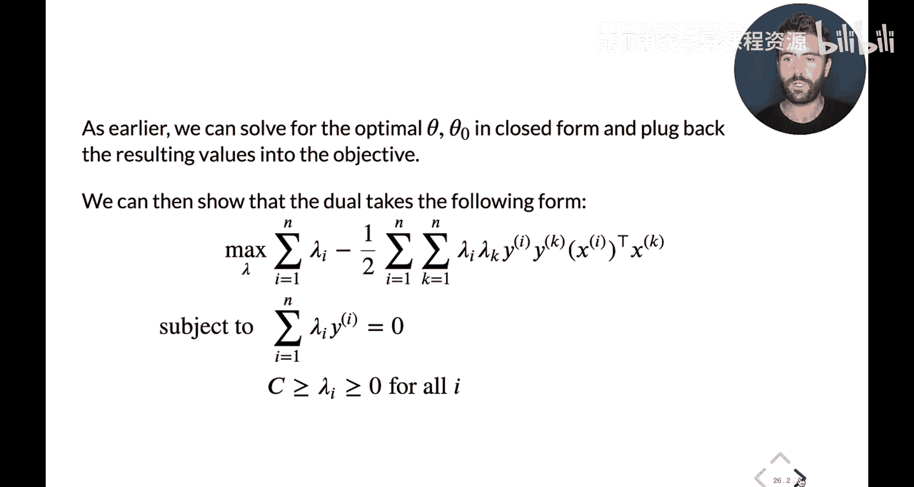

One such approach is based on an idea called coordinate descent。

Coordinate descent is a general way of optimizing functions of multiple variables。

 and the idea is really simple。We performed the following two steps。Over many iterations。

 as long as the function is being optimized。Essentially， we start with this function F。

 we choose a dimension。Call this J。 And then we optimize F。Over only this single dimension。

 Xj while keeping all the other dimensions fixed， so here F is a function of many different variables。

 but one of them is xj， and we're going to fix x2， x1， all the other variables to some value。

 and we're going to find the minimum x。Then at the next step。

 we're going to choose another dimension， we will optimize only over that dimension。

 and then we will keep doing this until this function is minimized。

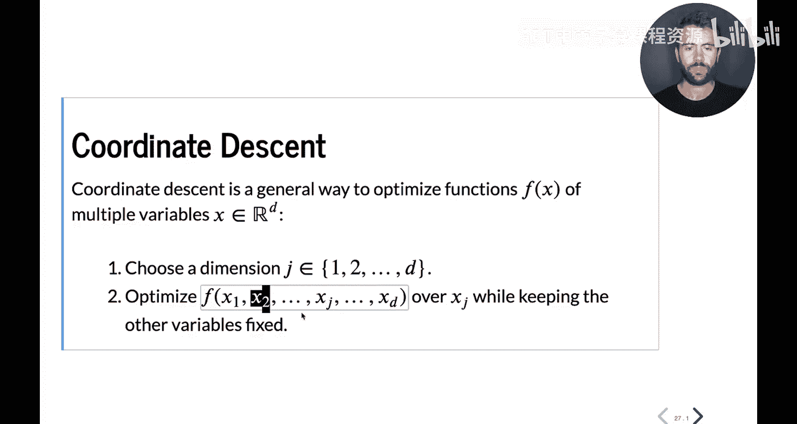

Here is an example that visualizes this approach this is from Wikipedia here I have a two dimensional quadratic function and you may recall from our earlier lectures that we can represent a quadratic function in two dimensions via its level curves so these are the level curves the two axes are the two input variables X and y to the quadratic function and each。

Each line here is a set of point at which the function has the same value and the minimum is in the middle and here this is the trajectory of coordinate and descent。

 So we start at some point here and now we find the minimum over y over the y axis while keeping x fixed so the minimum is going to be somewhere over this line and it happens to be here。

So we move here now we optimize over x， we move in this in the horizontal direction。

 and the minimum happens to be here。 Now once we're here， we move along y。

 and then we keep just doing these steps as long as we until we reach the minimum。

This is a visualization of coordinate descent。

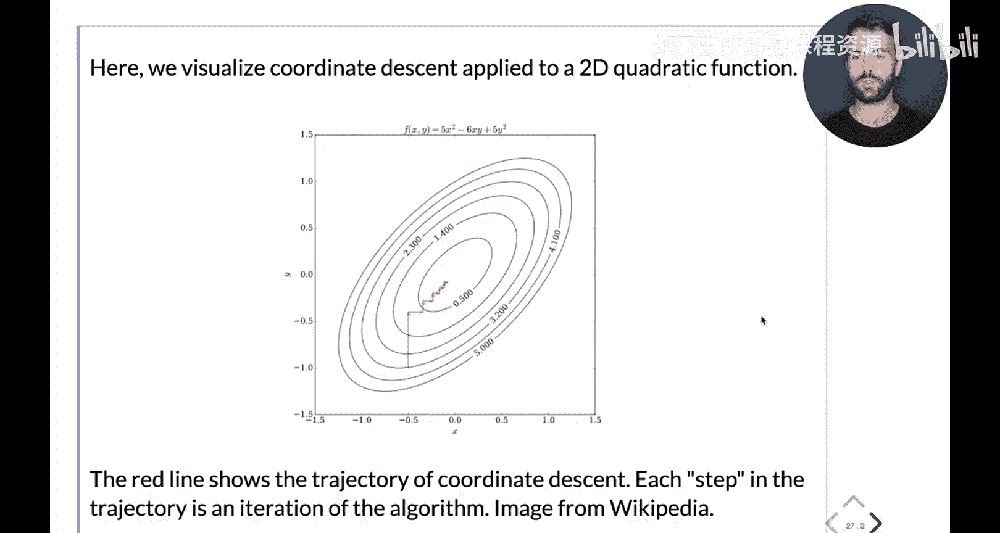

In practice， the dual problem that we have seen earlier。

 the dual of the SVM problem is solved using a technique that is closely related to coordinate descent called sequential Min optimization or SMO。

So here we have our dual。And we solve this duel by the following procedure。

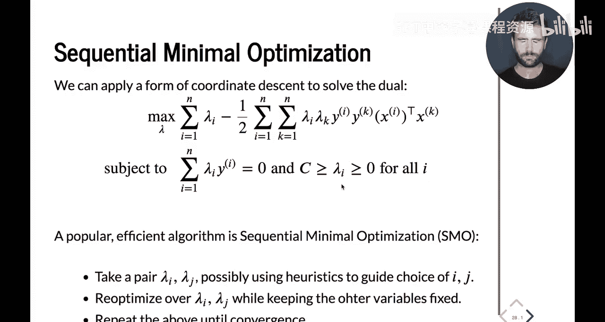

We we repeat the following steps as long as the function is being optimized。

 we take a pair of Lada I and Lambda J and there are in practice heuristics by which we would choose these so we can choose that there are certain heuristics that can be used for this。

And then we optimize over Lambda I and Lambda J while keeping all the other variables fixed。

And then we repeat this until conversiongs， we pick a pair and we optimize this this。

 And the reason we're choosing a pair instead of a single lambda is that we have this constraint。

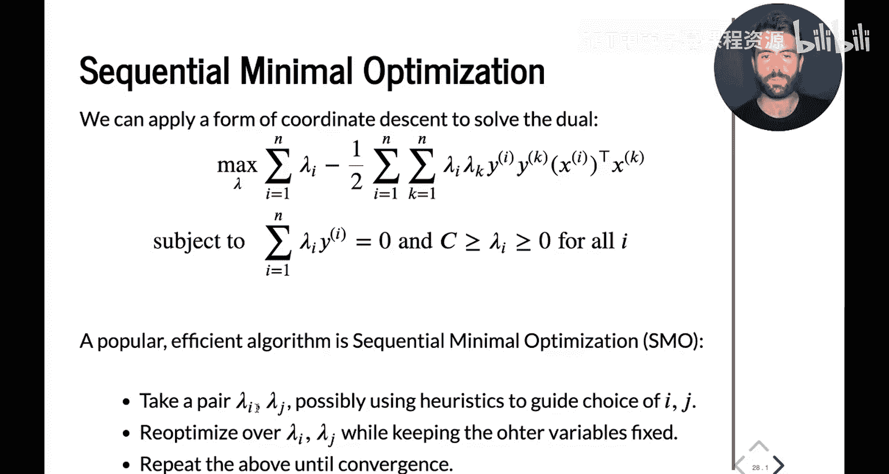

So all the lambdas。Multiply by y， these have to sum to1。

 and so we cannot just minimize one variable at a time。 We have to take two variables。

 so we take Lada I， Lada J， and then we can increase lambda I。

 decrease Lada J or vice versa as long as this constraint holds。

And then we optimize over Lada I Lada J， and then we take another one。 and in practice。

 this process is really efficient， and this is how the dual is solved in practice。

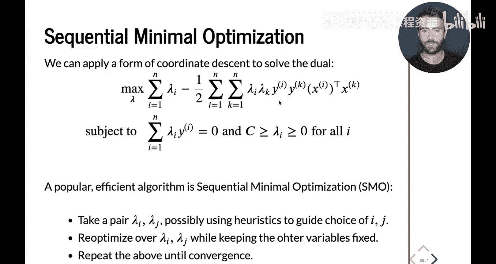

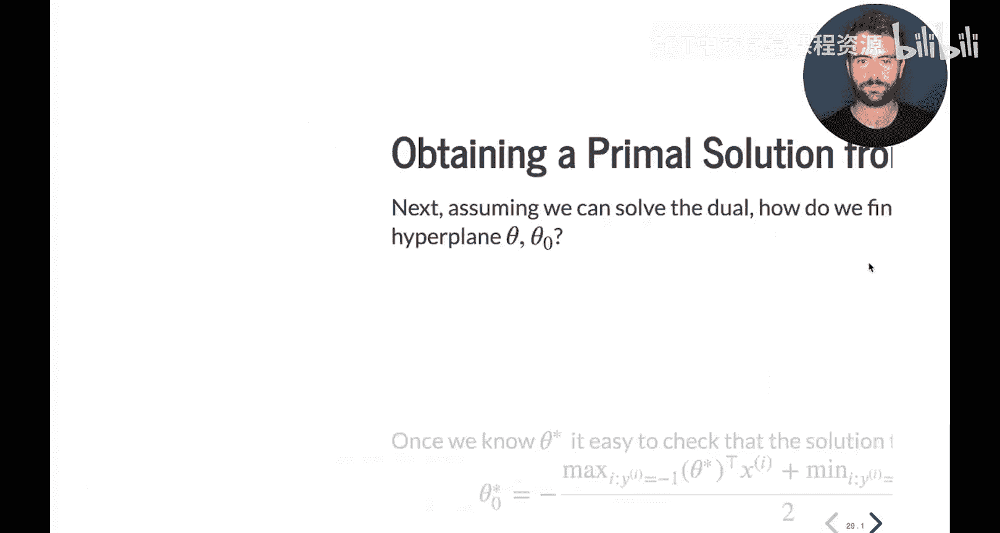

Now one thing I haven't mentioned is that once we have solved a dual。

 ultimately we are still interested in the separating hyperplane we're interested in the theta and theta zero。

So how do we actually retrieve the solution to the primal given that we have solved the duall？Well。

 I have actually alluded to this earlier when I was defining the so if you。

 if you remember when I defined the dual， at least in the separable case。

 I derived the equations that we would get when we solve for theta as a function of Lada so when we were。

Trying to minimize the lagangian over theta en closed form。

 we derived actually an expression for theta as a function of lambda。

 and so given that we have optimized for lambda， we know that for any lambda。

 the optimal theta must have this form， and in particular the theta for the optimal lambda must have this form as well。

And and because of the duality property， we know that this data must also be a minimizer of the other of the primal。

 So here we have a simple expression for the primal variables as a function of the dual variables。

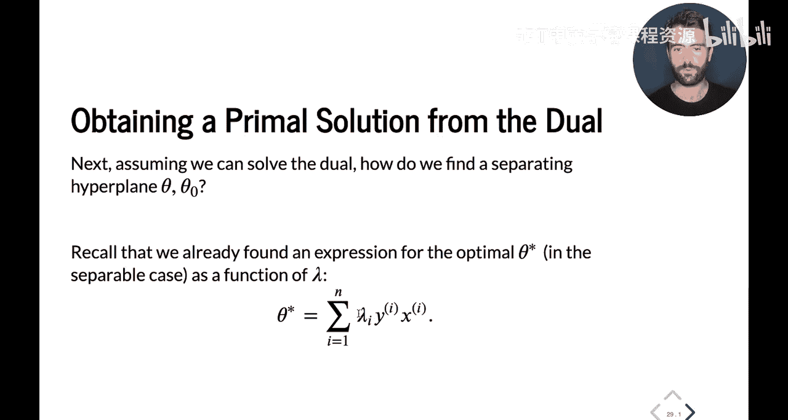

And for the intercept， there is also a simple form， so if we know the parameters。

 then we can derive parameters for the dual in a simple form。

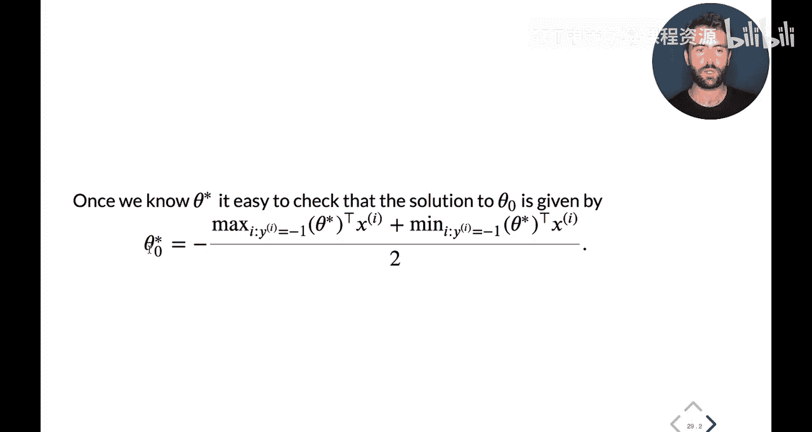

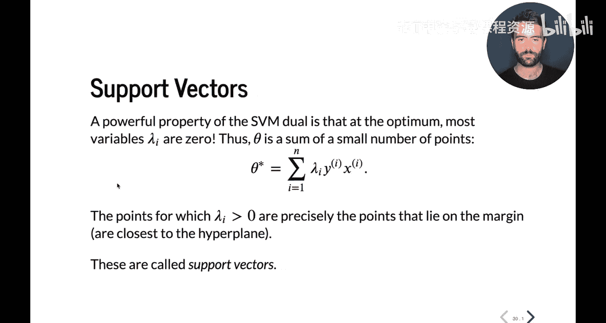

Finally， one interesting property of support vector machines is that if we look at this optimal parameter theta。

 this is a sum of over data points I where each data point is weighted by so this is a d dimensionsional vector。

 which is the same dimension as this vector。But we're weighing these de dimensionsal vectors by the following two scalars。

It turns out that in practice at the optimum solution of the dual problem。

 most lambdas are going to be0。So this sum is actually going to be。

 even though technically the sum is over n， only a small number of these lambda is will be non zero。

So this is actually going to be a sum over a much smaller number of terms than n。

And the points for which these lambda I are going to be nonze。

Are going to be the set of points that are the closest the to the hyperplane。

 to the separating hyperplane。So these are going to be precisely the points that lie on the margin。

So in other words。This is the set of points for which this。For which the formula for the margin。

 the gamma is going to be the smallest。And it's possible to derive this fact formally using optimization if you're familiar with the KKT conditions in optimization。

 I haven't mentioned this in the earlier video， but this is a fairly standard tool in optimization and just by applying these equations。

 we can in a very straightforward way derive this fact that I'm stating here without proof。

But you can also make a really intuitive argument for why that would be the case。So here。

 theta are the parameters of the hyperplane。And we are looking for the hyperplane that's as far as possible from the from the points in our data set。

So we have a set of points that is close to the hyperplane and a set of points that is far to the hyperplane。

 If we move and if we shuffle around the points that are far from the hyperplane。

 it shouldn't really change where that hyperplane is。 So the maximum margin。

 the concept of margin depends only on the points which are closest to it。

So as long as this hyperplane is far from the points that are close to the boundary。

 it doesn't matter what the points that are far from the boundary are， they can be changed。

 they can take different values， they can be moved around。

 but the decision boundary that goes through the middle of our data that shouldn't change。

And this is captured by this claim that I made， this data here only depends on the points that are really close to our decision boundary。

 but it doesn't depend on the points that are far from the boundary for those the lambda i is going to be zero。

And finally， these points that lie on the margin that are the closest to the hyperplane and that determine the form of this parameter theta。

 These are called support vectors。 And this is why our。Algorithm。

 this is why the sVM is called a support vector machine。

I am going to now illustrate this with an example。

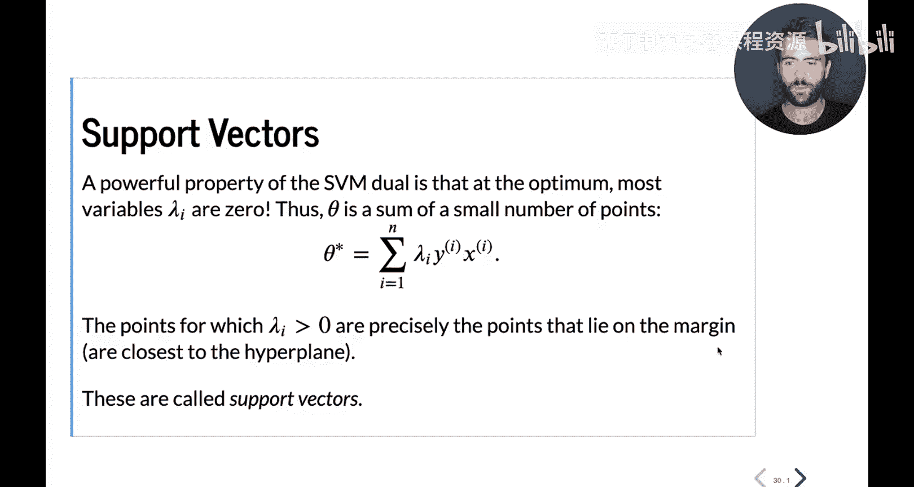

And for this example I'm again going to use the IIS flower data set we have seen this earlier here。

 I'm going to load this data and again this is a data set with four features。

 I'm going to only use the first two here the target is I've said it to be either minus one or one。

 depending on whether it's an iris satossa flower or not an iris satossa flower。

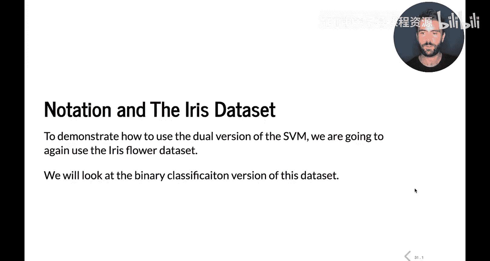

And。So again， this is the usual dataset set that we had before。

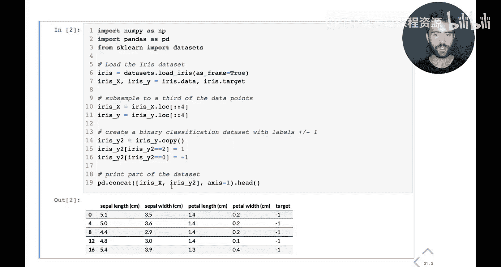

And I can visualize it。

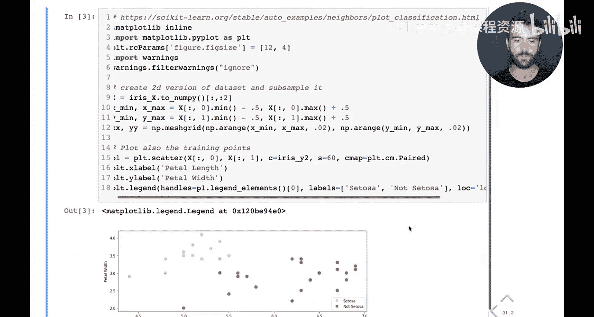

As follows here I have these two classes。So now let's see how we can apply the SVM algorithm to this data set。

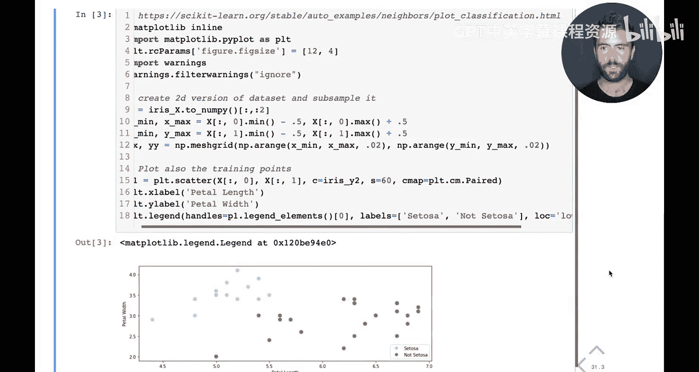

I'm not going to implement this algorithm in Python from scratch here。

 I am going to use an implementation that comes with the library Psyit learn。

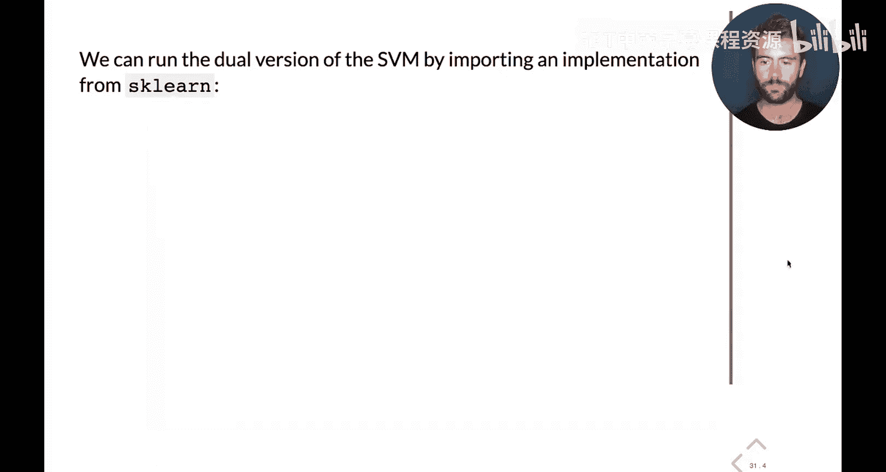

And this。In this library， we can use the SVM algorithm as follows， so there is a module called SVM。

 which contains a set of algorithms， and I'm going to use the SVC or the support vector classifier version of this algorithm。

And you can look at the source code of this implementation。

 it turns out that it's actually optimizing the dual version。

 so here when I run this code I am actually solving the dual problem。

But this is not the only way in which we can train a support vector machine， and for example。

 in p Psychit learn， there's another algorithm called linear SVC。

And this was this is actually going to be optimizing the primal and it's going to be optimizing the hinge loss version that we defined in the previous lecture。

So just to show that there are different definitions of the SVM algorithm and we can choose between them in Psyit learn。

So now I fit the support vector machine to my data set。

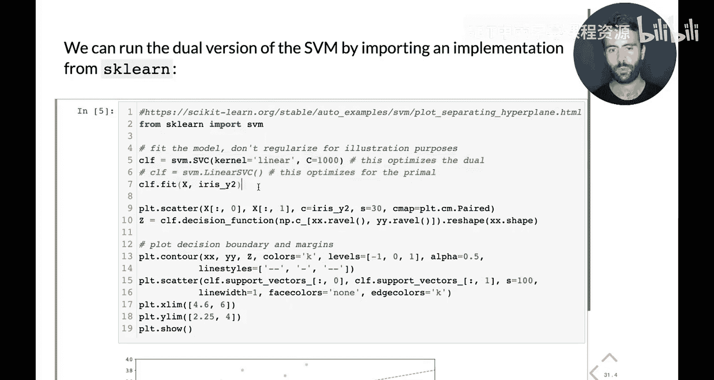

And I can visualize the results， as follows。So here I have the solid line。

 which is my separating hyperplane。And then the points that are in。

 I guess so to hear these dash lines， they visualize the margin。The distance between the。

The solid line and the dash line， this distance here， that is the margin。 That is the distance。

Along which we do not have any points from this data set， so as long as we're within this margin。

 there is no point that comes close to it and the first set of points that that we see as we move away from this separating hyperplane。

 they lie on the dashed line， they lie on the margin and I've highlighted these points with a black circle。

 there are three of them。And these points are precisely what we call the support vectors。

 so here we can retrieve them by looking at the support vector property of this classifier。

And you can see that the shape of this boundary depends only on these support vectors。

 if I were to change this point or to change this point， if I were to change any of these。

 if I were to change these two brown points since they don't come close to the boundary。

It doesn't matter where this point is because the margin depends only on the set of points that lie close to where the two classes are separated。

 and this is the intuition that I was talking about earlier when I said that these vector machines。

 only these support vectors determine the shape of this decision boundary。

So conclude this concludes lecture 10 and this concludes our discussion of support vector machines。

And again， I just want to reemphasize that this is a really powerful algorithm that is used in practice for many reasons and in the next few lectures we're actually going to look at in more detail and and we're going to look into this question in more detail and we will see ways and reasons why this algorithm is actually。

Why this dual formulation is actually important and we're going to see more advantages of using the dual formulation。

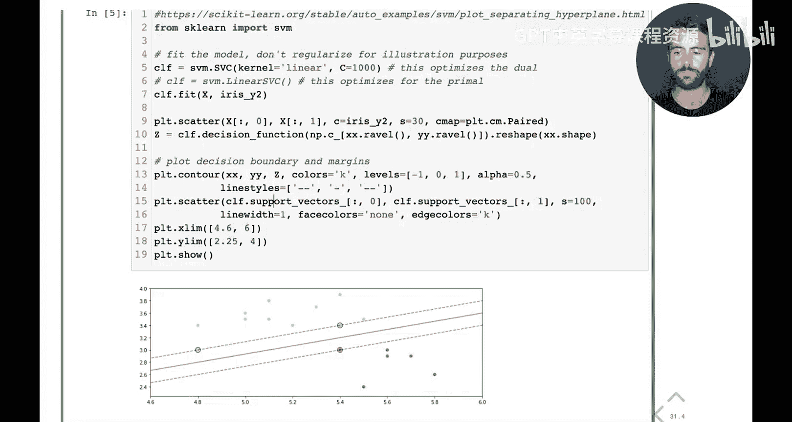