# 康奈尔大学《应用机器学习 CS 5787_ Applied Machine Learning 2020》中英字幕（deepseek p41 -41-Lecture 11. Part 1_ The Kernel Trick (Intuition).zh_en -BV12udzYvEFM_p41-

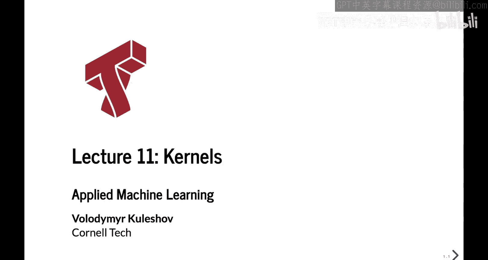

Hi and welcome to Lecture 11 of Applied machine learning。In Le 11。

 we're going to start a new topic called Cols。Clonnels is an interesting and important topic。

 and the motivation behind the idea of kernels is how to make our machine learning algorithms more flexible and more nonlinear。

So far， most of the models that we have looked at， both for regression and for classifications have been linear models。

 so they were a linear function of the input X。And in this lecture。

 we're going to look at a new way in which we can make them nonlinear without really increasing their complexity and without really making them more challenging to work with。

And this is going to be a general approach that will be applicable to most of the machine learning algorithms that we have seen so far。

And in fact， it's going to extend beyond supervised learning to unsupervised learning as well。

And this is the core idea is going to be that of kernels and the so called kernel trick。

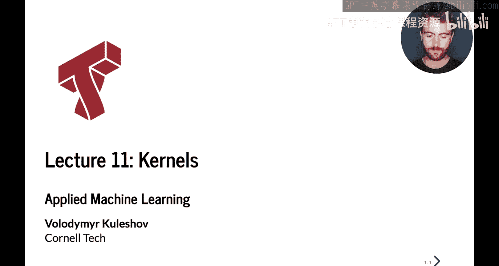

So before I define kernels and the kernel trick， I'm going to start with a little bit of motivation。

 I'm going to start with a high level observation about one of the algorithms that we have seen so far and then Im going to I'm going to give you a high level idea of why the approach of using kernels is interesting and how it can be powerful。

 so in this video we are going to start by looking at the high level motivation behind using kernels。

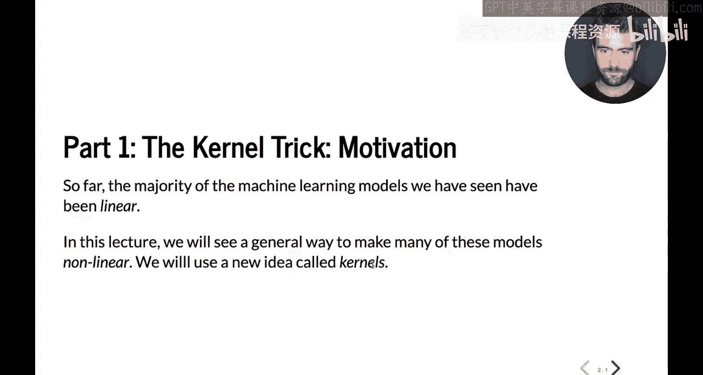

And we're going to start with a really simple algorithm。

 which was the first algorithm we have seen in this class， which is linear regression。

So recall that in linear regression we assume a model of this form our output where the model of the output of the model f of x is some kind of linear combination of the input attributes x。

 which we can write in a vectorized form as theta transpose x。

 so theta here are the parameters of the model and x is our input and it's a vector of input attributes。

In one of our first lectures in which we talked about linear regression。

 we saw that we can train these models using the mean squared error loss。

 which is simply the squared difference between the target that we have for our input and the prediction of the model which is here theta transpose X。

 so we take the difference of that， we square it and then we look at the average over the data。

And later on， we also saw that we can regularize this objective。

 which means that we add a penalty on the weights of theta。

And this encourages us to find a solution that both have a small error and whose parameters are numerically small。

 and that turns out that the solution is going to be better behaved numerically is going to overfit less and is going to better generalize the new data。

And the algorithm that we have seen， which learns this vector of parameters using an L2 regularized objective was called Rige regression。

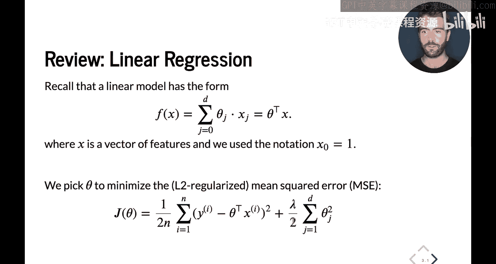

This model that I just show you earlier on the previous slide is fundamentally a linear model。

But in one of our earlier lectures， we saw that in principle。

 we can take any linear model and we can make it nonlinear by defining nonlinear features phi of x。

So here， Phi can be any kind of feature。It can be either a polynomial feature or it can be a set of signss and cosines that are derived from x。

 so phi of x can be highly nonlinear。But it remains linear in theta。

 which means we use our standard we can use all the standard techniques that we have seen in this course to learn theta。

 and we still in the end have a nonlinear function of x。

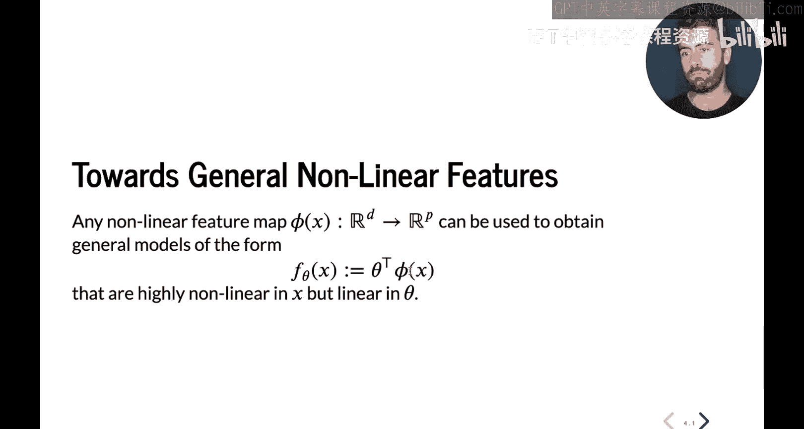

So I'm going to explore this approach a little bit more in this video and in order to make it a little bit more in I'm going to start introducing a little bit of notation to make things more precise。

 I'm going to introduce this new matrix called Phi。

 which is simply going to be our futurized design matrix。Recall that in one of our earlier。

Videos we defined the design matrix， which is simply a matrix in which we take all of our inputs X as being the rows of this matrix。

 so we simply stack all of our input vectors one on top of another to form a matrix and that what's called the design matrix。

The featureurized design matrix is the same except that instead of stacking together the raw vectors of attributes。

 we are stacking here the。The vectors of features。Here each x is an input with some raw attributes。

 now we have feturized it with phi， that is another column vector of dimension P。

And now we can simply take each of them to be a row， we take the transpose to make it a row vector。

 and now we just stack all of these rows one on top of another to form a matrix called the feurized design matrix and if our phi were attributes instead of features we would have our design matrix but now just to distinguish between attributes and features I'm going to use this symbol capital phi to denote the feurized version of this matrix in which the inputs are features instead of the raw attributes so at the position IJ of this matrix we have。

We have the。J's feature of the I input point。

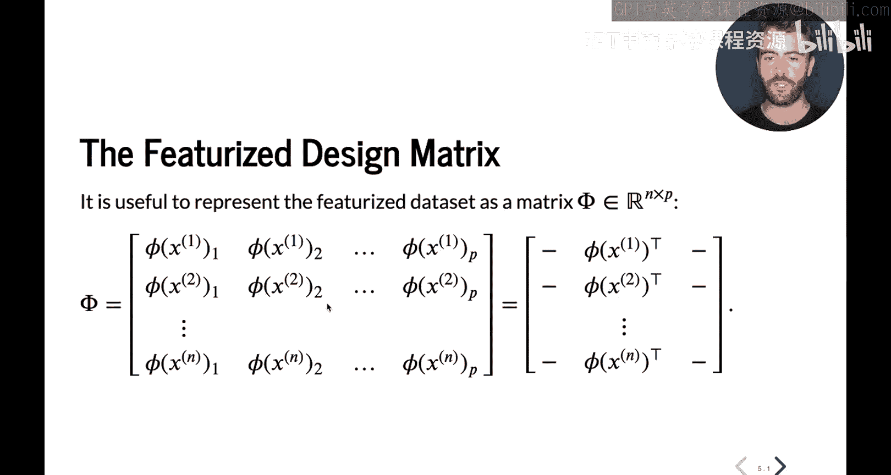

And we saw in our earlier videos that we can find given a design matrix。

 we can use this design matrix to compute a closedform solution for the parameters of a linear regression model using the normal equations。

The normal equations were a close form solution for the theta which minimizes our mean squared error objective。

So with a design matrix x， this was our formula here。

 this is we have this term Lambda because this is for an L2 regularized mean squared error objective。

And features given that our inputs are futurized， we can do the same thing except for the futurized matrix。

So in other words， I alluded to earlier that if our。If our model。

 if our inputs are described by some kind of highly nonlinear features， we can solve them。

As if we in the same ways we would solve a linear model as long as it's linear in theta。

 and specifically what I meant by that is that we would instead solve the following equation。

 which is simply our normal equation， but now I am computing this in the space of features instead of in the space of attributes。

嗯。So this will give us a solution for， for。For the aone parameters theta。

 when the inputs are feurized with some features phi。

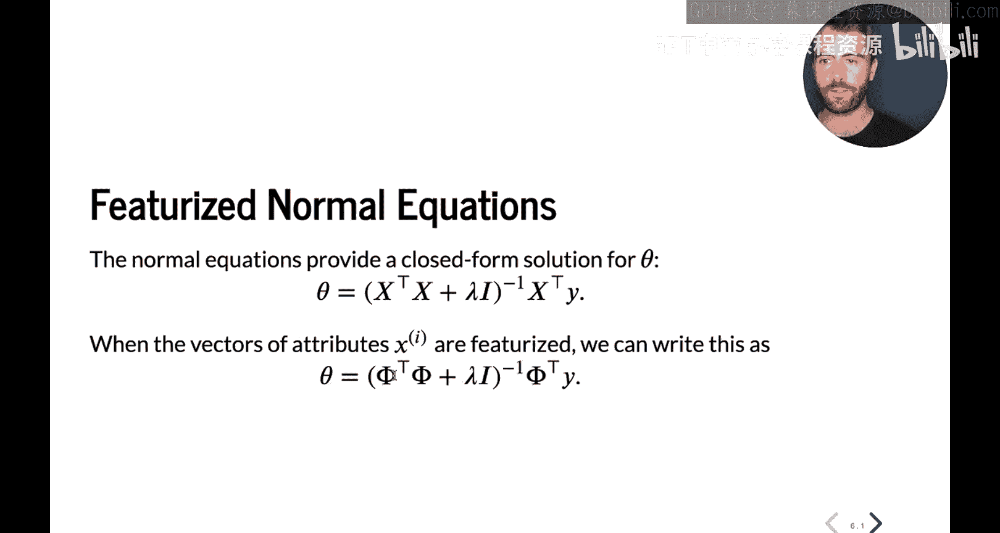

Now I would like to do two things to this algorithm that I'm starting to define。

 or I would like to apply a transformation to this set of normal equations that we had on our previous slide and that we're familiar with。

I'm going to transform them in one little way。In order to do this。

 I'm going to use the following identity for linear algebra that is sometimes called the push through matrix identity。

And the idea behind the push through matrix identity is as follows， Sose we have two matrices。

 U and V， this should say。

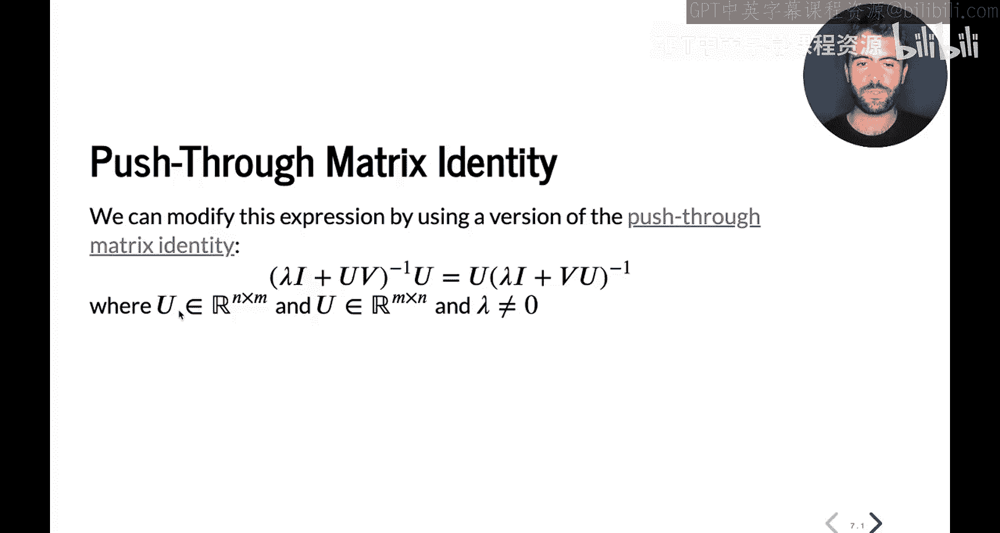

Fi。

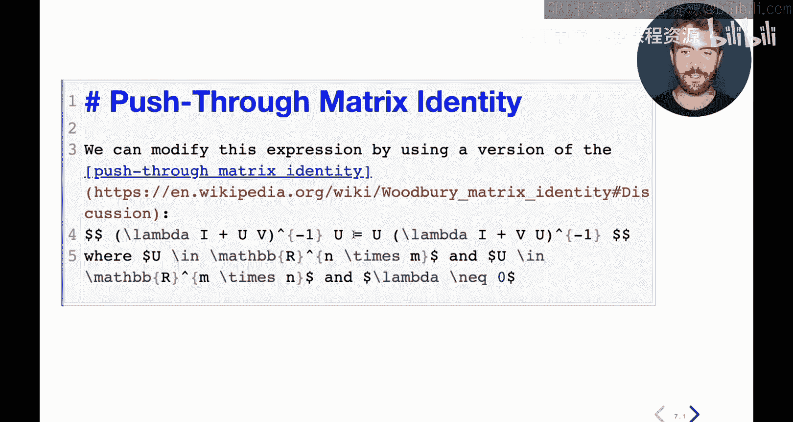

Then， we can。Then the following identity holds。So here I have an inverse of this matrix times u and it turns out that I can move U to the other side and I can flip the order of V and U and this will be the same。

An identity in linear algebra。 It is not。It is not very important to show the proof。

 but or for you to fully understand the proof， but the proof is actually really simple if you want to look at it as an exercise。

 but essentially in order to convince yourself that this is true。

 you may start with the following identity which is actually fairly straightforward here。

 I'm multiplying you。Well， you can convince yourself that this is the same by just multiplying it out on both sides。

 so we have Lambda U plus UVVU on both sides。It gives us exactly the same expression and now consider multiplying both sides。

By this matrix from the right and this matrix from the left， and as a result。

 we are going to obtain the following identity。When I mean multiply by this term on the right here I am simply taking the left hand side and then I multiply by this matrix from the right。

 which means that and this matrix is getting multiplied by its inverse， which means it cancels out。

 so on the left I have U on the right I have。This inverse that is now multiplying U from the right。

 Now I do the same thing with this matrix but multiplying it from the left。

 and you can convince yourself that this gives us the following identity。

So given that this is always true for any choice of matrix U and V。

 I can simply set u to be phi transpose and v equals phi。

 and I can apply this identity to my set of normal equations to obtain a different form for the normal equations。

 which is called the dual form。

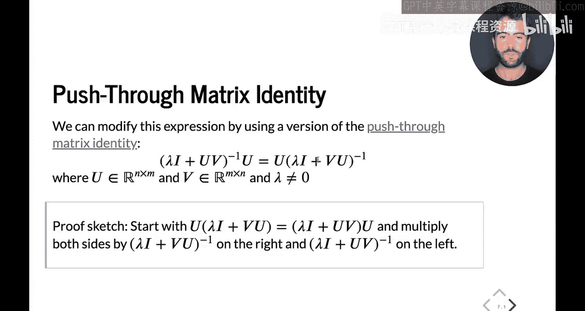

Sometimes referred to as the dual form。In other words here。

 this form you can easily check that this is equivalent to this side of the equation with the following choice for UNV and then what I have here is simply the right hand side of the equation with the same choice of UNV so here this is applying a different identity。

 but it gives us a different formula for the optimal weights theta。

One observation that we might want to quickly make about how these forms compare to each other is that here we are taking。

So phi is going phi is going to be an n by P matrix。嗯。It's going to be an n by P matrix。

 and therefore this is going to be P by n。 We are forming a P by P matrix or D if if we call the dimensionality of it features D or P then in here we're going to be doing an inverse of a D by D matrix which takes D cube time。

 but here this this product is going to have dimension because now it's。

Because now we flip the way the matrix are multiplied， this is going to be a squared matrix of size。

N by N， where n is our number of data points。And taking the inverse of this matrix is going to take N cube time。

 So actually， this is going to be a little bit faster if。

D is greater than n because this expensive cubic operation is going to be in a number that's smaller。

So if we have a very large number of features， then this might be preferable。

 it will be preferable if our number of features is greater than number of data points。

 this is just one distinction between these two equations it is not terribly important but you might want to convince yourself that it's true in order to better understand these two formulas。

But now let's make another observation that is。

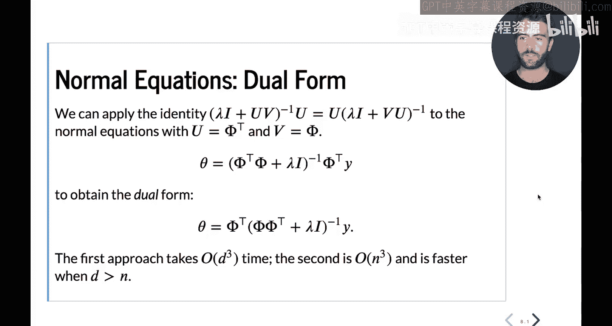

Even more important。

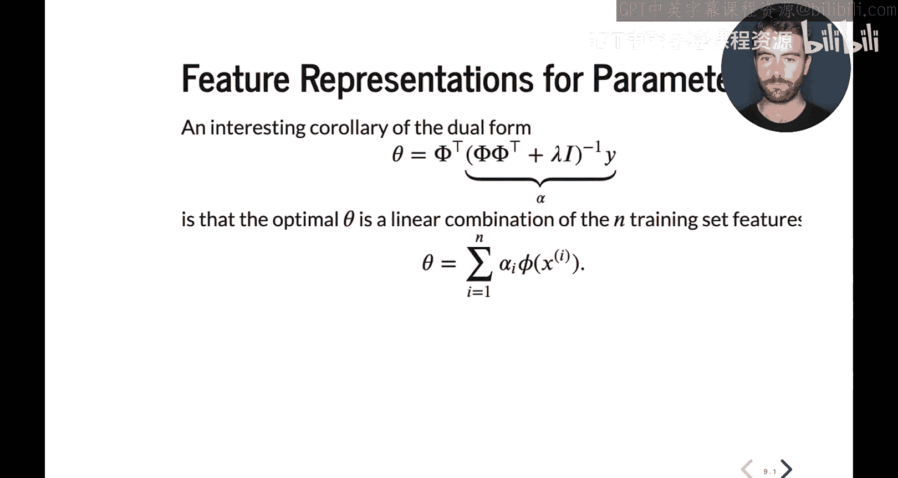

A very important observation that I'm making on the slide is the following。Here again。

 this is our dual form for the normal equations。And this here on the this set of the result of this set of multiplications and inversions and additions。

You should convince yourself that。 this is。A vector is going to be a vector of dimension， n。

Here this is a square matrix of dimension n by n， I take its inverse that gives me an n by n matrix。

 y is a vector of size， it's a column vector of size n。

 I multiply an n by n matrix by a vector a column vector of length n。

 this will give me this entire set of operationsbra will give me another vector also of dimension n。

 which I am going to call alpha。And now we can see our that our。ASet of parameters。

 theta is nothing but the product of the feature matrix phi with this new vector alpha that I defined。

 And in fact， we can write it out in in a more explicit form like this。

So theta is going to be the product of phi transpose times the vector alpha。

And because each column in phi transpose is the feturization of the I example， right。

 the Ih column of phi transpose is simply the I feturized example。

When we multiply this by a vector alpha， we're simply summing the columns with these weights alpha I。

 and now the form for theta is going to be as follows。And this is a really important form。

What this is saying is that the optimal set of parameters theta for our ridge regression model with features phi is a combination of it's a linear combination of the nfeturized training points。

So the parameters theta are a linear combination of the features。

That are measured over where the features are computed over the training points X。

This is a very important observation。Here again just to convince yourself that this is true。

 again this is our form for alpha and let's say that L is an n by n matrix。

 well let's call this n by n matrix that's the result of these operations that's call this n and then alpha I is going to have this particular form and this is going to be a linear weighting of all the features。

This is a very crucial observation and is going to be at the heart of many algorithms that involves kernels。

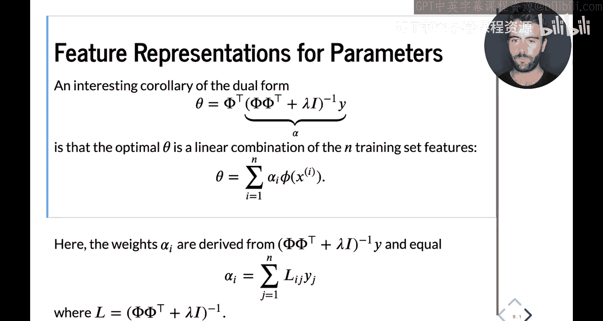

Why is that interesting。It's interesting because let' say that now let's suppose that I would like to make a new prediction for a new input X prime。

Because we have a linear model and just by the definition of our linear model。

 the output of the linear model at x prime is going to be simply。

Phi of x prime dot product with Theta。 This is just applying the definition of my linear model。And。

Now， given that I know that theta is a linear combination of the weights phi。

 I can just apply the definition that I had earlier to obtain the following expression。

So here I did nothing but plug in my definition for the vector theta， which is。Some of alphapha I。呃。

Times phi X。And now I can take this dot product inside the sum。

 which gives me the following expression。Let's now look a little bit more carefully what this is。

 It's saying that the optimal。It says that the model predictions at the optimal set of weights theta。

Is nothing but a linear combination of nothing but an average of the dot product of the features Phi。

Times the features of each training example， and these are weighted by the set of weights alpha。And。

Well first of all， there are many intuitive interpretation about this that that you could make and we're going to dive into this a little bit deeper。

 but the key observation here is that if I know the alpha I。

And if I can compute these dot products efficiently。

I can obtain a prediction without ever actually needing the vector Phi itself。In other words。

 the features themselves are not directly used in the equation， only their dot product is used。

So if I can somehow compute the dot product without really requiring the features。

 then I can still use this algorithm and if it happens that I can compute the dot product very efficiently。

 more efficiently than。Computing the actual then what it would take to compute the actual features。

 Then I can significantly accelerate。The at least inference in this kind of model and this observation will actually this。

 this approach， it will actually be something that we can do。 and the this idea will be。

Something that we're going to refer to shortly as the kernel trick。

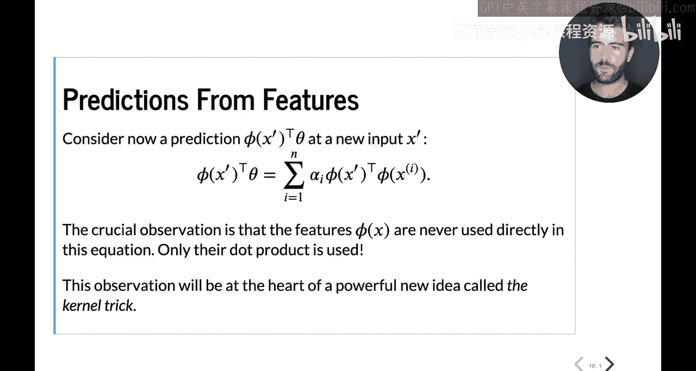

This trick is even more powerful than what I just， it's actually more interesting and more general than what I said earlier。

It's more general， because we can avoid。We don't need the features themselves。

 but their dot products not only for making predictions， but also for learning theta。

So to convince ourselvesselves， again， let's consider our vectorized feature matrix phi in which row I is simply the I viized input。

And then we can。嗯。We can consider the matrix phi phi transpose。

Which is simply the matrix of all the dot products between all the phi of Xi。That we have。

 so Ga is an n by n matrix， and the Ith J entry is the dot product of features of the I Theta point with the J Theta point。

And by our earlier definition of alpha。If we plug in this k times phi phi transpose into our definition of alpha which we derive from the normal equations。

 then we have the following form。And in order to compute this vector of alpha。

We again do not need the features themselves here， the only way in which these features find themselves are via the matrix k。

 and so if we can have k without the features if we can compute k efficiently。

 then we can use this formula to efficiently compute predictions at new sets of features x prime。

 in other words， given that I have a new input X prime。I can do the following。

 I can first compute this alpha， which again only requires me to know the dot products。

 It doesn't require me to know what the features are。

And then I can use it to make predictions using the formula that I had in my earlier slides。This is。

 again， an instance of something that we're going to call shortly a kernel trick or the kernel trick。

And if we can compute these features effectively as we're going to be the dot products of these features。

 if we can compute that quickly， and I'm going to show you soon how we can do this。

 then it's going to significantly accelerate the speed at which we can perform machine learning with nonlinear features。

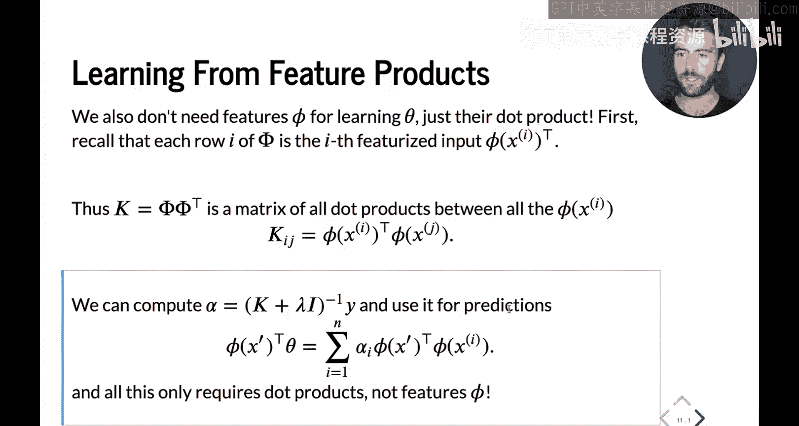

So again， this slide summarizes what I said earlier here。

 what I have described is an early version of something that is going to be called the kernel trick and now in the next video I'm going to show you。

How we can exploit this current trick， how we can make it even more precise。

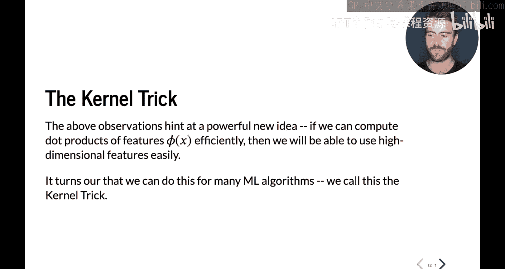