# 应用机器学习：第11讲：核技巧（直观理解）🚀

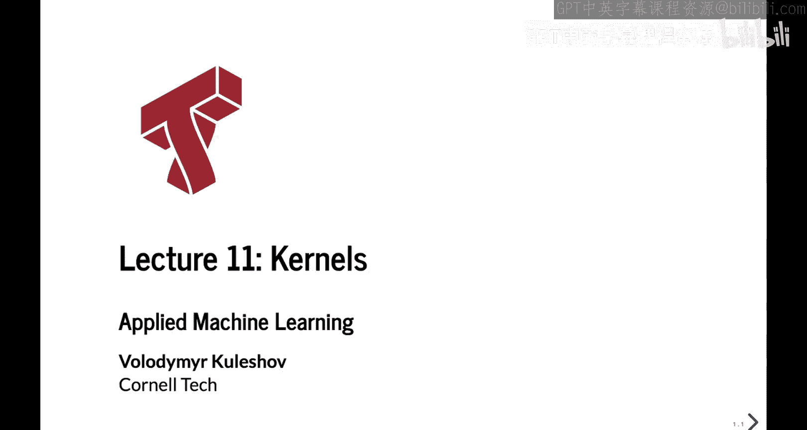

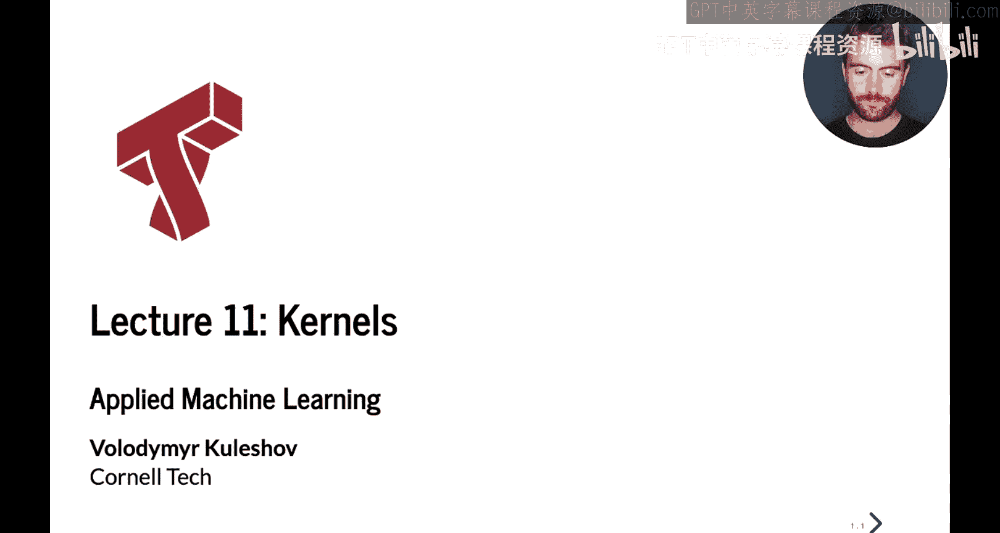

在本节课中，我们将开始学习一个名为“核”的新主题。核是一个有趣且重要的概念，其背后的动机是如何使我们的机器学习算法更加灵活和非线性。到目前为止，我们研究的大多数模型，无论是回归还是分类，都是线性模型，即输入X的线性函数。在本讲中，我们将探讨一种新方法，可以在不显著增加复杂度或使其更难处理的情况下，使这些模型非线性化。这将是一种通用方法，适用于我们目前见过的大多数机器学习算法，并且实际上可以扩展到无监督学习领域。其核心思想就是核以及所谓的核技巧。

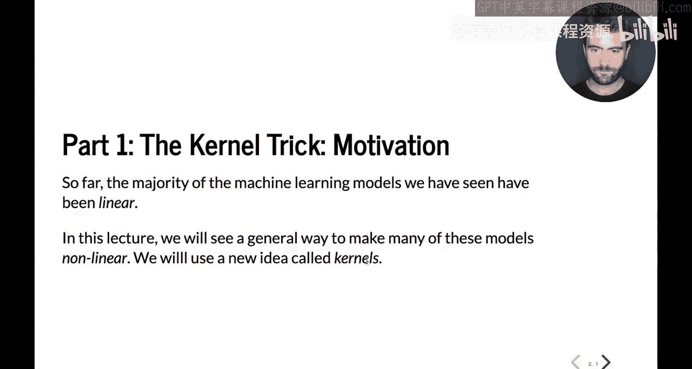

## 动机：从线性回归出发 🔍

在正式定义核和核技巧之前，我们先从一个简单的算法——线性回归——开始，来理解使用核方法的高层动机。

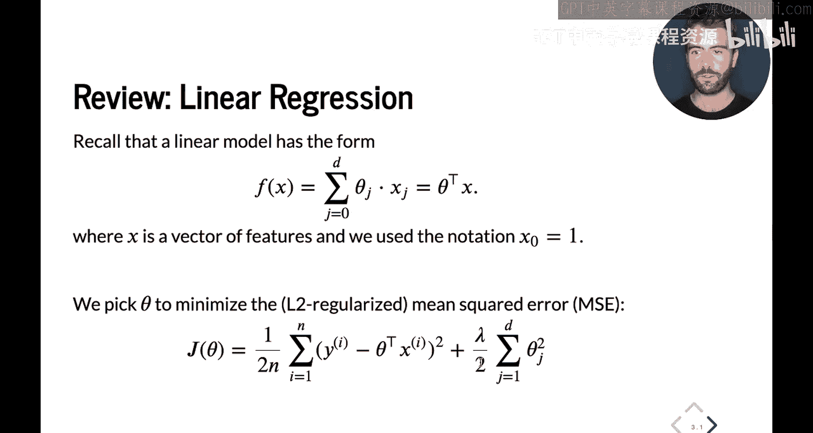

### 线性回归回顾

回想一下，在线性回归中，我们假设模型的形式为：模型的输出 `f(x)` 是输入属性 `x` 的某种线性组合。我们可以用向量化形式表示为 `θ^T x`。其中，`θ` 是模型参数，`x` 是我们的输入向量。

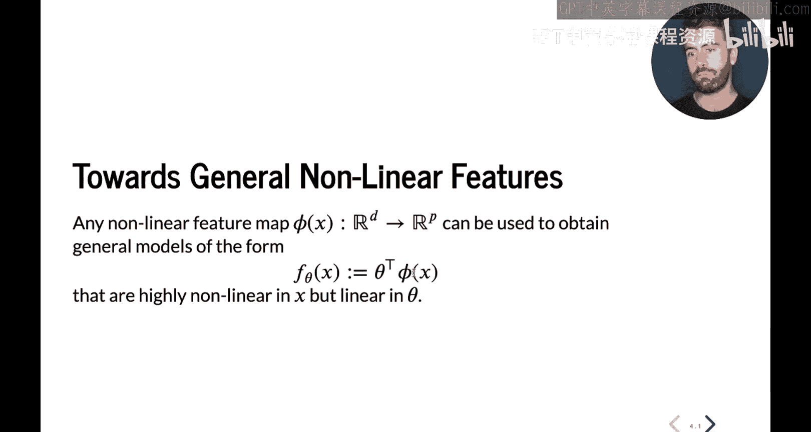

我们使用均方误差损失来训练这些模型，即目标值与模型预测值 `θ^T x` 之间的平方差的平均值。后来，我们还看到可以对这个目标函数进行正则化，即对权重 `θ` 添加惩罚项。这鼓励我们找到一个既误差小、参数数值也小的解，这样的解在数值上表现更好，过拟合更少，对新数据的泛化能力更强。使用L2正则化目标函数学习参数向量的算法被称为岭回归。

### 引入非线性特征

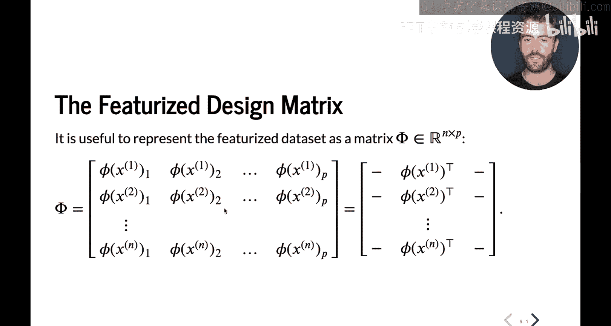

前面展示的模型本质上是线性的。但在早期课程中，我们看到，原则上，我们可以通过定义非线性特征 `φ(x)` 来使任何线性模型非线性化。这里的 `φ` 可以是任何类型的特征，例如多项式特征，或者由 `x` 导出的正弦和余弦集合。因此，`φ(x)` 可以高度非线性，但它在 `θ` 上仍然是线性的。这意味着我们可以使用本课程中见过的所有标准技术来学习 `θ`，最终得到一个关于 `x` 的非线性函数。

为了更精确地探讨这种方法，我们引入一些新的符号。

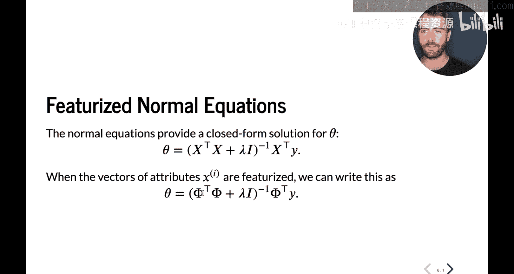

### 特征化设计矩阵

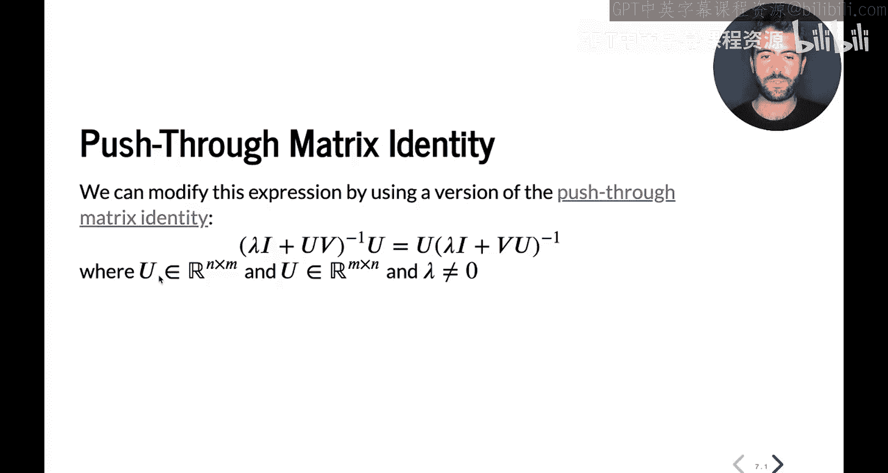

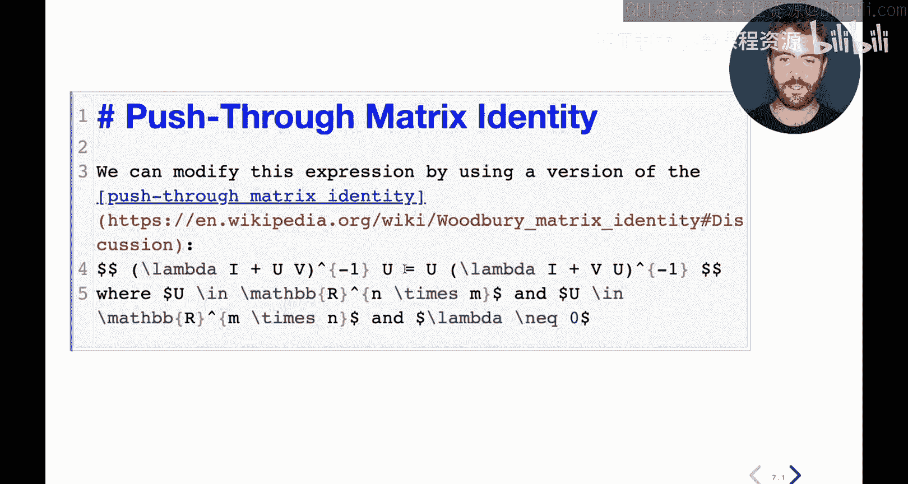

我们引入一个新矩阵 `Φ`，称为特征化设计矩阵。回想一下，设计矩阵是一个矩阵，其中我们将所有输入 `X` 作为该矩阵的行堆叠在一起。特征化设计矩阵与此类似，只是我们堆叠的是特征向量，而不是原始属性向量。每个 `x` 是带有一些原始属性的输入，现在我们用 `φ` 将其特征化，得到一个维度为 `P` 的列向量。然后，我们将每个向量转置为行向量，并将所有这些行堆叠在一起，形成一个名为特征化设计矩阵的矩阵。我们用大写字母 `Φ` 表示这个矩阵，以区别于原始设计矩阵。

### 岭回归的闭式解

给定设计矩阵，我们可以使用正规方程来计算线性回归模型参数的闭式解，以最小化均方误差目标函数。对于特征化矩阵 `Φ`，我们可以做同样的事情，只需将正规方程中的 `X` 替换为 `Φ`。这为我们提供了当输入被特征 `φ` 化时，参数 `θ` 的解。

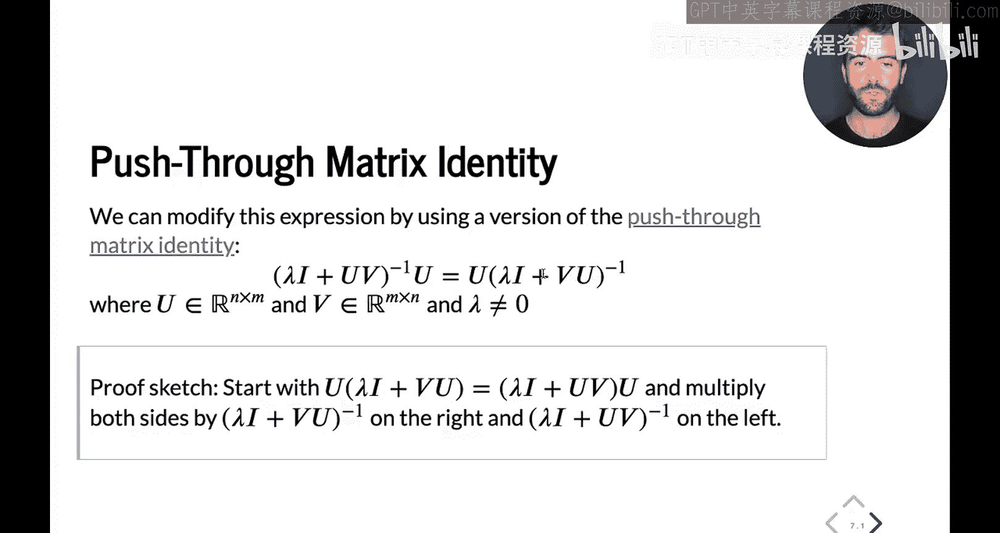

接下来，我们将对这个算法进行一点变换。

### 对偶形式与重要观察

我们将使用一个称为“推入矩阵恒等式”的线性代数恒等式，将正规方程变换为另一种形式，称为**对偶形式**。这种变换为我们提供了最优权重 `θ` 的不同公式。

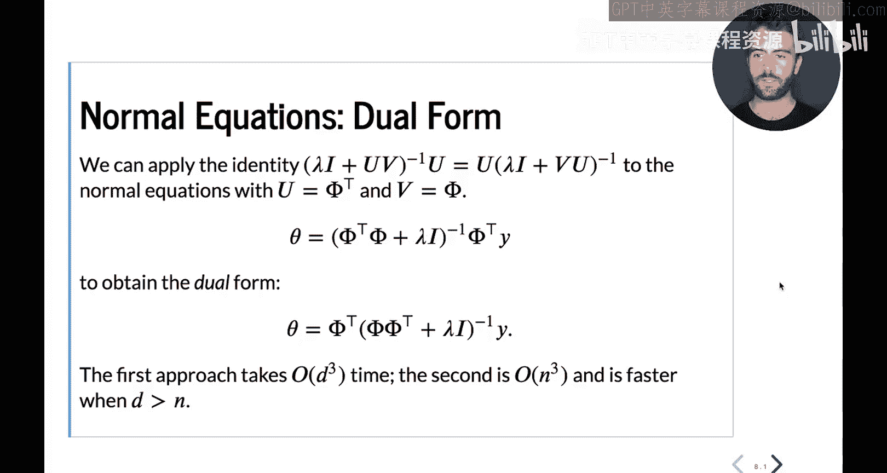

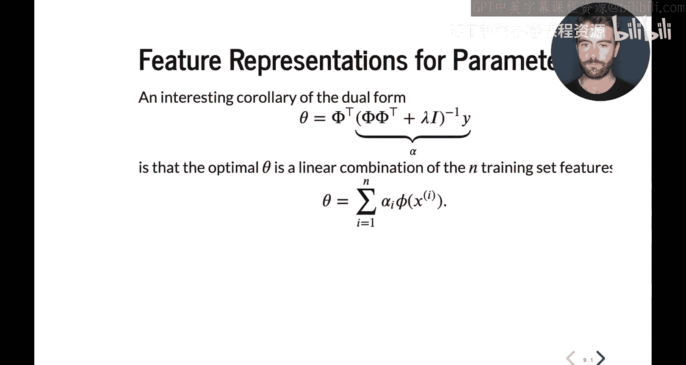

一个重要的观察是，在对偶形式中，最优参数 `θ` 可以表示为特征矩阵 `Φ` 与一个新向量 `α` 的乘积。进一步推导表明，最优参数 `θ` 实际上是所有特征化训练点的线性组合。具体来说，`θ` 是训练点特征 `φ(x_i)` 的加权和，权重为 `α_i`。

这个观察非常关键，它构成了许多涉及核的算法的核心。

### 核技巧的初步体现

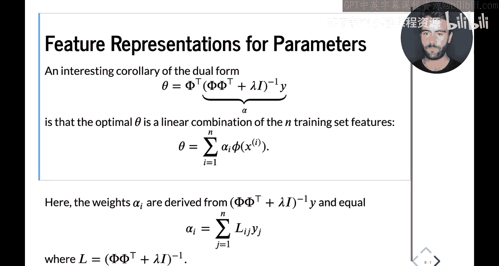

为什么这个观察很有趣？假设我们现在想为一个新输入 `x'` 做出预测。根据线性模型的定义，模型在 `x'` 处的输出是 `φ(x')` 与 `θ` 的点积。将 `θ` 的表达式代入后，我们发现模型预测值可以表示为所有训练点特征与 `x'` 特征的点积的加权平均，权重为 `α_i`。

这里的**关键观察**是：如果我们知道 `α_i`，并且能够高效地计算这些点积，那么我们可以在不需要实际知道特征向量 `φ` 本身的情况下获得预测。换句话说，方程中直接使用的不是特征本身，而是它们的点积。如果我们能以某种方式在不实际需要特征的情况下计算点积，并且计算效率比计算实际特征更高，那么我们就可以显著加速这类模型的推理过程。这个想法就是我们即将介绍的**核技巧**的雏形。

这个技巧甚至比刚才描述的更强大、更通用。它更通用，因为我们不仅在做预测时不需要特征本身而只需要它们的点积，在学习 `θ` 时也是如此。

为了证明这一点，让我们考虑特征矩阵 `Φ` 与其转置的乘积 `K = ΦΦ^T`。这个 `K` 矩阵是一个 `n×n` 矩阵，其第 `(i, j)` 项是第 `i` 个点和第 `j` 个点的特征的点积。根据我们之前推导出的 `α` 的定义，我们可以将 `K` 代入公式来计算 `α`。同样，这个计算过程只依赖于点积矩阵 `K`，而不需要直接知道特征是什么。

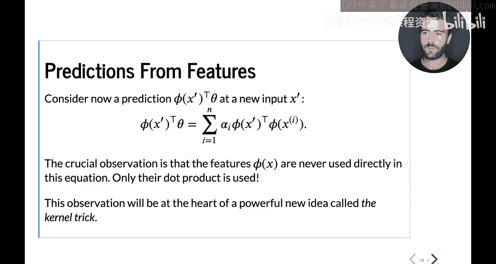

因此，给定一个新输入 `x'`，我们可以：
1.  使用只涉及点积矩阵 `K` 的公式高效地计算 `α`。
2.  然后使用涉及 `φ(x')` 与各 `φ(x_i)` 点积的公式进行预测。

如果我们能够快速计算这些特征的点积（稍后我们将展示如何做到这一点），那么它将显著加速我们使用非线性特征进行机器学习的速度。

## 总结 📝

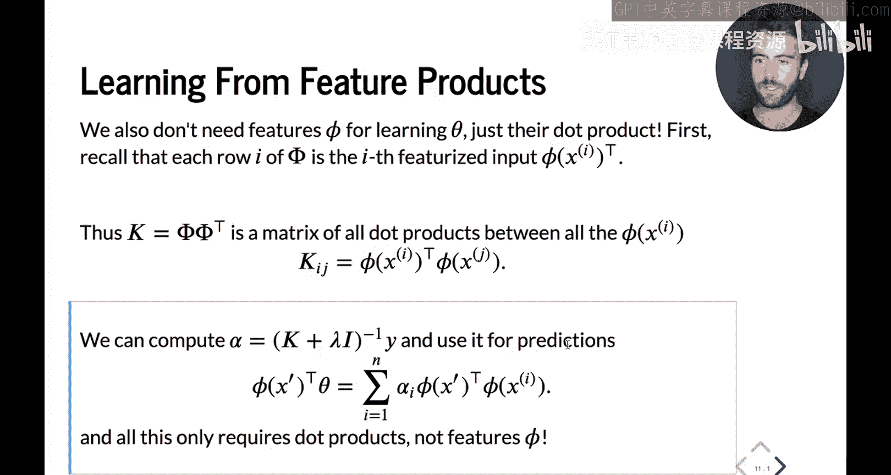

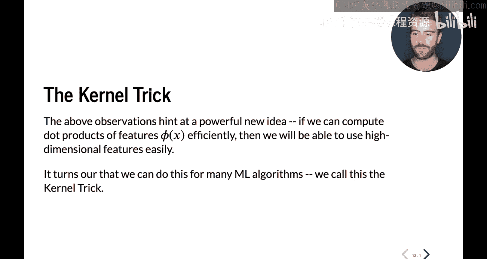

本节课中，我们一起学习了核方法的基本动机。我们从线性回归出发，回顾了如何通过引入非线性特征 `φ(x)` 来使模型非线性化。通过推导岭回归的对偶形式，我们发现最优模型参数 `θ` 可以表示为训练样本特征的线性组合。更重要的是，模型的预测和参数学习过程最终都只依赖于特征之间的点积 `φ(x_i)^T φ(x_j)`，而不需要直接使用高维甚至无限维的特征向量 `φ(x)` 本身。这个关键的观察是**核技巧**的基础，它允许我们在不显式计算复杂特征映射的情况下，高效地在高维特征空间中工作。在接下来的视频中，我们将更精确地探讨如何利用这个核技巧。