# 康奈尔大学《应用机器学习 CS 5787_ Applied Machine Learning 2020》中英字幕（deepseek p42 -42-Lecture 11. Part 2_ The Kernel Trick (Example).zh_en -BV12udzYvEFM_p42-

This is part two of Lec 11 of applieded machine learning in which we talk about kernels。

In the previous video， I give you an example of a machine learning algorithm for which we could write all the formulas and all the optimization procedures。

In a way that never required us to use the features Phi themselves。But instead。

 we only needed to use the dot products between the features Phi。

And then I made the claim that often we are able to compute dot products between features more efficiently than the time it would take us to count or enumerate or form the features themselves。

 in other words， computing dot products can be more efficient than representing the features themselves in their raw form。

And this idea， this observation is something that we call the kernel trick in this video I'm going to show you。

 I'm going to give you one example of what I mean by that。

 I'm going to give you one example of how we can compute dot products more efficiently than the vectors of features themselves and then I'm going to give you and then this will form a very specific example of what the kernel trick is。

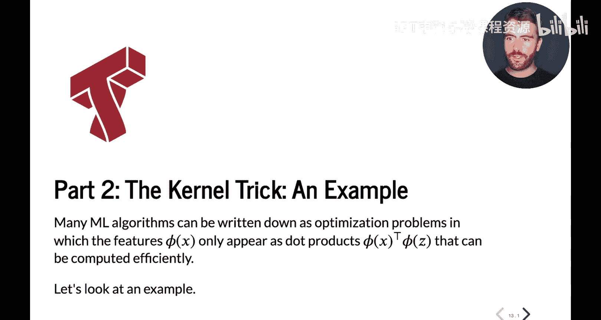

Recall that we are working with linear regression。And in linear regression。

 we have a model that's this form， it's linear in both the features。 it's linear in the。

In the parameters theta。

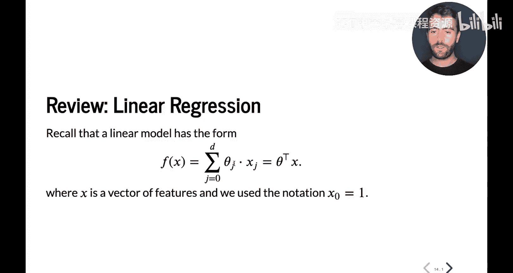

And if we want to make this model nonlinear， we can try using nonlinear features phi。Here。

 theta as long as f is a linear function in theta， like it is here。

 we can use any in the nonlinear function for phi and the result is going to be a nonlinear model in x that we can learn using our linear regression algorithms to find theta。

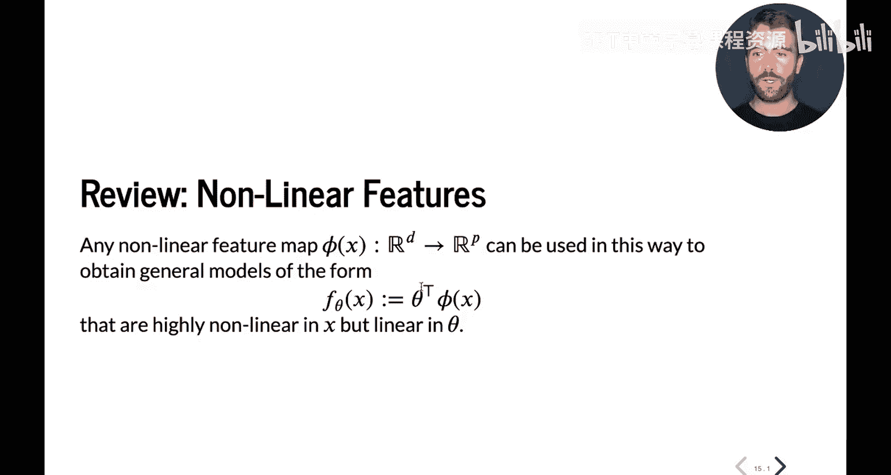

In order to define some of these algorithms， we started using this notation。

 which is that of the fuurized design matrix， the featureurized design matrix simply means that the way we construct this matrix is that we simply。

We take all the inputs X， we compute their features， this gives us a vector of features。

 we make it a column， we take the transpose to make it a row。

 and then we just stack all of them on top of another and this gives us a matrix in the entirety of this。

This matrix of this set of stacked columns， this is something that we call phi。

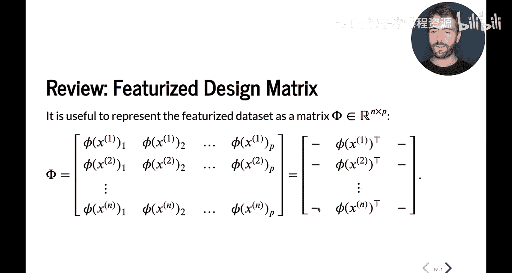

And using this notation， we defined a formula for computing the parameters of a linear model our which was based on the normal equations that we saw earlier。

Here at the top you see the normal equations， the standard normal equations using the feature matrix phi。

 and then we also saw that we can rewrite them in a slightly different way this way which is called the duall。

And this dual has several interesting properties。

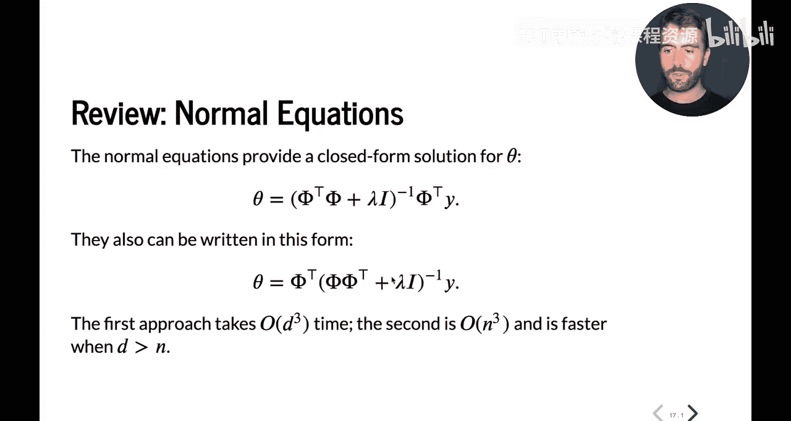

The most interesting and important property is that if we use the dual form。

We can show that the optimal parameters theta have the following form。

So our optimal set of parameters is actually a linear combination of the features at all the features measured over all the data points in our training set。

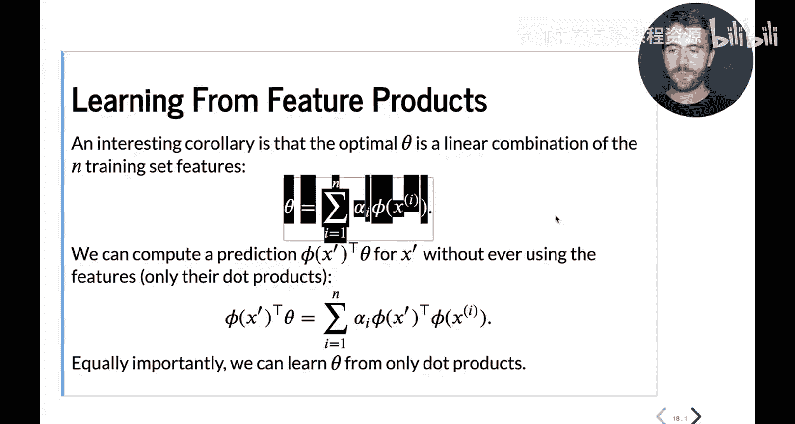

So here the XI are the points in our training data set。

When I learn a linear regression model using my set of dual normal equations。

 I get these weights alpha and then theta is simply the weighted combination of the phi where the weights are the alpha。

And this is a really powerful observation because it means that when we get a new example。

Let's say x prime， we can compute the prediction of the model。

 which is phi of x prime dot product with theta。We can compute it in this form where I have simply plugged in my definition of theta into into this expression。

 plugging this in， we have the following form， which only involves。

Dot products between features and not the features themselves。And similarly。

 we can learn these alpha also by looking at the dot products as opposed to。

As opposed to the features， in other words， to compute the alpha。

 I also I only need to know the dot products。And my claim was that if we can compute these dot products more efficiently than computing the features themselves in which we can。

 I'm going to show you how we can do that， if we can compute the dot products efficiently。

 then we can work with high level with high dimensional features phi。

More efficiently than we could otherwise。So what do I mean by this and what is an example of？

What is an example in which we can compute dot products between features very efficiently？

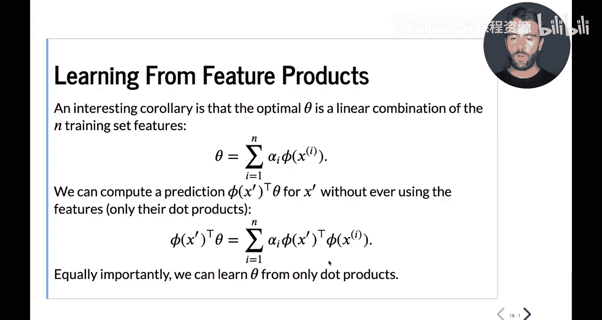

I will give you one example to start， and this is going to be the example of polynomial features。

Recall that a polynomial over a one dimensional input x is an expression of this form。

Where I'm taking x to the power P to the power P minus1， et cetera。

 and I'm summing all of these powers when they're multiplied by。Coefics， A。

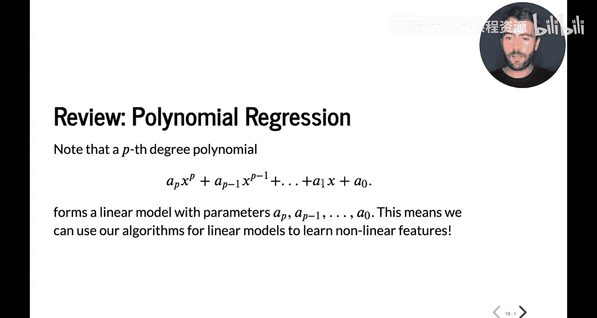

Given a linear model with a one dimensional attribute。We can form the following vector of features。

 which is the vector of polynomial features。And then the set of linear models with these features。

 Phi is going to be the set of all the polynomials。

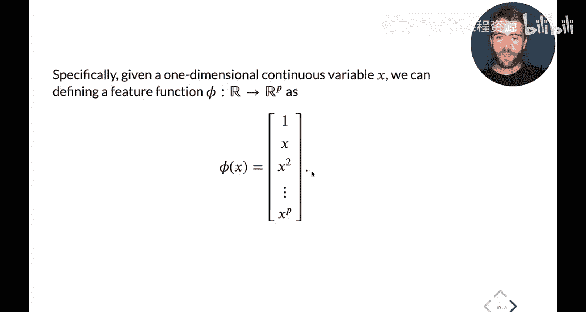

And therefore， if we fit a linear function， if we fit a linear regression model over the features phi。

 then we're going to be able to fit arbitrary polynomials to our data set。

So these are going to be nonlinear functions of x， but linear functions of theta。

 and therefore we're going to be able to learn them effectively and still have a highly expressive。

 flexible nonlinear model。

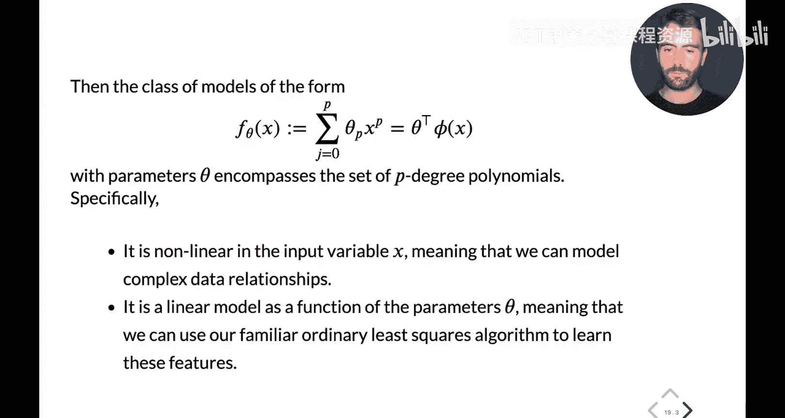

Let's look at this kernel trick in the context of polynomial features。

Imagine that we have features that have this form。First of all， my input X here is going to be。

It's going to be a d dimensionsional vector of attributes and let's say these are numerical real numbers。

 these are numerical values that are real numbers， so x is going to be of dimension D。

 and now I'm going to define a set of polynomial features of dimension d squared。

Using the following formula。I'm going to define this vector phi which has d squared components and the component at index IJ is going to be simply the product of attribute I with attribute J。

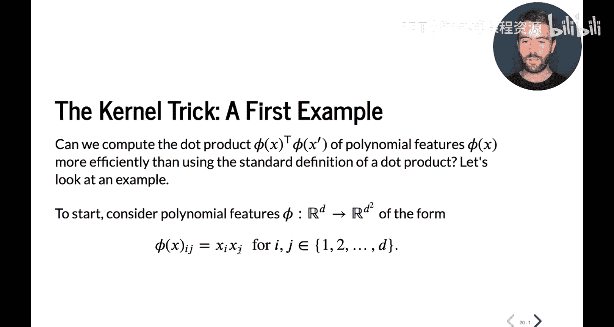

We can look at an example to make it a little bit。Clear， if D equals 3。

 then my vector of features looks like this。 I have three squared。

I have nine elements of this vector， and the elements are all the products of x2 times x1。

 x3 times x1， x1 times x2， x1 times x1。And this corresponds to a second degree polynomial over。

Over a three dimensional input， because the highest。

Degreee within all of these terms is 2 x1 squared here we have also x2 squared and we also have x3 squared。

So here I have all the dot products with the。I have all the products of the two attributes。

If we wanted to compute the dot product between these two features。

 between features between two sets of features at two data points， X and Z。

 then this is the definition of the dot product。Here I have all the dimensions of。Of this vector。

 which is simply X Xj with all the possible X and Xj。

 And here I also have all the dimensions along this vector。

 which is that I a J and then I'm simply multiplying the matching。dimensioning components。

 so the second component， the case component of this vector gets multiplied by the case component of this vector。

 and then we sum them， which simply gives me the following expression。

And this is a summation over d squared terms。You can see it here， I have two nested summations。

 each of them going over D terms， therefore computing this entire set of terms is going to take we have d squared terms over which we're summing and is' going to take big O of d squared time2。

Perform this sum， to perform this summation。

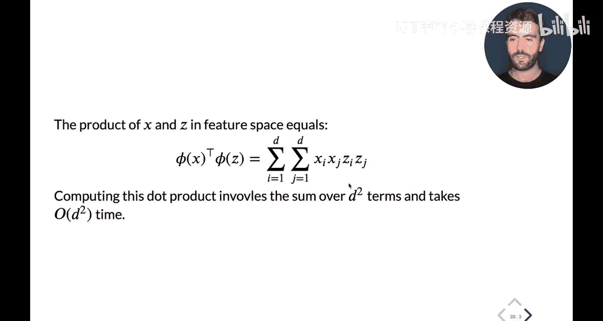

Now， consider the following alternative way of computing this dot product。

Instead of computing the dot product between the features at X and Z。

 let's instead look at the dot product of X and Z themselves。And take the square of that。

Using the definition of the dot product， we can。We can we get this expression where I simply applied the definition of the dot product。

And here， because this is squared， I can just write out the squared explicitly as a multiplication。

And now I have a product of two summations， I have D terms on this side， I have D terms on this side。

 and if I explicitly write out this summation， I'm going to take every term on the left here。

 I will multiply it with every term on the right。And then I will sum everything。

So this is the resulting summation and in this summation。

 I have every term that's on the left that's multiplying every term on the right and vice versa。

Since I have D terms here and D terms here， I have D squared terms。In this nested summation。

And then you can easily see that this summation is。

Nothing but the definition of my dot product in this high dimensional space。So in other words。

What I have here is another formula for computing the dot product between these two high dimensional sets of features。

But now the really important distinction that we want to make is that these。

When we used our formula to compute this dot product in feature space。In the on the previous slide。

It took us D squared time to compute this。But this。Term this expression。

 this formula can be computed only in biggo of D time。

Because I only need to compute the dot product between x and Z， which takes。B go of D time。

 because each of them has only D has has length D。 So the do product of two vectors of length D。

 I can compute that in big of D time。 And then I' simply take the square。

 And now I have the expression for the。Full dot product in feature space in only big O of D time。

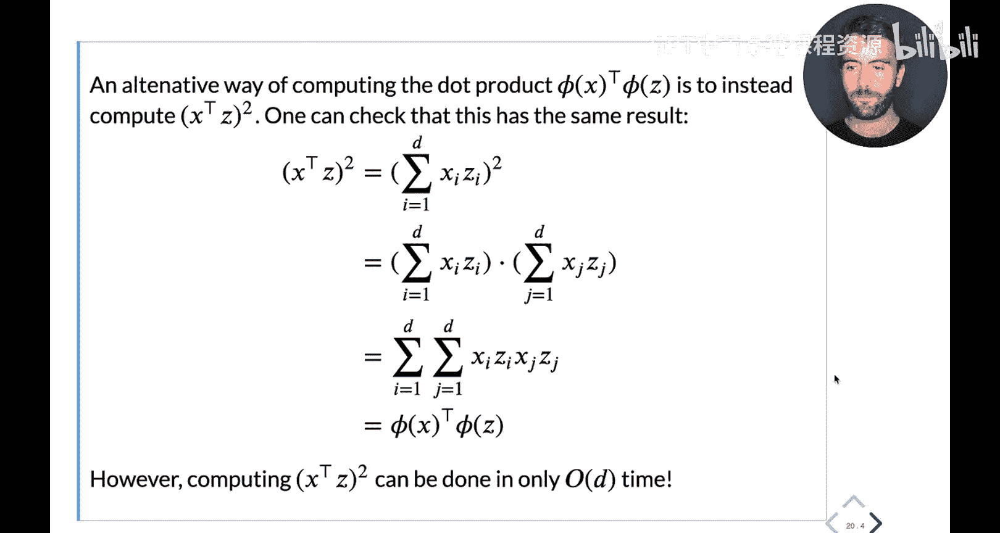

So this is really important and this is。A first example of applying the kernel trick。

In the context of an interesting set of features。Here we have two ways of computing the dot product。

 One is by forming the features themselves directly and。Multiplying them， which takes d squared time。

Or we can use our simpler formula， and this takes only because of D time。

And this is really powerful because anytime that we have an algorithm which only requires dot products as opposed to the features themselves。

 we can accelerate this algorithm by avoiding。To by avoiding having to do these complicated operations that take D square time。

 we can instead accelerate all these operations by。Bringing them down to big of D。

So the Ri regression algorithm that we saw in the earlier video is an example of an algorithm where we could use this approach because as I said earlier。

 every expression there only used the dot product， and so if we wanted to use these dimensions。

 these features of dimension d squared， we could use them without paying this d squared cost。

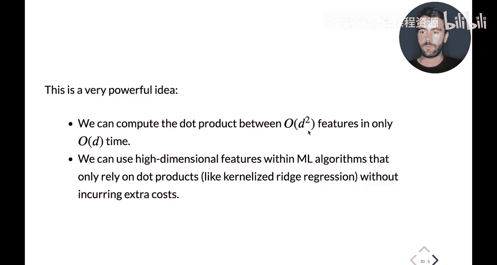

This is a really powerful idea， and this is at the heart of what is called the kernel trick。

And the kernel trick is much more general， here's another example。

Suppose that instead of having polynomial features of degree 2。

 we have polynomial features of an arbitrary degree P。 So now my vector of features phi。

 it has a length of D to the power P。And each component of Phi can be indexed by。P numbers， I 1。

 I2 up to I， and each of these indices。I 1， I2 IP is within my。

 that's simply an index within the space of components。 They go from one to the。

They go from one to D。And the value of the vector phi at this component is simply the product of。

Of these dimensions。 this is a generalization of what I had in my earlier slide， if p equals 2。

 then I get exactly the same thing。 But now instead of having my features be all the products between pairs of attributes。

Now， my features are all the products between。A subset of P of the attributes。And obviously。

 since this has length D to the power P， if we were to just compute these features and apply the definition of the dot product to determine their dot product。

 this would take us a big of D to the P time。But it's not hard to show that using this trick that I had in my earlier slide。

 I can also compute。 I can have the following。Expression for the power。

For the do product between features， Phi sub P。I can compute them alternatively using this formula and again。

 this formula takes only big of d time because the inner dot product takes big of D time。

 and then I just take to the power P。 In other words。

 I can have these arbitrarily long features I can have this arbitrarily large set of feature and no matter what dimensionality no matter what feature dimensionality I use。

 I can always compute their dot products in。In dementia， in time， that's linear。In other words。

 I can use my Rige regression algorithm with all these with an arbitrarily high degree polynomial without incurring any computational cost whatsoever over a linear model。

As long as I use that dual formula in every case， it doesn't matter if within that dual formula。

 I have dimension of degree。P， I have features of degree P， or if I have features of degree。

They can be of an arbitrary degree and it will still be linear。 This is a very powerful idea。

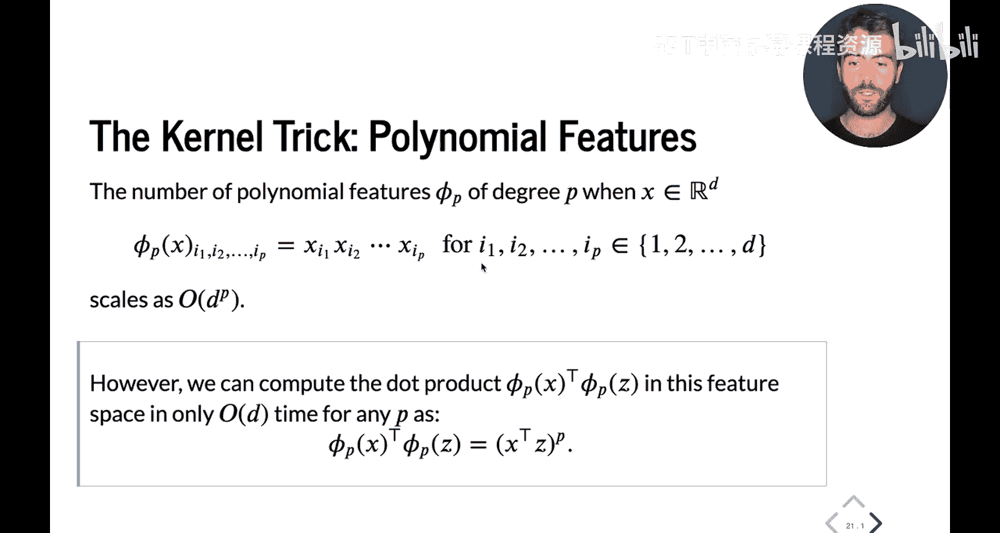

So it is really important in fact。We can derive we can define this。

 can an algorithm to we can give a name to the algorithm that I defined earlier。

And we can call it kernelized Rige regression， which means that kernelized polynomial Ri regression。

 and I'm going to explain to you shortly why I'm using the words kernelized。The word kernelized。

 but effectively this algorithm is sufficiently important to have its own name and whenever we use that equation that I had at the beginning of this video and in the previous video and whenever we compute these doc products using a version of the trick that I showed earlier。

 this can be considered its own algorithm and it's called kernelized polynomial Ra regression。

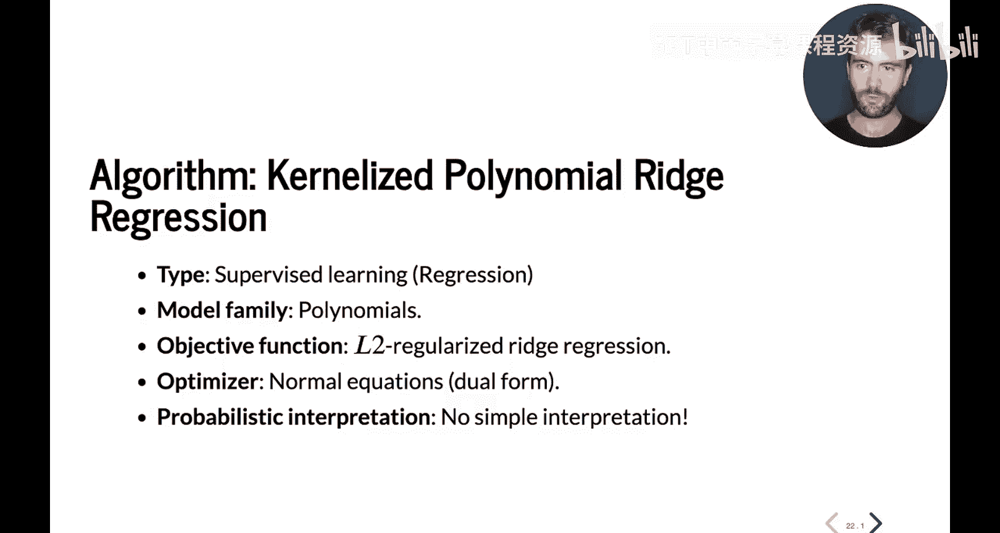

And more generally， this kernelized Rige regression is one application is one algorithm for which we can apply this idea called a kernel trick。

And again， the idea of the kernel trick is whenever in a machine learning algorithms。

 we have do products。Whenever the formulaizer functions of the dot products instead of the features themselves。

We can。We can accelerate them， and we can often have arbitrary complex features without any computational cost whatsoever。

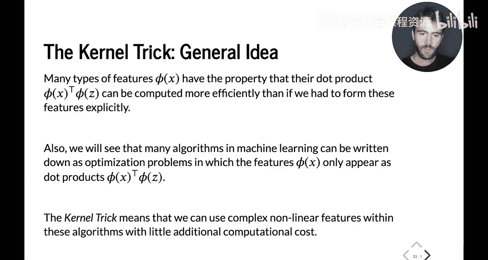

This can be used in many algorithms this can be used in this kernel trick。

 even though I only showed it within Ri regression。

 we can also apply it in various other forms of linear regression。

 we can apply it in logistic regression， which is a classification algorithm we can apply it within support vector machines and we can also apply it beyond supervised learning we're going to see later how we can apply this trick within unsupervised learning for algorithms like principal component analysis。

 density estimation and。In this lecture， I'm also going to show you a few more examples of how we can apply this。

This trick and other algorithms in which the kernel tricks can be used。

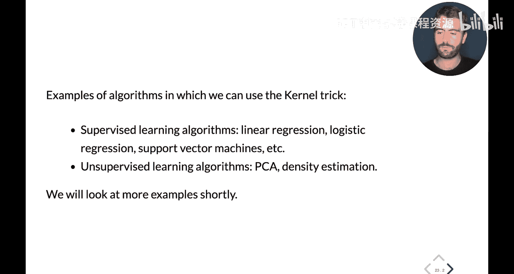