# 康奈尔大学《应用机器学习 CS 5787_ Applied Machine Learning 2020》中英字幕（deepseek p43 -43-Lecture 11. Part 3_ The Kernel Trick in SVMs.zh_en -BV12udzYvEFM_p43-

We're at part 3 of lecture 11 of applieded machine learning in which we talk about kernels。

In the previous few videos， I gave you an example of a machine learning algorithm for which we could write down all the steps and all the formulas using only the dot products between features as opposed to the features themselves。

And then in the following video， I give you an example of how we can compute dot products between features much more quickly than we can compute the features themselves。

And by using this trick of computing the features computing the dot products of features in a more effective form and plugging them in into formulas which don't require the features but require only the dot products by using this accelerated form within these machine learning algorithms。

 we can significantly。Speed them up， and we can make them work with very， very high dimensional。

 with very high dimensional features。Without really incurring a lot of additional computational costs。

In this approach， we refer to it as the kernel trick。In this video。

 I would like to give you an example of another algorithm that can also benefit from the kernel track。

 and this is going to be the support vector machine algorithm that we have seen in the previous several lectures。

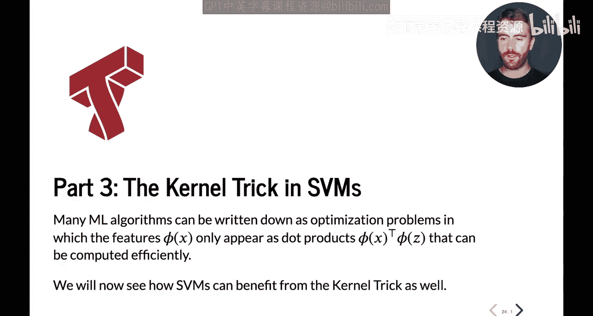

Recall that support vector machines in their simplest form are performing binary classification。

So we have a training data set and our targets Y they take one of two possible values。

 which we denote as minus1 or plus1。

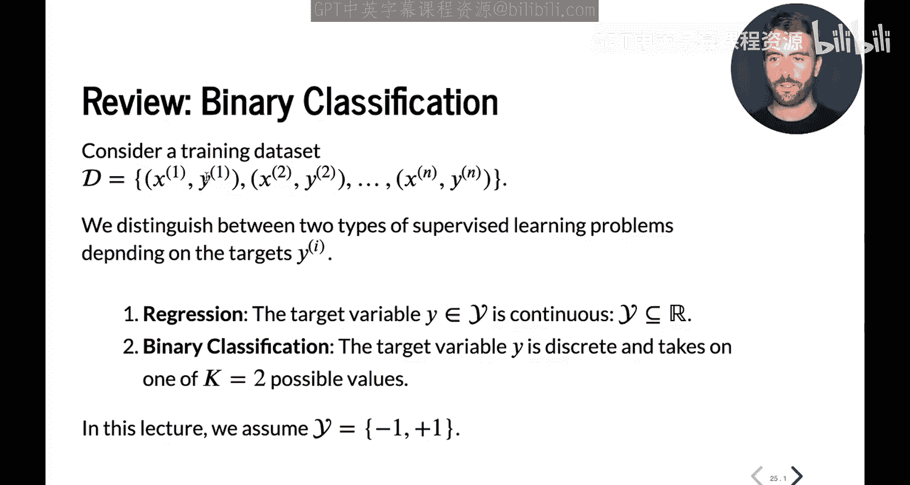

And the kind of machine learning model that we consider over this data is a linear model。

 which is also the same form that we had earlier when we talked about linear regression。

 except that now we are going to use this model for classification as well。

 and we're going to be able to use it for classification by using a different loss by using a different objective function。

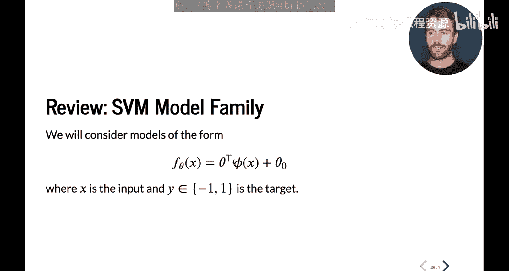

The particular objective function that we're using in an SVM is the following。

 this is a constraint optimization problem。And here we saw in the previous lecture that this is an optimization problem over the set of parameters。

 theta and theta 0， where we have the constraint that each training instance is classified correctly up to some small margin of error Psi。

And our objective function is minimizing the magnitude of the error's psi。

 and also it's minimizing the norm of the。Of the hyperplane， of the decision boundary theta。

And we saw that minimizing this norm is equivalent to optimizing for the highest margin between the two classes。

 which means that it corresponds to by minimizing this norm。

 we are choosing the hyperplane which sits as far as possible from the training points that belong to either of the two classes。

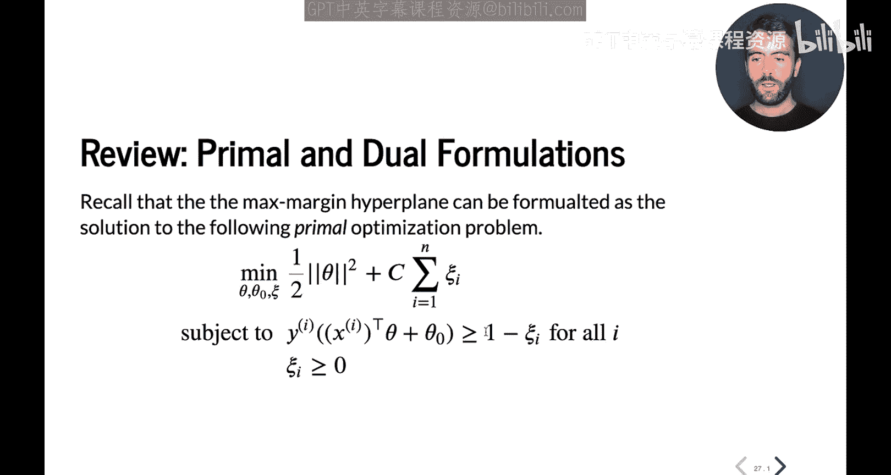

Now in our most recent lecture on SVMs， we saw that this problem can be reformulated into a different form using principles of Larrange duality。

We saw that this optimization problem is called the dual of the problem that I showed you earlier。

 that problem is called the primal， this one now is the duall。

And optimizing this problem gives us the same the same minimum as the previous one。

So this is a dual problem， a dual version that is equivalent to the primal。It is different though。

 in terms of how we perform optimization， now we have a completely different set of variables。

 now we have variables lambmbda。But this is still a quadratic optimization problem in Lambda with some constraints。

And it is also different in that。Before in the previous a problem， which was the primal。

 our number of variables， it was roughly we had approximately the main variable over the main set of variables of which we were optimizing were the hypermeter where the parameters of the hyperplane of which we had D here we have n variables。

 lambda， where n is the size of our data set。

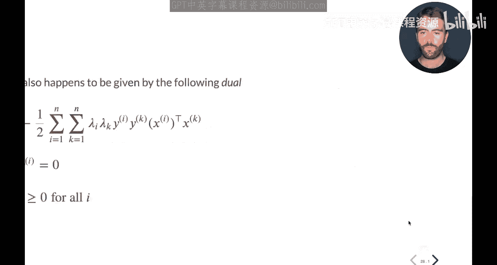

And then we saw that it's possible to solve the duall and obtain a formula for the primal。

And we derived this or we showed how to derive this， it's not that hard。

 we just solve a particular optimization problem， we take the derivative， we set it to0。

 we solve for the optimal theta， and we can see that the optimal theta has the following form。

And what's interesting is that this form also is really similar to what we had in the Rige regression example。

 Here， our optimal theta can be shown to be await weighted。

Combination awaited linear combination of the features at all of the inputs X。

And here the weights are given by the labels y， as well as by the optimal value by the optimal assignment to the dual variable as Lada。

In other words， by solving the dual， we obtain these Lambdas and now we have the following convenient form。

And given that the optimal theta has this form。We can also compute its features using we can compute the prediction at a new training point by also using a formula that looks really similar to what we had in our earlier example and which only involves the feature Phi。

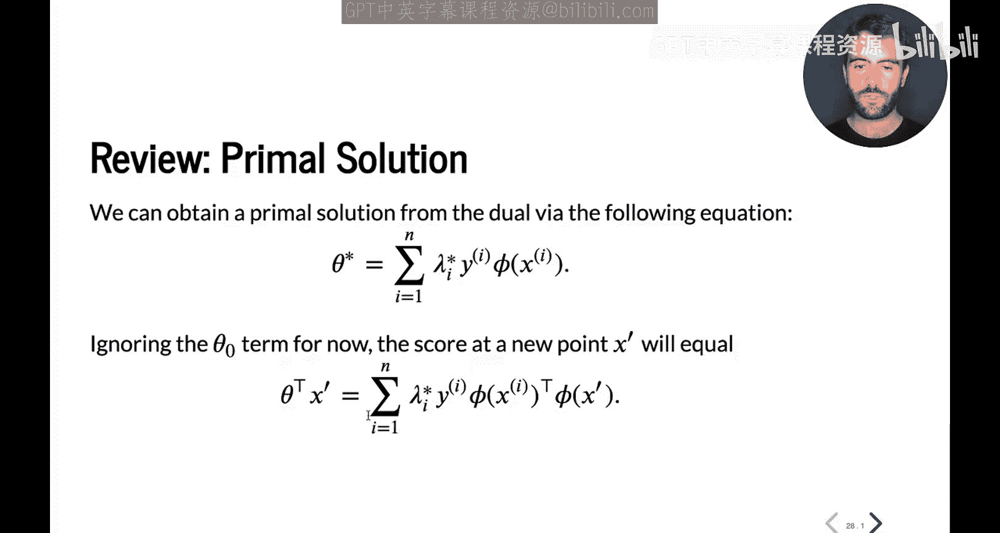

So， this should be。This should say feature phi， and now I have a dot product between theta and phi。

 which is my prediction， and this prediction only involves the dot products。

 but not the features themselves。

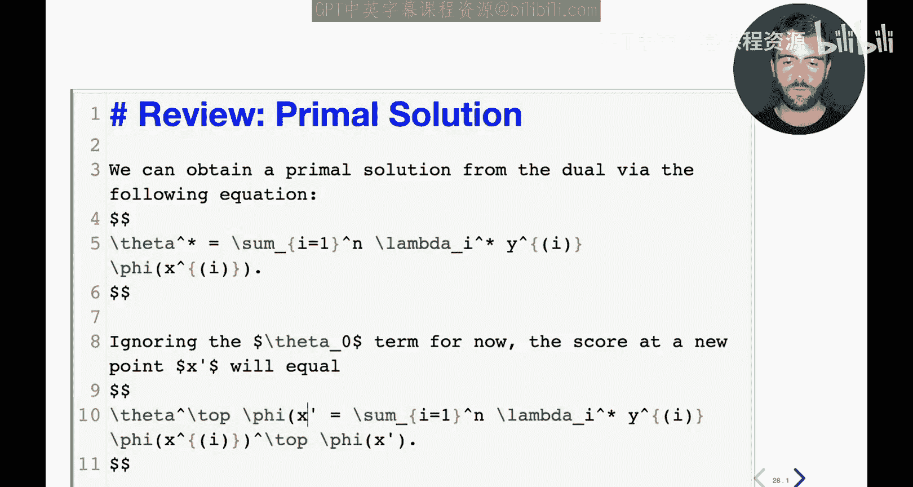

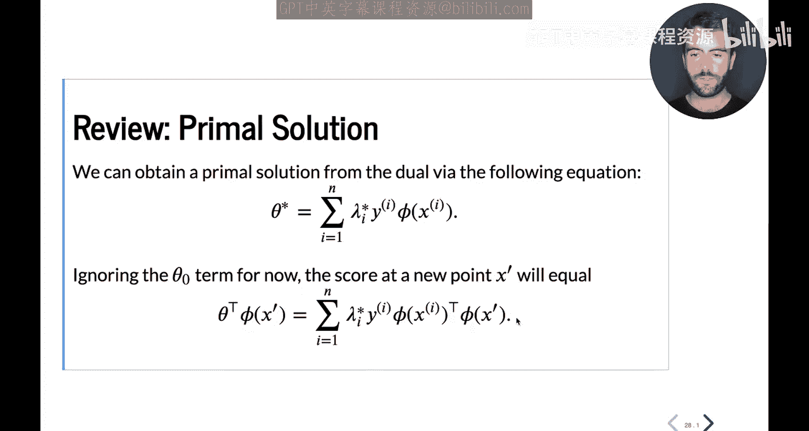

So let's look again at these formulas， this is the formula for doing prediction that you saw earlier。

 and here at the top I have my optimization objective for the dual of the SVM。

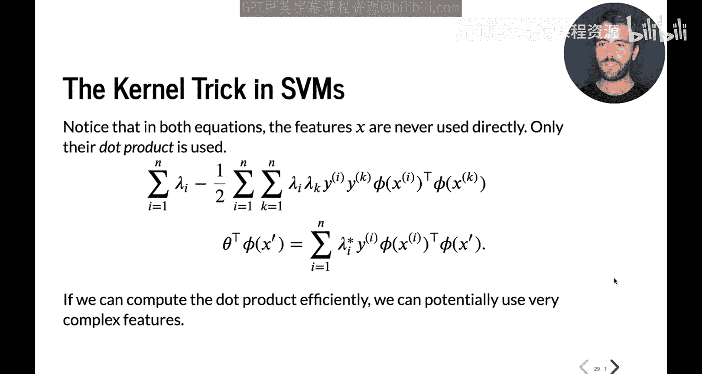

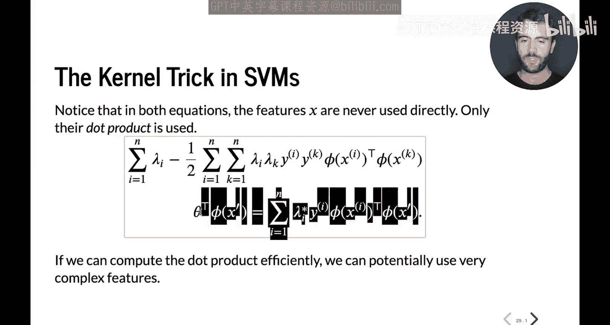

And both of these only involve dot products between features， but not the features themselves。

And so in the same way that we did with rich regression。

 we can also apply the principle we can here apply the kernel trick。

 and if we can compute these dot products efficiently。

 then we're going to be able to use this dual version of the algorithm very efficiently on large input dimensions。

 on large feature dimensions。

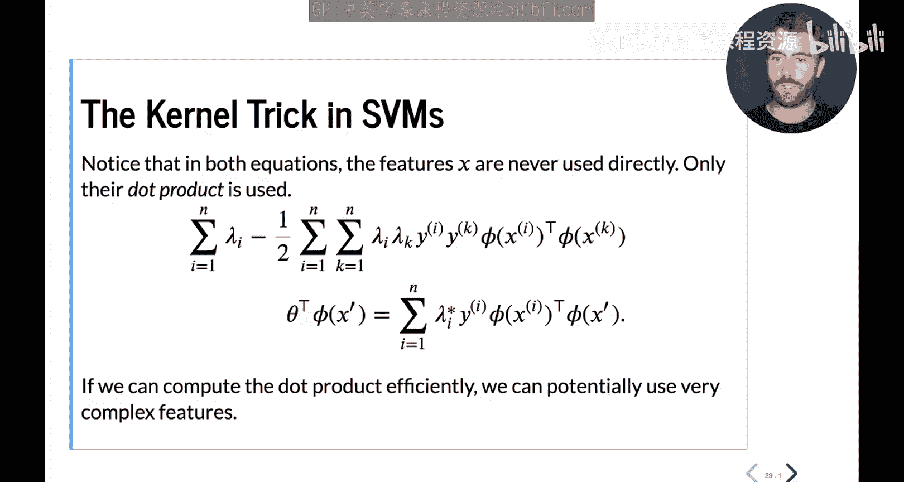

So we can define this a little bit more generally。 we can define the kernel tricks in SVMs a little bit more generally。

 let's say that we have some features phi， and let's say that we can find some way of computing this dot product more effectively than。

henhan the standard， then the straightforward approach of just using the definition。

 and let's say that this is given by a function K， which we're going to be calling soon the kernel function。

So let's say that if we want to compute the dot product between these two features。

 we can simply call this function K and it will compute this dot product quickly。Again。

 an example that we saw earlier in the in the previous video is if our features are polynomial features of all the possible products of the attributes of the input X。

 then we can compute this。Then we can compute the dot product really efficiently in in linear time using the following simple trick。

 and this defines our kernel function。

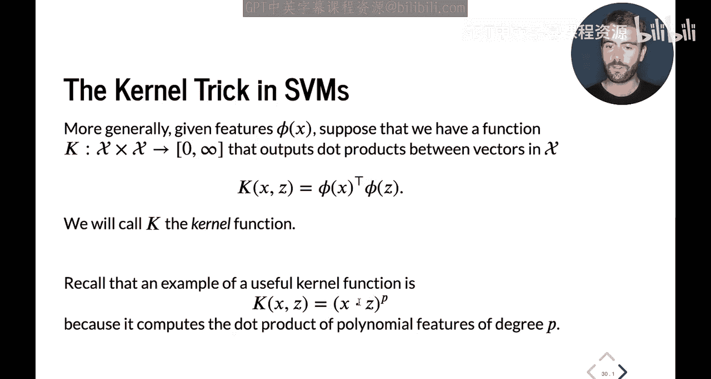

And now， given that we have a kernel function， we can define our optimization problem in this particular form here。

 I have simply replaced the dot product with the。With the kernel function， and。

We're going to be constructing this kernel function in a way that this is really fast。

Our predictions， so we're going to be able to solve the optimizationization problem quickly。

 then this prediction X prime is going to have this particular form where again I have replaced the dot product with the kernel function。

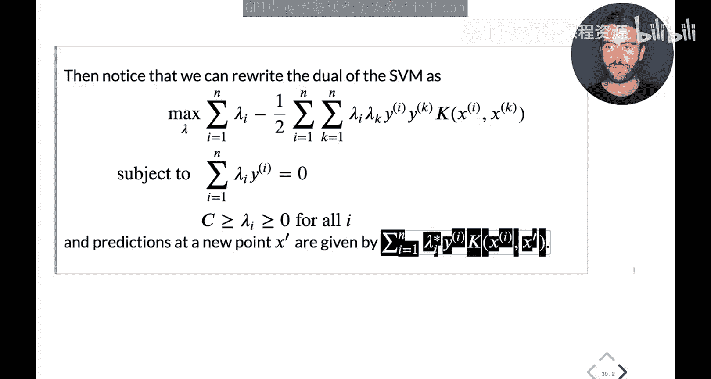

And therefore， everything is going to be。And， and and therefore。

 we're going to be able to use within S V within an SVM， very high dimensional features without ever。

Without， without really incurring much of the computational cost of using them。

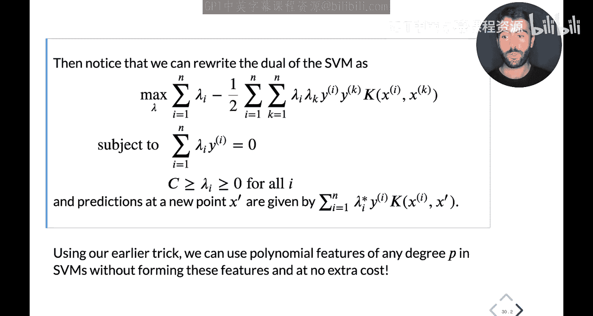

And so this defines another algorithm， which I'm going to be calling kernelized support vector machine classification。

 which is the kernelized version of the regular support vector machine classification algorithm that we saw earlier。

And here， as in the earlier video， we are solving this。 So this is a。This defines a new algorithm。

 which is an algorithm for binary classification。Because we're using these potentially highly nonlinear features。

 we're able to learn nonlinear decision boundaries。

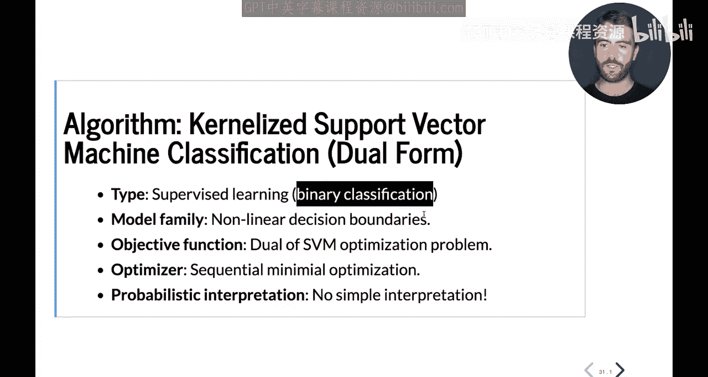

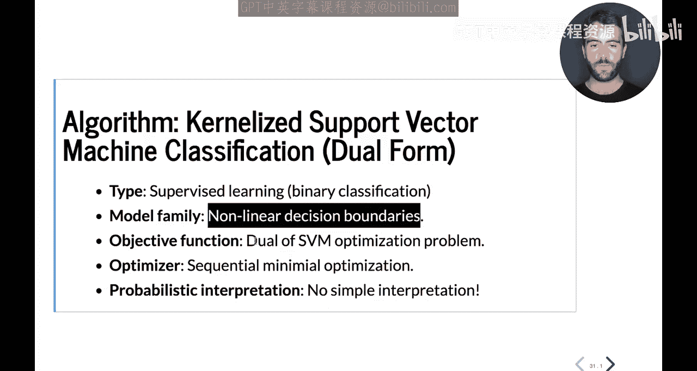

And we're able to compute these boundaries by solving the dual of the of the SVM optimization problem using algorithms such as sequential minimum optimization that we saw earlier to solve this dual。

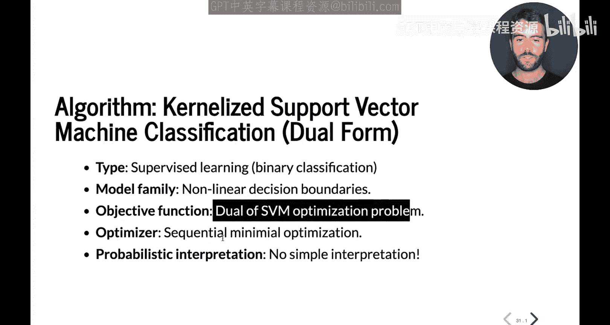

So kernels are actually very often used in SVMs。 And one of the main advantages of S VMs is that they can use。

Clonnels easily and efficiently。And in the next video。

 I'm going to give you more examples of kernels that we can use within support vector machines。

And also in algorithm with other algorithms as well。

 but I'll present them in the context of support vector machines。

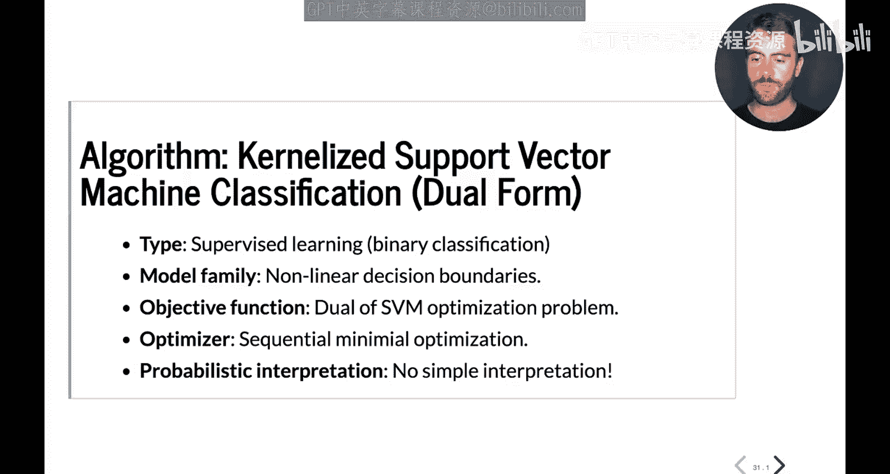