# 应用机器学习：第11讲：第3部分：支持向量机中的核技巧 🔧

在本节课中，我们将学习**核技巧**在支持向量机中的应用。我们将看到，通过仅使用特征之间的点积，而不是特征本身，可以高效地处理高维特征，从而显著提升算法性能。

---

## 概述

上一节我们介绍了核技巧的基本思想，即通过高效计算特征点积来加速机器学习算法。本节中，我们将具体探讨如何将核技巧应用于**支持向量机**，使其能够处理高维特征，同时保持计算效率。

---

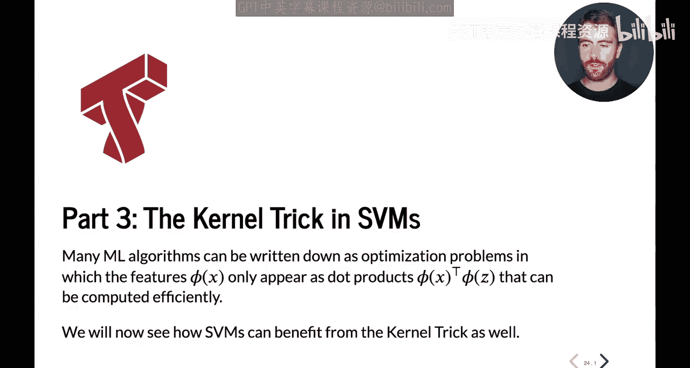

## 支持向量机回顾

支持向量机在其最基本的形式中执行**二元分类**任务。我们有一个训练数据集，目标变量Y取两个可能的值，通常表示为-1或+1。

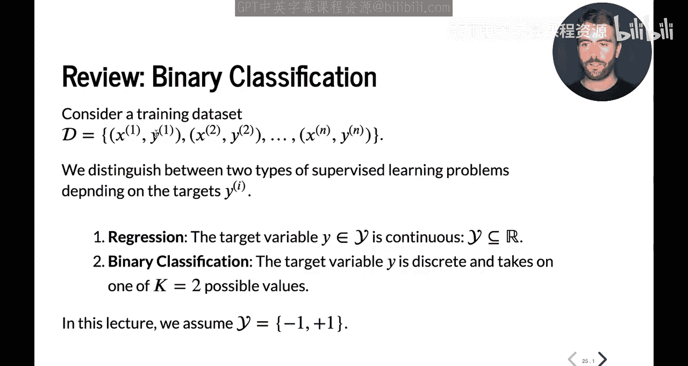

我们在此数据上考虑的机器学习模型是一个**线性模型**，其形式与之前讨论线性回归时相同。不同之处在于，我们现在使用不同的损失函数和目标函数，将该模型用于分类任务。

支持向量机中使用的特定目标函数如下，这是一个约束优化问题：

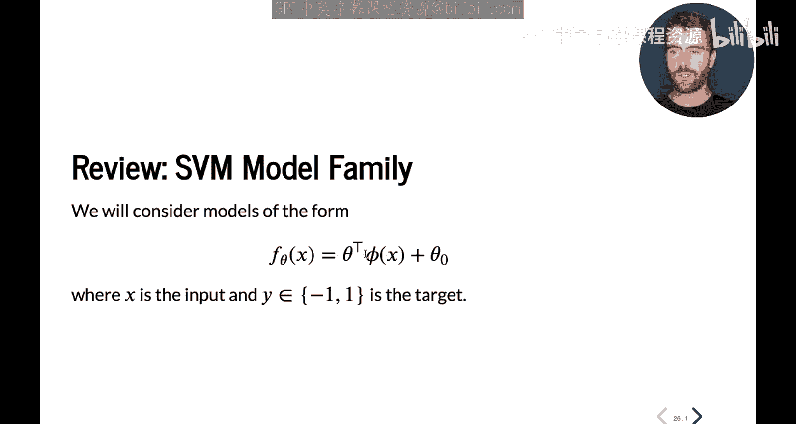

$$
\min_{\theta, \theta_0, \psi} \frac{1}{2} \|\theta\|^2 + C \sum_{i=1}^{n} \psi_i
$$

约束条件为：

$$
y_i (\theta^T \phi(x_i) + \theta_0) \geq 1 - \psi_i, \quad \psi_i \geq 0
$$

在之前的讲座中我们看到，这是一个关于参数θ和θ0的优化问题，约束条件是每个训练实例在一定的误差裕度ψ内被正确分类。我们的目标函数是最小化误差ψ的幅度，同时也最小化决策边界超平面θ的范数。

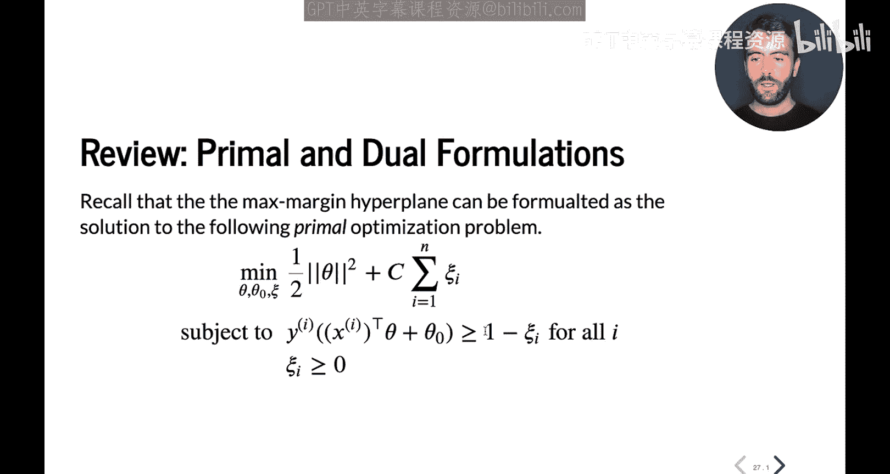

最小化这个范数等价于优化两个类别之间的**最大间隔**。这意味着，通过最小化这个范数，我们选择的超平面尽可能远离属于两个类别中任一类的训练点。

---

## 对偶问题与核技巧

在最近关于支持向量机的讲座中，我们了解到，利用拉格朗日对偶原理，可以将上述问题重新表述为另一种形式。这个优化问题被称为原始问题的**对偶问题**。

优化这个对偶问题能得到与原始问题相同的最小值。虽然优化方式不同——现在变量是λ，并且这是一个带有约束的关于λ的二次优化问题——但两者是等价的。

以下是支持向量机对偶问题的优化目标：

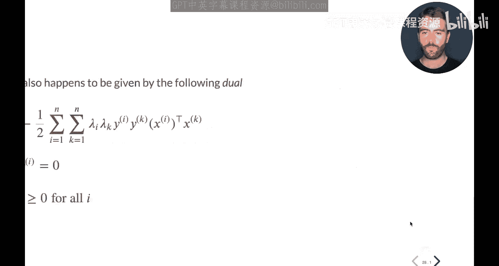

$$
\max_{\lambda} \sum_{i=1}^{n} \lambda_i - \frac{1}{2} \sum_{i=1}^{n} \sum_{j=1}^{n} \lambda_i \lambda_j y_i y_j \phi(x_i)^T \phi(x_j)
$$

约束条件为：

$$
\sum_{i=1}^{n} \lambda_i y_i = 0, \quad 0 \leq \lambda_i \leq C
$$

原始问题的主要变量是超平面的参数，数量约为特征维度D。而对偶问题有n个变量λ，其中n是数据集的大小。

通过求解对偶问题，我们可以得到原始问题参数的公式。最优的θ可以表示为所有输入特征X的加权线性组合：

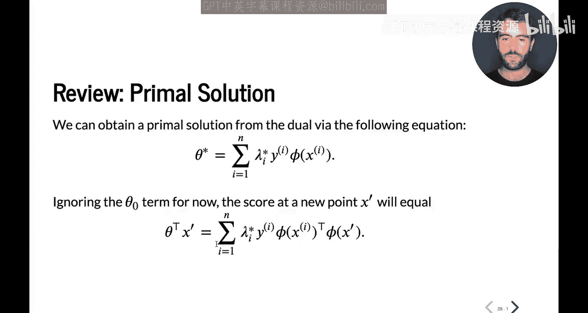

$$
\theta^* = \sum_{i=1}^{n} \lambda_i y_i \phi(x_i)
$$

这里的权重由标签y和对偶变量λ的最优赋值给出。这个形式与我们之前在岭回归例子中看到的非常相似。

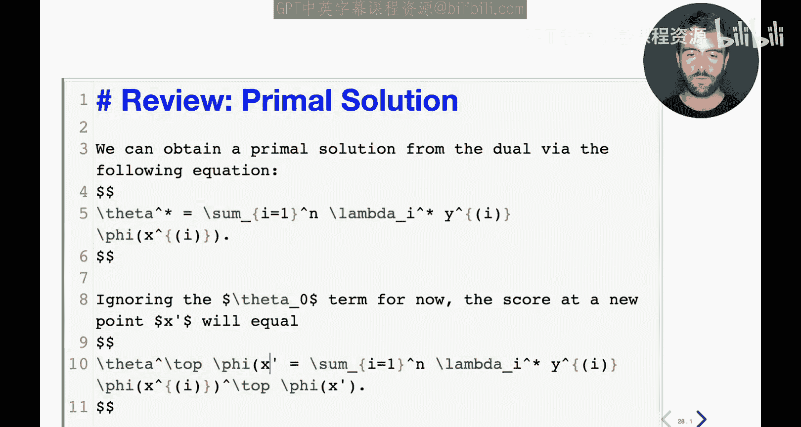

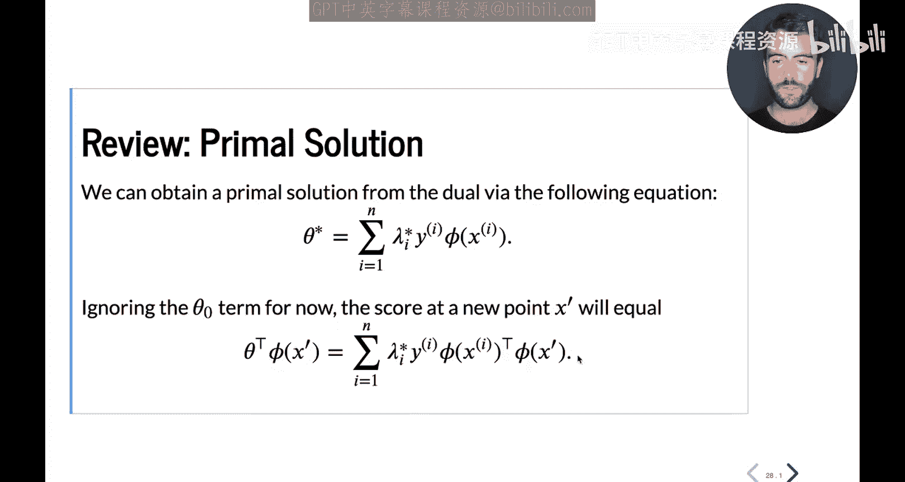

给定最优θ具有这种形式，我们也可以在新数据点上进行预测，其公式同样只涉及特征φ的点积：

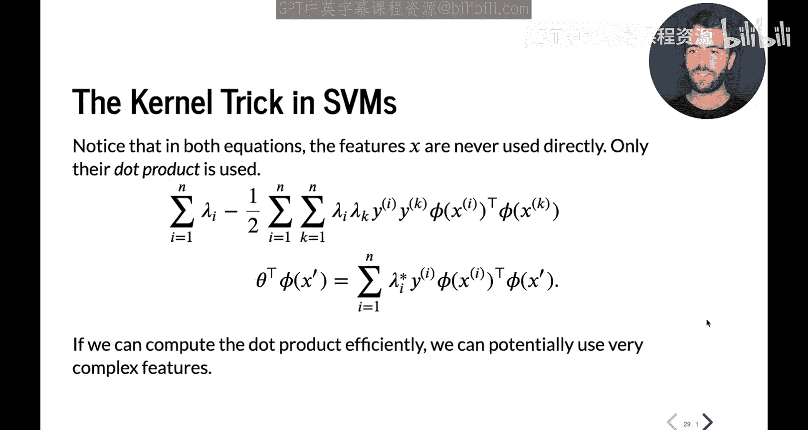

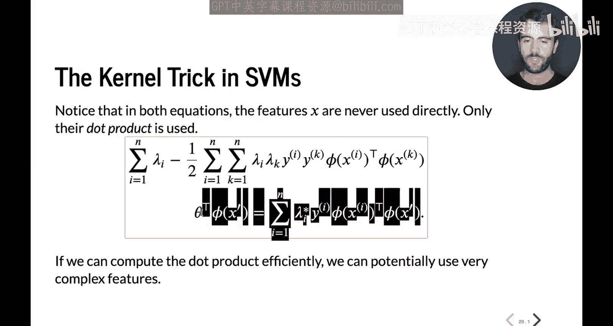

$$
f(x') = \theta^{*T} \phi(x') = \sum_{i=1}^{n} \lambda_i y_i \phi(x_i)^T \phi(x')
$$

---

## 应用核技巧

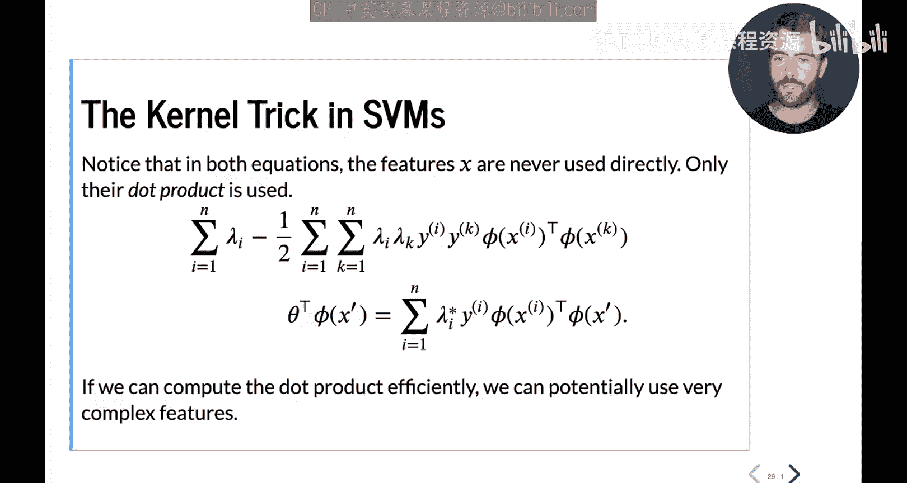

现在，让我们再次审视这些公式。顶部的公式是支持向量机对偶问题的优化目标，下面的公式是进行预测的公式。**两者都只涉及特征之间的点积，而不涉及特征本身**。

因此，就像我们在岭回归中所做的那样，我们也可以在这里应用**核技巧**。如果我们能高效地计算这些点积，那么我们就能在高维特征空间中高效地使用这个对偶版本的算法。

我们可以更一般地定义核技巧。假设我们有一些特征φ，并且我们找到了比标准定义更有效的方法来计算这个点积。我们称这个计算方法由一个函数K给出，这个函数K很快就会被我们称为**核函数**。

假设我们想计算这两个特征之间的点积，我们可以简单地调用这个函数K，它会快速计算出这个点积。我们在上一个视频中看到的例子是，如果我们的特征是输入X属性的所有可能乘积的多项式特征，那么我们可以使用以下简单技巧在线性时间内高效计算点积，这就定义了我们的核函数。

现在，假设我们有一个核函数，我们可以用以下特定形式定义我们的优化问题。我简单地将点积替换为核函数。我们将以一种使计算真正快速的方式构造这个核函数。

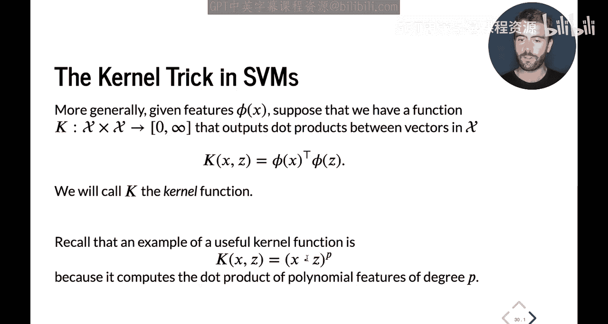

我们的预测公式也将具有以下特定形式，其中我再次用核函数替换了点积：

$$
f(x') = \sum_{i=1}^{n} \lambda_i y_i K(x_i, x')
$$

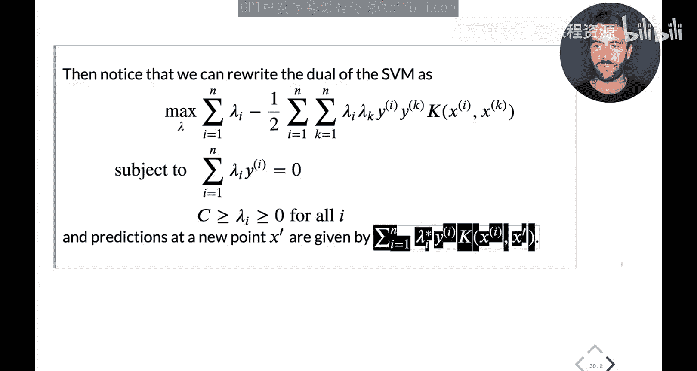

因此，一切都将能够高效计算。我们能够在支持向量机中使用非常高维的特征，而不会真正产生使用它们所带来的大量计算成本。

---

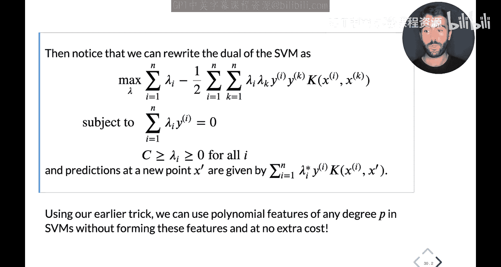

## 核化支持向量机

这就定义了另一个算法，我将其称为**核化支持向量机分类**，它是我们之前看到的常规支持向量机分类算法的核化版本。

与之前的视频一样，我们正在求解这个对偶问题。这定义了一个新的二元分类算法。由于我们使用了这些潜在的高度非线性特征，我们能够学习**非线性决策边界**。

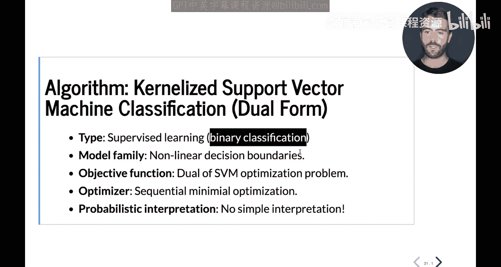

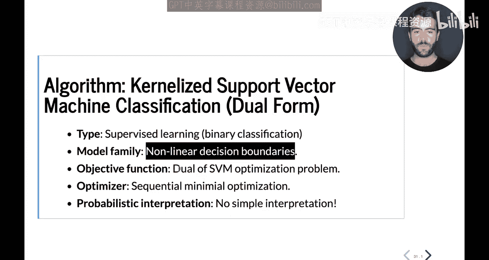

我们能够通过使用诸如之前看到的序列最小优化等算法来解决支持向量机优化问题的对偶问题，从而计算这些边界。

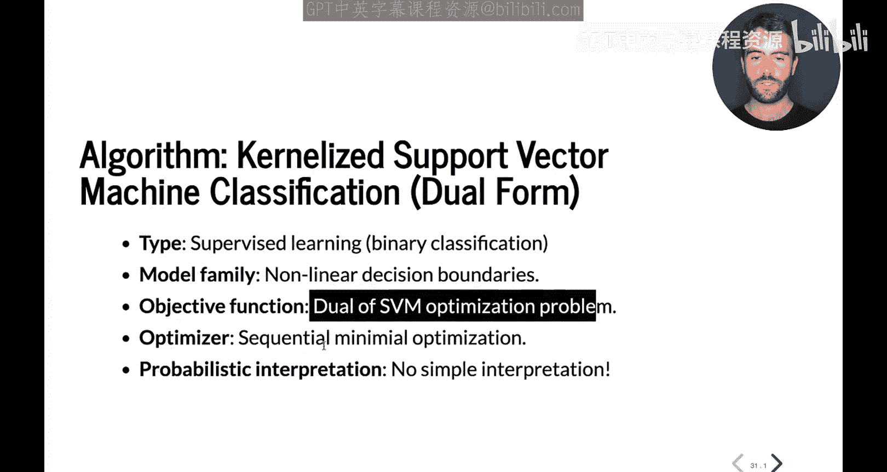

---

## 总结

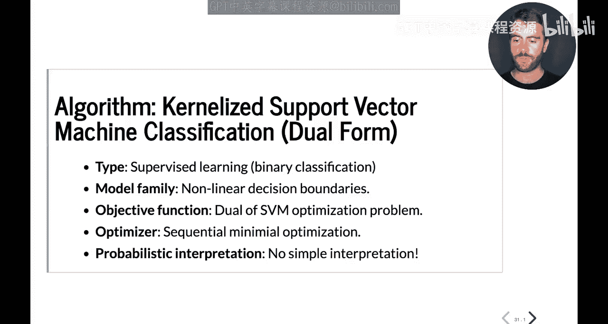

在本节课中，我们一起学习了如何将**核技巧**应用于支持向量机。我们回顾了支持向量机的对偶形式，并展示了其优化目标和预测公式都只依赖于特征间的点积。通过定义一个高效的**核函数**K来计算这些点积，我们可以使支持向量机能够高效地处理高维甚至无限维的特征空间，从而学习复杂的非线性决策边界，而无需显式计算和存储高维特征本身。核技巧是支持向量机的一大优势，使其在实践中非常强大和灵活。在接下来的视频中，我们将看到更多可以在支持向量机及其他算法中使用的核函数示例。