# 康奈尔大学《应用机器学习 CS 5787_ Applied Machine Learning 2020》中英字幕（deepseek p45 -45-Lecture 12. Part 1_ Decision Trees.zh_en -BV12udzYvEFM_p45-

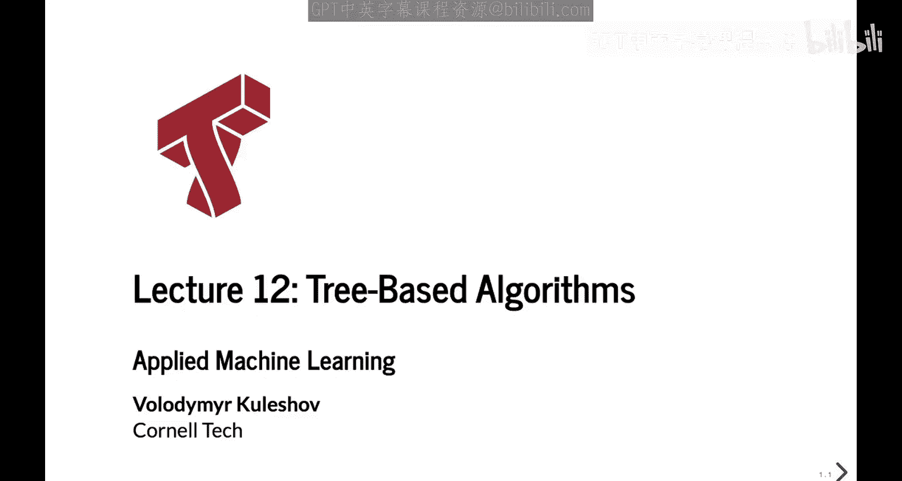

Welcome to Le 12 of applieded machine learning。In this lecture。

 we are going to look at a new kind of supervised learning algorithm called Dec trees。

 which is going to be quite different from the kinds of supervised learning algorithms that we have seen before。

In the previous sets of lectures， we saw different kinds of supervised machine learning algorithms。

 but they always came from an angle that was more mathematical。

 they came from an approach that was based on mathematical modeling so we would define a particular formula for how our predictions might look like or we define a formula that would map。

Inputs to predictions。And then we derived， again， using mathematical principles。

Ways in which we could learn these models。Now we are going to take a slightly different approach and we're going to instead look at models that try to mimic in a certain way how a human would make decisions when given a particular machine learning task。

And again， as I said earlier， this approach is going to the overall set of algorithms that we're going to cover are called tree based algorithms。

 and the first and one of the really important algorithms in this family are decision trees。

I'm going to start this lecture by first defining in this video what a decision tree is。

 and then later we're going to see how to learn these decision trees。

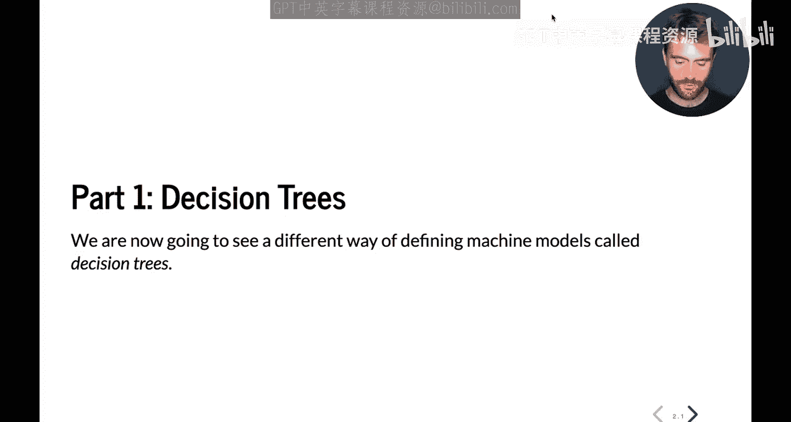

So recall that our definition of supervised machine learning is that in order to define a supervised machine learning algorithm。

 we need to define a data in order to define a supervised learning problem。

 we need to define a data and learning algorithm and the learning algorithm is composed of a model class which defines all the different models that could be mapping inputs to outputs。

 and it's also defined by an objective which ranks the models within this class by how well they fit the data。

 and then an optimizer which chooses the best possible model in this class。

So decision trees are going to be a rather different type of model class from the ones that we have seen earlier。

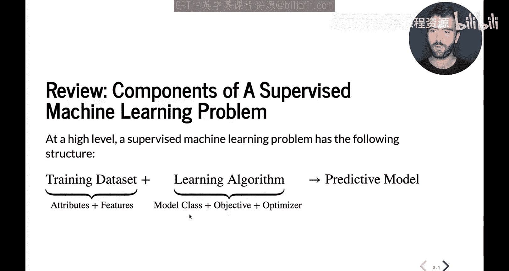

And in order to define this model class， I am going to use as an example。

 the diabetes data set that we have seen earlier。

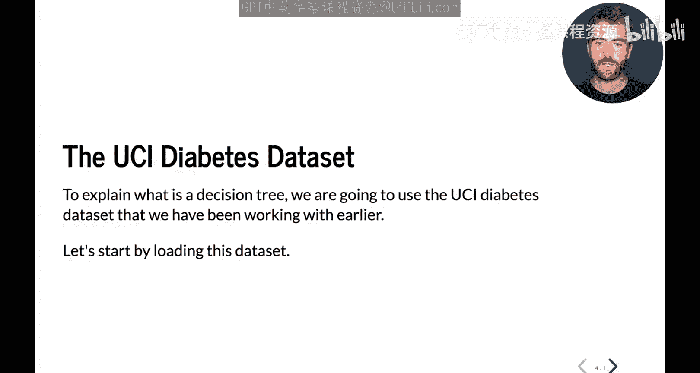

if you recall our diabetes data set consists of data points for about 442 patients that are for these 442 patients。

 we are collecting various kinds of measurements， including physiological measurements that are described here。

 we also have measurements such as their BMI， their blood pressure， we know their age。

 we know their sex， and in total we have 10 attributes， and based on these attributes。

 we want to make predictions about their diabetes risk。

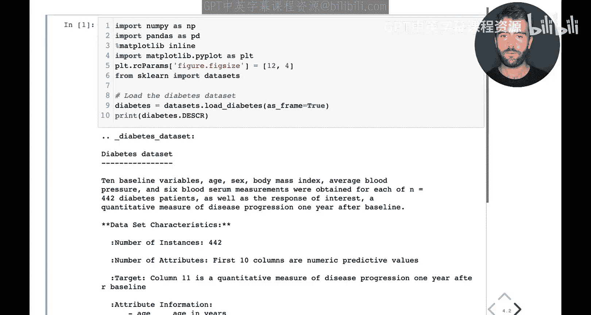

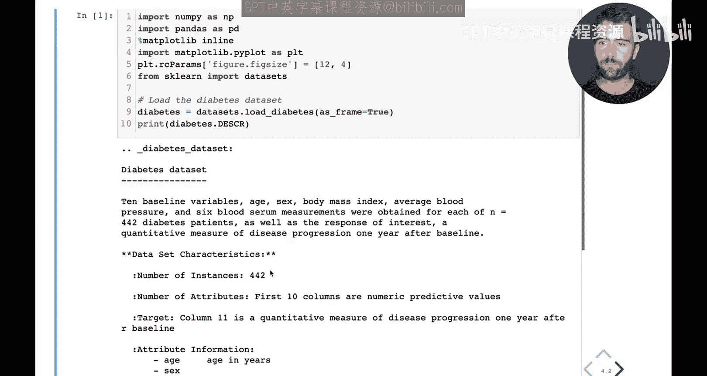

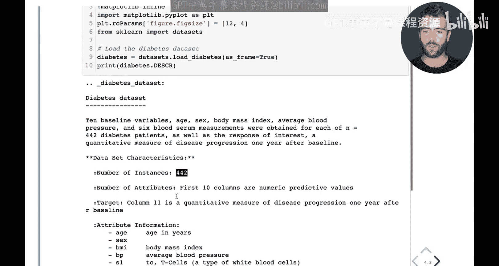

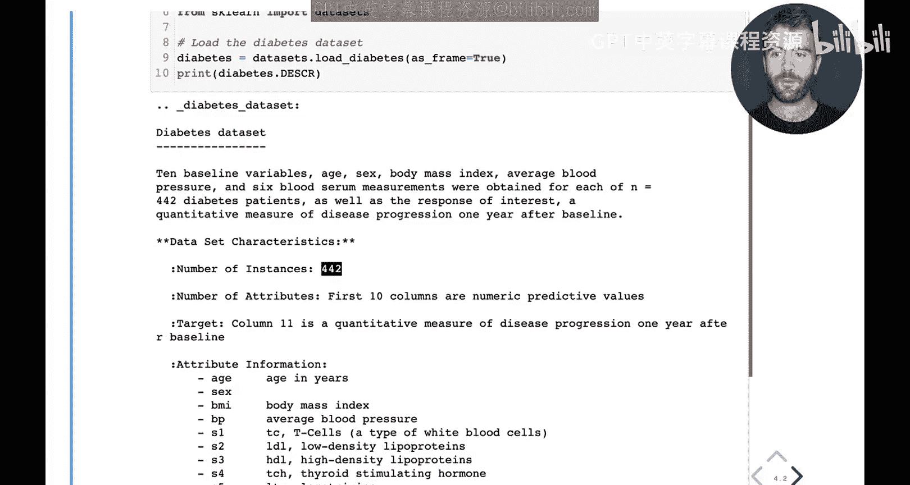

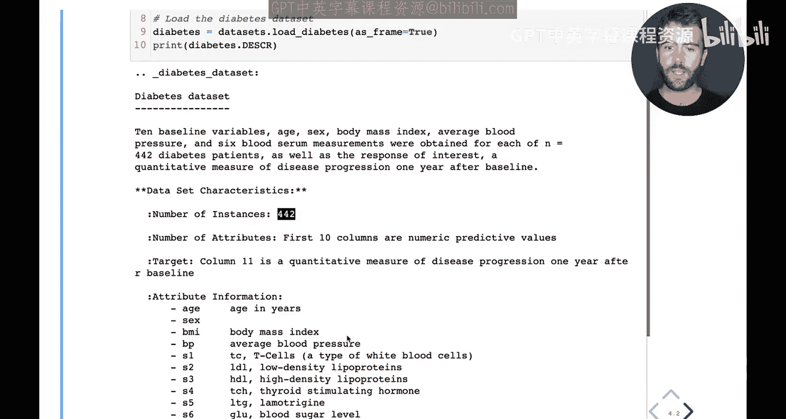

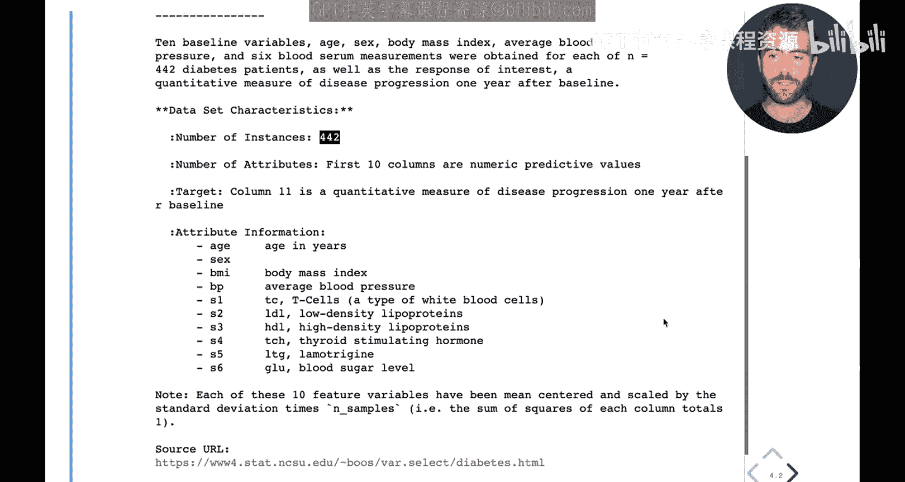

This is the full description of a data that you can find if you load from the Psyit learnn datasets package。

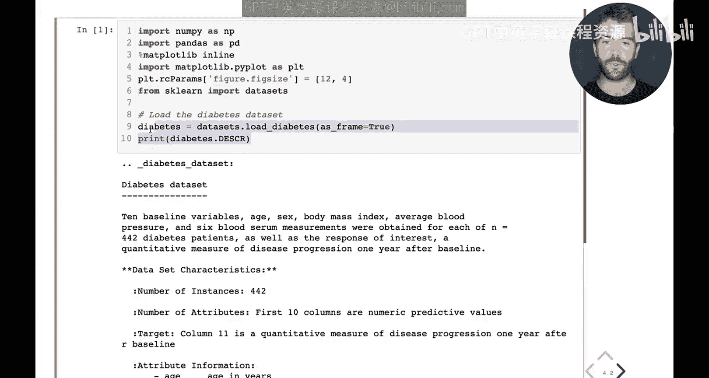

If we inspect the data directly we again have this data frame that we have already seen。

 we have certain columns， age sex， BMI， again if you haven't seen the earlier lecture。

 you may remember that these you should remember you should know that these columns are normalized so here for example age is taking these small values。

 that's because weize the H column to have mean zero and standard deviation of one。

 so these data has been pre-processed but these are valid representations of a patient's age sex BMI blood pressure and other physiological measurements。

And the key variable that we want to predict here is the diabetes risk。

And in order to make it simpler， we will assume that the risk of a diabetes patient can be binized as being either large。

 that is if the diabetes risk is greater than 150 or low if it's below that。Now。

 given that we have this data set， let's define what a decision tree would look like on this data。

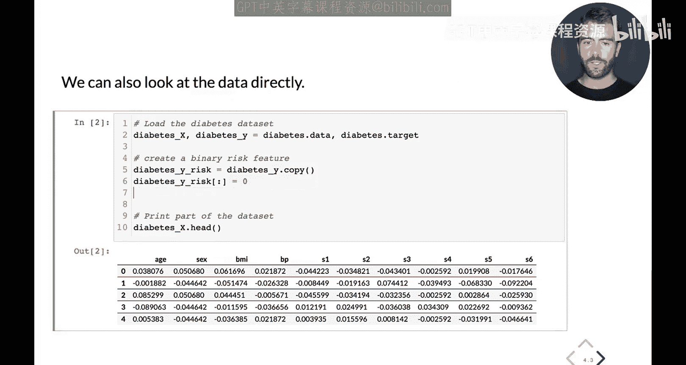

Imagine that instead of an algorithm， imagine that we had a human that would try to approach the problem of predicting diabetes risk。

So if this was a doctor that would be making this diagnosis。

 they would probably start by looking at various general properties of the patient， for example。

 their age， then depending on whether the patient is is old or young。

 they would then make a different decision so let's say that they realize that the patient is old。

 then the next question that would come to mind is， well is this a man or is this a woman。

 if it's an old man， well， that may already have some kind of medical meaning。

 and then if it's an old man， well we would probably want to collect or at least look at more closely at a certain set of measurements for the patient。

And then if it's a woman or if it's a young person， then maybe if it's a young person。

 then there's really nothing to predict they have a low diabetes risk， but the point here is that。

A human approaching this problem would probably follow some kind of process where they would try to follow a set of rules to understand the importance of which in order to understand the diabetes risk of this patient and they would consider different scenarios。

So one scenario might be that we're dealing with an old man。

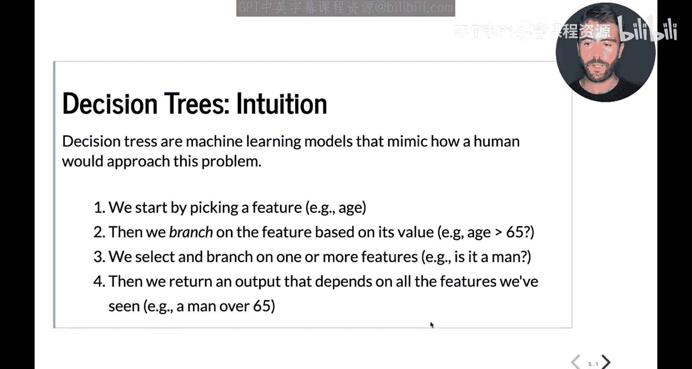

The diabetes， the decision tree approach， tries to mimic this rules based decision making approach that I just described。

In order to understand what a decision tree does， let's。

Import a decision free algorithm from psychic learn， and let's run it on our diabetes data set。

So the code here is really short here I am importing this decision tree classifier from psychit learn。

 I am training a decision tree of maximum depth2， or I'm loading it and here I'm training it I'm only using the first three features by the way。

 and now I can use this handy helper function plot tree from Psychit learn to visualize how the tree will look like。

And we have something， which looks like this。So this is a graph。

 it's a directed graph which shows how this decision treeclassifier that we have just learned will learn to make。

Predictions or how it will the process that it will follow to make predictions。

Each note here corresponds to a decision that it is making based on the data。

And because here I've limited the depth to  two， it's going to make two decisions。

The first decision is what is on the first line here， BMI less than 0。009。

If the BMI is less than a certain value then we go on the left and if the BMI is higher than that value。

 we go on the right and so if we're on the right here。

 then the BMI is higher than this value so it determines that this is this intuitively would correspond to a larger BMI value so the person would be would have higher BMI and then at this node we have BPP less than equals 0。

017 so if the blood pressure for this patient is less than this value then we go on the left and otherwise we go on the right and similarly if we're here in this branch of the tree。

 then the algorithm is also looking at the blood pressure and then here it has decided to use a different threshold to determine whether it's on one side or the other side。

And at each so each note here of the each node of the tree is a rule。

A little bit like the rules that I had in my earlier slide。

 how which determines what to do with a patient and what kind of risk group they might belong to。

And you can see immediately that this makes sense intuitively。

 we're first looking at the BMI if the person has a high BMI they look at their blood pressure。

 the blood pressure is high， then they're in this group。

 and this is going to be our high risk group here secular tells me that there are 86 samples in this data and 76 of them are high risk and 10 of them are low risk so here this tree has identified this high risk group of patients that have high BMI and high blood pressure and it has chosen this particular values。

And similarly here this set， these are patients with low BMI and low blood pressure。

 and most of them， 147 are have low risk and 41 has high risk。

 so again here in a fully data driven way， this algorithm has determined at least two classes of patients。

For which we can say that these are low risk and these are on the extreme right are。High risk。

And the structure for making this decision， again， it has these sets of rules that we can easily represent in a graphical form via a tree。

And this entire algorithm and also just this visualizations of its decisions， which by the way。

 we can easily run these as a human。 these are just really simple rules。

 So this approach is the decision tree approach and that illustrates at a high level what a decision tree model is and what it does。

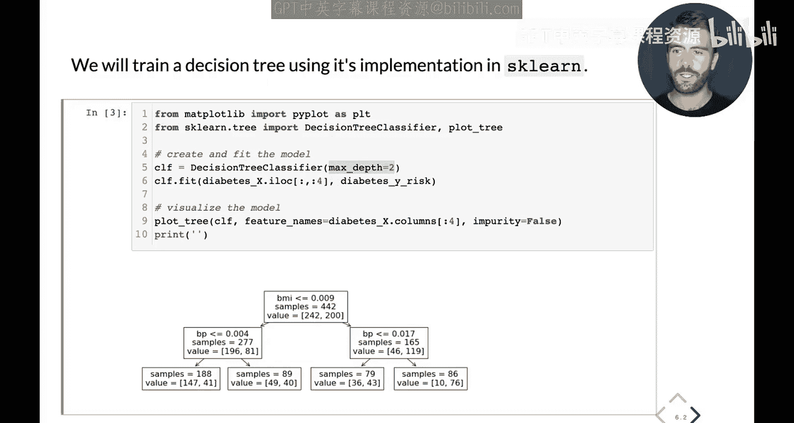

Now let's look at decision trees a little bit more precisely， a little bit more formally。

 let's define them in a slightly more precise way using a little bit of mathematical notation。

And the first concept that we need in order to do this is that of a decision rule。

 and that is probably the most important concept， the most important building block for a decision tree。

Essentially you can think of a decision rule as partitioning the feature space into two disjoint regions。

So one example of a rule that we saw earlier on the previous slide was looking at whether the DMI feature is higher or lower than a certain value。

And if the and essentially this rule， it outputs a binary outcome。

 we Is there certain criterion satisfied or is it not satisfied。And in a decision tree。

 we normally apply each rule to only one feature or attribute。Although we could in principle。

 immediately learn here a rule that looks at two variables in practice in all decision tree algorithms。

 we look at things one rule at a time， and this is in fact enough because if we wanted to have if we wanted to look at two variables。

 we could always branch on the second variable in the next rule in the decision tree in the next level of the decision tree。

And visually these rules， they correspond to edges here。

 or at least their outcome corresponds to an edge， a rule is associated with this node and then once we trigger this rule for a patient。

 we either have true or false and depending on whether it's true or false we go either to the left or to the right so these rules have a very simpleal graphical interpretation。

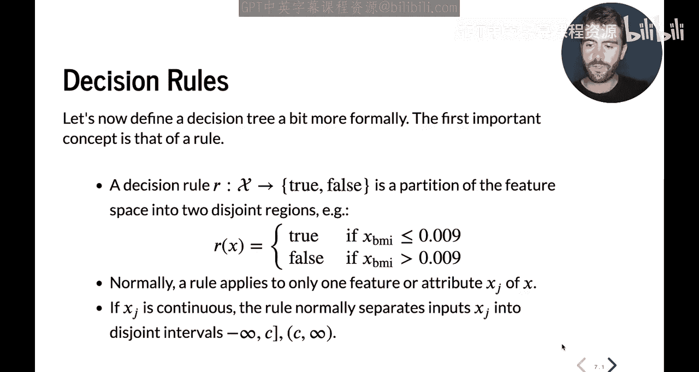

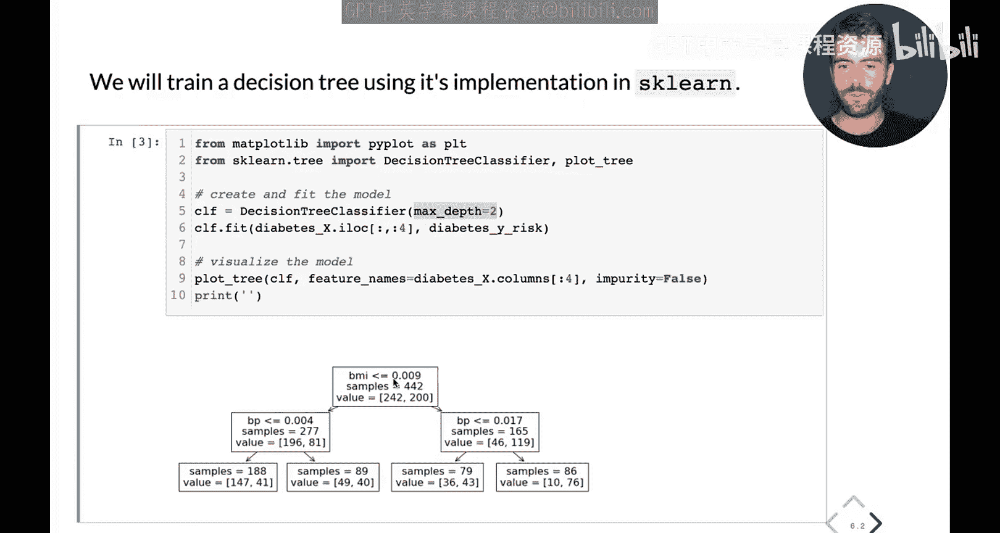

And depending on what kind of value these attributes take， if this is a continuous variable。

 then normally these kinds of rules would branch on a particular value。 So if this。

BMI is less than a threshold than we go one way， if it's larger then we go another way and we can define this mathematically as as partitioning the input space into two thisjo intervals with some middle threshold C here and then if we're on one side we go left if we' were on the other side we go to the right in principle we could also have a more complex region but we don't do this with decision rules that are used in decision trees because it makes the algorithms more complex and also there is no reason to do this if we wanted to have a more complex partition with multiple thresholds then again we could simply have two rules applied in a sequence。

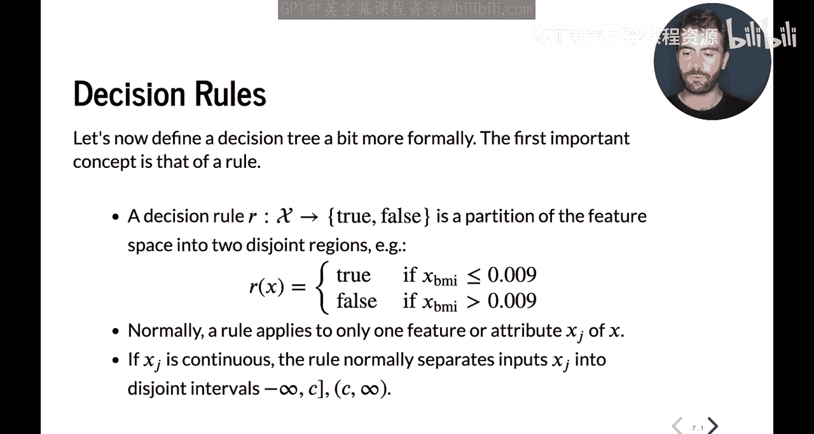

Now， the next important concept is that of a decision region。

 and that is something that is defined by the decision rules。

So consider a sequence of rules that are implemented that can be graphically mapped within a decision tree。

 so here we have M rules， then for each assignment to the outcome of these rules。

 we end up with some kind of partition of our feature space。So here。

 each of these rules can take some kind of value true or false， which I'm going to denote by V。

And then for each possible assignment of values to these rules， I have what I call here a region。

 and that is simply the set of inputs for which these rules are valid。

For which these rules attain the value that I specified here with the V variables。

So an example from the previous slide， in the context of diabetes risk。

 it would be we had in that tree the following region， so if BMI is less than 0。

09 and blood pressure is higher than this value， then that defines a region。

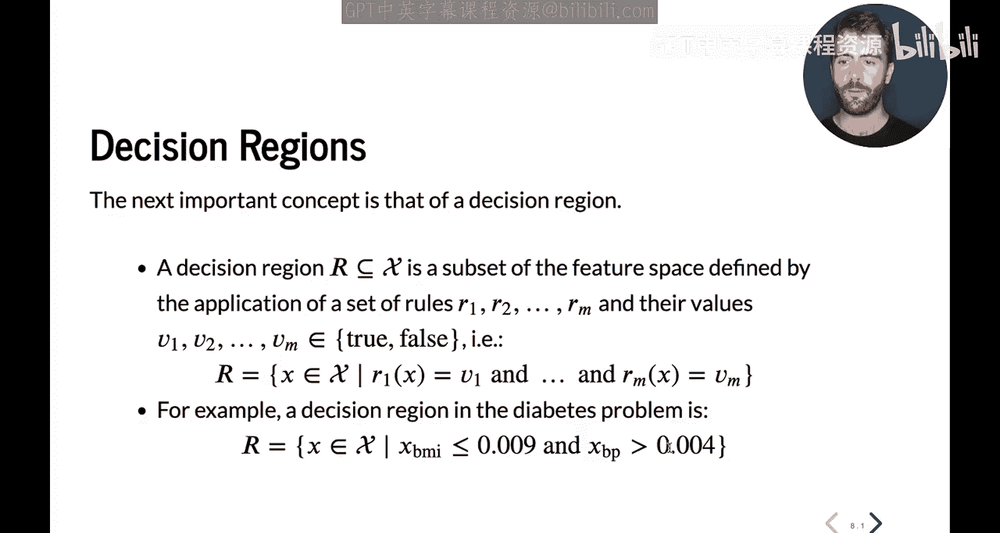

And visually inside a tree， these regions would be represented by the leaf nodes of the tree。

In particular， the region that I defined on that slide just a moment ago， it is this region。

 so here I have taken I have evaluated this rule and it said go left then I have evaluated this rule and said go right and now I am in this particular region and if instead edit did left left I would be in this region so here I have。

I have four possible values of the rules， so I have one rule at the root。

 then I have another rule that gets applied at the second level。

 so these two rules have their sequence has four possible values and there are four possible values that I can。

 there are four possible regions in which I can end up。

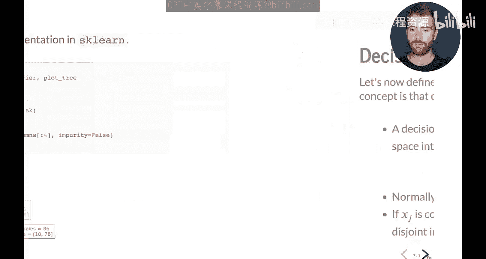

So these are rules。 these are regions。

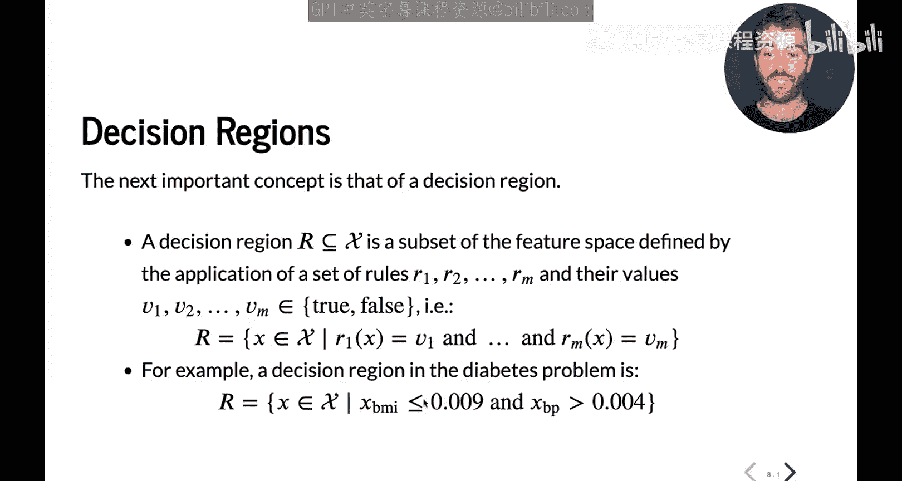

And finally， we can define a decision tree by looking at the。

We can define it really easily in the following form when we have this concept of regions。

Essentially， the decision tree is a partition of the feature space into a number of regions and these regions have a particular tree like structure。

But ultimately， we're just parting our。Feature space into thesejo regions。And then for each region。

 we learn a prediction prediction y sub bar， so y sub r here is the region is the value that we're predicting when we are in this region。

If you're not fully familiar with this notation， hear this。Here this I。

 it stands for an indicator function， and an indicator function simply means that when the term inside the parentheses is true。

 then it equals1 and otherwise equals  zero。So given an x。

 since the regions will partition the space of features， x will fall into one of these regions。

 so one of these terms will equal 1 and everything else will equal 0。

 and therefore the value of f of x at that point will simply equal the predicted y value for that particular region。

So here I'm also using the notation script R to define the collection of all the possible decision regions that this tree has。

I'm going to note here that these are obtained by a recursive splitting。

 I will mention in a second what this is， but essentially at a high level what this means is that they can be placed into some kind of tree structure。

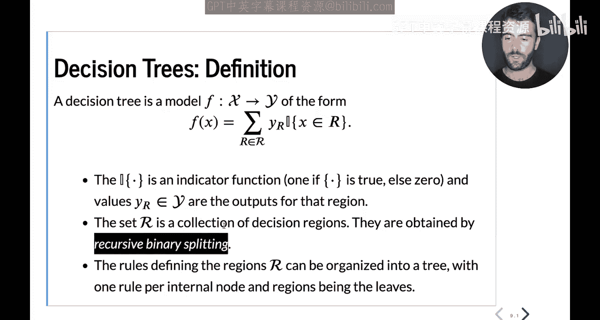

And again， here， yeah， as I'm saying。The rules can be organized into a tree with the regions being the leaves。

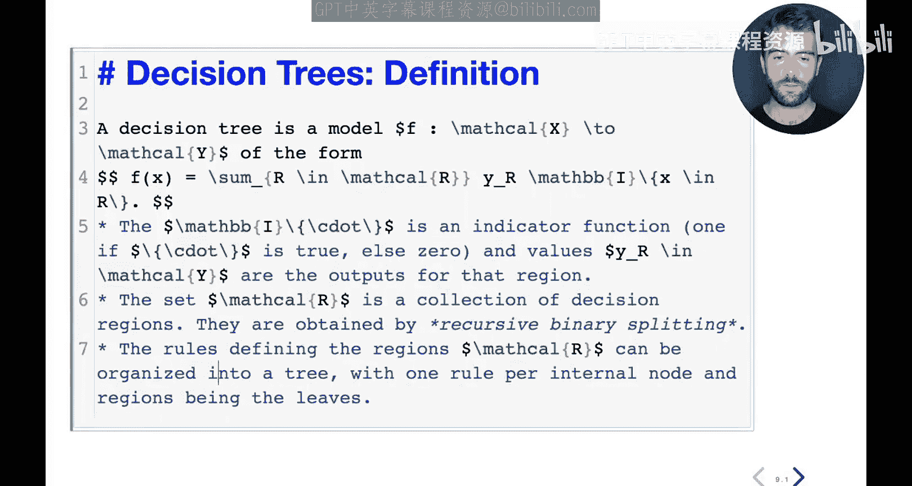

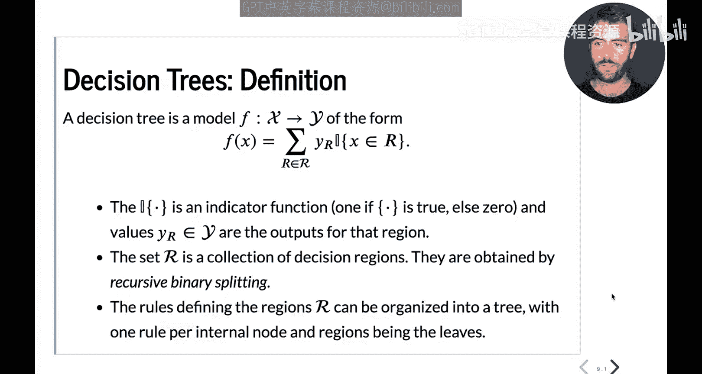

This is， again， the example we had earlier and the leafs are the regions and the rules are the inner nodes。

Finally， we can also look at this figure from the textbook by Haty et all to get another good example of what a tree might look like and what a partition and what are regions。

ThisSo here we have a simple little decision tree， which again has it has a total of five regions or one or two or three or four or five。

 and we have two variables。And these variables are， we have two attributes， x1， x2。

And the decision tree first looks at x1， whether it's less than t1。

 then if it's greater than it looks at x1 again， it splits it on a different value。

 and then it looks at x2， and finally we can be in one of these five regions。

And we can visualize the regions as follows。 So here on the X axis， I have。On this horizontal axis。

 I have x1。And here we're splitting x1 either by T1 or T3。

 So let's say that x1 is greater than t1 then we're in this area and now if x1 is less than t3 then we're in this area and now we fall into region r3 and so r3 is simply the set of it's the set of points for which x1 is between T1 and T3 so this is our region for r3 and if instead we go on the right side here as well。

 now we're greater than t1 and greater than T3 and now we split on x2 so we're definitely going to be in this area and then depending whether t2 is higher or lower than its threshold we end up being either r5 or r4。

So these are the set of regions that would be derived from a tree that has this form。

If we were to assign predictions to each these we were to assign a number to each of these values。

 then we could represent it in three dimensions like this。

 so here we have x1 x2 and the layout of these rectangles is the same that we had earlier。

 but now imagine we assign some number to each region which is our prediction。

 we can visualize this in the third dimension here so in this area R5 that is just this area and it corresponds to the largest value and here are 2 that is the purple region which corresponds to the lower value。

This is an example of how we instantiate this tree。

Of how we convert this tree into regions and finally I just want to make a note that not all regions will correspond to a tree。

 so here on the left we have an example of a region that of a set of regions that cannot be obtained by rules coming from a decision tree。

And you can see that， for example， this region。There is not a simple。

Branching algorithm that can determine this region。

And the reason why this area here cannot be derived by applying the decision tree approach is that we would have to split on more than one variable in this process in order to be able to get this region。

 we would have to split on more than one variable in the decision tree。

 and so therefore this structure would not be able to give us this particular region。

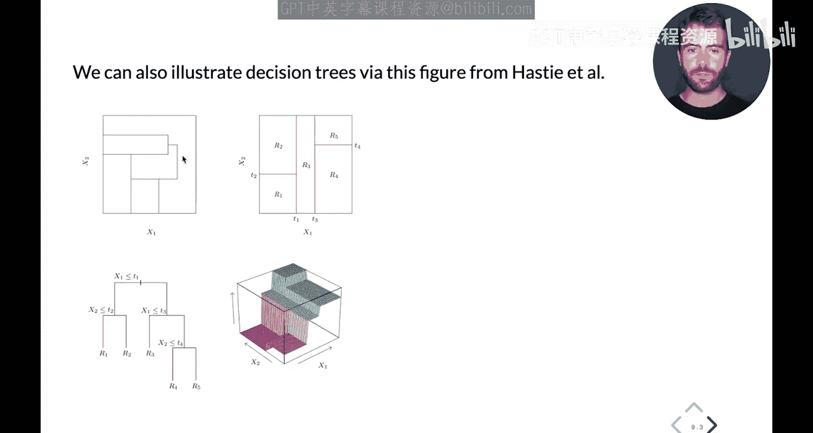

So decision trees are a very intuitive and simple approach。

 and they're a very important algorithm in machine learning。

The main advantages of decision trees is that they're highly interpretable if we wanted a human to understand what the algorithm is doing。

 it's really easy we can visualize it or they can just read out the rules， it's very simple。

And another advantage that may be a little bit less obvious is that decision trees require very little data preparation。

In many algorithms and machine learning， we have to worry about numerical issues like scaling of the features。

 or if the variables are continuous or discrete， then they have to be encoded in different ways into the algorithm。

Or if we're dealing with eification or with a regression problem。

 we have to choose a different machine learning model。

Here we don't really have to worry about this decision trees can just。

Look at unscaleed unprocessed inputs， they can perform regression and classification equally well。

And so they're just a very easy off the shelf algorithm。

Their main disadvantages is that if they are small and interpretable。

 then they're not really powerful。 There is only so many。

There's only so many things we can do with a short set of rules and if they are large。

 then we're going to see that it's really easy to overfit the data and if we werefit the data。

 then there's not a very obvious way of regularizing these models。So these are pros and cons。

 but overall decision trees are still a really important approach in machine learning that is used a lot and that is important to know。

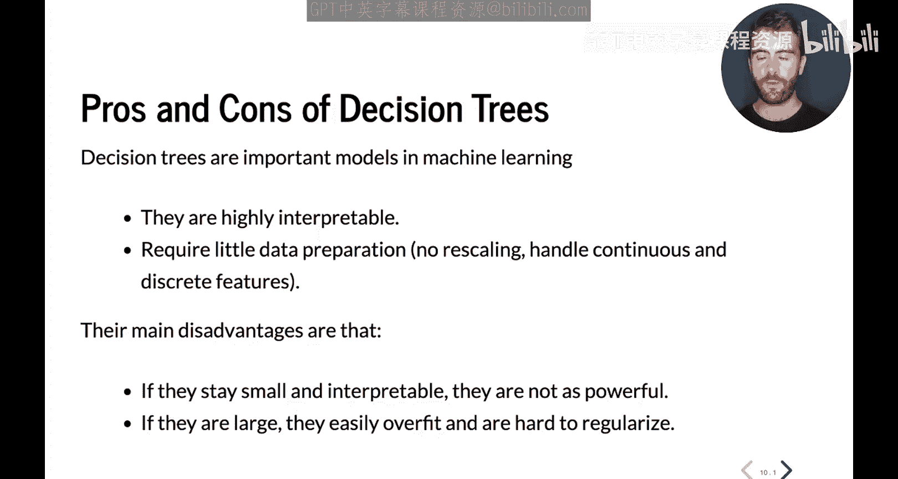