# 康奈尔大学《应用机器学习 CS 5787_ Applied Machine Learning 2020》中英字幕（deepseek p46 -46-Lecture 12. Part 2_ Learning Decision Trees.zh_en -BV12udzYvEFM_p46-

We're now at part two of Le 12 of Applied machine learning where we talk about decision trees。

In the previous video， I explained what a decision tree is。

 and now let's look at how we can learn decision trees from data。

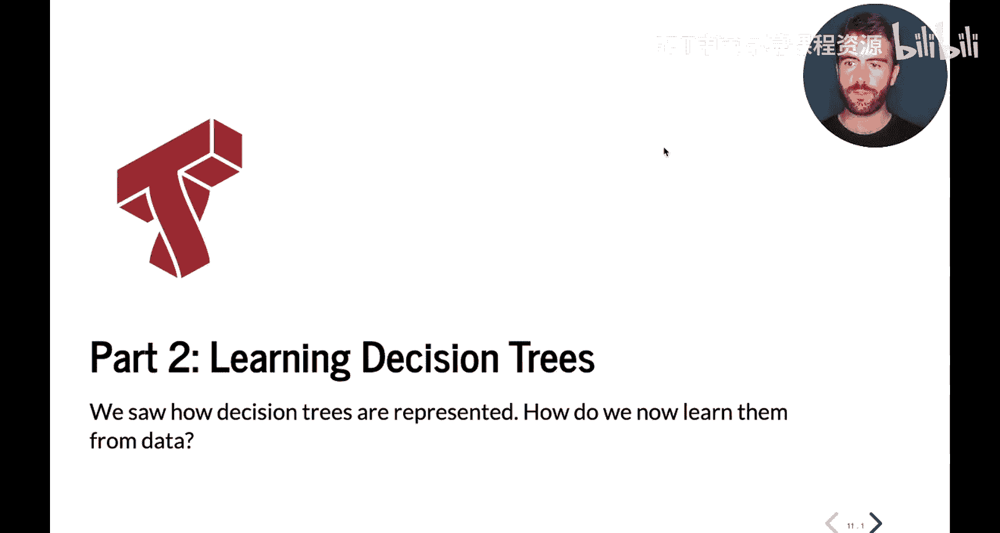

Recall that I defined a decision tree as a function that has the following form。

The decision tree implicitly breaks up the feature space X into a set of disjoint regions。

 each of them is denoted by R and their collection is denoted by script R。

 and then when we're given an input X。This x will belong to one of the regions and this indicator this indicator function here will be nonze at one of the regions and zero everywhere。

 and therefore we will output the prediction Y。

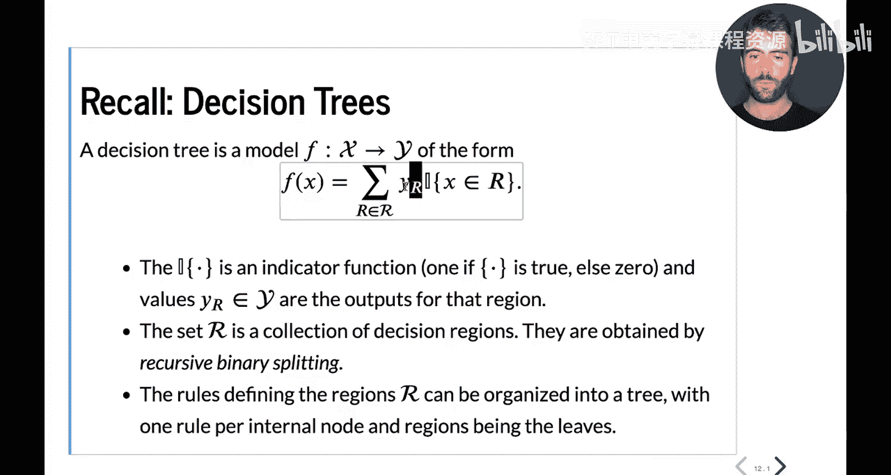

And we can visualize this。As a tree。And the regions here are the bottom leaves and each node here corresponds to a binary rule which tells us if we go left or right。

 so here the rule is whether BMI is less than 0。009 if it is less less than this number then we go to the left if not we go to the right here we follow another rule and finally we end up here and this gives us our final region which is defined by the outcomes of all the rules that came before it。

And we can also visualize this these regions as follows into dimensions here we had an example with the decision tree of this form。

 and it partitions the space as follows。

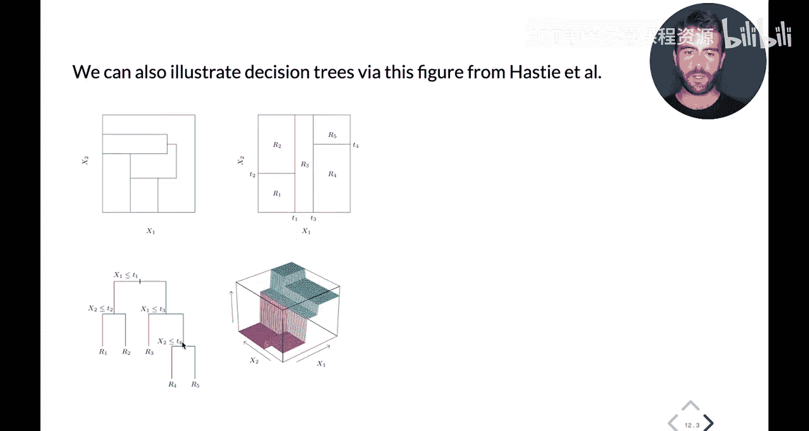

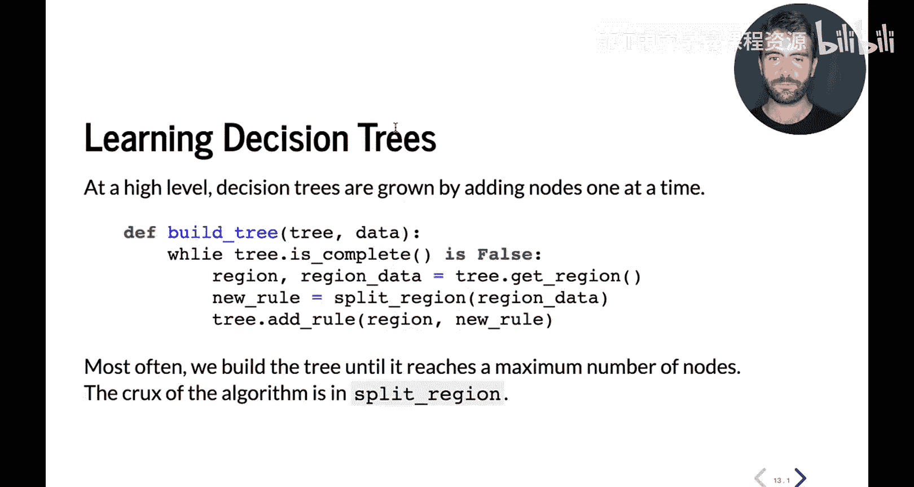

So how do we learn these decision trees from data at a high level， I can define the function。

 I can define the process for building these trees in pseudocode and it's reasonably simple。

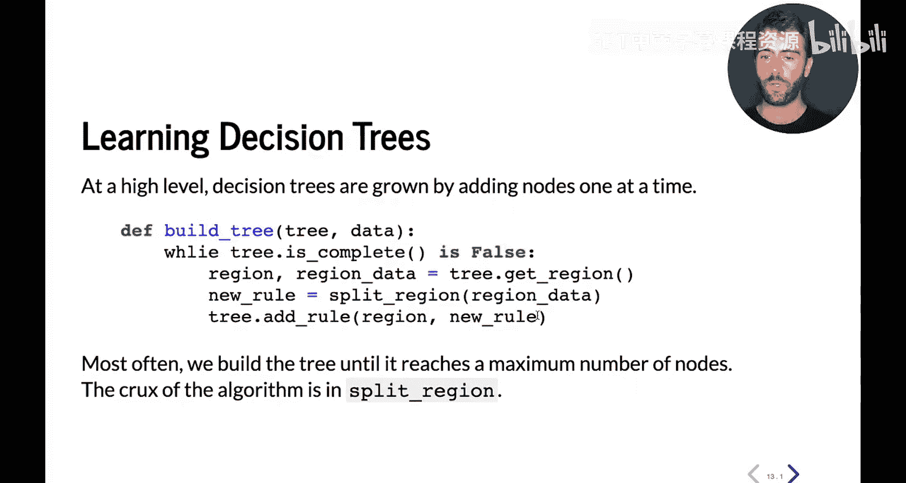

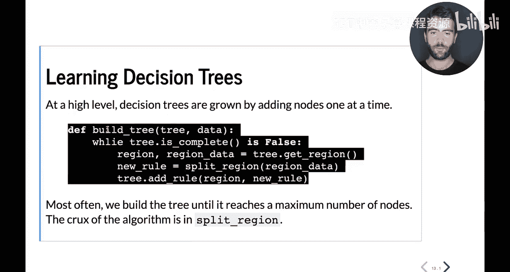

Essentially， we perform this process until the tree is ready。

 which is given by the following function， and normally we say a tree is ready when it has reached a particular number of nodes。

But while the tree is still being built， we retrieve a region from the tree。

And recall the disc corresponds to one of the leaves。

And we retrieve the data that is mapped to that region。

 which means all of our training instances that correspond to that region。

And then we create a new rule by splitting this region into two parts based on the data that is within that region。

 so imagine that we have split our data set by BMI and we have high BMI and low BMI now we choose the BMI node and then we further decide to split the high BMI data into two parts based on whether the blood pressure is high or low。

So we make this decision only with the high BMI data here we have a new rule where we decide on which variable to select on and what is the threshold for the variable。

 and then we add this rule back into the tree and by adding the rule we are creating a new internal node to the tree and then there are two regions that appear。

 there are two additional leaves that appear for this one rule。

So this is the high level pseudocode version of the building process。

 pseudocode algorithm for how we build a tree。And the main component， the main。

The most important part is within this split region function， which essentially given a region。

 it determines。What new rule do we add based on the data that's in this region？

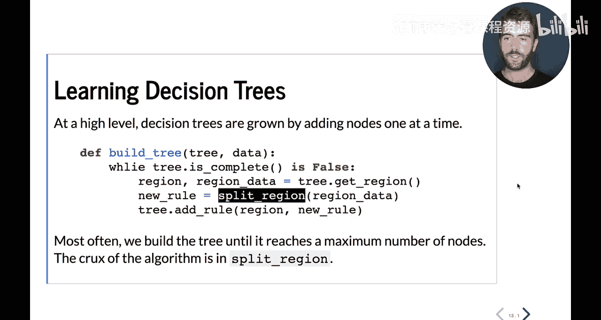

So how does this split region function choose the rule？Imagine that we have a data D。

 and again I just want to reemphasize that this process is greedy and therefore once we have chosen a region。

 we only look at the data for this region。And in order to figure out which rule to add。

 we simply look at all the set of possible rules and we choose a rule that attains the lowest possible loss。

Over this data set。In other words， if were this， if we were to write this down using a little bit of math。

 we would have this loss function L defined over a data set。

And this is the set of points for which our rule predicts true。

 and we have another set of points for which the rule predicts false。

And we are going to define a notion of loss in each of these two regions。

And our optimization problem is to choose the rule such that the sum of these two losses is as small as possible。

And there is a set of possible rules that we consider。I will give a few examples of what a loss is。

 but first， let's look at what is the set strip U of possible rules。

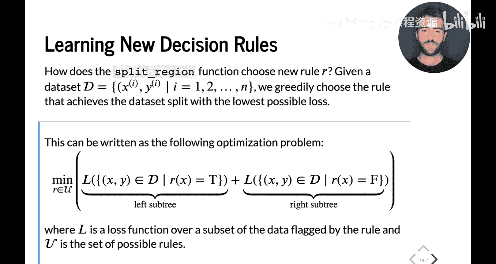

As I mentioned earlier in the previous video， these rules are typically really simple。First of all。

 we always want to split on only one attribute， if we wanted to split on two attributes。

 we could just have two rules followed by each other and then we also split on well we try to make only one decision based on one threshold if this is a continuous variable then we would choose a continuous threshold for some value of T and we would。

Simply break this in this rule would be true if x is less than t in false if it's greater than T。

 And again， if we wanted to have something more complex。

 we could always have multiple rules sequentially inside the tree that would reproduce the same thing。

For categorical features， we don't necessarily have an ordering and so typically these kinds of rules we would choose a particular class and we would return true if if the。

If this attribute takes on a particular value and if it doesn't and false otherwise。

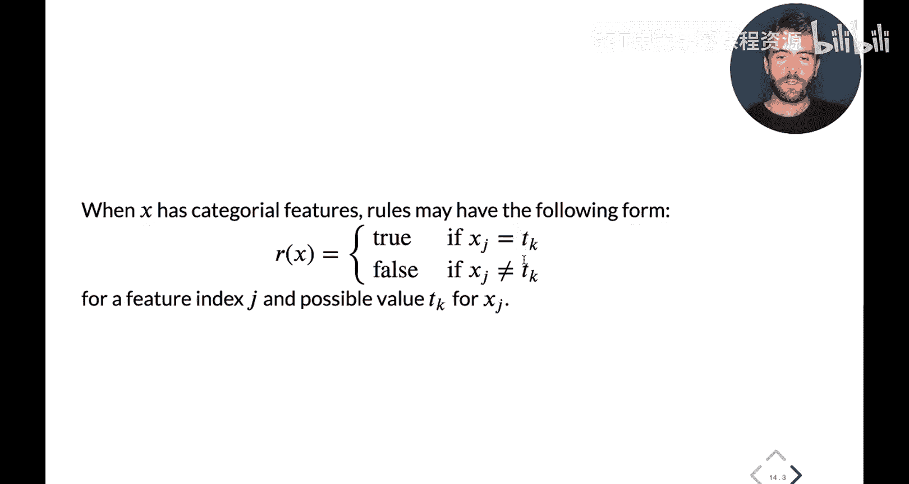

うんうん。So for each of these kinds of rules， we want to define some notion over this data set。

And notice here that I'm not defining any prediction from the model because the prediction will be determined automatically from this data set that goes into this rule。

If our set of y's are continuous variables。One common rule that we might want to。

 one common loss that we might want to take is our L2 error。So in other words。

 given a set of data points in D， we're going to first compute the average prediction in this in this set in the set of points so this is。

 again D here would be the set of points that are classified as either true or false by our rule now that the rule has made the split the best prediction that we could be making within that within that split according to our least squared error loss would simply be the average and the loss of this value of this average prediction is simply the sum across all the points and we measure the L2 loss。

And we probably want to take the average here as well if the data isn'tbalanced。

So and then if this ends up being a final leaf node。

 then the prediction we would make in this if this region ends up never being split。

 then the average y in this region would end up being the value that we predict。

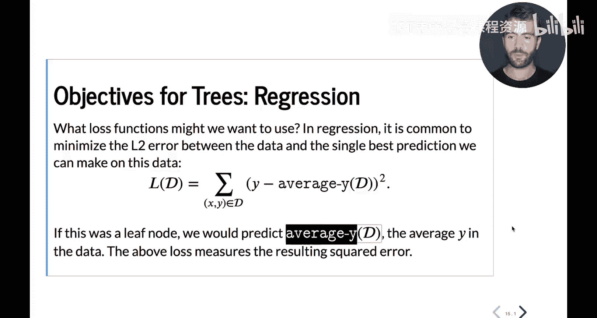

And then if we go back and if we define our， if we again rewrite our classification rule as。

Using the mean square error loss again this is going back to the formula that I had in my earlier slide and just plugging in the definition of this L2 loss。

 then we would have something which looks like this here I have the set of points for which the value is true and this is going to be the difference between the average prediction or the true points。

And I'm just looking at the L2 loss between the points in this data set and the average prediction。

If you think about this a little bit， you'll see that this kind of loss will incentivize to put all the。

To basically combine all the examples that have the same value。

 the same prediction into the same node of the tree， in other words。

 if we split on an unative feature and all the ys within this region。

 if these y if these targets y are all really different from each other。

 then the average is going to be high， but if we're able to cluster together。

 all the y's that take a very similar value then this loss will be small。

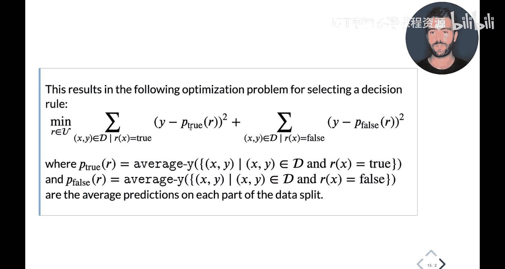

If we we have a classification problem， then we can。

Follow a similar approach the simplest approach would be to just use the misclassification rate。

 which is to simply count how many points are misclassified and we would want to compute this on average so if the points are if a large portion of the points are misclassified。

 then don't want to we would not want to pick this rule and of course given a split the best guess for the class of these points is simply the most common class that is found in these points。

And if this is the final leaf node， then we would be simply predicting this as the prediction from the decision tree。

There are also other losses that could be used such as the Gen index or the entropy。

 and these are all optimizing for splits where the two classes don't mix。Again。

 if you want to convince yourself that the best split would be one that clusters all the points of the same class together。

 Well， imagine that you have if all the points are of the same class， if we。

 if we're able to find a rule that collects all the points of the same class together。

 then all of these points will have a very，We'll have a very large we'll have a very low misclassification rate that will all be classified correctly because almost every point will take the most common value and if we don't do a good job at clustering。

Only a small number of points will have the most common value。

 and so our predictions will not be very accurate。

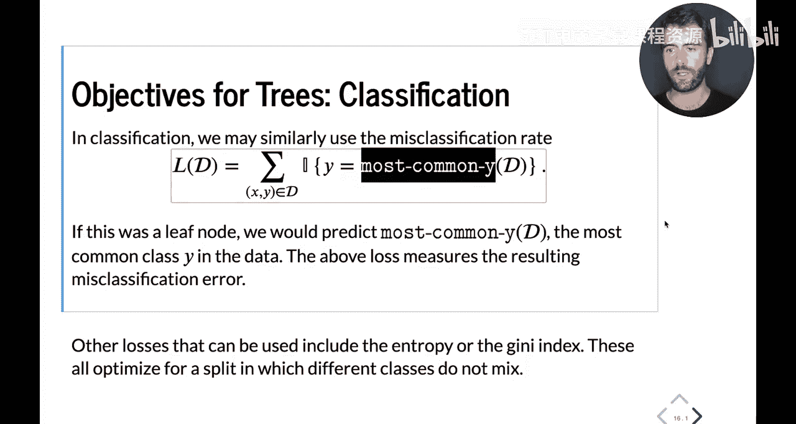

So this is the high level intuition for how we would build these kinds of trees。

Of course I omitted a lot of practical details in practice there's actually a lot of work that goes into implementing a good algorithm for learning decision trees and there's a lot of literature and there's a lot of open source packages that have been iterated over the years and there are many practical details and heuristics that are important one practical aspect is that in practice nodes are in practice trees are constructed to a certain depth but then they end up being pruned so in practice it's easier to build a bigger tree and then remove certain branches which are not very helpful in terms of optimizing the loss and this helps prevent the tree from overfitting the data too much and it also helps make the trees more compact and you know not reused to many nodes it also helps them be more interpretable if they have fewer nodes inside of them。

And there are many other approaches， so I have defined one particular approach that is really popular for constructing trees。

 but there are variations of this algorithm and some of them some of them may not be recursive。

 as I mentioned earlier so instead of constructing the tree in this kind of recursive approach。

 there are other ways of doing it and some names of algorithms that implement alternative approaches are ID3 C4。

5 C5。0， these are older algorithms but they're still used in many machine learning libraries for building decision trees。

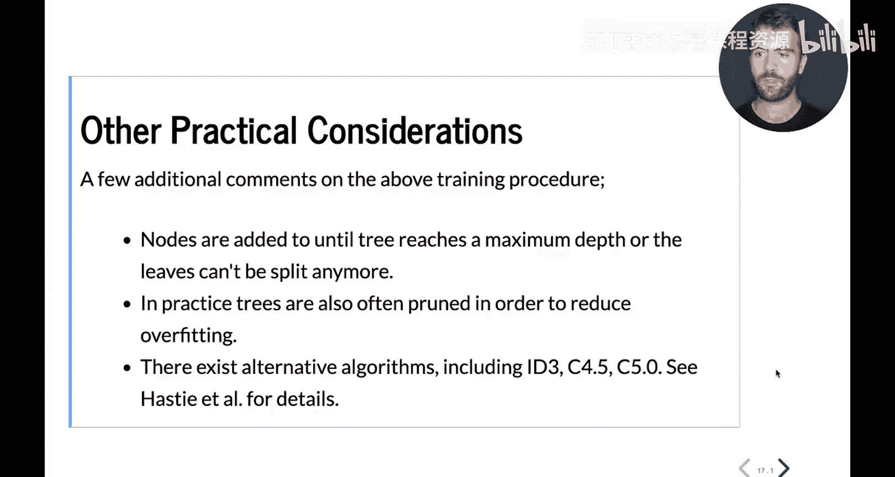

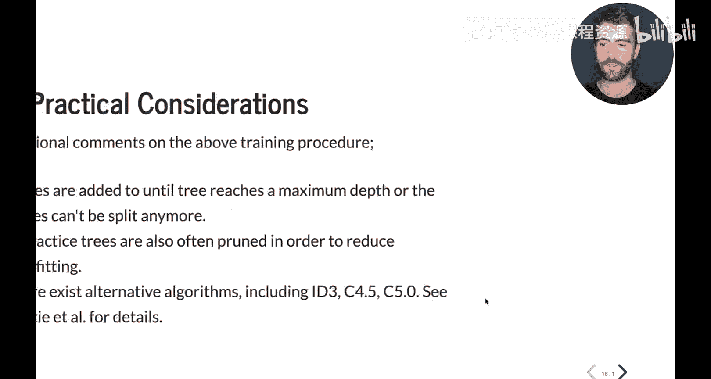

So now if I summarize what we have seen， if we combine our definition of a decision tree in the first video。

 this was the definition of our model class now I define a learning algorithm I define an optimization objective and an optimization procedure and now bringing these two things together we now have a definition of of an entire a complete machine learning algorithm which Im going sometimes it's called decision trees。

 but as I mentioned earlier there are slightly different ways building decision trees that might be a little bit different from what I just described。

 so to make it a little bit more precise I'm going to define this algorithm as CAt which is。

A slightly more precise term， so when we talk about that particular way of building decision trees that I just showed often it's called cart。

 which stands for classification and regression trees。

So this is an algorithm for supervised learning that as the name implies can solve both regression and classification。

 the model families are decision trees， and the objective function is everything or all the rules that I mentioned earlier。

 and the optimizer is is the greedy approach that I gave earlier with some additional heuristics such as pruning。

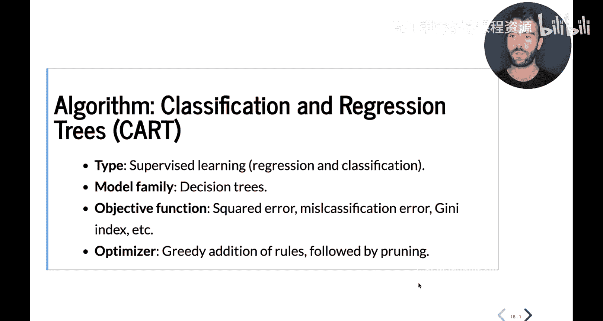