# 应用机器学习：第12讲：决策树学习（第二部分）🌳

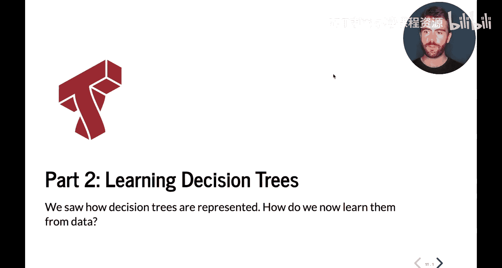

在本节课中，我们将学习如何从数据中构建决策树。上一节我们介绍了决策树的基本概念，本节中我们来看看具体的构建算法。

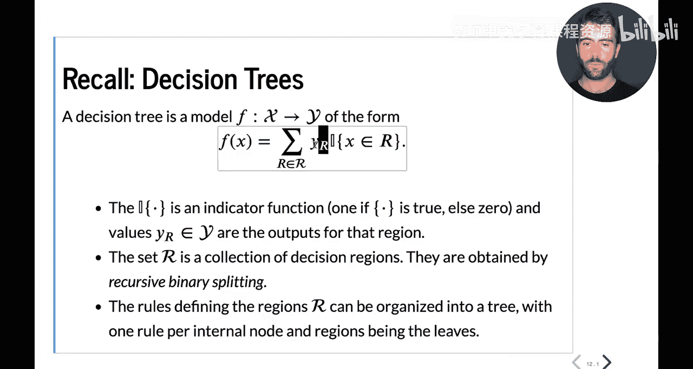

## 决策树回顾

决策树是一个函数，其形式如下：

$$
f(x) = \sum_{R \in \mathcal{R}} y_R \cdot \mathbb{I}(x \in R)
$$


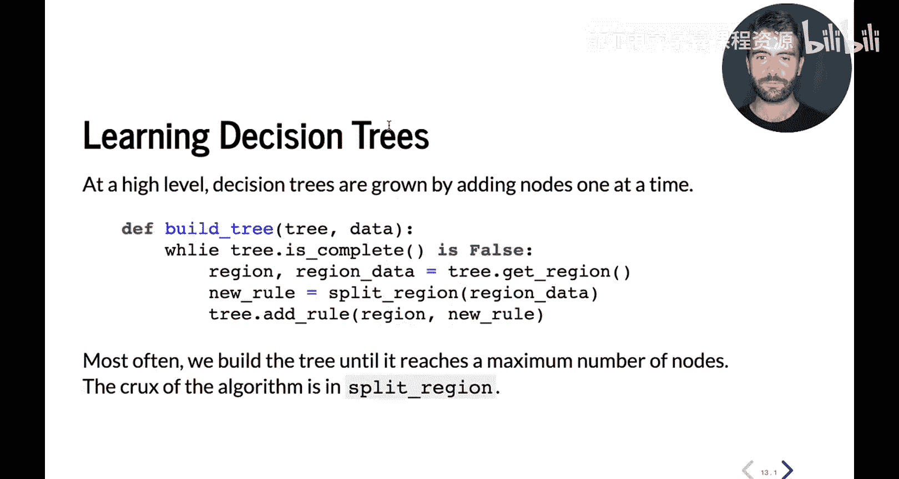

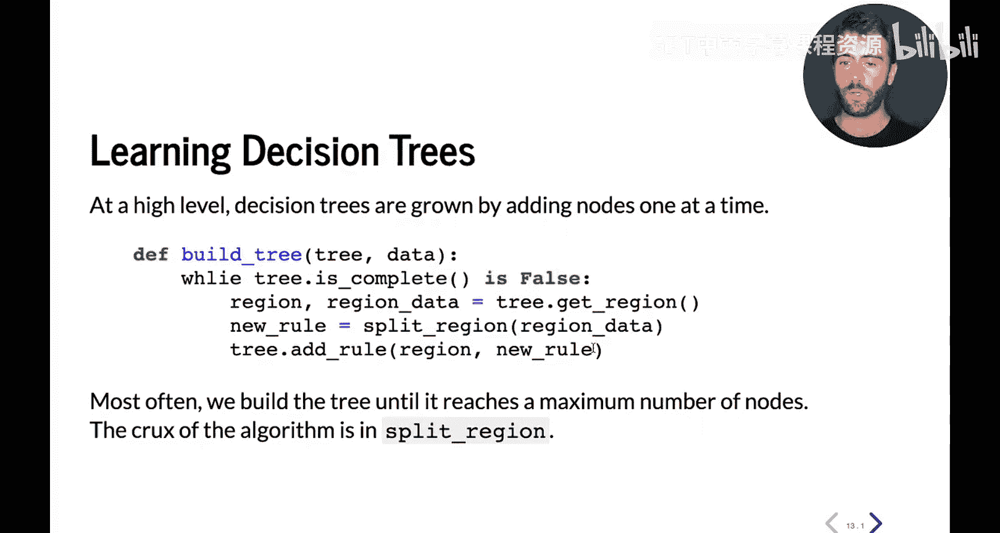

决策树将特征空间 **X** 隐式地划分为一组互不相交的区域 **R**，每个区域属于集合 **\mathcal{R}**。给定输入 **x**，它属于其中一个区域，指示函数 **\mathbb{I}(x \in R)** 在该区域非零，在其他区域为零，从而输出预测 **y**。

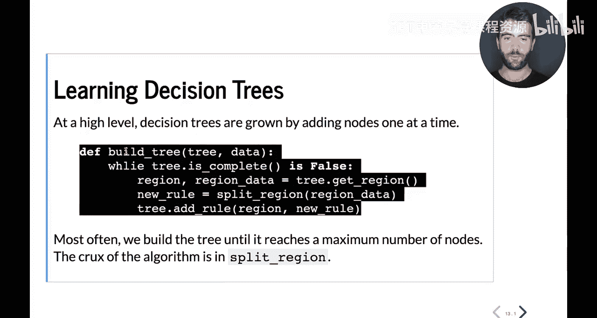

我们可以将决策树可视化为树结构。区域对应底部的叶子节点，每个内部节点对应一个二元规则，决定我们是向左走还是向右走。

## 决策树构建算法

现在，我们来看看如何从数据中学习这些决策树。从高层次看，构建树的伪代码过程相当简单。

以下是构建过程的高层伪代码：

```python
while tree_not_ready():
    region = get_region_from_tree()
    data_in_region = get_data_in_region(region)
    new_rule = split_region(data_in_region)
    add_rule_to_tree(new_rule)
```

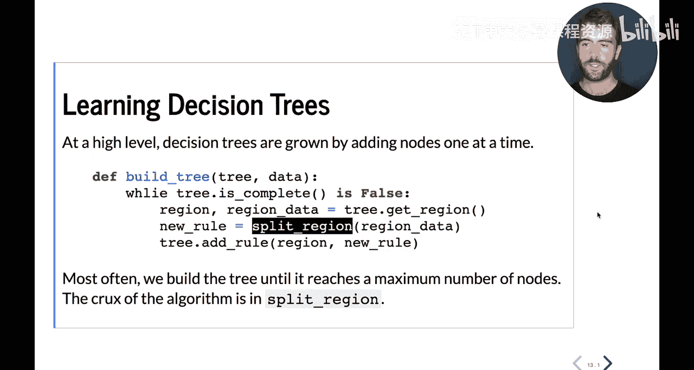

本质上，我们重复此过程直到树构建完成。通常，当树达到特定节点数时，我们认为它已就绪。在树仍在构建时，我们从树中检索一个区域（对应一个叶子节点），并获取映射到该区域的数据（即所有属于该区域的训练实例）。然后，我们根据该区域内的数据，通过将区域分成两部分来创建新规则。

这个过程的核心是 `split_region` 函数，它决定了基于该区域的数据添加什么新规则。

## 如何选择分裂规则？

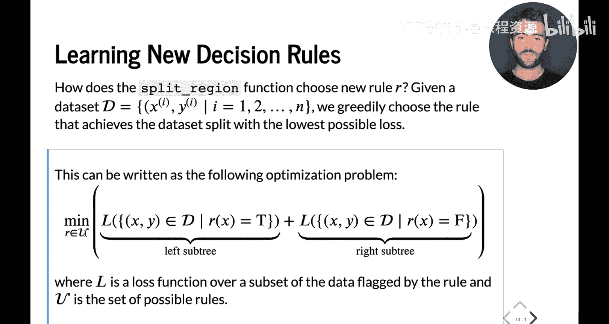

`split_region` 函数如何选择规则？想象我们有一个数据集 **D**。需要强调的是，这个过程是**贪婪的**，因此一旦选择了一个区域，我们只关注该区域的数据。为了确定添加哪个规则，我们只需查看所有可能的规则集，并选择一个在该数据集上获得最低可能损失的规则。

用数学语言描述，我们有一个定义在数据集上的损失函数 **L**。规则将点集分为预测为“真”和“假”的两部分。我们在这两个区域中定义损失的概念。我们的优化问题是选择一个规则，使得这两部分损失之和尽可能小。

我们考虑一组可能的规则。首先，让我们看看可能的规则集 **S** 是什么。

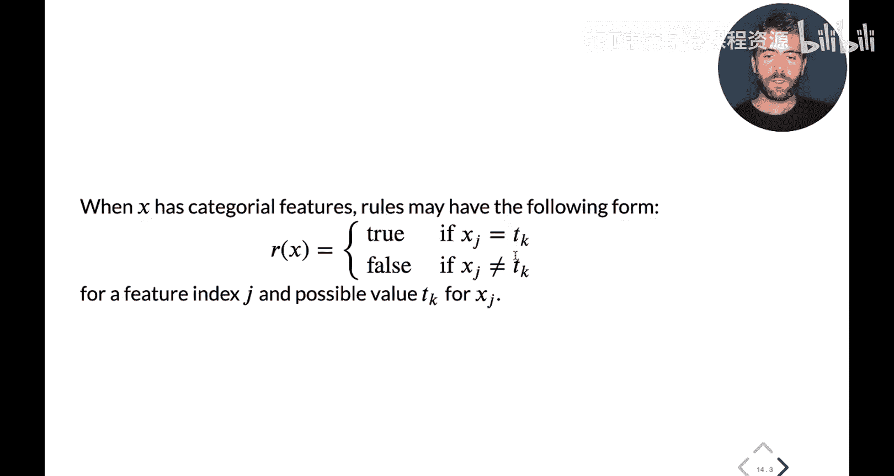

## 可能的规则集

如前所述，这些规则通常非常简单。首先，我们总是希望只在一个属性上进行分裂。如果我们想在两个属性上分裂，我们可以通过两个连续的规则来实现。对于连续变量，我们选择一个阈值 **t**，规则为：如果 **x < t** 则为真，否则为假。对于分类特征，由于没有顺序，我们通常选择一个特定类别，如果属性取该值则为真，否则为假。

对于每种规则，我们希望在数据集上定义某种损失概念。请注意，这里我没有定义模型的任何预测，因为预测将由此规则进入的数据集自动确定。

## 回归问题的损失函数

如果我们的目标变量 **y** 是连续的，一个常见的损失是 **L2 误差**。给定数据集 **D** 中的一组数据点，我们首先计算该点集中预测的平均值。根据我们的最小二乘误差损失，在该分裂内的最佳预测就是平均值，该平均预测的损失就是所有点的 **L2** 损失之和。如果数据不平衡，我们可能还需要取平均。

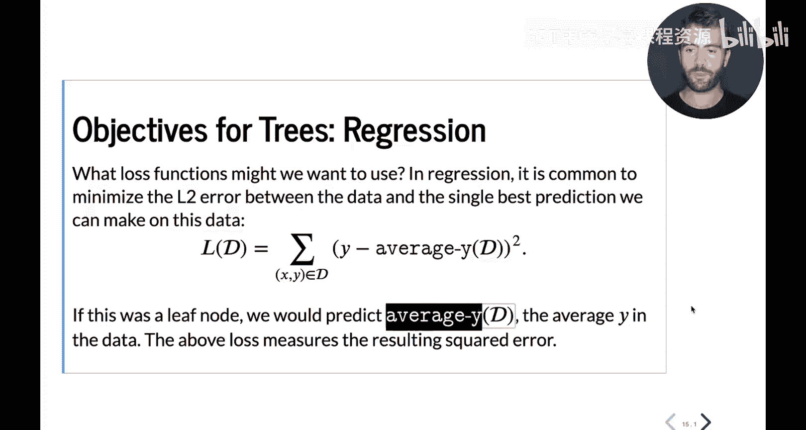

如果这个区域最终成为叶子节点，那么我们在该区域的预测值就是该区域内 **y** 的平均值。

使用均方误差损失重写我们的分类规则，公式如下：

$$
L(D_{\text{true}}) = \sum_{i \in D_{\text{true}}} (y_i - \bar{y}_{\text{true}})^2
$$

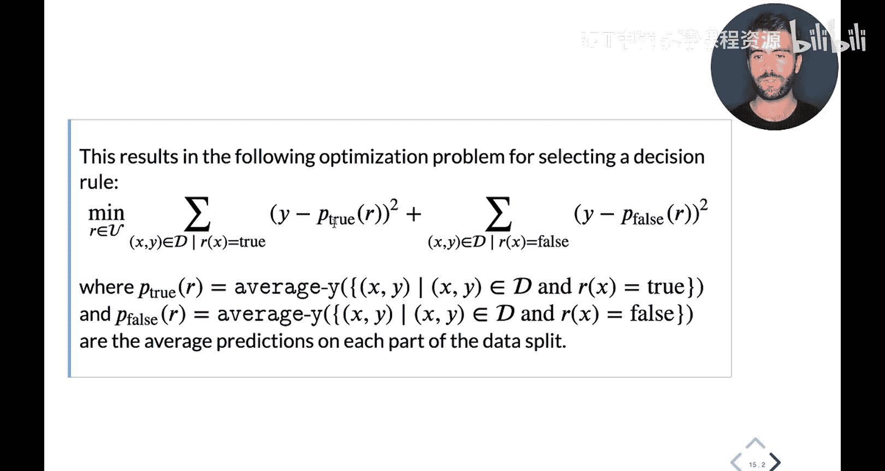

其中，**\bar{y}_{\text{true}}** 是 **D_{\text{true}}** 中 **y** 的平均值。

这种损失会激励我们将所有具有相同预测值的样本组合到树的同一个节点中。换句话说，如果我们能将在该区域内目标值 **y** 非常相似的所有 **y** 聚集在一起，那么这种损失就会很小。

## 分类问题的损失函数

如果我们处理的是分类问题，可以遵循类似的方法。最简单的方法是使用**误分类率**，即计算有多少点被错误分类，并取平均值。当然，给定一个分裂，对这些点的类别的最佳猜测就是这些点中最常见的类别。

如果这是最终的叶子节点，那么我们只需预测这个最常见的类别作为决策树的预测。

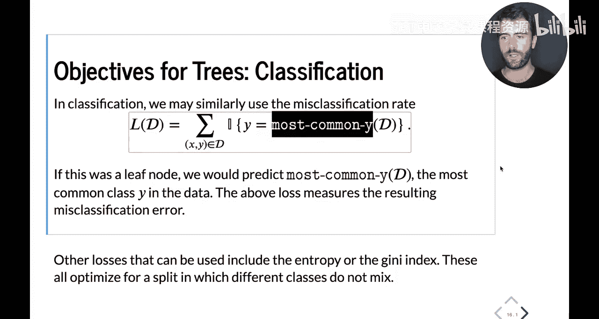

还可以使用其他损失，例如**基尼指数**或**熵**。这些损失都是为了优化两个类别不混合的分裂。同样，最佳分裂是能够将所有同类点聚集在一起的分裂。

## 算法总结与注意事项

以上就是构建这类决策树的高层直觉。当然，我省略了许多实践细节。在实践中，实现一个好的决策树学习算法需要大量工作，有许多文献和开源包经过多年迭代，包含许多重要的实践细节和启发式方法。

一个实践方面是，在实践中，树被构建到一定深度，然后会被**剪枝**。实际上，先构建一个较大的树，然后移除那些对优化损失没有太大帮助的分支更容易。这有助于防止树对数据过度拟合，也使树更紧凑、节点更少，从而更具可解释性。

## 其他算法变体

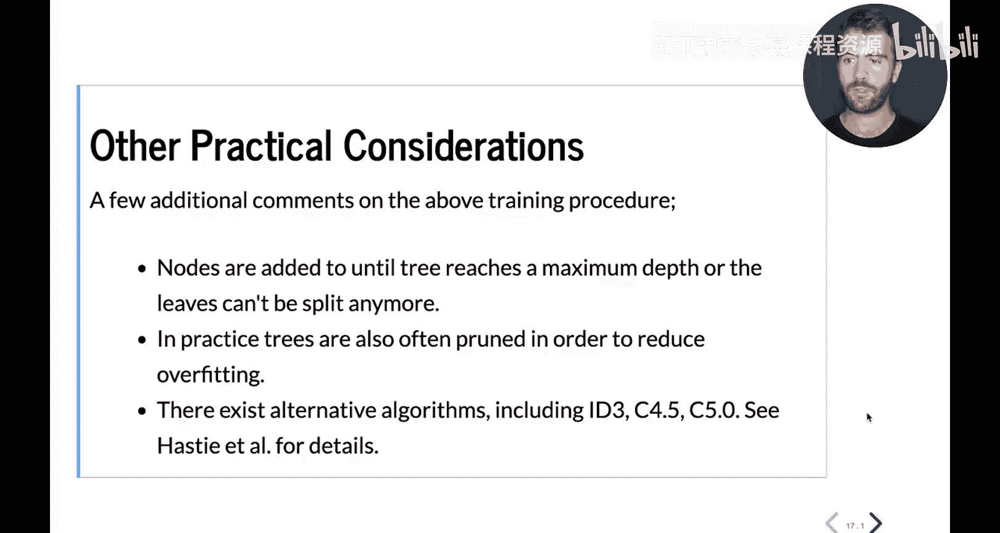

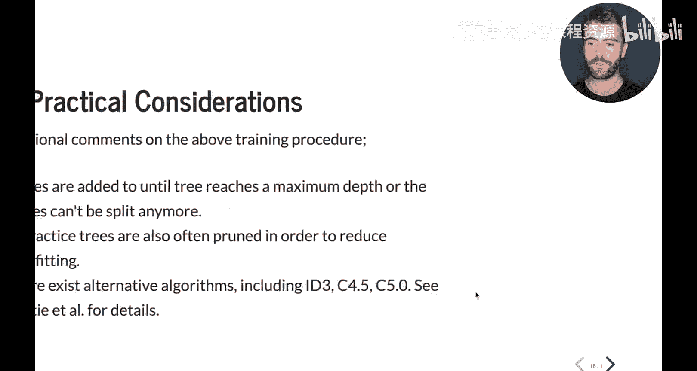

我定义了一种非常流行的构建树的方法，但这个算法存在变体。有些方法可能不是递归的。实现替代方法的一些算法名称包括 **ID3**、**C4.5**、**C5.0**。这些是较旧的算法，但在许多机器学习库中仍用于构建决策树。

## 完整算法定义：CART

现在总结一下我们所看到的内容。结合第一个视频中决策树的定义（我们的模型类定义），以及本节定义的优化目标、优化过程，我们现在有了一个完整的机器学习算法的定义。它有时被称为“决策树”，但如前所述，构建决策树有略微不同的方式。为了更精确，我将这个算法定义为 **CART**，这是一个更精确的术语。

**CART** 代表**分类与回归树**。这是一种监督学习算法，顾名思义，可以解决回归和分类问题。模型族是决策树，目标函数是我之前提到的所有规则，优化器是我之前给出的贪婪方法，并附加了一些启发式方法（如剪枝）。

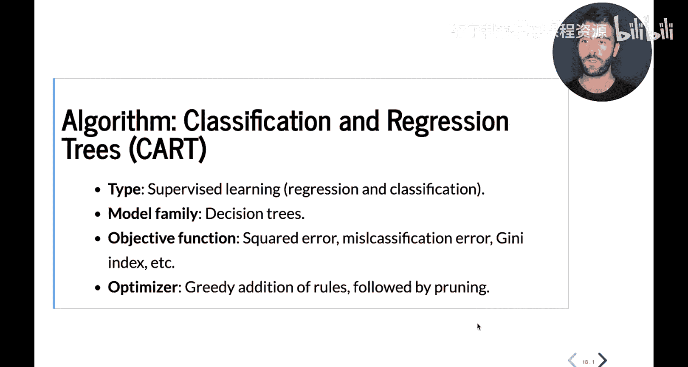

本节课中，我们一起学习了决策树的核心构建算法 CART，理解了其贪婪分裂的本质、不同问题下的损失函数选择，以及一些重要的实践考量，如剪枝。