# 康奈尔大学《应用机器学习 CS 5787_ Applied Machine Learning 2020》中英字幕（deepseek p47 -47-Lecture 12. Part 3_ Bagging.zh_en -BV12udzYvEFM_p47-

This is now part3 of lecture 12 of Apped machine learning， where we talk about decision trees。

In the previous two videos， I defined what the decision tree algorithm was。

And one of the limitations of decision tree algorithms that I mentioned and that we're going to see later in this lecture via practical example is that they tend to overfet the data。

And there's not necessarily a good way of regularizing them。

One way in which they could be regularized， although it slightly breaks some of their other properties。

 but one general approach to regularizing algorithms that also works in combination with decision trees is an approach called bagging。

So I will start by defining bagging in this video and then I will show you what it does when combined with decision trees later on。

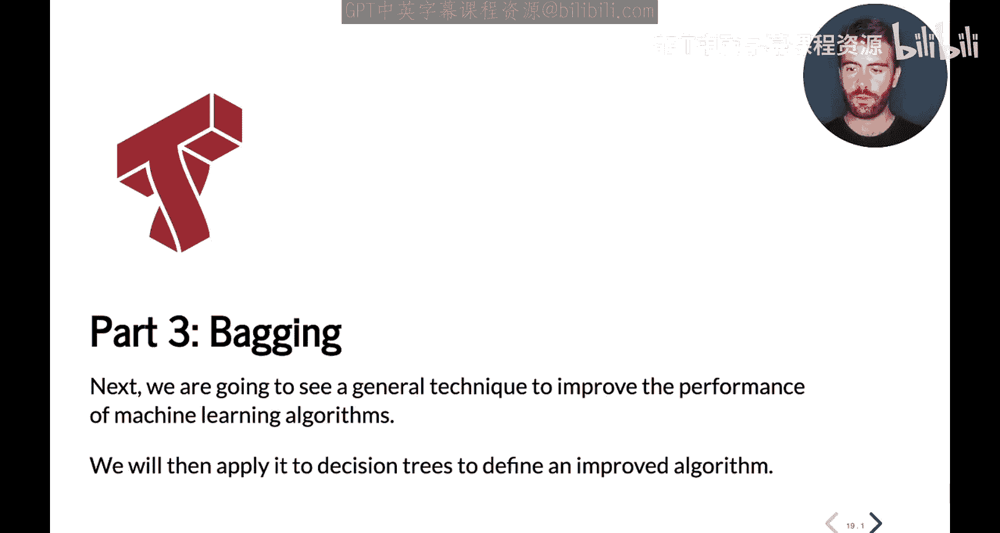

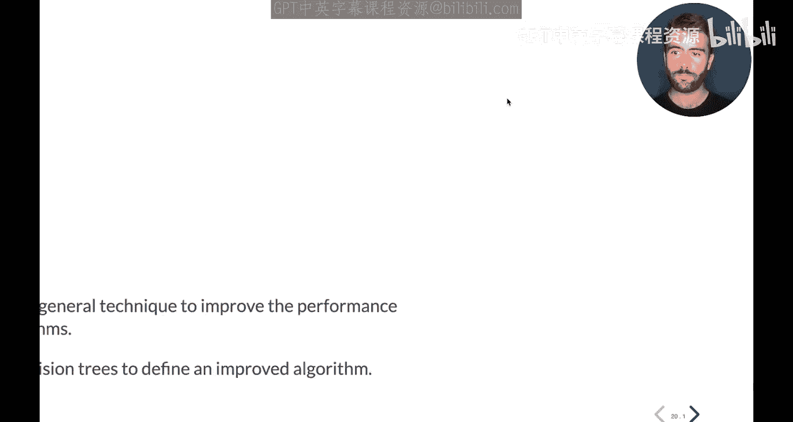

So first of all， let's remember what overfitting is overfitting is a really common failure mode in machine learning where we train a really expressive model。

 something like a very high degree polynomial that is able to fit our training set perfectly。

But because our training set is， it doesn't cover all the possible examples that we might see in the real world。

 It tends to overfit this data set in the sense that it's accurate on the training set。

 but it doesn't generalize to new data。 So it has fit the data perfectly。 But if we。

 but the predictions that are right outside the training points are。A are very bad。

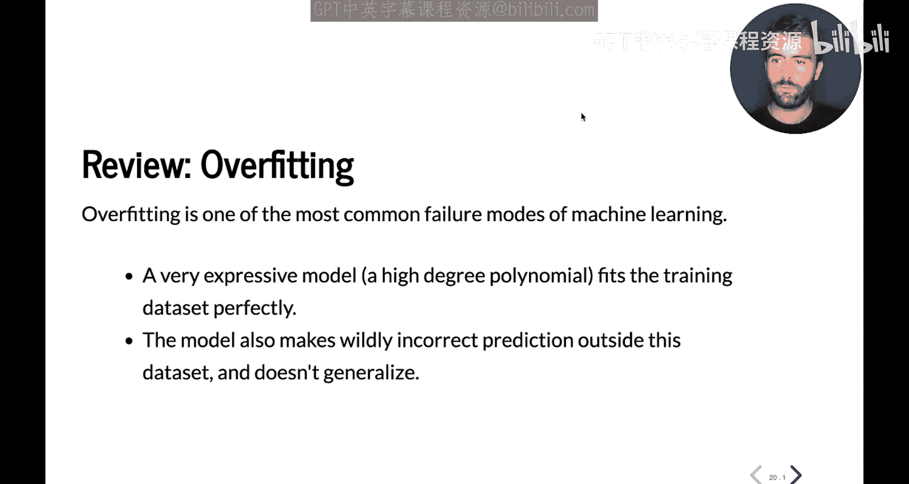

In order to。To give you in order to illustrate this with an example。

 I'm going to use the following data that I used in some of the earlier lectures in which I have this function that has this particular shape。

 it's actually a mix of ss and cosines。

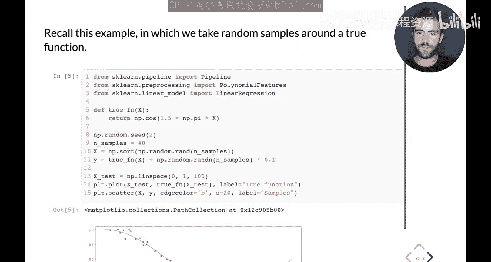

But it kind of looks like a quadratic function， and then I'm going to sample a lot of random points。

 so here I'm sampling 40 random points around this curve。And I visualize them in blue。

And the goal here is to try to learn this。The function the shape of this true function only from these blue samples。

 from these noisy blue samples。

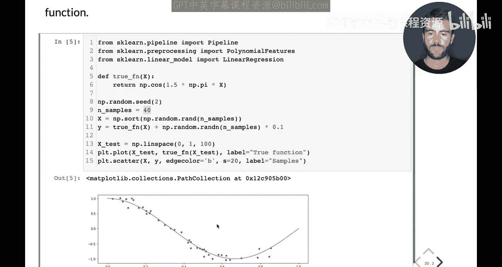

So let's see what happens if we fit a really high degree polynomial to this data set。

Or actually I'm going to slightly change the setup that we had in our earlier example。

 and instead of just fitting a high degree polynomial on the entire data set。

 I'm going to take random samples of 20 points。So I'll just subs sampleample 20 points at random from this data and then on each of these smaller sub data sets。

 I will train a different high degree polynomial， or I will train the same polynomial algorithm with the same polynomial degree。

 but it will give us a different model on each subset of the data。

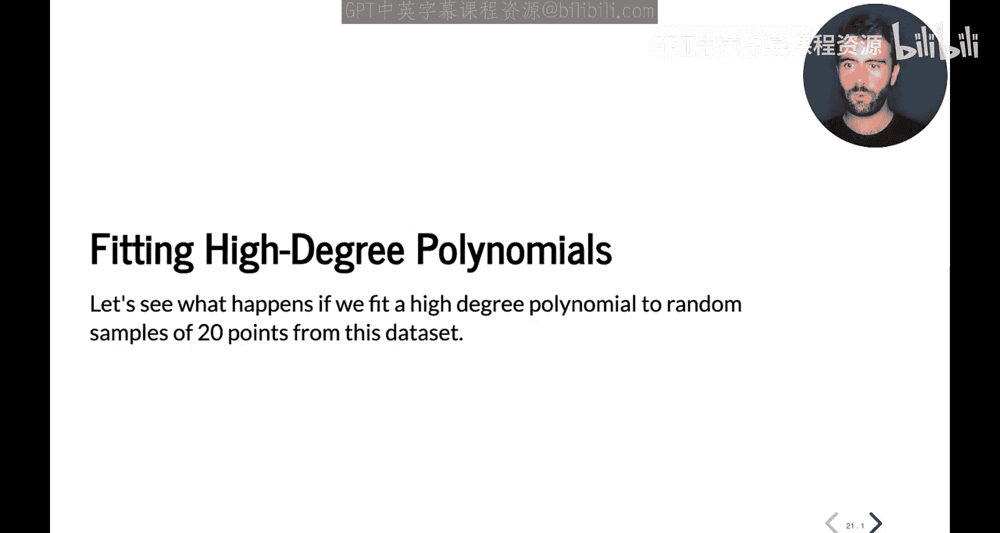

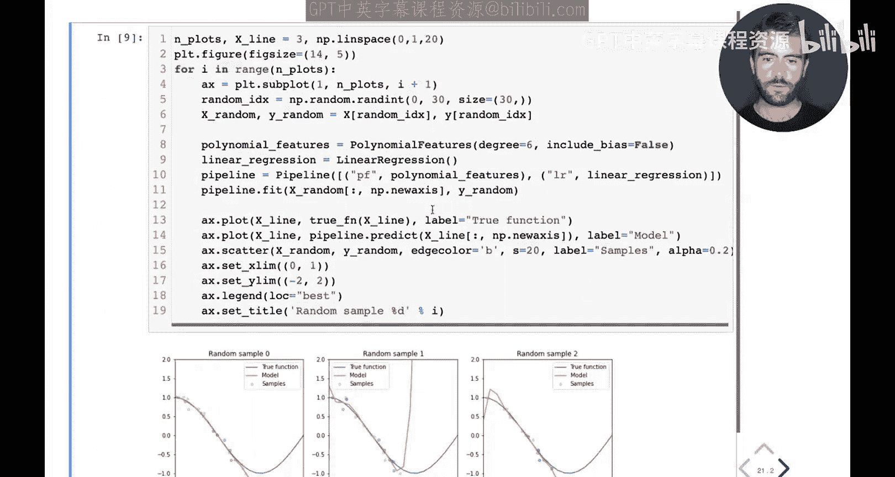

And let's look at the results。So here on each， first of all， here in blue， I have the actual curve。

 and you can see that in each of these three subplots， I have a slightly different subset of points。

So you can see that for example， these points are here but they're not here and then these two points are in this plot but not in this plot and not in this plot。

 so effectively we have a different subset of the data and when we fit this high degree polynomial the first thing that we see is that its shape is very bad here as soon as we leave the region where we have data。

 we have this really massive increase which is，Which is completely incorrect here。

 We also have an increase that's going down。 but the key observation is that each of these high degree polynomials。

 even though we used exactly the same machine learning algorithm。

 So we used polynomial regression with the same hyperparameters。

 it gives us a really different predictive model on each of these dataset sets。So again。

 these are points that are sampled literally from the same distribution of 40 points。

 I'm choosing 20 samples with replacement out of these 40。So they clearly have the same distribution。

 but for different samples from this data set， my prediction varies by a big amount。

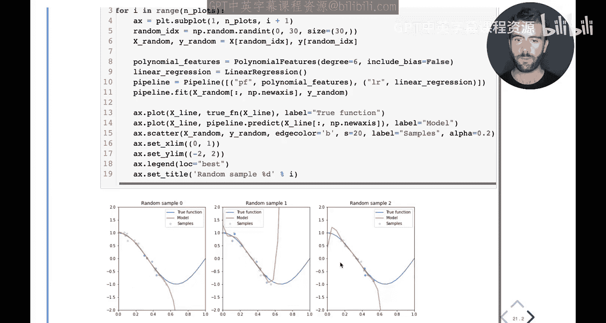

And this phenomenon， and again， just to clarify what it would vary。 So if these。

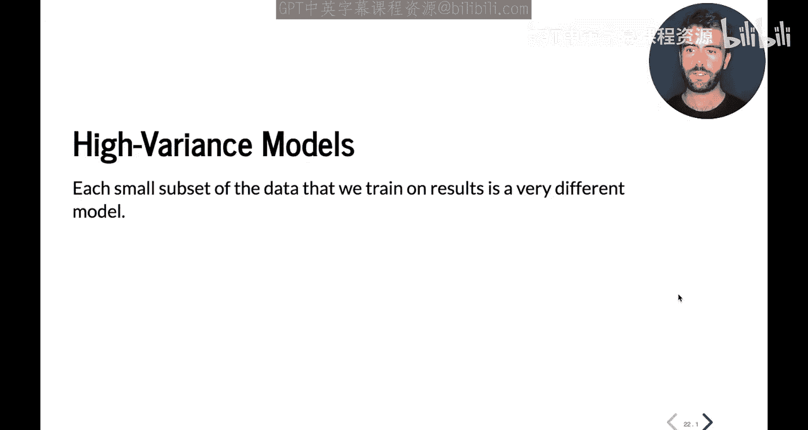

As I mentioned earlier， if we're overfitting the data。

 then whenever we're slightly outside our training set。

 the function will have really incorrect values and they're going to be incorrect and essentially random guessing。

 so if we choose a different subset of the training data。

 the big errors outside the training data will be really different and this is what's going to cause this large variation across the types of models to be obtained if we subsample a different set of data a different set of 20 data points。

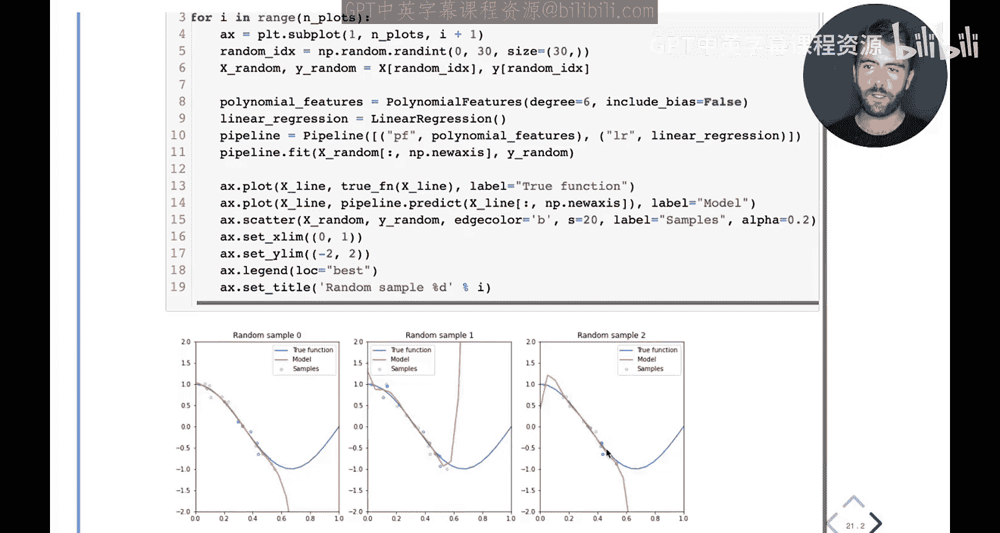

So this problem is also called the Hy varianceance problem。And again， if I were to summarize this。

 I would say that each small subset of the data that we train on gives us a very different predictive model。

And then an algorithm that tends to overfit for this reason， it is also often called high variance。

If we slightly pertubed the data set， so if we were to slightly change one of our points。

 the shape of the polynomial in the bad regions would change dramatically and because performance changes so much depending on。

These small perturbations in the dataset set or small samples。

 we call the resulting model we call this algorithm high variance， its prediction。

 its predictive model varies a lot depending on how we perturb the data。

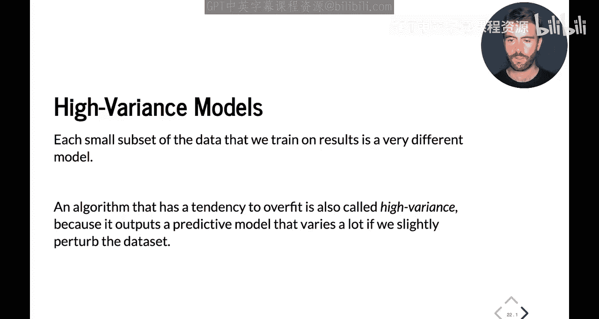

So how can we reduce。Overfitting， and how can we reduce this high variance behavior？

The idea of begging。Is to reduce this really large variability in the space of model by averaging many models that are trained on random subsets of the data。

The word， the termbaging， stands for bootstrap aggregation。

And bootstrap samples are samples that we obtain from our training set by subsling random parts of this data set at random。

So imagine if we have or consider our earlier example with the 4D training points。

 every time we sample 20 points with replacement at random from this data set。

 this random subset of 20 points is called a bootstrap sample from our data。

And it clearly has the same distribution as our original data because we're simply taking it with replacement and it's sampled from our training set。

 so it has to have the same distribution as our training set。

 but also the samples are going to be different。And we can train a model on each sample。

And then if we average these models， then even though each model will make its own。Errors。

 one model may be overfitting and dramatically overpredting。

 another one will be overfitting and dramatically underpredicting on average。

 if we take enough of these samples and we average over a sufficiently large number of models then these random errors will cancel out and we are going to have a predictive model that is going to be much more stable relative to small changes in the data and also that will be as a result overfitting much less。

Here I'm also defining the procedure for bootsttrarap aggregation in pseudocode and essentially it's really simple。

 we choose to have an average over some number of models that specified here。

 and then for each model we collect a sample from our training from our full training data set X。

 we take n samples from it with replacement， this gives us a mini training set X Iyi。

 then we just fit a new instance of this model of a model on our training set。

 and then we append the model to our set of models which we call an ensemble an ensemble is how we refer to a set of models that are combined together in machine learning this is the technical term and we add this to our ensemble and then have when we're making a new prediction at test time that is defined as。

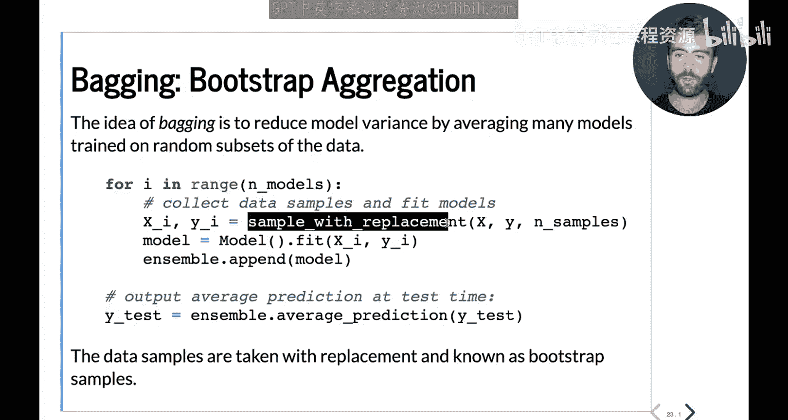

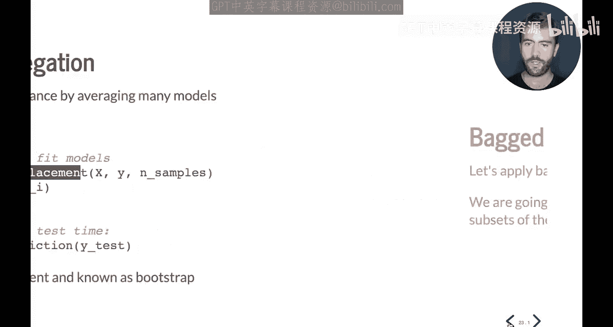

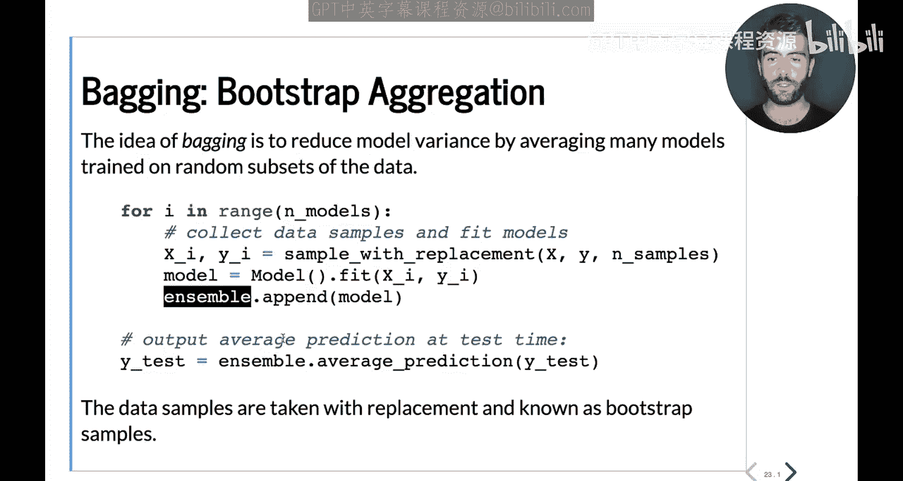

X test， obtain we create a new prediction by simply averaging the predictions of all the models。

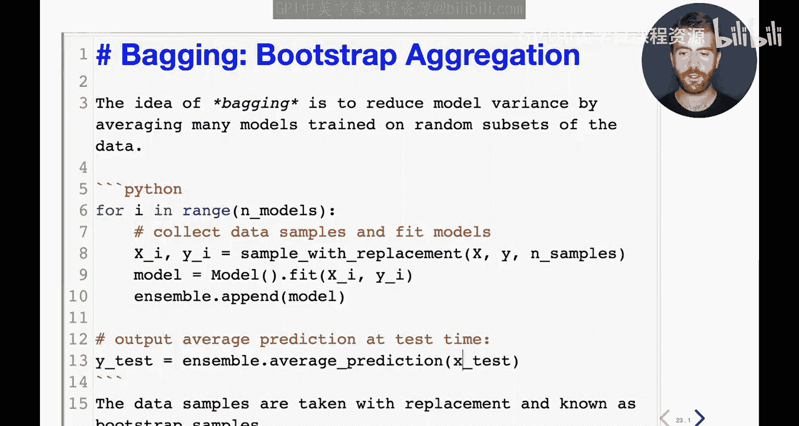

And so this process is known。

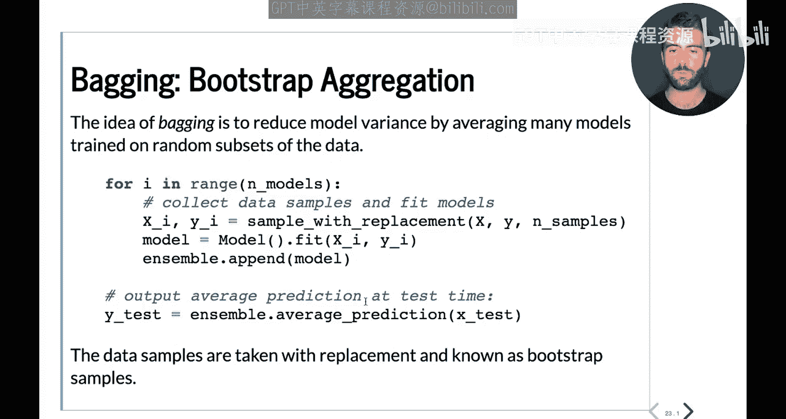

Sttraap aggregation。Let's now apply bootstrap aggregation to our polynomial regression problem that we saw earlier。

So I'm going to train a large number of polynomial regressions on a large number of random bootstrap samples from the data。

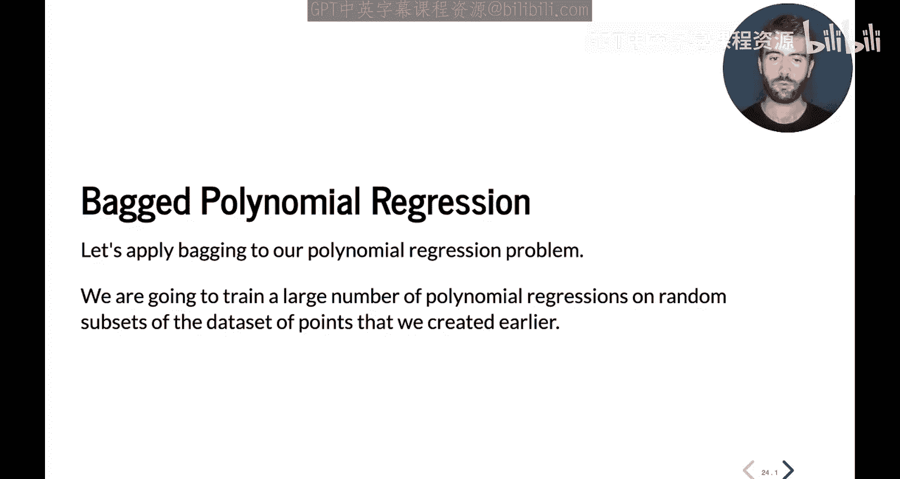

So let's start by training the model。Here I'm going to be training 10000 models。

 I'm going to be taking 10，000 samples of 30 points out of my set of 40 points。And for each of my。

 so here I'm I'm creating a new random subset， and then I create a new polynomial regression model here。

 and now I fit this polynomial regression model on my。On， on my。

Random new bootstrap sample on my on this new data set。 And then I added it to my ensemble of models。

 This is literally implementing the episode pseudo code that was in the previous slide。

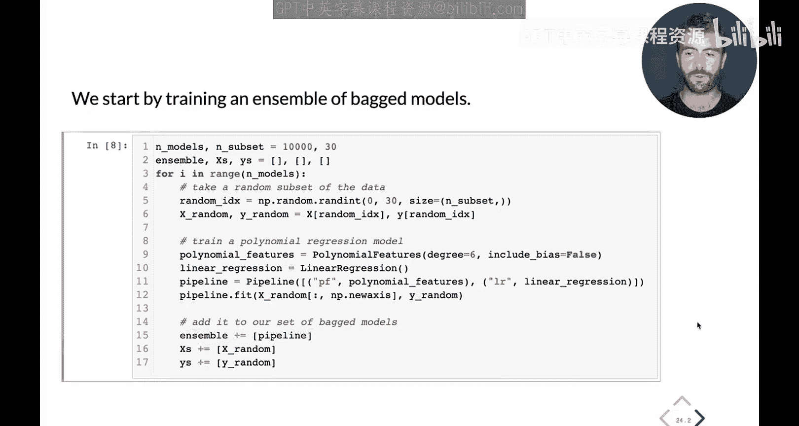

And now we can look at how well this performs by looking at each of these。 Well。

 I'm going to look here at three bootstrap samples。

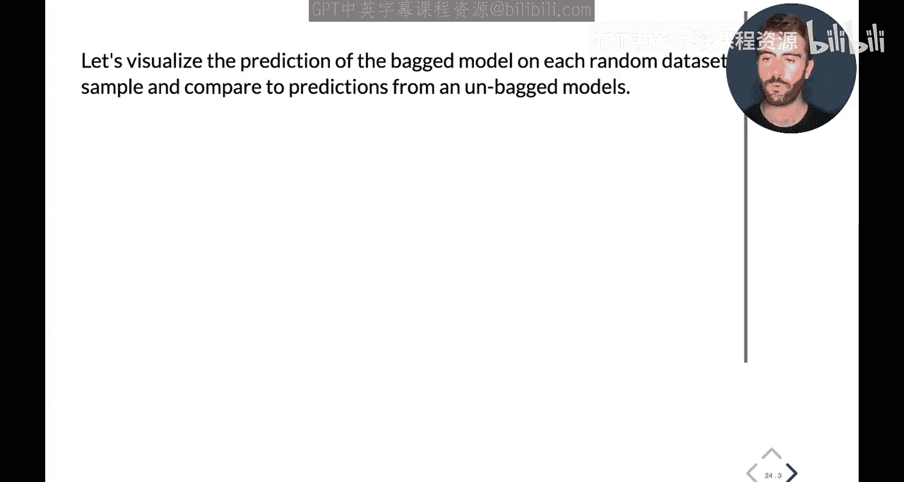

And on each of these samples， I'm going to visualize both the bag model and an unbed model that has only seen that training set。

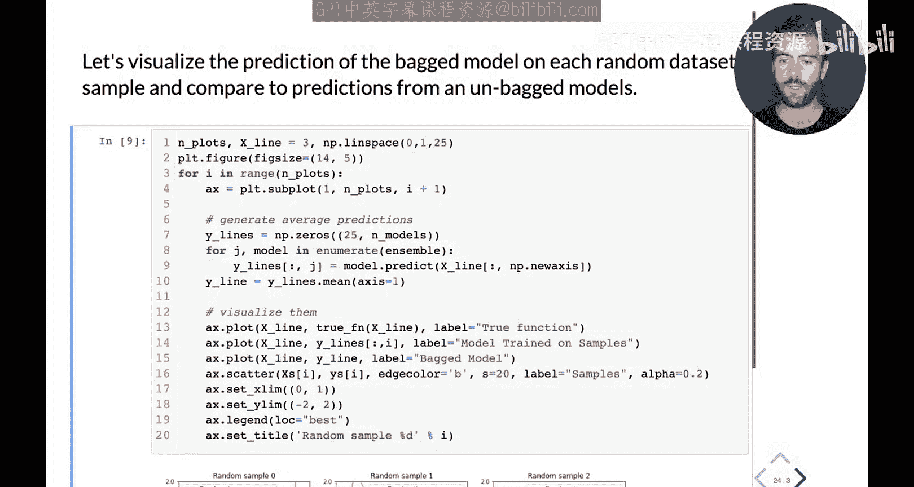

Here， this is the same drawing as earlier， obviously the blue curve is the true curve。

And you see different random subsets of the data， these are the small blue points。

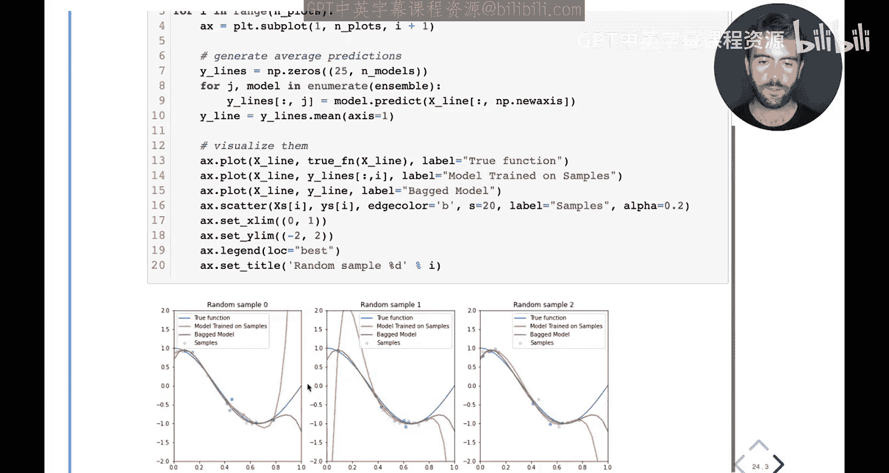

And the orange line is a polynomial regression that has been only trained on these blue points。

And you can see that it has this really。Really different behavior at each basically。

 the predictive model is very different depending on which subset of the data we choose。

But now if we average them， then we have the green curve。 if we average the 10。

000 bootstrap predictions。Then we obtain this green curve， so this green curve is an average of 10。

000 models like the orange ones that you see here and after we have averaged these 10，000 models。

 we have this green curve which is much better behaved and though it even though it doesn't fit the training set perfectly in this region。

 we also didn't have much data in this region anyway。

It fits the data quite well in most places and in places where this one makes really large error errors here。

 the green curve is much better behaved。So this is an example of how bootstrap aggregation can reduce overfitting significantly。

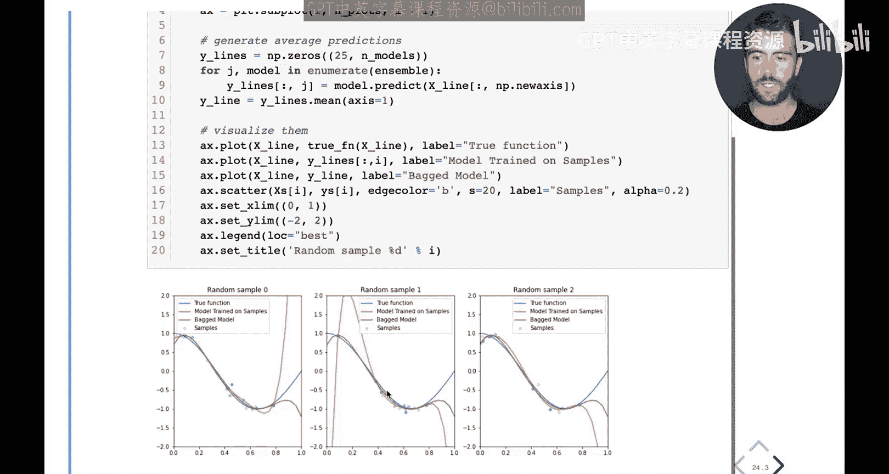

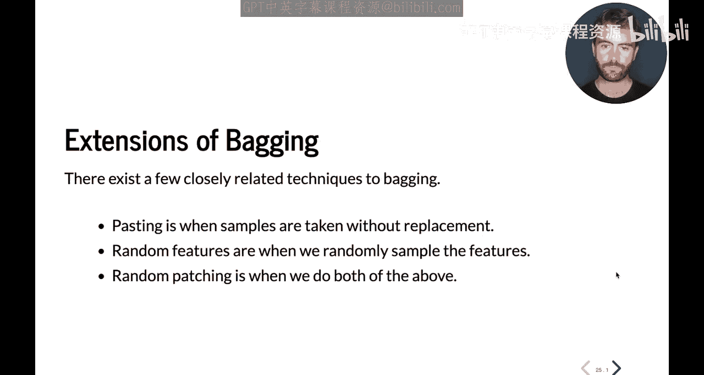

Bgging is an approach that is used a lot in machine learning。

 it's used with smaller and simpler algorithms， but it is used a lot。

 and I will show you an important example of how it is applied shortly。

 but there are also a few small extensions of bagging that you might want to be aware of。

When we take samples without replacement， then sometimes this is called pastting。

We can also do this in feature space as opposed to sample space。

 so we can subsample random features and combine models trained on different subset of features。

 this also helps prevent overfitting and it's called random features and if we combine the two we have something called random patching。

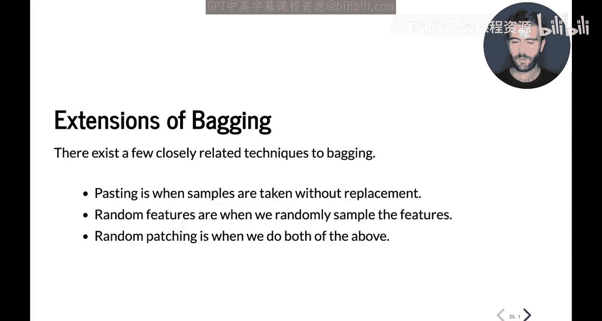

So in summary， bagging is a technique that can help us reduce overfaing of machine learning models and it works in a completely black box way。

 it doesn't need to know anything about the machine learning model that is being bagged。

 it is completely agnostic of that， so it's a really powerful technique that works that is useful and that works and that is often found in applications of machine learning where we need to reduce overfaing。

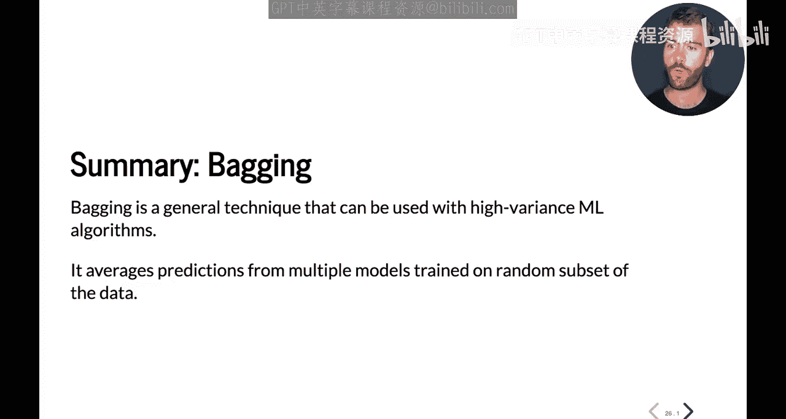