# 应用机器学习：第12讲：第3部分：Bagging 🎒

在本节课中，我们将学习一种名为 **Bagging** 的技术，它可以帮助我们减少机器学习模型（特别是决策树）的过拟合问题。上一节我们介绍了决策树算法及其局限性，本节中我们来看看如何通过Bagging来提升模型的稳定性和泛化能力。

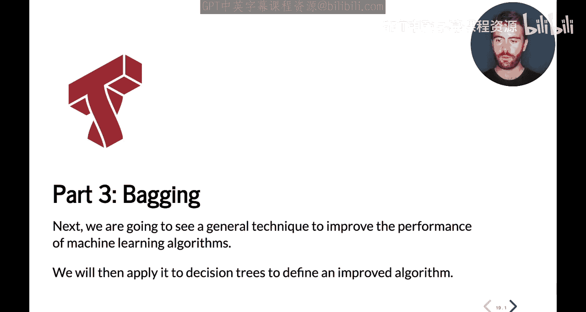

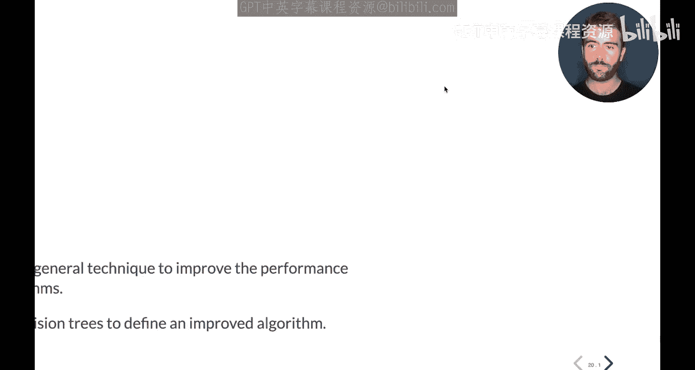

## 概述 📋

Bagging，全称 **Bootstrap Aggregation**（自助聚合），是一种通过组合多个模型来降低预测方差、减少过拟合的通用方法。它的核心思想是：通过从原始数据集中抽取多个随机子集（称为自助样本），在每个子集上独立训练一个模型，然后将这些模型的预测结果进行平均，从而得到一个更稳定、更准确的最终预测。

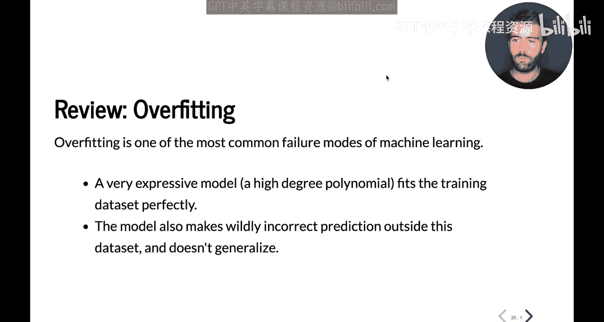

## 过拟合与高方差问题 🔍

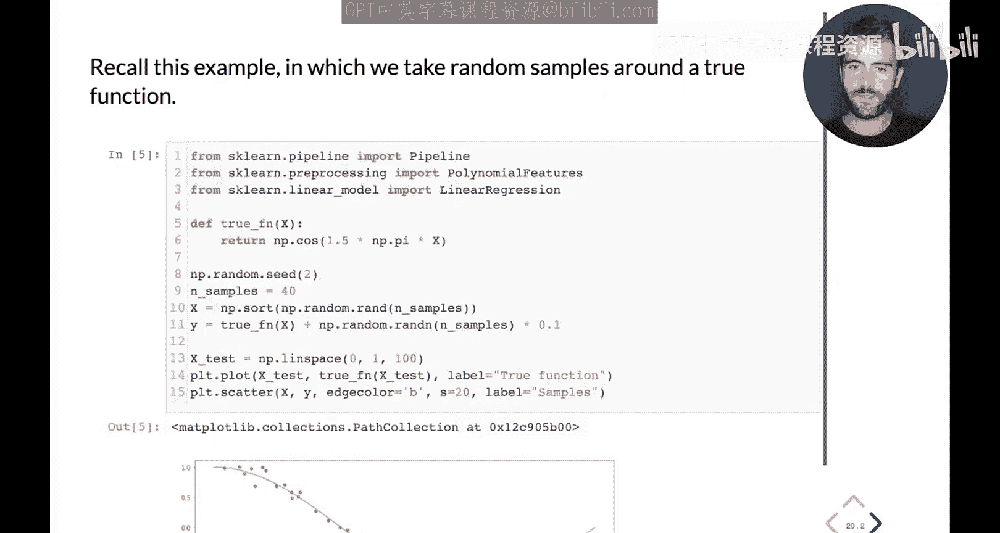

在深入Bagging之前，我们需要理解它要解决的核心问题：**过拟合** 及其导致的 **高方差**。

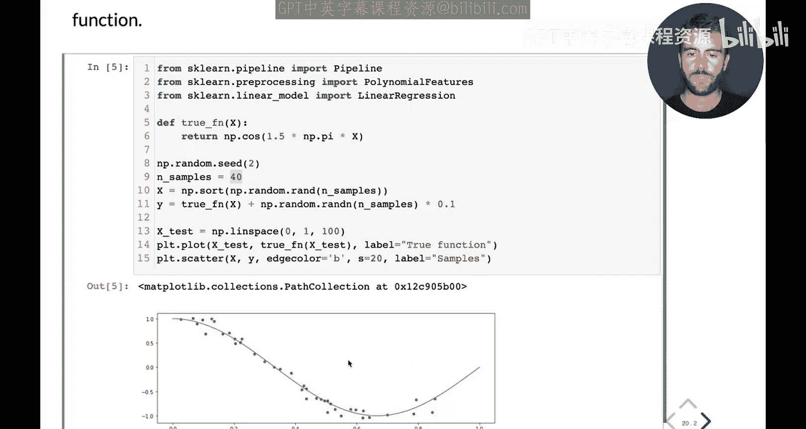

过拟合是机器学习中一种常见的失败模式。当我们训练一个表达能力过强的模型（例如一个非常高阶的多项式）时，它能够完美地拟合训练数据。但由于训练数据并不能覆盖真实世界中所有可能的情况，模型在训练集上表现优异，却无法泛化到新数据上。它完美地拟合了数据，但在训练点之外的预测可能非常糟糕。

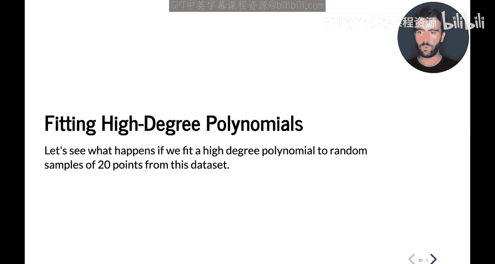

为了直观说明，我们来看一个例子。假设我们有一个由正弦和余弦混合而成的真实函数（蓝色曲线），并从该函数附近随机采样了40个带噪声的数据点（蓝色散点）。我们的目标是从这些带噪声的样本中学习真实函数的形状。

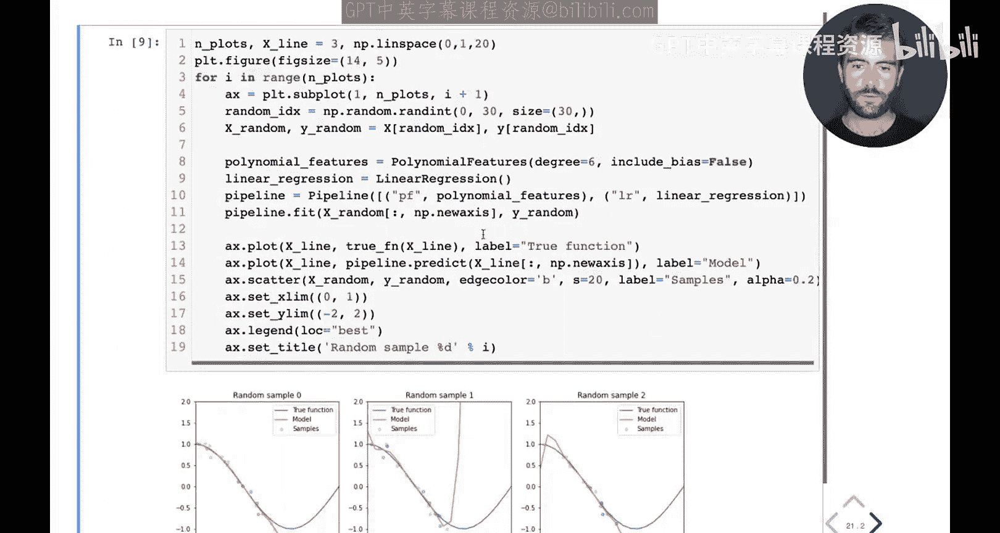

如果我们用一个高阶多项式来拟合这些数据，会发生什么？以下是具体步骤：

1.  我们从40个点中随机抽取20个点（有放回抽样），形成一个子数据集。
2.  在这个子数据集上，我们训练一个高阶多项式回归模型。
3.  我们重复此过程多次，每次使用不同的随机子集。

以下是观察到的结果：

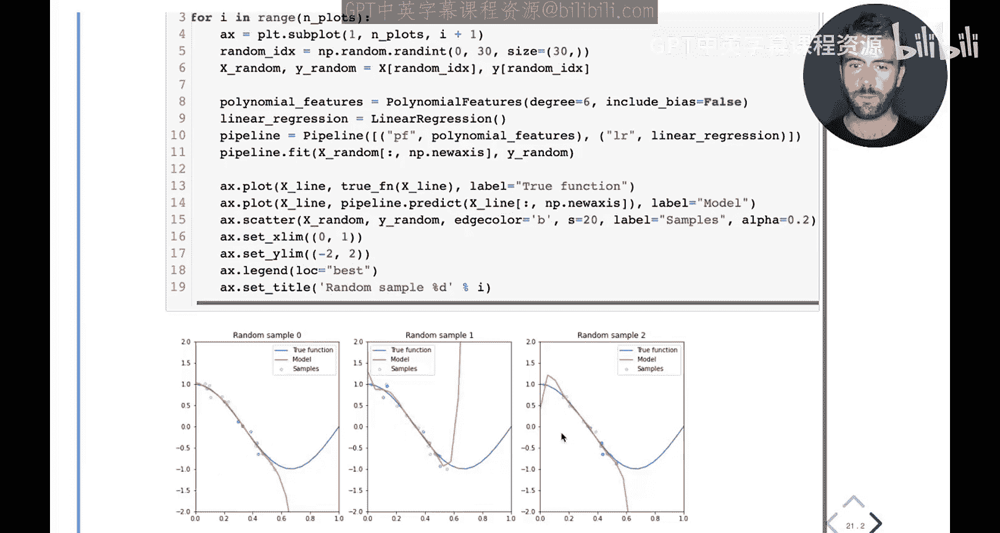

*   每个子数据集上训练出的多项式模型（橙色曲线）形状差异巨大。
*   尽管我们使用完全相同的机器学习算法（相同超参数的多项式回归），但不同数据子集产生的预测模型却截然不同。
*   在训练数据稀少的区域，这些模型的预测值会出现剧烈且不合理的波动。

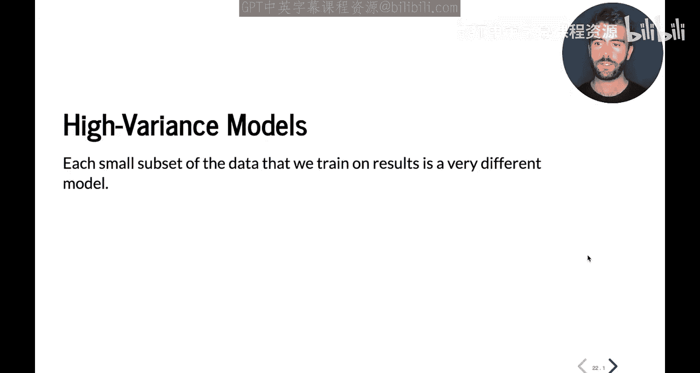

这种现象就是 **高方差** 问题。如果一个算法容易过拟合，那么对训练数据的微小扰动（例如，更换一个数据点或抽取不同的子集）就会导致最终学到的模型发生巨大变化。这种预测模型随数据扰动而剧烈变化的特性，我们称之为高方差。

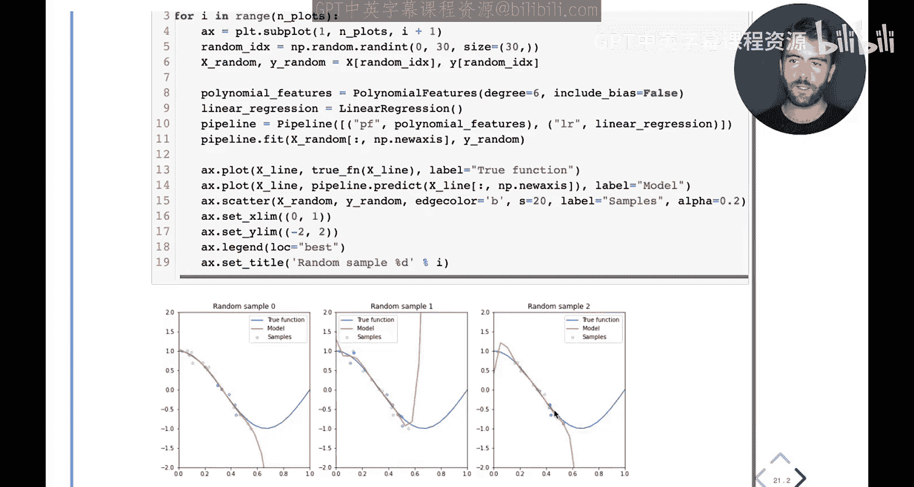

## Bagging 解决方案 🛠️

那么，如何减少过拟合和高方差行为呢？**Bagging** 的核心思想就是：通过平均多个在数据随机子集上训练的模型，来降低模型空间的巨大变异性。

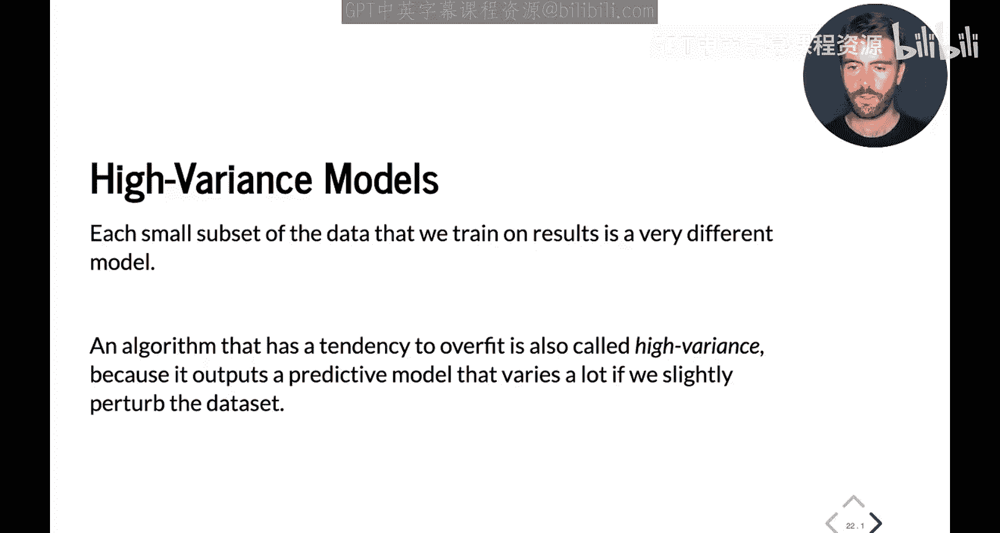

“Bootstrap”指的是我们从训练集中有放回地随机抽取子集的过程。每次抽取得到的随机子集称为一个 **自助样本**。它显然与原始数据具有相同的分布，但样本点会有所不同。

我们可以在每个自助样本上训练一个模型。然后，如果我们对这些模型的预测进行平均，那么即使每个模型都会犯自己的错误（例如，一个模型可能在某些区域过度预测，另一个则可能预测不足），只要我们有足够多的模型，这些随机误差就会相互抵消。最终，我们将得到一个对数据微小变化更加稳定的预测模型，从而显著减少过拟合。

以下是 **Bootstrap Aggregation** 的伪代码流程：

```python
# 输入：训练集 (X, y)，基础模型算法，自助样本数量 M
# 输出：集成模型 Ensemble

1. 初始化一个空的模型集合 Ensemble = []
2. 对于 i 从 1 到 M：
    a. 从训练集 (X, y) 中有放回地随机抽取 n 个样本，构成自助样本 (X_i, y_i)
    b. 使用基础模型算法在 (X_i, y_i) 上训练一个新模型 model_i
    c. 将 model_i 添加到 Ensemble 中
3. 对于新的测试点 x_test，其最终预测为：
   prediction(x_test) = average( model.predict(x_test) for model in Ensemble )
```

在机器学习中，这种组合在一起的模型集合被称为 **集成**。

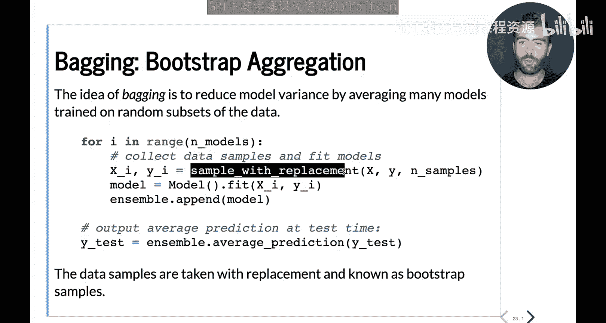

## Bagging 实战演示 📈

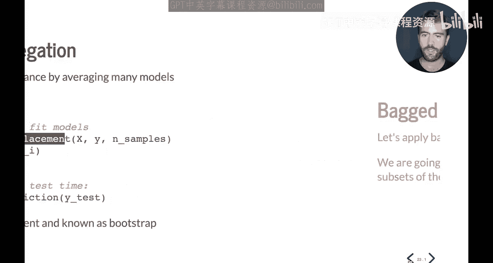

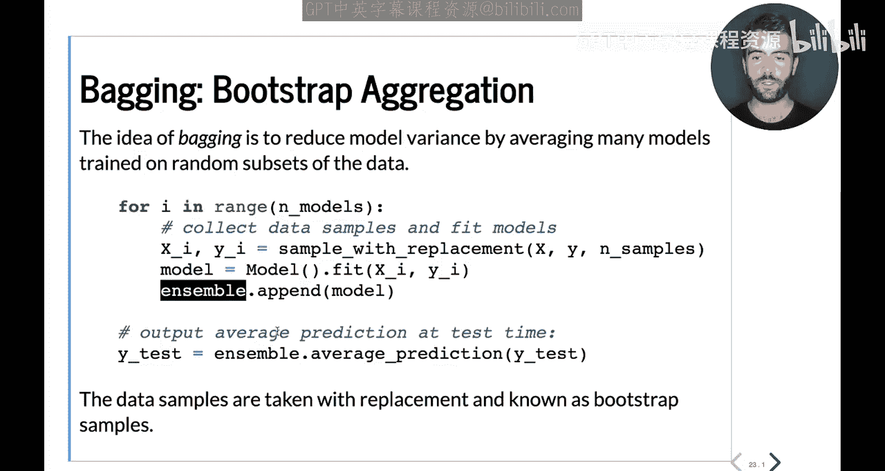

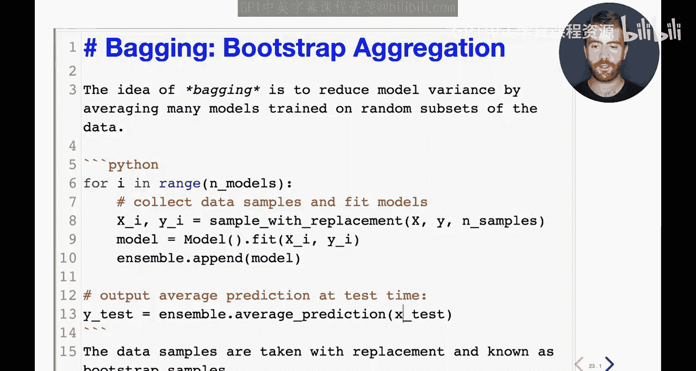

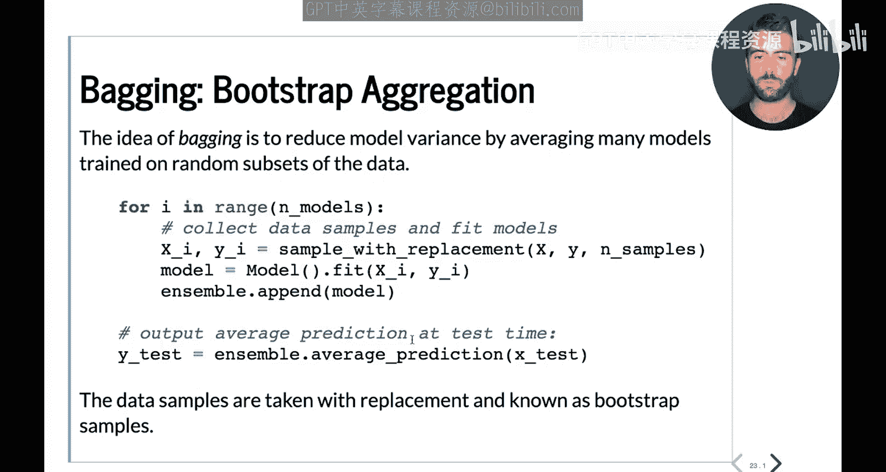

现在，让我们将自助聚合应用到之前的多项式回归问题上。我们将从40个数据点中抽取大量（例如10,000个）包含30个点的自助样本，并在每个样本上训练一个多项式回归模型，最后将所有模型的预测进行平均。

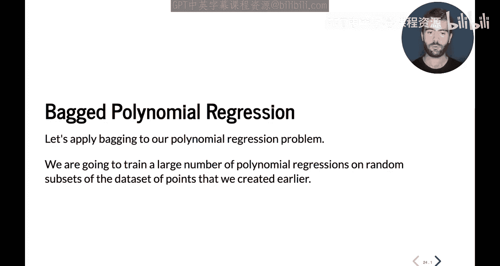

以下是演示结果的关键观察：

*   **单个模型（橙色曲线）**：每个模型仅在其训练的子集（蓝色散点）上表现，在数据稀少区域表现出剧烈且不一致的波动，模型间差异很大。
*   **Bagging集成模型（绿色曲线）**：这是10,000个类似橙色模型的预测平均值。尽管它没有在训练集上达到完美拟合（尤其是在数据本身稀少的区域），但其整体行为更加合理和稳定。在单个模型犯巨大错误的区域，绿色曲线的预测要好得多。

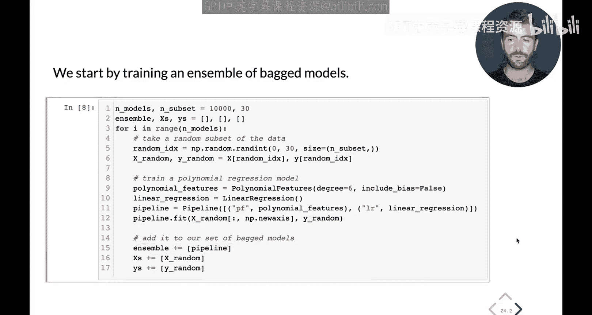

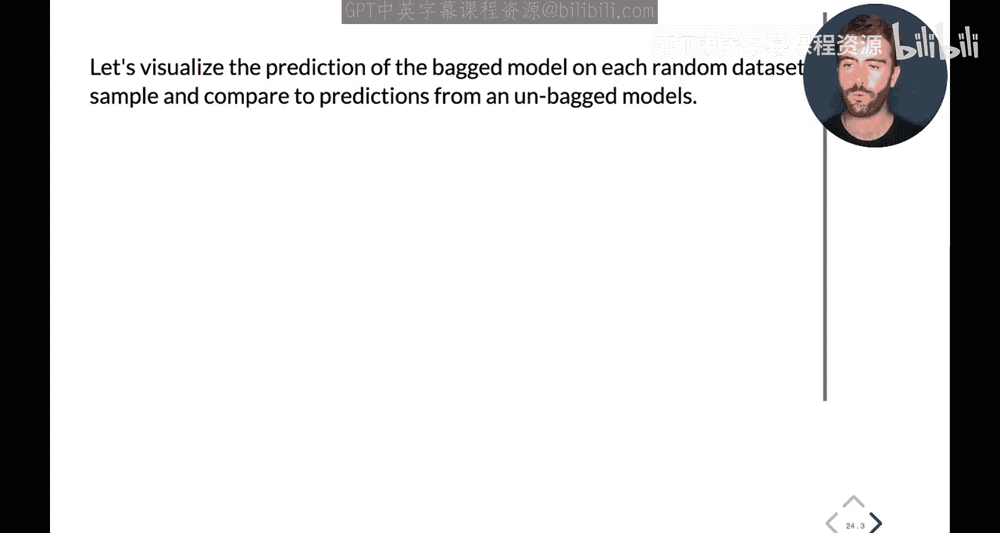

这个例子清晰地展示了 **Bootstrap Aggregation 如何能显著减少过拟合**。

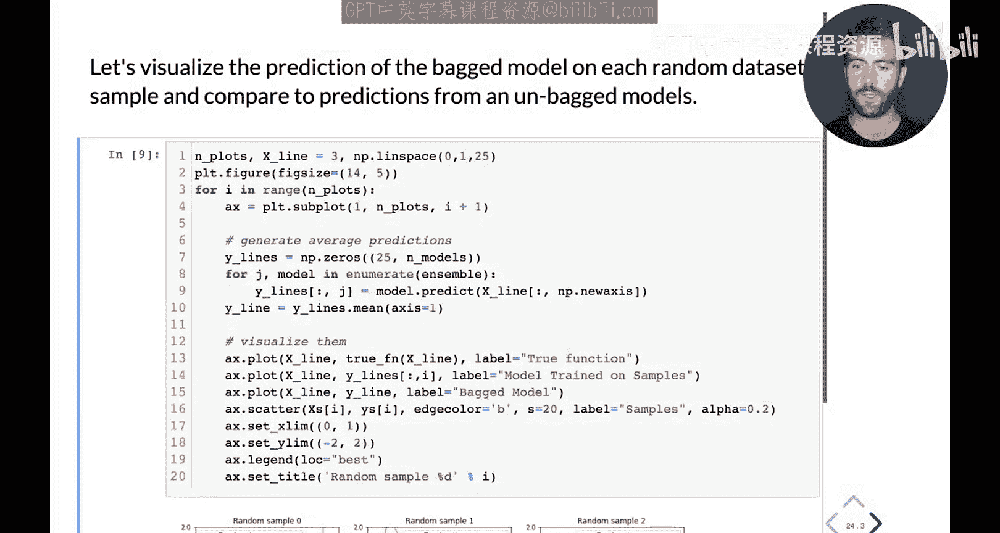

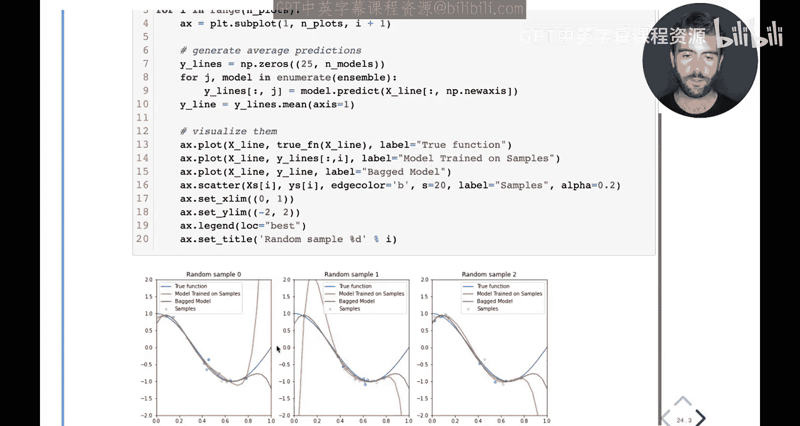

## Bagging 的变体与扩展 🔄

Bagging是一种在机器学习中广泛应用的方法。除了标准形式，还有一些值得了解的扩展：

*   **Pasting**：如果我们进行的是 **无放回** 抽样，这种方法有时被称为 Pasting。
*   **随机特征**：我们也可以在特征空间而非样本空间进行子采样，即随机抽取一部分特征来训练模型，这也有助于防止过拟合，称为随机特征。
*   **随机修补**：如果同时结合样本子采样和特征子采样，我们就得到了随机修补。

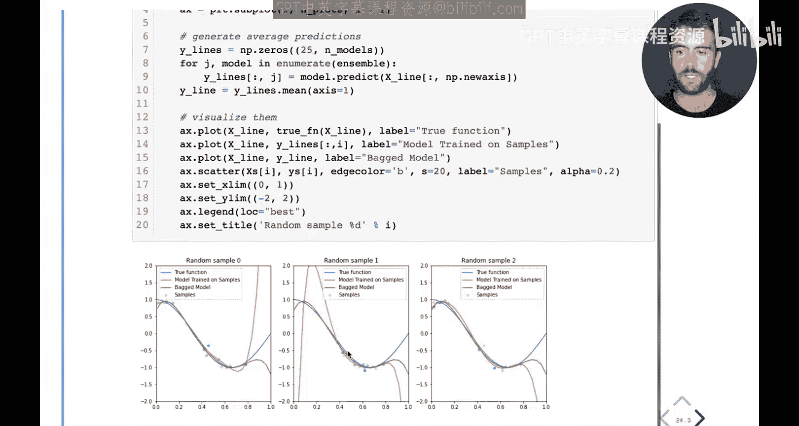

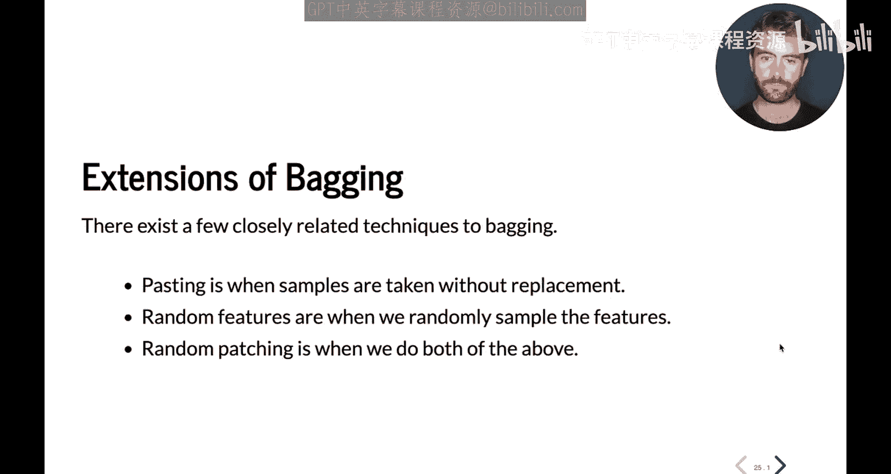

## 总结 🎯

本节课中我们一起学习了 **Bagging** 技术。它是一种强大的、与模型无关的集成方法，能够有效降低机器学习模型的过拟合和高方差。其工作原理是：

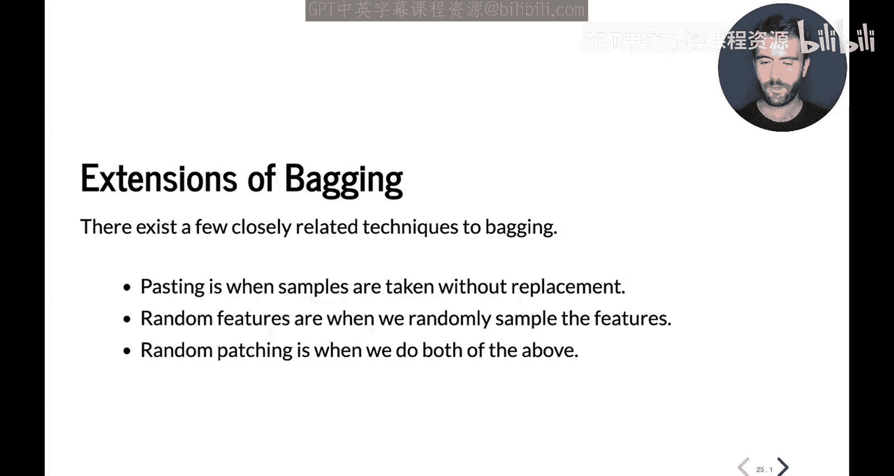

1.  从原始数据集中生成多个自助样本。
2.  在每个自助样本上独立训练一个基础模型。
3.  将所有基础模型的预测结果进行平均，作为最终输出。

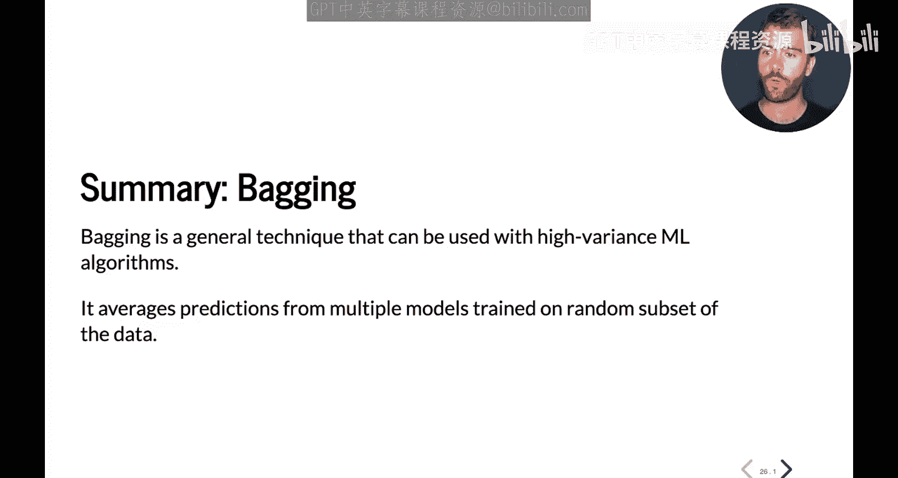

Bagging 的优势在于它是一个“黑盒”技术，不需要了解被聚合的基础模型的内部细节，因此可以方便地应用于各种机器学习算法，在需要提升模型稳定性和泛化能力的实际应用中非常有用。