# 康奈尔大学《应用机器学习 CS 5787_ Applied Machine Learning 2020》中英字幕（deepseek p49 -49-Lecture 13. Part 1_ Boosting and Ensembling.zh_en -BV12udzYvEFM_p49-

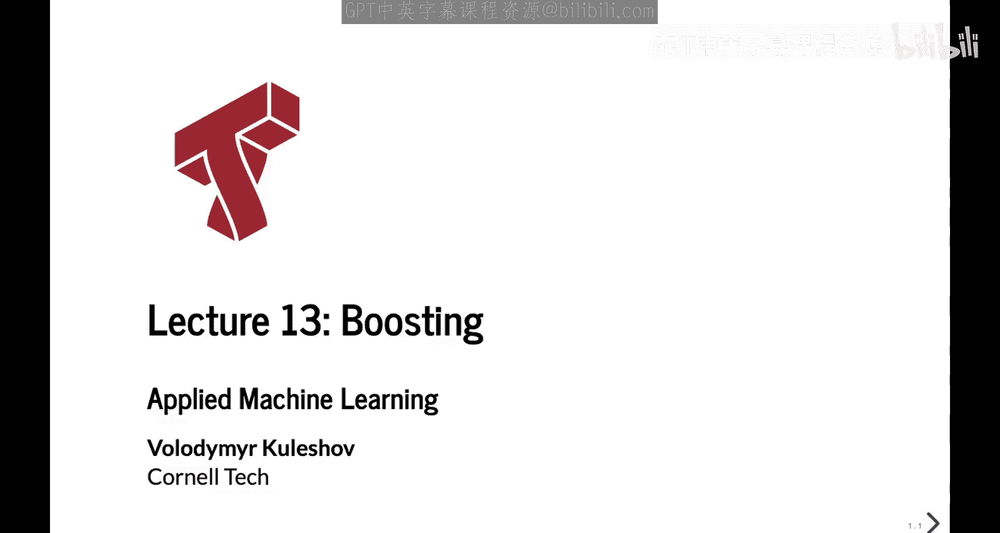

Hi and welcome to lecture 13 of applied machine learning。😊，In this lecture。

 we are going to look at a new class of machine learning algorithms that will be based on a new idea called Boting。

And we're going to start where we left in our previous lecture on decision trees。

 and we're going to see new ways in which we can combine simple algorithms like decision trees as well as other algorithms into more complex and more powerful machine learning models。

And the result of this lecture， the boosting algorithms that we're going to see。

 these are actually a really important family of algorithms that are very effective in practice and that represent the state of the art in terms of machine learning accuracy on many important practical problems。

So let's look at boosting algorithms First I would like to define the general idea of boosting and how it relates to some of the earlier methods that we have seen in the previous lecture。

 especially approach the bagging approach that we described in the context of random horse and decision trees。

And then from bagging， we're going to go to。

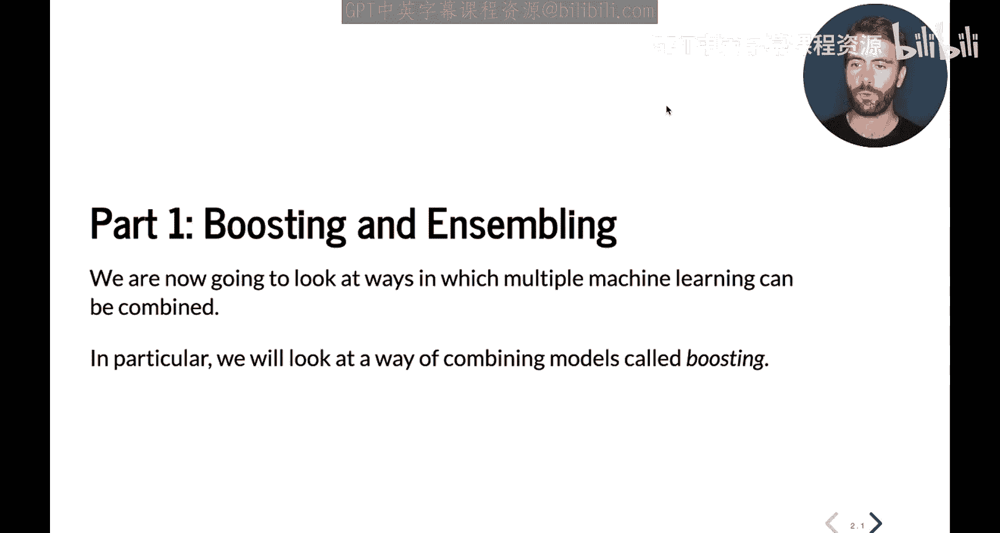

Boosting。

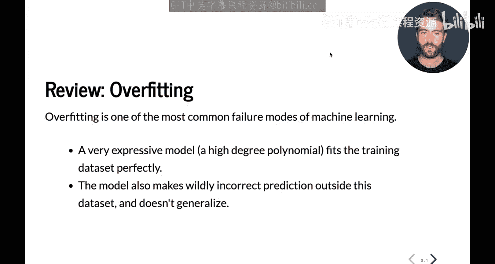

So recall that in the previous lecture， we started with the problem of overfitting。

Which is a failure mode that we often incur in machine learning。

 especially when working with large decision trees。

So the problem here is that we have a model that's very expressive and it's too powerful for the data。

 for the small data that we have， and therefore it fits this training set perfectly。

 but it doesn't generalize， it doesn't produce accurate prediction outside the training set。

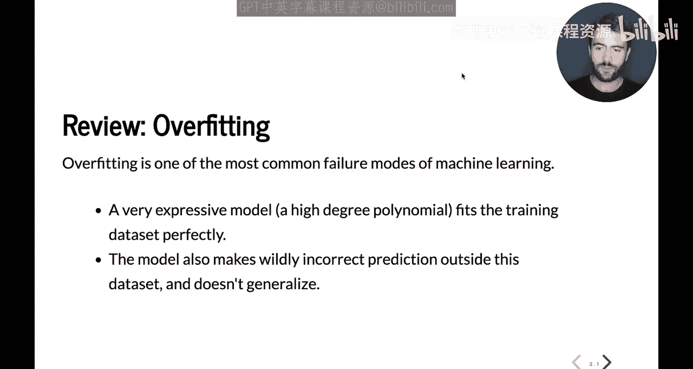

And we saw a general way of reducing the overfitting of machine learning models by averaging many models that are each trained on random subsets of the data。

 This is called bagging and essentially in bagging we repeatedly take random subsamples of our training set。

 we fit a new model on this random sample and we add it to our total set of models。

And then at prediction time， we output the average of all of these models。

 And because each of them is trained on a slightly different version of the training data。

 the errors that they produce outside the training region tend to be different。 And in particular。

 they cancel each other out。 So one model might might predict too high。

 The other one might predict too low。 But on average， this cancels out and produces。Predictions。

 which generalize better。

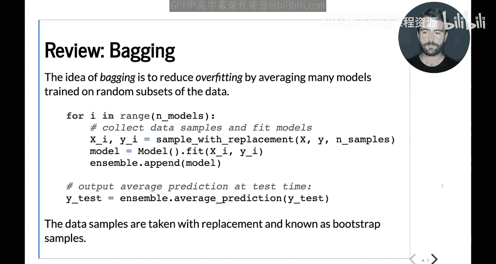

So the other problem， the converse problem of overfitting is underfitting。

Whi happens when our model is too simple for the data that we have， for example。

 if the data is better described by hydro polynomial， but we try to use linear regression。

 then we will not fit the training data well， and therefore we will also not be accurate on new data which comes from the same distribution as the training data and therefore it looks similar to the training data and we will also not be accurate on the new data。

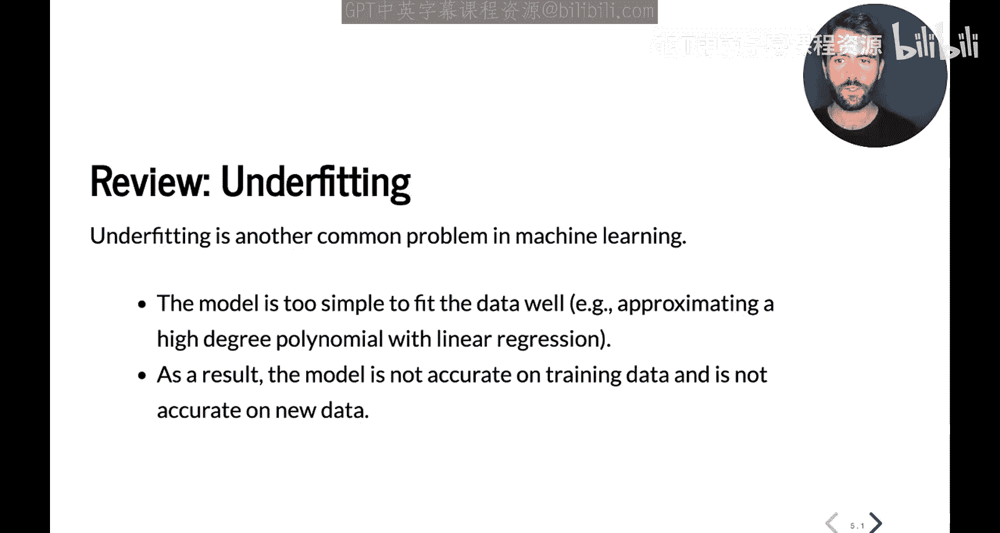

Boosting the idea of this lecture， the approach that we're going to the set of algorithms that we're going to look at in this lecture can be seen as a way of reducing underfitting by also combining different machine learning models into a larger。

 more powerful model。So in that sense， it is quite similar to bagging。

 we combine many simpler models into one larger model that we're going to call the ensemble model or and we will denote this by F。

But unlike in bagging where these base models， they tend to be too expressive and we want to reduce their overfitting here。

 these models G are too small， too simple， and they tend to underfi the data。

And we use boosting to make the ensemble of models more powerful and more expressive than each of the individual models。

And the general approach to how we're going to do this is by having each new model that we add to our ensemble。

 look at the errors of the previous models and make predictions and try to fit the part of the data that the other models have not fit well。

 and so in that sense， each new model will correct the errors made by the previous models in the ensemble。

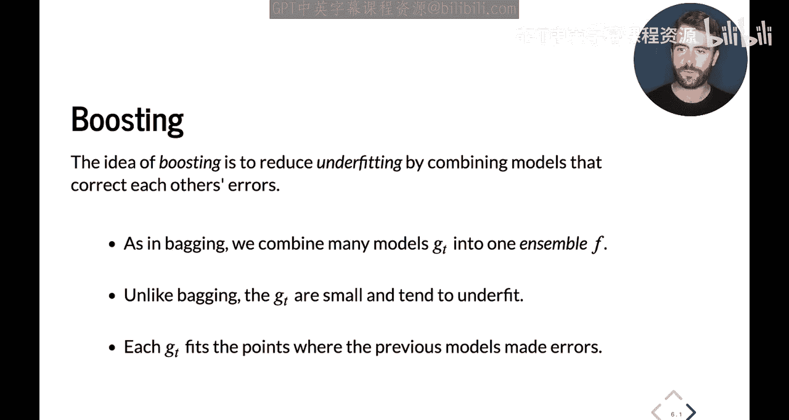

And a key ingredient for defining a boosting algorithm or for using boosting is this model G。

 which is called the weak learner。So we call this the weak learner because the models。

 the only requirement on these models is that they're slightly better than random。

And you can think of in practice a weak learner as being either a linear model or a small linear model with a small number of features。

or a small decision tree， like a depth1 or a depth 2， depth 3 decision tree。

 or any model that really underfits the data， but it's still able to extract some small amount of signal。

 which makes it more accurate than random。

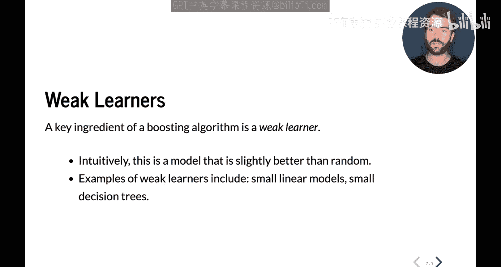

So given if we start with learning， a weak learner。

 so an algorithm that will produce a model that will be just slightly better than average。

We can take these models and combine them into。A more powerful model in the following way。

 which is the general approach that is taken by boosting。

So we start with an initial weak learner and we fit it on our data set and we set our ensemble to be that model initially。

And then we compute weights for the data based on how accurate the current ensemble is on those data points。

So if our F here， which consists initially of only our base learner is accurate。

 then the weight for that point is going to be small and if it's really inaccurate。

 then we're going to assign more weights to the points that are inaccurate。

And then we will fit our next week learner on the same data set。

 but now we're going to add these weights W。 We're going to weigh the error。

 We're going to weigh the loss of each of each point by this weight。

 And so the error of points that are。That are。On which the existing model is less accurate。

 they will have more weight， and so we will tend to minimize the error more at those points as opposed to a different set of points。

How where the model is more accurate。So this requires our weak learner to be able to minimize a weighted loss。

 but in practice most algorithms that we have seen， including linear regression or decision trees。

 they are all able to minimize weighted losses as well， for example。

 with a linear regression algorithm inside the linear regression algorithm。

 we can simply add weights to each our loss as a sum of losses over each training point and we can simply add a multiplicative weight to。

 for example， the mean squared error of each at each data point。

And we can still optimize the objective in the same way。

 either using gradient descent or other approaches that we have seen。

And so now that we have the second week learner that has been trained to fit the error of the previous model。

 we add it to our ensemble with some weight alpha that determines how important this new based learner is。

And then we go to step2， we recompute the weights， We train another weak learner。

 and we repeat steps2，3，4 until we have a sufficiently powerful model F。

And you can see that at each step， this model F will become more and more expressive because it's going to be the sum of a large number of weak learners that each are accurate on a subset on a different subset of the data。

 and so their ensemble will be able to achieve good accuracy on the entirety of our training data set。

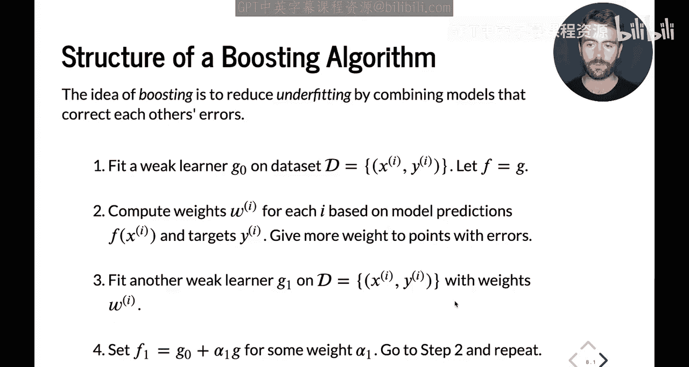

If I were to implement this in Python， I would use the following journal structure。

 I would initially start with a uniform set of weights and then for each then if I wanted to create an ensemble with this many models。

 then I would fit the current I would fit a model with an initial set of weights。

 then I would look at its predictions， I would create a new set of weights and then add it or ensemble。

And the output would be some kind of consensus something like the weighted average of the predictions from the base from all of the weak learners that we have trained as part of this procedure。

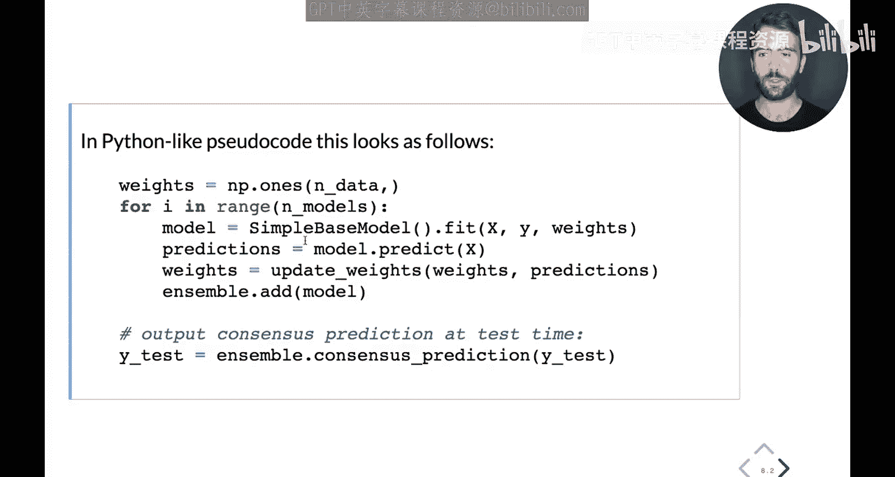

A small historical note about boosting boosting originally came from the machine learning theory literature。

There was a theoretical question machine learning， which is whether it's possible to combine weak learners with that each is only slightly more accurate than random that has slightly above 50% accuracy and whether it's possible to combine a number of weak learners into a strong learner that has high accuracy and do this in approvalable way with theorems that guaranteed the success of this algorithm。

 and this is a problem that was studied in the late '80s and early 90s。

 initially some theoretical results were derived and eventually this line of research led to the first practical boosting algorithm called at a boost and at a boost is a historically very important very important algorithm both from a theoretical perspective because it solves this theoretical question that people were asking themselves and also in practice it has。

It's been for a long time， a very powerful machine learning algorithm that has。

That has had wide applications and was really considered the state of the art for a long time。

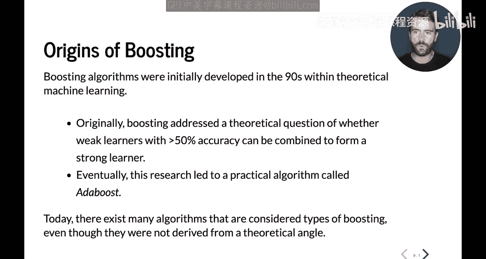

So add a boost， this algorithm which I'm going to define。In a moment。

 it's an algorithm that was originally developed for classification。

 although there are versions of this which work for regression。

 and it learns an ensemble of weak learners， which are often decision trees using an objective function that we're going to talk about later in the next video called the exponential loss using a particular form of optimizer。

 which we're also going to talk in the next video， which I will not mention here。

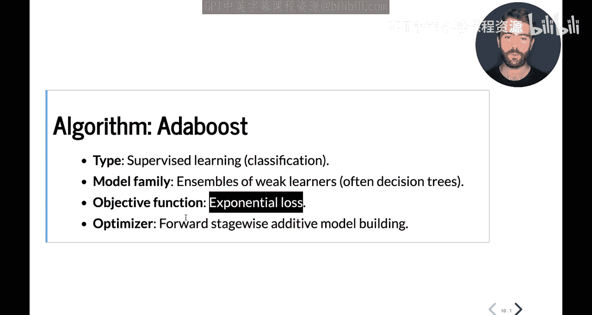

Let me just define the structure of this algorithm at a high level。

 So you have one specific example of how a boosting algorithm would look like。

 and then we're going to see how it works on on。On a simple data set。

So this algorithm follows the high level boosting structure that I defined earlier。

We start initially with a uniform set of weights and an empty ensemble and then for a number of iterations。

 we fit a weak learner， which can be our decision tree。

 and then we compute the weighted misclassification error so here recall that this notation boldface I this is called the indicator function and so this is this equals one when this condition does not hold one when this condition holds and0 when it does not hold and so here you can see that if all the weights equals one。

 then this is simply the percentage of points which are misclassified and if this is。

If the weights are nonze， then we， then this is a weighted average of the。It's a。

 it's a weighted misclassification error because now each misclassification point is each misclassified point has a weight that is given by by this value。

 by this variable and that goes into the overall。To the overall percentage。

So we have this weighted in the classification error， then we define。

What I'm going to call the model weight alpha， which is going to be a simple function of the misclassification error。

 these formulas by the way， are it's not essential that you understand exactly the intuition behind each term。

 but I think the high levell structure， I think you should recognize here the high levell structure of a boosting algorithm that we have seen earlier。

So we compute this model weight and we add this weak learner to our ensemble with this weight that we have determined。

And then we compute new weights for the data points。

 the weights W using this update in which we increase the weight of misclassified data points by a value that's the exponential of alpha。

This guarantees that all the points are positive and it also guarantees that points on which we make errors。

 these points have more weight， so if if we are making an error on a particular point。

 then this expression， this indicator function will evaluate to1 and so we will simply multiply that weight by e to the power alpha。

And if this point is classified accurately， then this will evaluate to0。

 and we will simply multiply w by the exponential of 0。

 which is one and those weights will be unchanged。So this follows the high level structure that we had earlier。

 we are assigning more weights to points on which we are less accurate。

 and following this procedure repeatedly we get the add boost algorithm。

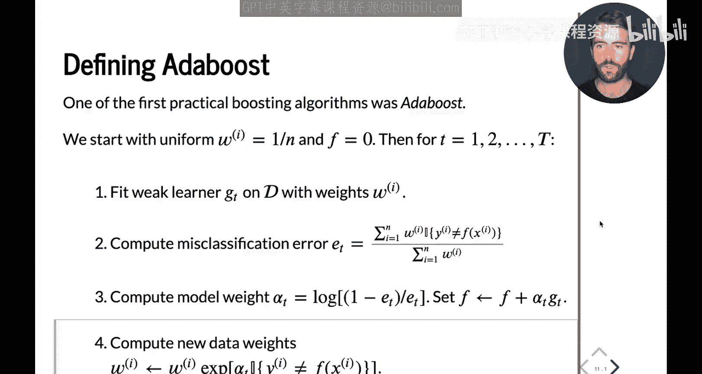

Let's now see how this algorithm works in practice。On a small toy data set。

So here I'm following an example that's taken from the second learn set of examples and I create this simple toy dataset which I'm going to show you in here this code simply visualizes this dataset and here we have two classes the blue and the orange class and they are clearly this is a toy dataset but it's clearly more complex than the ones we have seen so far in particular it's linearly it's clearly linearly notseparable here we have the blue class which is surrounded by the orange class in this cluster and here we have another cluster of points where it's the opposite the orange class is surrounded by the blue points。

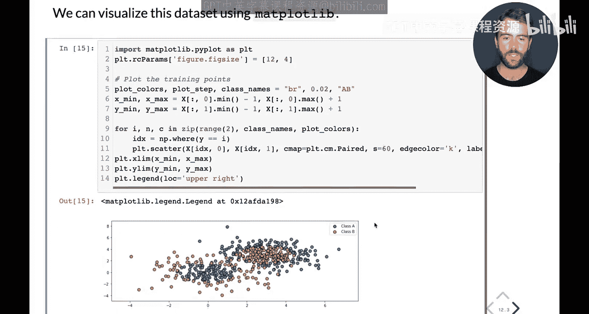

So it's highly linearly separable， even though it's in two dimensions。

 it's still a complicated data set to learn。

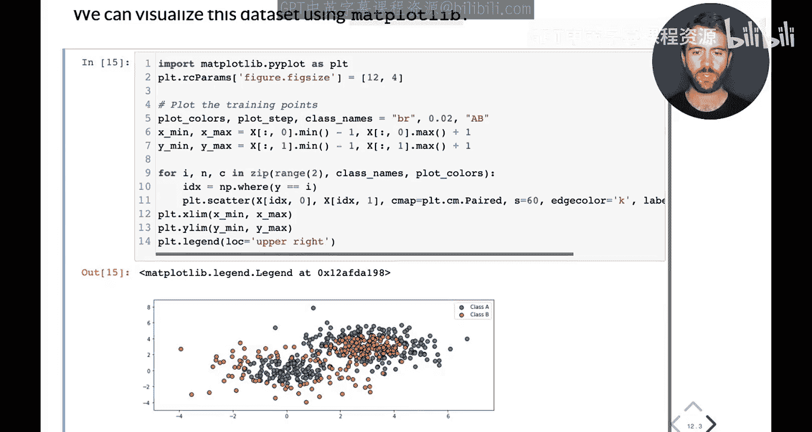

So let's train add a boostt on this dataset in order to use add a boost in practice。

 it's easy again if we use the psyic learn library。

 we can import this add a boostt classifier and add a boost。

 as I mentioned earlier because it's a boosting algorithm， it takes a baseline classifier。

 it takes a weak learner， which here we are defining to be a decision tree classifier with a depth of one。

And we are going to learn an ensemble of 200 such classifiers。

So you can see here that defining this algorithm is really simple。

 we can fit it to our data with one line of code。And the result gives us the following decision boundary。

 So here I am simply， I'm generating。

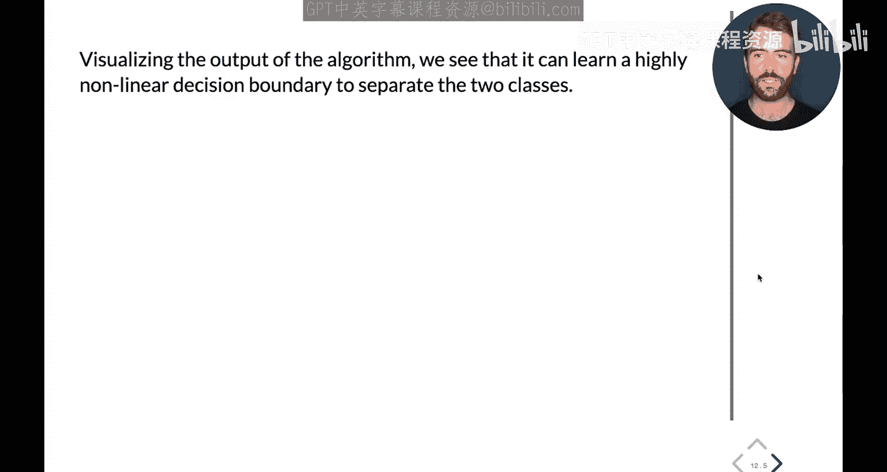

Here， I'm just creating a two dimensional grid on this in this in this region。

 And then I generate predictions for every point in this grid。 and I visualize them here。

 and then I visualize the rest of the training points here。 And this is what we have。

 So you can see here that this algorithm， even with a really simple ensemble of with a really simple model of 200。

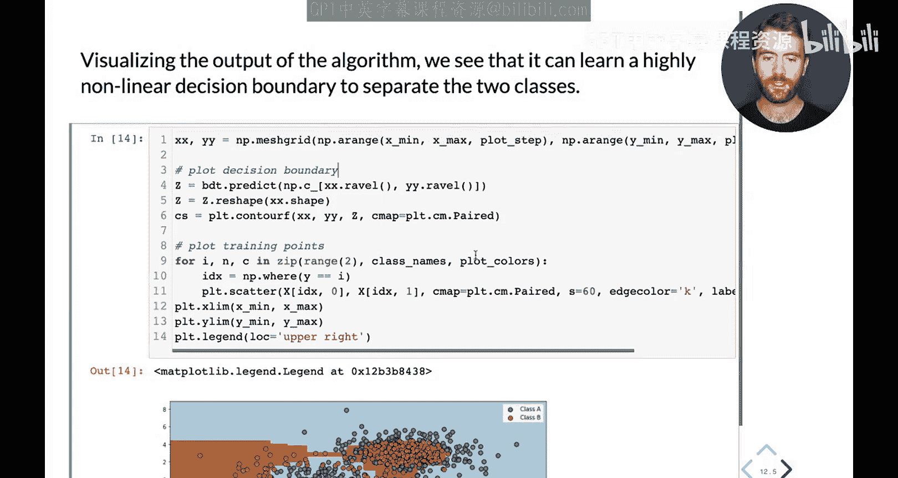

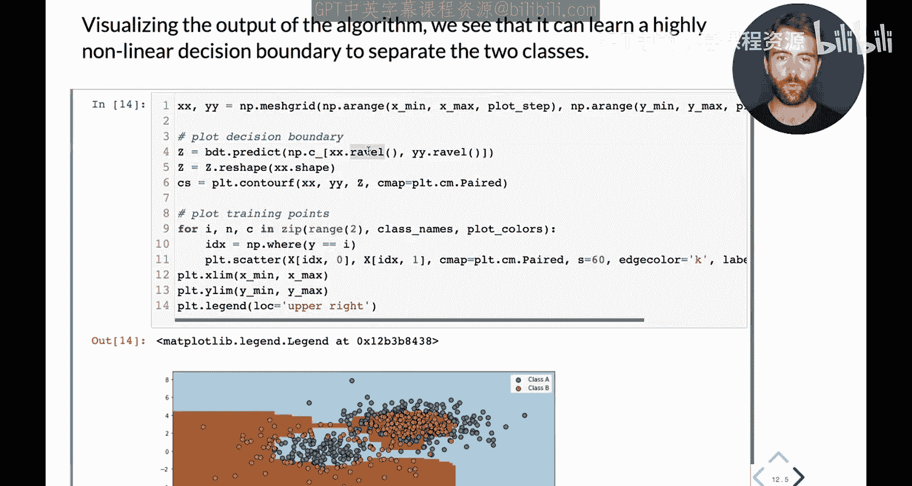

Depth 1 decision trees。 We are able to learn the structure of this data。

 So here I've learned that the orange class it lives around the blue class and my orange region almost correctly surrounds the the blue region。

 And here it's the opposite。 It has identified this island here inside the。😊。

Inside the surrounding blue points。As being orange。So here using a really simple off the shelf model。

Without really any significant hyperparameter tuning， I was able to learn this highly。Nonseparable。

 non linearly separable structure。And this is a first hint at how powerful。

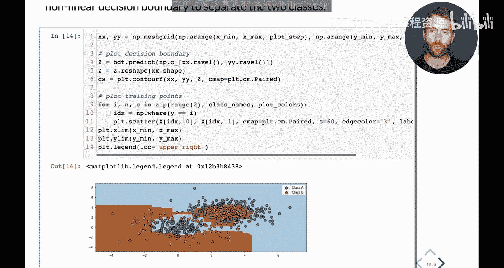

Boosting algorithms can be。Now， I also want to mention that boosting and bagging are special cases of a general idea called ensembling。

 and I've used the term ensembling before， but what it really means is combining multiple machine learning models into one larger。

 more powerful model。So bagging and boosting are two of the most popular ensembling techniques which reduce overfitting in the case of bagging and underfitting in the case of boosting。

 but there are also other types of ensembling that that is useful to be aware of。

 one of them is stacking and stacking simply means that we train we have M input models。

And we train each of these input models under our training data。We freeze them。

And then we train another model on the outputs of these models。

 so now our output model will take us input its input features will be its input the input attributes that go into the model F are going to be the outputs of the model of the models G。

So this is a simple approach to try and it has a name it's called stacking and it works best with very different models G。

 so for example， combining a decision tree with an SVM with a linear model with an naE base and then and then training another model with these four outputs as features they could be an effective approach that can often lead to additional performance improvements。

And then also I'm going to highlight that the Bayesian approach。

 which we saw in one of the earlier lectures， that is also technically a form of ensembling because we are averaging many models of this form with different set of thetas and we effectively use these sets of weights。

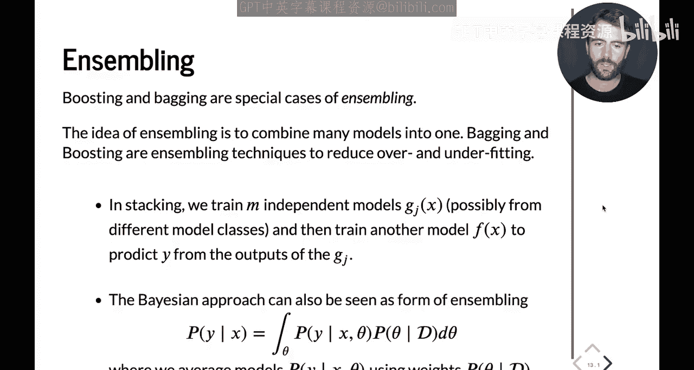

So the Bayesian approach is actually a really principled approach for defining ensembling algorithms now in practice this formula cannot be implemented and there are many ensembling algorithms that are special cases of this formula in the sense that they provide an approximation to it。

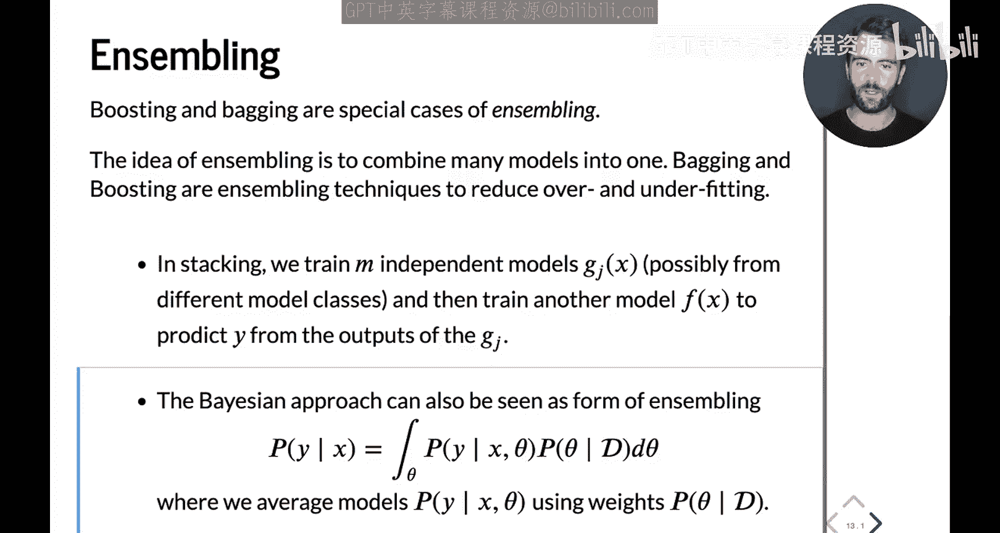

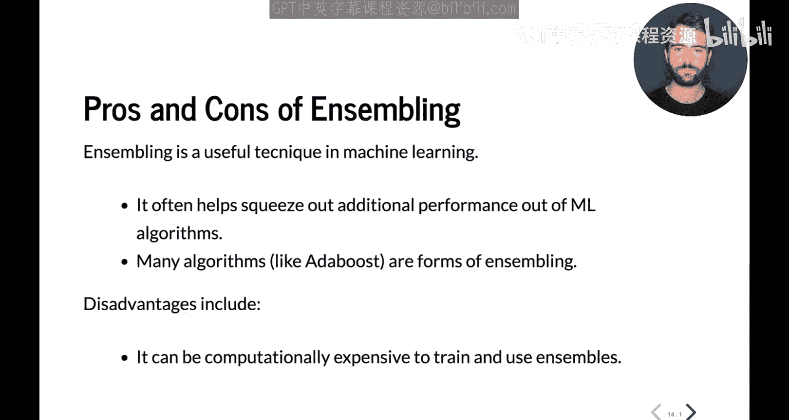

And the idea of ensembling is actually it is a useful one to know for applying machine learning。

In practice with a lot of state of the art algorithm。

 we can always squeeze out a little bit more performance out of the model if we try ensembling。

 so for example， with neural networks， if we train a few different types of neural nets from a different initial training point we can improve our performance a little bit more and also ensembling is important because many。

Algorithms in machine learning， like boosting algorithms， are actually forms of ensembling。

But of course， we may not always be able to use enseling in practice because it is expensive to train many different kinds of models。

So this concludes the high level description of boosting。

 and next we are going to see a different perspective on boosting that will also be used to define new algorithms。

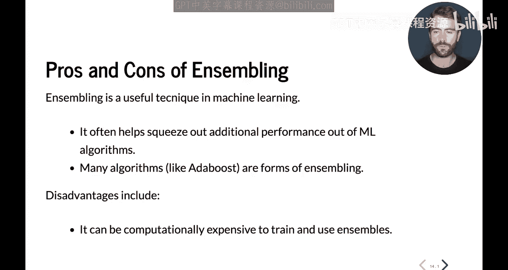