# 康奈尔大学《应用机器学习 CS 5787_ Applied Machine Learning 2020》中英字幕（deepseek p50 -50-Lecture 13. Part 2_ Additive Models.zh_en -BV12udzYvEFM_p50-

This is now part two of lecture 13 of applied machine learning on boosting and in this part of the lecture。

 we are going to look at additive models， which is a different perspective on what boosting does and it helps us。

It helps us explain the behavior of some of the boosting algorithms that we have talked about。

 and also we'll use it to derive new kinds of boosting algorithms。

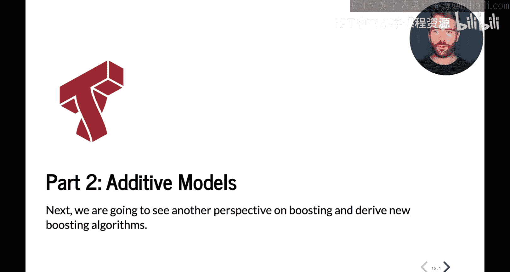

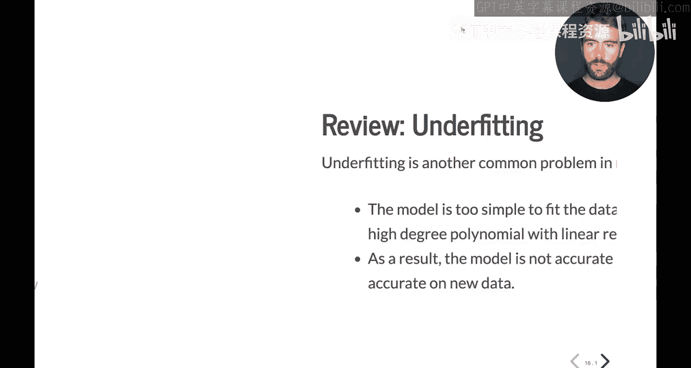

So， recall that boosting is。A set of algorithms， it's a general approach for combining models to reduce the problem of underfitting Underfitting happens if our model is too simple for the data that we have。

 so if the data is described by a high degree polynomial， but we try to fit it with a linear model。

 then we will not be able to fit our training data well and we will not make good predictions we will not make good predictions on the training data and we will also not make good prediction on new data。

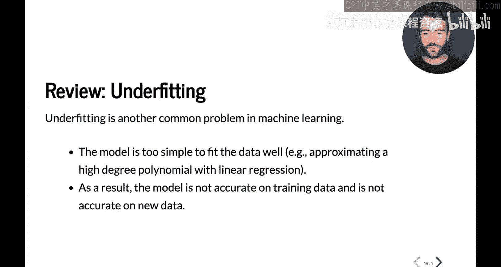

And boosting is an idea of' an approach for reducing underfitting by combining many inaccurate models。

These models are combined in what is called an ensemble。

 but unlike the bagging approach that we saw earlier。

 these models tend to be inaccurate and they can be used to create a more accurate model by training each new model on the points where the previous on the points where the previous models have made the biggest errorss。

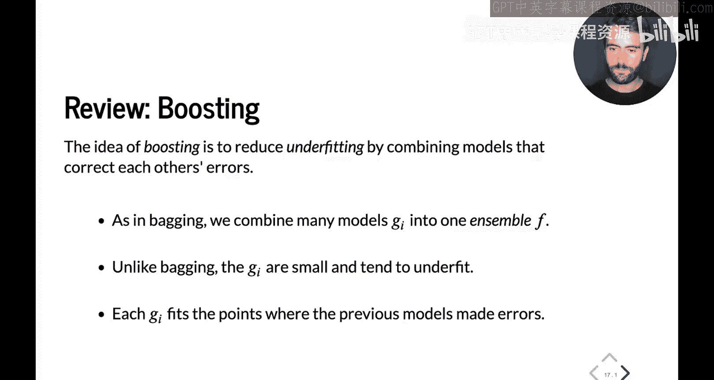

And boosting it fits what is called more generally in machine learning an additive model。

An additive model is an important class of machine learning models， we saw linear models。

 we saw polynomial models， and now additive model is another class that's important。

 and it has this structure。So it's called additive because it is a weighted sum of a number of simpler models。

And each of these submods has its own set of parameters denoted by phi。

And it also has a weight alpha， which describes its importance within the ensemble。Again。

 the alpha and the phi are the parameters well sorry HG has these sets of parameters and the parameters of the global model of the ensemble F is simply the set of all the alphas and phis。

And this is more general and more powerful than the kinds of models that we have seen so far。

 For example， it's more powerful than a linear model， because now each of these Gs can be， it can be。

Much more complex。 And in fact， this model no longer is not necessarily linear in its parameters because G may not be necessarily linear in its own parameters。

 For example， if G is a decision tree， then it's going to be a nonlinear model。

 So this makes the ensemble more powerful， but it also makes it more difficult to train。

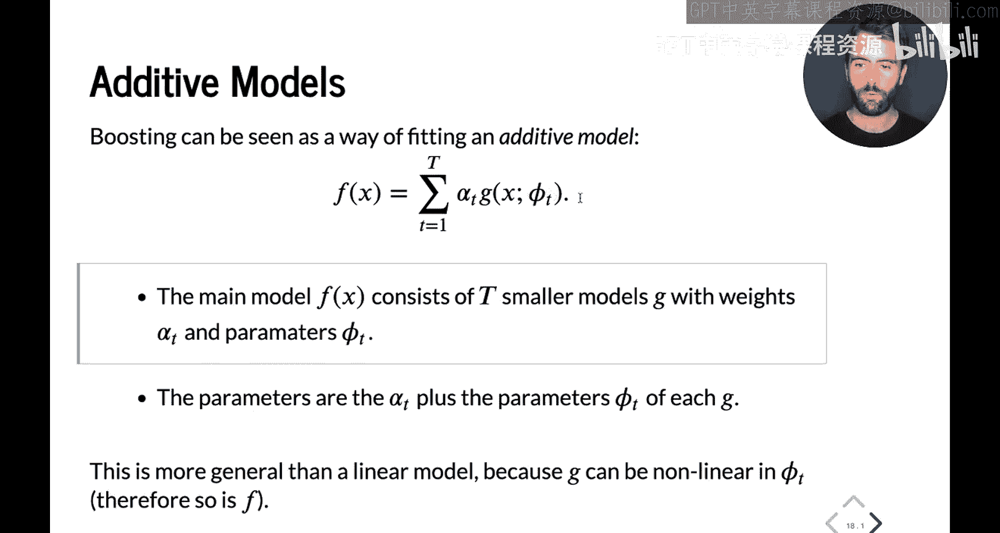

One way that we saw of training these kinds of additive models is of course， boosting。

 I'll just briefly briefly summarize here the boosting approach。

 we start with an initial weak learner， we train it on our data。

 then we compute weights that are high at points where F makes an error and low points where F is accurate。

We train a new weak learner on a data using these weights。

 and so the weak learner will prioritize the points where the previous model has made errors。

 then we add it to our ensemble， and we repeat this procedure。

This is one way of training additive models。

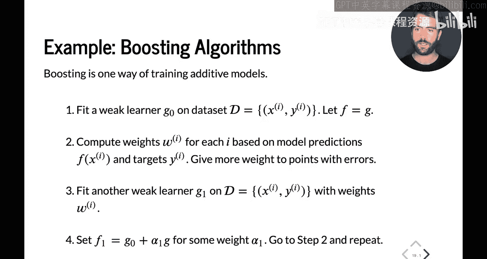

But this also happens to be an instance of a more general framework。

 which is called forward stagewise additive modeling。嗯。

This approach is a general way to fitting any kind of。Additive model with any kind of。

With any kind of。A set of based learners and various kinds of objectives。

And boosting algorithms can be recovered as a special case of this framework。

So suppose that we have some kind of loss that determines the goodness of our fit。

And we initially start with a model that is simply combined。 is here， I'm simply taking。冇。

Learning algorithm and the base learning algorithm。And it's model G。And I minimize the loss。

 So I basically fit1 g here to the to the training data set。Then， at each subsequent iteration。

I look at my F and the previous models that I have fit and I put them here and now I consider the model in which I have added this new instance alpha times G of phi to all the other components of my additive model which are here。

 So this is already a sum over t minus1。Additive submodels。 and now I want to add another one。

And I need to determine its parameters， and。

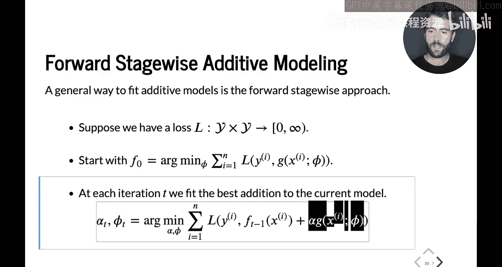

And weights。And weight alpha And the way that I'm going to do this is I will solve this minimization problem。

 but I will keep this part fixed， and I will only optimize over the alpha and the phi of the new model。

So if this base model is sufficiently simple。Then it's possible to perform mis minimization efficiently。

And it will improve the previous error because I can always set alpha to 0。

 It will never be as bad as the previous model。 So I'm going to add a new model to my additive。

 I will add a new submod to the additive model F that will result in an improvement in performance。

And it's also crucial that these that everything that's within F。

 the parameters of the submods that are within。This set of terms。These are all frozen。

 so we keep this as a constant， and we only optimize over this part。

And this is necessary in order to keep the optimization problem tractable。Now， of course。

 this also has the problem that we may be a little bit too greedy or we may miss I would say it has the first obvious problem that it has is that we may miss certain solutions which are better。

 for example， it's possible that if we change the parameters within the submods that live inside this version of the ensemble if we modify them if we modify these parameters jointly with these parameters。

 we are likely to find a better solution， but we don't do that， we only。We only minimize this term。

 and。That prevents us from finding the global optimum。

 the globally best set of parameters for the ensemble。

 but it keeps this optimization process tractable。

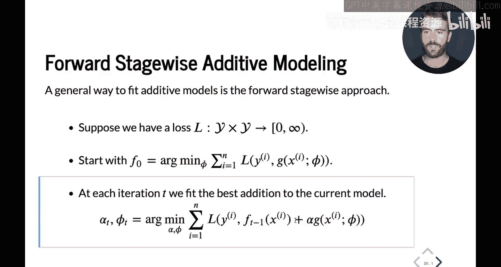

Before I go in in a lot more detail into additive models， I just want to。

Give a few here practical notes。 just describe in a bit more detail how these components can look like。

 I haven't really defined what G is so far。 I told you that boosting is a special case。

 So algorithms that could go into boosting these are。For example。

 decision trees are often used in practice within boosting。

 and they could also be used within these kinds of additive models。

 but there are also some other common。Based models G that can be used with this approach。

 cubic sps are an example of a model that could be fit in this way。

Or combinations of cubic explains can be brought together into an additive model using this approach。

 and there are also some kernelized models that can be used here。

And we can repeat this training process for some number of iterations that's either fixed or we can monitor performance on a holdout set and when we see that our performance on the holdout set no longer improves and we're only reducing our training error but the holdout error is not improving or it's increasing。

 then we know that this is the point at which we are I which we're now starting to overfit the data and we can stop adding new models there。

 this is also called early stopping sometimes。And an important choice。

 an important design choice when using， when fitting these kinds of。Moels is is the loss L。

And I want to give you a few examples of losses that are used with these types of additive models。

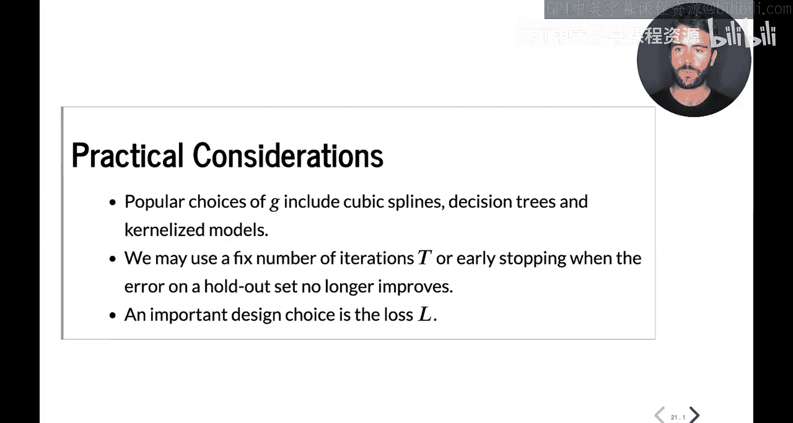

And we'll see interesting connections from that。One kind of loss that I want to introduce in the context of additive models that we have never seen before is the exponential loss。

The formula for the exponential loss goes like this Here。 you can think of y as being our true label。

 F is just the parameter that。F is just an estimate of why。And y here is minus1 or1。

 so this is binary classification， it's a loss for binary classification。

 and we assume that this is our encoding for the two classes， either plus1 or minus1。

And this is the formula for a loss。So you can convince ourselves that this is a good loss because。

 for example， suppose that the true class y equals 1。

 then this loss will be small if F is going to go to infinity。

And so our score is is going to be far away from0， which is the threshold between the two classes here。

 this loss is going to encourage F to be really high and away from the decision boundary at 0 it's going to go to infinity and similarly fy equals minus1。

 then the best f is the one that goes to minus infinity。Which is， again。

 the direction where we want to be if our true target is negative。

So this just shows you that this is a reasonable loss to use。

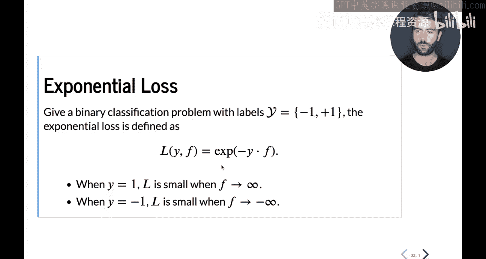

And。It's also useful to visualize this loss。

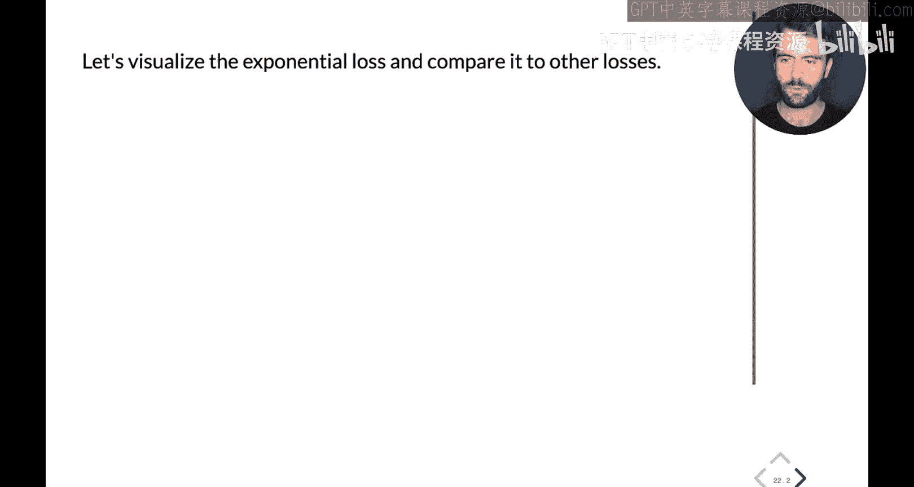

Here this is a lot of Python code， but here I just define these two losses。

 I just define four losses， so hinge L2L1 and the exponential loss and nuy and here I just do a simple four loop to visualize them in a2 by2 grid。

 which you see here。

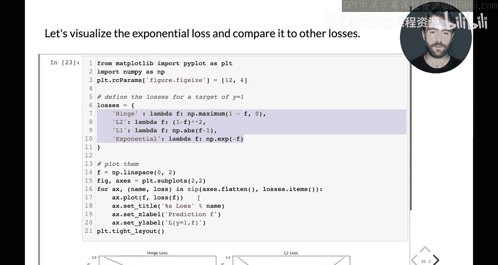

So you should remember from our previous lectures the L2 loss， which has this shape， the L1 loss。

 that's just the absolute value， so it looks like an absolute value。

 And again this is all when y equals 1， so the minimum here is1 the minimum here is1 the hinge loss we saw in our lecture and SVMs it's the valid loss and here also one is among the set of minimizers and the exponential loss the minimizer is not really at1 it's actually plus infinity but you can see that it is smaller in the direction that's farther away from-1 which is our wrong class。

 So one is the correct class and。The farther we are away from the wrong class， the lower the loss。

 which is what we want it to be。

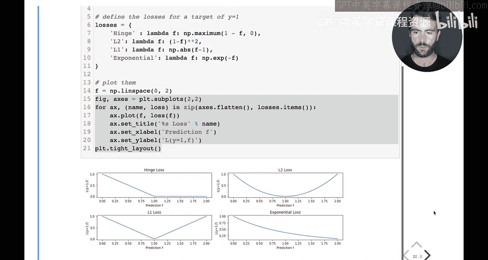

Now， the exponential loss is interesting because we can show that add boost is simply forward stagewise additive modeling using the exponential loss。

At each time， step T here。Well， first of all， if we use the exponential loss。

 then at each time step T， our loss is simply going to be the following expression。

 So this may look like there's a lot of symbols in in it。

 but it's just the definition that we had earlier except that I。II replaced F with our here with the。

With this。With this。With the new model with the prediction from the new model that we're going to be training and we call that in forward stageized Editive modeling。

 this is everything that's already in our ensemble and it's fixed and we optimize over the weight and the parameters of the new component that we're going to add to our ensemble。

So this is our L2 loss and。I can rewrite it in this equivalent form。

Where I simply did a few algebraic manipulations， I took this thing here and then multipied by Yi。

 because this is added， I can take it out and this just becomes exponential of this and it multiplies the other part which is in the other exponential and this is just a simple here there's just a few simple algebraic manipulations。

 which shows you that these forms are equivalent。So already， you see that this is a weighted。

Exponential， this is a weighted exponential loss。With the following weights。

 And already this starts to look a little bit like。Like like a boosting algorithm。

 given that we have weights。 and it's possible to derive the same update rules for the weights and the alpha that A boost uses by。

Analyzing this expression。

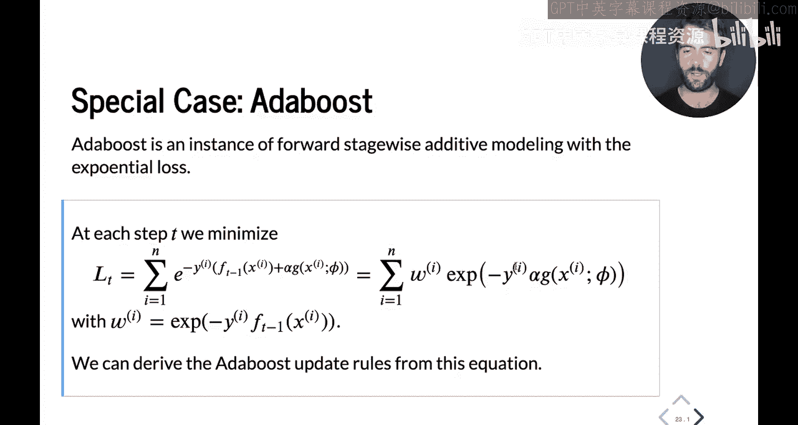

This going this is going to be the only slightly mathematical part of this video and if you don't follow all these manipulations。

 it is okay， but just remember the high level idea that from the above expression。

 we can derive the add boost update rules， which means that add a boost is a special case of forward stagewise Editive modeling。

So suppose that our prediction is in this set， which is a set of labels。

 then we can take the previous expression and we can do a few algebraic manipulations because this is either -1 or 1 and because the true class is minus1 or1 then everything really simplifies here and we're only left with alpha as something which doesn't equal minus-1 or1。

 and if we look at all the different cases。

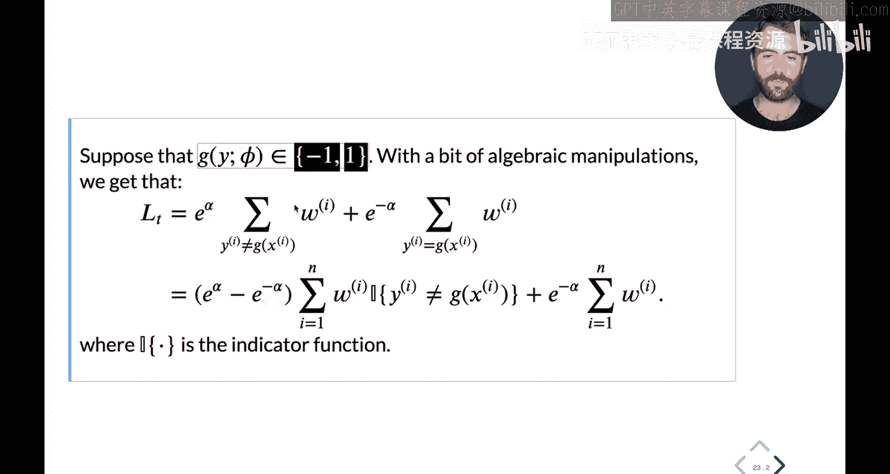

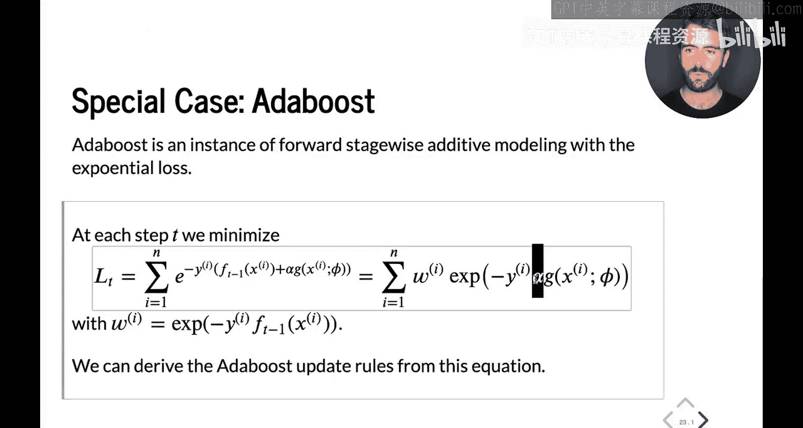

Well， essentially we have these two cases if if。If our prediction is not correct。

 then the weight is going to be E to the alpha。 If it， if it is correct。

 is's going to be E to the minus alpha， that is what。

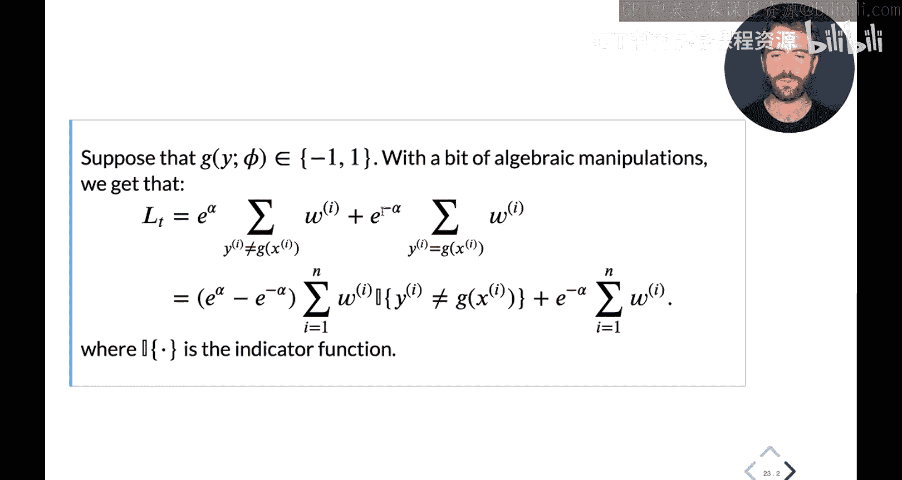

That is what this last term。Becomes。

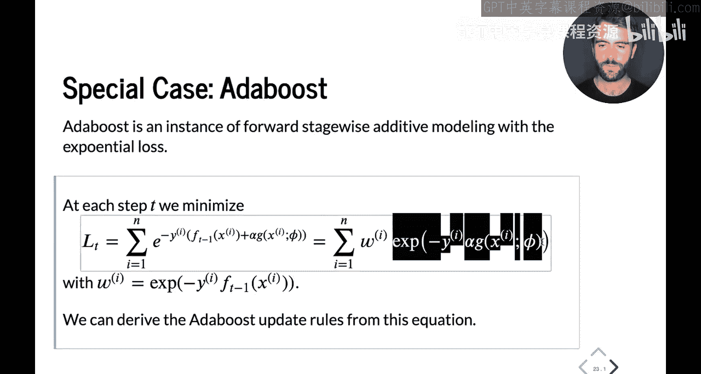

And and then we still have the weights from before。

 and now I can just rewrite this in the following equivalent form。 again。

 this is just simple algebra。 And now given that this is my loss， I can solve for the optimal G here。

And it's easy to show that。 well， first of all， it's。

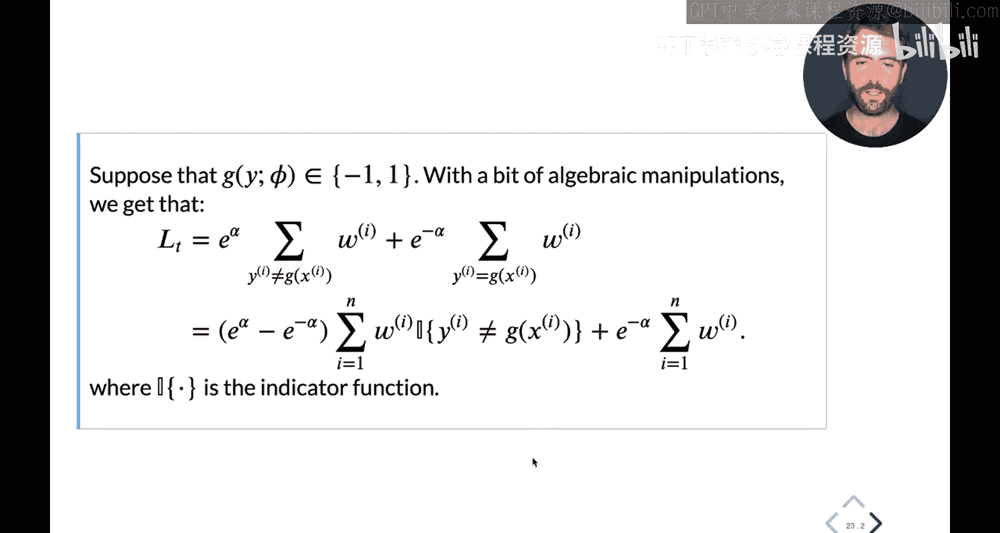

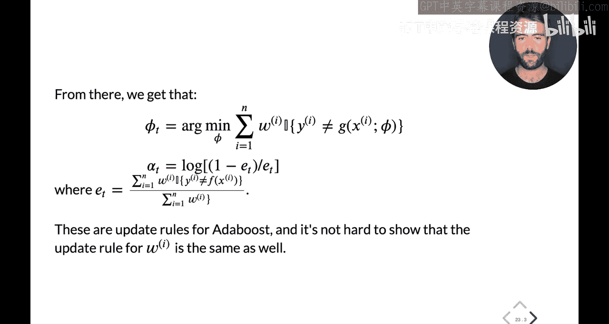

It's straightforward that if this is the loss that we're minimizing， then we want to find。

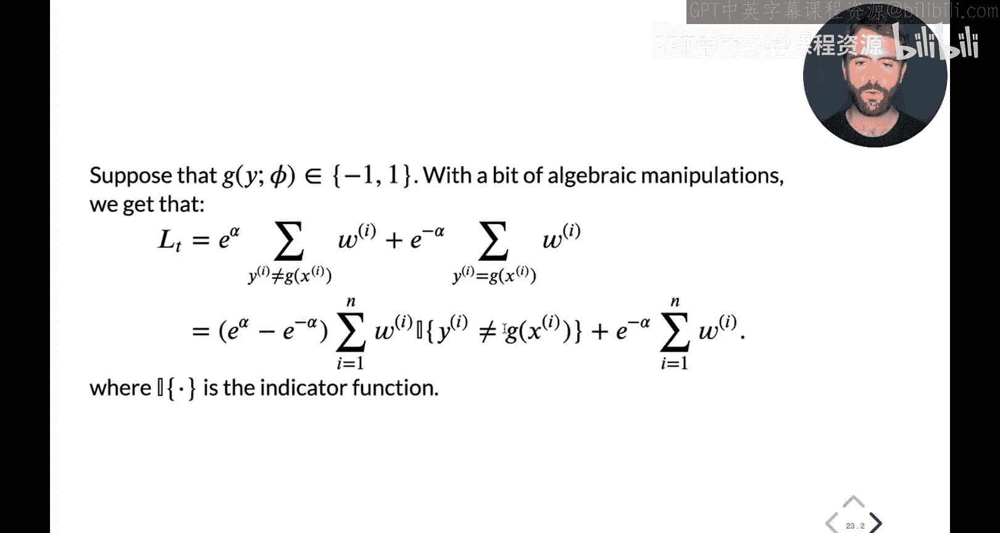

，The parameter phi that will minimize。

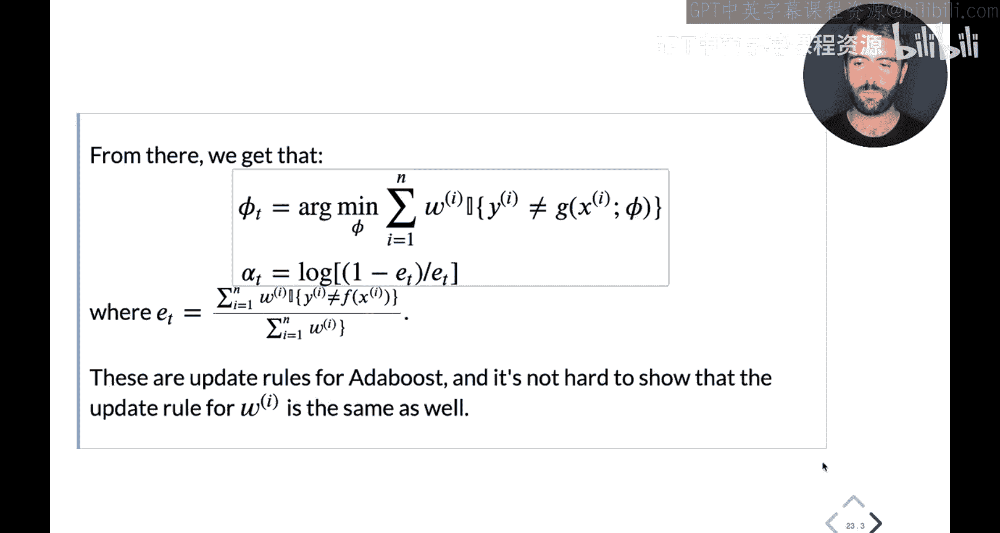

This equation， it is simply。 So if I wanted to minimize this loss over the space of G， then I， well。

 this is not a function of G at all。 This is the only part。 That's a function of G。

 And this is my weighted loss。 So the the minimizer of this loss is the minimizer is simply the minimize。

The minimizer of the。

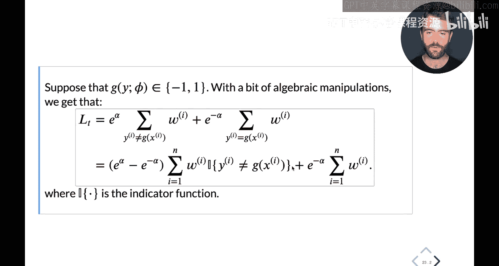

This term here， which is what I'm saying here。 and then it is possible to derive。

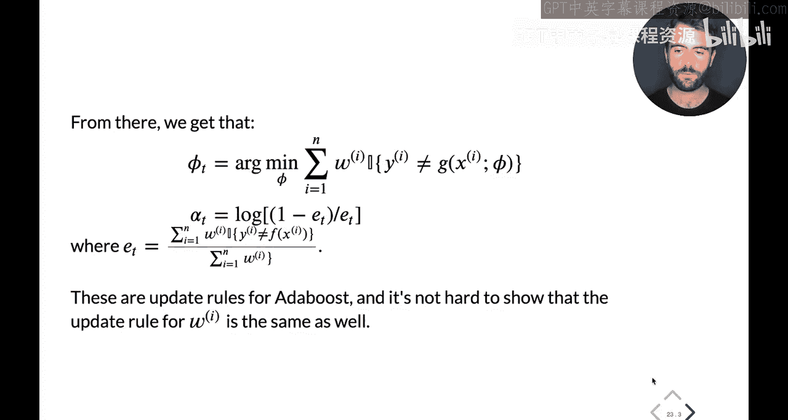

To take this equation and solve for alpha。

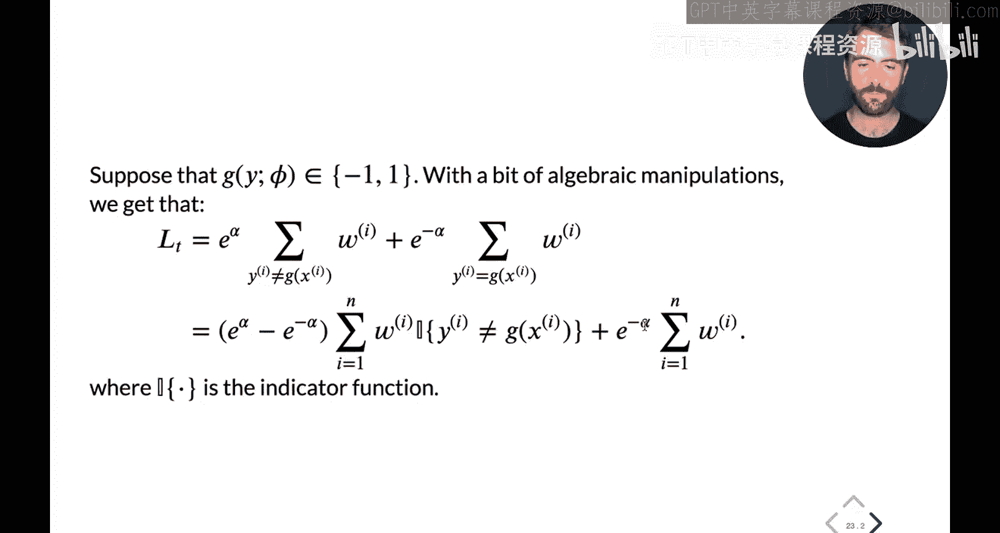

To obtain the following update rule， which is the same thing that I had in error boost and with a few additional algebraic manipulations。

 we can also show that the weight update also remains the same。

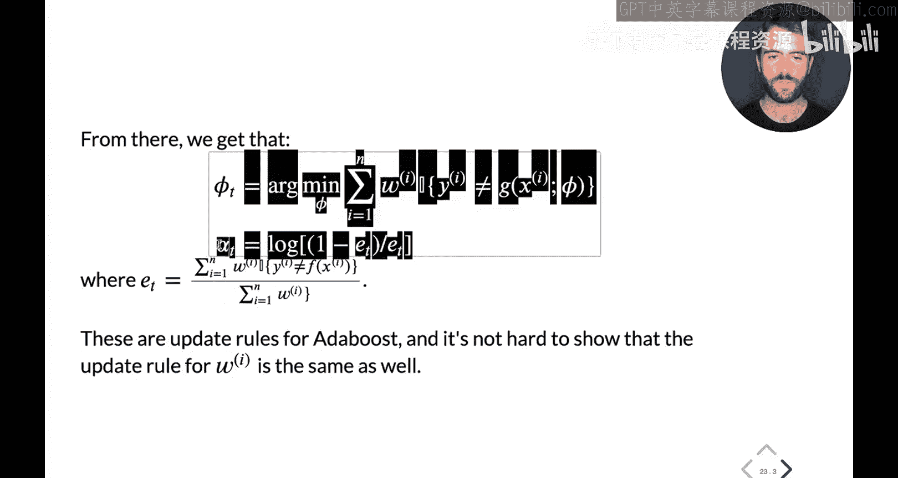

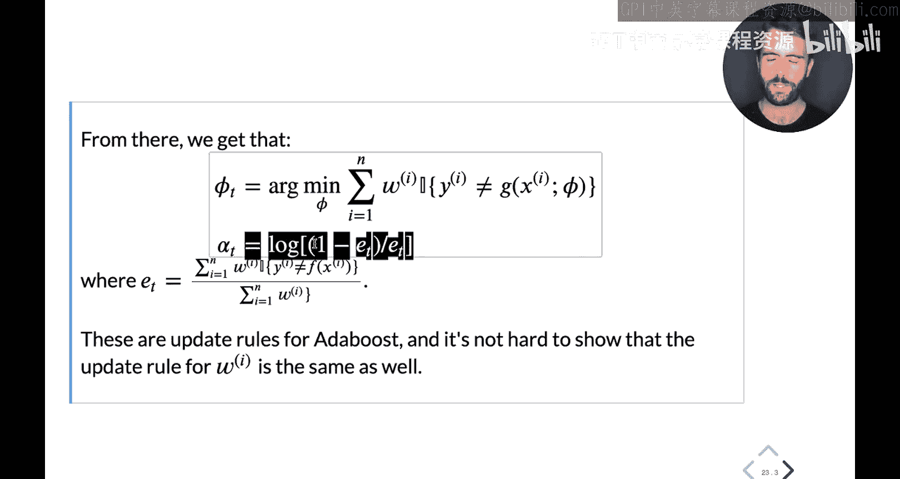

So this proves our claim。And it's an interesting observation about add boost。

 It's interesting that add a boost is a form of is an instantiation of approach to fitting additive models。

But what this also means is that if we take that forward stagewise approach and we swap the exponential loss for a different kind of loss。

 then this can be seen as a way of deriving new boosting algorithms。In particular。

 at a boost as defined before， it is defined for classification。

 we would probably also want to do boosting for regression。

We can derive a principled boosting algorithm for regression by taking the forward stagewise approach and swapping the loss for the squared loss。

 which you see here。And the result is going to be another algorithm called L2 boost。

 which is another form of boosting and in this algorithm we can show that at each time step T。

 we solve the following minimization problem where this new model G that we're adding to our ensemble it minimizes the L2 error where it target that it's trying to fit is this variable called R and R is simply the difference between y and the prediction from the previous model。

 So this is the residual if the previous model was perfectly accurate。

Then we would just predict zeros everywhere。 So this G would be0 everywhere。

But essentially R here is the error from the previous model that we're predicting。Here。

 and so this is also a form of boosting because we are fitting the parts of the。

We're fitting the points where the previous model made inaccurate predictions。

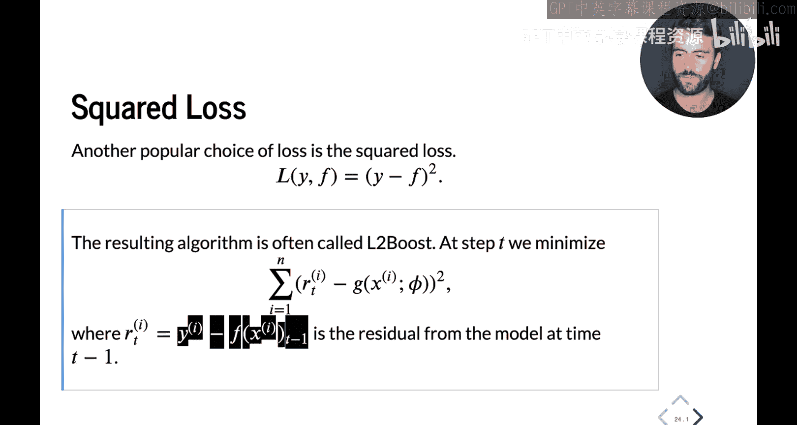

Now， there are also other algorithms that we can define。

One other loss that we can consider is the logistic loss。The logistic loss。Here here。

 this should look a lot like our exponential loss。And now we're effectively taking one plus the log。

So it's as if we're considering our exponential loss on the log scale。

And this is a useful loss because it addresses some of the problems that Ada boost has。

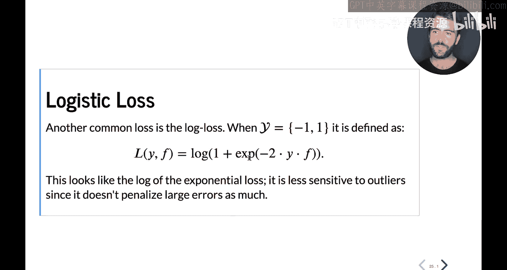

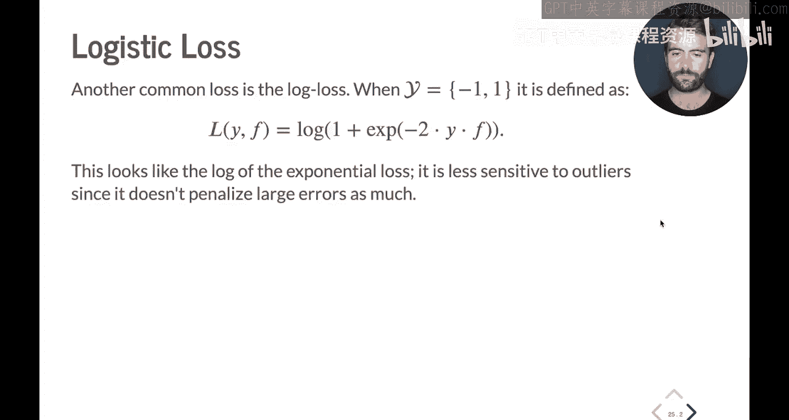

Let me plot this loss in the same way did that I plotted the earlier losses， and let's， for example。

 compare the exponential loss with the hinge loss or the L2 loss so here。This line here。

 is's an exponential function。 And although we don't see it。Clearly， in this figure。

 But this is going to be an exponential that will increase much more quickly than the L2 loss and and then the hinge loss that is linear。

 So this。Of the value of the loss when we're away from our。

 from a good prediction will increase really quickly。

 and we will assign really large penalties to points that are。Misclassified。

 So we will and especially if there's a point that's very misclassed that is very far。

 it will assign a lot of penalty to that point and is going to an algorithm that optimizes the exponential loss。

 is going to try really hard to minimize the worst case predictions。

 So it's going to emphasize a lot minimizing the errors on the point that are misclassified the most。

And this idea of minimizing the worst case predictions can be good in some cases， but in many cases。

 in practice， we have outliers。 So there are points that are just。

Either they have been introduced by noise or that are just， you know。

 that may be artifacts of some data collection process。 And as a result。

 these points are really far away。 and the model is just not able to to predict on them。

 And often the best solution is to ignore them。 And this is why there's often an outlier filtering steps。

 which。an outlier filtering step which we try to remove them， but the exponential loss。

 it will really try to fit those points which are there only by error。

 and as a result this may result in bad performance。In fact， in practice。

 when applying machine learning， it is often preferable to use a loss that is more like the hinge loss that is linear and doesn't penalize outliers as much。

 and in practice， this often results in better performance。

So the logistic loss is one way of addressing this problem。Because we're taking the log here。

 this function does not grow as quickly as the exponential when we go towards the wrong prediction。

 and so it doesn't overemphasize。Fitting outliers。 And in practice。

 this can result in a better boosting algorithm。

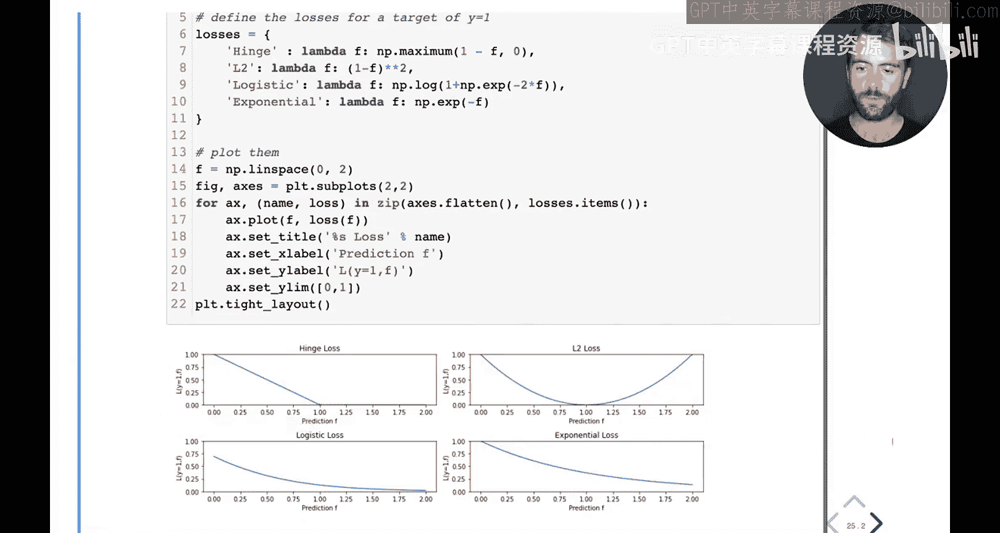

So， if we were to。Diveve the loss that is optimized by forward stage wise additive modeling it will look like this。

 Again， this is just plugging in our definition of it's just plugging in this thing into the。

Into the into the loss。 and the result is going to be a different algorithm from。

At a boost called Loit boost， we can also derive a way to define weights。

 This can also be seen as doing a weighted minimization of the data。

 a weighted solving a weighted optimization problem of the data at each step。

 but the weights will be different the formulas will be different the formula for alpha will be different。

 and so this will be a different kind of boosting algorithm that is called Loit boost。

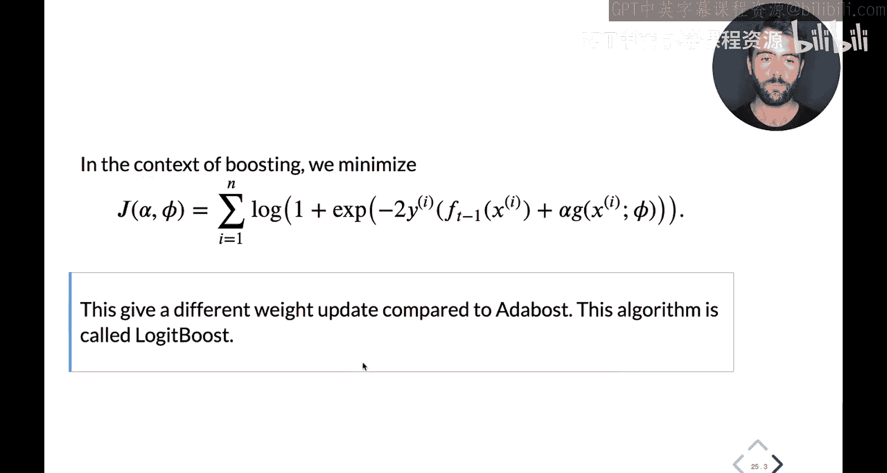

So we have now seen a few boosting algorithms。And these different kinds of boosting algorithms that we have seen so far。

 They improve over this basic algorithm that we had。 Well。

 basic over this initial algorithm that we had called add boost。

 They're useful because they can optimize。W range of objectives。 and and in practice。

 these objectives can provide us additional benefits。

 such as being more robust to outliers or extent to regression。

And while add a boost is only for classification。And technically we call these algorithms as boosting。

 sometimes people use boosting to only denote algorithms like add a boost that have been derived using that theoretical approach that I mentioned earlier in the previous video and that have these theoretical guarantees within a particular framework and algorithms that are not derived from that are sometimes not called boosting。

 but I think in practice for this lecture and also for most practical discussions。

 we can safely call these algorithms that we have seen today as，Posting algorithms。Now， of course。

 these also have some limitations， computation time can be an issue because we are repeatedly solving optimization problems at every step。

And also each loss may require specialized derivations if we were to derive update equations like we did for at boost or L to boost。

And finally， this optimization。May have certain properties which I'm going to just briefly mention here as being too greedy。

 and we're going to dive a little bit deeper into this and first explain this problem and then look at how we can address it。

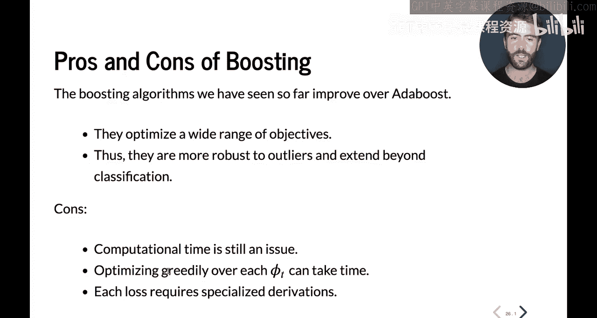

But again， just to summarize this video， we have seen models that have this form that are called additive and they can be fit using the for stagewise approach which can reproduce edit a boost and can also lead to new algorithms。

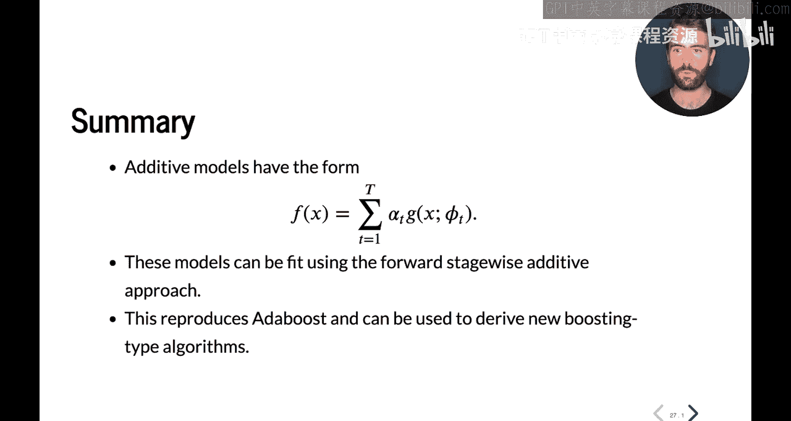