# 康奈尔大学《应用机器学习 CS 5787_ Applied Machine Learning 2020》中英字幕（deepseek p51 -51-Lecture 13. Part 3_ Gradient Boosting.zh_en -BV12udzYvEFM_p51-

We are now at part three of Le 13 of Applied machine learning in which we talk about boosting。

In this video， I would like to talk about yet another kind of boosting algorithm called gradient Boing。

And gradient boosting is going to be the most powerful of the boosting algorithms that we have seen so far。

 and this is actually going to be an algorithm that attains state of the art performance on many important machine learning problems。

 and in fact gradient boosting algorithms are some of the most successful algorithms on competitions like Kagel meaning that they tend to be used in the largest number of winning results on Kagel。

 so gradient boosting really achieve state of the art performance on many many important problems。

And we're going to look at them in this video。

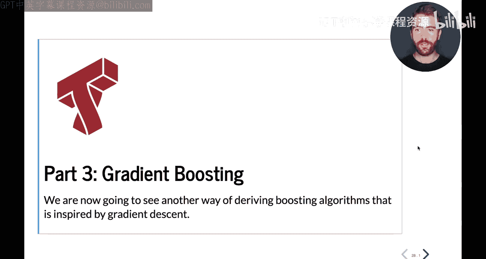

So recall that boosting is a way of combining multiple smaller， weak learners。

 multiple small models into a bigger model by training them in a way that corrects the errors of the submodels。

So these are weak models， but we fit them on the points where the previous models have made errors。

 and so the resulting ensemble of all of these models will be accurate given enough predictors。

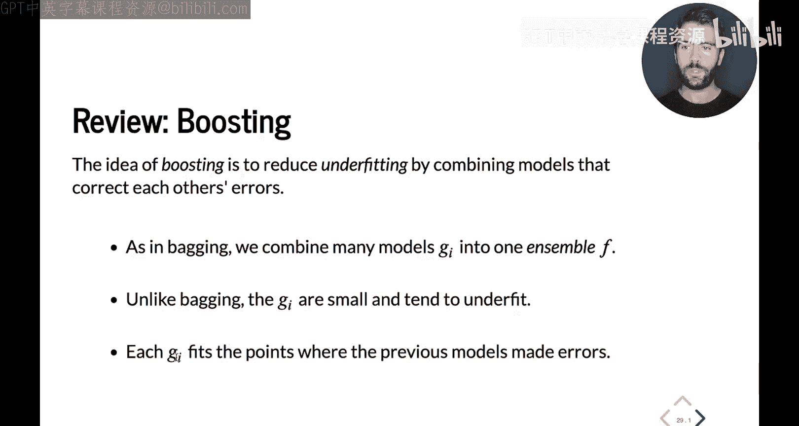

And we can see that these we can we can see boosting as fitting what is called an additive model。

 So an additive model consists of a main ensemble model in T smaller submodels that each have weights alpha and parameters phi the。

TheThe total set of parameters。Of the full model are the alpha and all the phi。And it is。

 it is a model that is。We use the term additive but not linear because it is not linear in the parameters anymore。

 this can be highly nonlinear because the G itself can be nonlinear in the phi。

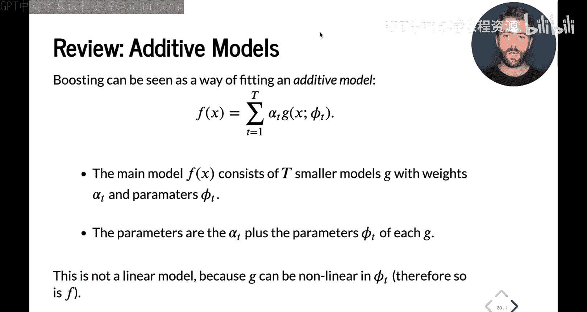

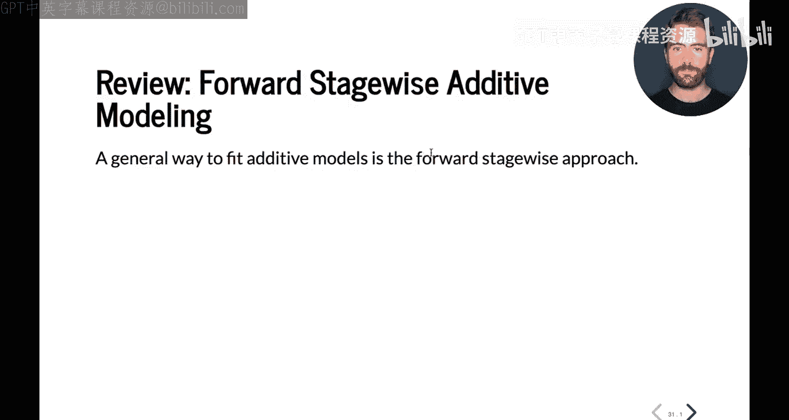

And a general way of fitting these kinds of models is the forward stageage wise approach where we have a loss。

 and initially we just minimize this loss， but then at the next iteration we look at all the additive components that we have so far。

 we put them here and we freeze their parameters and we only learn the parameters of the new model which comes here。

As a as the is our。As the next additive as the teeth additive term， it comes here and we only。

Optimize over this part， we keep this part fixed， fixed。

 and this keeps the optimization problem tractable。

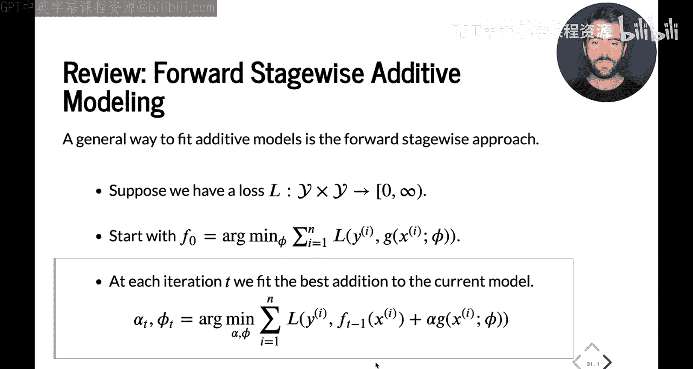

And then as we saw earlier， we can fit many kinds of losses using this approach if we use the exponential loss。

 we have an algorithm called At boostt， if we use the L2 loss， then we can solve this for regression。

 and there are many other losses as well。

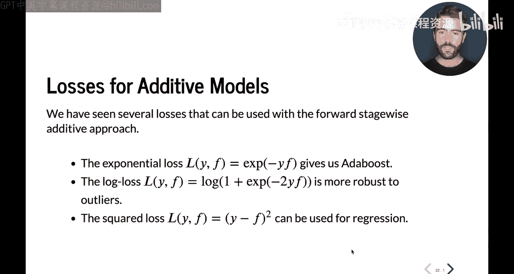

But this approach is also not without limitations。One issue is that， for example。

 in the case of add boost or al to boost or logicit boost， we derived。

Manual update rules by hand for what alpha can be or for what the weights can be now of course we may need have manual we may not need to have a formula for the alphas and the Ws。

 but having a formula simplifies analysis and makes the algorithms faster。

 but of course defining these new update rules for each new kind of loss is laborious and may not always be possible。

Also， we still have to solve an optimization problem at every step5。

 but if we solve this optimization。Maximally， if we solve this optimization exactly if we find the best phi。

 then this approach may be a little bit greedy。By this， I mean that we are trying to optimize。

 we're trying to reduce our loss here in this optimization problem by as much as possible at every step。

 and it's possible that we are going to overfit at some step by by if we use a model G is too flexible。

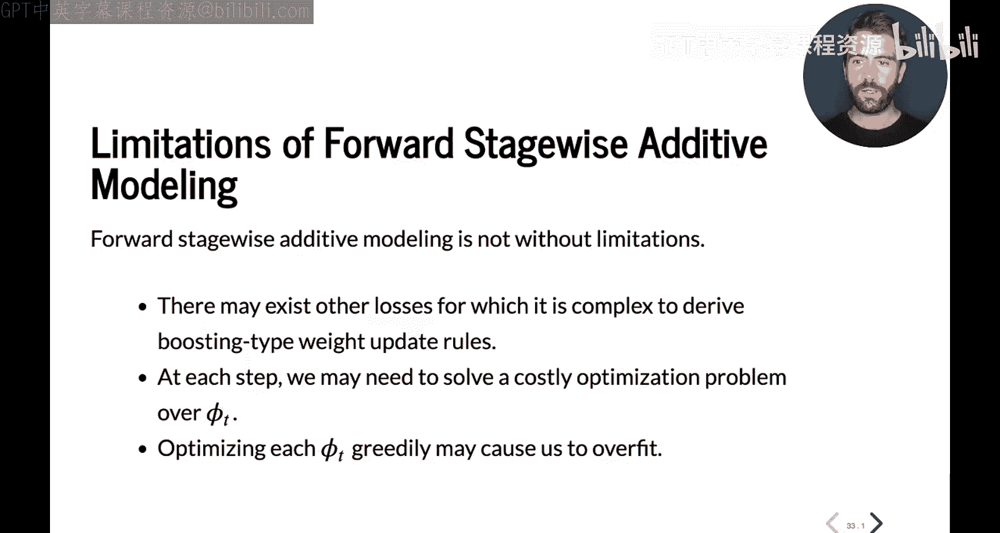

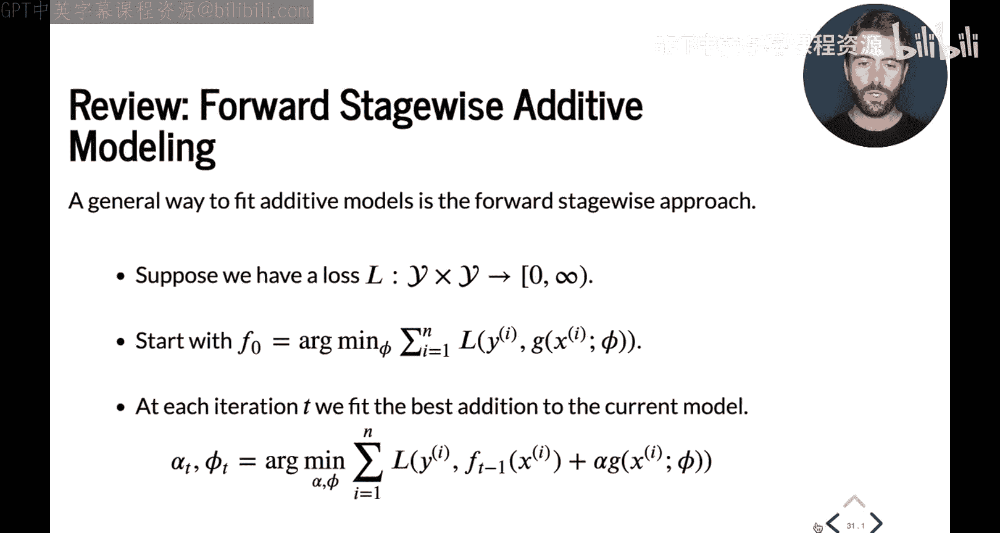

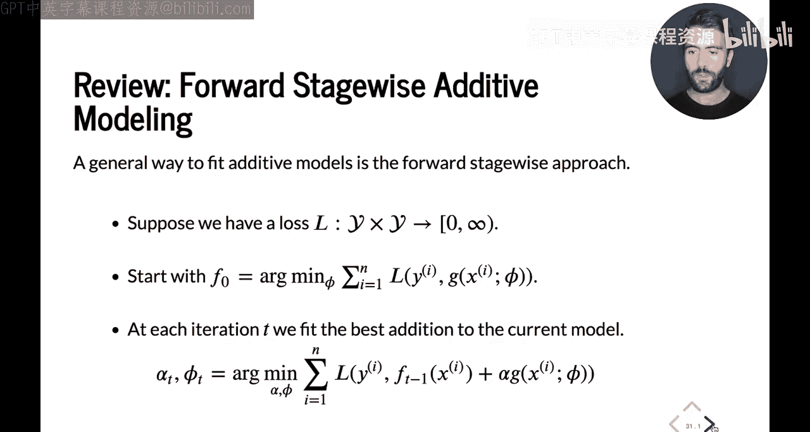

So we would like to look at ways of addressing these limitations。

 So we would like to have an algorithm that works with。Many different losses in a very general way。

 and that is still easy to train and that also can be controlled for overfitting more effectively。

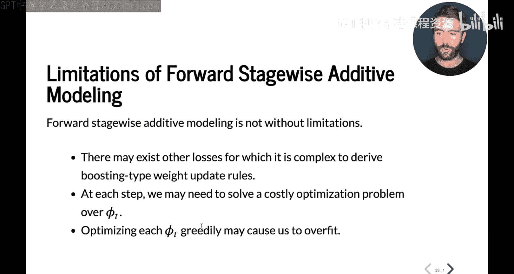

And the resulting algorithm is going to be called gradient boosting。

Before I define gradient boosting， I'm going to talk to you about functional optimization and we'll see that gradient boosting is an instance of this principle called functional optimization。

So in functional optimization， the idea is that instead of optimizing over a model。

We're going to consider the problem of optimizing the loss over an arbitrary set of functions that go from x to Y。

So before we would be optimizing the parameters of some kind of model。

 but let's just as an intellectual exercise， look at what would happen if we were to optimize over a general model。

Over a general function， over the space of functions directly。

So one immediate observation is that we only have n data points and so we only have n degrees of freedom and even though we have an infinite number of functions。

 we have a very large space of functions， for the purposes of fittingad our training set。

 they only are defined by their values at end data points and so we are essentially optimizing essentially。

A large set of functions are all going to be equivalent if they output the same predictions on the training set and we can summarize all of these functions by a single vector。

 which I'm generally here by boldface F， which lives in our N where n is our number of data points。

So again， optimizing over the entire space of function is equivalent to optimizing over these kinds of vectors because we only have n data points over which we can optimize。

And the resulting optimization problem has this form。

So we are looking for we are optimizing over the space of f's and so this is the value of a function at this point and we're minimizing the loss with the Y and if we find a good F。

 then all the functions that，Have this that attain this set of value。

Then attain this set of values at the training set， those are good functions。

So so far this is more of an intellectual exercise。

 and let's continue this intellectual exercise further to give it as a thought experiment。

 imagine that we would optimize this expression using gradient descent。

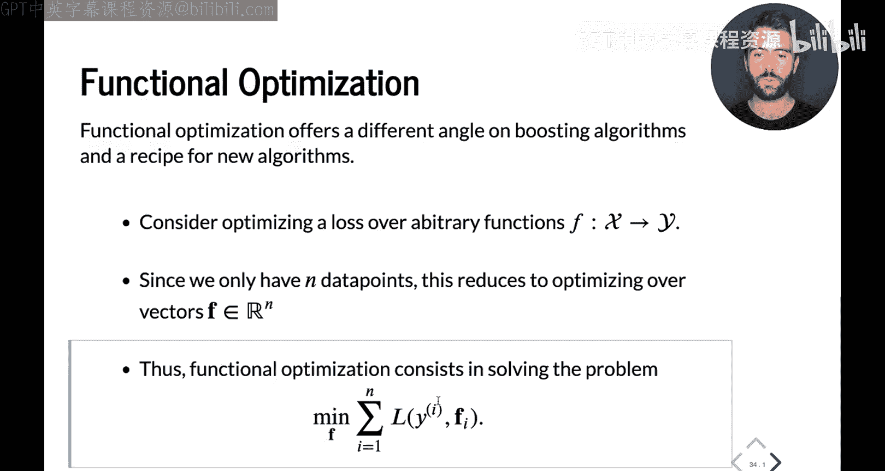

If we wanted to optimize this using gradient descent， well， we need some notion of gradient and。

This notion of gradient that we're going to use will be called the functional gradient。

 which is the gradient of this expression here。Relative to the vector of points that are。

Rel to the vector F that defines our function。Each component of this spec is simply the partial derivative of this expression with respect to the parameter here。

 F sub I， so here for example， F2， only the second term depends on f2。

 so therefore we have only the second term here in the numerator and we're taking its derivative with respect to F2 in the second component of the gradient。

And this defines here a valid gradient for this loss。

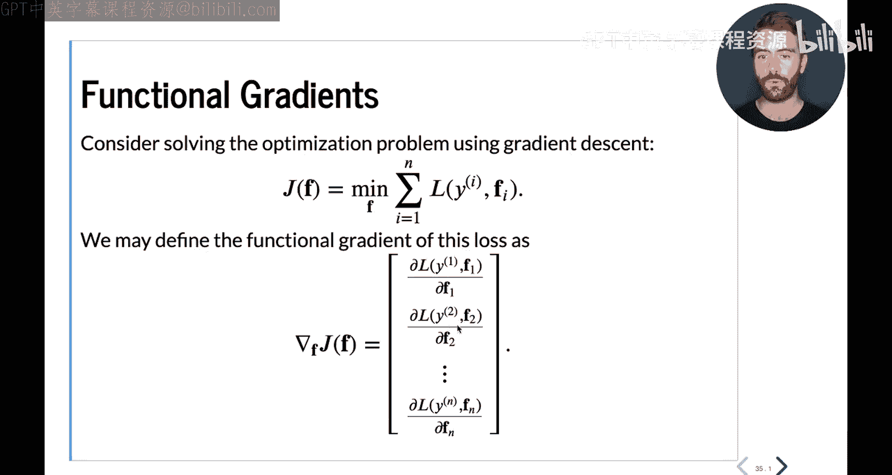

嗯。If we have this gradient， then we could minimize our function earlier by applying the following update。

 which is simply gradient descent with the step size of alpha。Now。

 these are all definitions that we're going to be using in a moment。But of course。

 the algorithm that I'm proposing here is not really practical， as I said earlier。

 it's a thought experiment。First of all， it is really easy to optimize this objective because it's unconstrained。

 we can choose any value for f， in fact we could just set F to our vector y and not even perform gradient descent。

 which is why I'm saying this is a thought exercise。

 but even if we did use this gradient descent algorithm。

 we would trivially arrive to the minimum because we just have a simple and constrained optimization problem。

for for most reasonable losses held that we would use。

But also the problem is that if we solve this optimization problem exactly。

 we will be fitting the training data really well， but this function that we're going to learn。

Will not generalize。So we can learn a set of values for F that will be accurate on our training set。

 but not all of the functions that achieve this vector F are going to generalize。

And what we really want is we want to find a function that achieves a small value of our objective that has a good fit that is measured by our objective function J here。

 it achieves a good fit at any end points that we might sample from the distribution。

 So given we want to perform some optimization procedure， such that。This。

This this resulting function， if I evaluate it at any other set of en trading points。

 it will be accurate。

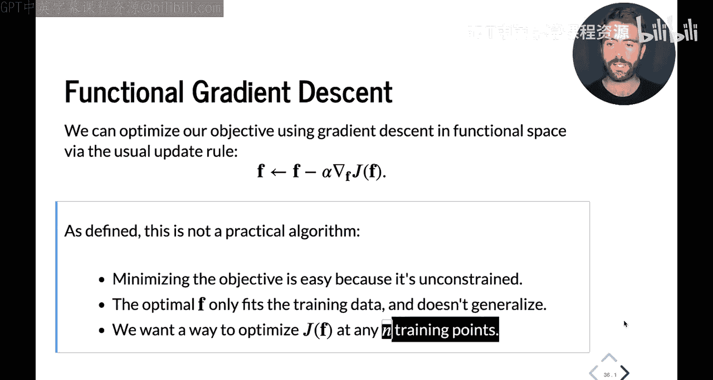

So how would we do this？

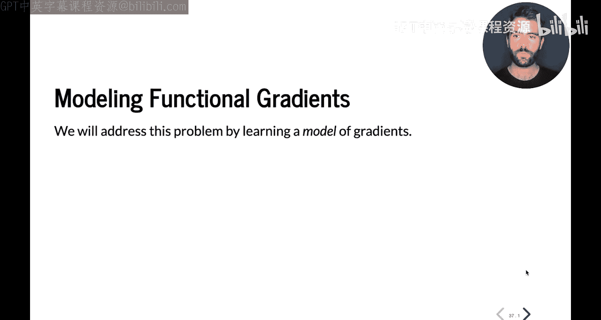

Well， we're going to do this by learning a model。

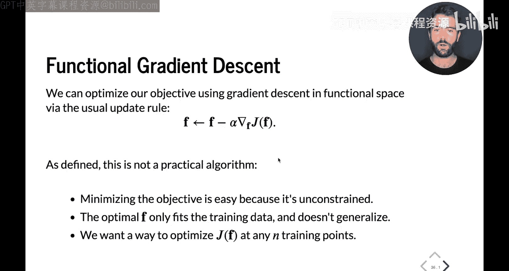

Of ingredients。So let's dissect what this means。

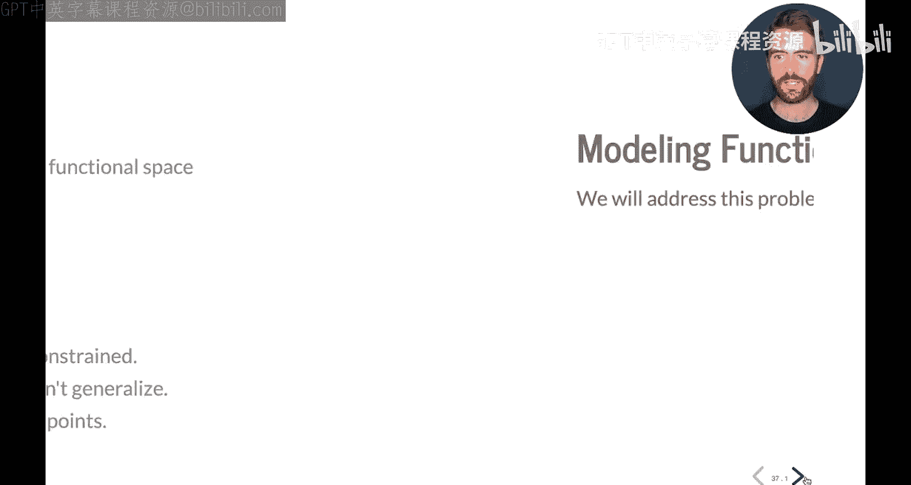

In supervised learning。We started with the concept of a model for the function F that lives in some kind of class which we dided by script M。

 and the idea is that we're going to learn a model that achieves a good prediction on our training set。

But also， it will generalize。And we will on purpose。

 choose a class M here that doesn't contain all the functions， so if M is too large we will overfit。

 so we constrain M on purpose either directly or via a regularizer。

And this prevents us from overfitting， so for example。

 we would choose a linear model instead of an arbitrary degree polynomial so that we can generalize outside the training set。

And so even though there is an arbitrary function we could that we could learn and that would take our value of。

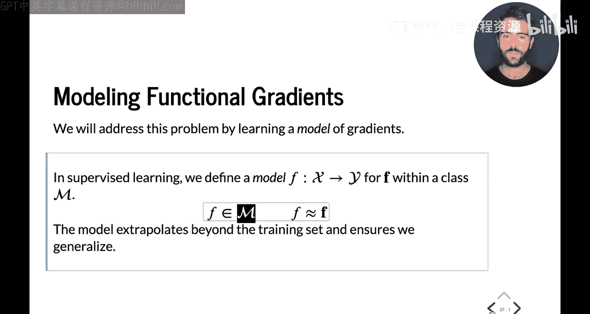

F here， we're going to assume a model for F that will be restricted， it will not be perfect。

 it will not achieve the minimum possible value here of the dysfunction F could achieve if we were to directly optimize over the smallest F。

 but as a result it will generalize。

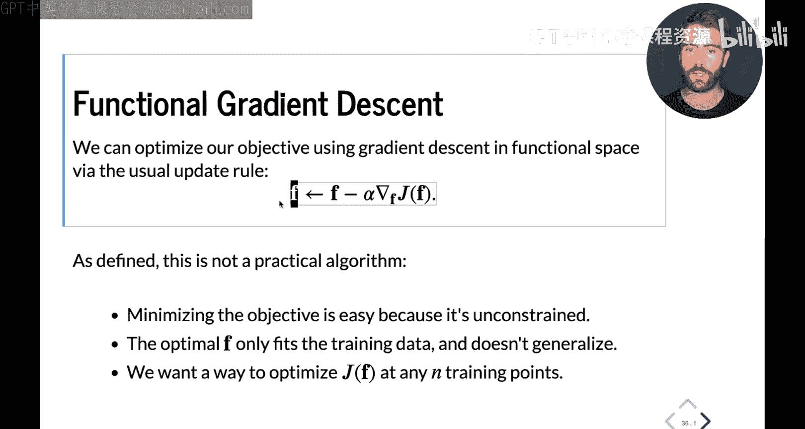

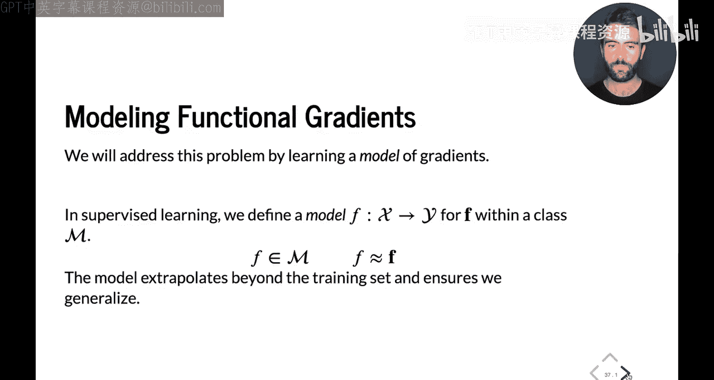

So the idea of approximating gradients is that we apply the same idea to the gradient of the objective function。

So we want to again， perform functional gradient descent。But we only have end training points。

And instead of just directly minimizing over these training points。

 we are going to assume that the gradient has some kind of functional form that is defined by a model。

And then instead of adding this arbitrary value of the gradient， which is unconstrained。

 we're going to instead replace this with a surrogate model， which will be constrained。

 And then if we perform gradient descent if we perform many steps of gradient descent。

 we will not minimize or function directly。 But we will have。A function which approximates the the。

Which generalizes well beyond the training set。So。Again。

 we assume some kind of a model for what this gradient is。

 and we use it to approximate this functional gradient term。

And then if we look at our gradient descent update and we replace this functional gradient with an approximate model of this gradient that we're going to learn from data。

 then we have the following formula for functional gradient descent。So here at each step。

 I am taking whatever function。I currently have whatever estimate of the minimizing function I have。

Then， I estimate its gradient。From data， and this gives me another function G that at each point will evaluate to the gradient。

 it will evaluate to the partial derivative that I want for each value of x。

And then I simply add it to my old function， and this gives me a new function that is the previous one minus this step of functional gradient descent。

Oh。

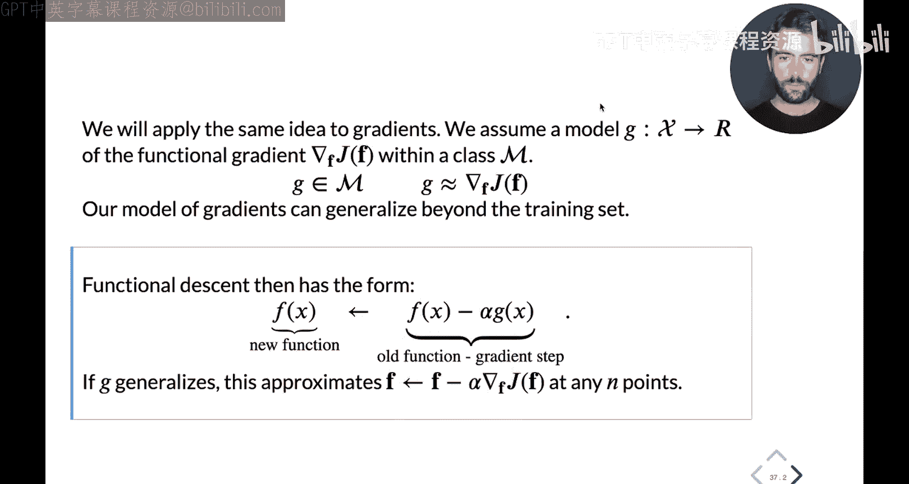

So let's now define this a little bit more precisely。So I I vaguely mentioned。

That we can approximate this general。AF gradient with a function G， but what does that really mean？

What does it really mean in practice？So in order to do this。

 we going in order to perform this approximation， we are going to resort to standard supervised learning。

So imagine that we have some function F， again， we are optimizing over the space of functions and we are at some point in our optimization process。

 which is some function， some guess for the best model。

 and we want to improve this further by a little bit。So we in order to improve this function。

 we want to take a gradient step。On F。 And so we need to estimate its functional gradient。

This notation here。It shows the derivative of the loss。With respect with parameter F。

 which is our estimate of y evaluated at the value F of x。

So if I wanted to take the function at the point f of x and change the value at f of x in order to minimize this loss。

 then I would follow this derivative。And this is evaluated at f of x and we can evaluate it。

 we can evaluate it at every possible point x， and if I were to take a step along all of these points。

 then I would be minimizing the value of my loss。So this and also this is the value that was in our vector here when we set f to be f of x1。

 and the second component was this expression where we used f of x2， etc。

In this notation bar evaluated， this is a standard notation is calculus in calculus。

 which says that we evaluate this expression at this particular value。

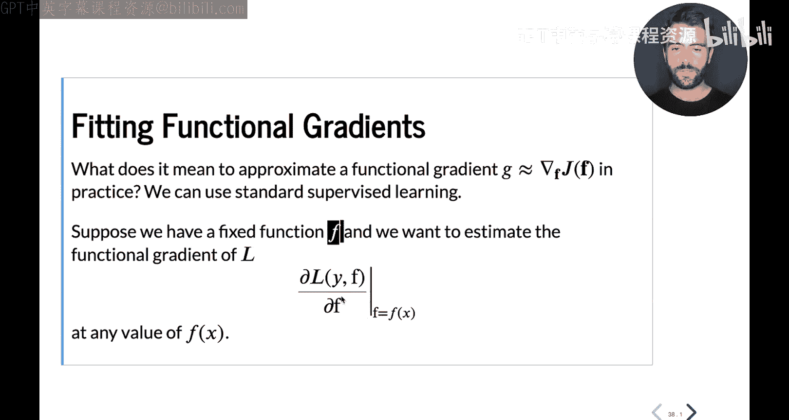

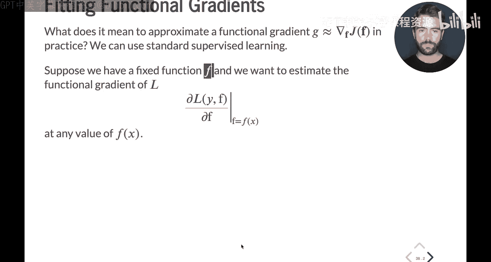

So how can we create a gradient oh and by the way I should mention that as a function of x。

 this is a well definedfined function， so for each value of x I can evaluate this expression and gives this gives me a well definedfined function that is the functional gradient of f at every possible point。

 and in fact if we instantiate if we consider this function at our set of training points。

 then we have this vector that I have defined earlier， but in principle as a function of x。

 this can be a general function that we can evaluate at any point。

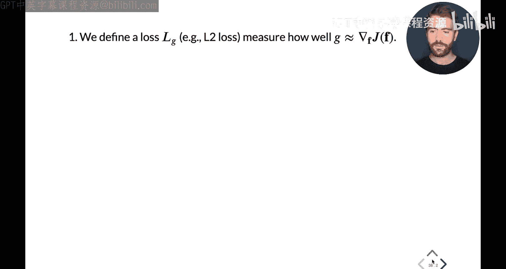

And therefore， and also as a function， it's a function from the spaces of x's to the real numbers because this is going to be just a real valued number。

 so this is a function from x to the reals and it's a function that we can try to estimate from data。

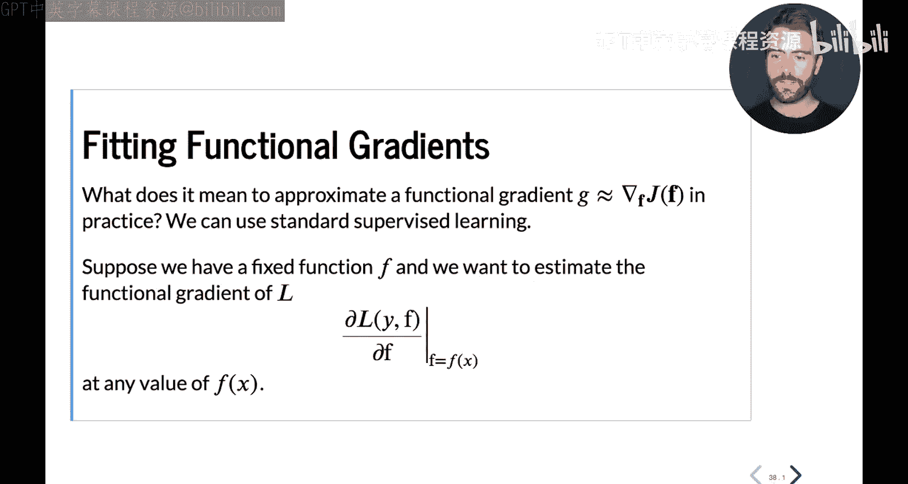

And we can estimate it using supervised learning。If we want to apply supervised learning to estimating this problem。

 well， recall that our recipe for applying supervised learning is a model class。

 so we're going to assume that G is within some model class。

 this going be a decision tree or some other type of model。And we also need to define an objective。

 so we assume that we have some notion of loss that measures how well this approximation holds。

 and this can be， for example， the L2 loss， in fact。

 the L2 loss is that is a loss that is used in practice for this often。

And now we need to define a training data set for in order to apply。

 well so we have a loss and we also have an algorithm for minimizing this loss so we can use decision trees to minimize this L2 loss。

 and so this defines our supervised learning algorithm and now in order to apply supervised learning。

 we also need to define a data on which we're going to fit this function。

And this data set is defined here。I am using the same notation that I kept using that I have been using before for a supervised learning data set。

 and here I'm denoting this dataset set for the gradient as ScD subG。

And it consists of a set of n training instances where each training instance here within is within the。

The parentheses， and I have n of them。 They're index by i。This this training instance。

 it has an input， which is our input X。And it also has a target。Which is here。

And the inputs are simply inputs of the vectors of attributes that we have part of our training set。

 and now at each point in the training set， we can estimate we can compute and we can use as a target our estimate of the functional derivative。

We call， as I said， this expression， we can it。It is a function of。Of x。

 so we can evaluate it at each point in our training set。

And now we can try to predict it using supervised learning。 And for a suitable choice of model G。

 we are going to be。Predicting this value in a way that will be accurate on our training set or sufficiently accurate on our training set。

 and that will generalize。So essentially this forms a valid supervised learning problem where we are fitting a model G that will approximate the components of this vector again here each value that we have。

Here each value that we have here， this functional derivative at this point。

 that is simply the eighthh component of this vector。So。We are。

 again trying to approximate this functional vector via a function G。

 such that if we evaluate G at X， we're going to get derivative， the I component of this vector。

 which is simply this expression here。And then if we evaluate it outside our training set。

 if we choose our model class correctly such that it generalizes。

 then we will also get estimates of this gradient accurate estimates of this gradient at points outside the training region。

 and therefore we will generalize。So again， here， we train a model on this data set。 and now if I。

If I evaluate this model at some mu point x， then the output will approximate the functional derivative at a point f of x。

 which we may have not seen before。So in this sense。

 the function G of x that we will have learned is going to be an approximation to the true functional gradient。

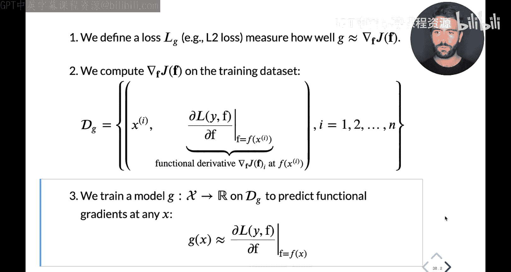

So this what I defined so far has been an approximation procedure to learn an approximate model of a gradient。

Next， let's now given a model of a gradient， we can now plug in this model in our definition of gradient descent and perform gradient descent in functional space with we can perform functional gradient descent。

 using our estimate of the using our model which estimates the true gradient in functional space。

And when we perform this procedure。When we perform this procedure， this gives us an algorithm。

 this gives us a valid machine learning algorithm， which is called gradient boosting。

So gradient boosting is functional gradient descent with approximate gradients that we learn at each step of gradient descent。

Let's's let's define ingredient boosting here。So ingredient boosting， as in general boosting。

 we start with an empty ensemble。And then。Over the course of multiple steps that are indexed by T。

 we perform the following。First， we form this training data that I defined on the earlier slide。

And we fit a model of the gradient at this function F， which is defined here。Using our loss。

 And you can think of this loss as being the L2 loss that's often used in practice。

 So we have we're fitting this gradient。Uing this using this function。

And then we perform a step of gradient descent and functional space。So we update our current。

Ensemble， which is also an additive model by adding to it this additional term。

 which is our gradient plus that is multiplied by a parameter alpha which can be seen as a step size and this can vary or it can stay the same over the course of gradient descent。

So these two steps define the green boosting algorithm here in step1。

 we run the process that I showed in the earlier slide and this gives us a model G。

And then we simply update our model F by setting it to be the previous instance of the model with this additional term editing。

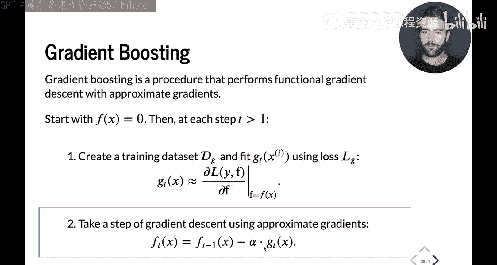

So this summarizes the gradient boosting approach。And after we have run this for a number of steps T。

 we are going to get a model that has this form。Which is simply an additive model。

 and it looks exactly like the output of a boosting algorithm。

So this is why Korean boosting is also called boosting。 It's a。

 it's a principled way of doing of fitting。An additive model。

And it also happens to correspond to boosting and the advantage， well， first of all。

 if we were to apply gradient， if we were to instantiate gradient boosting with either the exponential loss or the。

Or the L2 loss， we would recover our earlier L2 boost or add boost algorithms。

 except maybe we would choose a different set of weights alpha， but otherwise we can recover。

Our earlier algorithms as special cases of greeting and boosting。

 but also greed and boosting can work without any modificationification for any differentiable loss and we don't require any derivations on top of this loss。

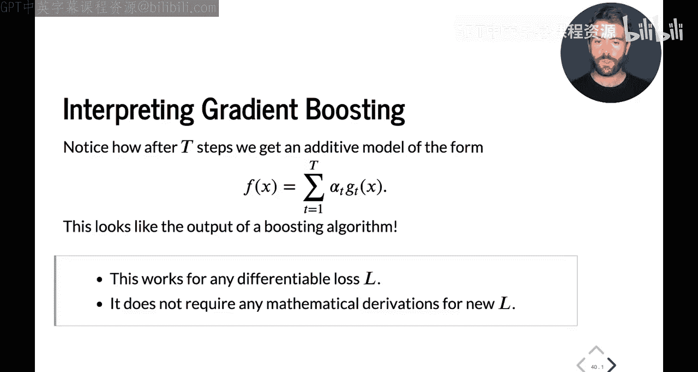

Now what kind of interesting losses can we use Green boosting works equally well for aggression and classification for aggression we could use the L2 loss which we have seen before。

 but now we can also easily plug in the L1 loss， we could use something called the Huber loss which I haven't really talked about but it's essentially an interpolation between L1 and L2。

And we can even train various probabilistic type of losses。

 There exists a loss which again I'm not defining it here。

 but it is called the quantile loss and the quantile loss estimates some kind of quantile of the distribution so the 50th quantile is the median。

 the 75th quantile is the value such that the data lies below this quantile 75% of the time。

 and so the quantile loss now estimates properties of the distribution of y given x and we can use it to form prediction to output prediction intervals in addition to just single outputs for gradient boosting for。

For why using gradientian boosting。And we can also use classification losses。

 some of these we've seen before， log loss exponential。

 there are also times when we want to model certain discrete counts， like for example。

 if a person comes to a store or if a number of individuals come into a store to buy a certain item。

Then we can model this process using something called the negative binomial distribution。

 and this defines its own loss。We can apply green boosting on top of that。 And my point here is that。

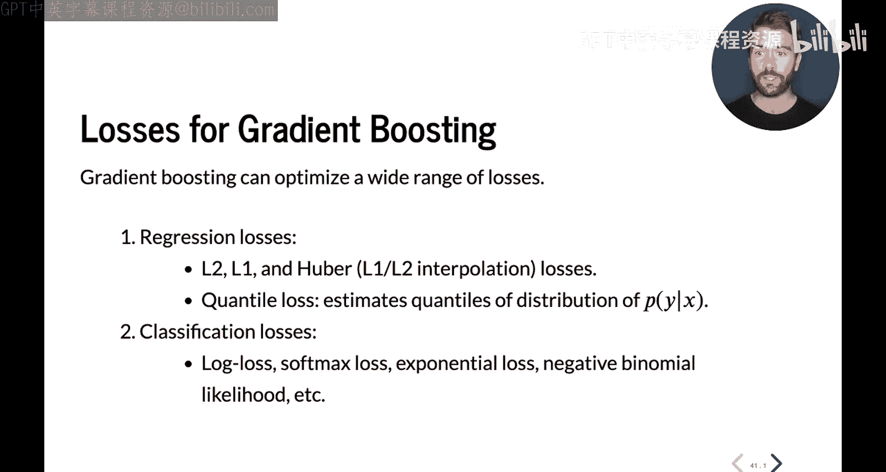

Any differentiable loss works。And in practice， when we use gradienting boosting， we。

There there are again， a few practical considerations that are worth keeping in mind。

I haven't mentioned yet what the base learners are。But in most applications of rec creating boosting。

 these are taken to be decision trees。The reason we have been using decision ci trees so far for most applications of boosting is that they're easy to train and also they don't require a lot of preprocessing of the data and they work equally well for classification and regression。

So。In some algorithms like neural networks， it's important to consider the numerical properties of the input it has to be properly scaled。

In certain algorithms， the input features must be sufficiently uncorrelated。

 but here with a gradient decision with with a decision tree。

 we don't really need to worry about how the input looks like。 We can just。

Run it without many modificationifications。And that gives and so if we use decision trees as the base learners。

All the boosting algorithms that we have seen so far。

 they inherit this property that they can work on various types of inputs without a lot of preprocess。

Now， within this algorithm， we can also perform regularization effectively。

 one way in which we can do this is by controlling the tree size。But also。

 we can do this by controlling the step size alpha。 So we don't need to。

 I mentioned earlier that a problem with the previous approach is that we could fit the。

We could be too greedy and we could optimize the model to a degree is that would lead to overfitting at a particular step。

 but here we can easily solve this problem by just taking smaller step sizes alpha so this is this correspond to performing smaller steps of green descent and we can terminate this green descent process early by using early stopping and monitoring our performance on a holdout data set。

And finally， because this procedure has an interpretation of gradient descent。

 we can apply certain standard tricks to accelerate this process and to scale it up to large data sets。

For example， instead of fitting the gradient on all of the data。

 we could subs sampleample a portion of the data and only fit the gradient on that data point and that essentially corresponds to something which is called stochastic gradient descent which you may have heard about if not it's not important。

 my point here is that we can also scale up this algorithms。

 up this gradient boosting algorithm to large data sets in a principled way by subsling the data in certain ways。

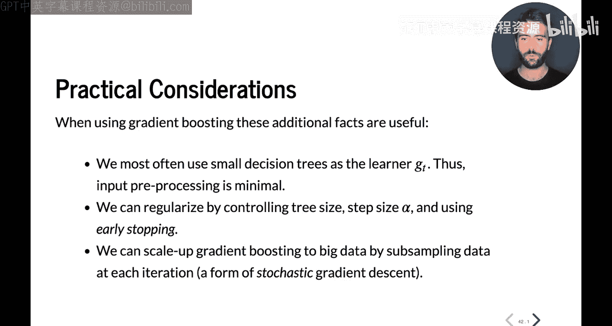

So here I'm summarizing this algorithm， which is gradient boosting。

 it works for both classification and regression， it can use ensembles of weak learners。

 it uses ensembles of weak learners as the model family and these weak learners are often decision trees。

 and it can optimize any differentiable function using gradient asscent。

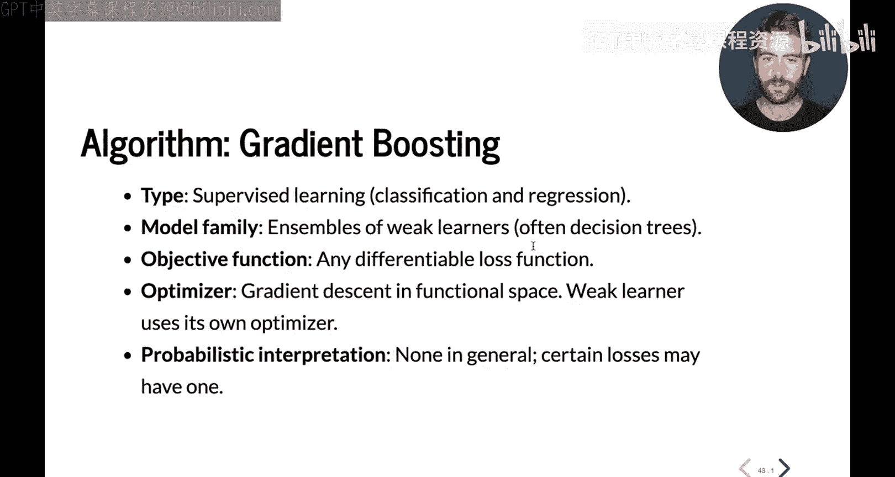

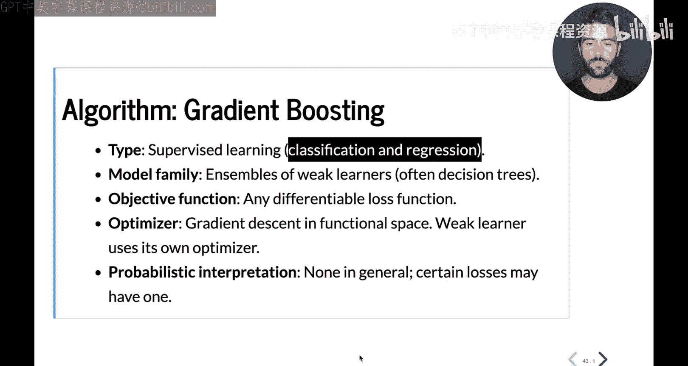

Let's now look at a small example of green boosting on a regression data set here I'm going to define the following regression problem where there is a true function here。

 which is given by this expression。

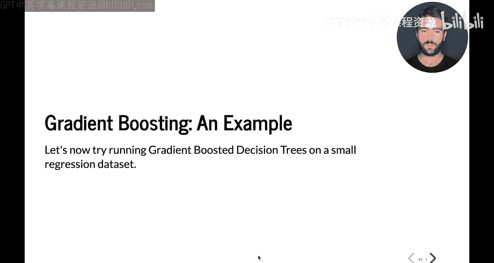

And I'm sampling random points around this function， so this is a noisy function。

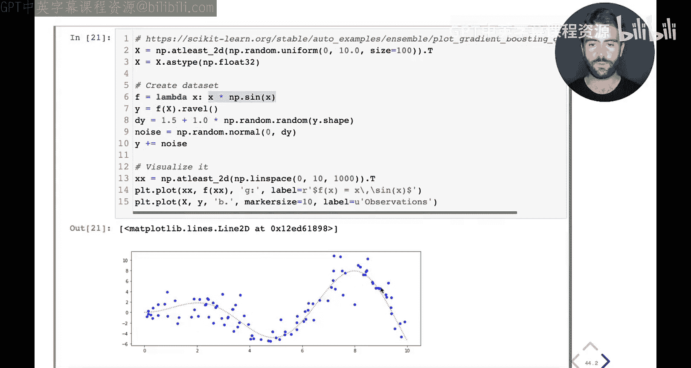

And。I can train agreeing and boosting regression。Easily using thes learn function here I just import。

 I instantiate and this function。

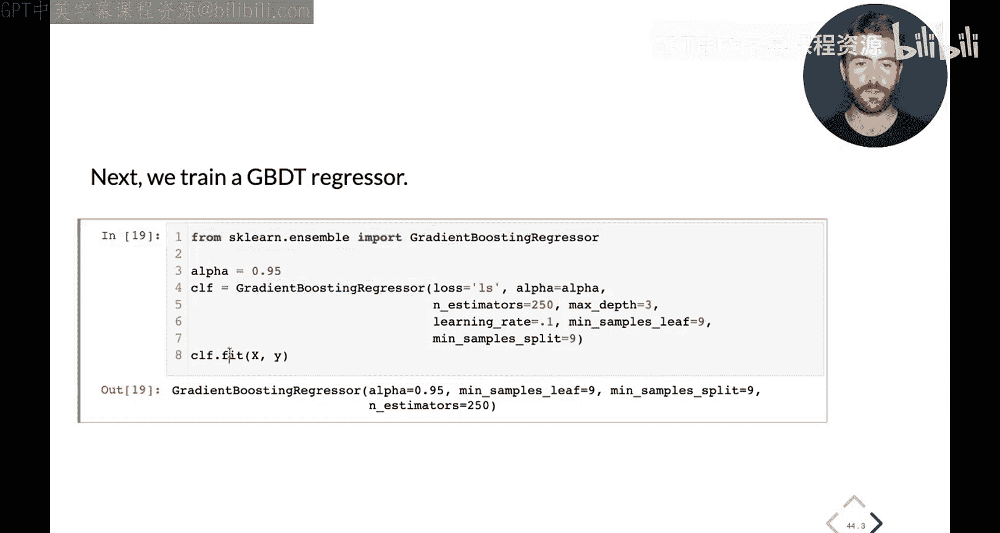

And now I can visualize its predictions。In a very convenient way。

 I simply run the prediction function and the output is this。Red curve。

And you can see that this red curve actually， it follows the data and it has this。

ItIt's not a smooth function because this is all made up of decision trees。

 So so there is a decision tree which outputs a certain value in each interval here and。

And the greed boosting algorithm simply combines a lot of them until in some places like this。

 the kinks are so small that it looks smooth， but essentially it's a。

It it's this kind of step function and it's jagged because it's a combination of decision trees。

 but these are still really accurate and even though we have this very nonlinear curve。

 we're still able to fit really well without making any assumptions at all on the shape of this data。

 so we did not assume any kind of polynomial， we did not assume any kind of kernel we just had some bounds on the number of decision trees that we had and we use decision trees of a small depth so here this was actually set when we defined the algorithm here。

 we have the decision trees of depth 3。

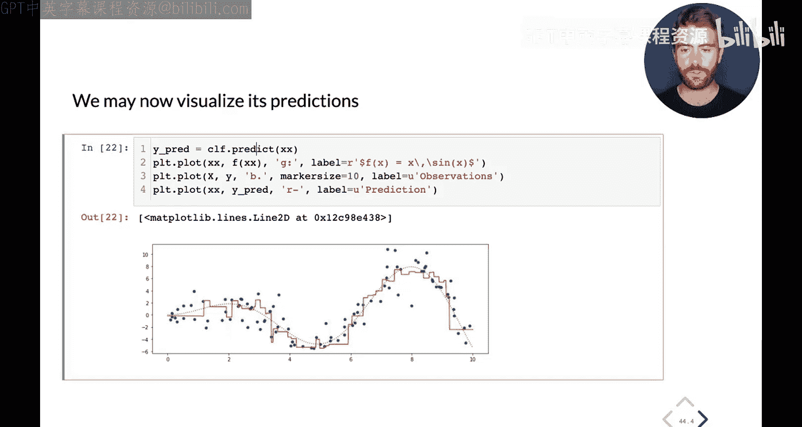

And we have 250 estimators。

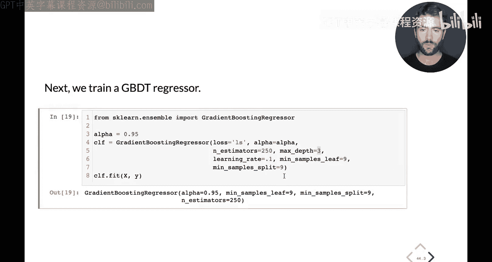

So this shows how easy it is to fit a complicated function using creating boosted trees。

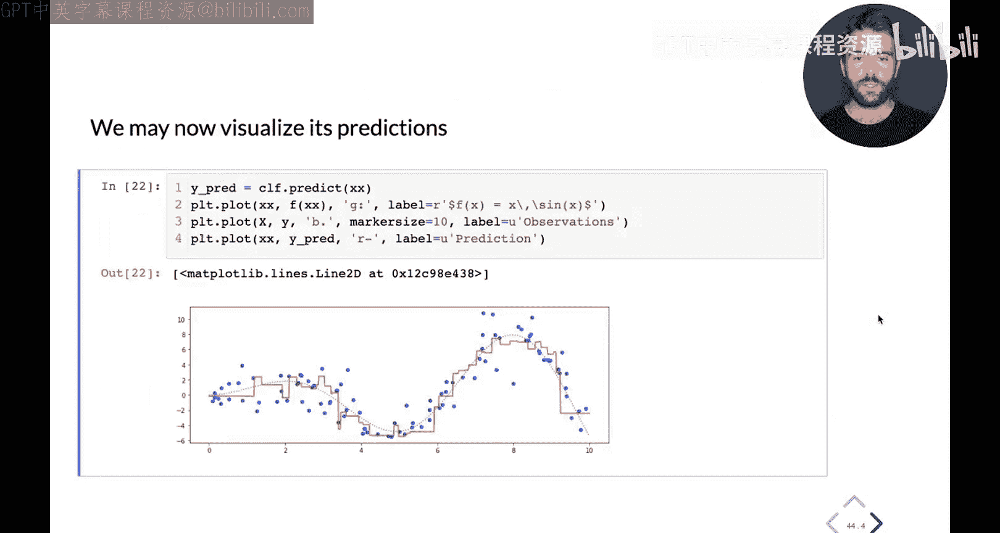

And so I just want to summarize。Part of the lecture by again reemphasizing that creating boosting algorithms are the most powerful form of boosting that we have。

 and it's also one the one of the most powerful algorithms that we have in machine learning and there are implementations that achieve state of the art performance on many problems often outperforming other popular approaches such as deep learning。

One interesting fact about grain boosted trees is that they tend to。There。

Probably the most performing model on Kaggle， they tend to win the most competitions。

 as I mentioned earlier， one of the reasons is that they require little preprocessing and tuning。

 so they're not affected by data processing problems which makes it easier to tune the actually important hyperparameters and they also scale really large data sets and they can fit a lot of different objectives which makes them really powerful。

And if I were to highlight the limitations， I would say the main limitations of green and boosted trees。

 the reason why it's not a universal of the shelf algorithm is that it doesn't work with unstructured inputs like images and audio because it's not really since the base learner as a decision tree。

 these don't really work on images or audio， it's not really possible to define。

To analyze an image via a decision tree by just looking at the shape of the pixels or at least it doesn't work well。

 and also some of these implementations may not be as flexible as modern and deep learning libraries。

But however， on inputs which correspond to a set of well definedfined features。

 like most of the examples we saw in this class， for example。

 the diabetes data set where we have certain features like measurements about a patient or the properties of a house or other well definedfin features in these kinds of regimes。

 green boosted trees are state of the art and they're probably the first algorithm that you should try。

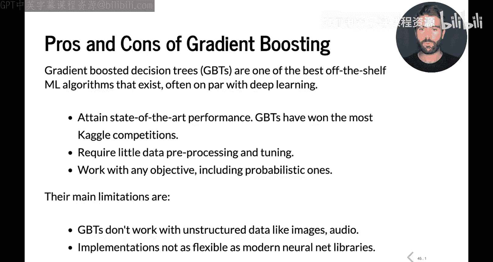