# 康奈尔大学《应用机器学习 CS 5787_ Applied Machine Learning 2020》中英字幕（deepseek p52 -52-Lecture 14. Part 1_ An Artificial Neuron.zh_en -BV12udzYvEFM_p52-

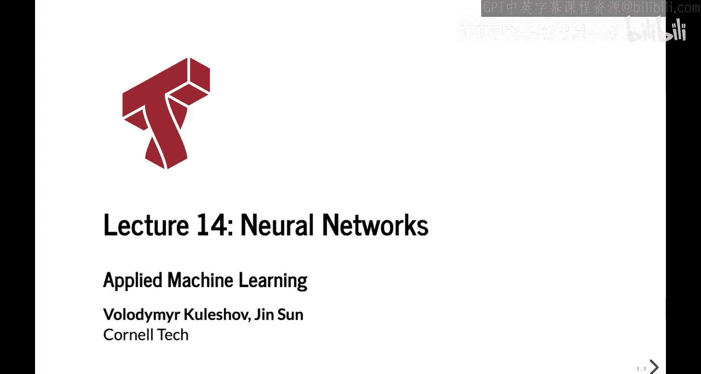

Welcome to Lecture 14 of Applied Maine Learning， which is going to be the start of a two part lecture series on neural networks。

Neural networks are a very important type of machine learning model that is inspired by how the brain works。

 and in recent years， neural networks have been very effective on a lot of really important problems such as image classification。

 machine translation。Speech recognition on all of these problems and and many others methods based on neural networks have pushed the state of the art by a significant amount and in this lecture and the following lecture。

 we are going to start from the basics and then build our way towards defining some of the more recent deep learning models that have achieved that have been really successful and achieved some of these breakthroughs in these application areas。

But for this lecture， we are going to start with some basics and we are going to define just a general concept of we're going to define the basics of neural networks。

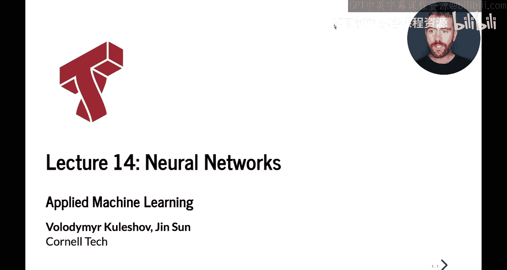

And in this video we will start with the very basics and I'm going to describe a mathematical model of a neuron。

 which I'm calling here the artificial neuron， and this simple model will be the building block for all of the subsequent models that we're going to see in this lecture and in the following lecture。

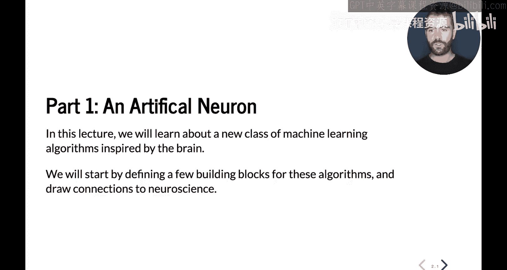

So for this video， we will focus on the problem of binary eification。

 which is the setting in which the target y is discrete and we're going to assume that the two classes are encoded with0 and end the 1 and we have a model that maps inputs to targets which we're denoting by F。

 and this is the model that we're going to try to represent in a form that is inspired by how the brain works。

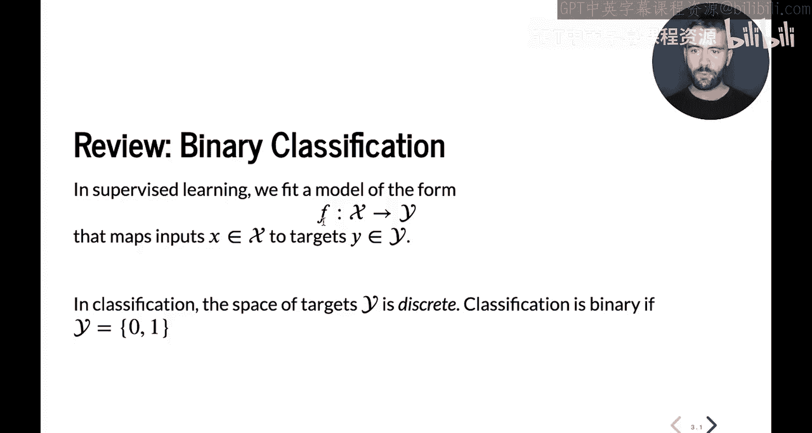

We saw in some of our earlier lectures one algorithm that is very popular and very effective for and that solves the binary classification problem。

 and that is logistic regression in logistic regression we assume that the model F takes the following form where we have a linear term where we have a linear part of the model that is composed with the sigmoid function。

 which is a function that has this form given here， and it squishes the output of this linear。

Part of the model into a value that is between0 and1。

 and we can interpret that as the probability of the class being one。

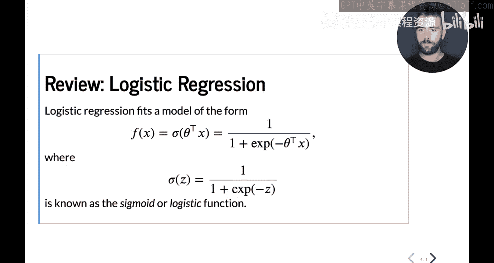

So let's now look at a different kind of model that or let's start working our way towards a model for binary classification that is inspired by a different set of ideas。

 and then we're going to go back and we're actually going to see a lot of connections to logistic regression。

The angle that I want to take in order to define the next set of models is one that comes from neuroscience and the biology of the brain。

In this slide， I have an image that I have this figure which shows at a high level。

 shows the different parts that make up a neuron， which is the basic cell that comprises the brain。

And at a high level， you can think of the neuron as having a few key elements。

In the middle of the neuron， there is the nucleus。And this。

Central core part of the neuron receives inputs via。V what are called dendrites。

 so the dendrites are parts of the cell which branch out and go farther out and connect to other cells。

 and these dendrites receive inputs from neighboring neurons。

You these inputs and can think of these inputs as being electrical signals that have a certain intensity to them。

And。The cell has a number of dendrites， each of them receives an input signal。

They all are all combined at the nucleus。And when the input coming from these signals is sufficiently high when the cells that send their electrical signals into this neuron。

When this signal is strong enough。The nucleus reacts and this inner part of the cell。Fies。

 which means that it sends another electric signal， another electric impulse。

Towards the output part of the neuron， which is a long branch called the axon。

So when the neuron receives a strong enough signal via its dendrites。

 it fires and it sends an electrical signal down the axon。

 which will then go and connect to other neurons。And this is at a high level the structure of a biological neuron。

The basic building blocks of artificial neural networks is going to be a mathematical。

 idealized model of this biological neuron。

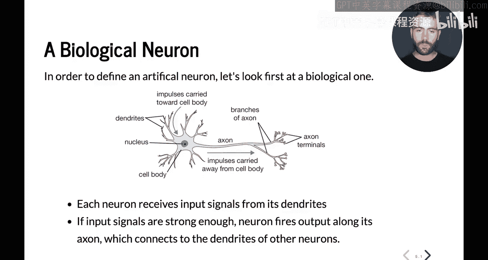

And this artificial model looks as follows。嗯。In this figure。

 we are going to represent inputs that are coming into the neuron by the variable x and x here as before it is a vector of inputs。

And you can start the analogy， you can start drawing an analogy to the biological neuron by viewing each input dimension of x as an input that is coming into our model of an artificial neuron。

 so you can think of it as input that is being fed into the neuron via dendrite。

Within this idealized model， we're going to modulate the input VSM weight W。

 so internally the neuron assigns different weights to its dendrites。

And then once we have received the signals from every dendrite， these are some together。

In inside the body of the cell。And then once if the sum of inputs is sufficiently large。

 then it also fires a signal。And the minimum threshold at which we。

Fi signal is specified by what we call an activation function and which is in this example。

 it is denoted by F。And you can think of this as a function that equals some value when the sum of these modulated signals is large。

Then this function f will output a large value and when the input is low， it will output a low value。

 and the output is the equivalent of the signal that is gets sent by the axon in our biological neuron。

So just summing up。You can think of an artificial neuron as a sequence of three operations。

 first we take the inputs， we assign them a weight。

Then we sum these inputs to obtain the total signal that is coming into the body of the neuron。

 and then we have an activation function which transforms this total signal into an output that gets sent via the axon。

And the output of the artificial neuron has a form that's given by this equation where again。

 F denotes the activation function。

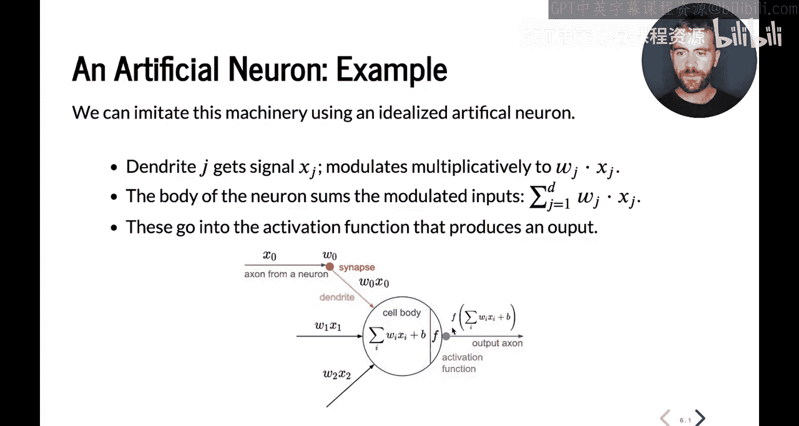

So let's define this again a little bit more formally using some mathematical notation。

 we're going to say that an neuro official neuron is a model that goes from the set of inputs which we can take a real numbers in this particular example。

 it is between zero and 1， but actually this can be a different range but it goes into some welldefined range。

And。It performs the following operation where we multiply weights with the inputs and then we pass the result into an activation function here and in the rest of the slides I'm going to use the nottation sigma and this is typically a nonlinear function。

And by virtue of being nonlinear， artificial neurons are going to be able to model more complex nonlinear functions that other models will not be able to well sorry。

 I should say combination of neural networks will be able to combinations and more specifically compositions artificial neurons will be able to model more complex functions than simple linear models。

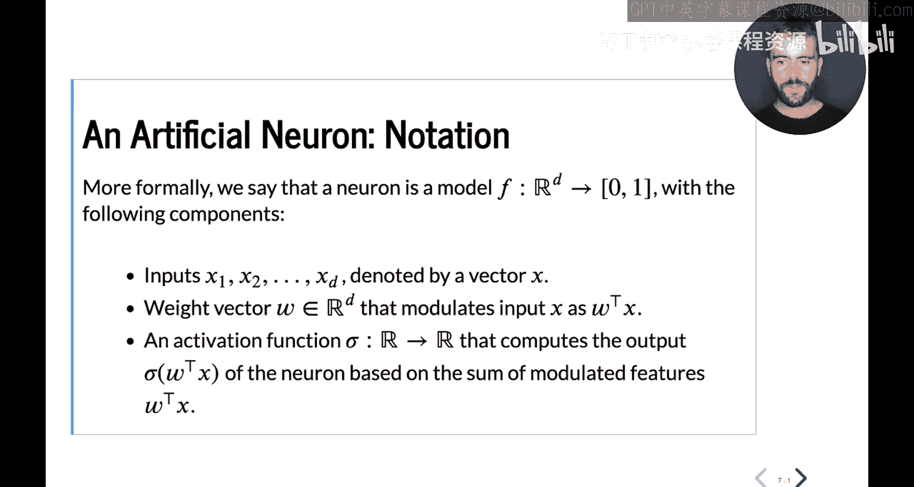

Now。In this definition that I gave in the earlier slide。

 everything was well defined except perhaps the activation function。

 and here I'm going to give you one example of an activation function and it is simply the step function。

 and it is very simple， it simply equals one， if the signal is positive and zero if it's negative。

And an artificial neuron with the following activation function is referred to as a perceptron。

A perceptron is a very old algorithm， it was developed by Frank Rosenblt at a Cornell in the 50s。

 and it is considered to be the first model of an artificial neuron。And the in the 50s and early 60s。

 there was actually a very big。there was a very big interest in these kinds of models。

And they're still important for historical reasons。

 although this particular activation function is not used very much in practice these days。

We can visualize this activation function and it looks like the following step function。

So essentially， if the input that is coming into the body of the cell is small。

 anything from minus infinity all the way to the threshold zero is it does not fire anything and then as soon as we cross the threshold now the neuron fires and its cell and it sends an output signal。

 which we encode as1。So， this is。This is a somewhat more specific definition of an artificial model of a neuron。

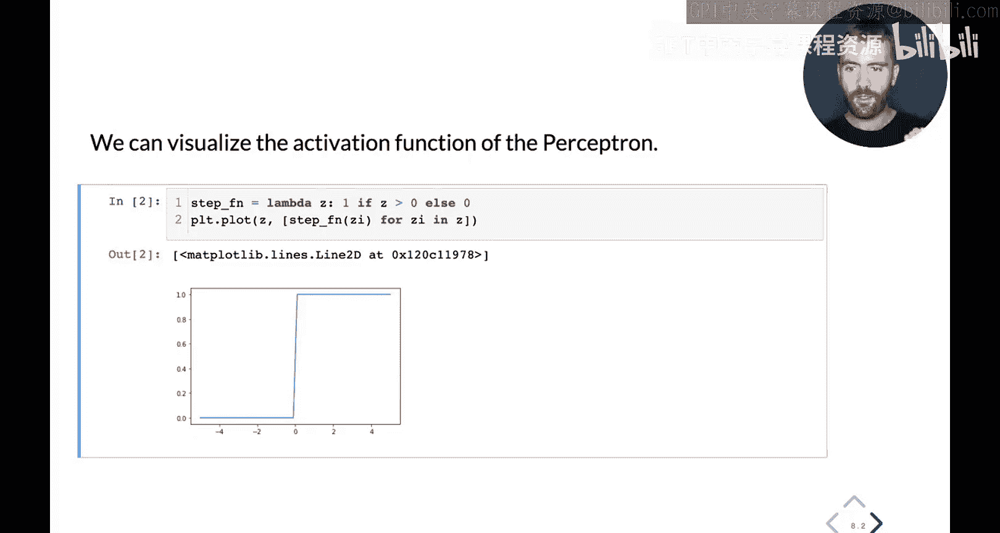

Another type of artificial neuron that we have seen before is the following logistic model。

 So here I am using the。I am using the。Sigmoid function as my activation function。 and if I do that。

 well， I simply get back my logistic regression model。

But it's actually interesting that we can interpret logistic regression as another simple model of an artificial neuron。

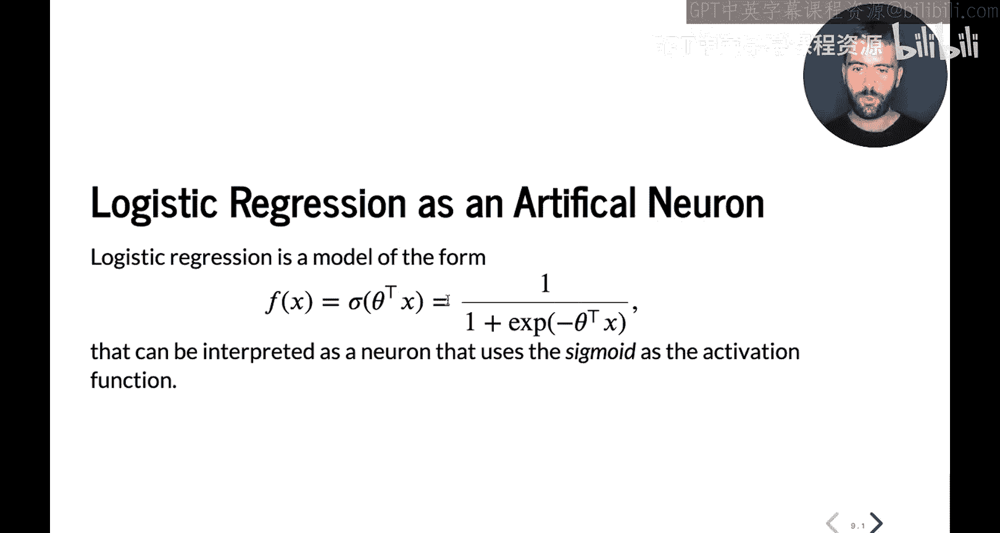

To better understand this， let's look at the shape of the sigmoid function。

This sigmoid function takes a low value0 when the input is or something is close to 0。

 when the input is small， and then as we approach our threshold of0。

 then it increases and it outputs a larger value and then as soon as we're after something like4 here。

From 4 to infinity， we output something which looks really close to one。

So you can think of this as a smooth version of the step function that we saw earlier。

And for a long time， this was used as the main activation function of neural networks。

 It is good that it is smooth because it is easier to optimize using gradient descent。

And for a very long time， this。Sigmoid neuron， which is the same model as logistic regression。

 was the most popular model of an artificial neuron。

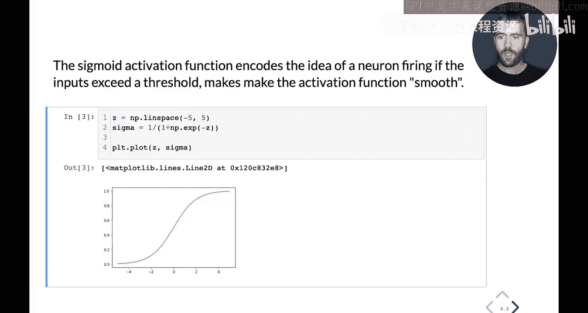

Now， these are not the only kinds of activation functions that exist in over the last 10， 15 years。

 researchers realized that actually other activation functions are。Are better。

 They improve over the step function and the sigmoid function。 And， in fact， neurons that use these。

Actation functions are。Well， they still exhibit the same behavior that we would expect out of a model of a neuron。

 which means don't fire if the input is low and fire if the input is high。

 but also they have better numerical properties and they are easier to optimize using gradient descent and in modern neural networks。

 we very often use the following rectified linear unit activation function。

And that makes it easier to optimize and it still models the neuron。

 the way in which it models the neuron is as follows here。

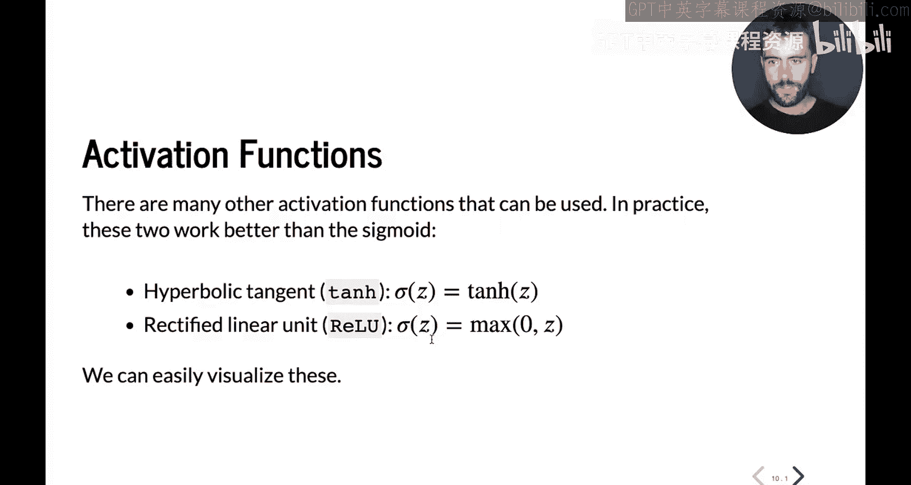

This is the hyperbolic tangent。And it still has this S shape behavior that we want。

 except that now the inputs are squished between minus1 and 1。

And the value activation function has a form that equals 0。When we are blow our threshold。

 and then it linearly。Then， the。The size of the signal is linear after we cross the threshold。

 And so this also behaves like like an artificial neuron， but this function is actually。

It has better numerical properties， and it is easier to optimize。

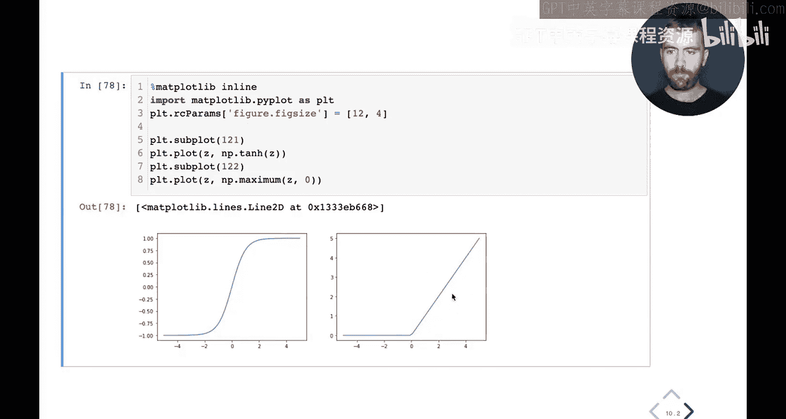

Let's quickly demonstrate how this would work on a practical data。

 we are again going to use our data set of ir flowers， which I import and load here。

 I am renaming class2 to label 1， which means that we are going to be classifying these two classes so it's a binary classification problem。

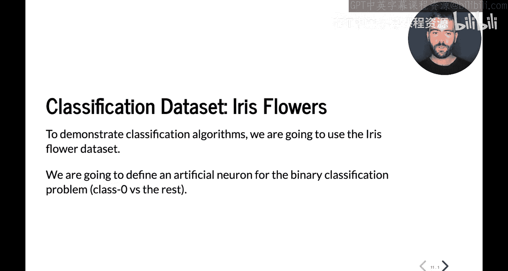

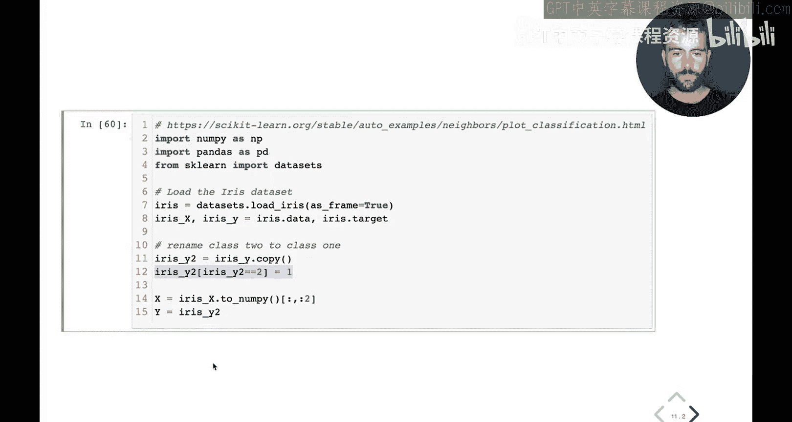

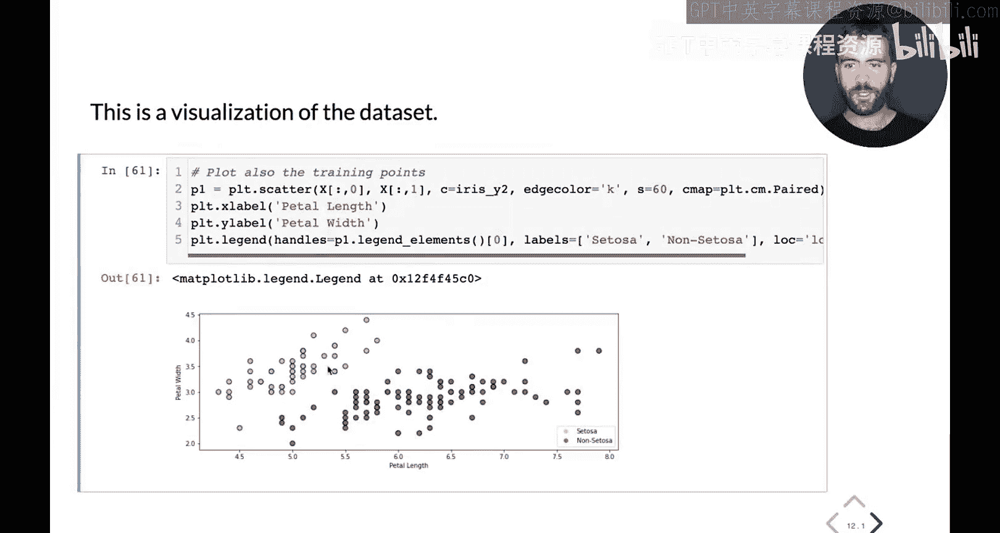

And we can implement in our official neuron with the sigmoid activation function very easily。 is。

These are two lines of code for defining a neuron， and we can also define its gradient very easily in one line。

If you want to see the derivation of this gradient。

 you can go back to our lecture on logistic regression。

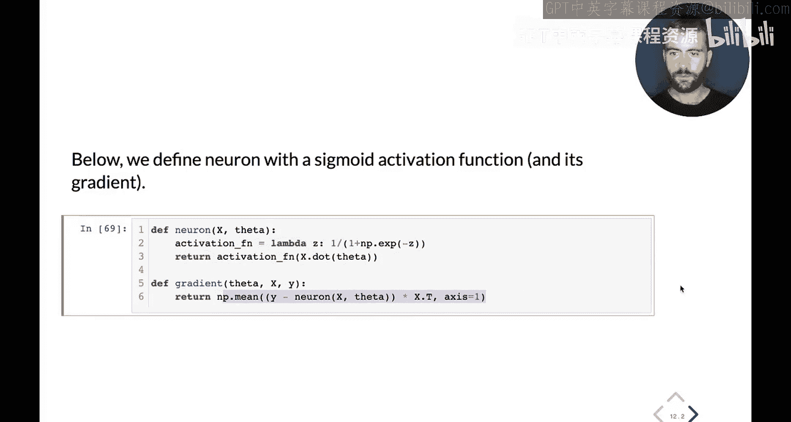

And now gradient descent is， again only a few lines of code here。

 we run it for a number of iterations。

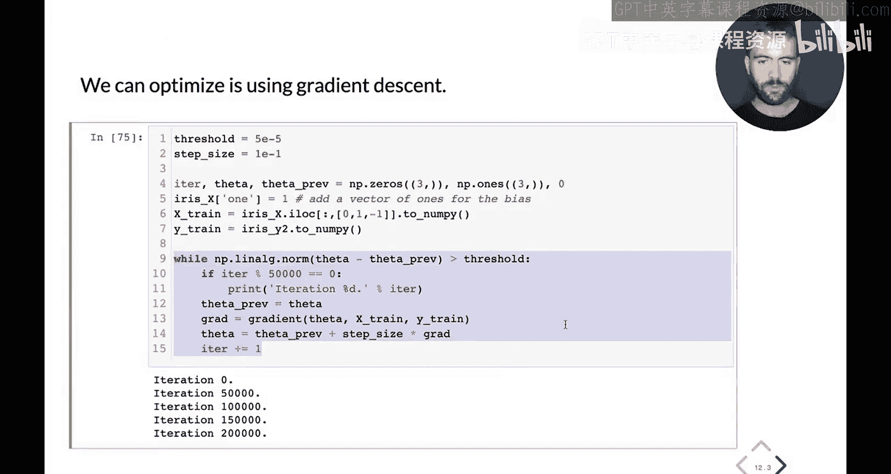

And the end result is a linear boundary that separates the data。

 which is what you would expect from a model that is。

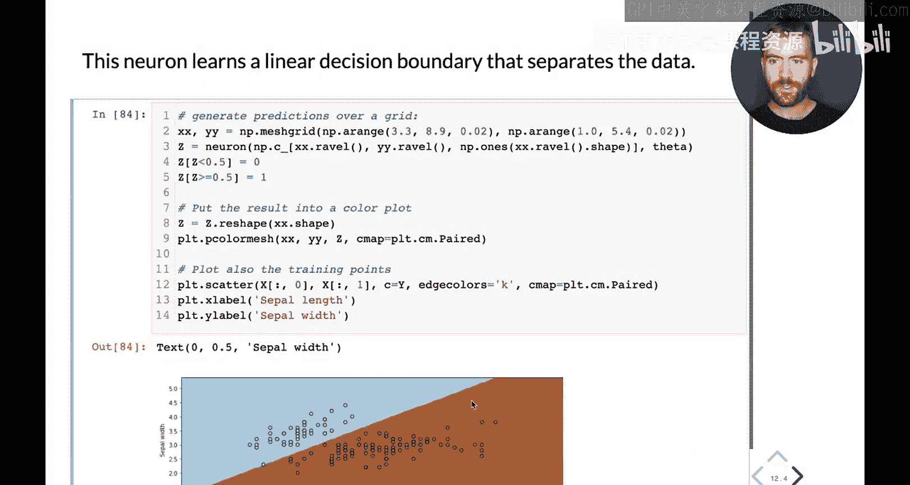

That has the same functional form as logistic regression。

So this is going to be our building block for more complex algorithms。

 and even though this decision boundary is linear， we are going to see in the next few videos how we can combine。

Multiple artificial neurons to build a more complex function that will become nonlinear and will be able to learn a lot of interesting。

A lot of interesting functions from data。

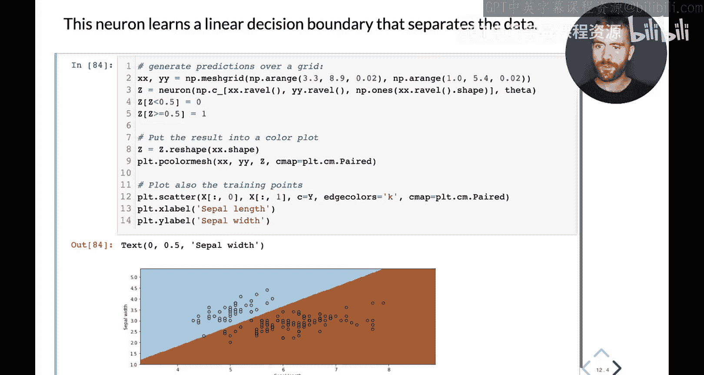

And again， just to summarize the algorithm we have introduced in this。In this video。

 we talked about the artificial neuron and this is an algorithm that can be used for both regression and classification。

 we can use it with any loss。And well， we may need to change the activation function if we use certain losses。

 but in principle， we can make it work for both regression and classification and。呃。

The model family is linear， followed by nonlinear activation。

It often still learns at a linear decision boundary but this is the type of the model and we can optimize it using different objectives。

 it can be also optimized using the L2 loss or other kinds of losses。

 and there is no formula for the solution of an artificial neural for the optimal weights of an artificial neuron we typically use gradient descent and there are many special cases of artificial neurons two that are famous are perceptron and logistic regression。

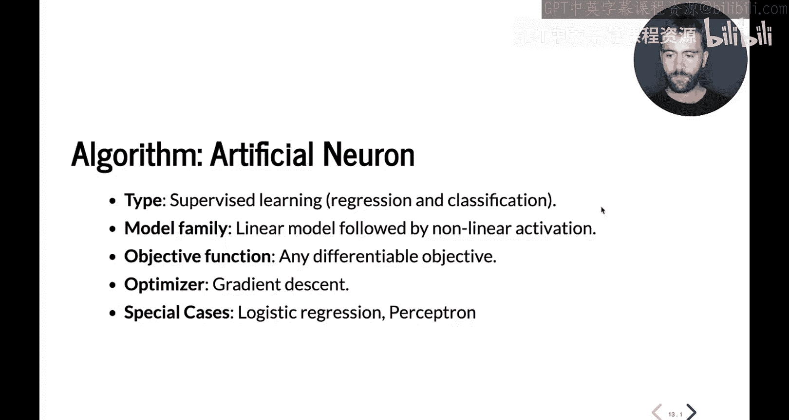