# 应用机器学习：第14讲：人工神经元 🧠

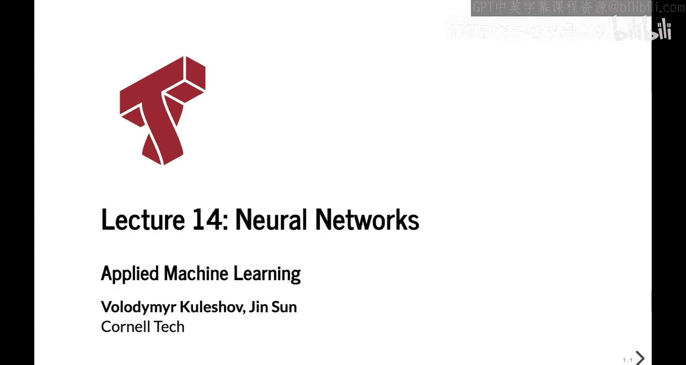

在本节课中，我们将开始一个关于神经网络的两部分系列讲座。神经网络是一种非常重要的机器学习模型，其灵感来源于大脑的工作原理。近年来，神经网络在许多重要问题上非常有效，例如图像分类、机器翻译和语音识别。在这些以及许多其他问题上，基于神经网络的方法已显著推动了技术前沿。在本讲及后续课程中，我们将从基础开始，逐步构建，最终定义一些更近期的深度学习模型，这些模型取得了巨大成功，并在应用领域实现了突破。

## 从基础开始：人工神经元

上一节我们介绍了本系列讲座的概览。本节中，我们将从最基础的部分开始，描述一个神经元的数学模型，我们称之为**人工神经元**。这个简单的模型将成为本讲及后续课程中所有后续模型的基础构建块。

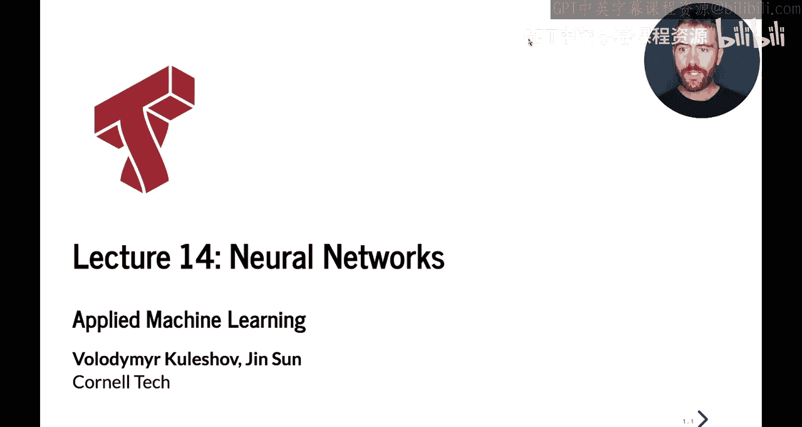

## 问题设定：二元分类

本节我们将聚焦于**二元分类**问题。在这个设定中，目标变量 `y` 是离散的，我们假设两个类别分别编码为 `0` 和 `1`。我们有一个将输入映射到目标的模型，记作 `F`。我们将尝试以一种受大脑工作原理启发的方式来构建这个模型。

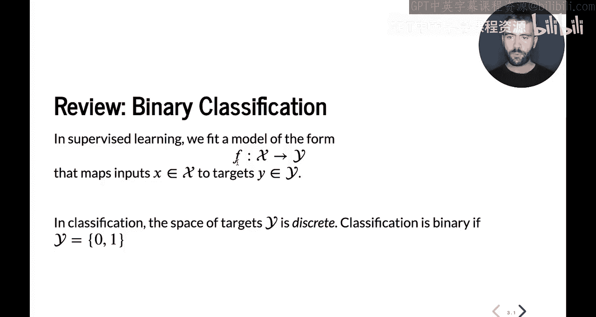

## 回顾：逻辑回归

在我们早期的课程中，我们看到了一个非常流行且有效的解决二元分类问题的算法：**逻辑回归**。在逻辑回归中，我们假设模型 `F` 采用以下形式：它由一个线性部分与一个Sigmoid函数组合而成。Sigmoid函数的形式如下，它将线性部分的输出压缩到 `0` 和 `1` 之间的值，我们可以将其解释为类别为 `1` 的概率。

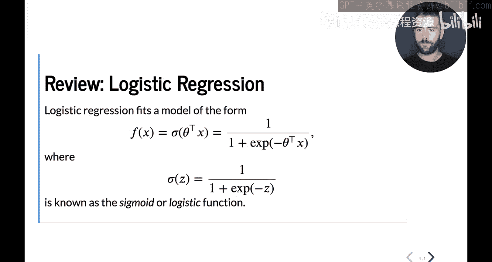

**公式：**
`F(x) = σ(w^T x + b)`
其中 `σ(z) = 1 / (1 + e^{-z})`

## 迈向新模型：神经科学的视角

现在，让我们开始构建一个受不同思想启发的二元分类模型。我们将从神经科学和大脑生物学的角度出发，并最终会看到它与逻辑回归的许多联系。

下图展示了构成大脑基本单元的神经元的主要部分。在高层次上，你可以将神经元视为具有几个关键元素：
*   在神经元中央，有细胞核。
*   这个核心部分通过称为**树突**的结构接收输入。
*   树突是细胞的延伸部分，它们向外分支并连接到其他细胞，从邻近神经元接收输入信号。
*   这些输入信号可以看作具有一定强度的电信号。
*   细胞有多个树突，每个都接收一个输入信号。
*   所有信号在细胞核处汇总。
*   当来自这些信号的总输入足够强时，细胞核会做出反应，细胞内部会**激发**，这意味着它会沿着称为**轴突**的输出分支发送另一个电脉冲。
*   当神经元通过其树突接收到足够强的信号时，它就会激发，并沿着轴突发送电信号，该信号随后会连接到其他神经元。

## 人工神经元：数学模型

人工神经网络的基本构建块将是这个生物神经元的数学化、理想化模型。

这个人工模型如下图所示。我们将用变量 `x` 表示进入神经元的输入，`x` 是一个输入向量。你可以通过与生物神经元类比来理解：将 `x` 的每个输入维度视为通过树突馈送到我们人工神经元模型的输入。

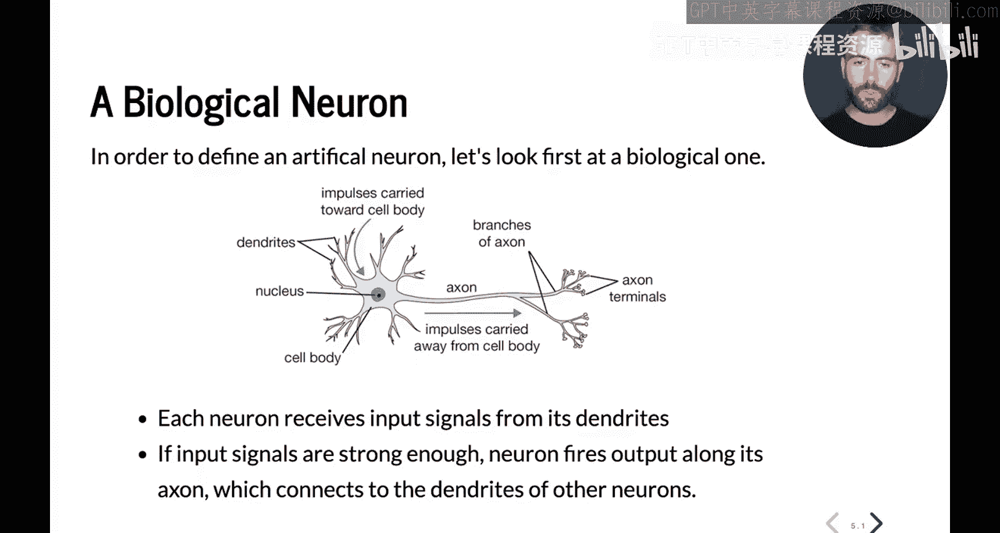

在这个理想化模型中，我们将通过权重 `w` 来调节输入。因此，在神经元内部，它为每个树突分配了不同的权重。然后，一旦我们从每个树突接收到信号，它们就在细胞体内求和。如果输入的总和足够大，它也会激发一个信号。激发信号的最小阈值由我们称为**激活函数**的函数指定，在这个例子中记作 `f`。你可以将其视为一个函数：当这些调制信号的总和很大时，该函数输出一个较大的值；当输入较低时，它输出一个较低的值。输出相当于生物神经元中轴突发送的信号。

总结一下，你可以将人工神经元视为三个操作的序列：
1.  获取输入，并为它们分配权重。
2.  对这些输入求和，得到进入神经元主体的总信号。
3.  使用激活函数将这个总信号转换为通过轴突发送的输出。

人工神经元的输出形式由以下方程给出，其中 `f` 再次表示激活函数。

**公式：**
`输出 = f( w^T x + b )`

## 形式化定义

让我们用一些数学符号更正式地定义一下。我们将说，一个**人工神经元**是一个模型，它从输入集合（在这个特定例子中，我们可以取实数，范围在0和1之间，但实际上可以是不同的范围）映射到某个明确定义的范围。它执行以下操作：我们将权重与输入相乘，然后将结果传递给一个激活函数。在接下来的幻灯片中，我将使用符号 `σ` 来表示激活函数，这通常是一个非线性函数。由于是非线性的，人工神经元（更准确地说，是人工神经元的组合，特别是它们的组合）将能够建模比简单线性模型更复杂的非线性函数。

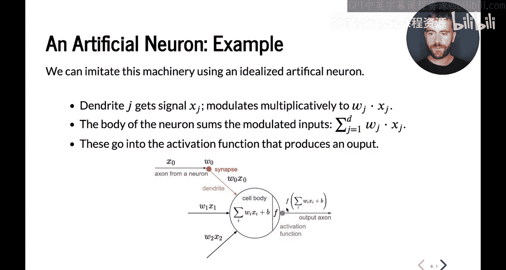

## 激活函数示例：感知机

在我之前给出的定义中，除了激活函数外，其他部分都已明确定义。这里我将给你一个激活函数的例子：它就是简单的**阶跃函数**。它非常简单：如果信号为正，则输出 `1`；如果为负，则输出 `0`。

具有以下激活函数的人工神经元被称为**感知机**。感知机是一个非常古老的算法，由康奈尔大学的 Frank Rosenblatt 在 20 世纪 50 年代开发，被认为是第一个人工神经元模型。在 50 年代和 60 年代初期，这类模型曾引起极大兴趣。它们至今仍因历史原因而重要，尽管这种特定的激活函数如今在实践中已不常用。

我们可以将这个激活函数可视化，它看起来像下面的阶跃函数。本质上，如果进入细胞体的输入很小（从负无穷到阈值 `0` 的任何值），它不会激发任何信号；一旦我们超过阈值，神经元就会激发，其细胞发送一个输出信号，我们将其编码为 `1`。

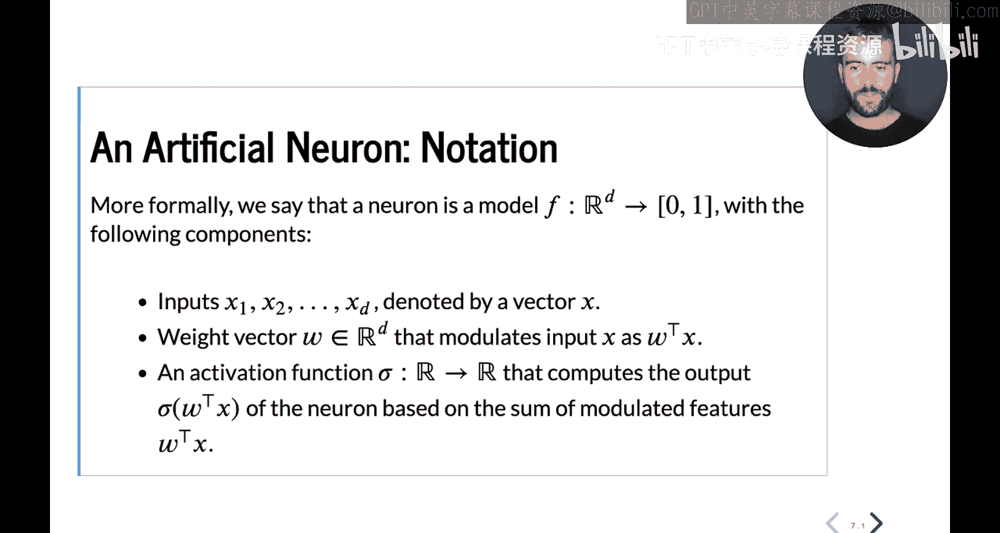

**公式：**
`f(z) = 1 如果 z > 0，否则为 0`

## 另一种人工神经元：逻辑回归模型

另一种我们之前见过的人工神经元是以下**逻辑模型**。这里我使用 Sigmoid 函数作为我的激活函数。如果我这样做，那么我实际上就得到了逻辑回归模型。有趣的是，我们可以将逻辑回归解释为另一种简单的人工神经元模型。

为了更好地理解这一点，让我们看看 Sigmoid 函数的形状。当输入较小（接近负无穷）时，这个 Sigmoid 函数输出一个接近 `0` 的低值；当我们接近阈值 `0` 时，它开始增加并输出一个较大的值；一旦输入超过大约 `4`，从 `4` 到正无穷，我们输出的值看起来非常接近 `1`。你可以将其视为我们之前看到的阶跃函数的平滑版本。

在很长一段时间里，这被用作神经网络的主要激活函数。它的平滑性是好的，因为它更容易使用梯度下降进行优化。在很长一段时间里，这个 Sigmoid 神经元（与逻辑回归是同一个模型）是最流行的人工神经元模型。

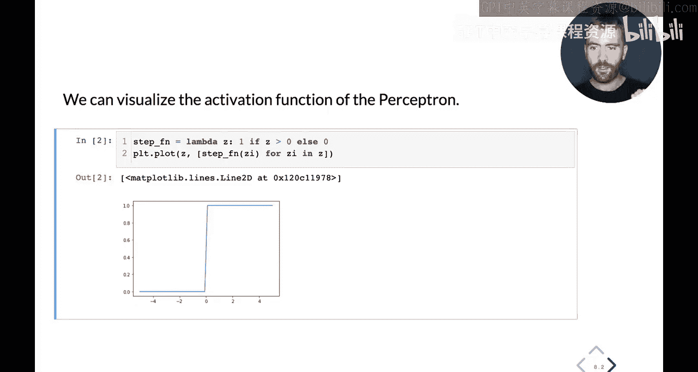

**公式：**
`σ(z) = 1 / (1 + e^{-z})`

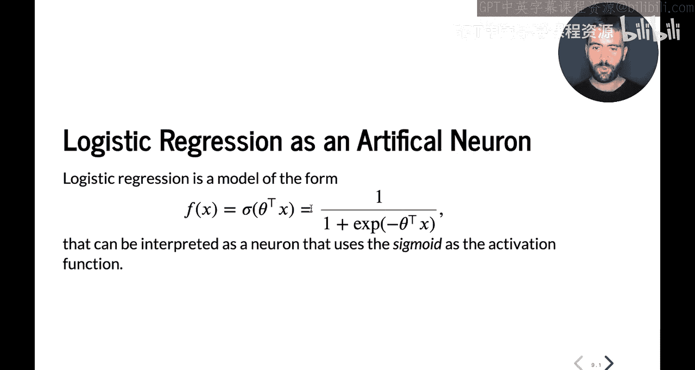

## 现代激活函数

现在，这些并不是唯一存在的激活函数类型。在过去的 10 到 15 年里，研究人员意识到实际上其他激活函数更好，它们改进了阶跃函数和 Sigmoid 函数。事实上，使用这些激活函数的神经元仍然表现出我们期望的神经元模型行为（即输入低时不激发，输入高时激发），而且它们具有更好的数值特性，更容易使用梯度下降进行优化。

在现代神经网络中，我们经常使用以下**修正线性单元**激活函数。它使优化更容易，并且仍然以如下方式对神经元进行建模。

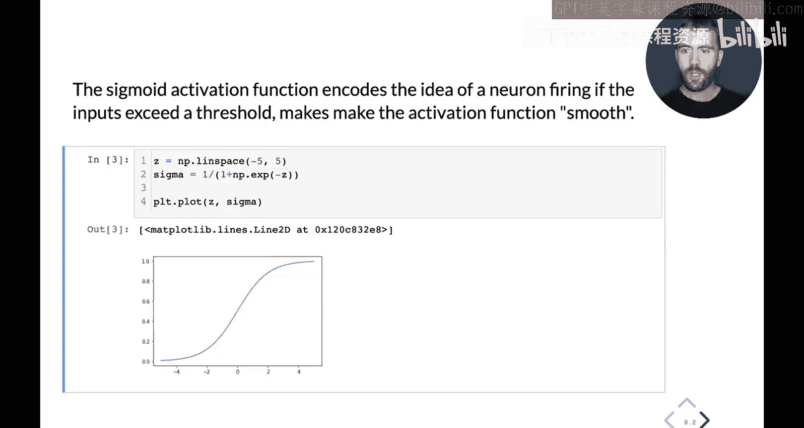

**公式：**
`ReLU(z) = max(0, z)`

这是**双曲正切**函数。它仍然具有我们想要的 S 形行为，只是现在输入被压缩在 `-1` 和 `1` 之间。

**公式：**
`tanh(z) = (e^z - e^{-z}) / (e^z + e^{-z})`

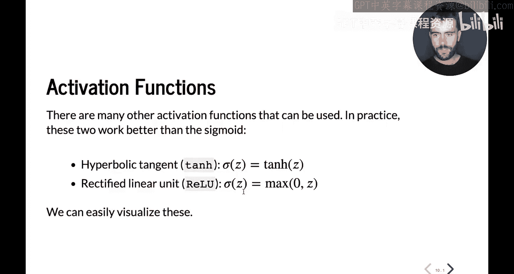

这个激活函数的形式是：当我们在阈值以下时，输出为 `0`；然后，在我们超过阈值后，信号的大小是线性的。因此，这也表现得像一个人工神经元，但这个函数实际上具有更好的数值特性，并且更容易优化。

## 实践演示：在鸢尾花数据集上

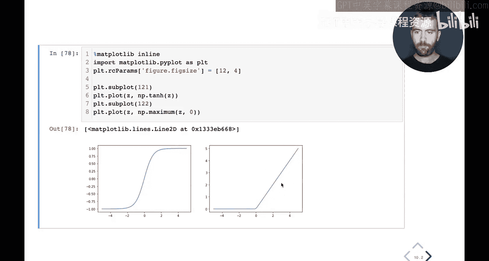

让我们快速演示一下这在实践数据上是如何工作的。我们将再次使用我们的鸢尾花数据集。我将导入并加载它，将 class 2 重命名为标签 1，这意味着我们将对这两个类别进行分类，所以这是一个二元分类问题。

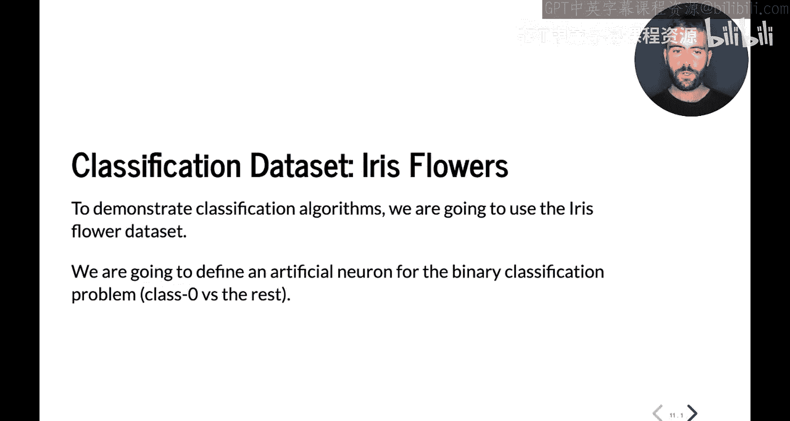

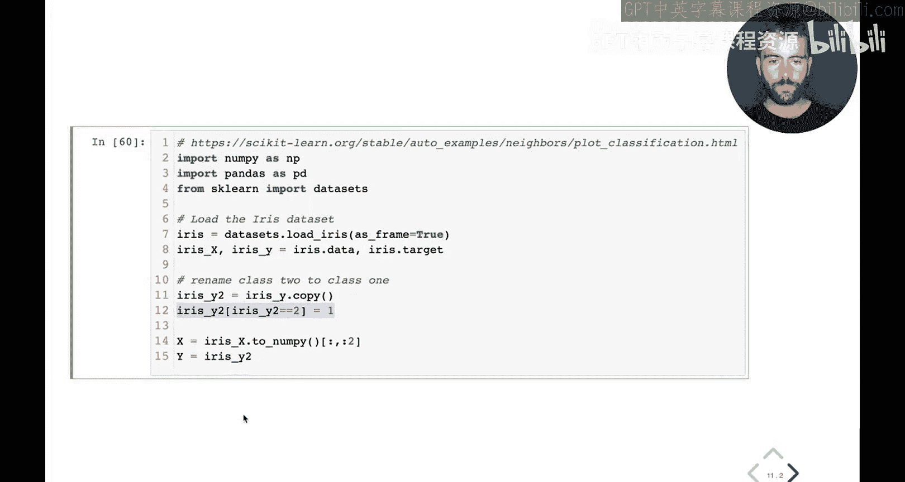

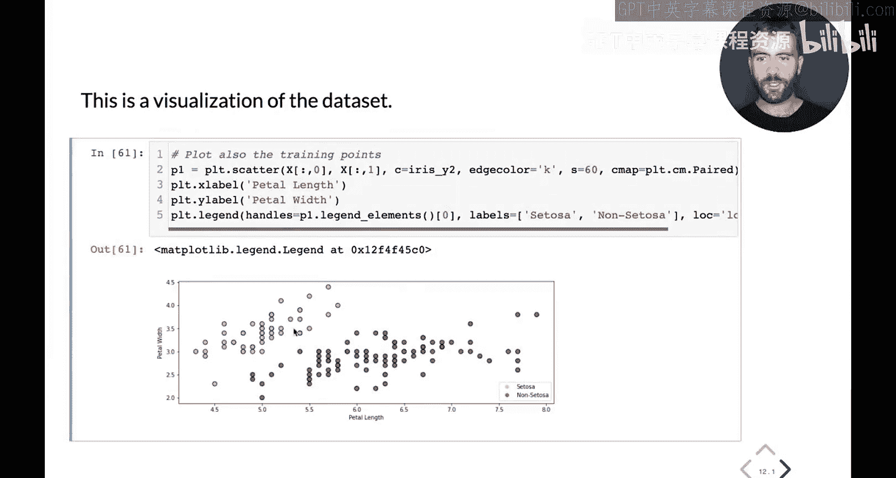

我们可以非常容易地实现一个具有 Sigmoid 激活函数的人工神经元。定义神经元只需两行代码，我们也可以在一行中轻松定义其梯度。如果你想看这个梯度的推导，可以回顾我们关于逻辑回归的讲座。

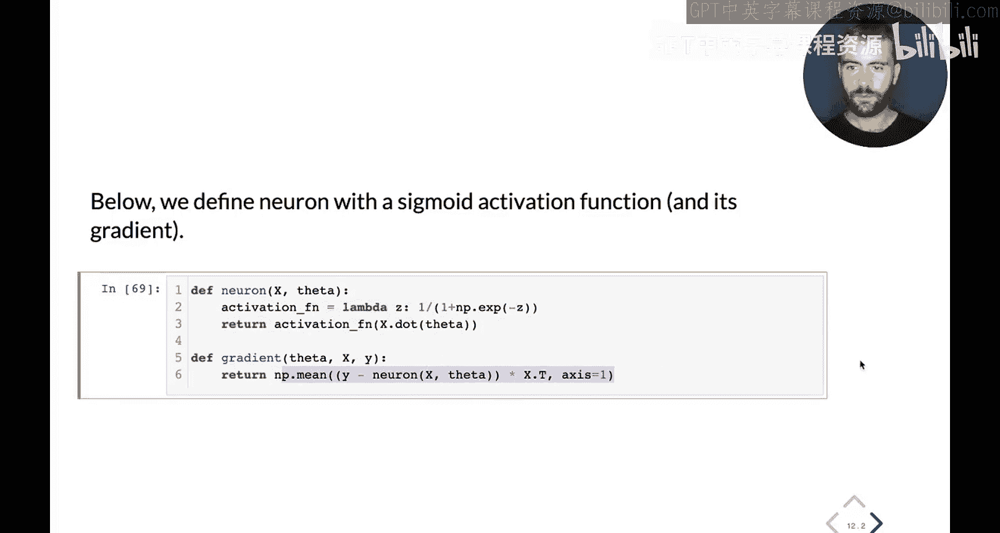

现在，梯度下降又只需要几行代码。我们运行一定次数的迭代。

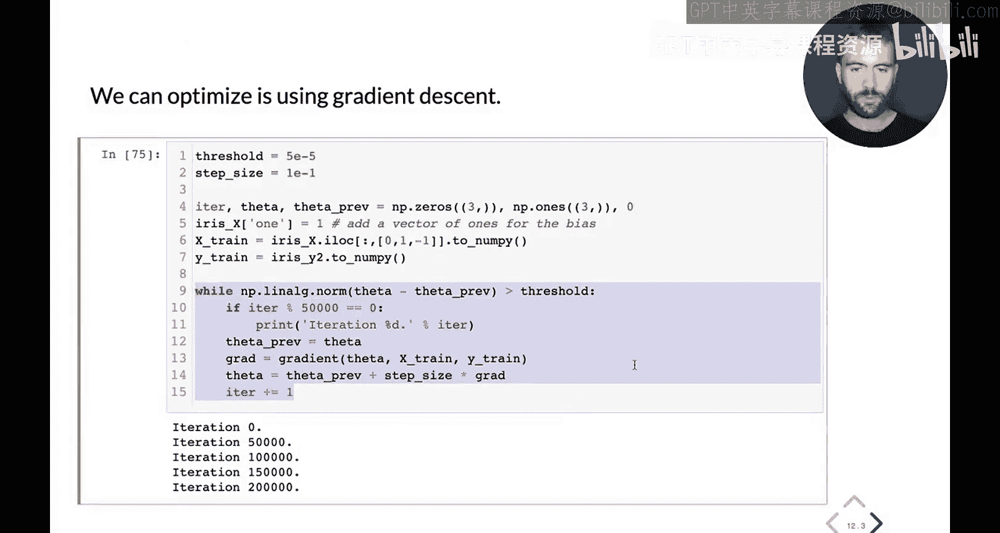

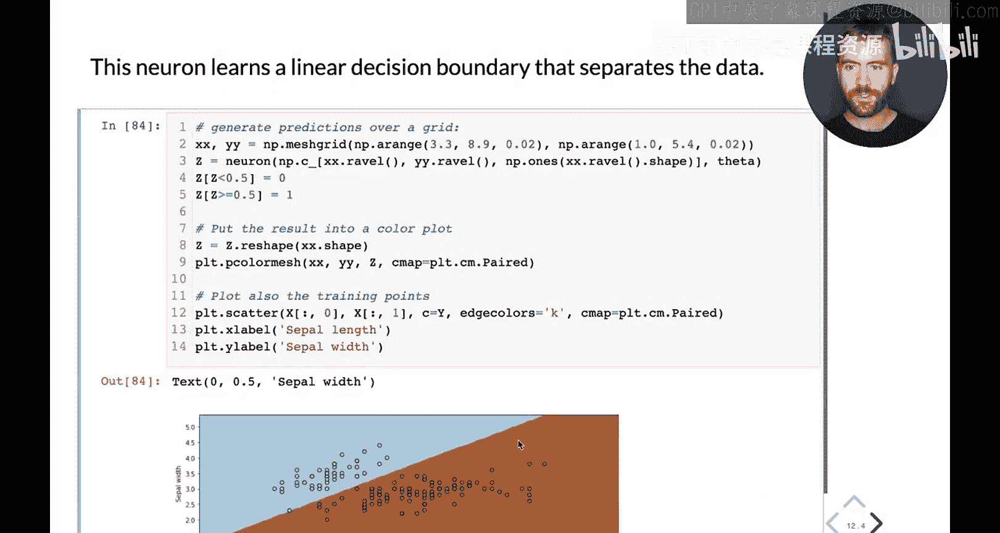

最终结果是一个分离数据的线性边界，这正是你从一个与逻辑回归具有相同函数形式的模型中所期望的。

所以，这将是我们构建更复杂算法的基础模块。尽管这个决策边界是线性的，我们将在接下来的几个视频中看到如何组合多个人工神经元来构建一个更复杂的函数，该函数将变成非线性的，并且能够从数据中学习许多有趣的函数。

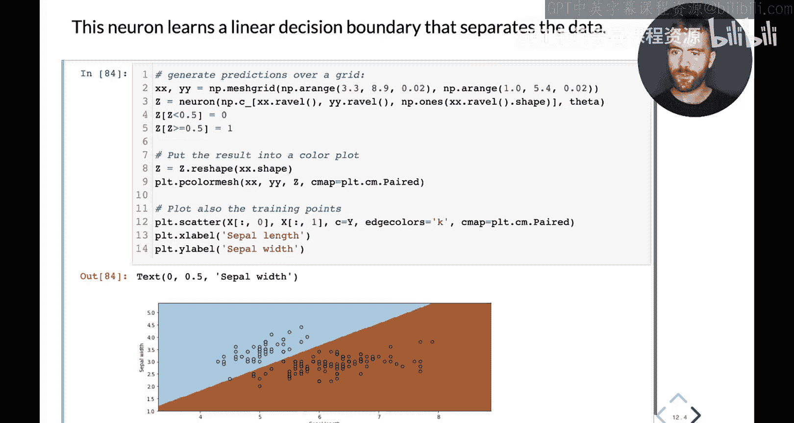

## 总结

在本节课中，我们一起学习了**人工神经元**。这是一种可用于回归和分类的算法，我们可以将其与任何损失函数一起使用（尽管如果使用某些损失函数，我们可能需要更改激活函数）。原则上，我们可以使其适用于回归和分类。

该模型族是“线性变换后接非线性激活”。它通常仍然学习一个线性决策边界，但这是模型的类型。我们可以使用不同的目标函数（如 L2 损失或其他类型的损失）来优化它。对于人工神经元的最优权重，没有封闭形式的解，我们通常使用梯度下降。

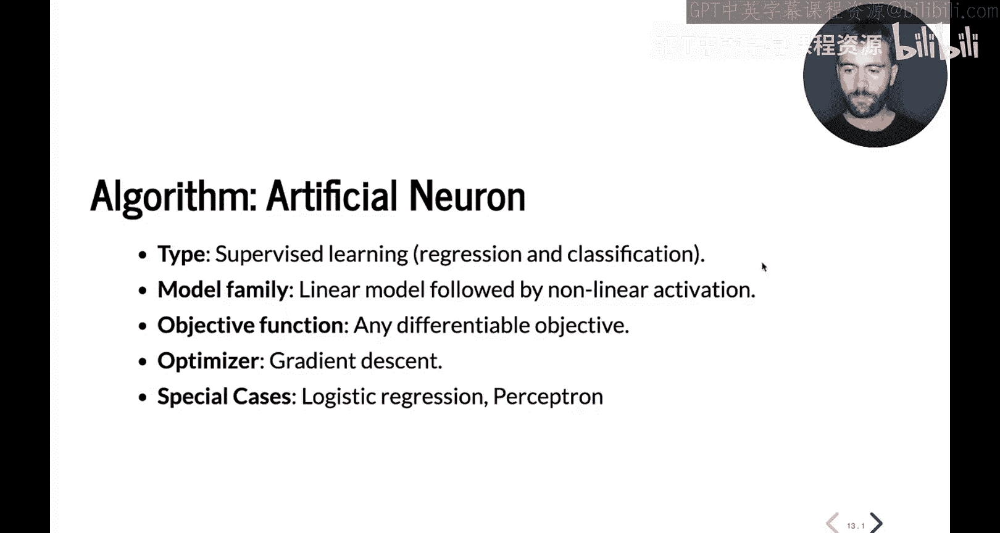

人工神经元有许多著名的特例，其中两个是**感知机**和**逻辑回归**。