# 康奈尔大学《应用机器学习 CS 5787_ Applied Machine Learning 2020》中英字幕（deepseek p53 -53-Lecture 14. Part 2_ Artificial Neural Networks.zh_en -BV12udzYvEFM_p53-

This is now part2 of lecture 14 of applied machine learning。 and in this video。

 I will talk about artificial neural networks In the previous video。

 we defined a model for a single artificial neuron and now we are going to see how to combine these。

Neurs into a more complex model called the artificial neural networks。

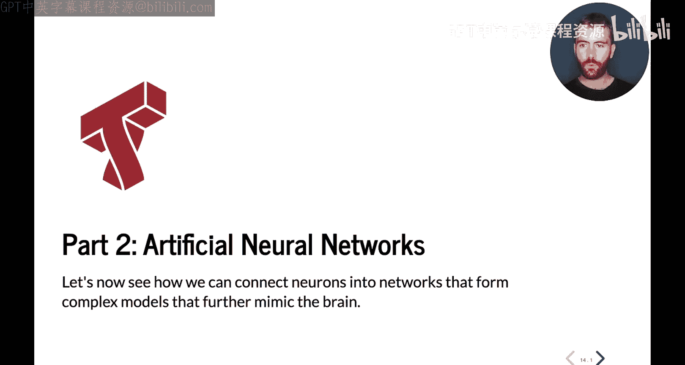

So recall that in our previous video we defined this model in which we have a neuron that has the following form。

 we take an input X， and we modulate each dimension of x with weight with the multiplicative weight W。

 then we sum this we sum the modulated inputs， and then，This goes into an activation function。

 which is。Tyically which typically outputs a larger value when this input is large and a smaller value when it is small。

 and in that sense， it models the behavior of a biological neuron。2。

Well known examples of artificial neurons are the perceptron。

 and also logistic regression can be viewed as an idealized model of an artificial neuron。

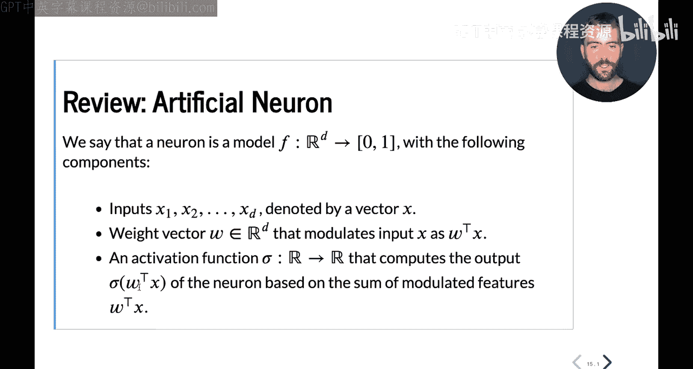

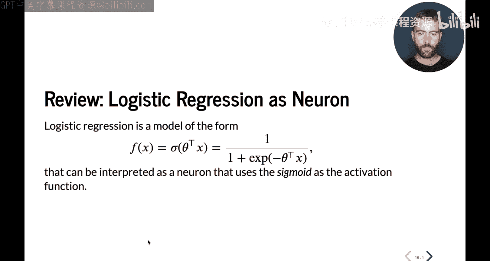

So in in this video， we are going to see how to combine neurons into。Into neural networks。

And the way this is typically done is via。Neurural network layers。

So here this image illustrates best what a neural network looks like。Each node here。

 except for the red ones， but the blue and the green nodes are examples of neurons。

And the red denotes the inputs。 So here red， the the two red circles would contain the inputs x1。

 the it would contain。A two dimensional input， so x1， the first dimension of x x2。

 the second dimension of x， and then these are fed， both of these are fed into the first neuron。

 the second neuron， the third neuron， each of these neuronsn can have different weights。

Then the output of these neurons gets fed into a last neuron， and this is the output of our network。

And we can think of these arrows as， well first of all within each arrow for each arrow we have an associated weight and these are these correspond to well。

 for this neuron， the input its input arrows correspond to dendrites。

 and the red circles correspond to the inputs， the input signals they get received via these dendrites。

 then this is the blue circle。Behaves like the body of a cell。

 which takes the weighted sum of all the inputs， and then it applies an activation function to determine how the neuron is going to fire。

 and then the output gets sent via this axon into the next neuron。So in this sense， that this is。

This is a model of an artificial neural。 is artificial is an artificial neural network。

 a model of what could be a biological neural network。

And what's important here is that this is typically represented as a directed acyclic graph。

 although there is such a thing as recurrent neural networks。

 but to see this in the we're not going to look at this in this video， or in this lecture。

 but most often the standard type of neural network is directed。

 meaning that the input signals are propagated forward and modified by these neurons until they reach an output。

 and they're typically organized in layers which means that these inputs don't communicate with each other。

And in principle， they could， but arranging them in layers makes computation easier。

 and it also makes it easier to define these operations in terms of linear algebra。

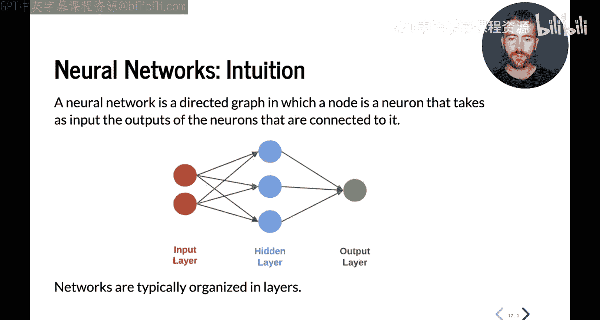

So more formally， we can define a neural network layer as a function that takes a d dimensional input and outputs a p dimensional output。

And what it does is to apply。A number p of neurons in parallel to the input x。

And each neuron has its own weight， and typically they share the same activation function。

 although strictly speaking， we could， in principle。

 have a layer with different activation functions， but typically these are the same。

And the total set of parameters of this layer。Is the union of all the parameters of all the neurons。

And we refer to P as the size of the layer， which is， again， the number of neurons。

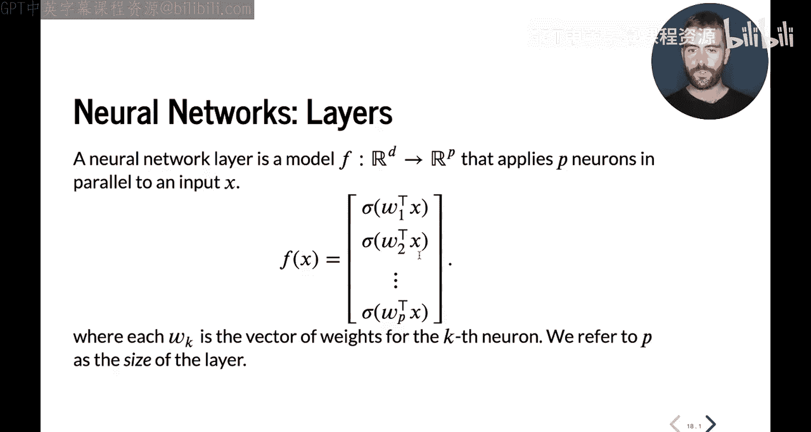

we can visualize it as follows here，Our input is x and in this example it is two dimensional。

 this neuron has a weight W1， which is also two dimensional。

 it multiplies the input coming in via these two arrows。

 then these get sound and the output is given by sigma。The same thing is。

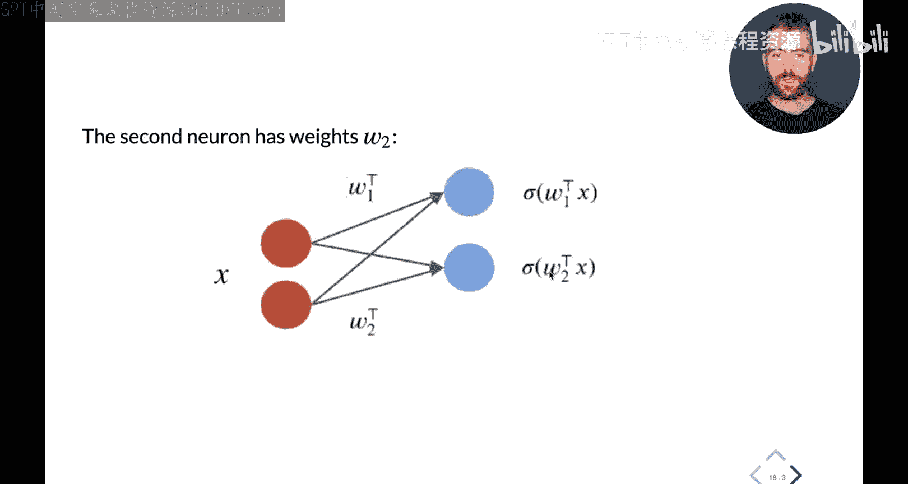

We have the same thing for the second neuron。And for the third neuron as well。And in this。

In this layer， we have the following weights， W1， W2， W3。

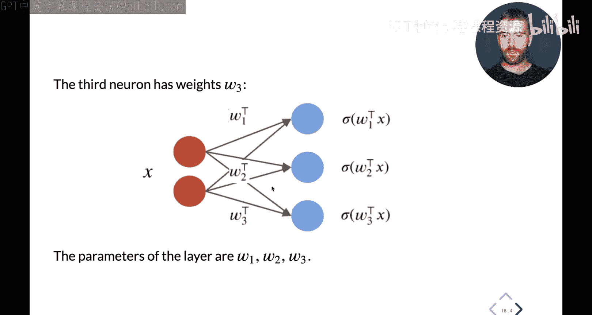

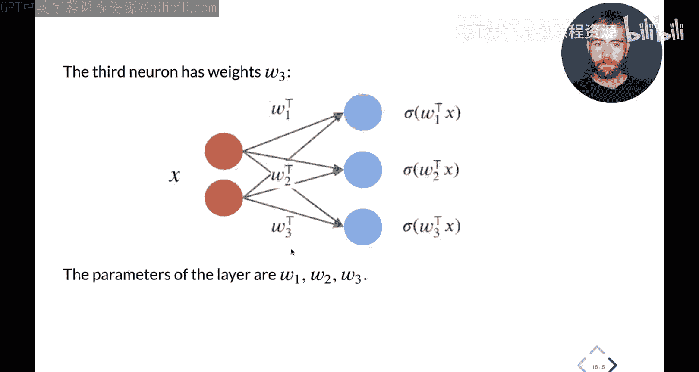

It is easier， often to。To， to put these。To combine these weights into a matrix。

So here W is simply the matrix in we in which each row is。Is the vector W I transpose。

 So W I transpose is the I throw of W。 And so we can write this。 We can write this layer。As。

Using linear algebra notation by doing a matrix vector product， which gives us a vector of。

That has these elements， but without the activation function。

 and then we apply this activation function to this vector。

 which just means that we apply it to each element。

So this is a bit of notation to make things more succinct。And if we actually implement this， we。

 if we use linear algebra libraries to implement it。

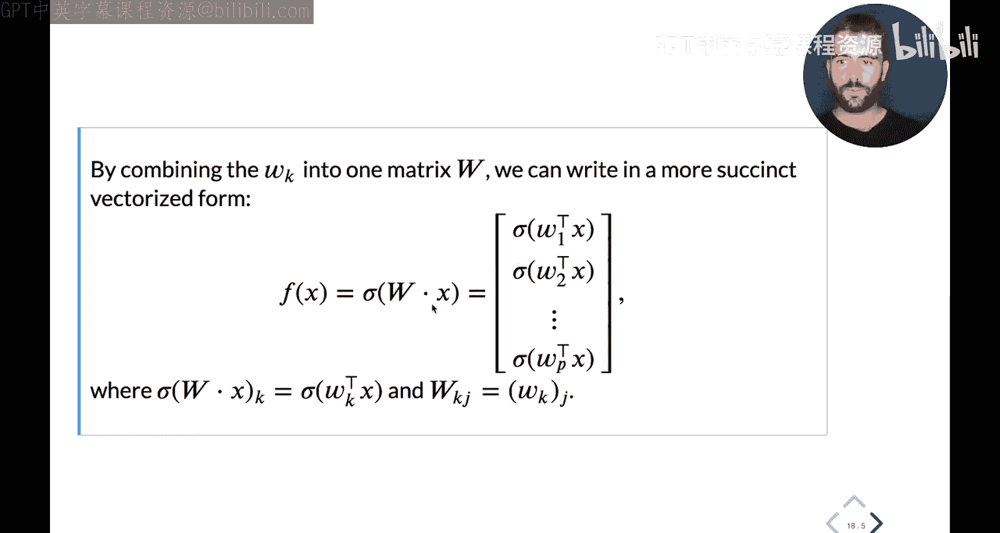

In this way， it will make things much faster。And graphically， we can represent this as follows here。

 this entire layer has a set of parameters that are denoted by a matrix W and the output is simply sigma w times x。

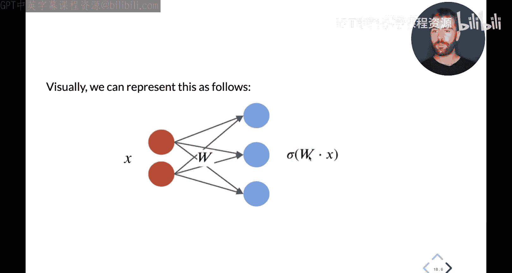

So I have defined a layer。Now， I can define more formally a neural network。

 and a neural network is simply a composition of。A number of layers， let's say， L layer。L layers。

And by the way， we refer to the inner layers as hidden layers。

 and the output is the output layer and they're hidden because。

 well we do not see their output directly， it gets fed into another internal layer。

And assuming we are doing assuming we are predicting a y that is either a standard regression target or a classification target。

 the final layer will have a one dimensional output。And it may also not use any activation function。

 or it may require a special activation function that depends on the output that we want to predict。

And this notation here with a circle， if you haven't seen it。

 it just denotes the composition of function， so F circle G simply means f of G。

 so we are composing these functions one into another。

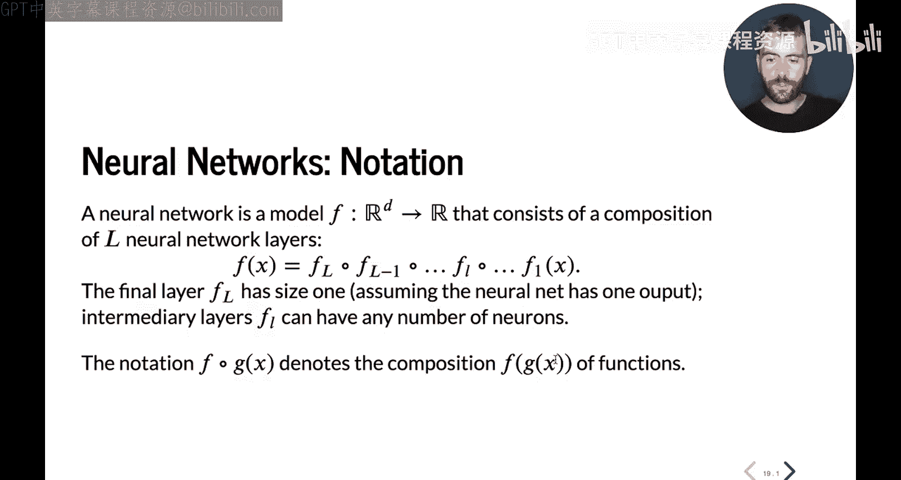

And visually， we can represent this as follows here。 we have the inputs。

 which go into a hidden layer， and then we have。Potentially a long sequence of these kinds of hidden layers until we reach our final output layer。

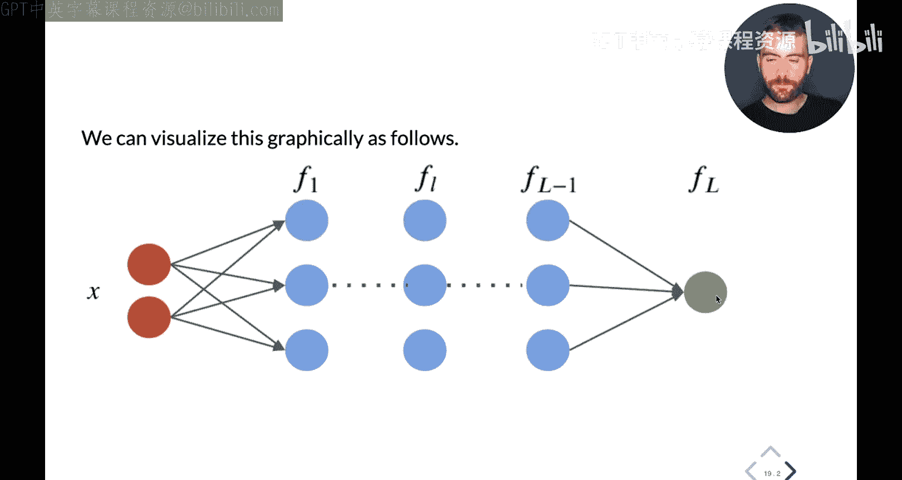

So we can implement this quite easily in Python， suppose that we have a simple neural network with a two dimensional input。

 three hidden units， so three hidden neurons or one hidden layer of size3。

 and then a final output layer。

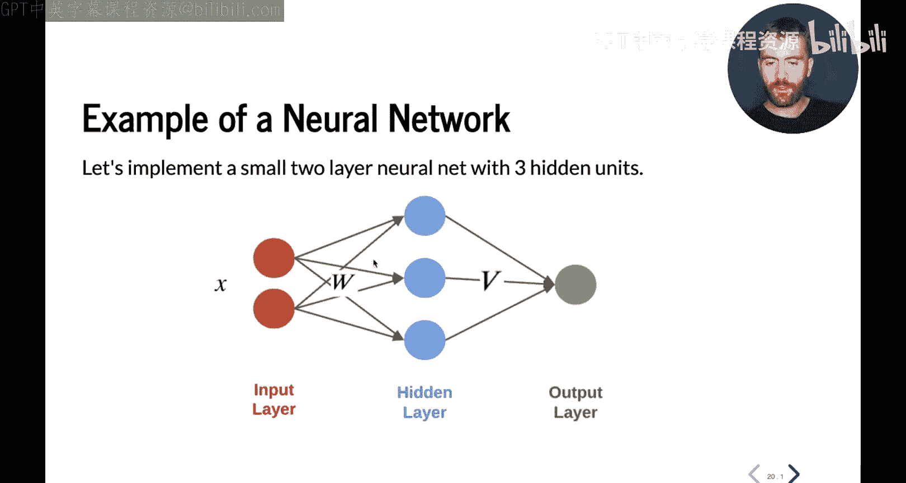

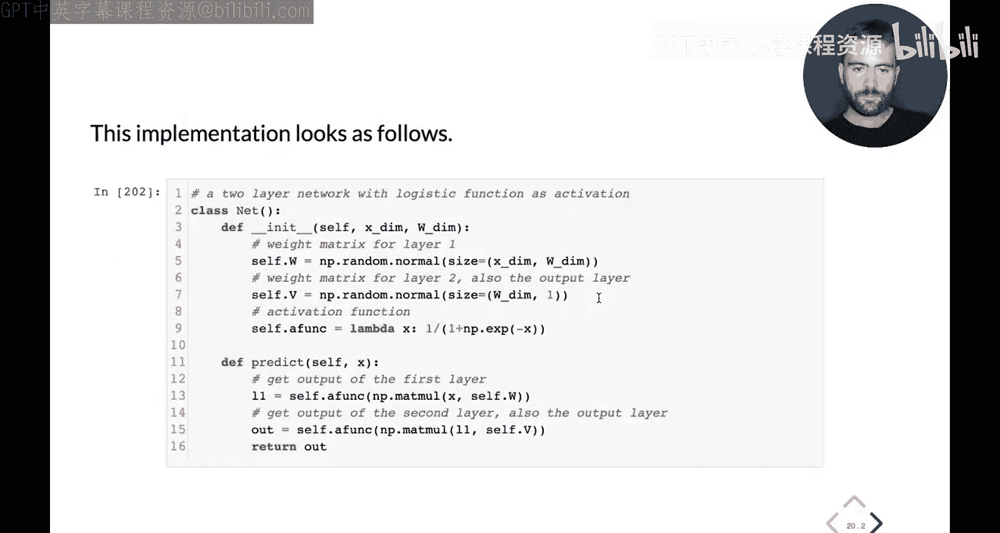

We can implement this in Python quite easily。Here we simply define a random matrix for。W。

 we start with a random matrix for V。 And then if we wanted to， oh， we also。

Definine an activation function here， this is the sigmoid activation function and if we want to compute the output。

 we receive an x here we compute the output of the final layer of the hidden layer and here we compute the output of the output layer。

And this is just a really simple implementation of a neural network and we're using NmI to perform these linear algebra operations efficiently。

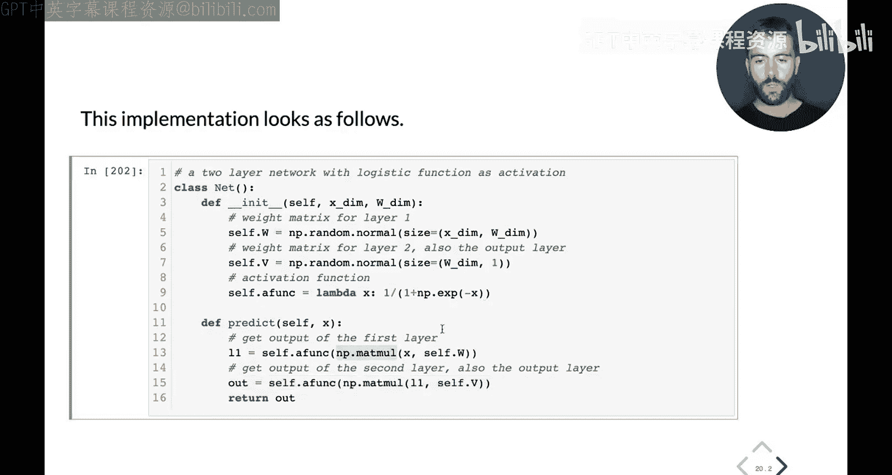

We're going to pause here。 and in the next lecture。

 we will actually see how to train this model using gradient descent。

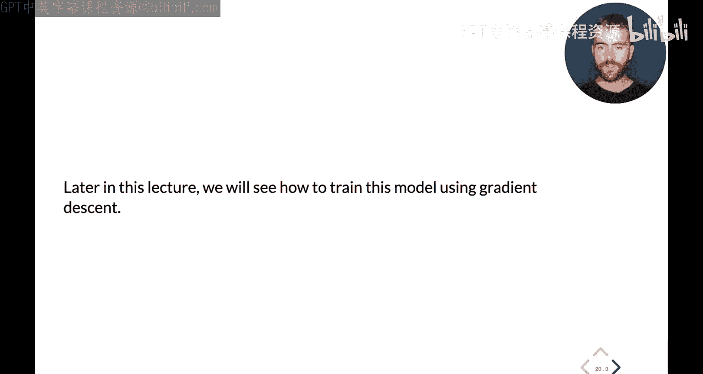

Now， before I move on， I also want to mention that there are many other output layers here so far I have mentioned these three types。

 but there are actually many other ones。

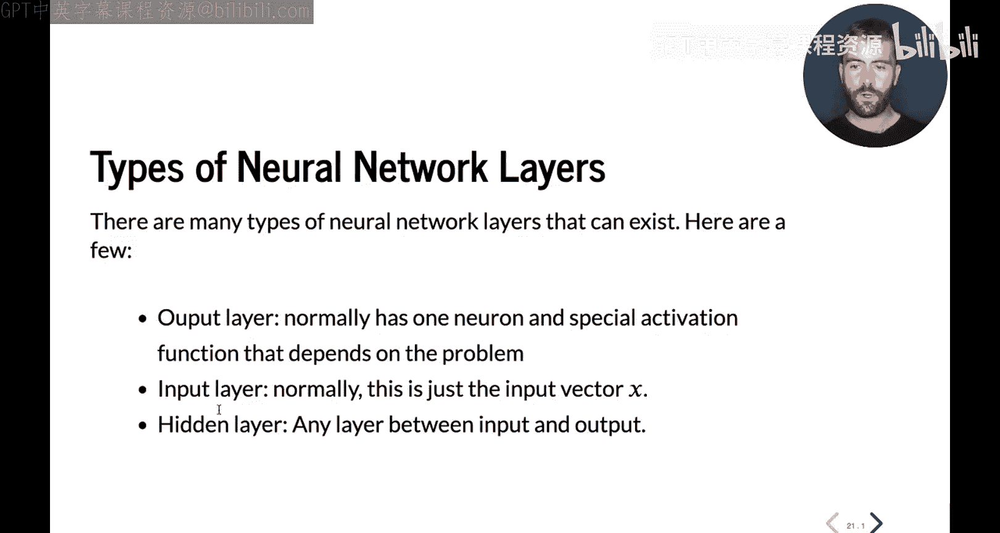

We use the term dense layer to denote the kinds of。

Layers that we have seen before where we have a matrix separation and every neuron is connected every neuron from the previous layer is connected to every neuron in the following layer。

But in practice， many useful layers do not have these dense connections， or if they do。

 they reuse parameters across them。One very important type of layer that we're going to see in the next lecture is the convolutionional layer which applies。

 so this multiplication is such that we apply a special operation called the convolution。

 which I'm going to define in the next lecture。And sometimes， as I mentioned。

 these layers can feed back into earlier layers which breaks the D structure。

 but then we have something called a recurrent neural network。

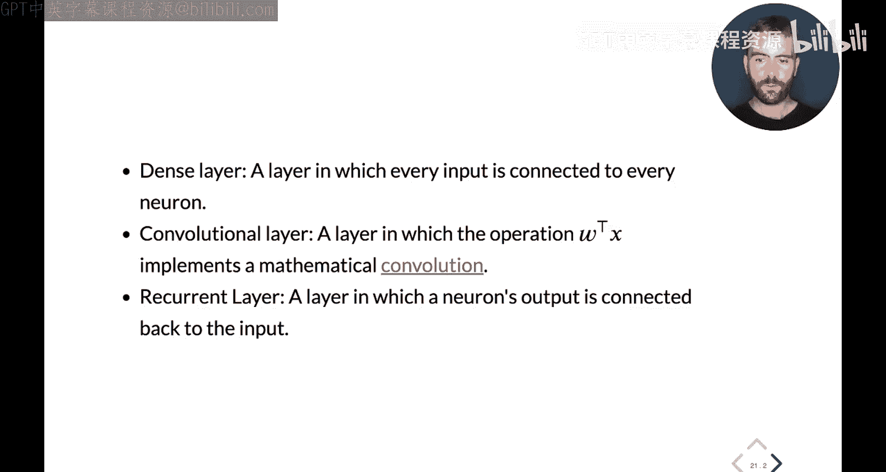

So to summarize， I have defined a new algorithm called a neural network and the examples that I gave。

 they were fully connected again because they all used dense layers and there are other types of neural networks which do not use these fully connected layers and we will see a few examples later on。

 but essentially these are again algorithms for supervised learning both regression and classification and they are optimized using gradient descent。

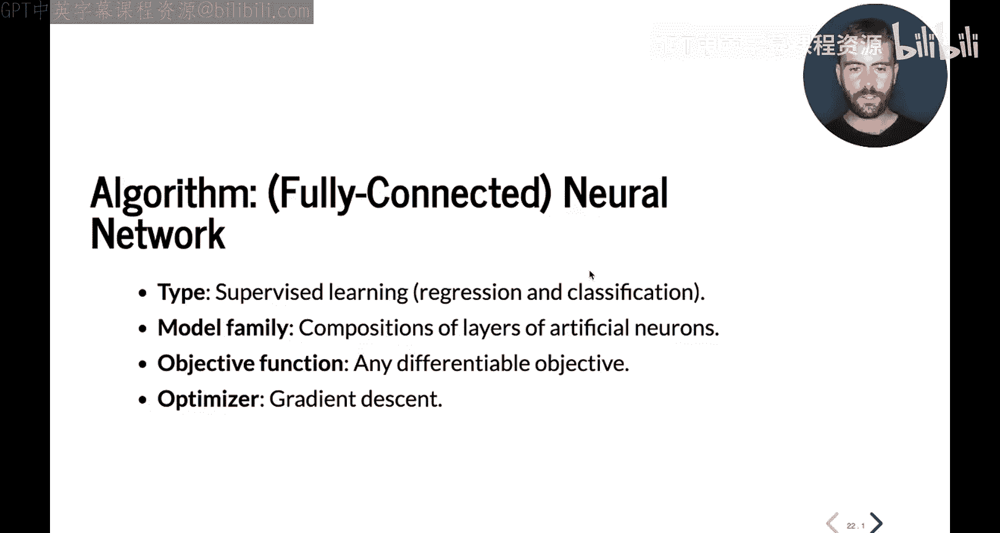

These kinds of neural networks， even though the particular form that I described is typically not the kind of model that gives a state of the art result on interesting problems like image classification or recognition。

 they still work very well and they are very flexible models。

 in fact there are results that can show that a neural network that's sufficiently large。

 can approximate any function that's a famous theoretical result from the late '80s。

And in terms of applications， these kinds of neural neural networks work best on in domains where。

We have unstructured inputs such as audio images and it's not obvious how to manually define features for an image and a neural network is useful in these kinds of applications and again for large enough neural networks we can often get really good performance。

Now， they also have limitations。 They require a lot of data。

 and they can also be slow and also hard to train using gradient ascent By hard。

 I mean that we need to worry about carefully choosing the learning rate。

 we need to be able we need to。Carefully choose the initial guess for the values of the parameters。

We need to process our input， so the input has to be normalized if some of the features are really large and some of them are really small。

 then it will not train well， the gradients will cause numerical instabilities and。

It will it will actually not work。 and it's also not when it does not， when it does not work。

 it's actually quite hard to to debug。 So neural networks have some limitations。

 but they're still a very important and a very powerful model。

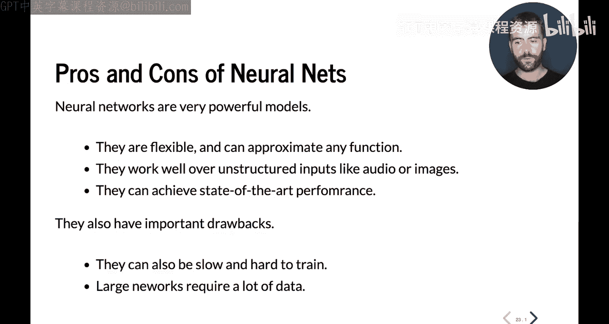