# 应用机器学习：第14讲：人工神经网络（第二部分） 🧠

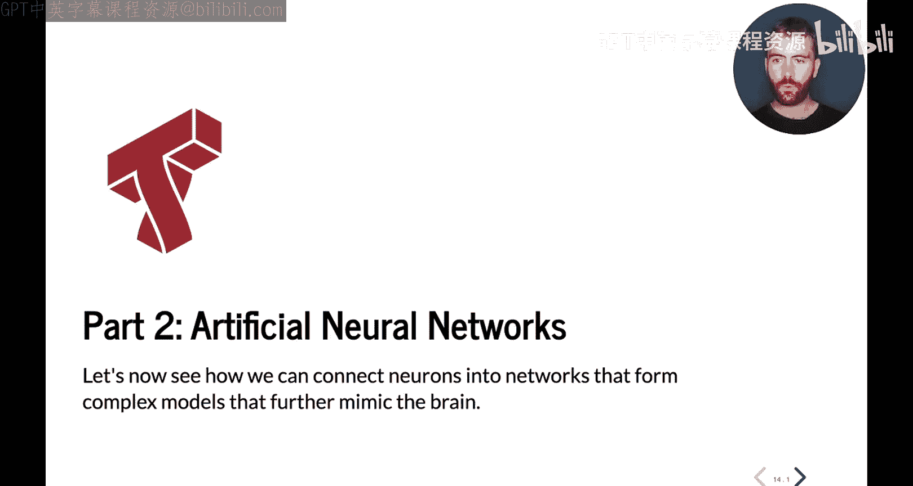

在本节课中，我们将学习如何将单个神经元组合成更复杂的模型——人工神经网络。上一节我们介绍了单个神经元的基本模型，本节中我们来看看如何将这些神经元连接起来，形成多层网络结构。

## 从神经元到网络 🌐

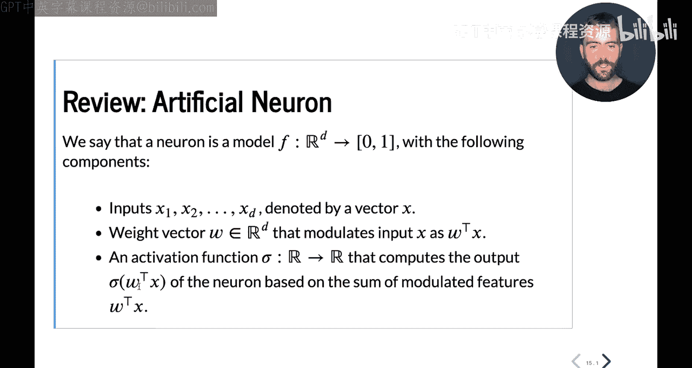

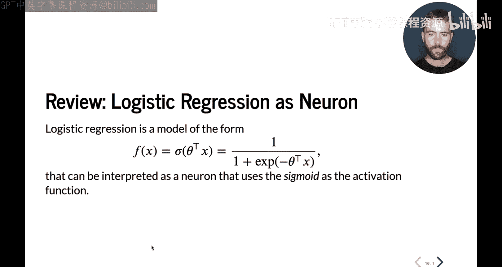

在上一节中，我们定义了单个神经元的模型。该模型接收输入 **x**，通过权重 **w** 对输入的每个维度进行调制，然后求和，最后通过一个激活函数 **σ** 输出结果。激活函数通常在输入较大时输出较大值，输入较小时输出较小值，以此模拟生物神经元的行为。著名的例子包括感知机和逻辑回归。

现在，我们将探讨如何将神经元组合成神经网络。通常，这是通过构建**神经网络层**来实现的。

## 神经网络层 🧱

神经网络层是一个函数，它接收一个 **d** 维输入，并输出一个 **p** 维结果。它的工作原理是将 **p** 个神经元并行应用于输入 **x**。每个神经元都有自己的权重，并且它们通常共享相同的激活函数。该层的全部参数是所有神经元参数的集合。我们称 **p** 为层的大小，即神经元的数量。

我们可以将其可视化如下：输入是 **x**，每个神经元都有一个权重向量 **w_i**。输入通过箭头（对应权重）进入神经元，进行加权求和，然后通过激活函数 **σ** 产生输出。

为了便于表示和计算，我们通常将这些权重组合成一个矩阵 **W**。矩阵 **W** 的每一行都是一个权重向量 **w_i^T** 的转置。这样，整个层的操作可以用线性代数简洁地表示为：

**h = σ(Wx)**

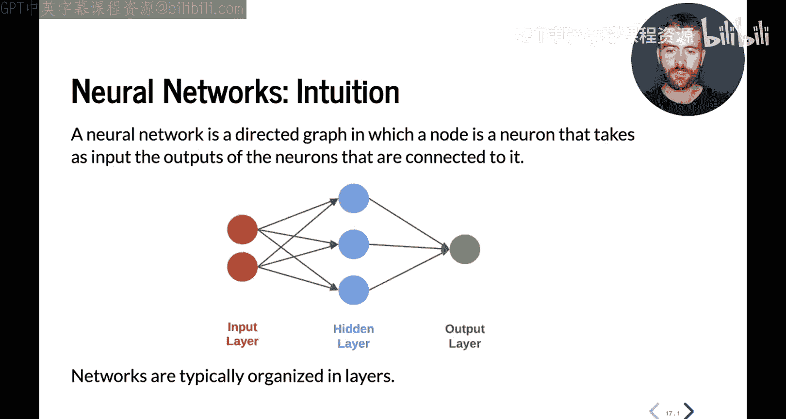

其中，**σ** 被逐元素地应用于向量 **Wx**。这种表示方式不仅更简洁，而且利用线性代数库可以实现高效计算。

## 构建神经网络 🏗️

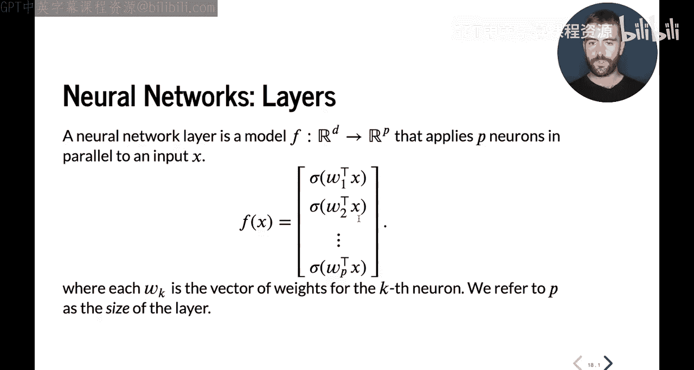

一个神经网络就是多个层的组合。假设我们有 **L** 层。我们称内部的层为**隐藏层**，最终的层为**输出层**。隐藏层之所以“隐藏”，是因为它们的输出不直接可见，而是作为下一层的输入。

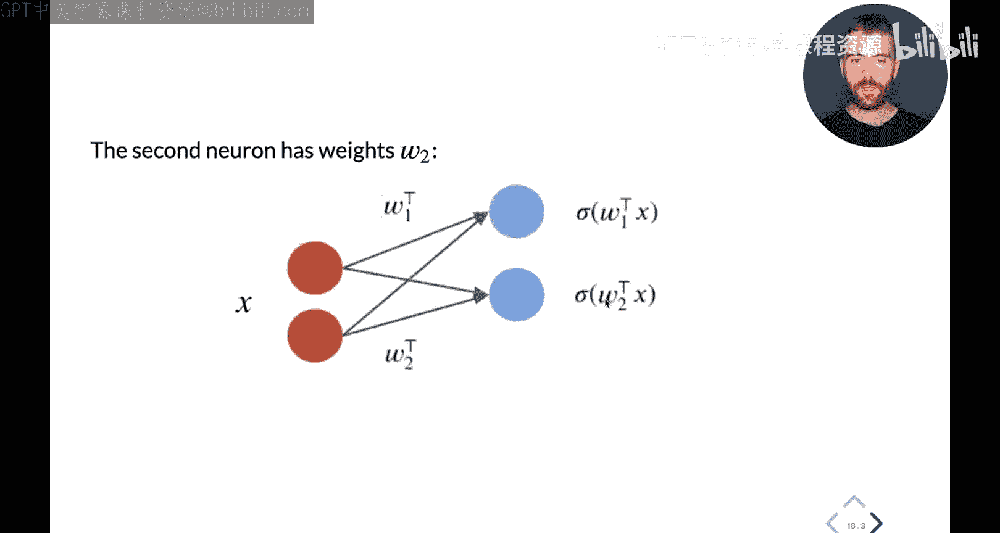

如果我们预测的目标 **y** 是回归或分类任务，那么输出层通常是一维的。它可能不使用激活函数，或者根据预测目标的需要使用特定的激活函数。

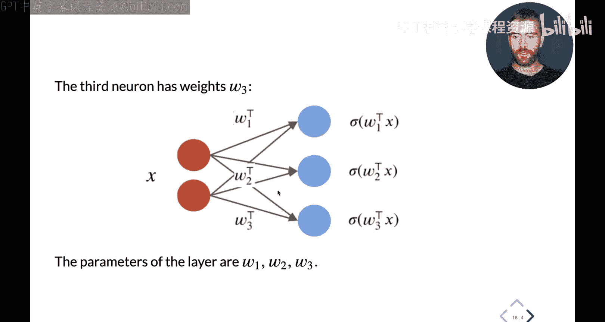

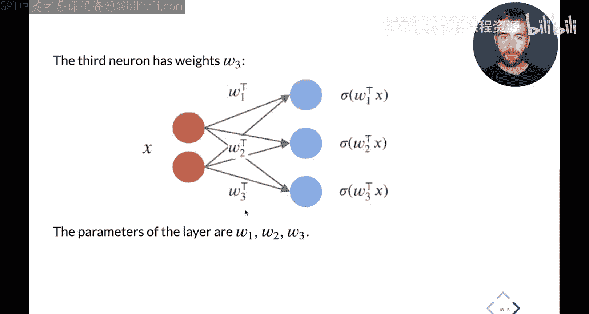

用函数复合的符号表示，一个 **L** 层的神经网络可以定义为：

**f(x) = f_L ∘ f_{L-1} ∘ ... ∘ f_1(x)**

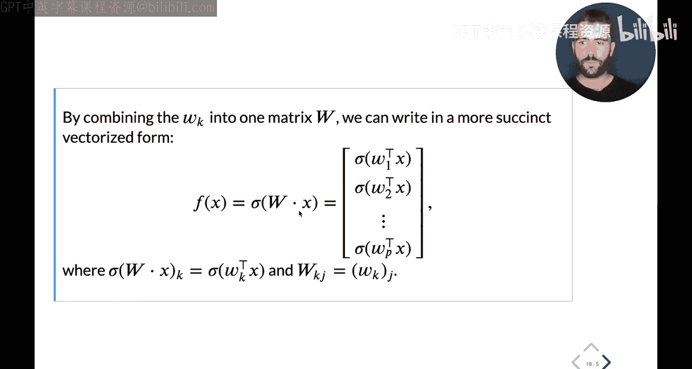

其中，**∘** 表示函数复合，即 **f ∘ g(x) = f(g(x))**。

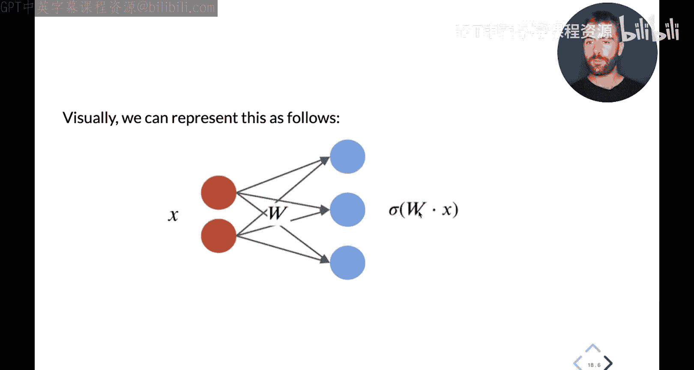

视觉上，我们可以将神经网络表示为：输入进入一个隐藏层，然后可能经过一系列这样的隐藏层，最终到达输出层。

## 一个简单的Python实现 💻

以下是一个简单的Python实现示例，展示了一个具有二维输入、一个包含3个神经元的隐藏层以及一个输出层的神经网络：

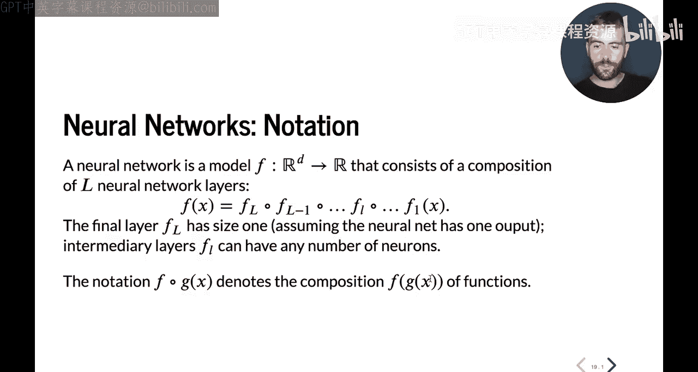

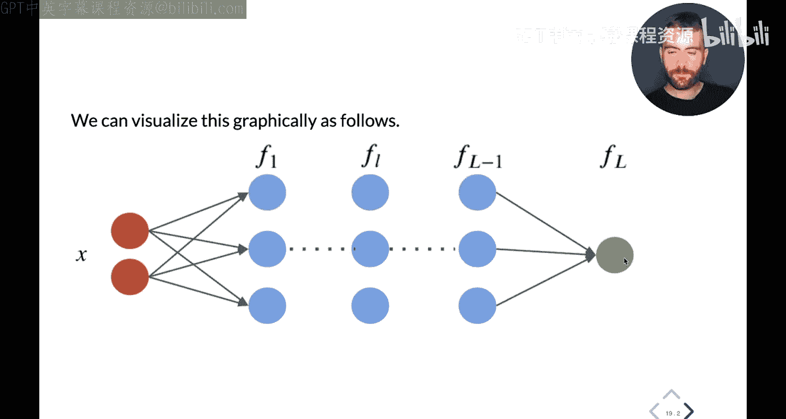

```python
import numpy as np

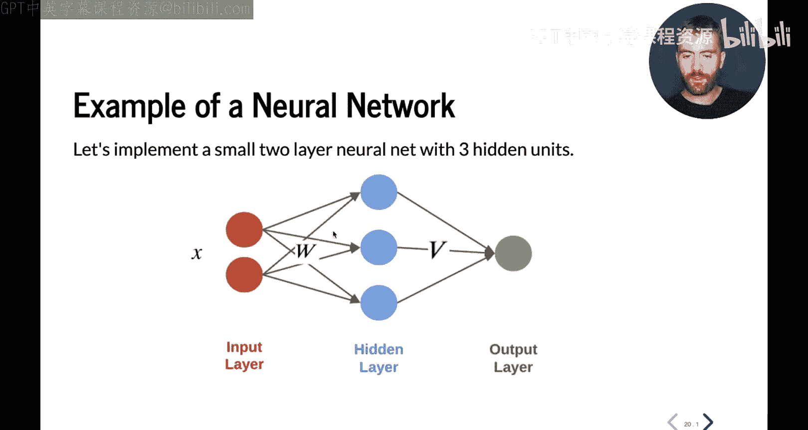

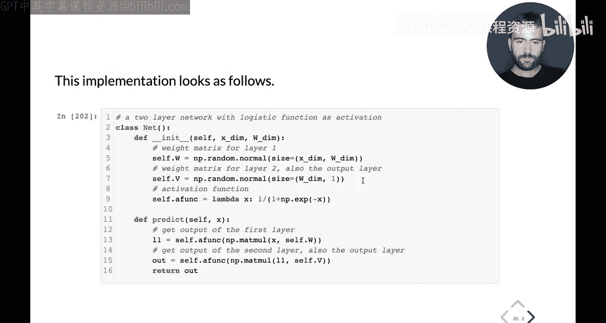

# 定义激活函数（Sigmoid）
def sigmoid(z):
    return 1 / (1 + np.exp(-z))

# 初始化权重矩阵
# 隐藏层：3个神经元，每个接收2维输入
W = np.random.randn(3, 2)
# 输出层：1个神经元，接收3维输入（来自隐藏层）
V = np.random.randn(1, 3)

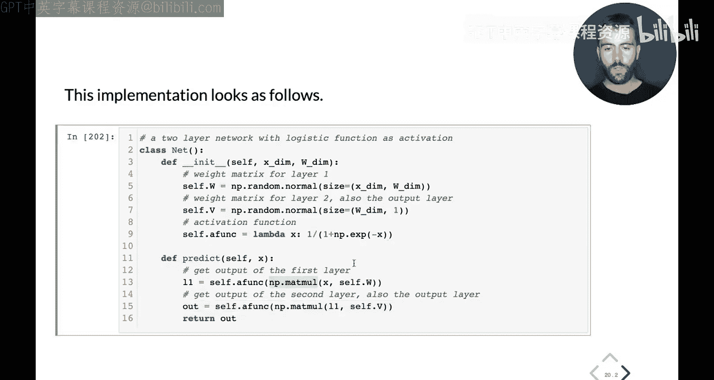

# 前向传播函数
def forward(x):
    # 隐藏层计算
    h = sigmoid(np.dot(W, x))
    # 输出层计算（此处假设为回归，不使用激活函数）
    y_hat = np.dot(V, h)
    return y_hat

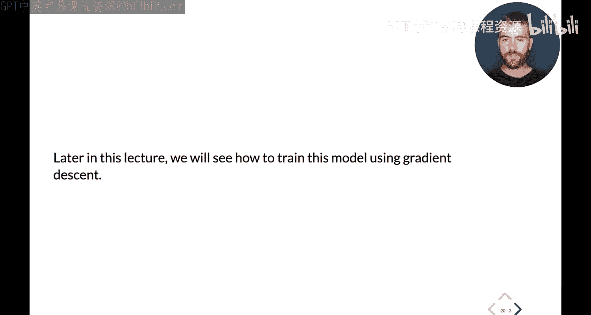

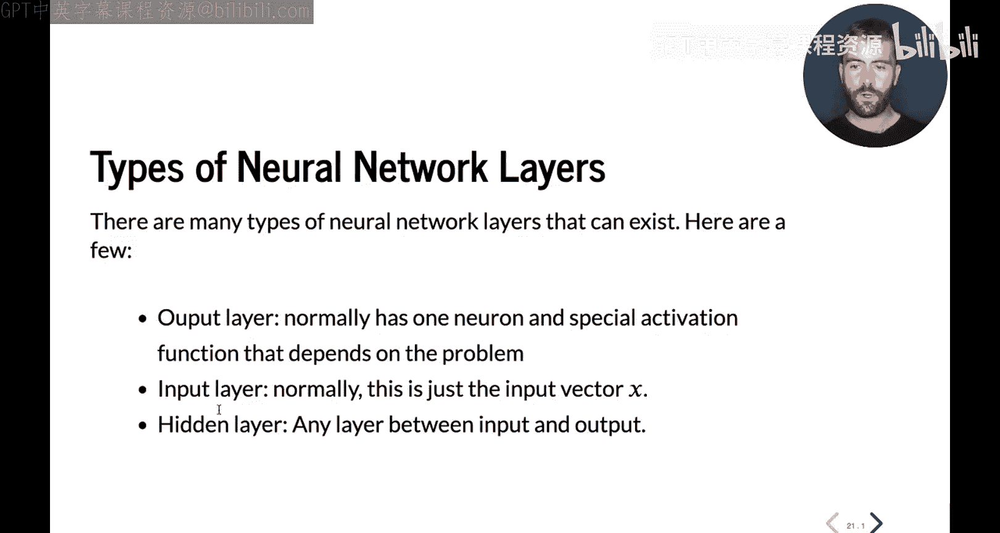

# 示例输入
x = np.array([0.5, -1.2])
output = forward(x)
print(f"网络输出: {output}")
```

这段代码使用NumPy高效地执行线性代数运算，简单地实现了神经网络的前向传播过程。

## 神经网络的类型与层 🔄

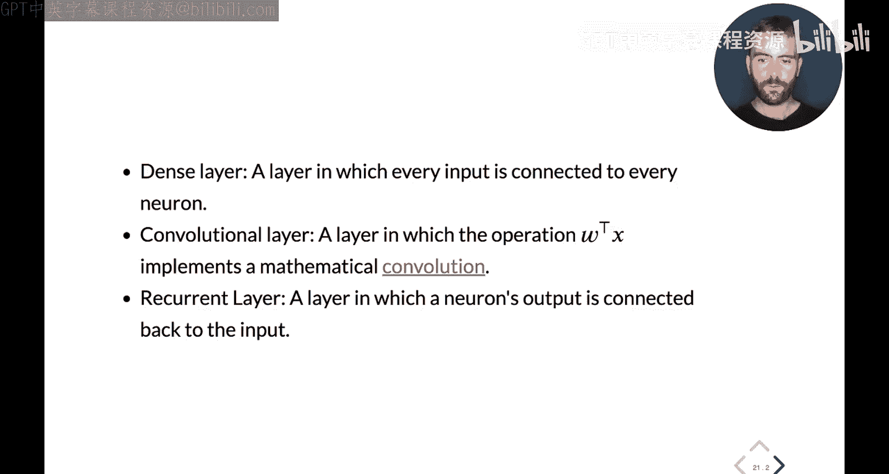

我们之前定义的层，其中前一层的每个神经元都连接到后一层的每个神经元，被称为**全连接层**或**密集层**。

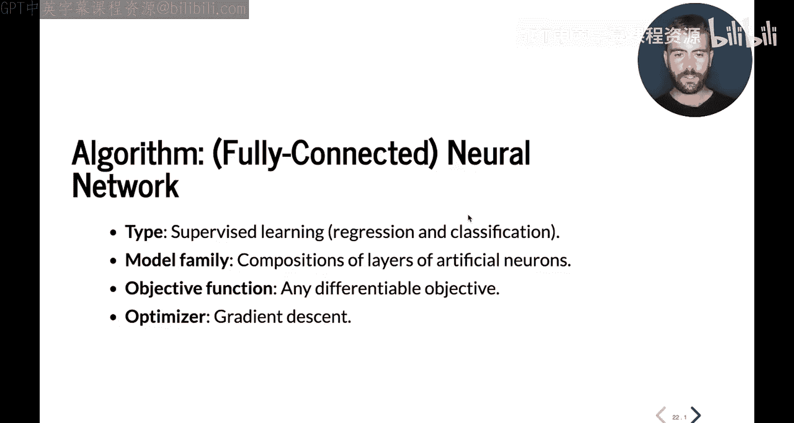

但在实践中，许多有用的层并不具有这种密集连接，或者会在连接中重用参数。以下是一些重要的层类型：
*   **卷积层**：在下一讲中，我们将看到卷积层，它应用一种称为卷积的特殊操作。这种层在图像处理中尤其重要。
*   **循环神经网络层**：这类层的输出可以反馈到更早的层，从而打破了有向无环图的结构，适用于处理序列数据。

## 总结与展望 📝

本节课我们一起学习了人工神经网络。我们定义了将单个神经元组合成层，再将多层组合成网络的方法。给出的例子使用了全连接层。神经网络是用于监督学习（回归和分类）的强大算法，通常使用梯度下降法进行优化。

即使本节描述的基本形式通常不是解决图像分类等复杂问题的最先进模型，神经网络仍然非常有效且灵活。理论上，足够大的神经网络可以近似任何函数。它们在处理音频、图像等非结构化输入数据时表现尤为出色，因为我们很难手动为这些数据定义特征。

然而，神经网络也有其局限性：需要大量数据、训练可能较慢且困难。训练时需要仔细选择学习率、参数初始值，并对输入数据进行规范化处理。当网络表现不佳时，调试也颇具挑战性。尽管如此，神经网络仍然是机器学习中非常重要且强大的模型。

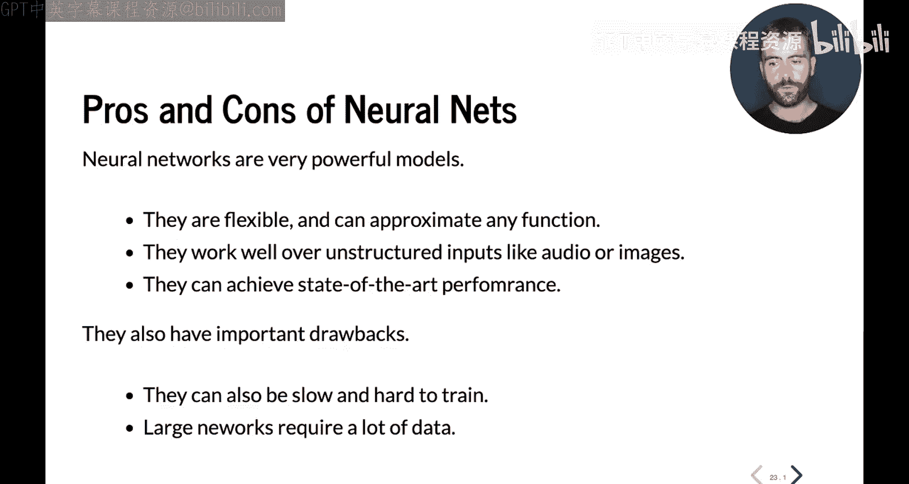

在下一讲中，我们将探讨如何使用梯度下降来训练这个模型。