# 应用机器学习：第14讲：第3部分：反向传播 🧠

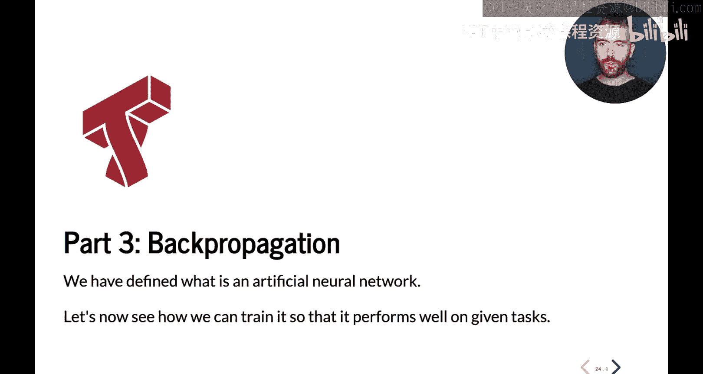

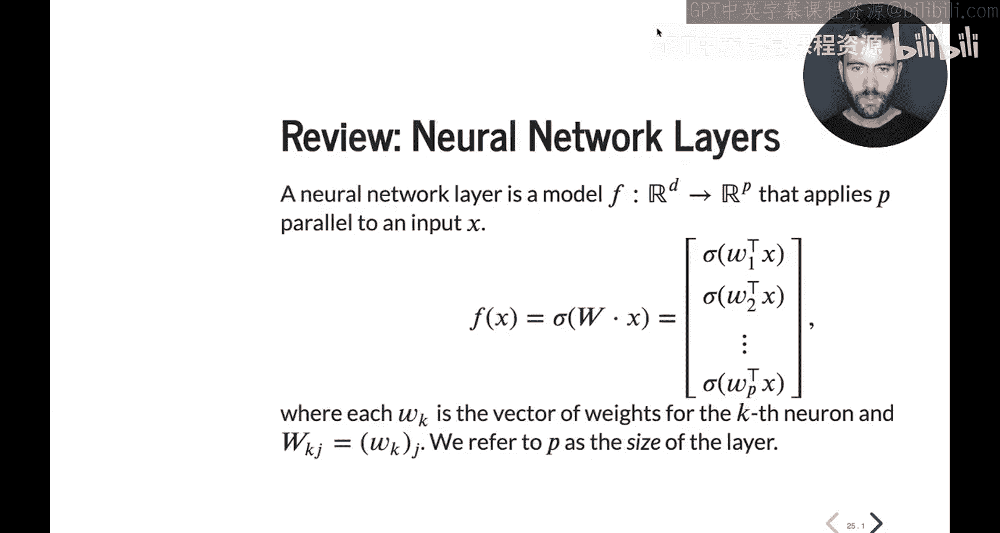

在本节课中，我们将学习如何训练人工神经网络。我们将重点介绍反向传播算法，这是一种利用梯度下降法高效计算神经网络梯度的关键技术。

在上一节中，我们定义了人工神经元和神经网络的结构。本节中，我们来看看如何使用梯度下降法来训练神经网络。为了计算神经网络的梯度，我们将使用一种特殊的算法，称为反向传播。

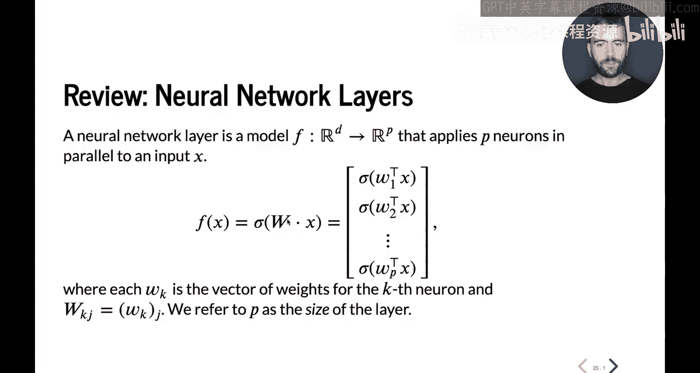

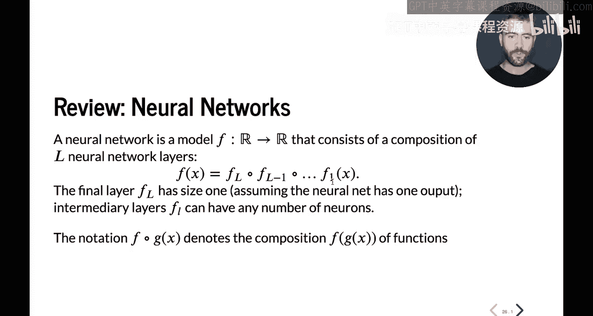

## 神经网络结构与梯度下降

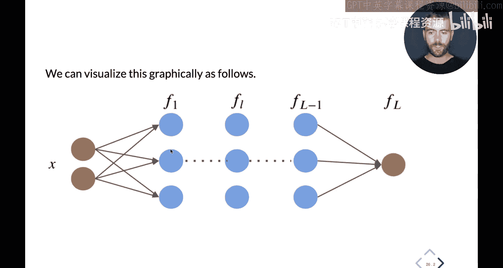

回忆一下，一个神经网络层具有以下结构：我们有输入 **X**，每个输入乘以一个对应不同神经元的权重向量。我们可以将这些权重向量组合成一个矩阵 **W**，然后对每个神经元应用激活函数。用向量化形式表示，可以写成：
```
Y = σ(W * X + b)
```
这给出了神经网络层的输出。

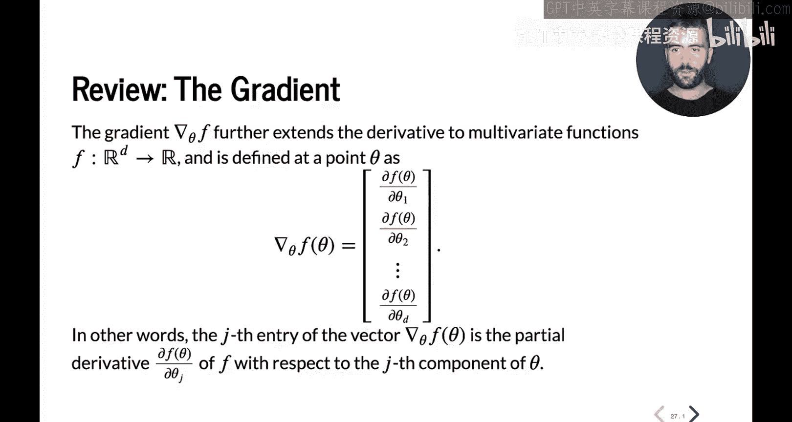

当我们组合多个这样的神经网络层时，如果取 L 层并将它们依次组合，就得到了一个前馈神经网络。

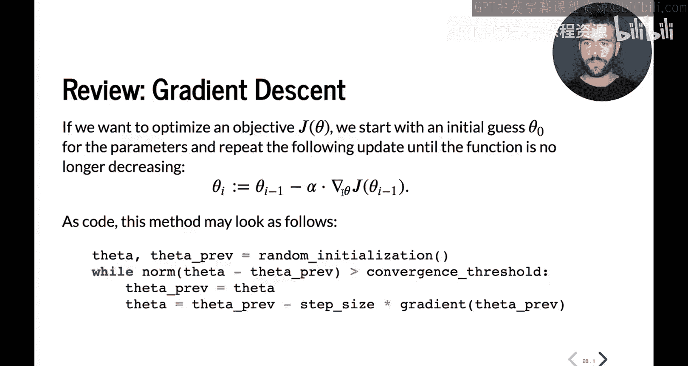

从视觉上看，其结构如下：我们有不同的层序列，最后一层称为输出层，中间的蓝色层称为神经网络的隐藏层。

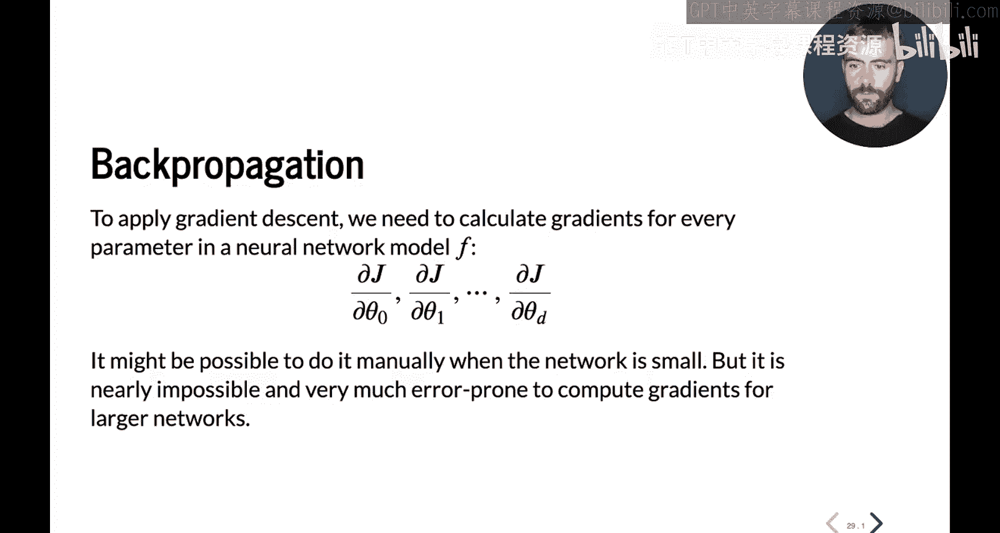

通常，在优化机器学习模型时，我们使用梯度下降法。事实上，即使优化单个神经元（其行为与逻辑回归相同），我们也必须使用梯度下降。如果我们使用感知机或任何其他激活函数，仍然需要使用梯度下降进行优化，因为没有公式或闭式解。因此，我们也将使用梯度下降来优化神经网络。

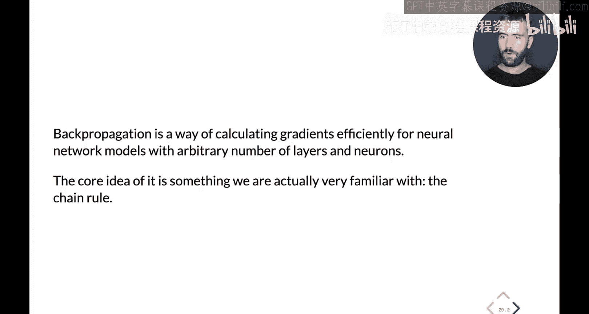

梯度下降的结构如下：我们从参数的某个初始猜测开始，然后反复应用以下更新：我们沿着目标函数梯度给出的方向在参数空间中移动，这个方向能最快地最小化目标函数。

为了应用梯度下降，我们需要计算神经网络模型每个参数的梯度。反向传播算法将允许我们做到这一点。

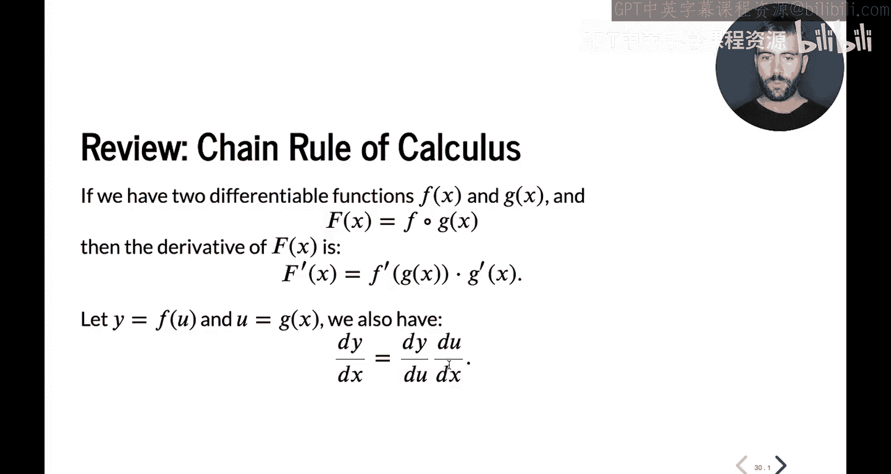

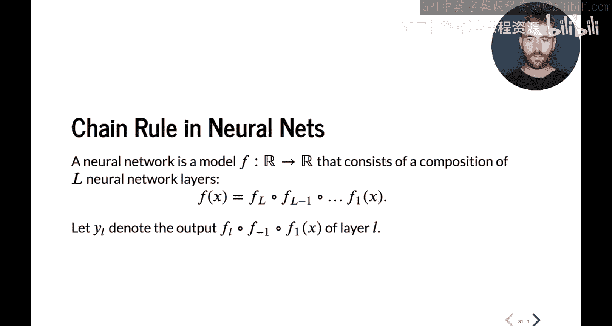

## 反向传播的核心：链式法则

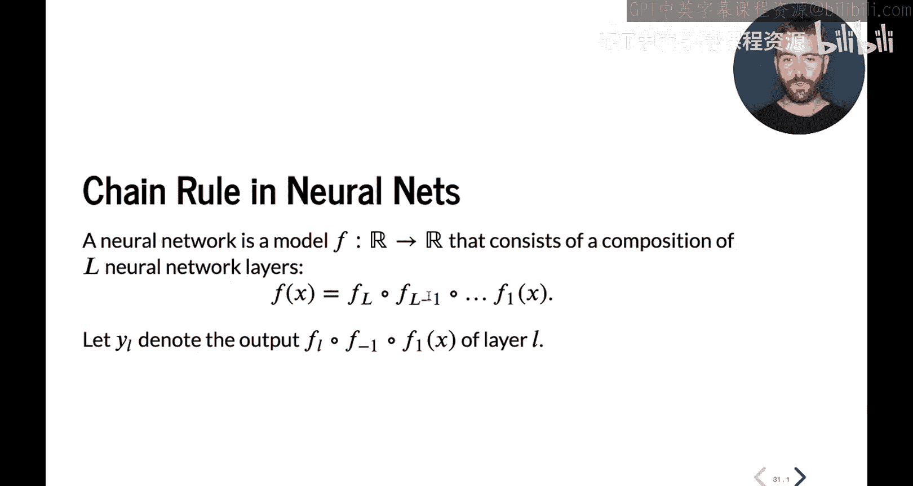

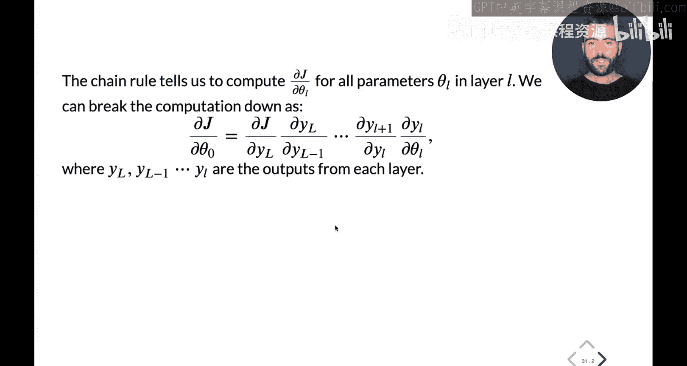

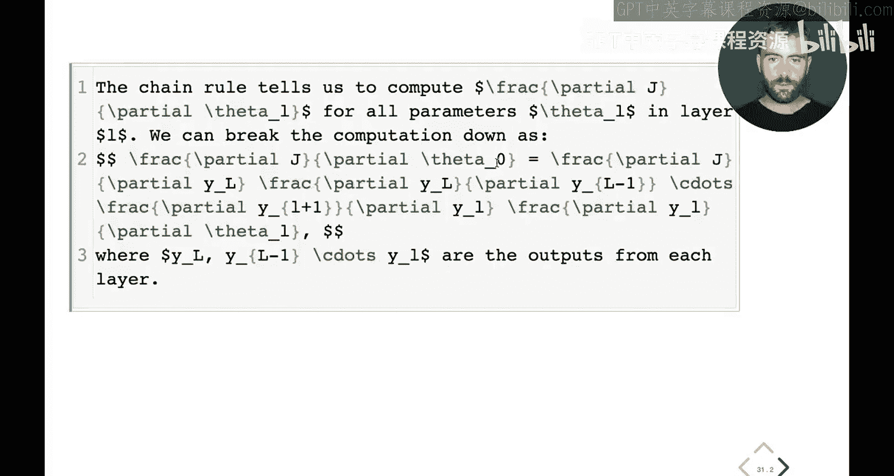

反向传播的核心思想是微积分中一个简单的公式，称为链式法则。

你应该记得，微积分中有一个公式用于计算两个可微函数复合后的梯度。如果我有 F 与 G 的复合，那么其梯度由下式给出：
```
∇(F ∘ G)(x) = ∇F(G(x)) * ∇G(x)
```
或者使用另一种符号表示，我们有如下公式。如果 y 是最终层的输出，u 是隐藏层的输出，那么最终层关于 x 的导数将是第一层关于其输入的导数乘以第二层关于其输入的导数。

如前所述，神经网络具有这种结构，它是函数的复合。因此，为了计算神经网络的梯度，我们将链式法则应用于以下层序列。

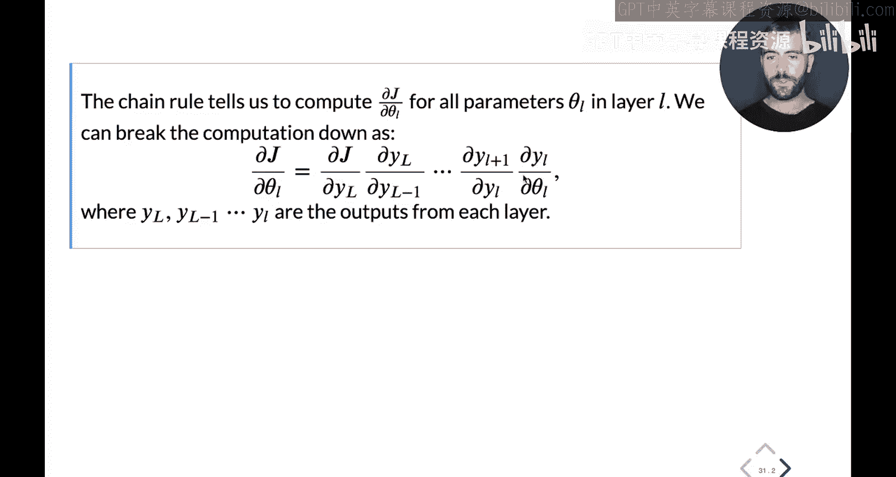

假设我们有一个参数 θ_L（这应该是第 L 层的参数），我们想要计算目标函数 J 关于这个参数 θ_L 的梯度。根据链式法则，这将是目标函数关于最终层输出的梯度，乘以最终层关于其输入（即第 L-1 层输出）的导数，依此类推，直到第 L+1 层关于 y_L 的导数，然后是 y_L 关于 θ_L 的导数。θ_L 只是第 L 层的一个标量参数，我们可以使用以下公式计算其导数，这仅仅是链式法则的一个应用。

现在，一个重要的观察是：如果我使用另一个更靠前的参数，例如 θ_{L-1}（第 L-1 层的参数），那么公式将非常相似，只是这里会多出一组项。这些导数（例如 y_L 关于 y_{L-1} 的导数）将在许多梯度计算中被重复使用。因此，反向传播算法会计算所有这些中间梯度，存储它们，并在所有下游梯度计算中重用它们。换句话说，当我们计算第 L 层参数 θ_L 的导数时，我们将保存或已经保存了这里以及在此之前的所有梯度。在下一步，如果我们计算第 L-1 层参数 θ_{L-1} 的梯度，我们将重用已经保存的所有内容。

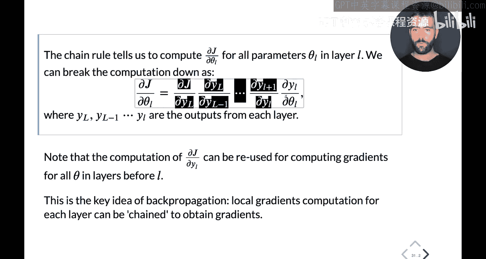

这实际上是一种动态规划形式。如果你熟悉算法和不同的算法技术，这种重用先前步骤计算的思想被称为动态规划。因此，你可以将反向传播视为一种特定的动态规划算法。但本质上，反向传播是在深度神经网络中高效实现链式法则的一种方式。链式法则是给出梯度定义的公式，而反向传播是一种算法，它允许我们以尽可能重用早期层梯度来计算后续层梯度或导数的方式来计算它。

## 反向传播工作原理示例

现在，让我们看一个简单示例，了解这是如何工作的。

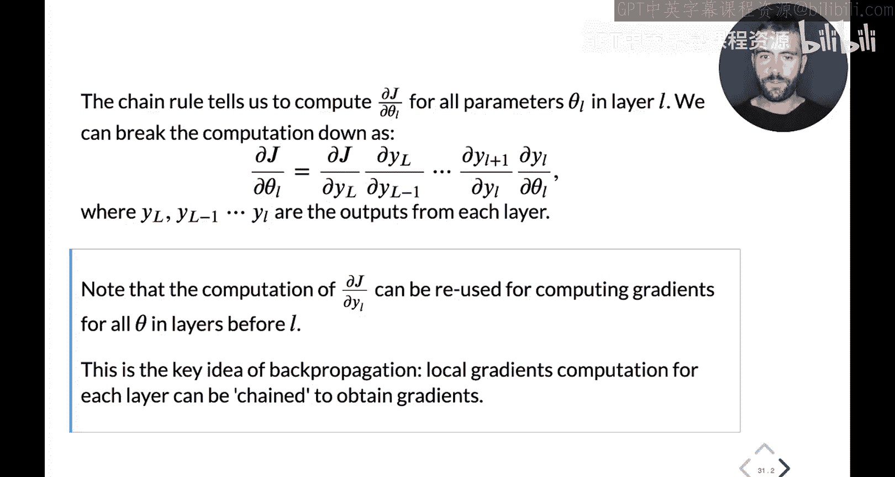

假设我们有一个层，它接收输入 **X**（这可以是实际输入，也可以是前一个层的输出），并产生输出 **Y**。假设这是最终层，我们有一个损失函数 J，以及某种目标值 **ŷ**，我们可以形成损失 J。

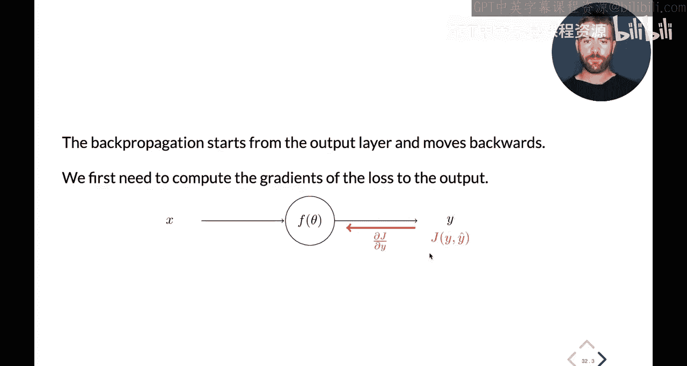

如果我们想计算关于此处某些参数 θ 的导数，我们首先需要形成 J 关于 y（该层的输出）的导数。

现在，我可以简单地应用链式法则来计算 J 关于参数 θ 的导数。输出是 y，而 y 是 θ 的函数，这个函数由这里的 F 给出。所以我可以简单地这样做，这仅仅是链式法则的一个应用。

在下一步，我可能还想计算 y 关于 x 的导数。如果 x 实际上是前一个层的输出，这将非常有用。在这种情况下，我会对计算 J 关于 x 的导数感兴趣。根据链式法则，这简单地等于 J 关于 y 的导数乘以 y 关于 x 的导数。注意，J 关于 y 的导数我已经在这里计算过了。因此，反向传播算法将存储这个值，并重用它来计算这个梯度和这个梯度，然后也会在下游使用它。

现在，想象一下我前面还有另一个层。根据相同的逻辑，这个 F_L 的梯度将使用它前面的梯度。因此，内部这将是许多通过链式法则获得的导数的乘积，但我可以只存储这个乘积（它将是一个数字），然后我可以使用相同的技术来计算这一层的导数，并向下传递另一个梯度，该梯度将被用来计算这一层的导数，然后它再向下传递一些东西，依此类推。这就是反向传播的结构。

## 手动实现：一个简单的两层神经网络

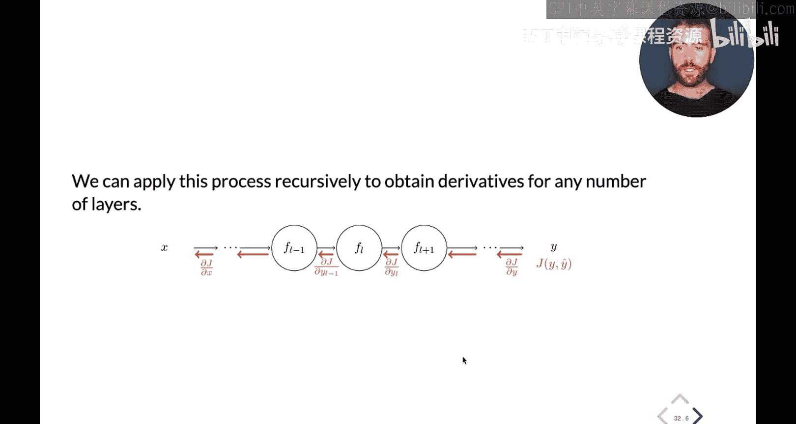

为了使内容更具体，让我们手动实现它。我们将为一个简单的两层神经网络（就像我们之前看到的那样）进行实现，该网络有 3 个隐藏单元，1 个输出单元和 2 个标量输入 x1, x2。

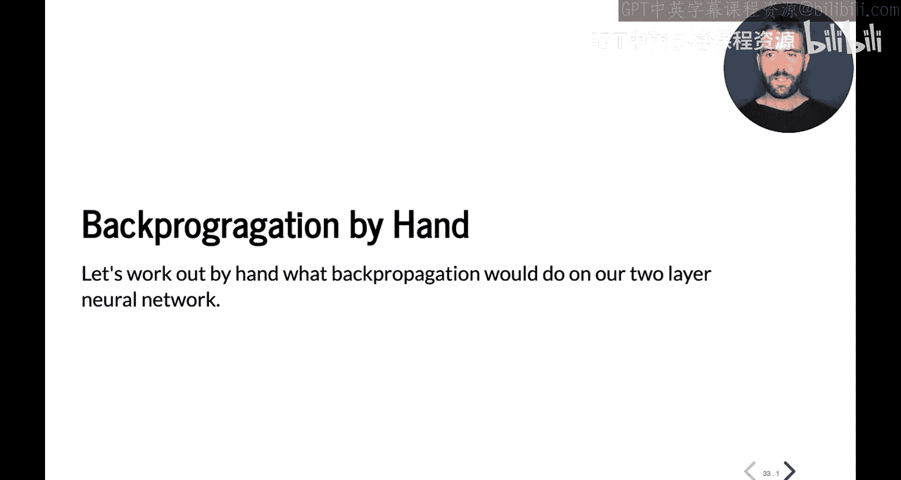

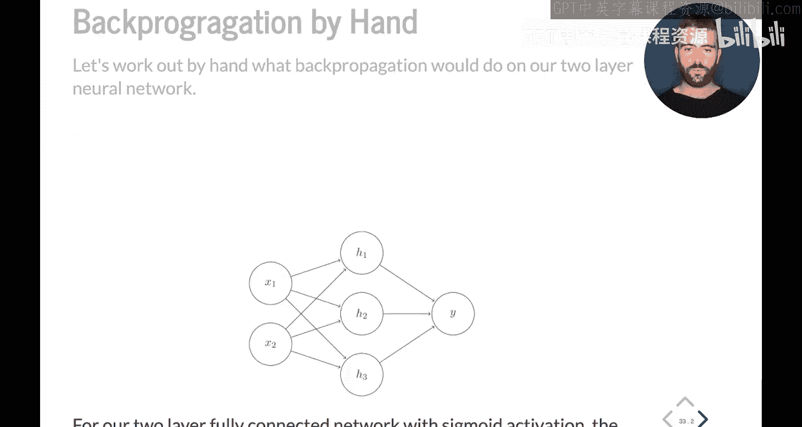

我们将使用矩阵 **W** 表示隐藏层的权重。所以这里 **h** 由 σ(**W** * **x**) 给出。**V** 将表示输出层 **y** 的权重。我们将在所有层中使用 σ 作为激活函数。

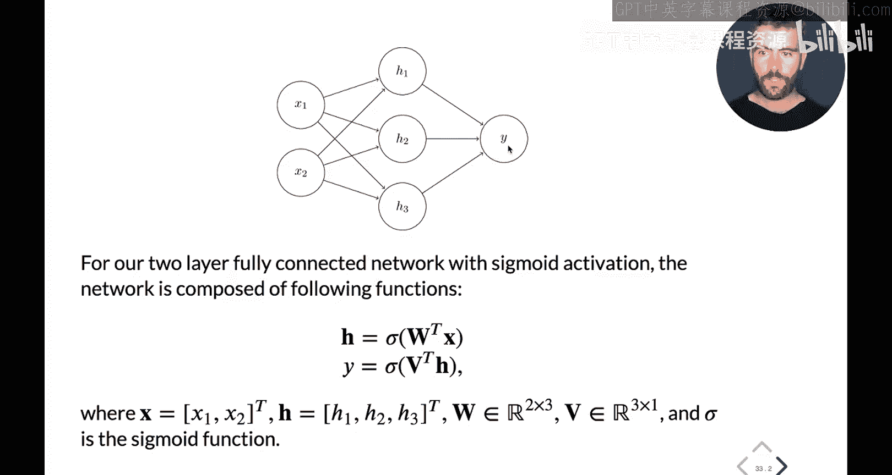

假设我们有以下权重集合、目标值 ŷ 和输入。现在，让我们逐步计算这会给我们什么结果。

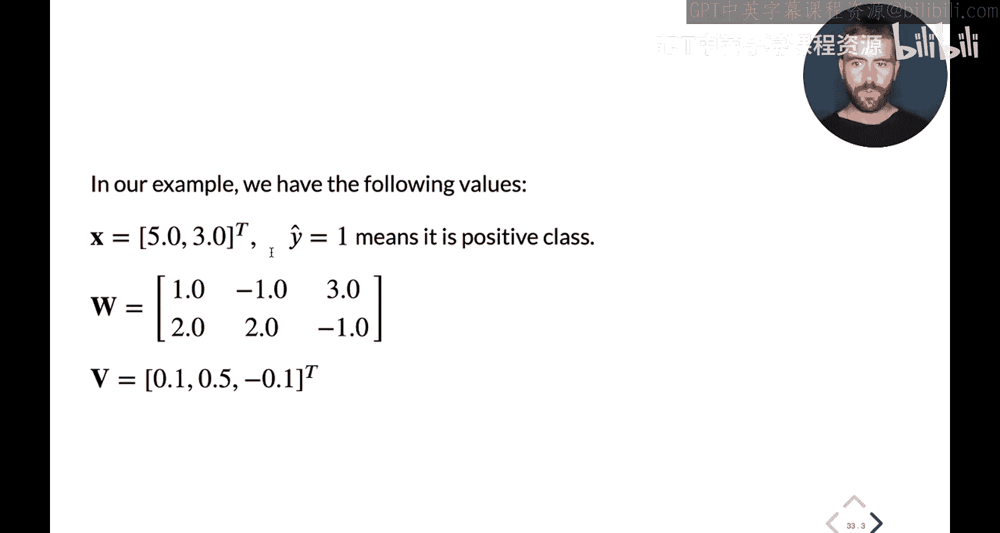

我将在这里使用几种颜色：蓝色表示权重，黑色表示节点的值。我的输入是 5 和 3。我想计算这个神经元的输出。这个神经元将接收输入 5 和 3，将它们乘以权重（1 和 2），然后应用 sigmoid 函数，这将给出一个非常接近 1 的值，这就是这个节点的值（黑色），它仅仅是这个神经元的输出。

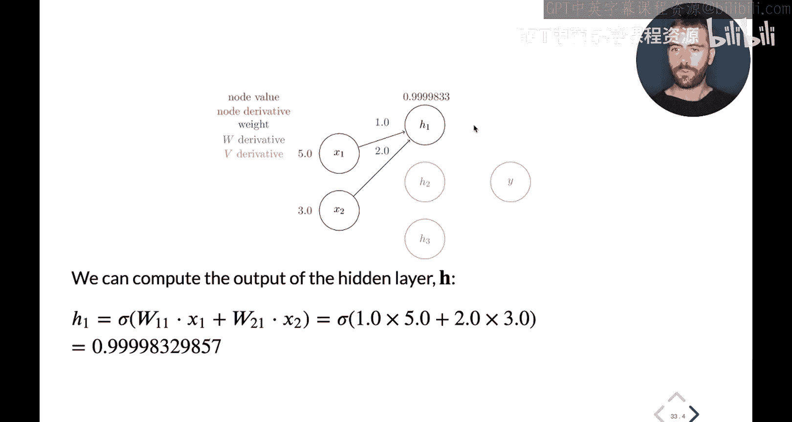

现在，我可以对中间的神经元做同样的事情：我的权重是 -1 和 2，这给了我一个较小的输入，如果我对这个输入应用 sigmoid，我得到以下输出，大约是 0.73。

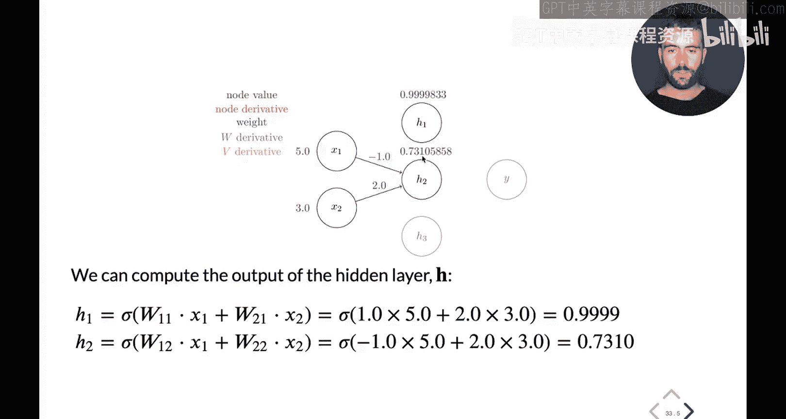

对于这个神经元，我也有一个非常大的值。这就是它的样子。这样我就计算出了隐藏层的输出。

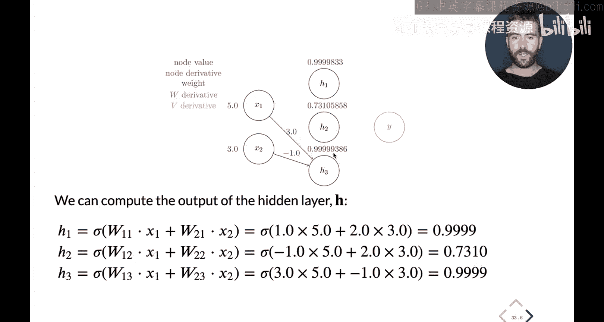

现在，我可以类似地计算最终层的输出。这些是沿着每个连接的权重。同样，你可以将此连接视为这个神经元的树突和那个神经元的轴突，它的权重是 0.1。所以我只需取这些输出（0.9, 0.73, 0.99），将它们乘以这些权重，求和，现在我有了一个输出。

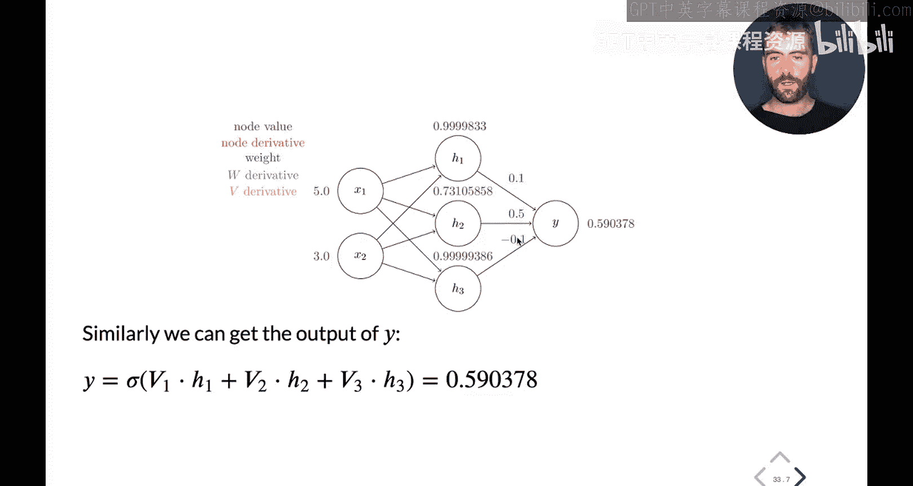

最后，我可以计算损失的值。假设我们使用交叉熵损失，那么这将是我们损失的值，大约为 0.52。

现在我们可以开始计算梯度了。因为我有这个损失值，但我的目标是计算每个权重的梯度或导数，以便执行梯度下降。在反向传播中，我们经常谈论前向传播和反向传播。我刚才展示的称为前向传播：我计算了每个神经元（包括输出神经元）的值和输出。现在，我将反向进行，实际计算所有梯度。

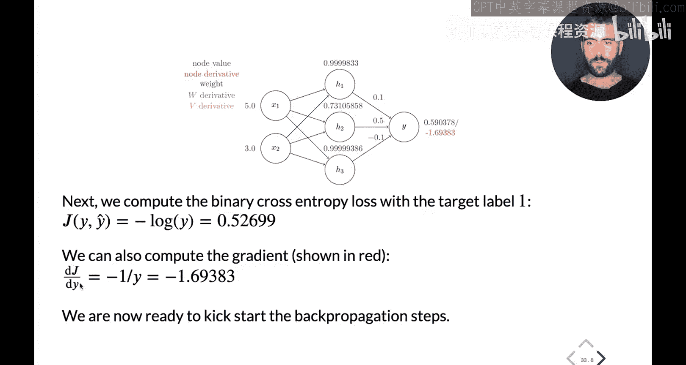

我们要计算的第一个梯度是 J 关于输出 y 的导数。

再次使用公式，计算关于 **V**（输出层权重）的梯度如下，这仅仅是链式法则。现在利用 sigmoid 的导数就是 sigmoid 乘以 (1 - sigmoid) 这一事实（我们在逻辑回归的讲座中见过），我可以形成导数。我可以证明，对于输出神经元权重的每个偏导数，公式简单地等于这个。因此，从这个定义和公式很容易验证，这就是输出神经元每个权重的偏导数公式。

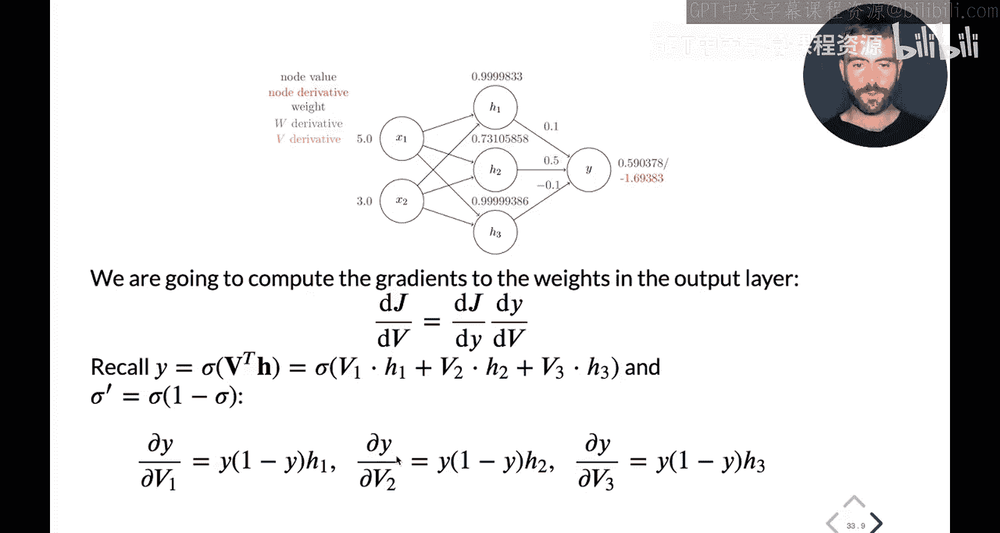

应用这些公式，我现在可以计算每个权重的梯度。这里蓝色是权重，红色是它们的梯度。这只是前一页幻灯片中公式的应用。

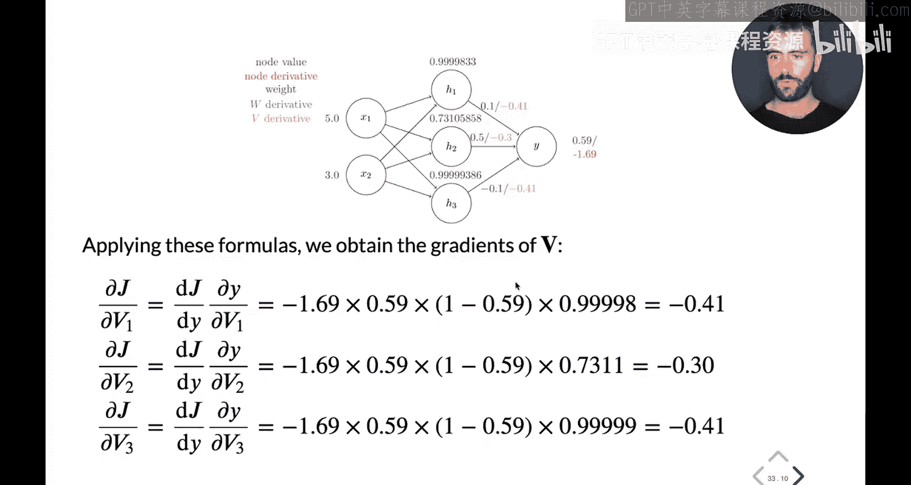

现在我想计算关于隐藏层权重的梯度。这些将是这里的梯度。

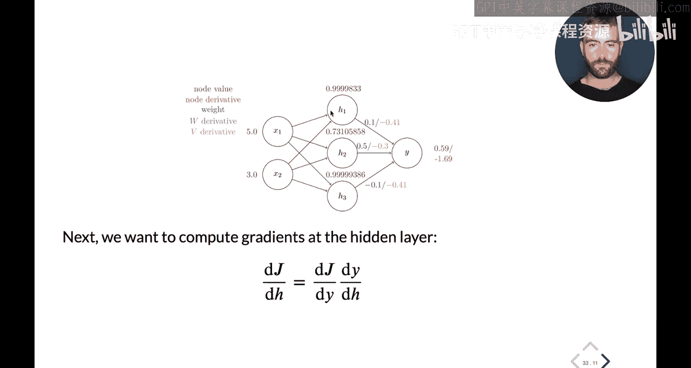

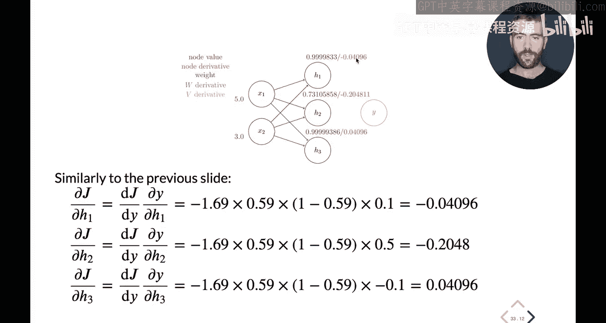

同样，根据我之前有的相同公式，但根据链式法则，隐藏层权重的导数是... 这里，h 是输出。为了澄清，我刚刚计算了红色部分（参数的梯度）。现在我将计算关于 h1, h2, h3（神经网络的输出）的梯度。我这样做的原因是在反向传播的下一步，我将使用这些来计算下一组权重的梯度。

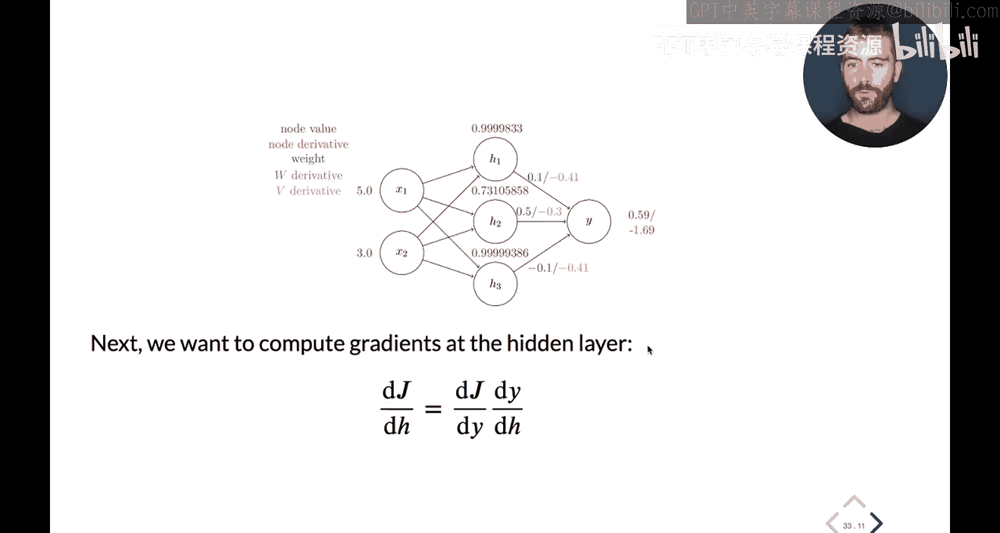

再次应用公式，J 关于 h1（隐藏神经元 1 的输出）的导数是 J 关于 y 的导数乘以 y 关于 h1 的导数。应用这个公式，我得到以下这些导数值。

重要的是，对于计算梯度的目的，这个节点 y 本质上不再需要。关于这个节点，或者如果我有更多节点，关于神经网络上层发生的一切，我已经用这三个数字总结了。这是我唯一需要跟踪的东西。我可以“丢弃”所有上层的神经元。我的意思是，只要我们有这些偏导数，只要这些偏导数被计算出来，我们就不再需要知道这里发生了什么。

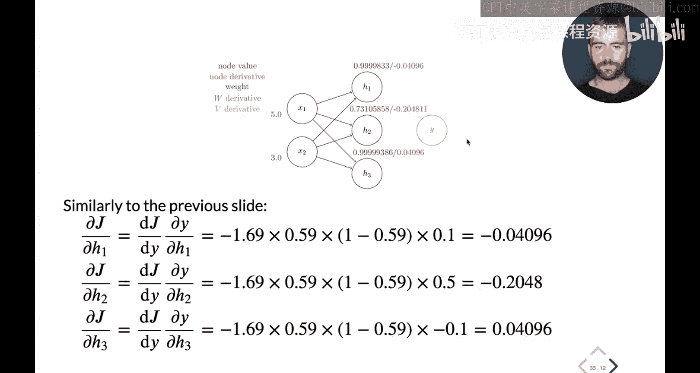

无论我们只有一个输出层，还是前面有多个隐藏层，这些都包含了神经网络上游发生的一切信息。

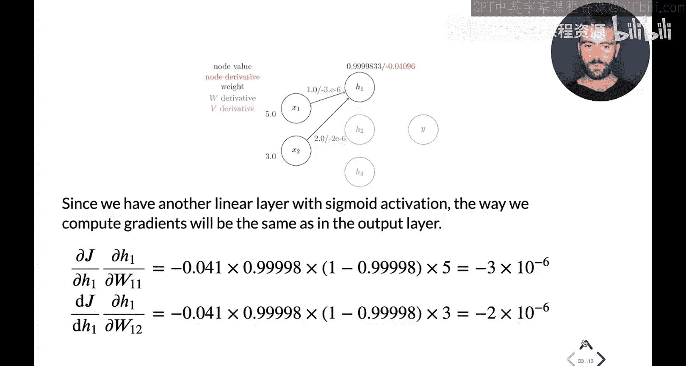

现在，让我们计算这些蓝色权重的梯度。再次使用微积分的链式法则，损失 J 关于参数 **W** 的偏导数... 例如，参数 W11 在这里是 1，另一个参数是 2。根据链式法则，导数是 J 关于 h1（输出层 h1）的导数，乘以 h1 关于 W11 的导数。这里，h1 的导数项，我们可以很容易地计算，因为这仅仅由人工神经元的公式给出，这仅仅是人工神经元输出关于其权重的导数。而前一项，我已经在算法的先前步骤中计算并存储了它。

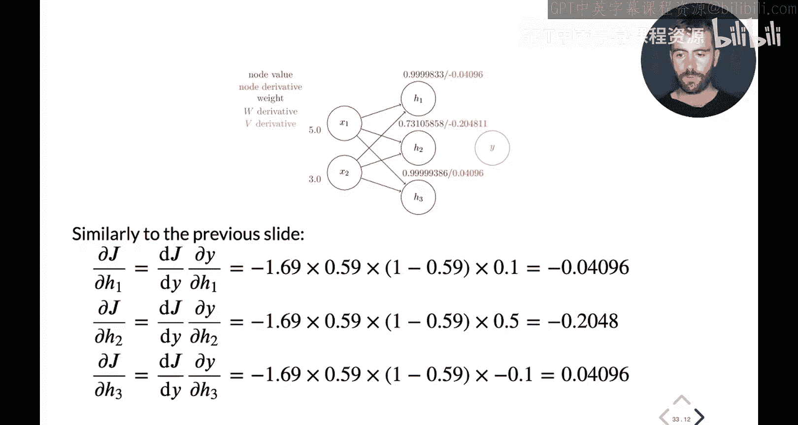

这就是我之前计算并保存的，其内部也是通过链式法则计算的，但链式法则的所有不同步骤现在都已保存，我只有 J 关于 h1 的这个权重，仅此而已。这是我运行此算法时从先前版本得到的唯一数字。现在应用公式，我得到这一层的以下偏导数。

我可以类似地计算这一层的其他偏导数。再次，这里红色的导数是关于输出的导数，而这里紫色的导数是关于权重的导数。

这样我就手动运行了它。现在让我们看看如何在 Python 中实现这个算法。

## Python 实现概览

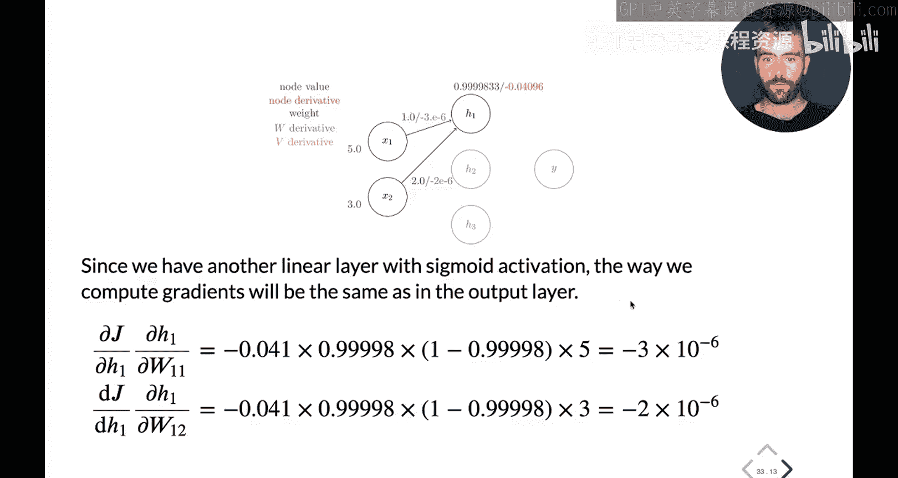

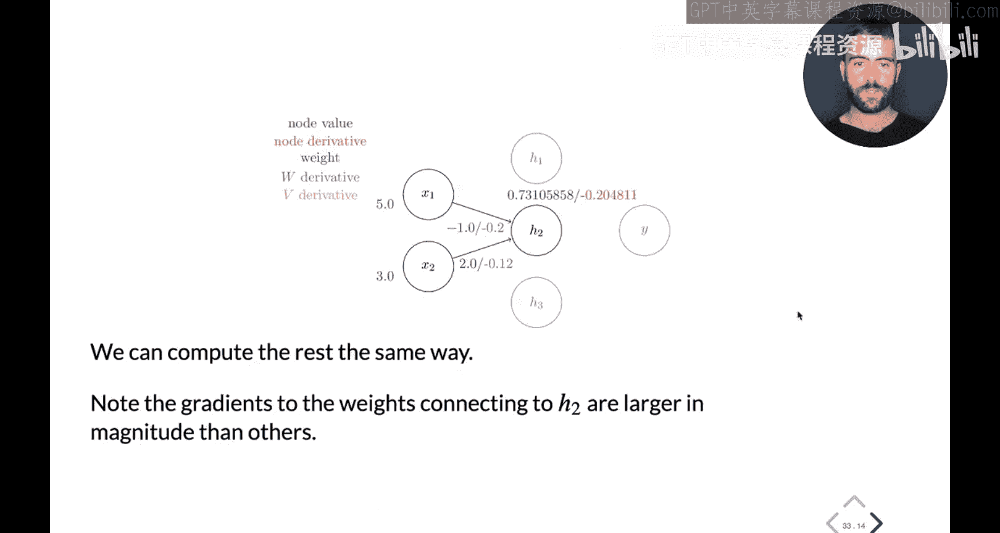

你可以稍后重新查看此内容，通过看这张幻灯片不一定需要理解这个实现，但仅从高层次看，我们可以定义一个描述层的类。这个类有一组权重，有一个激活函数，`forward` 函数获取该层的输出。我们只需应用矩阵乘法，应用激活函数，计算并返回输出，同时我们也保存这个输出。

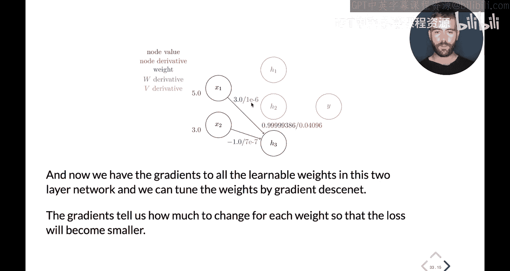

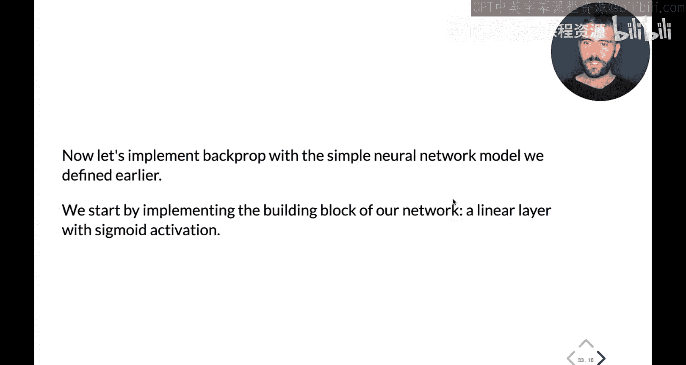

当我们应用反向步骤时，我们可以计算梯度。这里的反向步骤接收从上层传递来的梯度。这可以是损失的梯度，也可以是该层之后各层的梯度。基本上，在此之前的一切都已计算好，并综合成一个传递到这里的梯度。现在，该层的梯度是每个神经元关于其权重的梯度的函数，并且也乘以输出梯度。这就是我们这里有的梯度。

再次说明，你现在不需要理解这段代码，但如果你对反向传播的实际实现感兴趣，我鼓励你回头更仔细地研究这是如何实现的。

现在，我们可以通过定义几个这样的层类来形成一个神经网络。这里我有两个 sigmoid 层。每个都有一组权重。第一个的输入维度是 x，输出是这个维度。第二个是我们的输出层，所以它的输出是 1，其输入是前一层的输出。

如果我想从神经网络输出预测，我运行隐藏层的前向传播，然后运行输出层的前向传播。

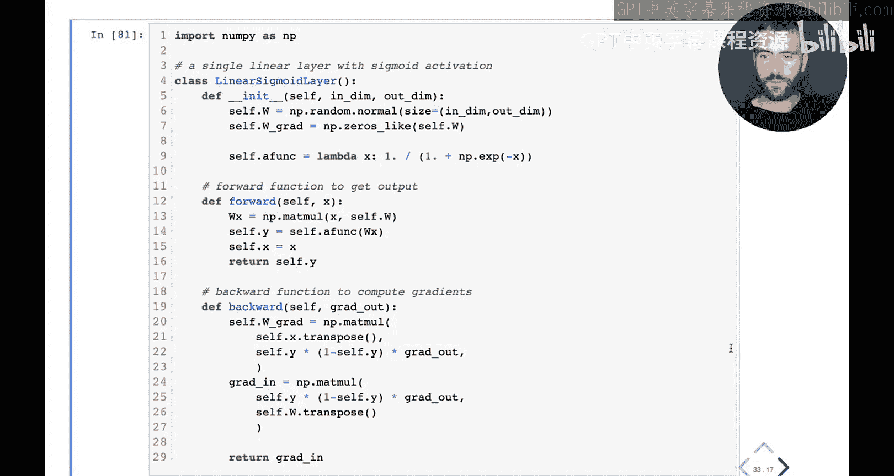

为了应用反向传播，我们首先形成损失的导数，然后我们计算关于... 实际上，我们执行反向传播。在反向传播中，我们沿着算法传递这些梯度。所以，这是输出层的梯度，它综合了来自第 1 层之前所有层的信息，我将其传递给第 1 层。然后当我们执行这一层的反向传播时，它保存其梯度，现在我可以使用这个操作检索这个梯度。

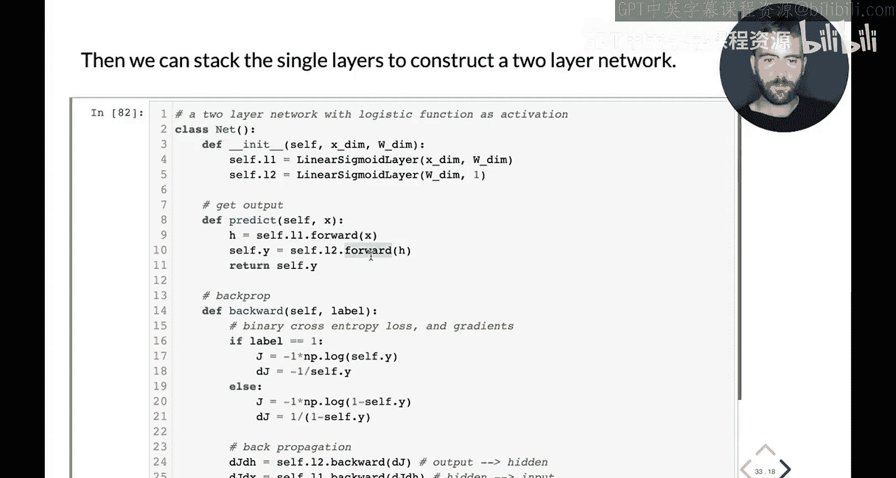

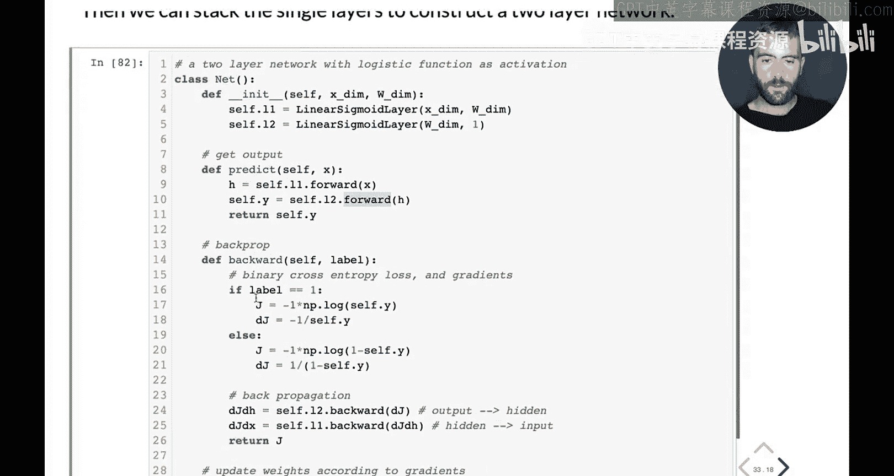

我可以使用这种形式执行一步梯度下降。

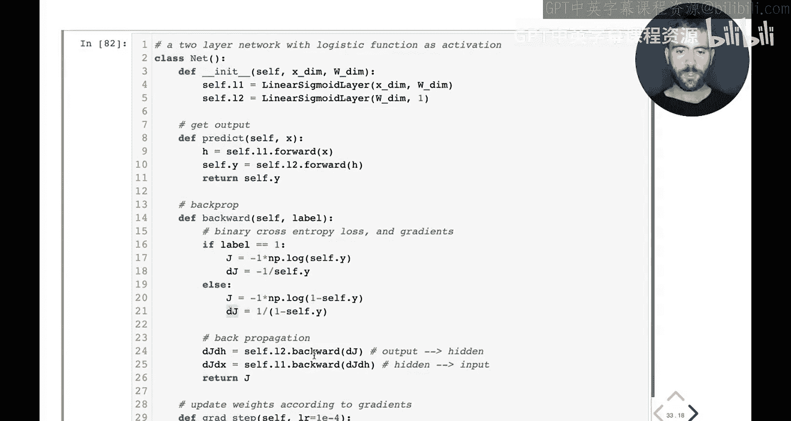

这里我使用先前示例中的权重和值实例化了这些数字。现在我运行反向传播，你可以检查这些梯度是否与我们之前手动计算的梯度相对应，你可以仔细核对这些值是否匹配。

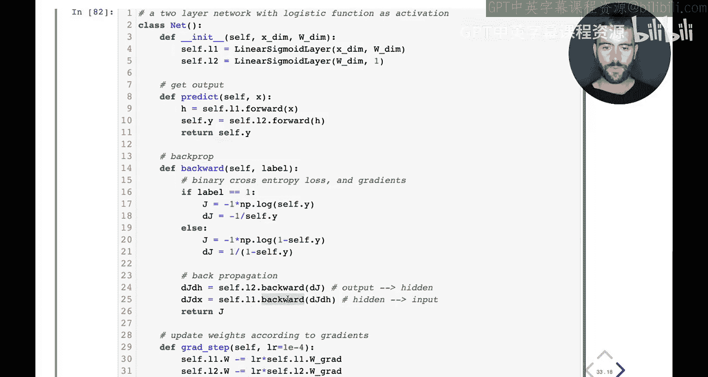

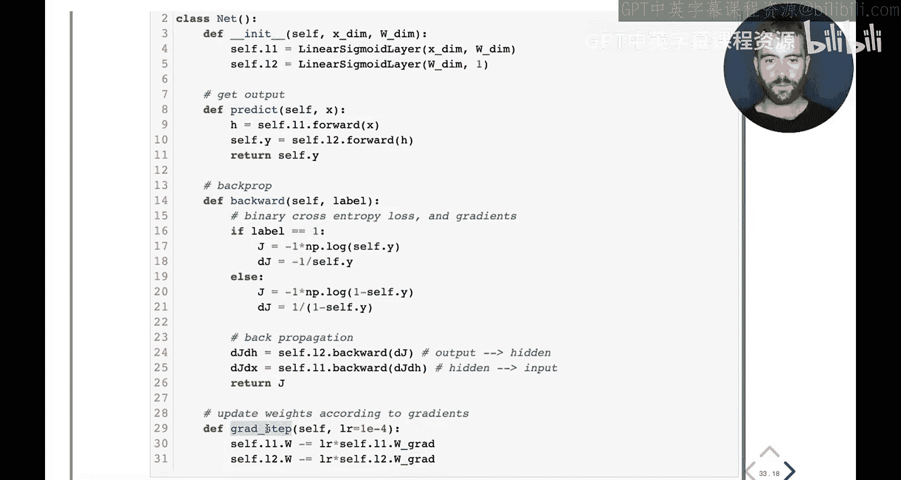

最后，我们也可以在这里运行梯度下降。这是梯度下降的一个简单实现，运行 100 步。我们执行反向传播，计算梯度，然后在这个梯度上执行一步，并附加我们目标函数的值。这里我们只是在一个训练样本（大小为 1）上最小化损失。

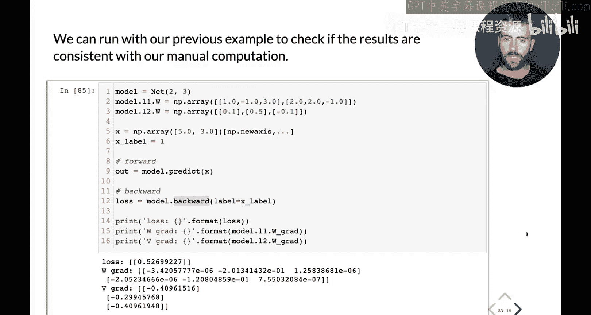

经过几步后，我在这里绘制了损失值，它在 100 步内变为零。橙色是神经网络的预测值，它接近 1，而 1 是我们优化的标签。

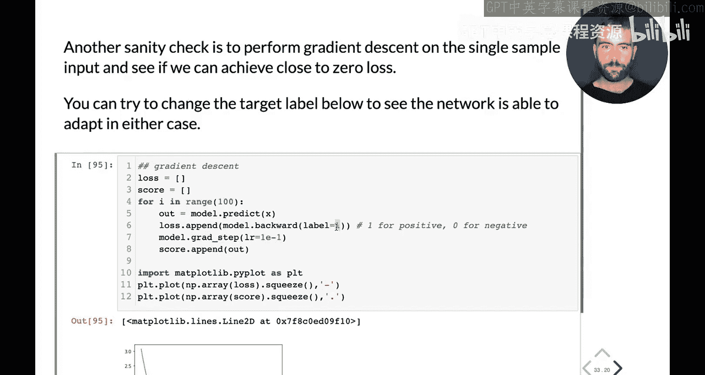

这就是该算法如何工作的一个实现。再次强调，你现在不需要通过看幻灯片来理解这个实现，但我认为如果你研究实现以及公式，你会更好地理解反向传播算法的内部原理。

## 总结

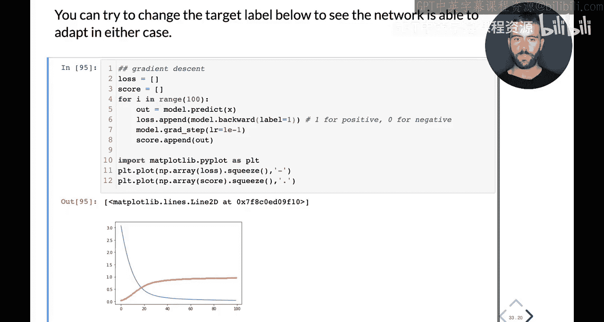

好了，总结一下，我们定义了反向传播算法，它允许我们高效地计算神经网络的梯度。因此，我们可以使用梯度下降来训练这些强大的神经网络模型。

在下一讲中，我们将看到一些更现代的神经网络算法家族，它们是深度学习的一部分。

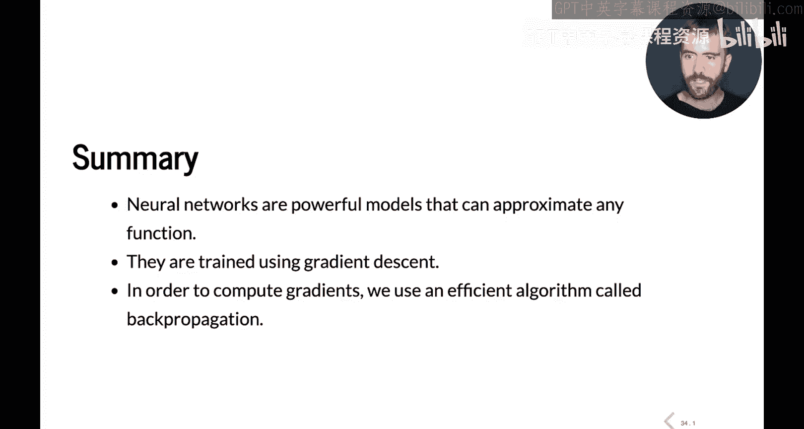

最后，我还要感谢课程助教 Ginson 帮助制作这些幻灯片，并帮助完成了许多实现。我再次鼓励你更详细地重温 Ginson 和我为这些幻灯片创建的这些实现和示例，并研究它们以更好地理解反向传播算法。