# 康奈尔大学《应用机器学习 CS 5787_ Applied Machine Learning 2020》中英字幕（deepseek p55 -55-Lecture 15. Part 1_ What is Deep Learning_.zh_en -BV12udzYvEFM_p55-

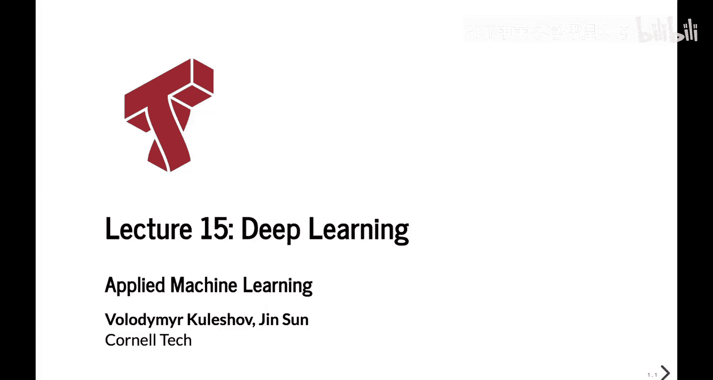

Welcome to Lecture 15 of Applied Ma learninging， in which we are going to continue our set of lectures on neural networks。

And in this lecture， we're going to talk about more modern versions of the neural networks that we saw in the previous lectures。

And these more modern versions of neural networks are part of a really exciting field of machine learning。

 which is called deep learning。So deep learning is going to be the focus of this lecture and in this first part。

 in this first video， I would like to just tell you what deep learning is and why it's interesting and give you a high level high level motivation for this kind of work and also explain a little bit more how it compares to some of the earlier work on neural networks。

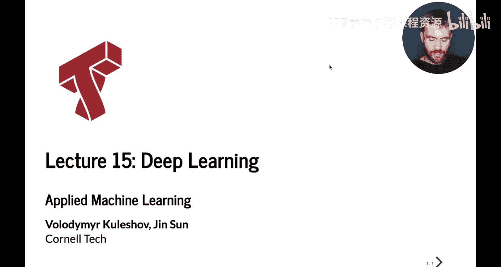

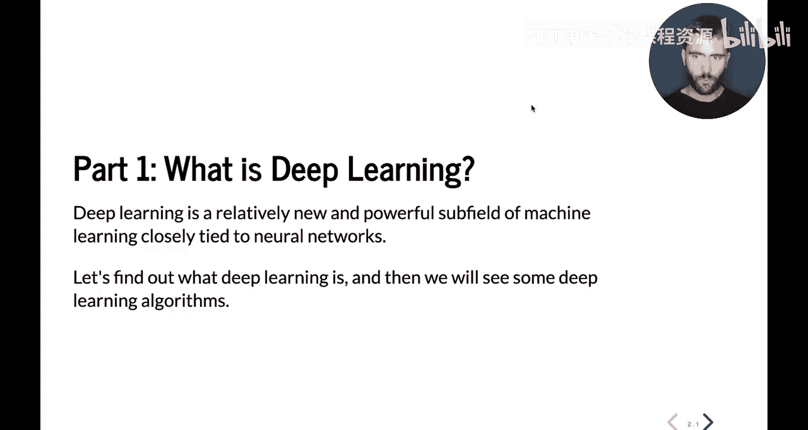

So recall from our previous lecture that neural networks are these models that are comprised of layers of neurons。

 each layer is well it's in of layers of artificial neurons and each layer is。It takes an input X。

 and it applies a transformation which consists of P neurons， each neuron has weights。

 these weights are used to modulate the input which then goes into an activation function and the activation function fire some signal。

 which is the output of the layer， and in vectorized form， we can write it like this。

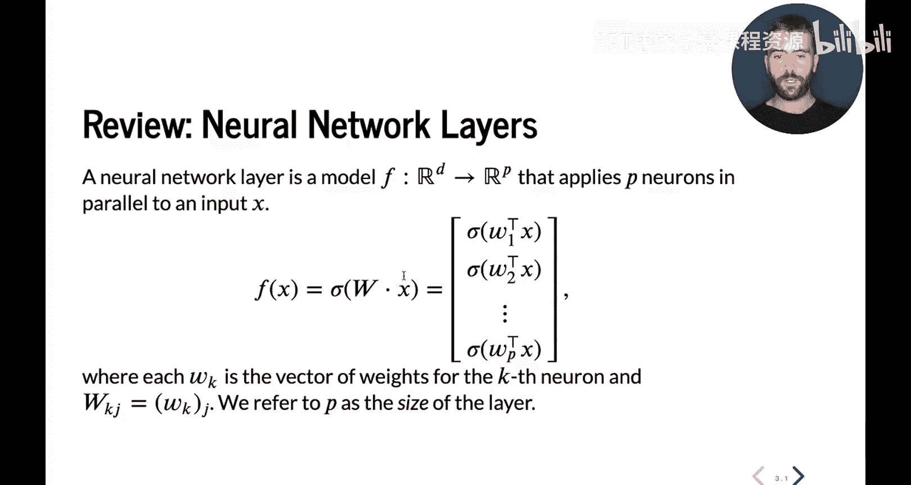

When we take multiple layers like the one I just showed and we apply them one after the other。

 we have what is called a neural network， so a neural network is a composition of functions like this。

 and we can illustrate it visually as a graph in the following form here this is the last layer is a single neuron which is the output layer and then these blue layers in the middle are called the hidden layers of the neural network。

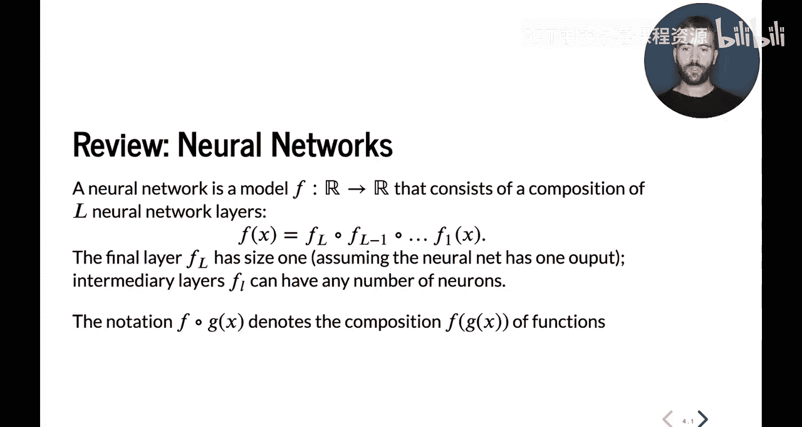

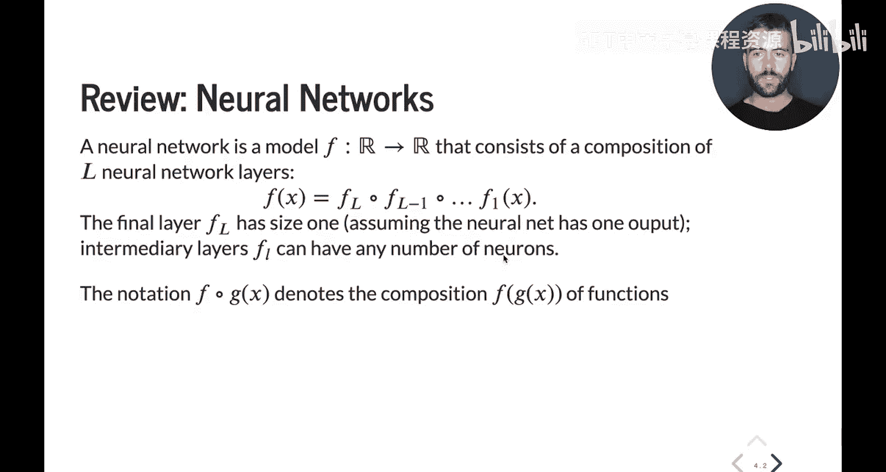

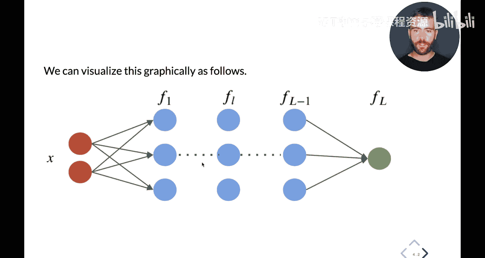

So these are classical neural networks and in recent years they have been in a sense。

 rebranded as a new field as a new set of algorithms called deep learning。

Deep learning is essentially still the study of neural networks。But modern neural networks。

 modern neural networks are different from the neural networks that existed earlier in the sense that they tend to be much。

Much larger and especially much deeper in the sense that they have many layers in the in the beginnings of neural networks。

 let's say， in the well， neural networks have existed for。Decades， but until the。

 until the perhaps mid 200s， most。Work on neural networks， studied。

Ind networks with a small number of layers， maybe。Usually just one hidden layer， but sometimes two，3。

4，5 modern neural networks that are part of the field of deep learning can have hundreds or even thousands of layers。

 and this makes them significantly more powerful。One other focus of deep learning is the applications of these neural networks to very to very large data sets。

Unlike previous neural network models which were they were smaller。

 they were also harder to train and as a result they were typically applied to smaller data sets and that's also in large part because smaller data sets were the only ones that were available。

Again， over last。Then， 15，20 years。Much bigger data set have have become available and。

It was discovered that neural networks actually work really well on these large dataset sets and that is part of what has driven renewed interest in neural networks。

 so when we talk about deep learning， we often talk about applications of neural networks to very large dataset sets with millions or more of input examples and these neural networks on these large dataset sets。

 they work best on data that is what are called unstructured。

 meaning that it represents raw signals like images， audio。

 sometimes text at the level of characters。And these inputs are unstructured because it's hard to define features for them。

 it's not easy to define a feature for whether an image contains a dog or a cat。

In the same way that it's in a way that it won't be comparable to if we had a medical record and we could define features about a patient。

 say whether it's an old man or whether it's。Whether they have some combination of diseases that is known to be important。

 we cannot really handcraft these features for unstructured data like images， text or audio。

 or at least it's really difficult and neural networks。

And deep learning shines on large data sets of these kinds of unstructured inputs。And， finally。

One other important aspect of modern deep learning is the way in which it's implemented in its run。

Part of the reasons why we can train neural networks on large data sets is because of the availability of specialized hardware such as graphical processing units and also more modern chips。

 you may have heard of the tensor processing unit， there are many specialized methods for training these kinds of deep neural networks。

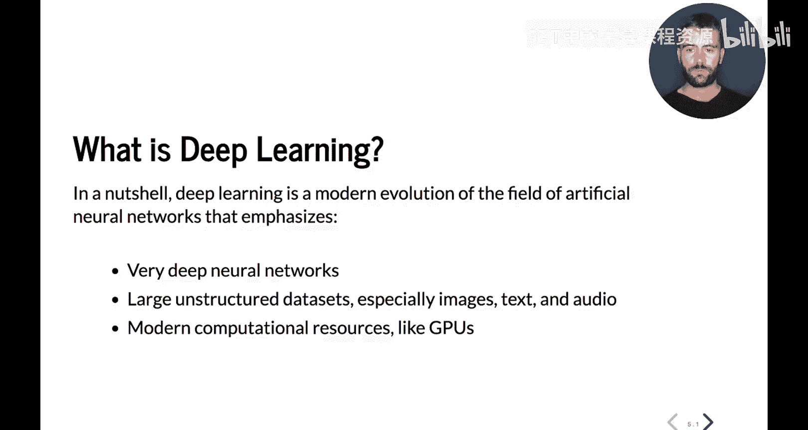

So why are deep models or models with many layers interesting。

One reason is that a neural network that is deep。Can represent more complex models。

In a more compact way than a network that is shallow。嗯。In other words。

There are many theoretical works that have shown that a neural network with even one hidden layer can approximate any function。

 so these neural networks can be they're very flexible models。

 but the size of this hidden layer is really large。

 it grows quickly with the complexity of the function。If instead， we have a deeper network。

We can use a smaller number of much small。 we can use a relatively smaller number of much smaller hidden layers to represent a function of the same complexity。

 So that hidden layer may increase exponentially as with with the complexity of our function。

But we can still have a polynomial model with a polynomial number of parameters that is deep and that can express a function of the same complexity。

So in other words， by making neural networks deep， we can learn really complicated mappings。

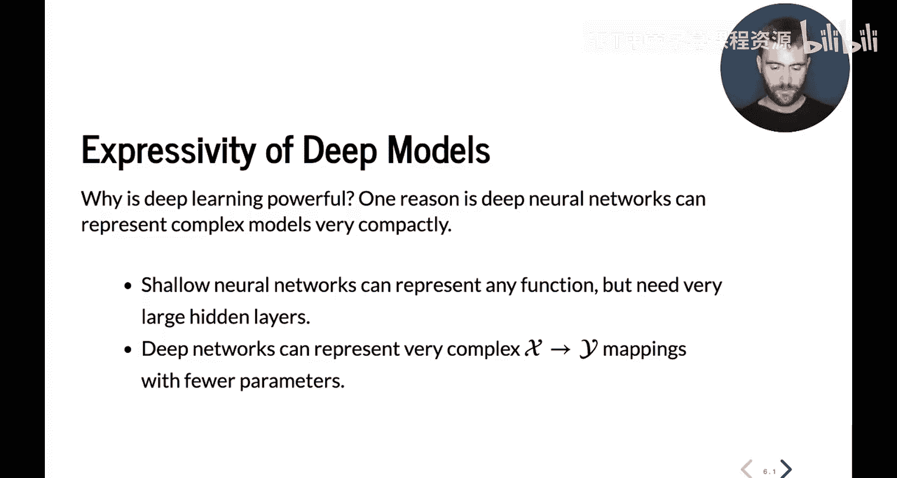

Just to give you an idea of the kinds of mappings that a neural network can learn。

 this is an application of neural networks to a problem called image captioning。

 we have an image and we want to output text in English that describes what's in this image。

This is a really hard problem， and none of the classical algorithms that we have seen so far can be applied to this problem。

We're not going to be able to apply logistic regression or naive base to this task。

But when we apply deep learning with a deep neural network。We can transform this image。

 We can feed it into a sequence of neurons， and then a sequence of another neurons called a recurrent neural network。

 And the output that this sequence of neurons will give you will look something like。

Like the following， which is a surprisingly accurate description of what is in this image。

So this is a really interesting application of neural networks。

 and it shows the complexity and the richness of the mappings that can be learned via neural networks that are deep。

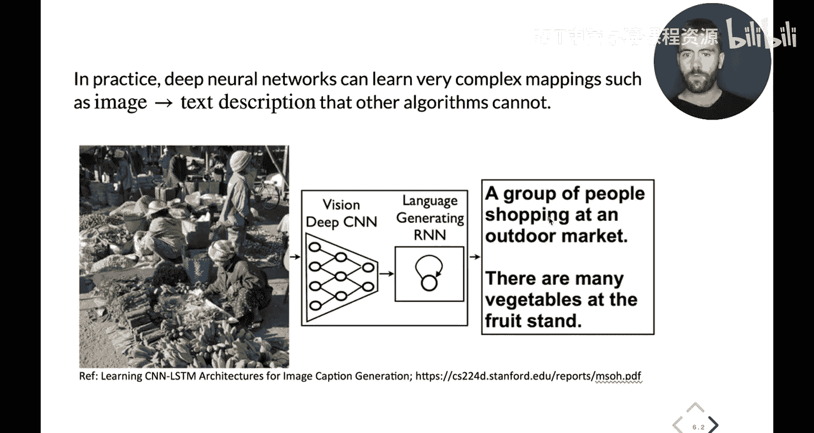

The reason why deep neural networks are effective and they can learn complex mappings more compactly is that they're able to build。

Useful representations of the data。So when we feed a neural network。

 when we feed an input through many layers of a neural network。

We find that each layer tends to learn。Features or representations of the data that are increasingly abstract and。

And it built upon the representations from previous layers。So in other words， the first layer， well。

 let me give you actually an example here。 So this is a visualization of what a neural network with。

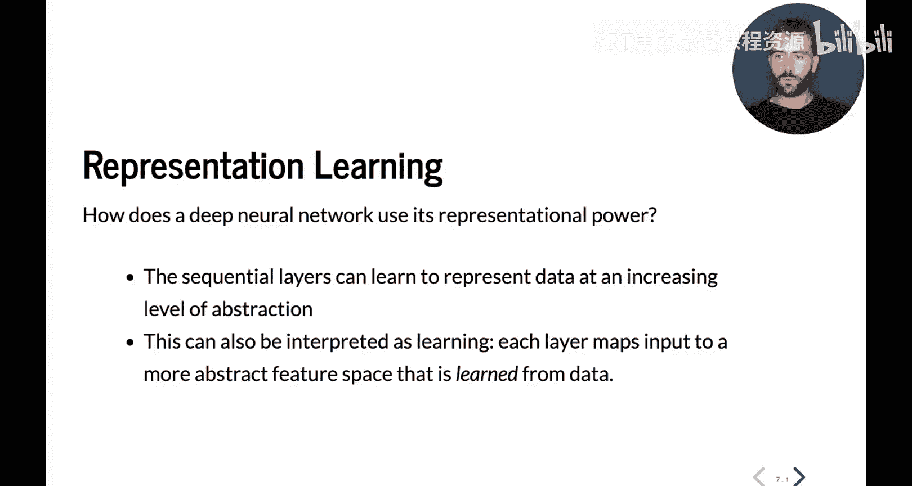

In this case， we have two hidden layers， but so this is actually considered a neural network that's relatively shallow。

 but apply these if we make these neural networks sufficiently deep。

We're going to see that it will learn features that are particularly useful。 So for example。

 if we inspect the weights of the neurons at the lower layers， maybe the first or the second layer。

 we're going to typically find something which looks like this， these are little edges。

 And so each neuron applies a little edge to its input and it fires when it sees that edge in the image。

Then if we go to the middle level features， we're going to see that these neurons。

 they tend to fire when they see a particular combination of these edges which forms interesting features here。

 so here you see an eye an ear a nose， what this means is that this neuron is fired when it sees a combination of input edges when it sees a combination of inputs coming from lower layers that correspond to edges and these edges form a structure that has an ear or a nose or some kind of familiar shape and then at the highest level of a neuron。

 we might see general types of faces。Which means that。These neurons fire when at the input。

 we have a face which has characteristics that are similar to some of these higher level phase types。

 So in other words， when we train a deep neural network from data， it learn weights that encode。

Useful representations of the data。They learn these representations purely from data wet。

The neural network doesn't know a priori what a face is or what a nose is。And these。Features these。

These neurons， they are organized in increasing levels of abstraction。

 and this is a feature that is characteristic of deep learning algorithms and a lot of the success of deep learning models is attributed to its ability to learn these hierarchical representations。

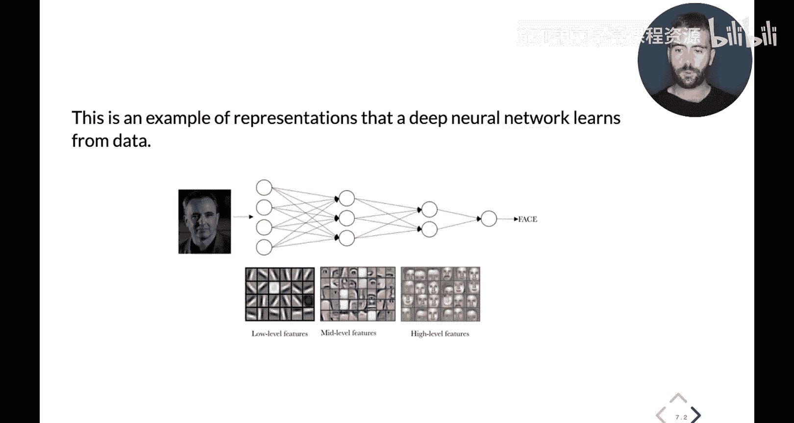

Now，I mentioned earlier that deep neural networks can achieve really good performance。

 And part of the reason why they can do that is because they。

They can make use of data very efficiently。In other words。

Consider the performance of an algorithm as a function of the amount of data that it receives。

If we have little data， then performance will improve， but with a traditional learning algorithm。

 once we hit some number of data points， maybe this is 10，000， maybe this is 100，000。

 but at some point our model will saturate and it will no longer it will no longer be useful to have any data。

But with neural networks。performance tends to improve as we give it more data。

 and if we have a very large neural network， its performance tends to keep increasing as we give it more data。

And as a result， for very large data sets in this high data regime。

 large neural networks tend to significantly outperform classical machine learning models。

And one way of looking at this is that a neural network is a very complex model with a very large set of parameters。

 it's very expressive， it has a lot of power in it。

 and by giving it a lot of data it can use its high representational power very accurately to extract a lot of signal from the data and be very accurate。

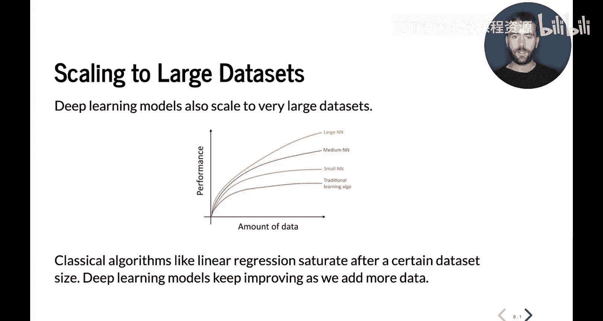

Then。The reason why we are able to use these kinds of data sets in the first place is that neural networks can benefit from particular specialized hardware。

In other words。There are a lot of specialized tools and both software frameworks and hardwares and and types of hardware such as graphical processing units that enable scaling neural networks through really large data sets。

And not all algorithms can benefit from these specialized computational units。

 but because neural networks are based on a set of operations that involve linear algebra。

 they tend to benefit a lot from the specialized hardware。

 and this is part of the reason why we have been able to scale them to very large data sets and yeah。

 and this is a big reason for their effectiveness。

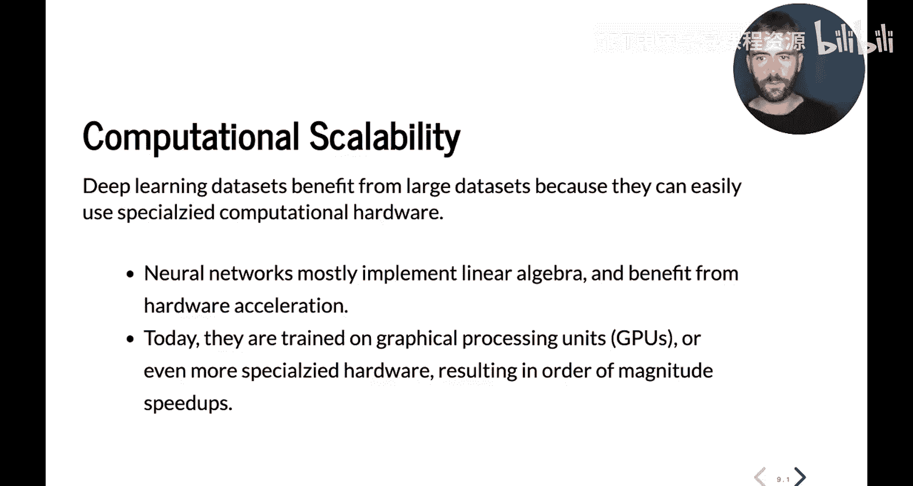

And finally， the other interesting thing about deep learning is that it still has a lot of connections to neuroscience。

Simple neural networks were defined by taking inspiration from of the brain。

 from principles of how the brain works。And。If we further look into the function of the brain。

 we will see that a lot of the connections that are inside the brain consist of many。

 many layers of neurons， so the neural networks that are inside our brain are deep and that is sometimes considered to be one of the motivation for building deep artificial neural networks。

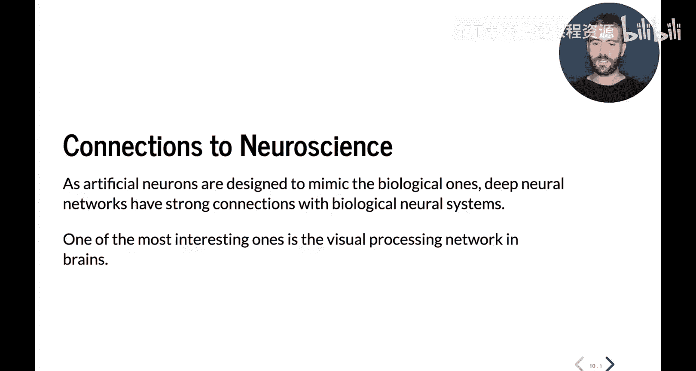

In fact， if we analyze certain parts of the brain， like for example， the visual cortex。

 we see a lot of behavior that is really similar to what we see in deep neural network models。

So in the visual system of the human brain， there are typically a number of zones that'renot by V1。

 V2， and then there are a few others that are downstream here。

If we study the brains of animals with these kinds of visual systems。

 we can often find that these sequences of neurons are these sequences of basically these regions they correspond to layer of neurons which are connected to each other in a sequential pattern and each of these regions。

Correspond to progressively more abstract representations of the data， so for example。

 in the very first parts of the brain that process visual input。

 we have something which look like which looks like edges and these are the kinds of edges that I had in my earlier image of an artificial neural network。

And then as we move farther along the neurons in the visual system。

 these neurons tend to be activated by increasingly more complex patterns。So in that sense。

 biological neural networks tend to also be deep， and they also tend to。Have this。

 they tend to encode these hierarchical representations。And and so in that sense。

 deep neural networks behave surprisingly similarly to。To biological neural networks。

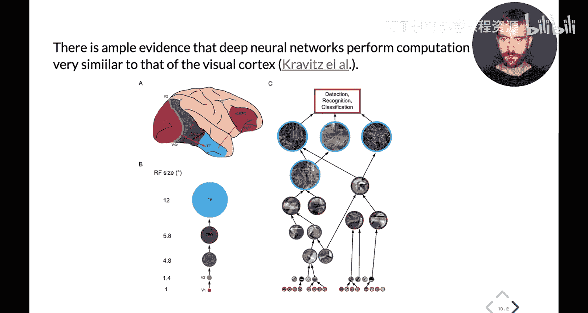

And。Because of all of these properties that I mentioned， the ability to use a lot of data。

 the ability to being trained efficiently， the ability to learn representations。

 because of all of this deep learning has been very successful over the past decade or so。

 in fact has been a real breakthrough， it has pushed the state of the art in a lot of technologies like speech recognition or machine translation。

 the machine translation systems that we have today， if you translate something in Google。

 it will be significantly more accurate， be in fact I think if you did a side- by side comparison you will be stunned by the improvement in accuracy in machine translation and that is mostly due to innovations that happen over the last five years or so。

And also it has enabled lots of new results which were not possible before here just to show you one fun example。

 so these images they are actually generated by a neural network so we can use a neural network for supervised learning but we can also use it to generate images and if you haven't seen this before I encourage you to visit this website it will use a neural network to generate live pictures of humans that don't really exist。

 this is all generated by a neural network that has been trained on a large data set of human faces and so in that sense neural networks have unlocked new functionality that still surprises researchers every year。

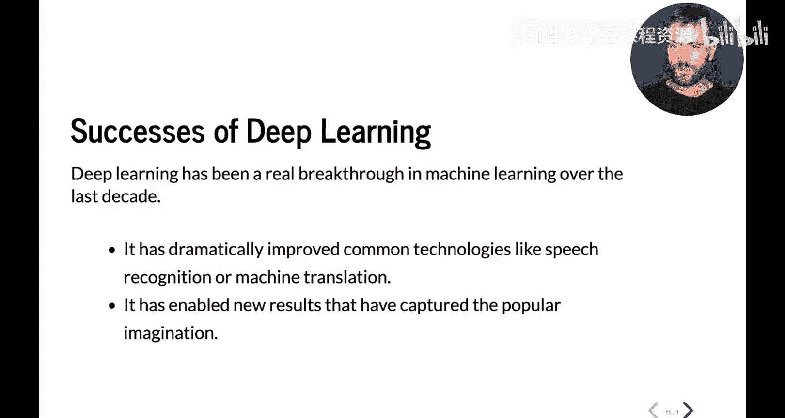

So neural networks are really powerful models， as I said they achieve a new state of the art and they can also be combined with other algorithms。

 so for example， the kinds of algorithms that we have seen so nabase， gash instrument analysis。

 derived we can derive versions of these algorithms where some components are neural networks。

 other components are probabilistic， we can mix all of these things together and can drive new algorithms that are more powerful generalization of classical algorithms。

And I would say the main downsides of neural networks of deep neural networks same are the same that I mentioned earlier when I talked about regular neural networks。

 they can be often slow and hard to train because of numerical instabilities and they also require a lot of training data。

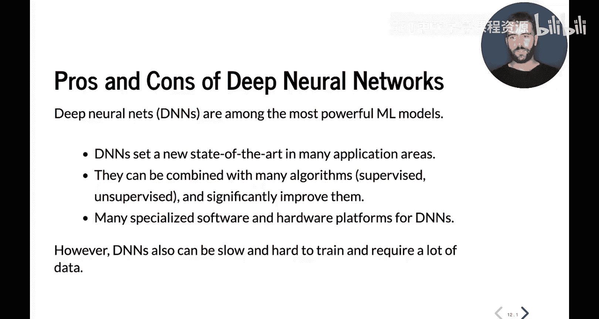