# 康奈尔大学《应用机器学习 CS 5787_ Applied Machine Learning 2020》中英字幕（deepseek p56 -56-Lecture 15. Part 2_ Convolutions.zh_en -BV12udzYvEFM_p56-

This is now part two of lecture 15 of Apped machine learning。And in this part of the lecture。

 I'm going to talk about two important operations called convolution and pooling。

 and these two operations will be the building blocks of a new kind of deep learning model called the convolutional neural network that I'm going to define in the next video。

But first， let's look at these two operations。

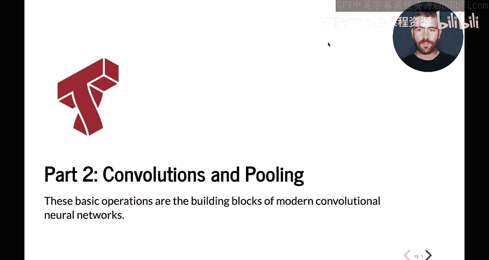

To set a bit of context， remember that we're talking about deep learning。

 which is a modern evolution of the field of neural networks in which we emphasize very large and in particular。

 very deep neural networks that are trained on large data sets on modern computational resources like graphical processing units。

So in order to define certain deep learning models。

 we're going to first need to define an operation called the convolution。

The convol is in operation over two vectors， F and G that have dimensions N and M respectively。

And I'm going to refer to F as the filter， and G is going to be the signal。

You can think of F as being a smaller vector than G。

 You can think of G as having dimension perhaps 100， and F would have dimension 5， for example。

When we talk about a convolution in deep learning， we typically think of the following operation。

It is denoted by F star G。And F star G is a function。

That is defined at certain positions P and at each position P。

 it is defined by the following operation。So the convolution is itself a vector that takes certain values it can even be a function。

 this can even technically be defined for the entire set of natural numbers and at a given position P。

What we do essentially is a dot product between F and the vector G starting at position P。

So this is going to be the definition that I will use of a convolution for this video。And again。

 you can think of this as a form of a dot product， in fact sometimes the convolution is or the convolution is known as a sliding dot product and here with the following assumption that we will set GFT to zero for values that fall outside its range。

So let's think about what this means for a little bit， and then we're going to see a lot of examples。

One way to think of this convolution is a form of a local product of F with this sub sequenceequence of G that starts at P and goes all the way to P+ n。

So G is a long vector。 F is a shorter vector， and we're going to do a convolution with G at position P。

And now， if we think of this value is going to be large when these two vectors。

 F and G are going to be， well， the dot product is going the dot product。

This dot product like quantity， will be large， which means that F and G will be similar to each other and is going to be small if they're going to be different or even orthogonal to each other。

And we can interpret this as searching for some kind of pattern F inside the signal G。

If F is found exactly in G， then we're going to have a really high value of the convolution and if F is not really found in G then we're going to have something thats small。

 but one way to think about this is too is that we're looking for a particular pattern inside this vector。

 that is one interpretation。Now this is best understood by a picture that I'm showing here。

 this is all in one dimension and what you see here in green is a filter with the following particular value。

 so it's a vector of length3 and then the gray area。

 the gray boxes you can think of that as being our signal。So it has a particular set of values。

And then the yellow boxes contain the value at the value of performing the convolution at different positions。

 so here if I apply this filter over these three numbers， then we simply use this formula。

 so the values of the filters are 10 and minus1， so therefore the operations is1 times the first value G p0 times the second one minus1 times the third one。

 so1 times 0 times 0 times 1 times minus1 times2 equals minus2 summ all of these gives us minus2 which is the value of the output at this example so the convolution。

At this position， I guess when p equals0， we started0 here equals this now if we were to start at p equals say2。

 so 01，2， then we would have we would be doing the dot product of these three numbers with these three numbers and it will give us an output of one and here I'm showing how it looks like at every position so the three lines represent the three inputs that are convolved with this filter to produce the output。

So this is an illustration of what the convolution does on this simple toy example。

And we're going to see many more examples later， but I strongly encourage you to really make sure you understand what it's doing in this what the convolution is doing in this simple example。

 and then we will it will make it easier to understand the one that are。

The ones that are going to come later。Before I go on further I just want to make a small note。

 technically what I defined within mathematics， it is not called the convolution。

 it is called a crosscor， the convolution has a slightly different technical definition which is more similar to this one where I have flipped the sign of the T so in a sense we're going in the opposite direction this is a technicality it doesn't matter and if we were to use one formula or the other one within deep learning algorithms。

 we would still have equivalent results and in practice。

When we talk about a convolution in deep learning， we actually mean it is actually what is called in mathematics the cross correlation and it is actually the formula that I gave on the very first slide。

 that is typically what a deep learning library would implement。But well， of course。

 it can vary by library but。Quite often， we implement the。

Formula that I gave and it's also easier to understand， which is why I started with that formula。

 but you should be aware that there's a slight technical definition here and finally the most general definition of a convolution in mathematics is even more general。

 it involves an integral instead of a sum it can be defined over continuous for continuous functions but we will not go into this level of detail。

 we will just use the definition that was in the previous slide。And finally。

 we can implement a convolution really easily in Python here。

 you can check that this is a definition of a convolution here， in fact， we're using the。Convolution。

 but under course correlation， but again， these are essentially equivalent。

So to gain a little bit more intuition， let's look at one slightly more practical example of what a convolution can do。

 and this is going to be a task called edge detection。

So let's start by defining a filter and a signal， so this is going to be my filter and it's simply an array that has two values。

 minus1 and 1。So in the previous story example， we had our filter was length 3。 Now it has length 2。

And the signal will have length 30。And is going to be mostly ones。

 except put we will fill in this subset with zeros and this other subset with zeros。

And now we can use our implementation of a convolution to convolve these two values and here this is another function。

 or this is another vector。Now let's visualize these。

So here I just use a bit of matlotlib to visualize these three expressions。

 and here I have on this side my filter， the way this works is that the indices are on the x axis and the values are on the y axis。

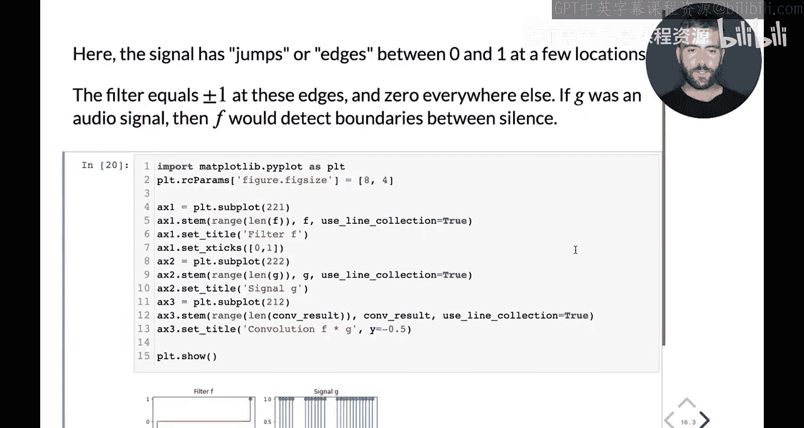

So if you remember， I defined my filter as being -1 and 1。 So at position0， I have -1 at position 1。

 I have1。And then my signal G， if you recall， is it has length 30。 So here x goes all the way to 30。

 and I filled everything with ones。Except for two gaps here that are filled with zeros。

And now let's see what happens if we convolve these two signals。

What happens is that we get the following shape， so we have a vector that's also of length approximately 30 here。

And it's zero everywhere， except at a few positions。Where it's either 1 or -1。

 and you can check that these positions correspond exactly to the position where we have a change here between 1 and 0 and0 and 1。

1 and 0 and 0 and 1。 so you can check that these kinks here or these or these ones correspond to these changes or these inflection points or kinks in the signal G。

So in other words， our signal is not smooth。 It has these jumps or edges between0 and one。

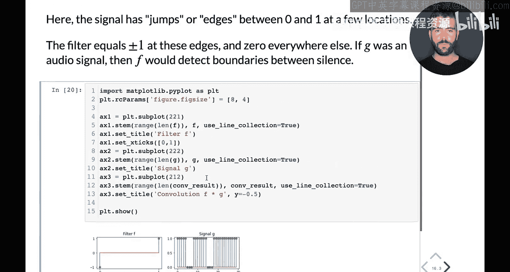

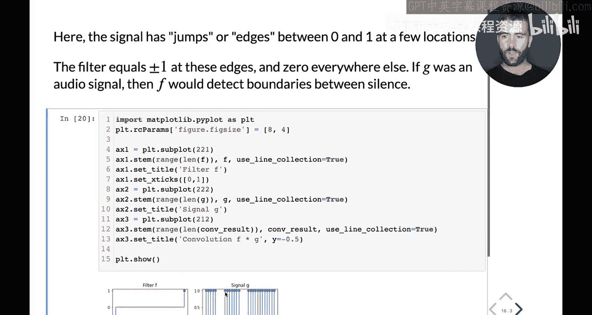

And with our choice of filters， we are detecting the positions at which these changes occur。

 so with these filters we now have after we apply this filter。

 we have a new signal that only contains the edges or the parts where the signal changes from one value to another。

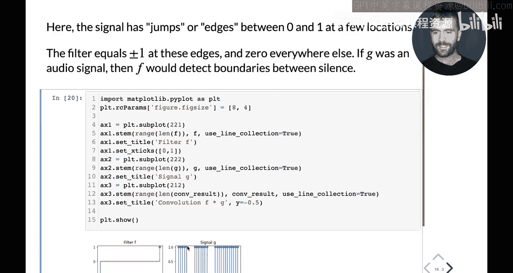

And you can convince yourself that it's the case by just looking at what happens if you apply the filter in this area where it's all ones because we all have ones。

 then one times1 plus 1 times minus1 equals0， and this is why we have zero here。

 but if we have an area where one value where we're going from1 to0， then。

Well here we're going to have one plus zero one times one。Equals。Equals。eququals minus-1 and then 0。

 so we're going to have something which is going to be nonzero only at the edges here and if two consecutive values are the same。

 then this filter will output 0， but if two consecutive values are not zero。

 then we are going to have a non-zero change here， we're going to have a nonzero value。

So this is an example of how we can use a convolution to detect interesting features of the signal。

 in this case， these are edges。Let's look at another example of what a convolution can do。

Here I'm going to again define a filter in the signal。

 the signal is the same one that we had earlier and now our filter。

 I will show you in a second what this is， it will look like a small bell curve。

 so here this is our filter， it has length eight or nine and its values follow this kind of smooth bell curve。

And now if I convolve this filter with this signal。

 what I get is essentially a weighted moving average of these points。

 so at each point I take the weighted average of the neighboring points。

 and I have something which looks like a smoother version of this signal where these gaps。

 these skull have been filled in by a smoother curve。

 but we still see this shape where it goes down and goes up。

So this is another feature of what a convolution can do。

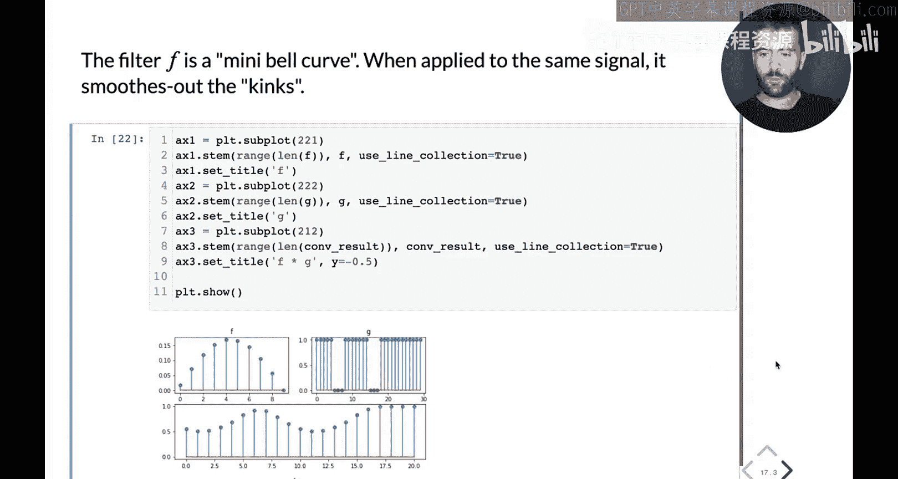

So if I were to summarize this， when we apply a filter onto a signal。

 we can either change its behavior， we can smooth it。

 or we can extract useful characteristics such as edge detection。

 which are positions where the signal has big changes。And in these examples。

 in all of the examples so far， I have defined my own filter。

But convolutions are really powerful in machine learning when we learn these features from data。

 so you can think of the feature as being a parameter that we're going to learn using gradient descent and this filter will learn to detect useful information in the signal like we use to detect the edges。

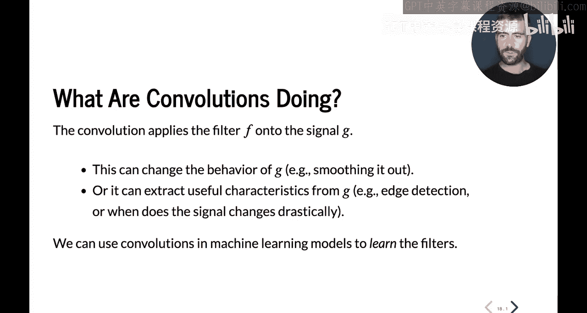

Before I talk about that。I also want to mention that convolutions can be defined in any number of dimensions。

 including in two dimensions。Here I have this illustration of what a convolution can look like in two dimensions。

And it still has the same behavior that you saw where we apply a filter at different。

Parts of the signal。 But now everything is too dimensional。 and and so the。

This filter is applied first along one dimension and then along the other dimension。

 and eventually it touches every position in the grid。So here the blue sequence is our signal。

 the gray area that is moving is the filter， and the result of this convolution is the green map that you see at the top。

So again， this is the same operation we had before。

 except having a three dimensional filter and instead of having a filter of length3 in one dimension。

 we now have a filter of length three in both dimensions and it gets applied as follows。

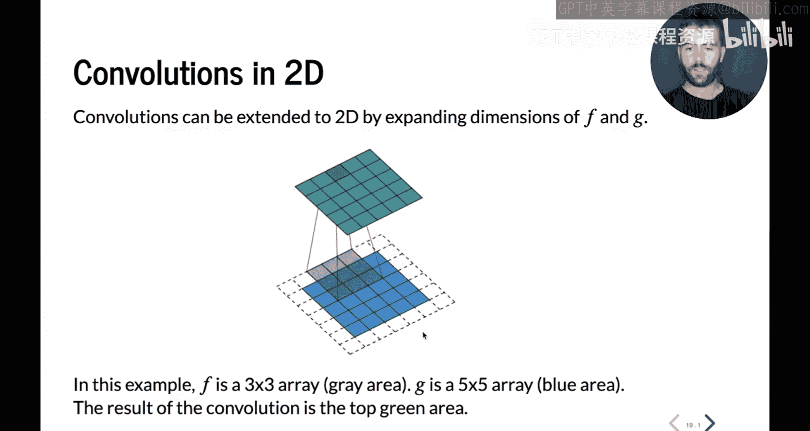

We can again use this idea inside neural networks。If the filter that we convolving， as you saw。

If if the filter is a way that's learned from data and G can be an image that's our two dimensional signal。

 then this F can go through the inputs and since we're doing a dot product。

 it will have a high value when when there' is a match against something that's encoded in the filter so this can be an edge or it can be it can be even a more complex object like a part of an image and when the when when the convolution finds this。

When the filter finds the pattern that it looks for in when the filter finds its corresponding pattern in the signal。

 then the value at the position in output in this green matrix will be large and when it doesn't match its the thing that it's looking for is going to be low。

 so you can think of this filter as searching for a particular feature in this2 by2 grid which can be an image and this2 by2 output grid。

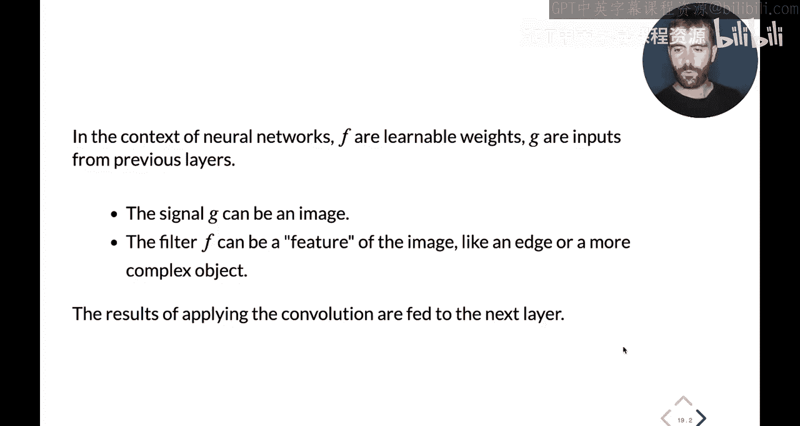

Corresponds to how much of that feature that we were looking for was found at each position in this in this two by2 grid。

So now let's make this intuition a little bit more formal。

 we can define a new neural network layer called a convolutional layer in which we also have a number of neurons。

And each of these neurons is the result of applying convolution。

So before our neural network in the previous lecture we saw dense neural network layers in which the operation at a layer was just a matrix multiplication。

 now we can replace these by convolutionional operators。

In theory we can also write the convolution as a matrix multiplication。

 so it's actually similar but the matrix has a particular structure and it's forced to have a particular structure way and certain values are forced to be identical inside the matrix but this is a longer discussion or it's something you can convince yourself I will not go into into more detail into that but it's a proper detail you may want to be aware of。

 but essentially convolutional layer applies has P output neurons and it applies。

P convolutions with a different filter。 And typically these filters have the same size。

 but they have。But the the value of the filter is different。 And here I'm denoting these by W。Now。

 let's understand a little bit more about how conional layers work in two dimensions。

Consider an input that is an image that we can encode as a。A three dimensional array。

Where we have a horizontal and a vertical dimension。

 so we have a height and a width of 32 and each correspond to pixels。

 so this would be a 32 by 32 image。And if it's a color image。

 then we would also have three color channels， typically red， green， and blue。

And these are so each of them is a 32 by 32 array， and we can stack these in。In a。

Along with the third dimension， which gives us an。呃。An array， or this is also called a tensor。

 a three dimensional array of that's 32 by 32 by3。So this array contains data about our image。

And now if we wanted to apply convolutions on this， we would define a filter。

The way that this is typically defined is that the filter has some size。

 so you saw in the earlier toy example of a 2 by2 convolution that it's also a square filter。

 so it has a dimension， it has a height and a width which in this example are going to be5 by 5 and because we also have。

A third dimension， these are， by the way， called channels。 So here we have three color channels。

 but we can also have different kinds of channels， not just colors。

 And this filter also has dimension 3。And the result of applying this convolution at this position is a single value。

 which is simply the dot product of the filter with the subset of the array that overlaps with this filter。

 So that gives us a single value， But then when we convolve this。

 we apply the same filter at every position here， which gives us what we call an activation map。

 an activation map was the green output in the previous example。 here， the activation map Well。

 it happens to be 28 by 28 because we。Because of the edge effects here， so we started。

 so basically along this dimension， given the filter has size5， we can apply it 32 minus5。

28 times along this dimension and along this dimension。

So the result of all of these applications gives us a 28 by 28 matrix， and again。

 the value at each entry of the matrix is the result of applying the filter at a particular position in this input array。

And the third dimension disappears because this filter has depth3。

 so it performs theduct product over all the three dimensions jointly。

So now this one filter gives us an activation map。But if we have an entire layer of filters。

 then we have multiple of these。So a different application of the convolution with a different filter might give us a different activation map。

 which I'm denoting here in orange。So here this filter has the same dimension。

 but it may have a different set of values， the image is still the same。

 but the filter is different and now I have a different set of activations。

And you can think of these filters as looking for different things， maybe if we're interested in。

Let's say we're interested in classifying certain objects。

 maybe there are certain patterns in the image that are more useful or that are indicative of one class versus the other class then。

These filters can learn the presence of different patterns in the image。

Here I have another third filter， which has another activation map that I'm not in green。

 And then if we have five。If the size of our convolutional layer is5。

 then we're going to have five activation maps like this， one for each filter。

 which and I'm deing these by different colors， and so the output of this layer is going to be another three dimensional array where the depth will equal the number of activation maps and the two spatial dimensions。

 the height and the width will depend on the size of this input。

And each of these activation maps records information about the presence or absence of some useful pattern at each position of the image that is given to us by the filter。

 so this is an example of what a convolution does。To give you an example。

 let's revisit our earlier to an example of edge detection and let's apply this in two dimensions。

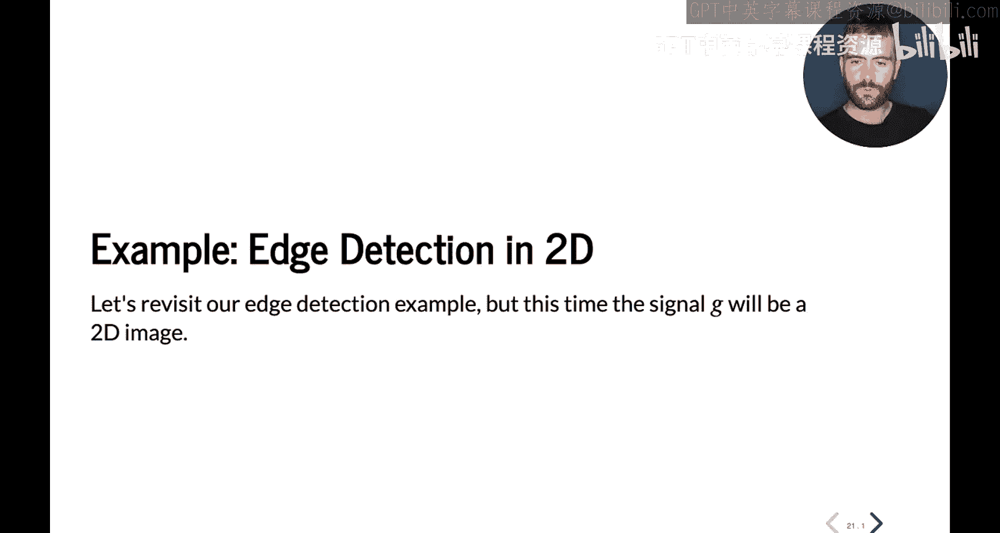

We're going to use two filters。 and these are the filters。 I define them using。Using Nmpy。

 they're all three dimensionals， well， no， they're all three by three。嗯。

And I'm going to load this image from sippi。And let's now look at what happens if we convolve this 2D image with each of these 2D filters。

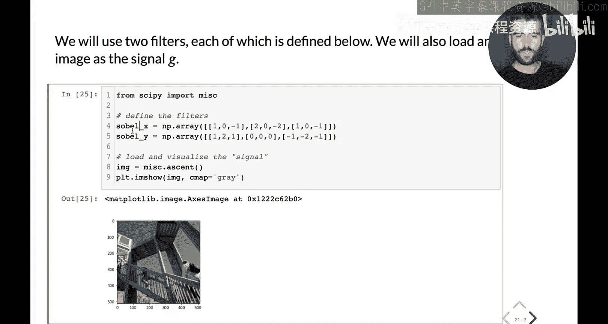

So here I use this signal library to perform the convolution， this is the first filter。

 this is the second filter， and now I use a bit of nonpy here to visualize them。

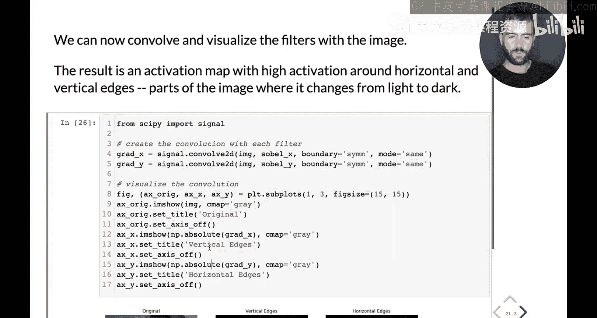

And what I see is the following， the first filter that I defined。

 it looks for the presence of vertical edges， which means lines where the input changes from light to dark。

And the other one looks for horizontal edges， which are lines where the input changes from dark to light。

And in most area of the image， these are dark， which means that the application of this filter gives me something that's close to 0。

 So here， especially I have the sky with no signal in it， it just looks empty。

 But in areas like these ones where I have the the stairs where I have a lot of。

Hizt we have a lot of vertical lines， I have this pattern here of vertical vertical lines。

 and similarly the horizontal filters are activated by the horizontal staircase shape here。

So this is an example of an activation map for a filter that detects vertical edges and at each pixel here I have a value that tells me the extent to which a particular region in this image contains an edge or not。

And then these kinds of inputs are useful for downstream computer vision algorithms that would perform various kinds of analyses of this image。

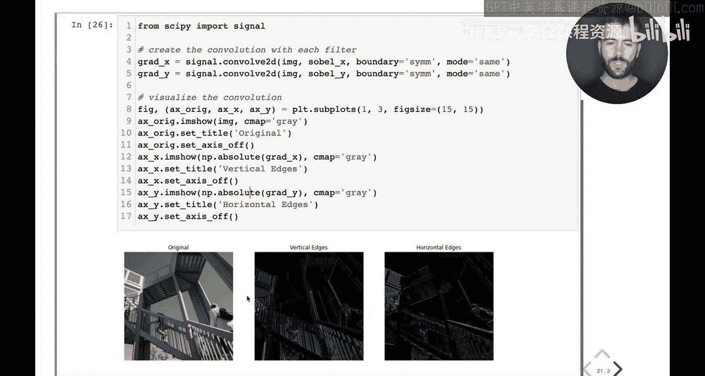

So when do we want to use convolutions， convolutions are useful if we have inputs that contain some kind of attributes that are interesting like a texture or some shape。

 but it doesn't matter where this shape is in an image， for example。

 if we're classifying cats versus cards， we want to know whether there's some texture that corresponds to fur in the image。

 but it doesn't matter exactly where exactly it is in the image。We call this spatial invariance。

 And so convolutions are useful when we have these kinds of。High level patterns that we want to find。

 but it doesn't matter where they are in the image。 and in many。Applications。

 especially with images and computer vision， we have this kind of invariance a lot in most interesting applications and most interesting inputs。

 and this is one reason why convol neural networks are really effective in applications like computer vision。

So this was the definition of my conional operation。

 and I also want to define a second important operation called pooling。So pooling is。

 you can think of it as an operation or a layer that transforms an input X by reducing its dimension。

It doesn't have any weights。 It doesn't have any learnable parameters。 It just reduces its dimension。

嗯。And the way that it typically does it is by breaking up a signal like a two dimensional image into subregions。

 And then within each subregion， we。We choose one value。

There is a common form of pooling called max pooling where in each region here we choose the largest value。

 so here it happens to be6 here it happens to be three。

 or we could also do average pooling where we could take the average， both of these are used。

And and the idea of max pooling is that。Well， we are only interested in whether the there is some kind of pattern in this part of the image。

And it doesn't matter if it occurs at this pixel or this pixel or this pixel or this pixel。

 we're only interested in whether it occurs in this part of the image， and so pooling。

It produces a lower level representation a of an output map from a convolution that tells us whether a certain feature is present in a general part of the image。

 so it is essentially。Downscales and it reduces the resolution of the output of a convolution。

 this loses some information， but it makes the resulting the resulting signal easier to process because it's smaller and also at some point it doesn't matter the exact location of a particular of a particular。

Or a particular object， so it's enough to use this higher level information。So again， as I said。

 pooling is an operation that they can reduce the size of。

Of the output of a convolutional neural network。And so now using these kinds of operations。

 I am going to define a new machine learning model called the convolutional neural network。

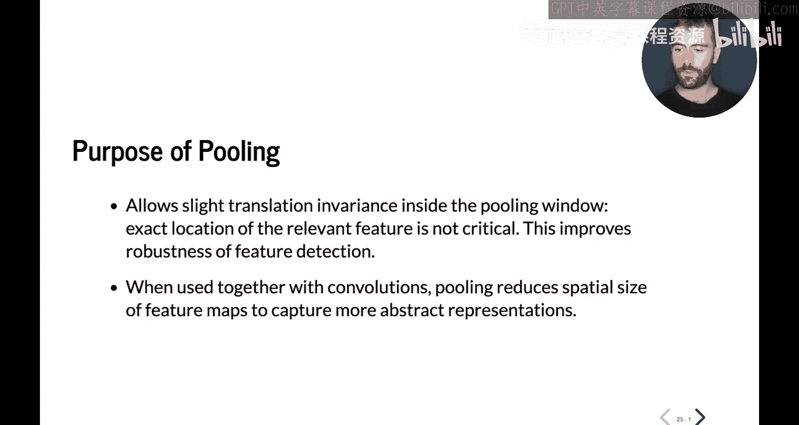