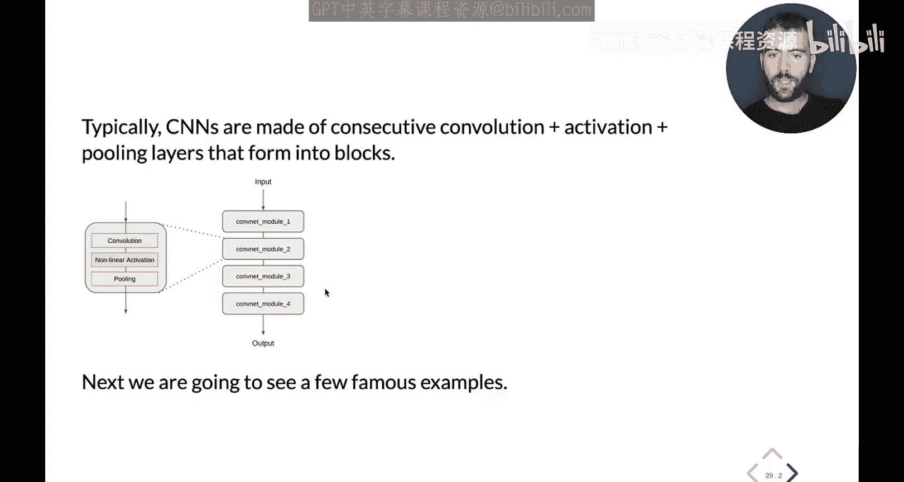
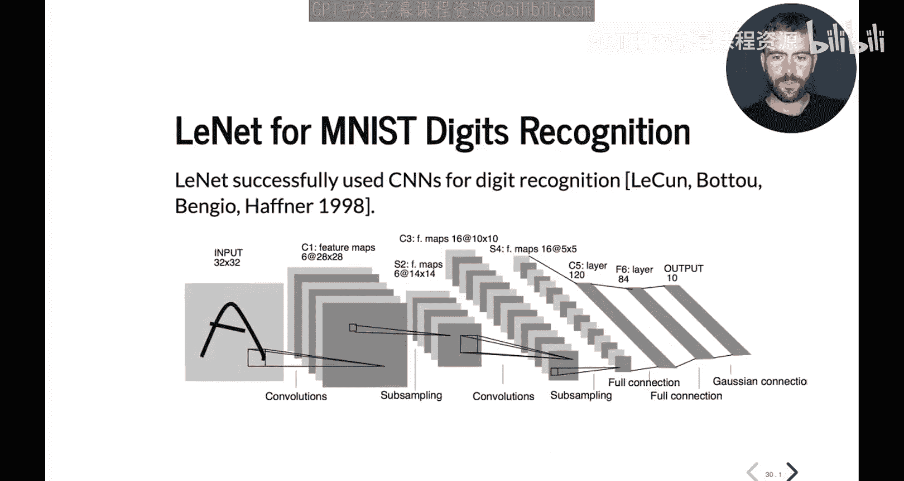
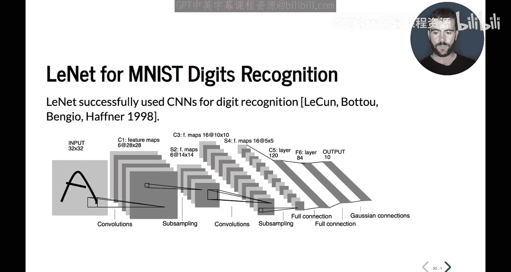
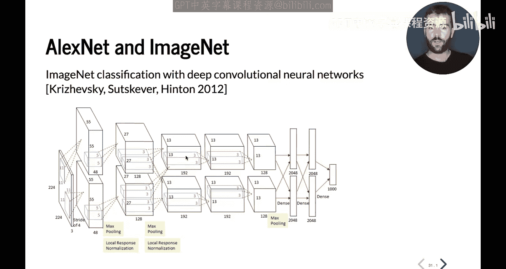
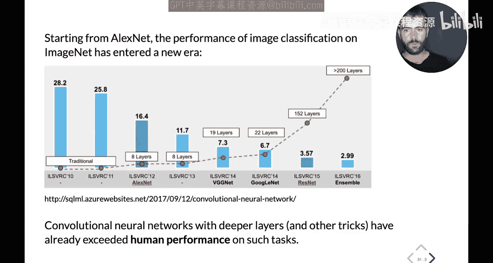
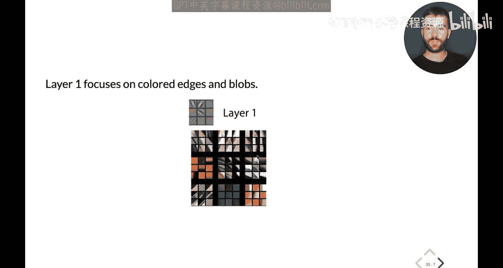
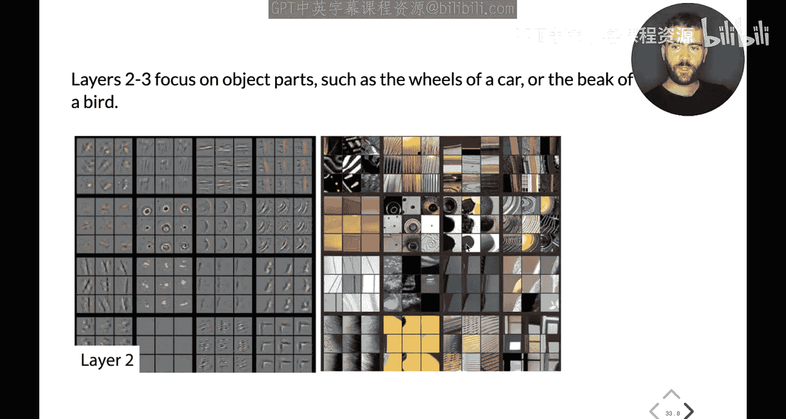
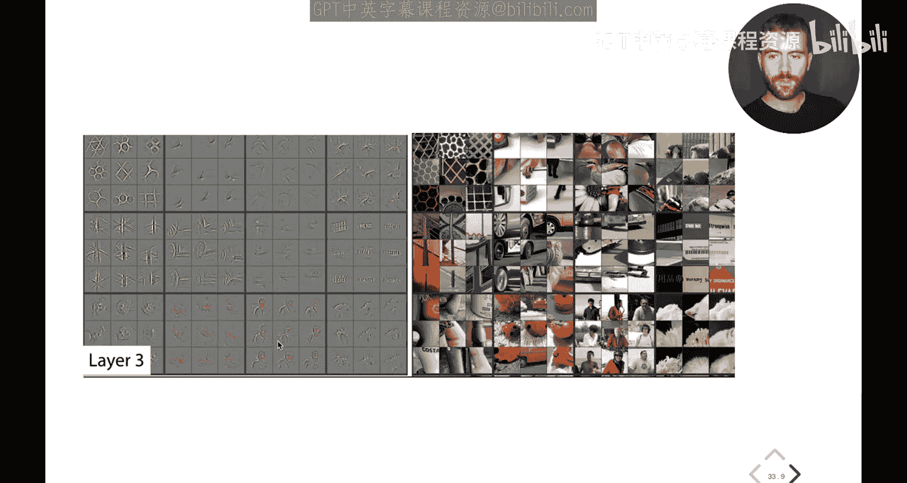
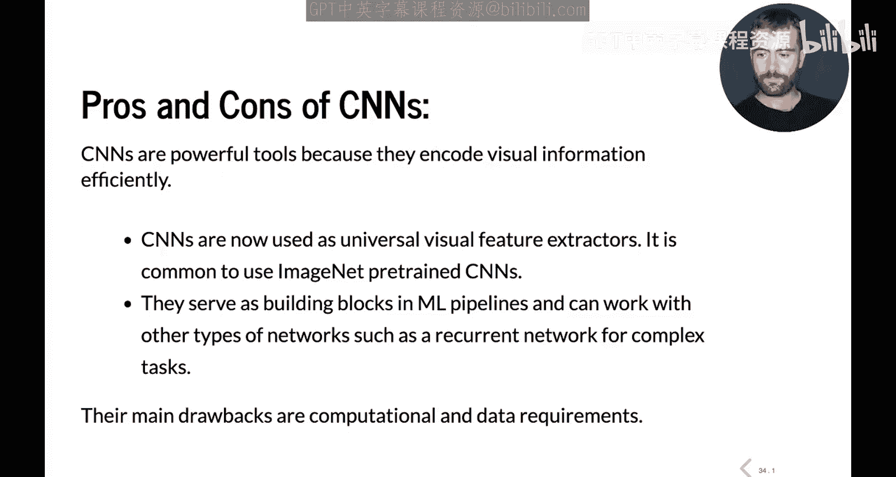

# 康奈尔大学《应用机器学习 CS 5787_ Applied Machine Learning 2020》中英字幕（deepseek p57 -57-Lecture 15. Part 3_ Convolutional Neural Networks.zh_en -BV12udzYvEFM_p57-

We are now at part 3 of Le 15 of applieded machine learning and now in this video。

 I would like to define an important deep learning model called the convolutional neural network。

 and this is going to use the two operations that we defined in the previous video which were convolutions and pooling。

So remember that convolutions are in operation that we can perform over a signal G。

 which is right here in blue， and we take a filter F which is in gray here and we apply it to this signal we essentially slide it over the image along all the axes and at each step we perform a dot product and the value of this dot product at each position forms this kind of2 by2 grid。

And this filter encodes some kind of pattern， and if we see the presence of this pattern in a particular location。

 then this activation map will have a higher value in some locations and a lower value in other locations。

And then another operations operation that we saw was called pooling， where we take a 2 by2 grid。

 this is typically the output of a convolution and then we break it down into parts and we take only the largest value of each part。

And what this means is that if we have the presence of a certain signal in this red image in this in this red area。

 it may not matter for downstream applications， whether it's in the。

It doesn't matter which one of these four pixels contains the useful feature as long as it's found in the top quadrant。

 that's all we need to know。 and so the pooling operation reduces the dimension and it only preserves the useful information and because the signal is because the pooled。

Aray is smaller， it easier to operate with， it's easier to perform data analysis with a smaller array。

 and that's the benefit of pooling。So a convolutional neural network is also a sequence of layers that combine these operations called convolution and pooling。

There are actually many kinds of structures that we could use for convolutional neural networks。

 but I'm going to define here the most。Simple one， but it's also one that's really powerful and that they can achieve good results in practice。

So。A con neural network is also a sequence of layers， but now these layers can be grouped in modules。

And each of these modules have the following structure， they contain a convolution layer。

 which is followed by a nonlinear activation。 This can be a sigmoid or re re means rectified linear unit we mentioned this we mentioned this type of activation in our first lecture on neural networks and then there is a pooling layer which can downs sampleample the size of this input and often at the very output。

 we also have a dense layer， which which I haven't mentioned here， which I haven't。Inluded it here。

 but we all often have a dense layer。So the definition of a convolutional neurallet is really simple again it's simply a composition of the operations that we saw earlier and of course the parameters of these operations well here the pooling doesn't have any parameters the activation doesn't have parameters that are all in the convolutional layers and the parameters of the convolutional layers are the filters so the neural network will learn which filters are important and also when I say a convolutional layer this actually contains a number of convolution so it's not just one convolution it's many filters that are applied to the same input and those form a stack of activation maps as we saw in the earlier videos。

So this is a vanilla structure of the neural net。And even small modifications of this architecture can achieve really good results。

One of the earlier and very famous examples of convolutionional neural networks is this model for digit recognition。

 which was created by Laku atal， it goes back to 1998。

 and this was an early success of convolutionional neural networks。

 this worked very well for digit recognition。The input is。A grayscale image of a digit。

 so here in this example it's a letter， but it could be a letter。

 but it was also very effective on digits。And then the way this neural network works is that we take this image。

 we apply a number of convolutions here， we have six convolutions of a particular size。

 the output are feature， so I would imagine these would be4 by4。

 but I guess it's not technically specified here， but these would be convolutions of a certain size。

 again， my guess is 4 by4。And， and then the output is。Is a， is a。

Is a number of stack activation maps。 Then these get fed into another convolution that gives us a smaller stack of activation but that and it's the same depth。

 Then we have even more even more and then these get smaller。

 and when we say subsampling here this just means pooling。 So these gets pooled into。Sorry。

 so these 28 by 28， we apply pooling with a region that's 2 by 2。

 this down samples size of the neural the size of these activation maps by 2 along each dimension so now we have 14 by 14 then we apply another convolution now we have a set of 10 by 10 maps。

And finally， we。We have。Now。Here we can perform downsampling by a factor2。

 and then in the end we apply a number of dense layers。

 so we just look at all of these as a big set of neurons。

 we perform we feed all of them as input to a dense neural network layer which we saw in the previous lecture have another layer and then another layer and this one is the output layer and it outputs probabilities over 10 possible digits。

So this is an example of a structure of a real world neural network。

 and this achieved state of the art performance， and in fact， it achieved。

Performance that is good enough for。Practical uses like sorting mail on on a data set of handwritten digits。

嗯。Another famous example is the Alexnet from 2012 by Krzevsquiro。

And this again has a really similar structure we start with an image now in this case we have three channels so this is a colored image that's of dimension 224 by 224 notice that this is much larger than what we had before and then we apply convolutions of dimension 11 by 11 on this data set and we have tensors so we apply two sets of convolutions。

 the reason there's two is the reason that you have two of each of them is because this was actually implemented over two graphical processing units and they ran both of these in parallel so this is a bit of a technicality but the idea is that we apply 48 feature maps。

 we apply 48 filters which gives us 48 activation maps and now we have this image 224 by 124。

The way this is done， it gives us an activation map that's 55 by 55 then it gets。

After applying max pooling， we narrow down to 27 by 27。 then we perform。More more operations。

 more convolutions， we have128 activation maps then it keeps increasing and then at the end we feed this to a dense neural network and the output is a 1000 dimensional output layer because we actually have 1000 different classes that we can predict。

And again， this is a structure of how a con neural network can look like。And by the way。

 between each box here， we have a nonlinear activation。So this was actually a very successful model。

In 2012， it significantly outperformed the previous state of the art on a competition called IageNe。

 essentially for years， the accuracy was around 25， 28， 30%。

 and then in one year it almost reached the performance by half。

 then the next year it also dramatically went down。

By using these convolutional architectures in a few years， the accuracy went down。

 so in this space of three years， the accuracy went down from 25% to 3。5% or 3。6% and this was。

An incredible achievement in the field of image recognition。

 and it demonstrated that convolutional neural networks are an immensely powerful model。

 and it has led to conal neural networks being used。Almost everywhere in computer vision。

 especially for tasks like image recognition and also a lot of other related tasks like tasks like detection or。

Other forms of image analysis。So here I will just define this algorithm as a little bit more formally。

 again it a form of supervised learning can be used for regression， inification。

 and along other dimensions it really behaves like a neural network。Now。

 before convolutional neural networks existed。Computer vision algorithms used to work with handcrafted features for images。

 I mentioned earlier it's really hard to create these features。

 and in years of research went into defining specialized features for images。

One popular image feature was called Sift， which stands for a scale andvari feature transform。

I will not go into the details of this， another one was called Hog。

 which stands for histogram of Oriented gradient， so it would essentially look at the way the image is varying here and if we were to visualize it it looks a lot like the edges that we。

That we saw in some of our earlier examples。嗯。And by using convolutional neural networks。

We can extract these features like theft the sift and hogs features。

 We can extract the equivalent of these features from data in a purely data driven way。

So to give you a better understanding of what I mean by that。

I'm going to show you an example from a paper by Zeyler and Fergus from 2013。

 which was one of the earlier papers to visualize the internal of a successful and powerful convolutional neural network model。

So here we have a model which is a sequence of convolutional layers。

 and we can visualize what each layer does by finding batches of the image。

 so subsets of images that have really high activation responses。

And we can also visualize the filters themselves using certain techniques。

 So if we look at the first layer of a convolutional neural networks and if we visualize what each filter does。

These filters tend to detect certain simple structures in the data like edges and blobs。

If we were to visualize these filters， they would look like this。

 so this is a little filter that outputs a high value if it detects an edge along this angle and this one has a high value if it detects this kinds of edges and this is a blob。

 it's a transition between these two colors。So these are different。These are different edges。

 And you can see that this one is activated the most by this set of images。

 which have these kind of diagonal lines from top left to bottom right。

 And then this green one gets activated by these kinds of green patterns。

 This one it gets activated when by these kinds of smooth gradients。

 So this is what is learned at the。

Bottom layer， it learns to detect simple geometrical shapes。

Then as we go progressively higher in the neural network， the neurons at the higher layer。

 they fire when certain。嗯。They again fire when activated by certain patterns。

 but these patterns become increasingly complex。So it may now look for particular you know circles like this one。

 these are still edges， these are curved shapes， these are other kinds of curves and so these are activated by。

Patches， which look like this。And now these start to look like objects like perhaps the wheels of a car。

Maybe this could be the texture of some animal these are now。

Higher level textures that start to become a little bit more useful。

And now if we visualize this even further at higher layers， we start to have more useful texture。

 we start to have more interesting textures here here。

 we even start to have the outline of a person that is so essentially what this means is that this neuron。

There's one neuron that is triggered and it fires when we have a particular shape that has when we have a particular input with this kind of form。

And then as we go higher， we start to recognize more complex patterns like here we have the snout of a dog。

Here we have something which looks like an eye， and it's triggered by these images that have eyes。

 So this is， again， an example of how convolutional neural network learns。

Complex features from data and it structures them in hierarchical representations。

 which are really powerful and which lead to really competitive and accurate performance on a lot of real world data sets。

So this summarizes my description of the convolutional neural network and again I want to emphasize that these are really useful models because they're well in themselves they are really powerful and they also have a lot of useful features for example they also have a lot of other useful properties。

 for example we can often train large convolutional neural networks and then we can use some of these。

Neurons， some of their outputs as features for other applications。 So， for example。

 we run the neural network。 We see the outputs of these kinds of neurons that are that are triggered on。

You know on these kinds of images and now we have a dog detector and if we have another application which is to detect breeds of dogs or to detect pedestrians or not pedestrians or if we have another different data set from the one on which this one was trained。

We can transfer these features to other data sets。So we can take a pretrain scanNN on a large data set and we can find unit on a smaller data set。

 and we can have really high performance on that small data set even though。The data side is small。

And also conutional neural networks can be used as building blocks and more complicated algorithms。

 for example， the earlier algorithm that I showed you in the first video that did image captioning。

 it used a conal neural network to initially parse the image。

And there are many other tasks on which con neural networks are effective。

 and this is why it's such a powerful model。

