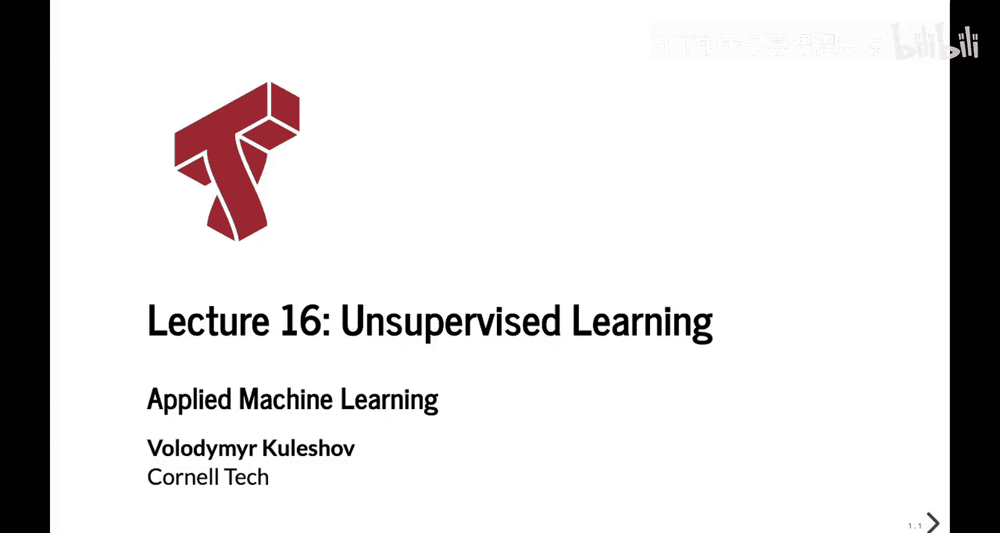
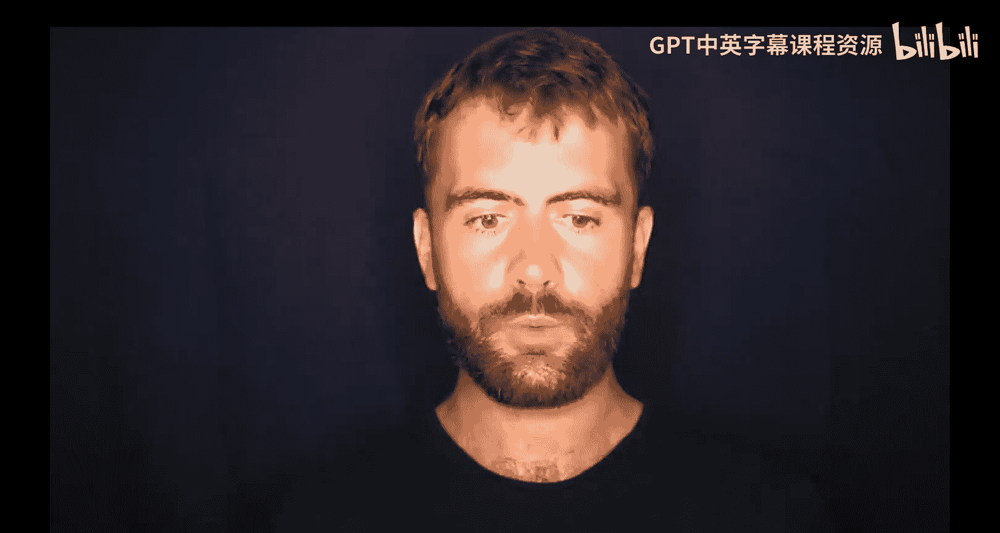
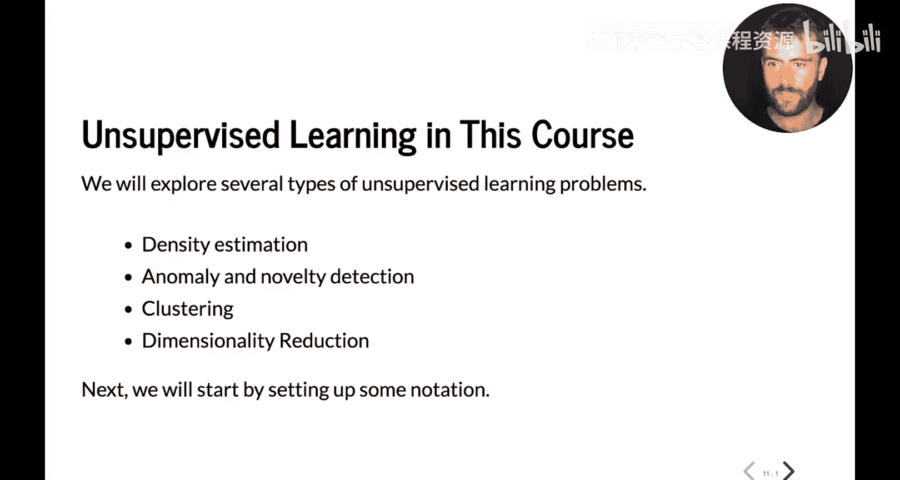

# 康奈尔大学《应用机器学习 CS 5787_ Applied Machine Learning 2020》中英字幕（deepseek p58 -58-Lecture 16. Part 1_ Introduction to Unsupervised Learning.zh_en -BV12udzYvEFM_p58-

Welcome to Lecture 16 of Applied Maine Learning。In lecture 16。

 we are going to start a new topic for this course。

 which is going to be the topic of unsupervised learning。

Unsupervised learning is a type of machine learning that is going to be very different from all the kinds of supervised learning algorithms that we have seen so far。

 and this lecture will be a broad introduction to the topic of unsupervised learning。So to begin。

 I would like to give you a brief high level overview of what unsupervised learning is。

 and I would like to start with a simple example that will introduce unsupervised learning data and an unsupervised learning algorithm。

So first， at a high level， unsupervised learning is different from supervised learning because it does not involve any labeled examples。

In unsupervised learning， we provide the algorithm with large amounts of unlabeled data。

 and then we ask the algorithm to。Discover by itself various kinds of interesting structure in the data。

These kinds of structures can involve clusters that are hidden in the data。

 and I'm going to give you an example of this shortly。It can also mean outliers。

 so points that look unusual or different from the points that we have seen so far or that don't seem to come from the data distribution。

And it can also involve interesting， useful signal that is structurally very different from a normal signal or from noise。

 for example， human speech that's hidden within noise that is a useful。

 interesting signal that we could try to recover in a fully unsupervised way。Now， again。

 at a very high level， the components of an unsupervised learning problem are very similar to that of supervised learning。

We always need to start with a data set， and I will define shortly what a data here is。

 but we do have to start with a data set。And then we apply an unsupervised learning algorithm to this data to obtain a model。

 which is going to be， I'm going to call this an unsupervised model to distinguish it from the kinds of predictive models that we have seen earlier in supervised learning。

 but again， it is a model that describes and that reveals something interesting about the structure of the data。

 and we are going to see many examples of such model in this course and in this lecture as well。

So to make this a little bit concrete， start by let's look at an example of a data and an algorithm。

And see the kinds of results that they would give us。So for our unsupervised learning dataset。

 we are going to use the IIS Flower data， which we have already seen several times in the supervised learning part of the course。

Here I'm going to load this data set using psychicL and again you should remember that this is a data set containing measurements for 150 flowers and if each of them we have four measurements of the flower in centimeters。

And this data set actually contains flowers from three different species which are given here。

 but for the purposes of this example， we will for now discard the labels。And here I can visualize。

 again using psycheic learn these flowers into dimensions so I two I can take two of their attributes。

 the Sepal length and the sepel width， and I can visualize these flowers into dimensions。

And what's important to note here is unlike in the earlier examples where we did this visualization。

 we now don't have any labels， all the points are considered equal here。

So because we don't have any labels， this is a good example of an unsupervised learning data set。

 it only contains measurements， but we don't know what they are。

 we don't know anything about the real structure of the data that was taken using that was measured separately。

So this was an example of a data set， let's now look at an example of an unsupervised learning algorithm。

And as a first example， I will introduce a popular， a very。

 very important and popular unsupervised learning algorithm called K means。

So this algorithm is called K means because it will try to identify k clusters in the data where k is a value that we're going to choose。

And the way K means identifies these clusters is that it it searches and returns a centroid for each cluster。

 which is essentially the center or the mean of that cluster。

 is going to be a point in our two dimensional space。And。Depending on which centroids we find。

 we may discover interesting structure in this data。Let's look at an example。

So first here I'm going to load the K means algorithm。

 this is the first time that we're running an unsupervised learning algorithm。

 but you can see that the structure here is really similar， we import the algorithm froms learnn。

 we instantiate it， and we're going to set the parameter K to three。

 we're going to ask it for to find three clusters in the data。

And I'm going to fit this to the data and again I will use the first two features。

 so here this is my data set of Xs and I fit the model on this data and as you can see this is an unsupervised learning algorithm because I only fit this on the X data set on the inputs but there are no labels that come in here anywhere in this process。

And now if I visual if I if I so I have fit the key means on this data set and now I can。

Look at the clusters that it has found。Again， this is really easy to do in Python。

 I have these cluster centers attribute within the model that I have learned。

 and here I'm visualizing these centroids using these red diamonds。

And you can see that the red diamonds happen to fall in these three areas here， this set of points。

 even just looking at it visually， we see that this looks to us like。

Like like a separate cluster it's clear there's a clear separation with the rest of the points and then Kmins also tells us that the best location for the other two clusters is approximately here and here。

 these are the centers of the two clusters of the two other clusters that it has found。And。

What is really interesting is that now if we visualize this。

 if we then go back and now we apply our labels to this data set。

We have the following labeled examples， so now I came back to the original data set that had actual labels for these flowers and I've applied these labels to this plot where each type of flower is now denoted by a separate color。

And I can see that the algorithm has found in a completely unsupervised way。

 so without using any labels it has found that this cluster here corresponds to the iristosa cluster and then it also correctly placed these two red diamonds in the middle of these two clusters and even though they look very similar to each other。

 without knowing the label it is hard to say that there are actually two distinct types of flowers and that one of them tends to be here more on the left and the other one tends to be more on the right。

 we don't see this at all without the labels， but unsupervised Kine has found the structure automatically without ever having access to the labels and we can confirm that this is the correct structure of the data by now evaluating it using these labels that were hidden at training time。

So this is a really interesting feature of Ks and it just shows how interesting and useful unsupervised learning can be。

And more broadly， unsupervised learning has many interesting and important applications。

It is often used for visualization， for example， we may want to discover a low dimensional if we have high dimensional data。

 we may want to project it in two dimensions along some kind of useful set of axes and so we want to find the most useful dimensions along which to project our data。

 this is a kind of unsupervised learning problem or even in the early example just visualizing these clusters is something that can be helpful。

 another interesting application is anomaly detection for example。

 if after training K means we saw a new flower which didn't seem to belong to any of our clusters。

That could tell us that this is a flower from a fourth species that we have not seen before。

Or in a more applied setting， we could use this for what is called predictive maintenance in the context of operating a factory and if we see some instruments that are behaving in a way that's different from what we expect。

 then we can identify them as being likely to break。

And then signal denoing is another application to which I have alluded， for example。

 if we have human speech that's mixed with white noise。

 unsupervised learning methods can effectively extract this speech。

And they can recover the true signal effectively。Here I have a few more short examples of what unsupervised learning can do this is another I guess this is a combination of clustering and dimensionality reduction what you see here is an application of unsupervised learning to the MNIS digit data set so here each point in this 2 d dimension corresponds to a number and originally each of these numbers is 74 so it's a 28 by 28 grid of pixels or in other words it's a 784 dimensional vector。

And we can apply unsupervised learning to project this twodial space into to project this 784 dimensional space into an informative two- dimensionsal space。

 which looks like what you see here and now we can go back and we can color these points according to their digit。

 and we see that again in a completely unsupervised way。

 this algorithm has determined that here the twos are clustered together in this part of the two dimensional space the sixes are here and it has even identified more precise structure within this data。

 for example， here it has discovered that twos are actually written in two different ways there is this kind of two where there's like this little loop here near the tail。

 or other kinds of twos look like look like the letters that without the loop。

On their tail and has separated these two as distinctda clusters and similarly here the sixes some of these sixes are tilted along one diagonal。

 these ones are tilted along the other diagonal we also have two types of ones these ones these ones are straight this is a set of one that is written in a diagonal and this is not something that we could have known even with having the labels but using unsupervised learning we have discovered this just by searching for a space that contain that the algorithm thought contain useful signal and this is what we have discovered this is an example of both clustering。

 dimensionality reduction and visualization and I think it's a really interesting example。

Another really interesting and similar example is。I in context shown here in the context of DNA analysis。

So imagine that instead of applying the earlier operation to digits， we apply it to DNA sequences。

 so now each of our x's instead of being a 784 dimensional image it's a。

It it's a genomic sequence which can contain hundreds of thousands to millions of measurements。

 so it's a very long sequence， but we apply the same kind of transformation。

 although this is actually a different algorithm from the one that was earlier。

 but it's still a dimensionality reduction procedure。

 and so we find an interesting two- dimensional space in which we want to represent this data。

So we project oh， and each genomic sequence corresponds to a person and we know the ancestry of this person。

So now I have projected all of this data into two dimensional space and again。

 I can go back and I can I can plot the。I can add with colors the true known ancestries of these individuals on this two dimensional axis。

And what I see here， and this is really fascinating， it looks exactly like the map of Europe。

If you notice here， all so here these points， they have a label ES。

 these are individuals of Spanish descent here in this cluster。

 I have individuals so here I have great Britain and I。e。

 is Ireland so I have Irish and British in the northwest corner in the east corner， there's Russians。

 Ukrainians， Lithuanians or Latvianians Finnish and Norweg in the north。

 in the very south we have Italy， we have Turkey here that's in a corner by itself in the southeast and it's a little bit separated from the other points have Greece here in blue。

 so essentially without knowing anything about geography only by looking at the unsupervised structure of genetic sequences。

 this algorithm has reconstructed the geographical map of Europe。

 so this is really fascinating and of course it makes sense because individuals。

Of similar ethnicities are the individuals of the same ethnicities are more similar to each other than to individuals of other ethnicities。

 so they naturally form a cluster， and similarly individuals that are from southern Europe are more similar to individuals from Northern Europe this is purely from their genes and because they would tend to have kids with individuals that are closer to them geographically。

And so if we project this in this two dimensional graph。

 we recover the geographical structure of Europe， which is another fascinating application。

And finally， the last interesting application when supervised learning that I want to show here is in the context of human faces。

 this is a result in deep learning from a few years ago。This is an algorithm。

 this is an algorithm that has looked at a large set of human faces and it has identified。

It has learned to map these faces into a low dimensional space and now we can perform arithmetic within that low dimensional space。

 so for example we start with an image of a smiling woman。

 we project it into this space think of it as one of these two dimensional spaces that I showed you earlier so we project it there and now we take a neutral woman。

 we again project it and then we take these two representations。

 these two low dimensional representation and we subtract the smile we subtract a neutral woman from a smiling woman and we obtain we do that then we add the vector for a neutral man。

And then we can generate images， so this is actually a generative model。

 a generative un supervised learning model that can generate images。

And that gives us the image of a smiling man， so in other words。

 again without knowing anything about human faces， only looking at data。

 this model learned has learned representations for the data which allow us to do these interesting arithmetic operation such as smiling woman。

 minus neutral woman plus neutral man， gives us a smiling man。

So these are a few examples of what unsupervised earn can do。

 we will focus on a number of applications in the following few lectures。

 we will talk about dimensionality reduction clustering anomaly detection density estimation and in the next video I will start to define these I will start define unsupervised burning a bit more formally and introduce some notation。

