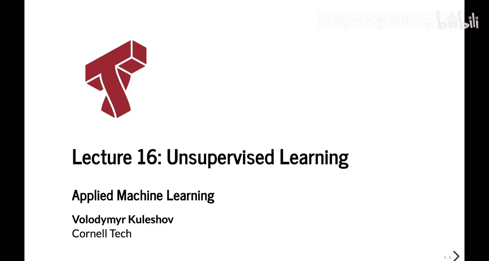
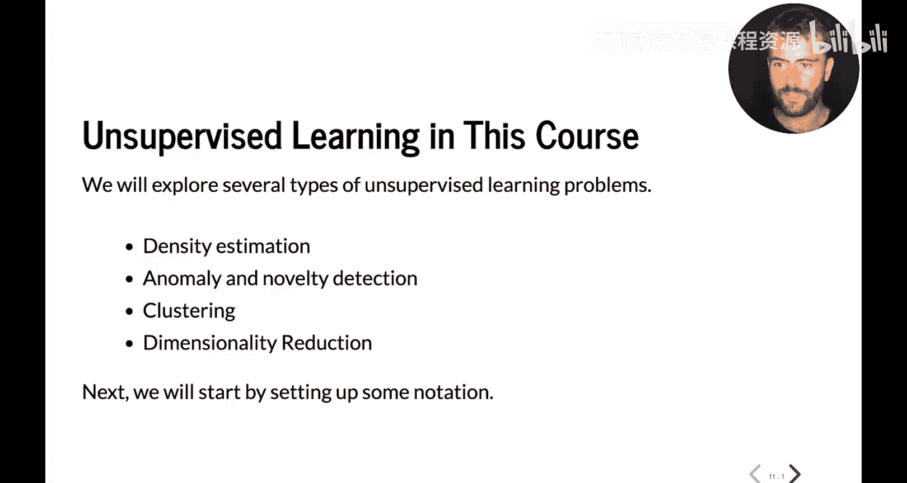

# 应用机器学习：第16讲：无监督学习简介 🧠




在本节课中，我们将开始学习一个全新的主题——无监督学习。我们将了解它与之前学过的监督学习有何不同，并通过具体例子和算法来探索其核心概念与应用。

## 概述

无监督学习是一种与监督学习截然不同的机器学习类型。在监督学习中，我们使用带有标签的数据进行训练，而无监督学习则只使用未标记的数据。算法的目标是自行发现数据中隐藏的有趣结构，例如聚类、异常点或有用的信号。

## 无监督学习简介

上一节我们概述了无监督学习的基本概念。本节中，我们将通过一个具体的数据集和算法来深入了解。

### 数据集示例：鸢尾花数据集

我们使用熟悉的鸢尾花数据集作为示例。该数据集包含150朵花的四个测量值（单位：厘米），并对应三个不同的物种。为了进行无监督学习，我们将暂时忽略这些标签。

在Python中，我们可以使用`scikit-learn`加载并可视化数据。例如，我们选择花萼长度和花萼宽度这两个特征，在二维平面上绘制所有数据点。由于没有标签，所有点都被视为同等，这正是一个典型的无监督学习数据集。

### 算法示例：K均值聚类

接下来，我们介绍一个非常重要且流行的无监督学习算法——K均值聚类。

该算法被称为K均值，因为它试图在数据中找到K个聚类，其中K是我们需要预先设定的值。算法通过搜索并返回每个聚类的**质心**（即该聚类中所有点的中心或均值点）来识别这些聚类。

以下是使用`scikit-learn`运行K均值算法的基本代码：

```python
from sklearn.cluster import KMeans
# 实例化模型，设定寻找3个聚类
kmeans = KMeans(n_clusters=3)
# 仅使用特征数据（无标签）进行拟合
kmeans.fit(X)
# 获取找到的聚类中心
centroids = kmeans.cluster_centers_
```

当我们对鸢尾花数据的前两个特征运行K均值（设K=3）后，算法找到了三个质心。将这些质心（在图中用红色菱形表示）绘制在数据散点图上，可以发现它们大致落在了三个不同的区域。

有趣的是，如果我们事后将真实的物种标签重新标注到数据点上，会发现K均值在完全不知道标签的情况下，成功地将三个物种大致区分开来。这展示了无监督学习自动发现数据内在结构的能力。

## 无监督学习的应用

上一节我们通过K均值看到了无监督学习如何发现聚类。实际上，无监督学习的应用远不止于此。

以下是几个关键的应用领域：

*   **可视化与降维**：当数据维度很高时（例如784维的手写数字图像），我们可以使用无监督学习方法将其投影到二维或三维空间，以便于观察和理解数据的内在结构。
*   **异常检测**：在训练了聚类模型后，如果一个新数据点不属于任何已知聚类，它可能是一个异常点。这在工业预测性维护或欺诈检测中非常有用。
*   **信号去噪**：例如，可以从混合了白噪声的录音中，提取出清晰的人声信号。
*   **发现隐藏模式**：在基因序列分析中，无监督学习能够仅根据基因数据，重建出个体的地理 ancestry 分布图，其结构甚至与欧洲地图惊人相似。
*   **生成模型**：现代深度学习中的生成模型（如GANs、VAEs）是无监督学习的重要分支。它们可以学习数据分布，并生成新的数据样本，例如进行“微笑属性”的人脸图像算术运算。

## 总结



本节课中，我们一起学习了无监督学习的基础知识。我们了解到它与监督学习的核心区别在于不使用标签数据。通过鸢尾花数据集和K均值算法的实例，我们看到了无监督学习如何自动发现数据中的聚类结构。最后，我们探讨了无监督学习在可视化、异常检测、信号处理和生成模型等多个领域的强大应用。在接下来的课程中，我们将更深入地学习降维、聚类、密度估计等具体的无监督学习方法。