# 康奈尔大学《应用机器学习 CS 5787_ Applied Machine Learning 2020》中英字幕（deepseek p59 -59-Lecture 16. Part 2_ The Language of Unsupervised Learning.zh_en -BV12udzYvEFM_p59-

Hi， this is now part two of lecture 16 of applieded machine learning。In part two。

 we are now going to look a little bit more closely at the language of unsupervised learning and we're going to define terms that we're going to be using throughout the next few lectures more formally。

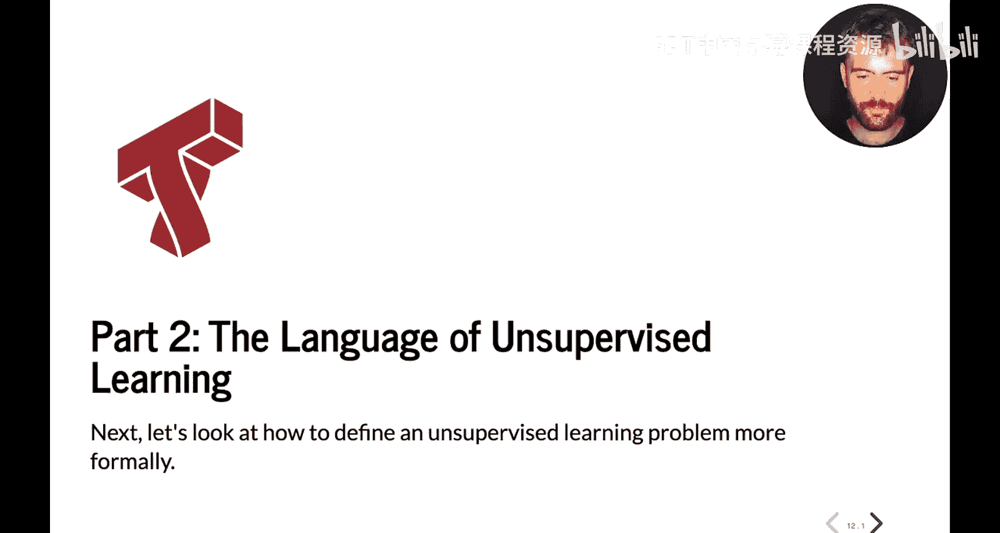

So to begin， I again want to revisit the components of an unsupervised learning problem。

As I mentioned earlier the structure is at a high level is similar to that of supervised learning。

 we have a data set and an algorithm， we run the algorithm on the data and the result is a model and unsupervised learning model。

That we can use to learn interesting structure in the data。And similarly to supervised learning。

 our data set will be here characterized by attributes。

And the learning algorithm will also consist of several components， it will consist of a model class。

 an objective that will rank whether a model class is a good fit to the data and an optimizer。

Whi will choose a model within the model class， optimizing the objective。

So this structure is really similar。

And let's now go through these different， or I should say this structure is similar at a high level。

 but the structure of the data and the particular choices of model。

 objective and optimizer are different in unsupervised learning。

 so we are going to look at these a little bit more closely and we're going to define what these terms mean in the context of unsupervised learning。

 and we will also do a short example。

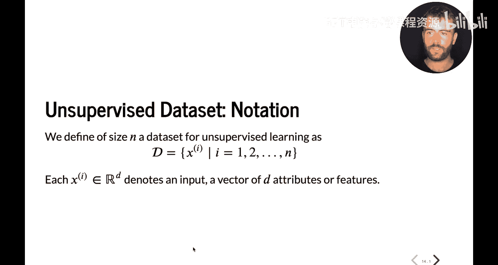

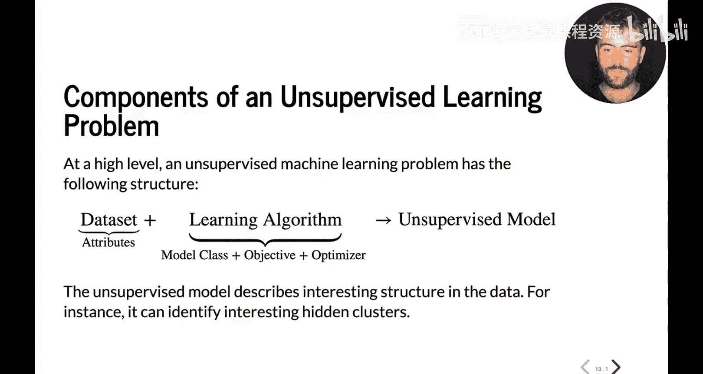

So first， let's start with the concept of a data set。

A data set in unsupervised learning is a collection of inputs where each input is a de dimensionsional vector of attributes or features。

This is really similar to unsupervised to supervised learning。

 except that we don't have the Y anymore， we only have the inputs X。

 and this matches our intuition for what we were the intuition that I laid out earlier saying that unsupervised learning is。

Is a form of supervised learning is what we get if you remove the labels from the data set。

 so here I actually remove the labels from this data set。

And similarly to supervised learning， we're going to assume that there is a data distribution that governs this data set。

We're going to assume that all our inputs are sampled from a probability distribution P。

 which we're going to call the data distribution， and we're going to denote this as follows。

So each label here in the earlier example we had a data set of flowers。

 so each flower is sampled from this probability distribution of all the possible flowers that we could have。

And crucially， these samples have to be。Well， in order for unsupervised learning algorithms to work well and also to have mathematical guarantees。

 this data， it should be independent and identically distributed and that's something that we normally assume。

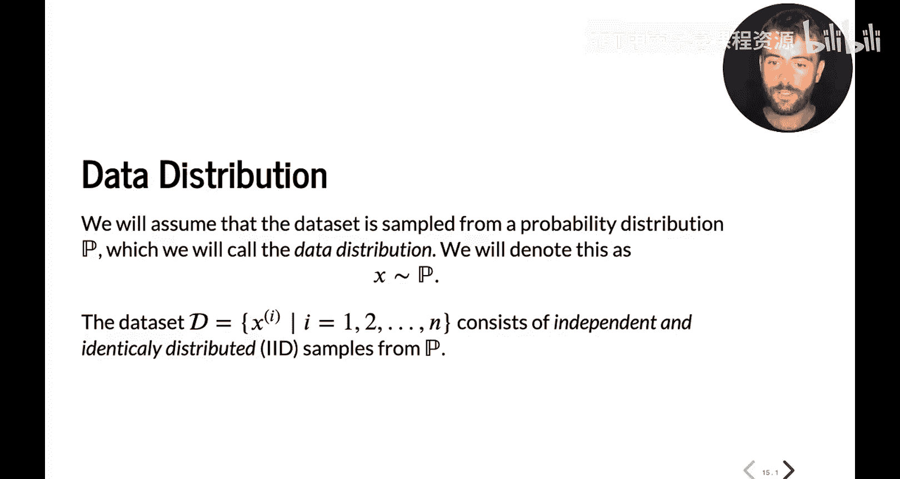

So let's just remember quickly what IAD means， so independent means that each training identically distributed means that each training example。

 each x comes from the same distribution， which is our data distribution and this distribution doesn't depend on the previous training examples。

 so。Each x is an independent sample from this distribution。So for example。

 if we were flipping a coin， then we have a sequence of independent and identically distributed samples。

 each coin flip is a IAD sample。An counter example would be yearly census data。

 if each point is the population of a city during given year。

 then it is clearly a value that we can model as being random because there are random events happening people are born and people die so in a way we can think of it as a random variable but it's clearly not independent because if the population has been high。

 the previous year， well in the next year the population will not drop to zero it will probably be somewhere in the range of the population of the previous year。

 so there are a lot of dependencies between consecutive values and this is an example of non-independent sequenceque of variables。

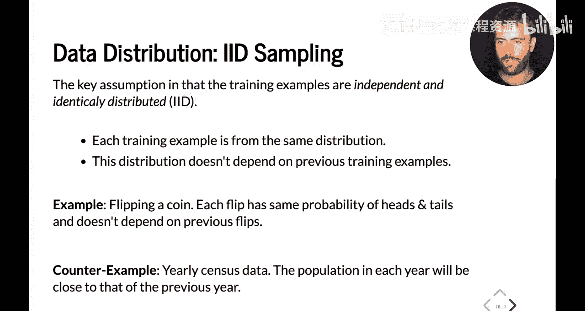

So。So far I defined what is a data set and we can also look at the components of an unsupervised learning algorithm which are at a high level the same components that that a supervised learning algorithm would have again we have a model class an objective and an optimizer。

This structure remains the same， but the particular choice of model class and objective is in the correspondinging optimizer。

 this is what's going to distinguish a supervised learning algorithm from an unsupervised learning algorithm。

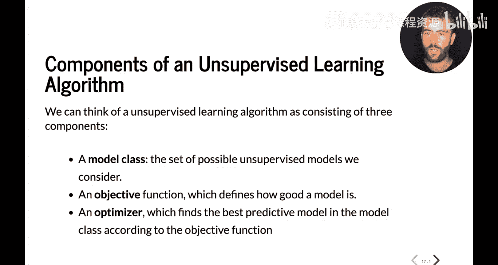

So let's define these a little bit more precisely。I'm going to or we will see as in supervised learning。

 we will see a non-probabilistic and a probabilistic definition of what as a model and I will start here with a nonprobabilistic definition。

 and this is not something that's standard in textbooks。

 but I think it's a mathematical definition that helps us better understand what word in supervised learning is and what it does。

So here I'm going to say that a model is a mapping that takes an input。

 and then it returns some interesting structural element。

 some interesting information about this structure。

And I'm going to assume that these definition of structures， they are within some set script S。

 and each element is a possible structure， or it's a piece of information about that structure。

This is really general and it can be defined in very。

 very different ways depending on the problem that we have。

 so for example the structure correspond to a particular cluster。

 maybe given an Xr model will tell us which cluster it belongs to or it can be a low dimensional representation it's going to find a good projection of X into a low dimensional data set or it's going to find some latent features on which we can do operations as as we did in our earlier deep learning example with the human faces so there are many definitions of what S can be and for now we'll just assume that there is some。

Some definition of structure that we can define for each problem that we're going to use。

And as in supervised learning， our models will often have parameters theta。

 so we can summarize them by a set of parameters and given a set of parameters the model will output certain values。

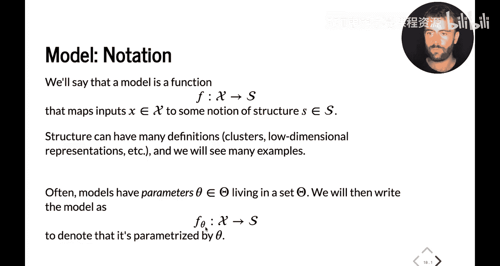

And then a model class is simply a subset of the set of possible models that we can return and set of all the possible structures。

It's a set and if our models are parameterized， then we then we can summarize this set by a set of parameters。

 so this can be， for example， theta can be some kind of factor of a particular length and the big theta is a set that has all the possible vectors of this length and now this defines a parametric model。

 and we can have both parametric and nonparametric model in a supervised learning。

 similarly to how we have that in supervised learning。

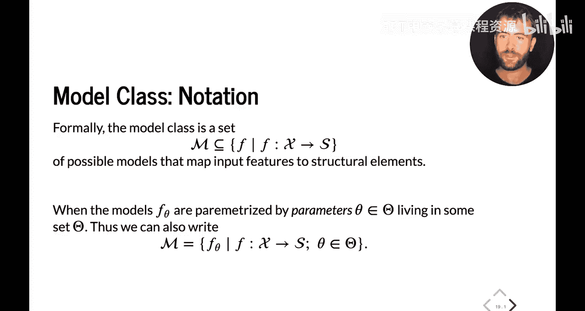

嗯。Now given a model class， we want to measure the extent to which a particular model fits the data well。

 and now we will have a different definition of fit。

 I'm going to give you an example shortly of what it can mean but still given a data we have to rank whether certain structures that are predicted by the model are consistent with the data or not and for that we're going to define an objective and we will optimize this objective in this most general form it can be defined over a function but in practice models are often parameterized by some parameters and so we can think of J as being an objective over the space of parameters that assign some value and we tend to minimize this objective which means that we are and therefore we often consider this as a loss function as well。

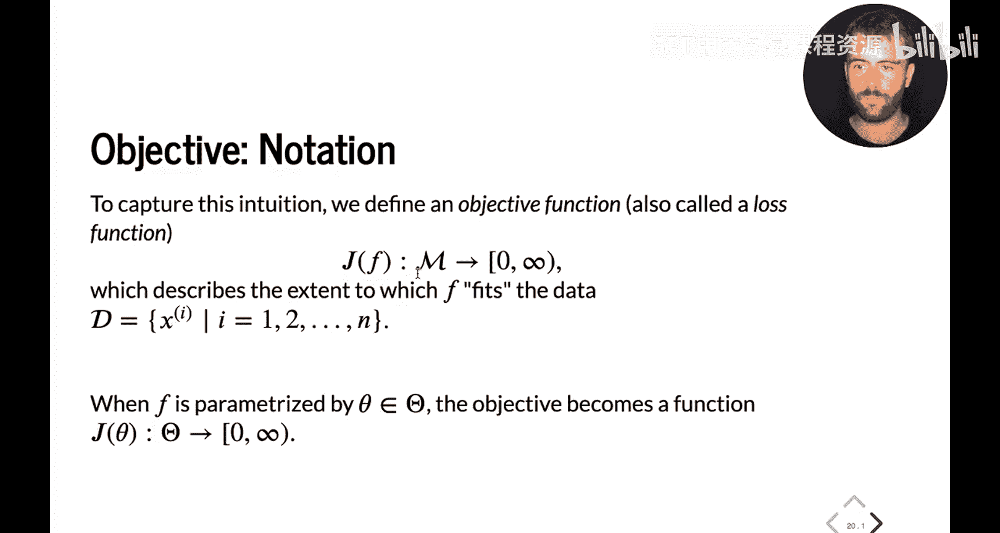

And of course， in order to do this， we will have to have an algorithm which is going to be an optimizer and this optimizer will find the function gives us the best fit and if we have parameters we can think of this model as optimizing the space of parameters。

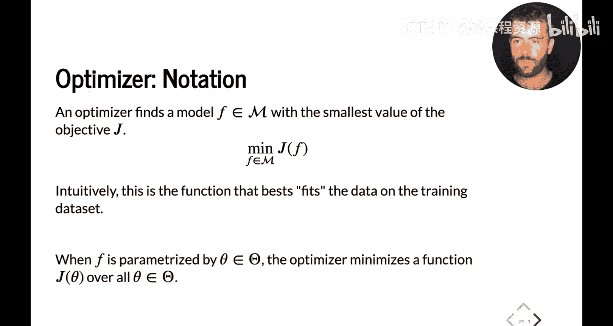

So this is a general definition and you can already see how it's different from supervised learning。

 but to make it even more concrete， let's look at an example。

 at let's look at the K means algorithm that we saw in the previous video and let's see how it fits within this framework for defining an unsupervised learning algorithm。

So recall that K means is an algorithm that tries to find k hidden clusters in the data where K is a parameter that we get to choose。

 so we ask it for a number of examples and then it tries to find them a number of clusters and then it tries to find them。

 and then each cluster can be represented by its mean or by what we call the centroid。

 the mean of the cluster， and each cluster is typically reveal interesting structure in the data。

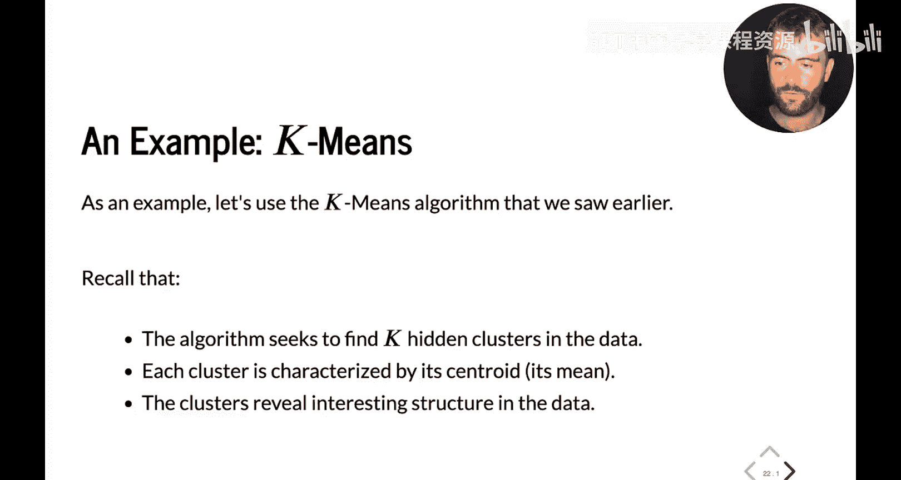

So。Let's define first Acha means's model， and as I said earlier。

 this is a function that takes an input and returns some interesting structural element。

And in the context of Ks we are doing clustering， therefore the interesting structure that we find are clusters in the data。

So we are going to have K possible clusters and K means we' map each point to its cluster。

And in order to define what the clusters are， the Ka means algorithm uses a set of centroids。

 so it defines the centers of each clusters and then the points that are closest to a particular centroid。

 they belong to that cluster so in other words we can completely parameterize the clustering with with a set of centroids and therefore in a ca means model。

 the centroids are effectively the parameters of the model that we get to choose and we get to place them within our set of features X within the set X。

 we get to place them there and then they define the clustering since each point belongs to the cluster of its closest centroid。

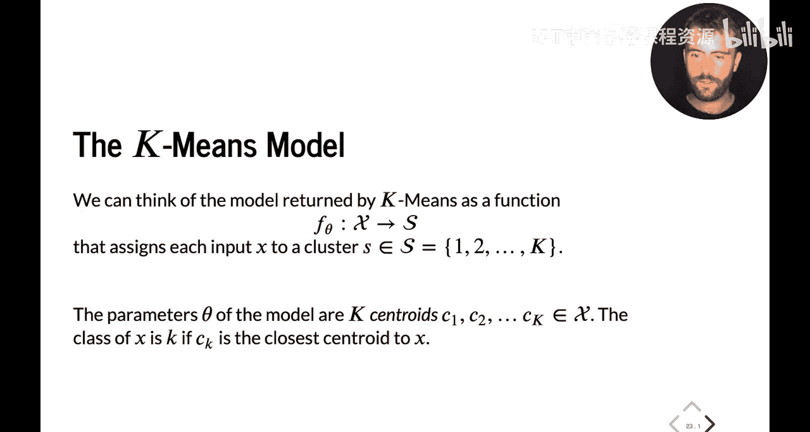

This defines a model， and now we have to determine how we are going to fit this model。

 how are we going to determine whether a particular clustering， a particular set of centroids。

 to define clusters， whether they are a good fit to the data。So how do we do this？One intuitive。

One intuitive definition is， well， if a centroid is a good centroid。

 then the points that are close to it， they must have a small distance to the centroid right so a centroid must be close to the points that belong to the cluster which which is a reasonable assumption if a point was far from a centroid。

 then it's not likely that it should be then it should probably not be part of a cluster it should be part of a different cluster so the distance from a centroid to its closest points is what we is a reasonable is a reasonable measure for whether this clustering is good and now we can use this as an objective function。

So what I wrote here， this is the sum over all the points， over all the points in our data set。

 and we are summing the distances from the point Xi to its closest centroid。So here I have Xi。

 I can compute the cluster to which Xi belongs to， this is the output of F of x。

And then I can retrieve the centroid， so if F of x says that this point belongs to cluster K。

 then I will retrieve the coordinates of the centroid and I will take the distance from so the norm of the difference which is a concept which is essentially the distance from Xi to CK。

 and that is the distance from the point to its closest centroid。And if we minimize this。

 then we're going to ostensibly find good centroids， a good clustering for this data。

So this is a sensible objective function， and this is essentially the objective function that is used within the K means algorithm。

The remaining question is how do we optimize this， how do we find a set of parameters， theta。

 or in other words， how do we find a good set of centroids for the clusters？

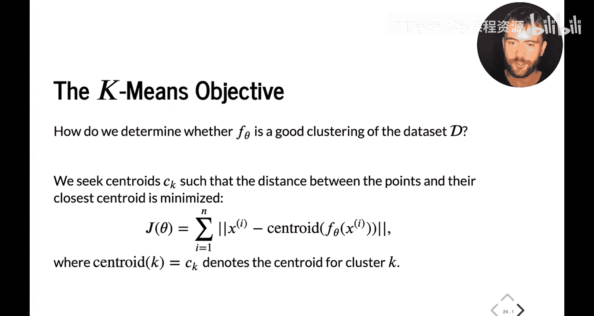

And that involves an algorithm that we're going to look at again in more detail in subsequent lectures。

 but essentially it's a two step process。We repeat the following two steps until convergence。

We start initially with a random cluster assignment， so we assign a point to a cluster randomly。

 of course there are in practice good heuristics for what random means。

 but I assume for now this is a completely random clustering。

 and then we just repeat the following two steps until convergence。First， given a clustering。

 we compute the centroids。So we take the set of points that belong to a particular cluster。

 and we compute the centroid as being the mean of that cluster。So we compute the centroid。

 and now we have a set of mucentroids and these define a new clustering。

 so therefore we update this function F such that Xi maps its to the cluster of its closest centroid。

And now this gives us a new clustering。We can recompute the centroids。

 there will be a different set of centroids now because our clustering has changed and then we again recompute the clustering for the newcentroids and we keep repeating this until conversions and after a number of steps this process will reach some minimum。

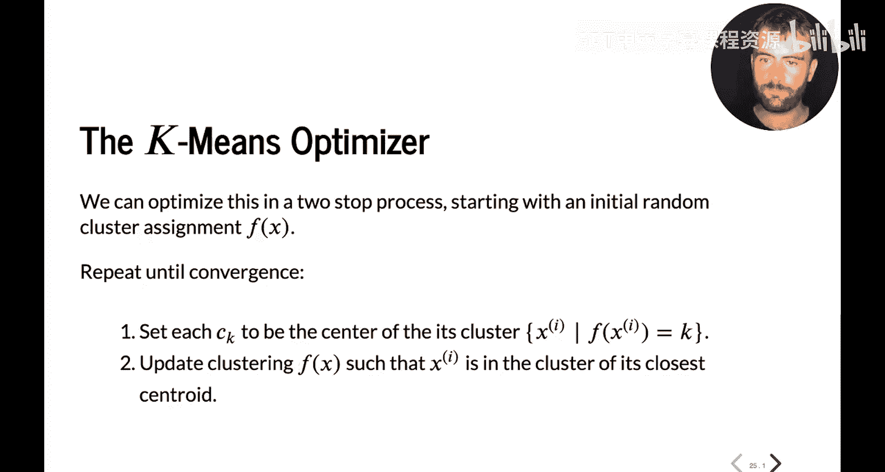

This is easiest to understand with an example and here we have an image that shows what K means would do here we have a data set of points the coloring of these points so and we're also going through multiple iterations so here we start zero1 to and then we perform iterations of k means the colors correspond to the clustering that we have identified at that iteration and those the lines here are the boundaries between the two clusters。

And we see the centroids here using as the following symbols。

 so here the red X is the center of the red centroid。

 the yellow x here is the centroid of the yellow cluster and here this blue circle that's the centroid of the blue of the blue cluster and initially they all start in some area but then over time we perform this iterative process where we so here they start in different places and now the yellow one keeps moving in this direction because the points are being assigned the points that are being assigned to this cluster are different after every iteration and so the centroid moves so basically at each step we recompute the set of points that are yellow and then we set this yellow centroid to the average of the yellow points and then after we have updated the yellow centroid we redo the coloring of the point。

And then we again make this yellow centroid to be their center， then we again recompute the coloring。

 then we again recompute the center and we keep doing this until we converge。

 and then we have something which looks like this。So this is the K means optimization algorithm。

 sometimes it's called also the expectation maximization algorithm but actually EM or expectation maximization is more general。

 but I've seen people refer to this as EM as well。

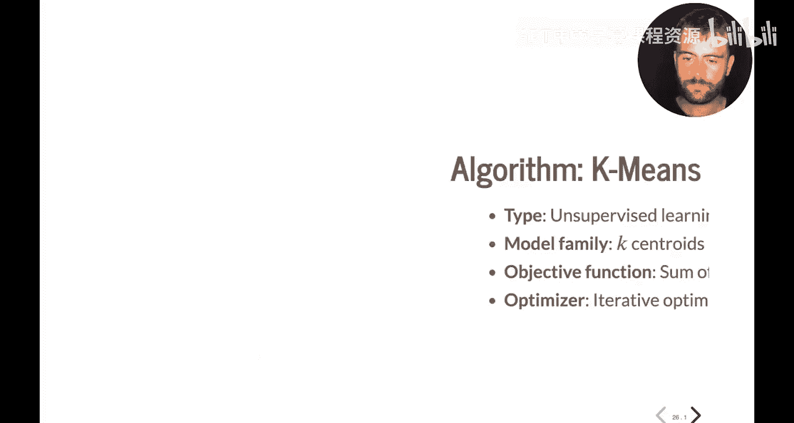

So here， just to summarize， we have defined our first unsupervised algorithm， which is K means。

 which performs a form of clustering by searching over the space of case centroids that explain the data and its objective function is the sum of the distances to the closest centroid at each point and it's optimized using this alternating optimization procedure。

And we're going to see many more clustering algorithms。

 but this is a first example and hopefully it makes some of these ideas more concrete。

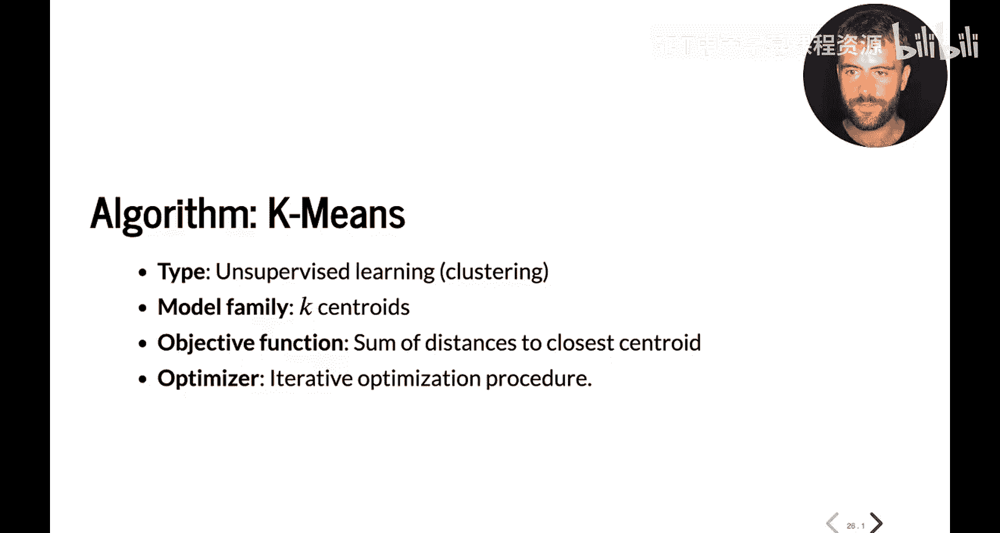